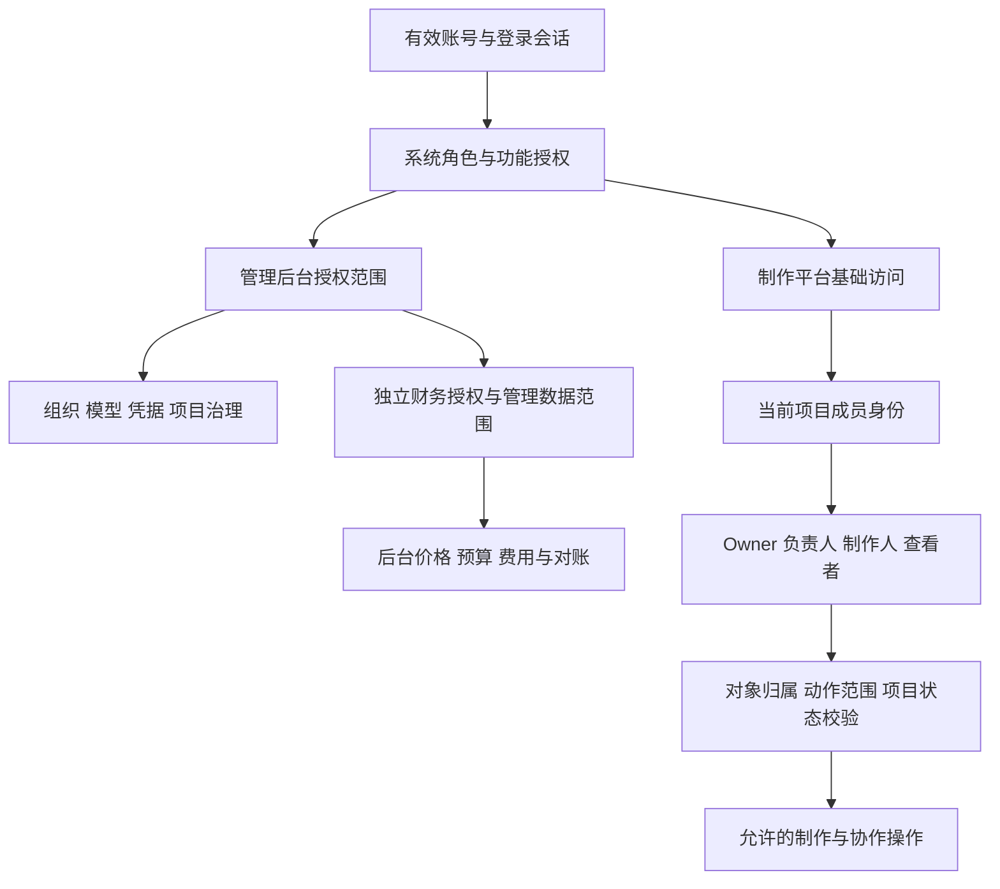
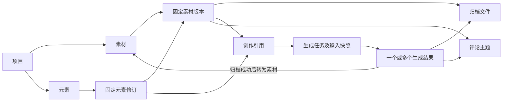
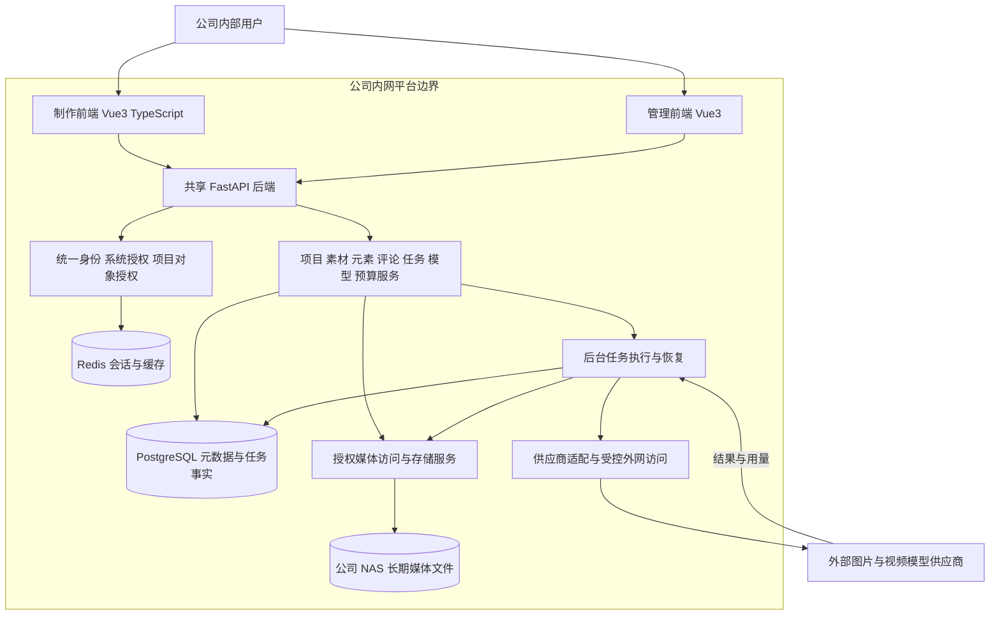
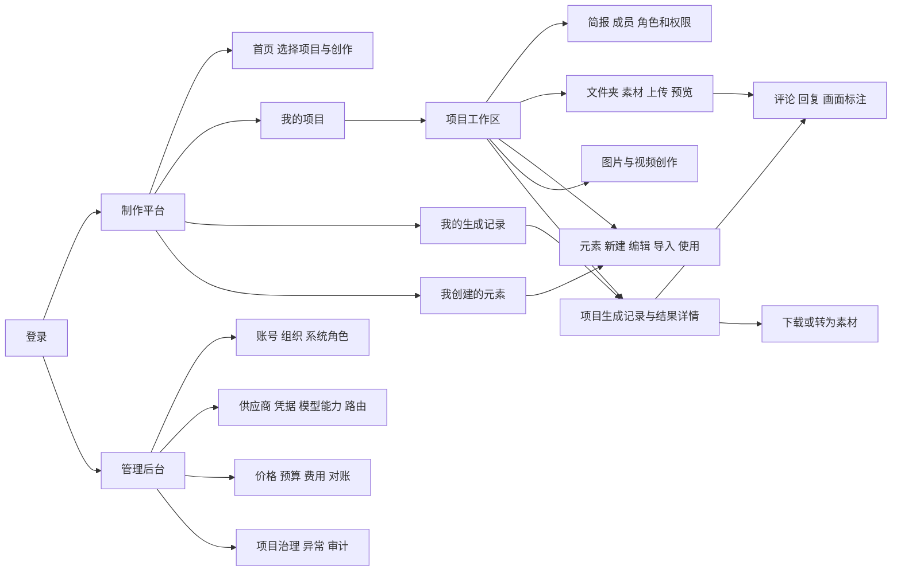
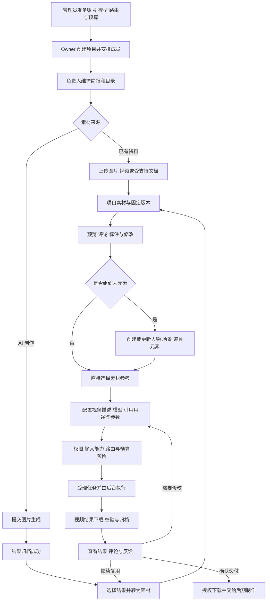
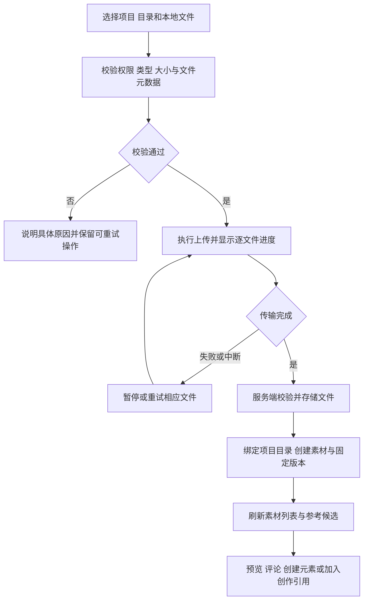
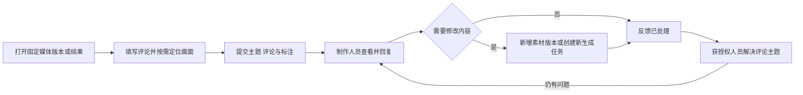
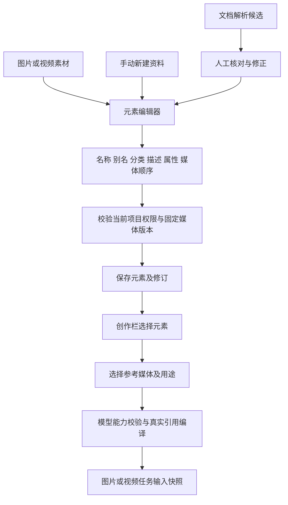
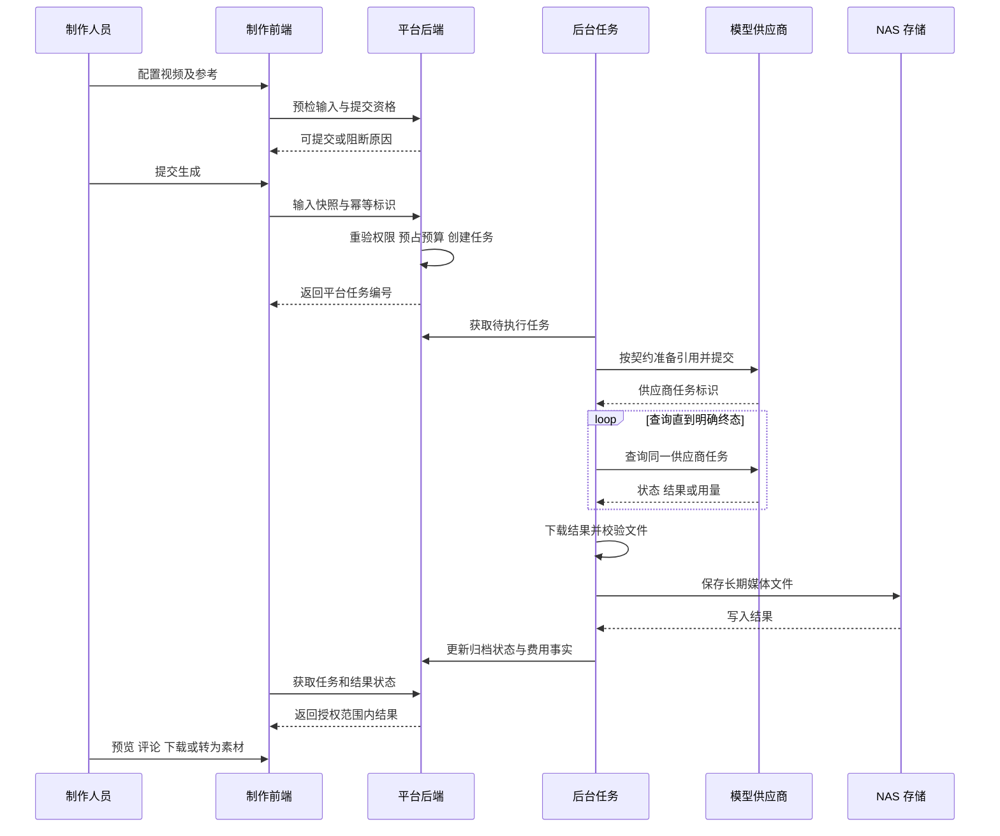
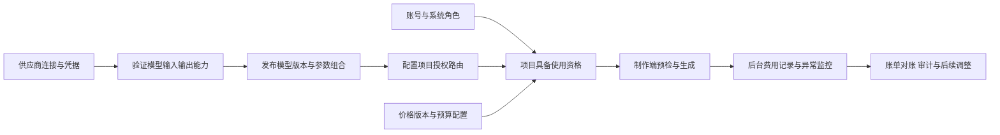

# AI 图片与视频制作平台产品需求说明书（全流程版）

版本：V1.0 评审稿

日期：2026 年 10 月 30 日

项目：higgsfield-ai

面向读者：产品负责人、业务负责人、制作团队、研发、测试及运维

本文从角色职责出发，定义从项目建立、素材上传或生成、评论协作、元素创建到视频生成、归档及交付的完整产品流程。本文是重新组织的产品需求稿，保留原有 PRD，不覆盖历史文件。

**核心业务主线：先上传或生成图片素材，按需整理为可复用元素，再将选定素材和元素用于视频生成；团队围绕具体媒体版本评论、修改和确认，最终归档并交付视频片段。** 上传视频也可用于元素资料；能否作为生成输入，取决于所选模型已验证并开放的能力。

本文中的“应”“必须”为产品要求；“源码已见”为本次静态核对结果，不代表运行验收通过。本文未执行真实供应商调用、数据库迁移、公司 NAS 验收或浏览器全流程测试。涉及当前实现的结论以本次工作区源码为依据，包含尚未提交的改动。

## 1 产品定位、目标与边界

### 1.1 产品定位

面向公司内部制作团队的 AI 图片与视频制作协作平台。制作端承接项目创作，管理端负责系统治理、模型接入及费用管理，两端共用用户体系和后端服务。

| 业务问题 | 产品目标 | 可观察结果 |
|---|---|---|
| 素材散落在个人电脑与聊天记录中 | 按项目及目录集中管理 | 每份素材可定位来源、版本、创建者与所属项目 |
| 人物、场景和道具参考难以复用 | 用元素组织描述和多份媒体资料 | 制作人员可选择固定元素修订用于后续创作 |
| 修改意见无法对应具体画面 | 评论绑定媒体版本与画面位置 | 图片标注、视频时间点与回复可以回溯 |
| 模型调用和成果留存割裂 | 打通生成、下载校验、归档和素材复用 | 生成记录可追溯到输入，结果可长期访问 |
| 权限和费用边界不清晰 | 分离系统授权、项目授权和财务授权 | 非成员不能读取内容，制作端不显示财务金额 |

试点阶段统计任务成功率、归档成功率、素材/元素复用情况、反馈处理情况和异常处置时间；具体指标目标由业务及运维评审确定，不预设未经验证的效率提升比例。

### 1.2 首期范围

首期包含：账号权限、项目及成员、项目简报和目录、素材上传与版本管理、图片生成、元素维护与导入、素材和元素引用、视频生成、评论标注、生成记录、归档下载、模型配置、预算及后台费用管理。

首期不包含：公司公共素材库及公开发布、完整视频剪辑拼接、对外社区与公开分享、商业订阅、独立 Chat、Canvas、AI 导演工作流及通用工具平台。视频片段交付后，由现有后期工具完成剪辑成片。

## 2 角色体系及职责

### 2.1 两层角色与一条财务边界

“系统角色”决定账号可以进入哪些平台功能；“制作平台项目角色”决定账号在某个项目中承担什么职责、可以操作哪些内容。平台管理员是系统角色，项目 Owner 是项目角色，两者不能互相替代。一个人可以兼任不同职责，在不同项目中具有不同身份。

### 2.2 系统角色及职责

下表按产品职责划分，实际系统角色包可以按组织情况组合；不表示每个职责都必须新增独立账号或固定角色种子。

| 系统职责 | 负责事项 | 使用入口 | 权限边界 |
|---|---|---|---|
| 系统管理员 | 账号启停、组织、系统角色、菜单及按钮授权 | 管理后台系统管理 | 业务日常操作不应依赖超级管理员身份；不以系统管理职责替代项目内容授权 |
| 平台管理员 / 模型运营人员 | 供应商连接、凭据生命周期、模型能力发布、项目路由、生成异常处置 | 管理后台平台业务模块 | 不因维护模型而自动获得项目素材或财务读取权 |
| 费用管理员 | 价格发布、预算设置、费用汇总、采购账单与对账调整 | 管理后台费用模块 | 按财务权限和管理数据范围读取；不因能看费用而能看素材正文 |
| 制作平台使用者 | 获得制作端基础功能权限，按授权创建或参与项目 | 制作平台 | 登录不等于加入所有项目；具体动作仍经项目鉴权 |
| 运维人员（运维职责） | 内网服务、NAS、备份恢复、外部供应商连通及运行监控 | 部署与运维环境 | 运维访问单独管理，不默认等同于产品内内容查看角色 |

### 2.3 制作平台项目角色及职责

| 项目角色 | 核心职责 | 可承担的工作 | 不可越过的边界 |
|---|---|---|---|
| Owner（项目所有者） | 对项目组织及权限负责 | 创建者自动成为唯一 Owner；配置项目角色权限、管理负责人、转让所有权、管理项目业务 | 不获得供应商凭据或后台财务权限；仍受有效账号、项目状态、预算和媒体状态约束 |
| 负责人（admin） | 日常组织与内容管理 | 维护项目、管理制作人和查看者，按权限整理和审核内容 | 不能修改 Owner 或其他负责人；不能配置角色权限矩阵或转让所有权 |
| 制作人（producer） | 具体创作与资料维护 | 默认浏览、上传、引用、生成、创建元素及管理目录；编辑、移除、配置和审核按本人范围控制 | 不能默认治理他人内容；下载与跨项目复制按项目授权开放 |
| 查看者（viewer） | 浏览项目成果和反馈依据 | 默认浏览已授权素材、元素、评论与生成记录 | 评论发布、下载及其他操作需额外授权；查看者不默认具有制作能力 |

协作评审人员可以使用获评论权限的查看者或其他适当项目角色，不另行假定系统已存在独立“审核员”角色。

### 2.4 关键权限规则

| 操作 | 产品规则 |
|---|---|
| 创建项目 | 需要系统层创建项目授权；成功后建立唯一 Owner 身份 |
| 角色与权限配置 | 制作端项目设置中由 Owner 配置可编辑业务动作；Owner 列固定，不通过普通角色修改改变所有权 |
| 转让所有权 | 接收人为启用的当前项目成员且具备基础项目访问授权；成功后原 Owner 成为负责人；并发冲突需刷新 |
| 查看/编辑对象 | 同时校验项目成员、功能授权、对象归属、本人或项目范围及当前状态 |
| 下载与跨项目复制 | 单独判断权限，不从“可预览”或“可创建元素”推导；跨项目复制还需目标项目写入权限 |
| 评论治理 | 本人编辑与管理他人评论分开授权，评论目标每次重新鉴权 |
| 财务查看 | 仅在管理后台按财务授权开放；Owner 的项目业务权限不包含财务读取权 |
| 撤权与归档 | 后续请求须重新受权限制；前端隐藏按钮不能替代后端校验；历史任务、费用与审计证据保留 |

旧文档中“三角色”“所有项目权限仅在后台配置”“制作端查看用量金额”等描述不作为本文口径。本版依据四级项目角色实现及 2026-10-30 财务边界修正；不在本次任务中批量重写其他文档。

## 3 产品对象与关系

| 对象 | 定义 | 与其他对象的关系 |
|---|---|---|
| 项目 | 团队、创作内容和任务归属的业务空间 | 包含成员、简报、目录、素材、元素及任务 |
| 文件夹 | 项目内组织内容的目录 | 上传和转为素材时必须明确目标目录；不是独立权限绕过入口 |
| 文件 | 实际媒体二进制及存储信息 | 正式环境长期保存于 NAS，数据库记录元数据 |
| 素材及素材版本 | 可管理的图片、视频或受支持文档及其固定版本 | 上传或由生成结果转入；历史版本不被新版本覆盖 |
| 元素及元素修订 | 人物、场景、道具等可复用创作资料 | 组合名称、别名、描述、属性和固定图片/视频素材版本 |
| 创作草稿 | 尚未提交的描述、引用及参数 | 不等于生成任务，不保证供应商已受理 |
| 生成任务 | 一次被平台受理的图片或视频生成请求 | 固定项目、发起人、模型能力、输入引用及参数快照 |
| 生成结果 / 作品 | 任务产出的一个图片或视频结果 | 一个任务可有多个结果；归档后可转为素材，不自动等于素材 |
| 评论主题 | 对某个媒体版本或生成结果的讨论 | 包含评论、回复、定位标注、视频时间点及处理状态 |
| 预算与账本 | 使用控制与费用事实 | 后台管理；未知费用不记为零，不因内容删除而删除历史 |

元素是可选的资料组织方式，用户可以直接引用素材生成视频。元素中的视频能保存为参考资料，不意味着任意图片或视频模型都接受该视频输入。

## 4 系统架构与功能全景

### 4.1 系统逻辑架构图

该图表示逻辑职责，不指定服务器数量、操作系统或容器部署方案。制作端使用 Vue Router、Pinia、Axios，Element Plus 与 shadcn-vue 共用主题状态；管理端沿用仓库的 Vue3 工程。后端沿用 controller → service → dao → entity/do 分层，使用异步 SQLAlchemy 2.0；数据库为 PostgreSQL，Redis 不替代数据库中的任务和费用事实。

浏览器通过平台授权访问媒体，不直接连接 NAS 共享目录。供应商输入由后端根据已验证契约上传或转换为可用引用，不能直接传入内网文件路径。供应商临时结果链接必须经下载、校验和归档后才成为长期可用结果。

### 4.2 功能路径全景图

路径表示产品导航和操作关系，不要求每个节点都是独立页面。我的生成记录、我创建的元素是跨项目个人视图，仍按当前项目访问权限过滤。制作端不设置费用页面；模型预检和任务详情不展示费用金额。

## 5 全流程总览与职责交接

| 阶段 | 主要负责人 | 输入 | 交接成果 |
|---|---|---|---|
| 环境准备 | 系统、平台及费用管理员 | 账号、供应商配置、能力验证、价格及预算规则 | 团队可访问项目并选择获授权模型 |
| 项目组织 | Owner / 负责人 | 创作目标和参与人员 | 项目简报、目录、成员及权限 |
| 素材准备 | 制作人 | 本地资料或图片生成描述 | 归档可用的素材版本 |
| 协作与元素整理 | 制作人及获授权评审人员 | 素材和反馈 | 修订后的素材、可复用元素 |
| 视频生成 | 获授权制作人员 | 描述、固定引用、模型参数 | 可追踪的任务和归档结果 |
| 交付与复用 | 负责人及获下载权限人员 | 归档视频和反馈 | 下载交付记录或新的项目素材 |

评论是贯穿各阶段的协作能力，不强制构成生成前审批；“已解决”评论或内容工作状态不自动触发生成、公开发布或财务结算。

## 6 项目创建与成员管理需求

**功能路径：** 登录 → 我的项目 → 创建项目 → 项目工作区 → 简报 / 项目成员 / 角色和权限。

1. 创建项目时填写必要名称及业务信息；后端验证创建权限，成功后建立项目及唯一 Owner。
2. Owner 或获授权负责人维护简报，说明制作目标、风格、交付内容及团队约定；创建镜头、人物、场景等目录属于团队组织方式，不强制预置固定目录模板。
3. 按职责添加成员和分配角色。成员变更后刷新当前可执行动作，失去访问权限的页面应停止提供受保护内容。
4. Owner 配置项目角色可操作的内容范围；负责人仅在允许范围内管理制作人和查看者。
5. 转让所有权必须明确目标成员，防止误操作；并发变更不覆盖他人新结果。项目始终只有一个有效 Owner。
6. 暂停或归档项目后，普通制作写操作受限；必要治理与恢复按权限执行。已有任务的查询、结果归档和费用收尾应按执行策略处理，不向已撤权成员恢复内容访问。

## 7 素材创建：上传与 AI 生成

### 7.1 本地上传创建素材

**功能路径：** 项目 → 文件夹 → 目标目录 → 上传；或创作栏 → 添加参考 → 本机上传 → 上传完成后选择引用。

| 需求编号 | 功能要求 |
|---|---|
| AST-NEW-01 | 上传图片、视频及受支持文档；格式、大小、像素、时长等按实际配置校验，界面显示限制，不把本地测试限制写成正式上限 |
| AST-NEW-02 | 文件选择时固定项目与目标目录；上传过程中切换目录不能造成文件误入其他位置 |
| AST-NEW-03 | 批量上传逐文件展示进度和失败原因；重试不得重复创建同一成功绑定结果 |
| AST-NEW-04 | 传输结束与素材可用分开呈现；文件验证、归档和对象绑定完成后才进入可引用状态 |
| AST-NEW-05 | 预览支持图片与视频；文档按支持格式提供预览或处理反馈，文档可见不等于模型接受其作为媒体输入 |
| AST-NEW-06 | 新版本保留旧版本及引用关系；删除和恢复遵循逻辑删除与引用完整性规则，不破坏历史证据 |

### 7.2 图片生成创建素材

**功能路径：** 首页选择项目或进入项目创作 → 图片模式 → 选择模型 → 填写描述及参考 → 预检 → 提交 → 生成记录 → 结果归档 → 转为素材。

用户可从文字开始生成图片，也可选择模型支持的图片参考。模型列表、比例、数量、分辨率及其他参数来自已发布能力配置，不因供应商目录出现某型号就自动开放全部规格。

1. 明确目标项目和目录，选择图片模型并填写提示词。
2. 按需从项目素材或元素选择参考；无参考模式是否可提交，以模型能力为准。
3. 预检权限、输入、路由、模型规格与预算。制作端显示是否可提交及阻断原因，不显示金额。
4. 提交后生成任务由后台执行；用户离开页面不应导致任务丢失。
5. 每个结果独立展示归档状态。生成成功但归档未完成时，不视为可长期交付素材。
6. 用户挑选可用结果并执行“转为素材”，明确目录与命名；保留来源任务及结果关联。
7. 转入的素材与上传素材共用预览、评论、元素创建和再次引用流程。

生成结果不会仅因任务成功自动变成项目素材；“转为素材”是明确的复用操作。图片生成失败或结果不理想时，修改输入并创建新任务，保留旧任务记录。

## 8 评论、标注与反馈闭环

### 8.1 评论入口与目标

**功能路径：** 项目素材 / 生成结果 → 预览详情 → 评论侧栏 → 发表评论或回复。由元素中的媒体进入评论时，目标仍是对应的固定素材版本。

| 能力 | 产品要求 |
|---|---|
| 文本评论和回复 | 记录作者及时间；回复只能属于同一评论主题；空正文不可提交 |
| 图片标注 | 支持点、矩形及路径标注；保存基于原图尺寸的坐标，缩放预览时位置一致 |
| 视频评论 | 可附时间点；画面标注必须同时附带时间点，且不超过目标视频时长 |
| 评论定位 | 点击定位信息应显示对应版本、画面和时间点；不能因素材升级定位到另一张图或另一段视频 |
| 评论编辑与删除 | 本人编辑和项目评论治理分开判断；并发修改提示刷新；删除不销毁必要审计证据 |
| 处理状态 | 支持解决、重新打开及颜色标记；颜色用于协作区分，不等于独立审批结论 |
| 表情回应 | 获授权人员可以添加或取消支持的表情回应 |
| 撤权控制 | 评论列表、回复、标注与操作均重新验证目标访问权限 |

旧评论继续绑定原目标，新版本不自动继承旧评论位置。修改后的内容可建立新的评论主题，团队可在正文中说明与原反馈的关系。评论不等同于任务派单、强制审批或消息通知系统；本文不把未核实的通知、催办、人员提及能力列为现成功能。

### 8.2 评论状态与内容状态分开

评论“已解决”只说明某条讨论已处理；元素或内容的工作状态表达制作进度；生成任务状态表达后台执行情况；文件归档状态表达媒体是否已持久保存。四类状态不能互相覆盖，也不能用评论解决状态自动认定最终交付通过。

## 9 元素创建、维护与引用

### 9.1 元素的价值与内容

元素将某个人物、场景或道具的描述及参考资料集中保存，便于多次创作保持参考一致。一个元素可关联多份图片或视频资料，包含主媒体、排序、名称、引用别名、分类、描述、属性和工作状态。生成输入改变时形成新修订，历史任务继续引用原修订。

### 9.2 三类创建路径

| 路径 | 操作 | 结果与限制 |
|---|---|---|
| 从素材创建 | 项目素材 → 选定图片或视频 → 创建元素 → 完善资料 → 保存 | 关联固定素材版本；来源媒体须归档可用且属于当前项目 |
| 在元素库新建 | 项目元素 → 新建 → 填写名称/分类/描述 → 添加媒体 → 保存 | 可以先建立无媒体资料，但不能绕过所选模型的媒体输入要求 |
| 从文档导入 | 项目元素 → 导入 → 上传受支持文档 → 解析候选 → 人工修正 → 确认入库 | 解析结果是候选；格式和解析能力以实际支持范围为准；确认失败应整体回滚，不重复创建 |

### 9.3 元素维护与使用规则

1. 项目元素支持搜索、筛选及网格、看板、表格等视图；视图是同一组对象的不同展示，不产生独立内容副本。
2. 保存元素时校验每份媒体的项目归属、可见性和文件可用性；视频与图片均允许作为元素资料。
3. 修改描述、媒体或生成相关属性后生成新修订；旧任务中的引用不得静默升级。需要采用新修订时，由用户明确更新当前草稿引用。
4. 创作栏“@”选择元素；输入 `@别名` 文本本身不能证明供应商收到了该元素。平台必须形成包含固定版本、媒体用途和文件信息的真实引用。
5. 元素主图、附图或视频不应无条件全部发送。实际提交哪些媒体、承担参考图/首帧/尾帧/参考视频等何种用途，依据用户选择和模型能力。
6. 跨项目复制需要源对象读取/复制及目标写入权限，生成目标项目的新身份，保留来源证据；不提供绕过授权的跨项目直接引用。
7. 元素工作状态及负责人等协作字段按项目权限维护；工作状态不自动对外发布，也不自动改变模型能力。

## 10 视频生成与结果交付

### 10.1 视频创作路径

**功能路径：** 项目 → 创作栏 → 视频模式 → 模型 → 提示词 → “＋”选择素材 / “@”选择元素 → 指定输入用途 → 参数 → 预检 → 提交。

用户可以直接引用已准备的图片，也可以使用元素资料。文生视频、首帧、首尾帧、多图参考、视频参考等输入模式，仅在对应模型及规格经过验证并发布后展示，不承诺每个模型都支持。

| 步骤 | 用户操作 | 平台处理 |
|---|---|---|
| 选择模型 | 选择当前项目可用视频模型 | 按授权路由和已发布能力提供选项 |
| 准备描述 | 描述主体动作、镜头、场景和期望变化 | 保存草稿，不自动发起付费调用 |
| 添加参考 | 选素材或元素，并指定用途和顺序 | 固定素材版本、元素修订并校验格式、数量和可访问性 |
| 设置参数 | 选择时长、比例、分辨率等开放项 | 隐藏或禁用未验证组合，不伪造默认能力 |
| 预检 | 查看可提交状态或问题提示 | 校验权限、项目状态、模型能力、引用、路由及预算 |
| 提交 | 确认当前配置并发起一次任务 | 固定输入快照，幂等受理并预占预算 |
| 等待结果 | 查看生成记录，可离开并重新进入 | 后台提交、查询供应商任务，记录进度和异常 |
| 查看交付 | 打开归档视频，评论、下载或转为素材 | 授权预览和下载，保留任务来源和文件校验信息 |

### 10.2 生成与归档时序图

这是正常异步视频路径；具体提交和查询字段由供应商适配契约决定。外部调用结果不明确、归档失败及费用缺失走异常处理，不用正常成功路径掩盖。

### 10.3 状态与异常处理

以下为面向用户的状态语义，不替代数据库枚举。

| 状态或异常 | 用户看到的结果 | 处理要求 |
|---|---|---|
| 预检未通过 | 明确无权限、无可用模型、引用失效或预算不足等原因 | 保留输入，修正后重新预检；不能继续提交 |
| 待执行 / 生成中 | 任务编号、阶段及可用进度信息 | 不编造百分比；刷新后可从生成记录重新进入 |
| 提交结果待确认 | 平台尚未确认供应商是否已受理 | 不盲目重新发起生成；进入查询或人工核查，避免重复消费 |
| 生成失败 | 失败原因及可执行动作 | 明确失败后可修改并新建任务；未知费用继续核查 |
| 生成成功、归档中 | 已有上游结果，尚未完成长期保存 | 不标记为可交付完成，不将临时链接当永久素材 |
| 归档失败 | 生成已成功但文件保存失败 | 重试下载与归档，不重新调用模型生成 |
| 归档成功 | 可授权预览、下载和转为素材 | 文件可用性与权限仍须在操作时检查 |
| 取消请求 | 按实际阶段显示是否可取消或已请求取消 | 不承诺供应商已停止或不产生费用；以实际终态结算 |
| 内容不满意 | 技术生成成功，但业务仍需修改 | 根据评论调整输入并创建新任务，保留旧结果 |

重复点击、网络重试不能重复受理或重复预占。当前页面待确认状态与服务端任务幂等分开处理；浏览器刷新后的自动恢复能力需单独验收，不把内存保留状态描述为持久恢复。

### 10.4 结果交付与再次复用

结果归档后，负责人或获授权人员通过预览与评论确认业务质量。需要修改时回到创作配置，新任务保留新的输入；确认可用时授权下载，交给外部后期流程，或转为素材继续创建元素和生成。平台首期交付的是可追溯的视频片段及其资料，不承诺完成最终影片剪辑。

## 11 管理后台支撑流程

| 管理模块 | 必要产品要求 |
|---|---|
| 账号与权限 | 开通、停用及撤权可追踪；制作权限和财务权限分开 |
| 供应商凭据 | 密钥不返回制作端，不在普通日志中明文展示；轮换与紧急撤销区分，保留任务关联版本 |
| 模型能力 | 精确到模型别名、输入模式及规格验证；价格表或供应商宣传不能单独证明能力可用 |
| 路由 | 为项目配置允许使用的供应商及模型；不可路由时明确阻断 |
| 价格与预算 | 发布价格版本，生成受理时固定计价依据；并发任务不能突破受理预算约束 |
| 费用与对账 | 平台计价、采购成本和实际账单分开记录；不同币种和口径不直接相加；未知用量不当零 |
| 异常处理 | 查询待确认提交、归档失败及费用异常；人工处理记录原因和审计，不删除原始事实 |
| 项目治理 | 按管理数据范围治理项目元数据，不自动获得项目内容读取权 |

制作端不显示我的用量、项目费用、预检金额或任务费用明细。预算限制继续执行，制作人员只接收完成当前动作所需的阻断提示。财务人员在后台按项目、用户、时间等条件查看授权范围内的费用。

## 12 页面与交互要求

| 页面 / 组件 | 核心内容 | 关键反馈与交互 |
|---|---|---|
| 我的项目 | 可访问项目、创建入口 | 空状态说明；无创建权限时不提供可执行入口 |
| 项目工作区 | 项目简报、目录树、素材、元素及生成记录 | 当前项目与目录始终明确；切换模块保留合理上下文 |
| 素材列表 | 图片视频缩略图、文件名、筛选与多选 | 按原比例等高排列；文件名置底，元数据及动作收进菜单；不拉伸媒体 |
| 媒体预览 | 固定版本、图片或视频、评论侧栏 | 视频时间控制、标注定位、返回来源列表；无权限时停止展示 |
| 元素库与编辑器 | 名称、描述、分类、媒体、属性、状态 | 选择媒体可预览；保存校验清晰；失败保留输入；历史修订可追溯 |
| 创作栏 | 图片/视频切换、模型、提示词、参考及参数 | “＋”选择素材，“@”选择元素；参数变更后原预检失效，需重新检查 |
| 生成记录与详情 | 输入快照、进度、结果、归档状态、后续动作 | 待确认提交避免误重试；归档重试与重新生成明确区分 |
| 项目成员与权限 | 四级角色、权限矩阵及转让入口 | Owner 固定列；不允许越级管理；保存冲突提示刷新 |
| 后台费用与异常 | 筛选、费用口径、异常原因和证据 | 财务信息按权限展示，缺失数据不显示为零 |

亮色和暗黑主题必须共用布局与语义色变量，提供可见的切换入口。切换主题保留页面、筛选、选择及未提交输入；弹窗、菜单、表格和两套组件库同步，媒体原图不变色。默认、选中、禁用、聚焦与错误状态均需验收。

长耗时操作展示处理阶段、可恢复动作与失败原因。表单采用组件级校验，成功反馈应与真实写入完成对应，不能把请求发出等同于保存成功。

## 13 存储、安全与运行要求

1. 正式媒体长期保存到公司 NAS，PostgreSQL 保存对象、版本、关系、任务和费用元数据。临时供应商 URL 不替代归档。
2. 媒体预览、下载、评论及生成引用均由后端校验权限；知道文件地址或对象编号不能绕过访问控制。
3. 外部模型调用由内网服务受控访问供应商，供应商不能被假定可读取公司 NAS 或内网地址。
4. 任务受理、预算预占和幂等记录保持事务一致性；没有物理外键时，由服务事务、锁及引用校验维护关联完整性。
5. 素材/元素逻辑删除不破坏已受理任务的固定输入与不可变历史；账本和审计不提供删除入口。
6. 后台工作器负责生成、查询、归档和必要恢复，浏览器关闭不应中断已受理任务；失败后的重试不得造成重复消费。
7. 备份恢复覆盖数据库、媒体和必要的加密配置；恢复后核对关联关系，默认不盲目重放真实模型调用。
8. 正式操作系统、容器化方式、服务器数量、NAS 协议、挂载路径、容量和恢复目标由运维确认。本地开发启动方式不能作为正式部署结论。

## 14 核心验收场景

本表为待执行的产品验收清单，不表示已通过。验收需保留操作人员、角色、项目、任务编号、实际结果和必要证据；模拟、静态检查与真实供应商/NAS 验收分开记录。

| 编号 | 场景 | 通过标准 |
|---|---|---|
| UAT-NEW-01 | 创建项目并配置四级角色 | 创建者为唯一 Owner；负责人不能改 Owner/其他负责人；查看者不能越权制作 |
| UAT-NEW-02 | 转让所有权及并发修改 | 有效成员接收成功，原 Owner 成为负责人；无访问资格或旧版本请求被拒绝 |
| UAT-NEW-03 | 上传图片与视频 | 文件归入选定项目目录，可预览；中断重试不重复绑定成功素材 |
| UAT-NEW-04 | 图片模型生成并转素材 | 真实任务结果校验归档成功；转素材后来源任务可追溯，目录正确 |
| UAT-NEW-05 | 图片评论与版本升级 | 标注和回复可定位；新增版本后旧评论仍绑定旧图 |
| UAT-NEW-06 | 视频时间点和画面标注 | 定位到对应时间和画面；超时长或缺失时间点的画面标注被拒绝 |
| UAT-NEW-07 | 评论治理与撤权 | 本人和管理他人权限区分；无权用户无法读取正文或标注；解决后可以授权重新打开 |
| UAT-NEW-08 | 图片、视频分别创建元素 | 两类媒体可保存为元素资料；模型不支持的视频输入仍被明确阻断 |
| UAT-NEW-09 | 元素修订与真实引用 | 任务固定原修订及媒体版本；仅输入别名不会伪装成已传入媒体；升级引用需显式操作 |
| UAT-NEW-10 | 无元素直接图片生成视频 | 选择合规图片参考即可提交，不强制先建元素 |
| UAT-NEW-11 | 真实视频生成闭环 | 权限与模型配置有效；任务受理、供应商查询、结果校验、公司 NAS 归档及授权播放贯通 |
| UAT-NEW-12 | 重复提交与提交超时 | 重复请求只形成一次受理及预占；不明确的提交进入核查，不自动重复调用 |
| UAT-NEW-13 | 供应商成功但 NAS 失败 | 显示归档失败；恢复后只重试归档，不新增模型调用 |
| UAT-NEW-14 | 制作端与财务隔离 | Owner 也不能通过制作端读费用金额；后台财务权限不赋予项目素材访问权 |
| UAT-NEW-15 | 预算竞争与费用缺失 | 并发受理不超预算；缺失费用标为待核查；重复返回不重复入账 |
| UAT-NEW-16 | 归档视频交付与复用 | 有下载权限才可下载；转素材保留来源，可继续评论或创建元素 |
| UAT-NEW-17 | 撤权与跨项目复制 | 非成员不能访问；复制逐项验证源读与目标写；失败不遗留部分业务对象 |
| UAT-NEW-18 | 双主题完整主流程 | 页面和弹层状态可读；切换不丢输入与筛选，媒体不变色 |

试点交付门槛：核心制作链路以真实授权账号走通；拟开放的模型输入组合分别有验证证据；公司 NAS 归档及授权访问通过；权限隔离、幂等和费用异常用例通过；重大缺陷关闭；运维和使用人员收到可执行交接资料。

## 15 当前依据、实现边界与待确认事项

### 15.1 本次源码核对结论

| 范围 | 本次可确认的静态事实 | 尚不能据此认定 |
|---|---|---|
| 项目角色 | 项目权限服务包含 Owner/admin/producer/viewer 四级角色，Owner 可配置可编辑动作 | 所有账号及完整角色矩阵已通过运行验收 |
| 财务边界 | 制作端 `/usage` 重定向首页；权限目录不再提供项目用量授权；最新权限文档明确费用归后台 | 正式部署已更新或所有旧会话已失效 |
| 评论 | 服务与输入模型包含固定素材版本/作品、回复、图片视频标注、时间点、解决/重开、颜色及表情 | 最新工作区修改已迁移、已部署或完整浏览器操作通过 |
| 元素 | 媒体校验接受当前项目归档就绪的图片和视频，保存固定修订关系 | 所有模型均支持视频引用，或生成质量已达业务标准 |
| 页面入口 | 当前路由有首页、我的项目、我的生成记录、我创建的元素；项目工作区接入成员与权限组件 | 每个入口都完成双主题及真实联调验收 |

### 15.2 需在相关能力开放前确认

| 事项 | 当前处理原则 | 负责方 |
|---|---|---|
| 正式上传限制及容量 | 使用可配置策略，不沿用本地测试值作正式承诺 | 产品、技术、运维 |
| 模型与输入组合 | 按实际供应商契约逐组合验证后发布 | 模型接入、业务验收人员 |
| 预算周期和额度流程 | 财务后台管理，制作端只接收可提交状态 | 业务、财务 |
| 内容与评论颜色的业务含义 | 不自动解释为正式审批，不自动触发后续流程 | 产品、制作负责人 |
| 删除恢复及证据保留期限 | 未确认前不自动物理清除历史引用和审计 | 业务、运维 |
| 正式 NAS 与部署规格 | 运维确认后执行真实存储、访问和恢复验收 | 运维、技术 |
| 文档解析质量 | 人工复核候选后入库，不承诺任意文档无误解析 | 产品、制作团队 |

### 15.3 配套文档与阅读顺序

本文负责产品范围、角色职责、用户流程及验收入口。研发和测试细节继续使用以下 Markdown 文档；遇到旧段落与近期变更冲突时，结合最新修正与当前源码核对，不将历史记录当当前结论。

| 文档 | 用途 |
|---|---|
| [首期需求与业务规则说明书](首期需求与业务规则说明书.md) | 稳定业务规则与范围依据 |
| [权限矩阵](权限矩阵.md) | 角色、对象动作、授权范围及最新角色/财务边界修正 |
| [页面规格与交互说明书](页面规格与交互说明书.md) | 页面字段与交互细节 |
| [技术架构方案](技术架构方案.md) | 系统分层、后台任务及存储架构 |
| [平台 API 契约](平台API契约.md) | 请求响应、幂等及错误处理 |
| [模型供应商接入契约与差异清单](模型供应商接入契约与差异清单.md) | 真实引用、模型映射及供应商差异 |
| [供应商模型目录与制作端选择规则](供应商模型目录与制作端选择规则.md) | 模型展示与能力开放规则 |
| [内网部署与 NAS 存储运维方案](内网部署与NAS存储运维方案.md) | 部署、媒体访问、备份及恢复 |
| [测试与验收方案](测试与验收方案.md) | 详细测试组织及证据要求 |
| [人工验收操作手册](人工验收操作手册.md) | 实际环境操作步骤 |
| [当前交付状态](当前交付状态.md) | 历史交付证据及验证边界；读取时注意各条记录日期 |

本版以完整产品流程供评审，不将文档编写完成视为功能上线或业务验收完成。
