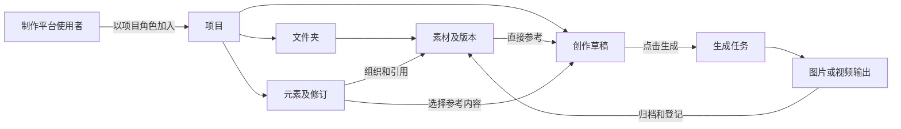
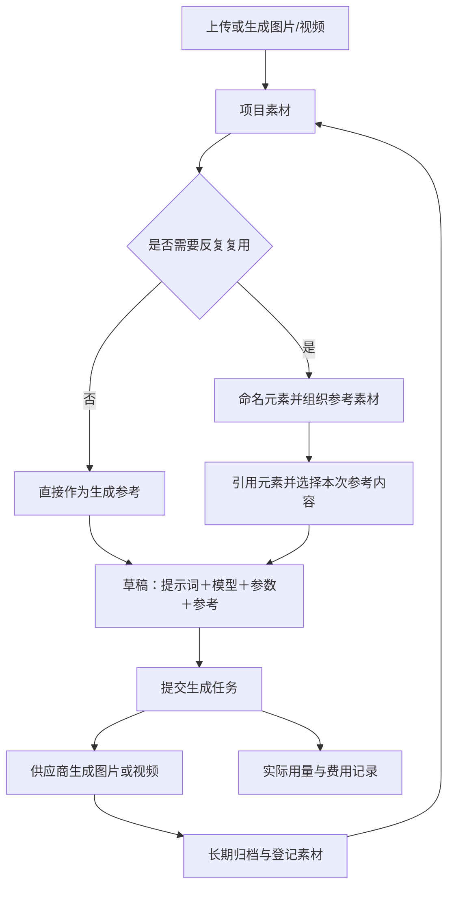

# Higgsfield AI 图片与视频制作平台 · 产品需求文档（PRD）

版本：2.0｜更新：2026-11-03｜面向：管理层、产品、研发、测试与平台管理员
代码基线：`fdf3f612`。本文说明当前产品范围与验收要求；代码存在不代表供应商、浏览器和正式 NAS 全链路已验收。技术落点见[技术方案](技术架构方案.md)。

## 1. 建设目的与业务价值

建设一个公司内部共用的 AI 图片与视频制作平台：管理员统一接入供应商，团队在项目内上传素材、生成图片、使用图片生成视频，并复用人物、场景、道具等元素；费用管理员能追踪每次调用的实际用量与费用。

核心生产路径是：**先制作或上传图片 → 选取参考素材 → 生成视频 → 保存为项目素材 → 审阅、复用或下载交付**。元素是可选的复用工具，不是生成视频的强制前置步骤。

| 当前问题 | 平台解决方式 | 验收关注点 |
|---|---|---|
| 供应商账号、模型配置分散 | 供应商配置一次，旗下模型独立配置与启停 | 制作人员无需接触 API Key |
| 文件、提示词与生成结果难追溯 | 项目内统一保存任务、输入快照、输出及素材关联 | 能找到谁用什么输入生成了什么 |
| 人物和场景重复寻找 | 元素按名称组织多份参考素材 | 引用固定版本，历史任务可解释 |
| 费用不透明 | 保存真实用量、任务价格版本和独立费用账本 | 可按人、项目、模型及调用追踪 |
| 操作门槛高 | 按角色呈现工作台，创作组件一键提交 | 普通管理员不需要命令行 |

不在首期范围：剪辑时间线、视频后期编辑、公司公共素材库、通用 AI 工具市场、文本聊天工作台、模型训练。预算和资金预占已从当前生成流程中取消。

## 2. 系统角色：决定能进入哪些平台功能

系统角色作用于整个平台；项目角色作用于某一个项目。同一个人可以具有多个系统角色，在不同项目担任不同项目角色。

| 系统角色 | 主要工作 | 边界 |
|---|---|---|
| 平台管理员 | 配置供应商地址与密钥；添加图片/视频模型；确认能力、价格和汇率；测试、启用、停用；检查调用与异常 | 不因管理员身份自动取得所有项目内容编辑权 |
| 费用管理员 | 查看全平台授权范围内的用量、费用、统计和对账资料；核查未计价及差异；按授权处理调整 | 不负责生成素材，不需要配置密钥；费用读取与费用调整分权 |
| 制作平台使用者 | 创建或加入获准项目，按项目角色上传、创作、管理或查看内容 | 获得系统使用资格不等于能访问所有项目 |
| 平台综合管理员 | 合并平台、费用以及用户管理、部门管理权限 | 是权限组合，不等同于框架超级管理员 |
| 超级管理员 | 系统角色、菜单权限等系统维护 | 不作为日常制作、对账的必要账号 |

用户与部门管理入口按实际权限显示。只拥有供应商管理权限的账号不能因为名称叫“平台管理员”就自动获得用户管理权限；综合管理员可同时处理这些工作。

## 3. 项目角色：决定在项目内能做什么

项目是一次制作工作的协作空间，包含成员、文件夹、素材、元素、生成记录和讨论。创建者成为唯一 Owner（项目所有者）。

权限层级：**Owner ≥ 负责人 ≥ 制作人 ≥ 查看者**。较高角色继承较低角色已授予的能力；同一能力的范围按“全项目 ≥ 本人 ≥ 无”计算。非 Owner 仍受系统授权上限、有效成员身份和项目状态约束。

| 项目角色 | 默认主要职责 | 管理边界 |
|---|---|---|
| Owner | 管理项目、成员、内容和角色权限；归档项目；转让所有权 | 唯一所有者；不因此取得平台财务与供应商权限 |
| 负责人 | 组织日常制作、管理制作人和查看者、管理项目内容及审核；拥有制作人的能力 | 不能转让所有权、配置角色矩阵或管理其他负责人身份 |
| 制作人 | 上传、生成、引用素材、创建元素、组织文件夹、参与讨论；部分编辑删除限本人 | 不默认管理项目成员或改变项目权限 |
| 查看者 | 查看项目内容、素材、元素、生成记录与讨论，下载素材 | 不默认上传、生成或修改内容 |

Owner 可在项目设置调整非 Owner 权限。跨项目复制等能力必须另行满足源、目标项目授权。角色继承不能被上层角色的一条“无权限”覆盖打破。服务端强制校验，隐藏按钮只是辅助交互。

成员被移除、账号停用、项目状态改变后的访问由后端判定；不能依靠浏览器旧页面继续操作。已提交任务的费用与历史记录不随成员退出而删除。

## 4. 核心对象与关系

| 概念 | 通俗解释 | 重要区别 |
|---|---|---|
| 项目 | 团队的一项制作工作及其内容集合 | 逻辑空间，不是操作系统目录 |
| 文件夹 | 项目内组织素材的位置，如“第一镜头/人物” | 数据库关系，不要求 NAS 同名文件夹 |
| 素材 | 平台可管理的一张图片或一个视频 | 可以来自上传，也可以来自模型生成 |
| 素材版本 | 素材某次具体内容 | 引用固定版本，避免历史任务随素材更新而改变 |
| 元素 | 命名的可复用参考资料，如“男主角”“餐厅” | 可以包含多张图片/视频、描述和属性，不只是文件改名 |
| 草稿 | 尚未提交的提示词、模型、参数、参考内容和保存位置 | 自动保存草稿不调用供应商、不产生生成费用 |
| 生成任务 | 用户点击生成后，后台受理的一次制作工作 | 任务是过程记录；图片/视频是任务输出 |
| 归档 | 将结果保存到平台长期存储并登记关联 | 不是把项目设为只读，也不是压缩文件 |
| 供应商素材 ID | 供应商素材库中注册后的标识 | 与平台元素 ID、平台素材 ID 是三种不同标识 |

## 5. 平台管理员的完整工作流程

1. 在“供应商与模型”配置供应商名称、接口地址、账号与密钥。同一供应商的图片和视频模型复用连接及密钥。
2. 点击“新增模型”，选择支持的模型类型和标识，确认参数能力。供应商报价存在某档分辨率不意味着接口已支持该档能力。
3. 确认模型价格及需要的汇率。项目价与采购价首版同价，分别保存 USD 费用。
4. 打开生成测试抽屉，先看待发送请求、模型参数和 cURL；选择“暂不测试”不发送请求。
5. 点击抽屉内“开始测试”才调用供应商。显示进行中状态，自动更新响应和最终结果；可在模型列表“测试记录”查看历史。
6. 测试通过并完成相关配置后启用模型。现有和新建项目自动可用，不再逐项目勾选开放范围。
7. 后续修改价格或汇率创建新价格版本；不要求重复付费测试，不追溯改变已提交任务和历史费用。
8. 停用模型阻止新的使用；普通停用不取消已经提交的任务。异常处置应明确作用范围，不能将“停用”解释为已撤销供应商任务。

管理员测试记入管理员测试等非项目消耗。查看详情、刷新状态、修改价格均不能隐式发起新生成。

## 6. 项目建立与上传素材

### 6.1 建立工作空间

有相应系统授权的使用者创建项目，设置名称、说明和成员；Owner 为成员分配负责人、制作人或查看者。成员在“我的项目”进入获准项目，使用文件夹组织镜头、角色或场景。

### 6.2 上传过程

选择当前项目和目标文件夹 → 上传图片或视频 → 平台校验文件类型、大小与可读性 → 保存文件与素材版本 → 当前文件夹显示素材。

上传不是模型生成，不产生该模型的 Token 消耗；后续把上传内容作为参考交给模型时，才按供应商生成规则计费。上传失败不能显示为完整可用素材。

文件长期存储与页面目录分开：数据库保存项目、文件夹、素材与文件之间的关系；媒体文件按存储键保存。正式环境计划使用公司 NAS，浏览器通过平台鉴权访问，不直接打开 NAS 共享地址。

## 7. 通过创作组件生成图片

制作人员在项目文件夹底部使用 `CreationComposer`：

1. 选择图片模式；在可用模型中默认优先选择 `mm-imagen2`，已有有效选择或草稿应保留。
2. 输入提示词，例如“一位男主角站在餐厅门口，暖色灯光”。
3. 按需加入参考图片或引用元素中的具体素材版本；不使用参考也可文生图。
4. 设置比例、清晰度、画质和数量。图片默认比例为 1:1；“比例＋1K/2K/4K”等选项按当前模型能力映射为实际尺寸。
5. 点击“生成”。前台不弹费用确认框，后台校验授权、模型和参数后受理任务。
6. 页面显示进行中；完成归档后结果自动成为项目素材，关联到**提交时记录的文件夹**。

重复点击须由前台提交锁和后端幂等共同防护。同一提交重试返回同一任务，不再调用供应商；用户明确发起另一任务则可以产生新的费用。提交后不提供取消生成。

若提交后切换文件夹，结果仍属于提交时的位置；若原文件夹已失效，显示保存位置异常并保留输出，不静默丢失或放到错误位置。

## 8. 用图片或其他参考生成视频

1. 切换视频模式，默认优先选可用的 `mm-eva-sd-2.5`。
2. 输入动作、运镜或场景提示词，选择模型允许的比例、分辨率、时长及声音选项。
3. 选取普通参考图片、参考视频，或通过元素选择参考内容。视频输入与普通图片输入影响 SD 计价档位。
4. 虚拟人物参考图片按相应 SD 能力使用“人物参考”语义；后台将文件上传并注册到供应商素材库，确认 Active 后使用 `asset://素材ID` 生成。
5. 点击生成后，后台取得供应商视频任务 ID，持续查询结果；不是等待一次 HTTP 请求直接返回视频。
6. 供应商成功返回视频地址与最终用量后，平台下载、校验并归档视频，登记素材及原文件夹关系，同时按真实用量结算。

图片与视频结果都可继续作为下一次制作的参考。视频完成状态、归档状态、费用状态是三个独立事实：生成成功但下载失败时只重试归档，不重新生成。

当前 SD 支持配置与协议存在差异的档位需保守开放：Fast 的 1080p、SD 2.0 的 4K 不能仅凭价格表启用。H3 与 SD 的参数、素材注册和计费策略不同，不把 SD 的所有能力套到 H3。制作端参考音频上传尚不能描述为完整交付。

## 9. 元素如何参与生产

以“男主角”为例：先上传或生成正面照、侧面照、全身照，选取这些素材创建名为“男主角”的元素，补充描述。生成时引用“男主角”，再选择本次需要的参考图；后台把元素修订及具体素材版本编入请求。

- 素材提供真实媒体内容；元素提供名称、描述、属性及可复用的组织关系。
- 元素不是重新训练一个人物模型，也不保证模型每次生成完全一致。
- 当前可用路径是先把文件上传为项目素材，再从项目素材建立元素。元素编辑器不能描述成已经支持直接上传媒体；元素文档导入也不等于上传图片。
- 同一人物可以有多个参考素材；任务记录使用哪一版，后续更新元素不改变既有任务输入。
- 跨项目使用元素必须经过受控复制及授权，不能跨项目直接读未经授权的素材。

## 10. 讨论、版本与交付

成员按权限查看素材和生成记录，围绕具体内容讨论。项目内的评论、审核与版本用于协作，不应把“AI 生成成功”视为内容已通过业务审核。

素材预览和下载受项目权限约束；版本引用指向实际使用版本。素材移除和回收站遵循逻辑删除规则，不应破坏历史任务和费用证据。下载的是平台已保存的媒体，不依赖供应商临时 URL 永久有效。

## 11. 用量、费用与对账

### 11.1 两种费用视角

- **供应商成本（采购费用）**：用于核对平台向供应商产生的消耗。
- **项目计价（平台费用）**：用于记录项目使用模型的费用。首版与采购同价，但独立记账。

同一次生成的两种金额不能相加，否则重复统计。项目任务与管理员测试分别归属；未计价记录显示待核算，不按零元掩盖。

### 11.2 计费规则

| 模型 | 当前规则 | 用量来源 |
|---|---|---|
| mm-imagen2 | 输入 Token × 输入单价/百万 ＋ 输出 Token × 输出单价/百万；初始为 5/30 USD | 图片响应内层 usage |
| SD 视频 | completion_tokens × 人民币百万 Token 单价 ÷ 固定汇率 ÷ 1,000,000 | 视频任务轮询成功响应 |
| H3 视频 | total_seconds × 0.13 USD ＋ max(image_count−5,0) × 0.04 USD，价格可配置 | 供应商可核实用量；时长包含规则按适配器归一化 |

SD 按版本、分辨率及是否包含视频输入匹配价格；nova/eva 对应版本同价。汇率初始为 1 USD=6.69 CNY，以任务保存版本为准。不能用四位小数展示价格反推精确结算，也不能把初次视频提交返回的零 Token 当最终用量。

### 11.3 对账应能回答的问题

谁发起、属于哪个部门和项目、是什么模型、提示词与参考是什么、请求数量/分辨率/时长、供应商任务号、调用和完成时间、真实用量、固定价格与汇率、原始金额、调整后金额、是否归档、是否存在异常。

历史费用不可直接覆盖；调整保留原因与证据。供应商账单导入、匹配、差异处理有实现模块，实际账单格式与真实业务对账仍需验收，不能把本地测试费用列表当作供应商正式账单。

## 12. 主要页面与交互要求

| 页面 | 首要任务 | 交互要求 |
|---|---|---|
| 管理工作台 | 找到与当前职责相关的入口 | 费用管理员只看费用相关；有用户/部门权限才显示对应入口 |
| 供应商与模型 | 配置一次供应商，管理多个模型 | 不要求理解价格簿 ID、能力版本 ID 才能接入 |
| 模型测试抽屉 | 先了解请求，再决定测试 | 未提交显示 Request；提交后自动显示 Response、进度和结果 |
| 用量与费用 | 查询、汇总、核查记录 | 明细抽屉；未计价明确标注；金额与币种清晰 |
| 项目素材 | 上传、组织、预览与下载 | 图片视频按比例展示，复杂信息放详情/菜单 |
| 通用创作栏 | 输入并生成 | 只显示模型支持参数，不展示面向财务的价格管理内容 |
| 元素库 | 建立和复用人物、场景等资料 | 清楚显示引用了哪些媒体，避免元素与文件混淆 |
| 项目设置 | 管理成员与权限 | 体现角色层级，Owner 特殊权限独立展示 |

所有页面支持亮暗主题；切换不丢输入。等待有明确加载状态，完成自动更新；失败说明原因和下一步。技术详情按需展开，不在主要操作区堆叠长提示。普通管理员无需 PowerShell。

## 13. 状态与异常处理

| 情况 | 平台行为 | 使用者应看到 |
|---|---|---|
| 提交处理中 | 锁定本次提交并保存幂等标识 | 正在提交 |
| 提交结果不明 | 保留原请求，核查结果，不自动创建新付费请求 | 结果待确认 |
| 供应商处理中 | 后台查询同一任务 | 生成中，可返回查看 |
| 供应商失败 | 保存错误与证据 | 失败原因和可操作入口 |
| 已生成但未归档 | 仅下载/归档重试 | 视频或图片已生成，正在保存 |
| 文件夹失效 | 保存输出并登记位置异常 | 待处理保存位置 |
| 用量或价格证据不足 | 不伪造零元或估算为实付 | 待核算 |
| 重复回调/重复归档 | 复用同一输出与素材关联 | 不重复出现素材或费用 |

## 14. 验收与交付边界

| 编号 | 验收内容 | 通过标准 |
|---|---|---|
| PRD-01 | 角色隔离 | 费用角色不出现供应商配置入口；服务端拒绝越权 |
| PRD-02 | 项目层级 | 查看者的授权被上级继承；本人范围不被误当全项目 |
| PRD-03 | 接入与启停 | 一次配置供应商；启用模型自动覆盖现有/新项目；停用阻止新任务 |
| PRD-04 | 图片生产 | 默认参数、单次提交、真实结果、原目录素材与费用可追溯 |
| PRD-05 | 视频生产 | 使用内层任务 ID 查询；最终 Token 来自轮询；视频完成长期归档 |
| PRD-06 | 参考链路 | 普通图片/视频可引用；SD 虚拟人物使用已激活供应商素材 ID |
| PRD-07 | 元素复用 | 能选择固定元素修订和素材版本，更新后历史任务不变 |
| PRD-08 | 防重复 | 快速多击/网络重试不产生多次供应商生成 |
| PRD-09 | 费用 | 项目与采购独立、不重复汇总；改价不影响运行中和历史任务 |
| PRD-10 | 故障恢复 | 归档失败只重试保存；结果不明不自动重发 |
| PRD-11 | 存储安全 | 越权媒体访问被拒；NAS 不可用不静默落到错误本地目录 |
| PRD-12 | 易用性 | 新管理员不用技术命令；抽屉信息有层级；亮暗主题可读 |

当前具备前后端实现和针对性测试基础，但本次仅做代码核对与文档同步，没有重新执行付费生成或正式部署验收。此前已归档但未自动关联文件夹的旧视频，不因代码修正自动批量补建关联。

正式上线前须确认：服务器及部署方式、NAS 挂载和容量、备份恢复、安全网络策略、后台进程托管、真实供应商账单格式，以及两端角色权限和图片/视频完整手工验收。

## 15. 推荐推进顺序

1. 平台管理员确认已启用图片与视频模型、价格和后台服务状态。
2. 在测试项目验证一次图片生成及费用，再验证普通参考视频生成。
3. 验证虚拟人物参考、元素复用、防重复与归档异常恢复。
4. 费用管理员核对任务、Token、价格版本和供应商记录。
5. 在正式内网与 NAS 环境完成部署及恢复验收后开放团队使用。

关联文档：[权限矩阵](权限矩阵.md)｜[价格与用量](价格用量预算说明.md)｜[当前交付状态](当前交付状态.md)｜[文档索引](文档一致性与优先级索引.md)。
