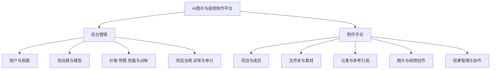
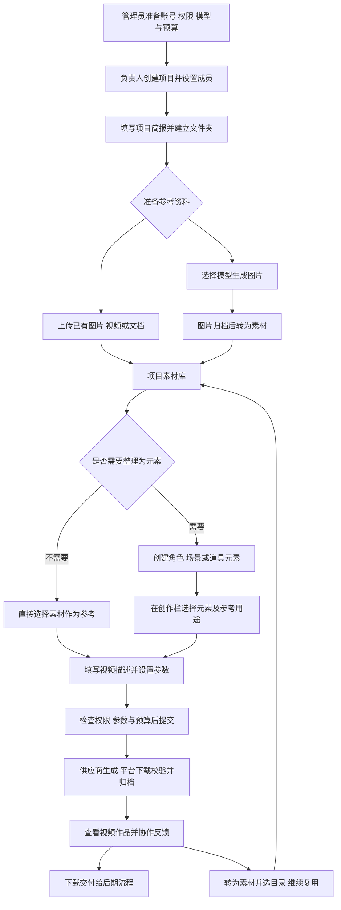
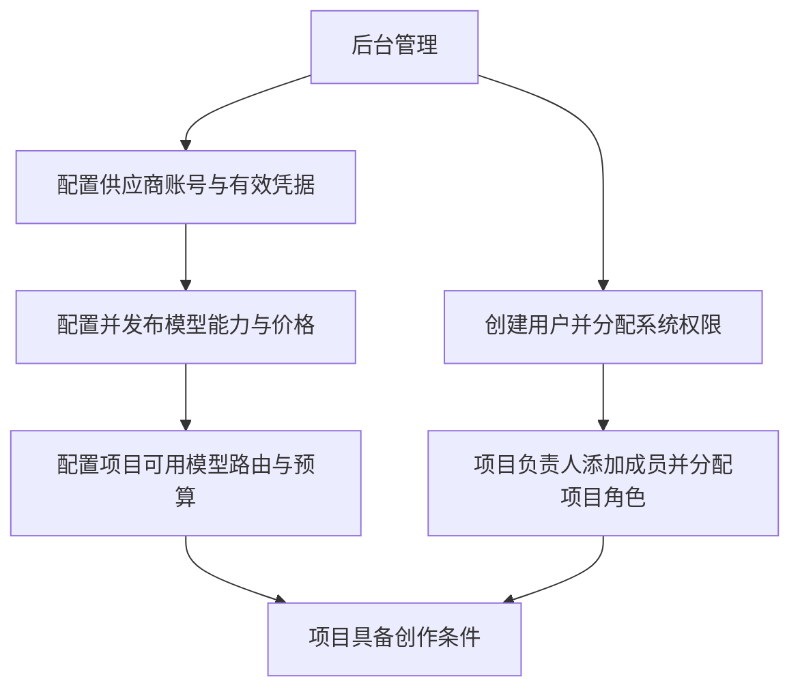
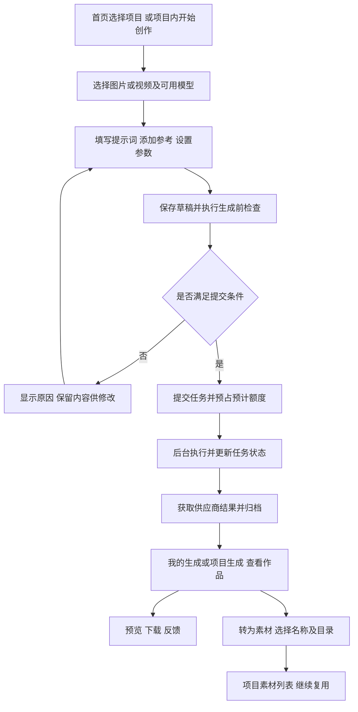

# AI图片与视频制作平台产品需求说明书

版本：V1.0 评审稿  
日期：2026年10月29日  
适用对象：公司管理层、业务负责人、项目负责人  
项目：higgsfield-ai

平台面向公司内部制作团队，将项目协作、素材管理、AI图片生成、AI视频生成和费用管理放到同一套工作流程中。业务主线是：**先准备或生成图片素材，再选择图片及可选的元素资料生成视频，最后保存、复用和交付成果。**

建设价值主要体现在三个方面：创作资料按项目集中管理；人物、场景等参考内容可以重复使用；每次生成的发起人、输入、结果和费用可以追溯。效率和成本改善需要通过试点数据评估，本期不预设未经验证的节省比例。

本文说明主要功能和操作路径，供范围评审及业务沟通使用。文中的路径结合当前代码实现编写；正式NAS、实际模型组合、费用和全流程仍需完成业务验收，不以本文作为上线完成证明。

## 1 产品范围与使用角色

### 1.1 两个工作入口

| 入口 | 主要使用者 | 主要任务 |
|---|---|---|
| 后台管理系统 | 系统管理员、模型与费用管理人员 | 管理账号权限、供应商、模型、价格、预算、异常与审计 |
| 制作平台 | 项目负责人、制作人员、获授权的查看与协作人员 | 创建或加入项目、管理素材、制作图片与视频、查看结果、反馈和复用 |

两个入口使用同一套用户体系。系统权限决定用户能使用哪些平台功能，项目成员权限决定用户能操作哪些项目内容。下表为业务职责划分，具体操作仍以实际授权为准。

| 角色 | 主要职责 | 典型成果 |
|---|---|---|
| 系统管理员 | 开通账号、分配系统权限、维护基础配置 | 员工可以按职责进入对应功能 |
| 模型与费用管理人员 | 配置供应商和模型，维护价格与预算，核对用量 | 项目有可用模型，费用有规则和归属 |
| 项目负责人 | 建立项目、填写简报、组织成员及目录、跟进成果 | 团队在统一项目范围内制作 |
| 制作人员 | 准备素材、维护元素、提交生成、整理作品 | 可复用图片素材和生成视频 |
| 查看与协作人员 | 在授权范围内查看、评论和提供反馈 | 明确的修改意见及工作状态 |

### 1.2 首期业务边界

首期覆盖项目内的图片与视频制作、素材与元素复用、基础协作、费用控制和文件归档。模型由外部供应商提供，平台负责统一接入和管理。

首期不包含完整视频剪辑与拼接、公司公共素材库、对外社区、公开分享、商业订阅，以及Canvas画布、独立Chat聊天和AI导演工作流。生成片段需要剪辑成片时，由团队现有后期工具承接。

## 2 主要功能全景

| 功能模块 | 主要功能 | 用户获得的业务结果 |
|---|---|---|
| 用户与权限 | 账号、系统角色、项目成员及项目权限 | 明确谁能查看、编辑、生成和下载 |
| 项目空间 | 创建项目、项目简报、成员设置、名称与生命周期管理 | 资料、人员和费用有统一项目归属 |
| 文件夹与素材 | 建目录、上传、筛选、预览、下载、移动、复制、版本和回收恢复 | 图片、视频及支持的文档集中整理 |
| 元素资料 | 角色、场景、道具等分类；名称、别名、描述、固定媒体版本与修订 | 形成可重复选择的创作参考资料 |
| 图片创作 | 选择模型、编写提示词、添加参考、设置参数、检查并提交 | 生成角色、场景及其他图片素材 |
| 视频创作 | 选择图片或视频参考，设置模型支持的参数并生成 | 生成可供后续制作使用的视频片段 |
| 任务与作品 | 进度、详情、固定输入、归档状态、预览下载、转为素材 | 结果可查、来源可追溯、内容可继续复用 |
| 协作与个人工作台 | 评论标注、工作状态、收藏、我的生成、我的元素 | 找到本人工作和团队反馈 |
| 模型与费用管理 | 供应商凭据、模型能力及授权路由、价格、预算、用量与对账 | 控制可用能力和使用额度，核对实际费用 |
| 文件与运维 | 授权访问、长期归档、异常定位、备份恢复要求 | 结果不会仅依赖供应商临时链接 |

以上为首期功能范围与已有实现方向；各模块的试点验收要求见第7节。

## 3 完整制作流程

### 3.1 从准备到交付的主路径

阅读顺序：**准备账号与模型 → 建项目和成员 → 准备素材 → 按需建立元素 → 生成视频 → 查看归档作品 → 下载或复用。**

### 3.2 一次业务制作的操作步骤

以“制作一段男主角在海滩活动的视频”为例，项目命名为projectA。片段时长以模型实际支持的范围为准。

| 步骤 | 操作人员 | 页面与操作路径 | 完成后得到什么 |
|---|---|---|---|
| 1 | 管理员 | 后台 → 用户管理、角色管理 → 创建账号并授权 | 可登录并使用获授权功能的用户 |
| 2 | 模型与费用管理人员 | 后台 → 供应商、凭据、模型、价格、预算、路由相关配置 | 项目可以调用的模型和计价条件 |
| 3 | 项目负责人 | 制作平台 → 我的项目 → 创建projectA | 团队工作空间 |
| 4 | 项目负责人 | projectA → 项目成员与设置 → 添加成员；项目简报 → 填写目标 | 明确的成员分工和制作要求 |
| 5 | 制作人员 | projectA → 文件夹 → 添加folder-assets、folder-shots | 素材和镜头的整理目录 |
| 6 | 制作人员 | folder-assets → 上传素材；或开始创作 → 图片 → 生成并转为素材 | 人物参考图characters1 |
| 7 | 制作人员 | folder-shots → 上传素材 → 选择参考视频 | 运镜参考reference_video_1 |
| 8 | 制作人员 | 项目素材 → 选人物图片 → 创建元素并填写名称、别名 | 可复用人物资料chart-boy；此步可选 |
| 9 | 制作人员 | 开始创作 → 视频 → 选择模型 → 添加人物图片或元素、参考视频 | 明确绑定参考内容的生成草稿 |
| 10 | 制作人员 | 填写海滩活动描述 → 设置支持的时长、比例等 → 检查并提交 | 一次可追踪的生成任务 |
| 11 | 制作人员 | 项目生成 → 任务详情 → 等待生成和归档 → 预览 | 可授权查看的视频作品 |
| 12 | 项目成员 | 查看作品 → 反馈和修改；满意后下载，或转为素材放入folder-shots | 可交付或继续复用的视频 |

两个文件夹名称仅用于业务整理，不自动限定文件类型。文档可以作为制作资料存放，但不是所有文件都能直接作为模型参考；图片、视频的参考用途由所选模型决定。

## 4 关键功能路径与规则

### 4.1 管理员准备路径

后台相关配置可以分工准备；图中表达的是最终依赖关系。只有账号、项目权限、可用模型、价格及预算等条件满足后，才允许提交相应生成任务。普通用户无需接触供应商密钥。

### 4.2 素材准备与元素复用路径

**直接素材路径：** 项目 → 文件夹 → 上传素材 → 预览确认 → 创作栏“＋” → 选择素材及参考用途 → 加入草稿。

**元素复用路径：** 项目素材 → 选择图片或视频 → 创建元素 → 填写名称、别名和描述 → 保存 → 创作栏“@” → 选择元素 → 加入草稿。

元素用于整理角色、场景、道具等资料；可以关联固定的图片或视频素材版本。一个元素可以组织多份参考媒体，实际传入模型的数量和类型仍受模型规则限制。

必须保留以下产品规则：

- 创建元素后，原素材继续存在；元素与素材是关联关系。
- 元素不是生成视频的必经步骤，直接引用素材也可以创作。
- 使用选择器建立真实引用，不能把在普通文字里输入“@别名”当作已经引用文件。
- 历史任务固定引用当时的素材版本和元素修订；更新资料不能改变旧任务的输入。
- 人物参考能帮助保持特征，但不承诺不同模型和不同次生成的人物完全一致。

### 4.3 创作与结果保存路径

**当前重要边界：生成成功并归档后，作品先出现在生成任务中；点击“转为素材”后，才进入项目素材列表。** “生成后自动加入当前文件夹”不作为当前已交付行为描述。转为素材复用已归档文件，无需用户再次上传。

首页必须选择有创作权限的项目；没有子文件夹也能创作。首页草稿默认使用项目根层上下文，文件夹内的新草稿可以带上当前目录。已打开草稿保留原目录上下文，用户应以草稿显示的保存位置为准。

保存草稿不等于提交生成；提交受理不等于供应商完成；供应商完成也不等于平台文件已经归档。

### 4.4 全局导航与项目导航

| 用户从哪里进入 | 可以看到什么 | 与其他页面的关系 |
|---|---|---|
| 首页 | 快速输入创意、选择项目并开始创作、最近项目 | 创作仍属于选定项目 |
| 我的项目 | 当前可访问的项目 | 进入项目工作区的入口 |
| 我的生成 | 本人发起且仍有权访问的跨项目任务 | 与项目生成共享任务记录 |
| 我的元素 | 本人创建或收藏且仍有权访问的元素 | 与项目元素共享来源资料 |
| 我的收藏 | 本人收藏且仍可访问的内容 | 提供快捷查找，不扩大权限 |
| 我的用量 | 获授权展示的本人用量与费用信息 | 按实际费用可见权限展示 |
| 项目 → 项目简报 | 当前项目的制作要求和说明 | 团队共同理解制作目标 |
| 项目 → 项目成员与设置 | 当前项目成员及角色 | 控制项目内可执行操作 |
| 项目 → 全部素材或文件夹 | 当前项目素材及目录内容 | 管理上传素材和已转入的生成作品 |
| 项目 → 项目元素 | 当前项目内有权读取的元素 | 为项目创作提供可复用资料 |
| 项目 → 项目生成 | 当前项目权限范围内的生成任务 | 可包含其他成员发起的任务，依权限而定 |
| 项目 → 开始创作 | 当前项目草稿与生成入口 | 不产生独立于项目的存储空间 |

同一任务可以同时出现在“我的生成”和“项目生成”，同一元素也可能出现在个人和项目入口；这些是不同查询视角，不代表重复保存文件。

### 4.5 反馈与再次制作路径

项目生成 → 打开任务和作品 → 预览、评论或标注 → 制作人员调整描述与参考 → 发起新任务 → 对比结果 → 标记工作状态 → 下载交付。

评论、标注和工作状态用于团队沟通；不将这些功能描述为已经建成多级审批、自动派单或完整审核工作流。新一轮生成仍需要重新检查参数、权限和预算。

## 5 文件归档与费用控制

### 5.1 文件保存在哪里

| 内容 | 保存职责 |
|---|---|
| 用户、权限、项目、成员、文件夹 | 数据库保存业务记录与关系 |
| 素材名称、元素别名、版本、提示词、任务与费用 | 数据库保存内容描述及追溯信息 |
| 图片、视频和上传文档的实际文件 | 文件存储保存，正式环境要求长期保存到公司NAS |
| 供应商临时结果地址 | 仅用于获取生成文件，不能替代平台长期归档 |

数据库记录“这份文件属于哪个项目、哪个素材版本、哪次生成”，并记录实际文件的位置。平台文件夹是逻辑分类，不要求与NAS上的物理文件夹一一同名。

访问路径为：**用户打开素材或作品 → 平台核验权限 → 读取存储文件 → 返回预览或下载内容。** 用户不直接访问NAS共享目录。生成使用外部供应商时，所需提示词与参考媒体按接口要求受控传输，供应商不直接读取整个公司NAS。

当前本地开发配置使用本机测试存储；正式NAS协议、访问路径、容量、备份和恢复方案需要运维确认并验证。

### 5.2 每次生成如何控制费用

选择模型和参数 → 检查价格及预算 → 按权限展示可用估算 → 提交时预占预计额度 → 记录实际用量并结算 → 在后台核对费用及供应商账单。

平台内部计价与供应商采购成本分别管理。预占是内部额度控制，不等于实际付款；缺少用量或费用依据时应显示待确认，不能按免费处理。估算可见性受权限控制，不假设所有制作人员都能查看采购成本。

### 5.3 用户遇到异常时的路径

| 情况 | 用户应得到的反馈与后续路径 |
|---|---|
| 没有项目权限或没有可用模型 | 明确提示原因，选择其他获授权项目或联系管理员 |
| 参数、参考类型或数量不兼容 | 在提交前指出问题，保留草稿供修改 |
| 预算不足 | 阻止新的不合规提交，由负责人调整使用安排或申请额度 |
| 上传部分失败 | 在上传记录中定位文件并重试，不要求重选所有成功文件 |
| 生成提交结果不确定 | 查询既有任务或由管理员核查，避免重复发起和重复消费 |
| 已生成但归档失败 | 显示归档异常；对可恢复的结果重试归档，不重新生成 |
| 项目归档或成员移除 | 限制新的操作和访问，保留历史任务、归属和费用证据 |

## 6 需求优先级与交付顺序

首期按现有B1—B4业务批次组织，先走通制作闭环，再完成试点交付。以下为功能顺序，不承诺未经排期的完成日期。

| 批次 | 必须形成的业务能力 | 阶段判断方式 |
|---|---|---|
| B1 管理与项目基础 | 账号权限、项目成员、供应商、模型、价格和预算可配置 | 管理员能完成准备，普通用户只能操作授权项目 |
| B2 图片创作闭环 | 上传或生成图片，追踪任务、归档结果、转为素材，记录费用 | 一次真实图片生成从页面提交到文件归档、费用归属连续完成 |
| B3 图片资产到视频 | 选择素材或元素作为参考，生成视频并长期保存 | 同一业务任务中的参考、供应商结果、归档文件和用量能够对应 |
| B4 协作与试点 | 内容组织、评论标注、工作状态、用量与对账、异常恢复 | 项目团队按真实角色连续完成一次制作，权限和恢复场景通过验证 |

当前仓库已包含上述主要页面与后端实现，并已有局部测试及操作记录。正式交付判断以业务场景验收为准；本PRD不将历史测试结果、页面存在或本地文件保存等同于真实供应商及公司NAS验收。

## 7 试点验收与待确认事项

### 7.1 业务验收场景

| 验收场景 | 通过标准 |
|---|---|
| 账号与项目权限 | 普通员工能登录授权项目；无权项目和操作不可访问；成员移除后重新验证访问限制 |
| 项目与素材组织 | 创建项目及两级目录，上传图片、视频，准确预览、查找及下载；验证移动和回收行为 |
| 图片生成 | 使用获授权模型提交真实任务，结果归档可读，可转入指定素材目录 |
| 元素复用 | 从素材建立元素，在新任务中选择真实引用；历史任务仍能追溯固定版本 |
| 视频生成 | 使用模型支持的图片或视频参考完成一次真实视频生成，结果可预览和下载 |
| 导航一致性 | 本人任务在个人与项目视角中对应同一记录，元素可按来源追溯 |
| 费用与异常 | 核对预占、用量和费用；验证提交不确定及归档重试不会直接产生新的生成请求 |
| NAS与恢复 | 正式文件确实落到公司NAS；授权访问正常；断开存储、恢复及备份恢复有可核验结果 |
| 基础体验 | 亮暗主题下主要页面、表单和弹层可用；切换主题保留输入与当前位置 |

试点期间建议记录：完成一次制作的时间、生成成功率与归档成功率、参考素材复用情况、可归属任务的费用比例、团队反馈问题。先形成基线，再确定优化目标，不提前承诺收益数字。

### 7.2 需业务与运维共同确认

| 事项 | 需明确的内容 |
|---|---|
| 首个试点 | 试点项目、负责人、参与人员及实际交付样例 |
| 首批模型 | 实际开放的图片与视频模型组合，以及支持的参数与参考类型 |
| 预算和费用可见范围 | 试点额度、额度调整负责人、制作人员可见的费用范围 |
| 正式部署与存储 | 内网服务器方式、NAS协议与路径、容量、备份和恢复责任人 |
| 正式业务验收 | 按B1—B4确认验收人员与时间，保留真实任务、文件及费用证据 |

## 附录 相关项目文档

- [首期需求与业务规则说明书](首期需求与业务规则说明书.md)：详细范围与业务规则。
- [制作平台建设方案 管理层阅读版](制作平台建设方案-管理层阅读版.md)：建设背景与管理视角。
- [人工验收操作手册](人工验收操作手册.md)：具体操作与验收证据要求。
- [内网部署与NAS存储运维方案](内网部署与NAS存储运维方案.md)：正式部署及存储约束。
- [当前交付状态](当前交付状态.md)：历史阶段记录，需结合最新执行证据判断，不作为实时环境状态。
