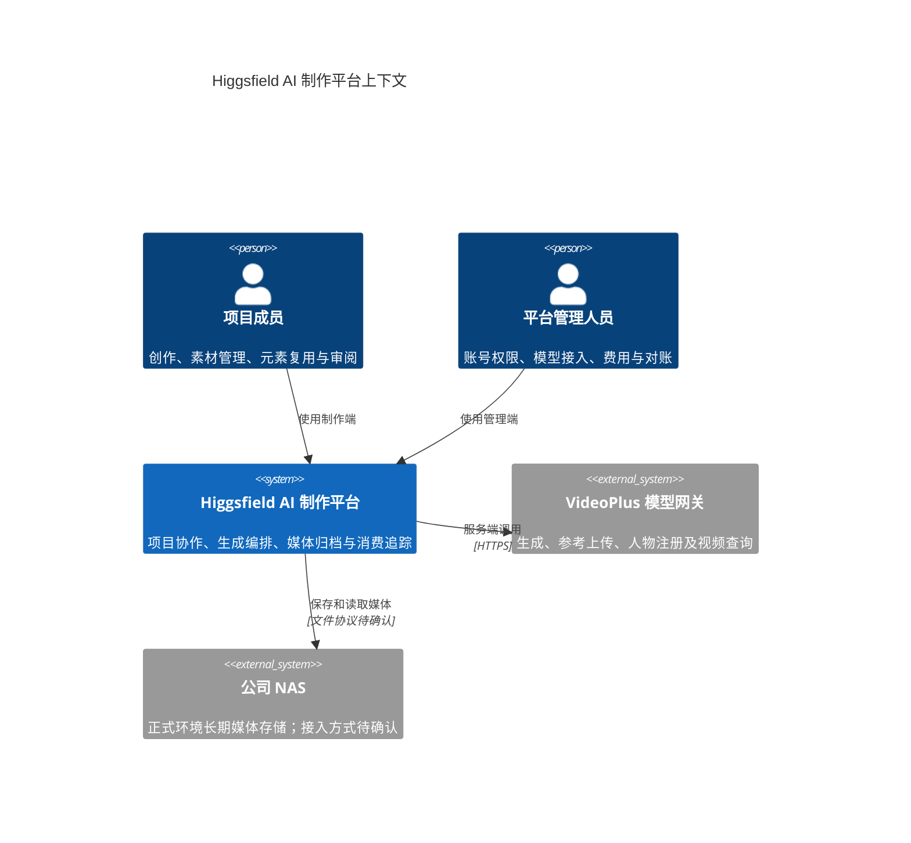
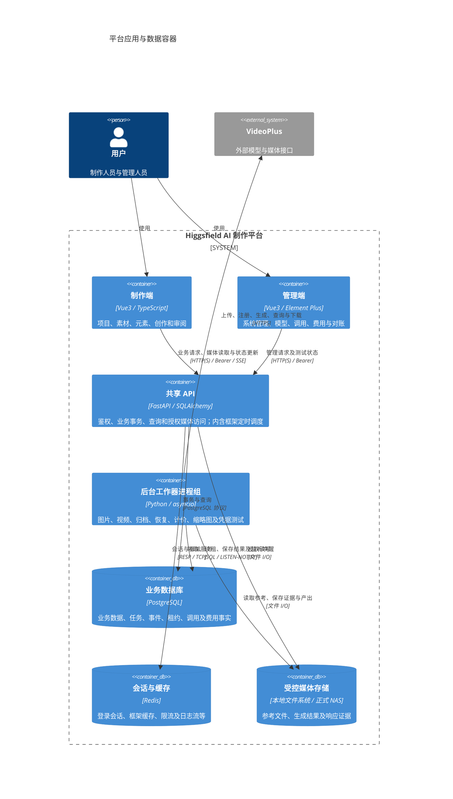
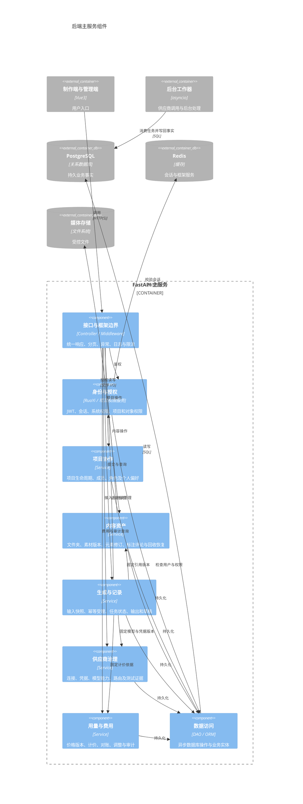
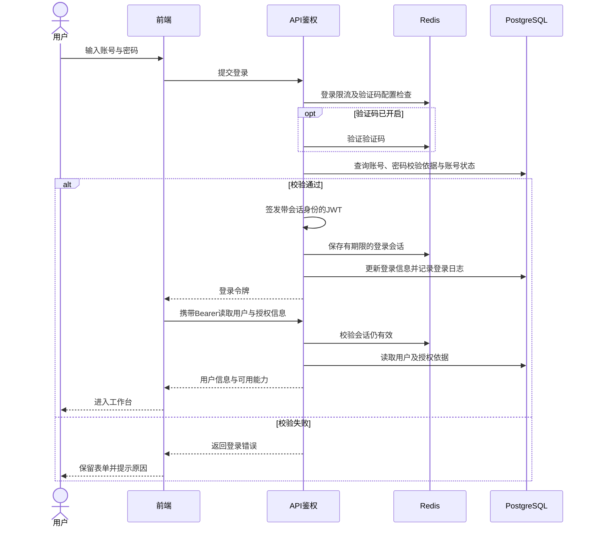
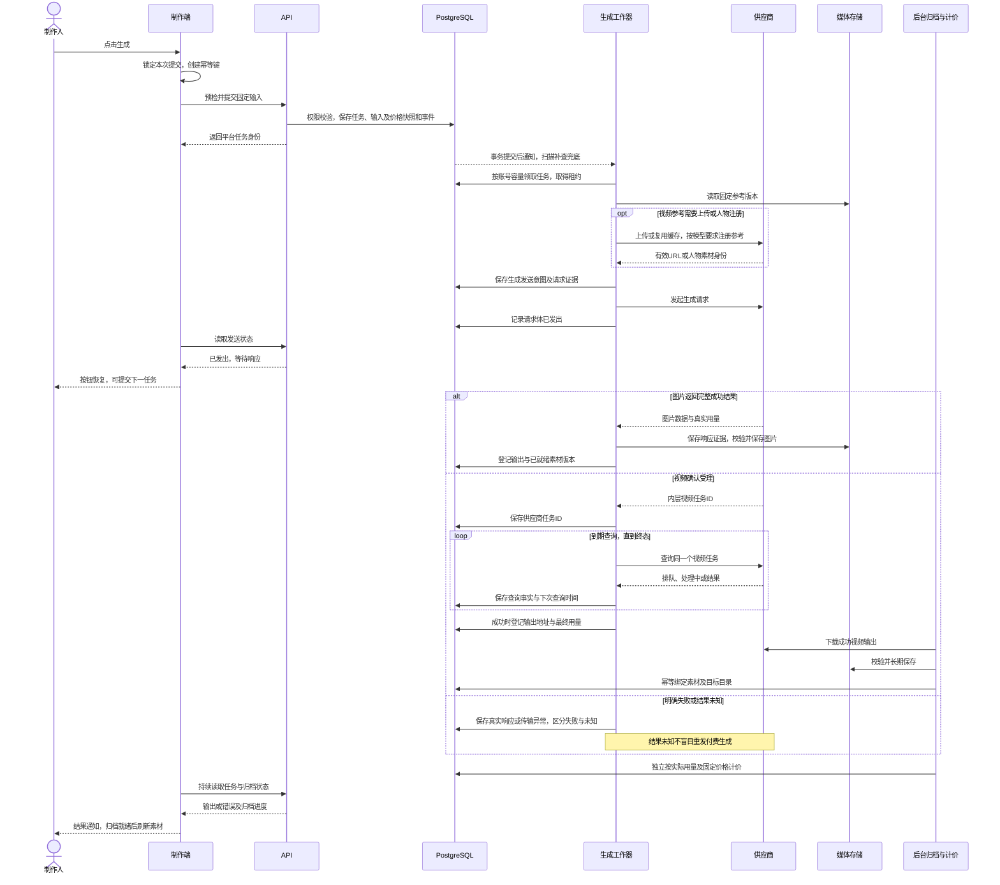
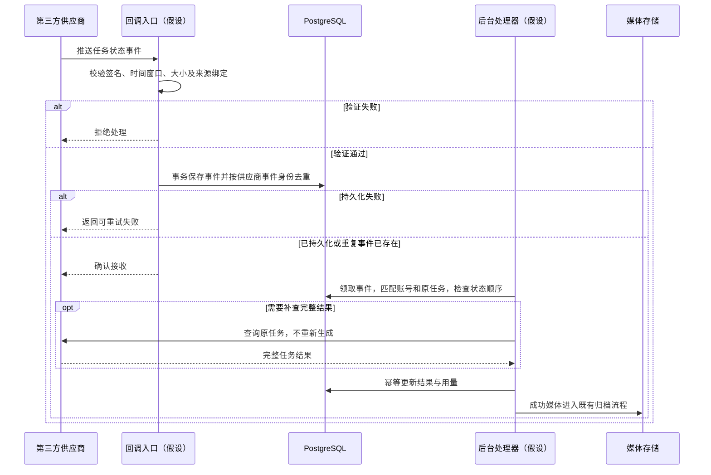
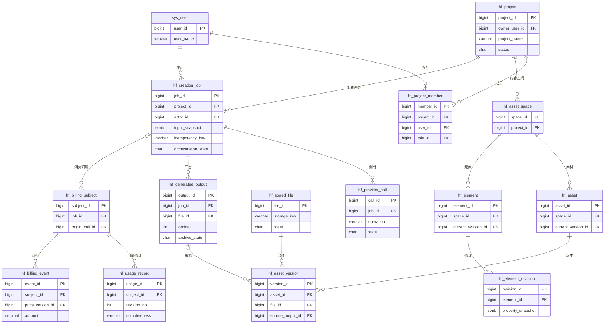
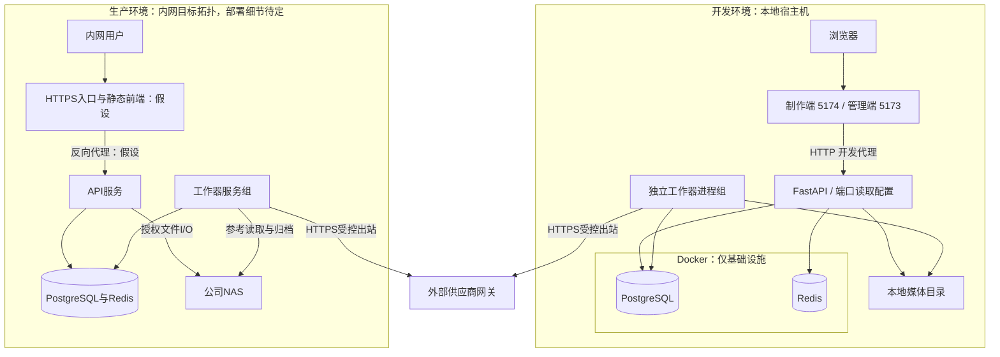

# Higgsfield AI 制作平台系统架构设计

## 1. 系统简介、业务目标

本文为 SAD / HLDD 概要设计，采用 C4 Context、Container、Component 三层视图，不展开接口字段和函数实现。核对日期：2026-11-05；源码基线：`fc7d091`。面向开发、测试与技术评审。

**系统定位：**面向企业制作团队的 AI 图片与视频生产协作平台，以项目组织成员、素材和可复用元素，集中执行供应商生成任务，保存产出并追踪用量与费用。

| 项目 | 说明 |
|---|---|
| 解决的问题 | 参考素材分散、生成过程不可追踪、供应商临时结果难以长期保存、协作权限及消费归属不清 |
| 业务目标 | 输入可追溯、任务可恢复、结果可归档、权限可控制、费用有依据 |
| 制作侧角色 | 项目 Owner、负责人、制作人、查看者；项目角色与系统管理角色分开 |
| 管理侧角色 | 平台管理、供应商模型配置、费用查询与对账等权限持有者 |
| 技术栈 | Vue3、Vue Router、Pinia、Axios；FastAPI、异步 SQLAlchemy 2.0、asyncio；PostgreSQL、Redis |
| UI | 制作端 TypeScript、shadcn-vue 与 Element Plus；管理端 RuoYi Vue3、Element Plus；共享亮暗主题语义 |
| 外部对接 | VideoPlus 模型网关及其上传、人物素材注册、视频状态查询能力；公司 NAS 为正式媒体存储目标 |
| 核心边界 | 不在本平台实现视频剪辑；不自行部署模型推理；不把供应商临时 URL 当永久素材 |

当前是**模块化单体 API + 独立后台工作器**，不是微服务集群。制作端与管理端共用后端，不另设 BFF。预算和项目专用路由存在存量模块，但当前实际用量生成链路不以预算预占为前置条件。

## 2. C4 上下文图（Context）

- 项目成员只操作获得授权的项目和对象，创建者不是唯一可见用户。
- 平台管理权限控制供应商配置、凭据测试、调用记录和费用等能力；项目权限仍由业务层检查。
- 供应商负责生成；平台负责输入固定、状态追踪、结果校验、归档和计价。
- NAS 不直接面向浏览器；本地开发使用受控磁盘目录。当前没有将 MinIO/S3 作为必需存储服务。

## 3. C4 容器图（Container，核心）

C4“容器”表示应用或数据存储边界，不意味着采用 Docker 部署。

| 容器或机制 | 当前职责与边界 |
|---|---|
| 制作端 | `higgsfield-frontend`；页面、组合函数、API 模块分层，浏览器不持有供应商密钥 |
| 管理端 | `ruoyi-fastapi-frontend/vue3/web`；供应商测试先预览请求，再由用户主动开始 |
| API | `ruoyi-fastapi-backend`；短事务受理任务，不用浏览器长连接承载供应商生成调用 |
| 工作器 | 独立于 API 生命周期；本地脚本按模式启动独立进程，进程内使用有上限的异步并发或批量处理 |
| 定时任务 | API 内有 RuoYi/APScheduler 调度；生成领取、视频查询到期和归档由工作器调度，二者不能混同 |
| 消息机制 | 无生成专用 Celery、RabbitMQ 或 Kafka；PostgreSQL 任务及事件是持久事实，NOTIFY 只唤醒，扫描补查兜底 |
| Redis | 不是生成任务的唯一存储，也不替代 PostgreSQL 任务状态；框架日志流与生成调度分开 |
| 媒体存储 | 数据库保存文件身份与元数据；实际字节保存于受控存储根目录 |

## 4. C4 组件图（后端主服务）

图中边界为 API 主服务内部组件；工作器是外部执行容器，复用同一代码库中的领域服务。

分层沿用 `controller → service → dao → entity/do`，输入输出模型位于 `entity/vo`。Service 管理事务和对象权限，DAO 负责数据库操作；并发任务不共享 AsyncSession。

核心源码范围为 `module_admin`、`module_higgsfield`、`config/scheduler` 及公共鉴权、中间件、日志模块。供应商网络调用在工作器中执行，不绕过主服务受理时保存的快照和权限约束。

## 5. 关键业务时序图

### 5.1 登录流程

JWT 签名有效不等于会话有效；后端还检查 Redis 会话与用户信息。验证码按配置启用，不能将其描述为始终开启。系统菜单权限和项目成员权限在后续业务请求继续检查。

### 5.2 业务提交流程：图片与视频生成

平台受理、供应商受理、生成成功、归档成功、费用确定是不同事实。工作器续租与版本栅栏保护并发写入；HTTP 等待和文件下载不持有业务事务锁。恢复已收到的图片、视频查询重试和视频归档重试均不等于重新生成。

### 5.3 第三方回调流程

**当前未发现生成供应商的回调接收实现。**图片走请求响应，视频走后台查询；前端 SSE 是平台向浏览器推送，不是供应商回调。下图仅为【假设】未来供应商支持并启用回调时的设计，不属于已实现能力。

未来落地前须确认供应商签名协议、事件身份、重试规则和公司内网可达方案；不得直接开放数据库或 NAS。回调与查询若共存，必须共享同一终态保护和去重规则。

## 6. 核心数据模型 / ER 图

以下仅保留核心实体与关键字段。`PK` 为主键；图中的 `FK` 表示**逻辑关联字段**，不是数据库物理外键。项目约束明确不建立物理外键，关联完整性由事务、锁、唯一约束及业务校验保证。

- **项目与空间：**项目关联成员和内容空间；目录负责空间内组织，个人置顶、隐藏与排序不改变项目权限。
- **素材与元素：**素材身份、固定素材版本、物理文件分离。元素通过修订媒体关联表引用固定素材版本；任务快照保留当时引用，不随后续编辑变化。
- **任务与调用：**一个任务可能包含参考上传、生成提交及多次状态查询；平台任务 ID、供应商任务 ID 与调用 ID 不混用。
- **输出与素材：**输出先记录供应商产出事实，归档就绪后自动绑定素材版本。`job_id + ordinal` 唯一约束防止同一输出重复登记。
- **用量与费用：**用量以修订保存，未知用量不当作零；平台费用与采购费用分口径计价，固定价格版本，账本与审计证据不开放删除。
- **未展开的关联：**项目角色、目录、元素修订媒体、标注评论、模型与凭据版本、任务事件、计价明细和对账均有独立实体；本图不替代完整数据字典。

业务表采用 bigint 自增身份、RuoYi 审计字段；可逻辑删除对象使用 `del_flag`。任务接受键、版本号和关联表保留联合唯一约束；数据库变更通过 PostgreSQL 迁移实施。

## 7. 部署拓扑与环境说明

开发拓扑来自本地 Compose 与启动脚本。正式拓扑中反向代理和分区为【假设】建议方案；公司内网部署及长期媒体保存到 NAS 是既定约束，服务器数量、OS、容器化方式和 NAS 挂载协议待确认。

| 环境 | 资源与数据 | 网络与域名 |
|---|---|---|
| 开发 | 本地 Docker 启动 PostgreSQL、Redis；API、两个前端和工作器运行在宿主机；本地磁盘保存媒体 | `localhost`；Compose 默认 PG 映射 35432、Redis 映射 36379，仅绑定回环，可用环境变量覆盖 |
| 测试 | 已有隔离 schema、数据库迁移、回环模拟供应商及前端测试；不能据此认定已部署常驻测试环境 | 独立测试域名未确认；自动测试不得误用真实收费凭据 |
| 预发 | 【假设】部署结构与生产相近，隔离账号、数据库、缓存、媒体与密钥，用于发布验证 | 域名与资源待确认；受控出站及 NAS 权限应覆盖生产同类路径 |
| 生产 | 内网服务器与 NAS；CPU、内存、数据库规格、进程副本数和备份资源未定 | 正式域名、TLS终止、内网访问策略及供应商出站白名单待运维确认 |

本地 `start-local.ps1` 复用或启动工作器后启动 API，不启动 Docker 或前端。API 热重载不更新工作器内存代码；工作器升级需安全停止并重启。正式环境应配置进程托管、健康检查、备份与告警，不能将本地脚本当作已具备生产高可用。

容量按供应商账号限制、活跃任务、图片解码峰值、视频下载带宽、数据库连接及 NAS 吞吐核定。当前没有可承诺的 QPS、并发用户数或端到端延迟指标。

## 8. 风险、约束与安全说明

| 事项 | 当前机制与验收重点 |
|---|---|
| 重复付费 | 受理幂等、发送意图和调用证据；超时不推断供应商失败，不自动创建新生成请求 |
| 调度与恢复 | 通知加扫描补查、租约续期、版本栅栏和有界并发；调度锁按 schema 隔离，不能绕过供应商账号容量 |
| 多用户公平性 | 准备任务按用户轮转并在空闲时补位；不抢占在途请求，不承诺严格配额或无限并行 |
| 外部故障 | 分开记录 HTTP、响应解析、供应商任务和归档状态；HTTP 200 不等于生成成功，已生成不等于已保存 |
| 媒体丢失 | 临时下载地址可能过期；归档重试不能保证过期源恢复。NAS 不可用、容量不足与备份恢复必须单独演练 |
| 权限 | 系统角色和项目角色分层；后端检查成员、项目状态及对象归属，不能仅靠前端隐藏按钮。撤权与缓存失效需回归 |
| 凭据与数据 | 供应商凭据及敏感临时地址加密，展示证据脱敏；密钥与数据备份分开保管，密钥丢失会影响恢复 |
| 防攻击 | 登录限流、配置化验证码、输入与媒体限制；结果下载有主机白名单及地址检查。生产仍需验证 TLS、CORS、上传大小、超时及 SSRF 边界 |
| 数据一致性 | 无物理外键，必须通过事务和引用校验维护关系；数据库与文件系统不构成单一原子事务，需验证补偿与孤立文件处理 |
| 审计与费用 | 保留输入快照、请求/响应证据、用量、价格版本和费用调整；不可变历史不因项目或素材删除而清除 |
| 部署与升级 | API 与工作器独立升级；改变锁和协议等协调机制时统一切换相关工作器，避免长期混跑不同版本 |
| 可观测性 | 区分进程存活、数据库就绪、任务进展、供应商结果和归档结果；健康心跳不能代替业务成功证据 |

发布验收至少覆盖：相同提交不重复生成、用户间并发调度、请求发出后按钮恢复、断连与未知结果、视频查询不重发、归档恢复不重复建素材、越权访问拒绝、费用与原始用量对应。单元测试和模拟供应商通过不能替代真实供应商、NAS、亮暗主题及完整用户路径验收。

源码依据：`ruoyi-fastapi-backend/server.py`、`module_admin/controller/login_controller.py`、`module_higgsfield/controller`、`module_higgsfield/service`、`module_higgsfield/dao`、`module_higgsfield/entity/do`、`module_higgsfield/worker.py`，以及 `docker-compose.local.yml`、`scripts/worker-settings.json`、两个前端工程。除明确标注的【假设】外，本文描述代码结构与职责，不证明相关部署已经上线。
