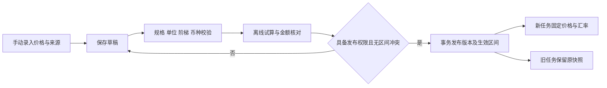
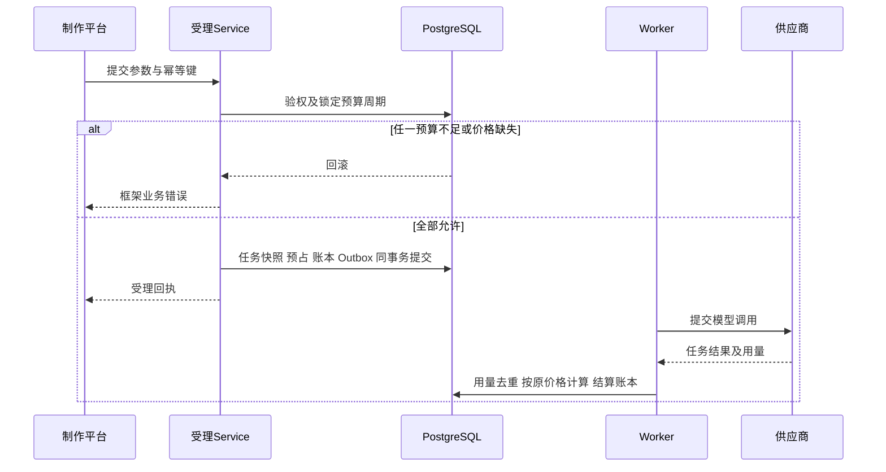
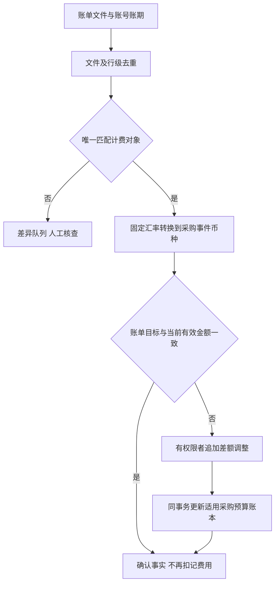

# higgsfield-ai · 价格用量预算说明

版本：1.3 评审稿  
日期：2026 年 10 月 27 日  
文档编号：P0-5  
范围：模型价格配置、用量归一、计价、预算、对账与调整  
状态：目标业务与计算契约；未配置真实价格、未执行收费调用、未编写业务代码

> 本轮设计同步依据：[制作平台实查功能与实现基线](制作平台实查功能与实现基线.md)及[实查设计同步报告](实查设计同步报告.md)。图片资产→元素/@引用→视频→NAS为首期主线；Tools和文本会话暂缓，角色权限配置统一后台。原站实测、设计约定和本平台运行验收分别记录。

## 1 依据、确认状态与范围

承接[技术架构方案](技术架构方案.md)第 9 章、[P0-1 首期需求](首期需求与业务规则说明书.md) BIL-01～10、GEN-03～09、ADM-06、[P0-2 供应商契约](模型供应商接入契约与差异清单.md)、[P0-3 数据库设计](数据库详细设计.md)、[P0-4 平台 API](平台API契约.md)及[P0-6 权限矩阵](权限矩阵.md)。遵循[AGENTS.md](../AGENTS.md)：PostgreSQL、若依字段和异步分层、Service 事务、框架响应与权限；前端 Vue3/Pinia/Axios，仅展示服务端计算结果。

P0-5 为文档编号，需求等级仍以 P0-1 和[统一索引](文档一致性与优先级索引.md)为准。本文 CALC/FIN 编号仅用于计算与验收追踪，不新增优先级体系。

已确认：价格后台手动维护；SD 2.0/2.5 平台计价采用用户官网截图；采购价与账单分开；版本固定；不重复消费；未知不当免费。本文细化的公式、去重、账本守恒为目标实现契约。月度预算、默认控制币种、无预算配置如何处理、估算上界及部分用量处理是评审提案，实施前按 §15 确认，不因文档完成而视为业务批准。

本期为公司内部额度与成本管理，不是向员工收款的支付系统；不增加充值、发票、积分或资金账户。真实价格依据为已提供的[供应商价格文档](../references/购买的apikey公司提供的文档/model-pricing.md)及[留存官网截图](价格来源/)。本轮未联网核验实时价格或重新联调，数据仅作为待发布初始草稿。

## 2 三种金额与唯一计费对象

| 名称 | 数据口径 | 用途与边界 |
|---|---|---|
| 平台计价 | purpose=platform | 公司内部定价及可选预算控制；不是员工实付金额 |
| 采购估算 | purpose=procurement | 按账号报价及用量估算的采购成本；不是供应商确认扣款 |
| 账单确认金额 | hf_reconciliation_line 的原币种事实，关联采购事件 | 根据账单确认/调整采购金额；不是第三个应与前两者相加的费用事件 |

同一计费对象的 platform/procurement 各自最多一个 hf_billing_event（UQ(subject_id,purpose)）。生成调用、测试、注册、确实收费的查询分别以 subject_kind 区分；普通状态轮询新增 hf_provider_call，但不重复创建 generation 费用。同步调用没有上游 ID 时使用原始调用身份；不能按相同提示词合并两次合法生成。

项目生成归原任务 user_id、发生时 dept_id、project_id；Worker 不是消费人。Key 测试归管理成本中心；注册费归预先配置的发起项目或成本中心，复用同一注册对象不重复收费。现有预算只支持 user/project 主体，不把成本中心费用塞入某员工预算；成本中心专属限额如需要，另补 P0-3/P0-4，开放测试前仍需确认预期费用和供应商额度。

## 3 后台价格配置与发布

### 3.1 配置层次

| 对象 | 必填内容 | 校验与作用 |
|---|---|---|
| 精确规格 model_variant | 模型能力版本、分辨率、视频输入标志及该能力要求的尺寸/质量/服务等级等 | 规格由服务端规范化；价格存在不等于模型能力已验证 |
| 价格簿 price_book | variant、purpose、currency；采购 accountId | 平台首期 accountId 为空；采购必须绑定账号；不按模型展示名模糊匹配 |
| 价格版本 price_version | versionNo、schemaVersion、half_up、calculationScale、分项、来源 | 草稿可不完整，发布后正文不可变 |
| 分项 rule_item | itemCode、unit、unitQuantity、unitPrice、quantityFrom/To、formulaTemplate | 单价非负、基数大于零；0 价必须 freeReason；模板为白名单键，不执行管理员输入脚本 |
| 生效区间 activation | effectiveFrom 含起点、effectiveUntil 不含终点、revision | 同价格簿区间不重叠；结束旧区间与发布新区间同事务 |
| 来源 source | 文档/截图/人工确认、摘录、获取时间、受控附件 | 发布至少一份证据，临时本机路径不能作为线上来源 |
| 汇率版本 | baseCurrency、quoteCurrency、rate、有效区间、来源 | 1 基础币换 rate 计价币；同币对已发布区间无歧义 |

Token模型的itemCode使用input、output、video_tokens，单位token、unitQuantity=1000000。H3视频候选使用output_seconds/reference_seconds（second、基数1）与input_images（image、基数1），目标白名单模板键定义为linear（单价线性）/tiered（累计分段）；0～5张免费段必须填写freeReason。H3在秒数归一、阶梯试算和真实用量验证前不发布。字符与缓存输入仍为未来文本/语音模板，不因报价登记开放产品。多模态输入 Token 若已包含图像/音频，不另加按图/音频费。

手动复制粘贴内容只进入草稿：录入→类型与来源校验→离线试算→差异预览→有权限者发布。不能直接把官网 HTML 或自然语言公式当可执行规则，也不能通过价格配置自动启用 Fast/4K 或其他未验证能力。

### 3.2 匹配与快照

匹配键为精确 variant + purpose + account 范围 + 配置币种 + 受理时间。能力版本和参数合法后，服务端确定 variant；平台价不能由前端选择“更便宜版本”。命中 0 条拒绝所需口径消费；命中多条视为配置冲突，不随机选一条；不默认回退低分辨率、无视频或其他账号价格。

任务受理固定平台价、适用采购价、汇率版本、预算周期与估算依据。估价不固定额度；携带 estimateToken 时价格发生变化按 P0-4 返回 PRICE_CHANGED 重新确认。排队后调价不影响已受理任务，重新生成才按新受理时间取价。

平台价必须存在。采购价缺失且没有采购预算约束时，建议允许已满足平台预算的任务，标记采购未知并告警；若采购预算生效则阻断。采购缺价时不能创建 price_version_id 为空的 hf_billing_event，保留 subject、usage 与任务待确认事实；补价需有历史适用依据和审计，不能使用“当前最新价”自动回填历史。

## 4 初始价格草稿与适用边界

下表单位为 CNY/百万计费 Token，按来源原样保留。SD 平台价格两个输入模式分别建规则；供应商完成用量的定义仍需对应模型验证。

| 模型规格 | 平台无视频/有视频 | 采购无视频/有视频 |
|---|---:|---:|
| SD 2.5，480p/720p | 70 / 70 | 70 / 42 |
| SD 2.5，1080p | 77 / 77 | 77 / 46 |
| SD 2.0，480p/720p | 46 / 46 | 46 / 28 |
| SD 2.0，1080p | 51 / 51 | 51 / 31 |
| SD 2.0，4K | 26 / 26 | 26 / 16 |

来源为[SD2.5 无视频](价格来源/SD2.5-无视频输入.png)、[SD2.5 有视频](价格来源/SD2.5-包含视频输入.png)、[SD2.0 无视频](价格来源/SD2.0-无视频输入.png)、[SD2.0 有视频](价格来源/SD2.0-包含视频输入.png)及供应商价格文档。截图近似“元/秒”和 5 秒示例不是固定秒单价；有视频输入截图示例金额相同，不证明输入视频免费。4K 有价不代表网关已支持。

| 网关模型 | 采购输入/输出 USD 每百万 Token | 说明 |
|---|---:|---|
| mm-gemini-2.5-f | 0.27 / 30.00 | 保留文档原价，不能自行改为 0.30 |
| mm-gemini-3.0-p | 2.00 / 12.00 | 平台是否采用同价须独立发布 |
| mm-gemini-3.1-f | 0.50 / 3.00 | 同上 |
| mm-imagen2 | 5.00 / 30.00 | 内层实际 Token；不叠加旧 0.0035 USD/张 |

Fast 报价仍以架构 §9.5 的采购草稿为准，没有本轮官网平台价格依据；H3纳入视频候选，其秒数及图片计价随能力验证发布；M3与语音仅保留后续模板。计费公式示例不等于任何模型已上线。

## 5 用量证据、归一与修订

| 场景 | 计价来源 | 禁止行为 |
|---|---|---|
| Gemini | 经验证的外层 usage，输入/输出映射到 input_tokens/output_tokens | 把整个 total_tokens 同时当输入和输出；忽略历史上下文和图文输入计量 |
| 图片 | 二次解析 content 后的内层 usage，按 P0-2 精确字段映射 | 使用外层 0；n 张输出时把请求级 usage 乘 n；叠加无依据按张费 |
| Seedance | 内层任务结果 usage.completion_tokens → video_tokens | 使用外层响应 ID 查费；在返回 Token 上再加估算参考视频 Token |
| 流式 | 已验证的最终 usage 或可靠累计修订 | 把每个分片累计值求和；按可见文字长度冒充计费 Token |
| 缺失/部分/异常 | completeness=unknown/partial，原证据保留 | null 变 0、负数取绝对值、解析失败静默免费 |

hf_usage_record 保存 source_path、parser_version、is_cumulative、raw_usage、payload_hash 与修订号。相同 subject/payload_hash 重复返回只记调用，不再记用量修订或费用；不同修订不求和。累计值减少或规格变化保留异常证据，不能用“最后到达响应”覆盖较新的可信事实；需供应商修订依据或人工核查。

真实用量为非负值；0 只有经验证真实为零才计零。截图公式可产生小数 Token，用于预估的 Decimal；当前数据库实际 token 字段为 bigint，供应商若返回分数不得截断强存，先作为原始证据并标记差异，正式支持前补类型/契约。

## 6 计费公式、阶梯与精度

普通分项原始金额 `raw_i = quantity_i / unitQuantity_i × unitPrice_i`。输入、输出及缓存等项必须互斥；缓存如包含在总输入中，普通输入=总输入−已核验缓存输入，不能两个都用总输入。首期没有缓存字段/模板的组合保持关闭。

阶梯采用累计分段计费，而非“命中某档后全量按该档”：分段数量 `q_i=max(0,min(q,to_i)-from_i)`，无上限视为 q；同 itemCode 阶梯连续且不重叠，按 `[from,to)` 定义。计数前 5 张免费对应数量区间 `[0,5)` 消耗 5 单位，第 6 张开始进入付费段。全量档位计费需另定义模板，不混用。

后端 Decimal 运算，API 金额/汇率/大整数用十进制字符串，禁止 JavaScript Number 或二进制浮点参与金额决定。价格/金额 numeric(24,10)，汇率 numeric(24,12)，单价基数 numeric(18,6)，分项数量 numeric(24,6)。溢出、超精度输入须校验拒绝，不依赖数据库静默截断。计算上下文须足够覆盖中间乘除，最终按价格版本 scale 和 HALF_UP 量化。

本版建议首期 calculationScale=10：先保留高精度各 raw_i，汇总后量化事件总额；明细按同尺度量化，若明细之和与总额相差最小单位，用确定性余数分配在现有分项之间补齐，并在 calculation_snapshot 记载原值、量化值和分配。不得生成负分项或改变单价。先取向零截断值，再按小数余数降序、item_id 升序分配最小单位，可保证明细合计等于事件总额。币种展示如 CNY 两位、USD 按页面约定，不反向覆盖 10 位账本。

### 6.1 汇率与 SD 采购表达

`base=USD, quote=CNY, rate=6.69` 表示 1 USD=6.69 CNY：USD→CNY 乘，CNY→USD 除。6.69 是本份供应商报价依据，不是实时外汇价或永久常量。报价换算与预算换算分别记录目的和方向，不能重复乘除；未来需要不同币对组合时必须先补当前任务单汇率字段的契约，不暗中使用最新汇率或三角换算。

为保留供应商 CNY 基准的精度，建议 SD 首期采购价格簿以 CNY 记录 42/70 等源价，采购事件亦为 CNY；界面及对账按固定汇率另展示 USD 采购估算，原币种始终明确。这使“42/6.69”保留完整除法，不把供应商表中四位 USD 近似值当精确单价。若选择 USD 价格簿，必须另行明确其有限小数单价/舍入依据并发布，不能混用两种表达后再计算一次换汇。USD 账单原文保留，转换回事件币种后作差。

跨币种预算用原任务固定汇率，在 ledger.conversion_snapshot 保存源金额、方向、转换结果和舍入。同币种不换汇；没有有效所需汇率时阻断相应受理或对账确认，不拿零或 1 替代。

## 7 估价与预占策略

预览只返回估计和可否提交，不锁额度。视频预估：无视频输入 `width×height×fps×outputSeconds/1024`；有视频输入增加经验证的 referenceSeconds。分辨率标签不能推定实际宽高/fps，多个参考视频及裁剪如何计量由已验证模型策略决定。

文本输入包括实际构建的上下文及多模态内容，输出按明确输出上限；图片按已验证尺寸/质量/n 对应的保守用量上界。无可靠上界时显示“待估”，**建议默认拒绝正式消费**，不能以 0 预占；若业务接受保守固定额度或估计系数，必须形成有来源、版本和范围的策略并评审，不在代码中藏常量。估算策略版本及输入依据保存到任务 input_snapshot 的版本化结构。

### 7.1 预算定义与周期

预算主体为用户或项目，purpose 为 platform/procurement，币种明确；同一任务检查全部适用的 active 用户/项目预算及 monthly/total 周期，而非任选一个。建议默认内部额度采用 platform+CNY；外币模型需有固定换算。用户和项目两次记入各自控制账本只是两个约束，不是两笔供应商成本。

D05 建议 monthly 使用 Asia/Shanghai 自然月，数据库存 UTC 边界，区间左闭右开；任务按受理时刻归属。10 月末受理、11 月完成仍结算到 10 月原 period；total 仅一个无结束周期。active 预算缺少当前周期是配置错误，不能绕过。完全没有适用预算时建议阻断消费；是否允许显式不受限策略尚待确认，不能把缺配置默认为无限额度。

禁用预算只影响后续新受理，已存在 reservation 仍结算；修改额度只追加 change_limit。降额可低于现有占用，但必须显示超额及阻断后续提交，不释放在途预占凑余额。

### 7.2 受理事务

按统一锁协议锁定适用预算定义，再按稳定 period_id 顺序锁全部周期；预算新增/启停与受理必须对相同用户/项目主体使用同一事务串行化入口，防止扫描后新增约束产生漏检。与项目/会话/任务锁的全局次序由 Service 统一，不在各 DAO 自行 commit。不得跨供应商网络调用持锁。

对每个周期，`available=limit−consumed−reserved`；要求 available≥本次该口径预占。任一不足整体回滚。成功时一次事务写任务快照、全部 reservation、reserve 账本、周期缓存、幂等结果与 Outbox，提交后才能返回框架 HTTP 200/code=200 受理回执。相同幂等请求重放不重复预占，也不重新选当前价格。

## 8 预算账本与结算守恒

对每个 period：`reserved_amount=Σreserved_delta`，`consumed_amount=Σconsumed_delta`，`limit_amount=Σlimit_delta`。缓存可重建，账本只追加；不设 consumed+reserved≤limit 的 CHECK，因为实际消费可能超额。剩余额度允许为负，记录真实金额并告警。

| entry_type | reserved_delta | consumed_delta | limit_delta | 适用 |
|---|---:|---:|---:|---|
| change_limit | 0 | 0 | 新额度−旧额度 | 首次初始化也写入 |
| reserve | +R | 0 | 0 | 正式受理 |
| settle | −已用于本次结算的预占 | +首次确定费用 | 0 | 与事件计价同事务 |
| release | −可释放剩余 | 0 | 0 | 已确认剩余无需消费 |
| adjust | 0 | 有符号费用差额 | 0 | 用量修订/对账调整；如仍有预占，用独立 release 同事务处理 |

business_event_key 按 period+业务事件身份去重，不能用每次 HTTP 请求随机值代替；settle 引用 billing_event_id，adjust 引用 adjustment_id。零预占或零费用不写三 delta 全 0 的账本行，使用业务状态与审计记录，满足 P0-3 约束。

### 8.1 完整费用与多收费对象

一次任务可能包含生成、注册等多个 subject，按相同 purpose 聚合该任务已确定费用，不能只看到第一项生成费用就释放全部预占。锁预算/预占和费用对象，在一次事务内生成事件、明细、对应账本及状态；重复消息依唯一键成为无变动重放。

完整费用 C≤原预占 R 时，总 settle/release 的 reserved_delta 合计 −R，consumed_delta 合计 +C。C>R 时仍记 +C、释放 −R，允许负可用额度并阻断后续消费。没有有效账单证据不能因为任务 failed/cancelled/finished、页面关闭、URL 到期或 NAS 归档失败就认定 C=0。

### 8.2 部分、未知与更正

建议首期仅在计费对象的必需分项完整时确定其首次金额；缺分项保持 pending/amount=null，原始部分用量可展示，不将其当完整账单。同任务一个 subject 已完整、另一个未知时，可先结算完整 subject：消耗增加 C，释放至多 min(remaining,C) 的预占，未知项保留剩余；不增加 original_amount 或违反 remaining≤original。未知项风险超过剩余预占时告警并限制后续消费，不能宣称该预占构成上游硬限额。

全部收费对象已确定后释放剩余。若需把未知费用转“待确认负债”，当前 schema 无独立负债账本，首期只使用 pending_confirmation 和保留预占，不虚构负债已入账。关闭本地跟踪不等于关闭计费。

用量修订导致费用变化，以原价格重新计算目标累计金额，再减当前有效金额形成 adjustment；不能叠加新累计总用量。修订/退款不得使单事件有效金额或周期已消费总额为负；供应商额外信用额或不可归属退款进入差异队列，另议信用账本。已释放预占不因退款重新预占。

## 9 对账、确认与调整

管理员经用途隔离上传账单→创建批次→预检→按账号及稳定外部对象键匹配→核对原币种金额与计费项→登记差异→有权限者追加调整→确认。文件哈希只能防整文件重复，行级 external_line_key 才能防同账期改版文件重复入账。无可靠稳定键、缺账号、匹配多条或金额冲突均进入 disputed，禁止靠相近时间自动认领。

`有效金额=首次 amount+Σdelta_amount`。API BillingEvent.amount 表示数据库首次确定金额；adjustments 单列。报表按有效金额汇总；不把明细总额、调整后的余额和原金额重复相加。该映射沿用 P0-4 amount/adjustments 字段，不新增 DTO；前端不得自行将所有金额字段求和。

完整对账目标 `delta=账单累计目标（换算后）−事件当前有效金额`，支持同一 subject 多行收费及负数退款。退款行作为增量证据时 delta 就是其换算后增量，**不能用单行退款金额减整笔历史费用**。必须明确该来源是完整累计账单还是增量补扣/退款；未确认语义不能自动调整。

账单确认 `/reconciliation-lines/{id}/confirm` 仅确认事实，不隐式调用 adjustment；金额不一致且未完成显式调整时采购事件保持 disputed，不能伪装已平账。差额为 0 仅确认，不写零 adjustment。错误调整以反向新调整冲回，保留原记录；并发用 revision，业务 adjustment_key 防同一依据被换请求键重复记账。

采购调整只改变 procurement 事件和同口径预算；不能自动改变 platform 事件或内部平台预算。若公司决定调整平台计价须有独立依据、权限和事件。跨币种账单保留原始币种/金额、汇率版本、方向与目标金额；无现成结构化换算列的证据写入版本化 raw_line 及审计，不能仅记自由文本原因。真实账单晚到仍调整原受理周期，不移动到新月份以隐藏超额。

## 10 计算示例与预期结果

示例中的用量、预算及账单金额为构造测试数据；单价来自上述资料的示例注明来源，不代表真实发生费用。默认账本精度 10 位，展示两位仅为 UI。

| 示例 ID | 输入和计算 | 精确结果/预期 |
|---|---|---|
| CALC-01 SD2.5 平台 | 720p、无视频，108000 Token ×70/1000000 | 7.5600000000 CNY，展示 7.56 |
| CALC-02 SD2.0 平台 | 1080p、243000 Token ×51/1000000 | 12.3930000000 CNY，展示 12.39；不得按 12.39 结算 |
| CALC-03 口径分离 | SD2.5 720p 有视频，1000000 Token；平台70、采购42 CNY/百万 | 平台70 CNY；采购42 CNY；按6.69折算采购6.2780269058 USD，三者不相加 |
| CALC-04 Gemini | mm-gemini-2.5-f，输入10000、输出2000；0.27/30 USD 每百万 | 0.0027+0.06=0.0627000000 USD；按6.69换算0.4194630000 CNY |
| CALC-05 图片多输出 | 请求返回2张图，内层请求总输入2000、输出4000；5/30 USD 每百万 | 0.01+0.12=0.1300000000 USD；不乘2，不另加每张0.0035 |
| CALC-06 缓存模板（后续） | 总输入10000含缓存4000，输出2000；普通0.30、缓存0.06、输出1.20 USD/百万 | 6000×0.30/百万+4000×0.06/百万+2000×1.20/百万=0.0044400000 USD；不开放未定义字段 |
| CALC-07 H3候选分段免费 | H3输出10秒、参考2秒各0.13；7张图前5免费、其余0.04 | 12×0.13+2×0.04=1.6400000000 USD；模型未因示例启用 |
| CALC-08 累计用量修订 | CALC-01 用量108000修订为120000，相同原价70 | 目标8.4 CNY，追加+0.84；重复修订不再调整，不收7.56+8.4 |

### 10.1 预算预占与结算

CALC-09：项目月额度100 CNY，已消费60、其他任务预占20，可用20。本任务预占15后，consumed=60、reserved=35、available=5。实际完整费用12.393：settle 的 reserved_delta=−12.393、consumed_delta=+12.393；release=−2.607。最终 consumed=72.393、reserved=20、available=7.607。两条变动与结算同事务，重复回调无新账本。

CALC-10：同上受理状态，实际费用变成25：settle −15/+25，无剩余释放；最终 consumed=85、reserved=20、available=−5。显示超额并阻断新受理，但不把真实25裁成15。若用户预算同时适用，每个周期记录自己的25消耗，财务费用只计一次25。

CALC-11：10月31日23:59（Asia/Shanghai）受理、11月1日完成，使用10月周期及原价格；以 CNY 预占10、供应商已接受但 usage 缺失，remaining=10、state=pending_confirmation；不能因跨月自动释放。经证据确认完全未受理且免费，release −10，consumed_delta=0；若已受理且是否收费未知，继续保留。

CALC-12：项目可用20、用户可用10，本次预占15。项目单独看足够，但任一预算不足即整体拒绝；任务、两个预算与 Outbox 均不产生部分受理。两个并发请求争抢相同剩余额度时按锁与幂等处理。

### 10.2 采购对账与退款

CALC-13：SD 有视频采购原金额42 CNY，USD 账单完整累计目标6.30，冻结汇率6.69。账单目标为42.147 CNY，追加+0.147，采购有效金额42.147；平台70 CNY不变。若采购预算以 USD 控制，原采购估算经固定汇率为6.2780269058，账单目标6.3000000000，预算应追加0.0219730942 USD。按**目标累计换算值减已记累计值**计算预算差额，不能只换算0.147后舍入产生尾差。重复导入不再追加。

CALC-14：随后收到唯一标识的1 USD 增量退款，对应原交易；换算−6.69 CNY，采购有效金额35.457 CNY，USD有效目标5.30。追加退款调整，不改原42或首次单价；平台计价不动。不把−1 USD当完整账单目标去减6.30。退款超过对应事件已记余额进入争议，不让账本负数。

CALC-15：同一视频轮询10次返回相同108000 Token：10条调用事实、1份相同用量证据、每个已配置口径1个计费事件。任一 subject 用量不完整不写假零金额；可归档作品但费用仍待确认。

## 11 页面、权限与 API 映射

| 操作 | P0-4 端点/权限 | 附加边界 |
|---|---|---|
| 草稿/来源/汇率录入 | price-books、price-versions、price-sources、exchange-rate-versions；billing:price:write | 管理附件用途隔离，保存不是发布 |
| 试算与查看 | price-versions/{id}/simulate；billing:price:read | 离线，不调用供应商，不预占 |
| 发布/结束区间 | publish、price-activations/{id}/end；billing:price:publish | revision、幂等、区间锁、来源和完整项 |
| 预算创建/开关 | budgets POST/PUT；billing:budget | PUT仅修改active；不通过它改币种、周期或额度 |
| 周期与额度调整 | budgets/{id}/periods、budget-periods/{id}/adjust-limit | 写change_limit，不覆盖历史消费 |
| 对账匹配与确认 | reconciliations、reconciliation-lines；billing:reconcile | 确认事实与金额调整分开 |
| 金额调整 | billing-events/{id}/adjustments；billing:adjust | 必须理由和用量/账单依据，防重复/超额退款 |
| 管理汇总 | usage/summary、billing-events；billing:read | 按 P0-6 管理范围，不泄露素材/Key |
| 制作端费用 | projects/{id}/usage/summary、me/usage/summary；按 P0-6 费用范围 | 仅platform；无权省略金额，不展示0伪装 |

权限继承 P0-6：负责人不自动有费用/调额权限；费用管理员不自动有项目素材或 Key 权限。Key 测试即使由平台管理员操作，也不能默认读取采购成本。页面亮暗两主题保持一致权限与金额状态，Decimal 字符串由格式化展示层处理，不在浏览器决定结算。

普通成功与业务错误复用若依 ResponseUtil，业务失败可为 HTTP200/code601；细分码沿 P0-4 data.errorCode，例如 BUDGET_INSUFFICIENT、PRICE_CHANGED。新细分错误码须先登记 P0-4，不在本文自建响应信封。

## 12 数据落点、事务与实现限制

| 领域 | P0-3 设计落点 | 不变量 |
|---|---|---|
| 价格及证据 | hf_price_book/version/rule_item/source/version_source/activation/publish_event | 唯一规格、生效区间、不可变发布版本 |
| 汇率 | hf_exchange_rate_version | 原任务固定币对、方向、版本 |
| 调用及计费身份 | hf_provider_call、hf_billing_subject | 调用次数不等于计费次数 |
| 用量与金额 | hf_usage_record、hf_billing_event、hf_billing_line_item、hf_billing_adjustment | 用量修订不求和，首次金额+有符号调整 |
| 对账 | hf_reconciliation_batch/line | 文件与行双重去重，退款保留原文 |
| 额度 | hf_budget、hf_budget_period、hf_budget_reservation、hf_budget_ledger_entry | 余额缓存等于账本累计，周期不漂移 |
| 可靠性与审计 | hf_api_idempotency_record、hf_outbox_event、hf_audit_log | 账本与业务事务一致，可重放不重复 |

Service → DAO → entity/do，AsyncSession 独立，不并发共享；计价计算为可测试的 Decimal 业务逻辑，DAO 不决定收费规则。PostgreSQL bigserial、公共审计字段、无物理外键；价格、用量、账本及审计不通过 del_flag 绕过唯一性或删除历史。跨表归属与用途在事务中校验。

本版不增加表或业务端点。当前边界：成本中心无专属预算；没有独立待确认负债；任务只有一个汇率引用；缓存 Token/字符等后续字段未全部结构化；估算策略尚需版本化 schema；多币对并行预算和复杂商业计费须先补 P0-3/P0-4。不能因 JSON 可存任意值就绕过契约。

## 13 费用状态、报表及审计

pending 表示金额尚未完整确定；calculated 为按可信用量及原价得出；confirmed 为有相应确认依据；disputed 为冲突待核查。编排完成、作品归档、用量完整和财务确认独立。platform 的确认是内部确认，不代表供应商账单；采购确认不能把未知 platform 金额伪造成已确定。

P0-4 汇总的 calculated/confirmed/disputed 三金额桶互斥，按事件当前状态归入一次，金额采用有效金额；pending 不进入已知合计，计入 unknownCount。不同 purpose、currency 分组，不混加；用户/项目预算账本不是财务成本汇总来源。时间口径明确 createTime 或 billingPeriod；历史部门按任务快照，不用当前组织覆盖。

审计包括来源、配置差异、发布者、用量解析版本、调整依据、换算、预算事件键和原因；日志不写Key或不必要的提示词。对账差异没有有效证据时维持可追踪状态，不为“报表好看”归零。

## 14 验收清单

| 用例 | 验收结果 | 关联规则 |
|---|---|---|
| FIN-01 | 草稿缺项可存，发布缺来源/单位/免费说明/区间重叠被拒绝 | BIL-01/03/05 |
| FIN-02 | CALC-01～08 精确值、单位及分项合计正确，UI舍入不影响账本 | BIL-04/09 |
| FIN-03 | CALC-09～12 预占、超额、多维并发与跨月余额正确 | GEN-04/05、BIL-06/08 |
| FIN-04 | 重复调用/累计用量/乱序响应不重复计费，修订只记差额 | BIL-07、GEN-04 |
| FIN-05 | 无价、未知用量、无估算上界不按免费开放；缺采购价规则按评审策略执行 | BIL-03/07 |
| FIN-06 | 发布新价或汇率后旧任务仍用原快照，新请求按生效边界 | BIL-05/09 |
| FIN-07 | CALC-13/14 对账、退款、重复文件及重复行不重复调整平台或采购预算 | BIL-10 |
| FIN-08 | 失败/取消/归档失败/关闭跟踪不自动释放未知费用预占 | GEN-07/09、BIL-07 |
| FIN-09 | 无费用权限的详情、汇总、SSE、预算状态不泄露金额；财务不能读Key | QLT-01、ADM-01 |
| FIN-10 | 部分收费对象与最终对象先后到达，预占剩余合法，最后才释放尾差 | BIL-06/07 |
| FIN-11 | 事务中途失败、重复消息、进程重启后，账本累计等于周期缓存 | GEN-04、BIL-07 |
| FIN-12 | 差额0不写调整；负数退款不使有效费用负数；跨币种累计舍入无漂移 | BIL-09/10 |

## 15 待确认事项与实施门槛

| 事项 | 本版提案/当前限制 | 最迟确认时点 |
|---|---|---|
| D05 预算口径及周期 | platform+CNY、Asia/Shanghai自然月，可叠加项目总额；无预算默认阻断 | 预算受理编码前，费用负责人 |
| 采购价及币种表达 | SD保留CNY源价，固定汇率展示USD；缺价且仅平台预算时可留采购未知 | 价格/采购计费实现前，费用与技术负责人 |
| 估算上界与未知处理 | 无上界阻断；部分对象完整才入账；未知保留预占 | 各模型正式开放前，接入与费用负责人 |
| D09 用量和失败收费 | 核实视频输入范围、图片多输出、失败/取消/测试/注册/查询费 | 对应能力开放前，接入负责人 |
| 金额精度和舍入 | calculationScale=10、half_up、总额后分配分项尾差 | 计价实现前，费用负责人 |
| 预算变更适用边界 | 新预算约束只影响新任务，原预占继续结算原周期 | 预算配置实现前，费用与产品负责人 |
| 对账与退款来源 | 明确累计/增量、稳定外部键、币种和原始证据 | 导入功能编码前，财务与接入负责人 |

本次只完成文档及离线示例核算，不代表上述提案已批准或供应商收费语义已验证。正式消费前必须满足相应模型能力、价格、用量、预算及权限门槛；文档静态检查、PostgreSQL并发测试、供应商账单核验、双主题浏览器验收分别记录。

## 跨文档一致性提示

预算默认口径、币种、周期、无预算策略与计算舍入仍按 §15 评审，架构或页面不得把建议变成已批准配置。费用权限与生成权限分开：无金额查看权限时预校验仅返回可否提交及安全原因，不返回金额/价格版本，不能因此剥夺已授权生成动作。降额允许低于现有占用并显式超额，不释放在途预占。编码前依赖汇总见[确认清单](文档全量核对与编码前确认清单.md)。

## 实查创作入口的费用边界

Elements Use、@引用、切换模式/模型、修改参数及预览不触发供应商收费调用；点击生成并通过权限、能力及预算校验才受理任务。参考网站的积分及显示费用不作为本平台价格承诺，预算与双口径结算仍沿原精确规则。生成图片添加到元素不重复计生成费；归档失败重试不新建生成任务。若导入候选解析使用收费模型，须独立展示估算和消费意图、记录调用，不能在“上传文件”时隐式收费。文本会话报价仅未来保留，首期不开放。

## 供应商模型菜单确认

本轮model-pricing.md作为供应商报价原始证据留存到docs，20项调用名称映射见[供应商模型目录与制作端选择规则](供应商模型目录与制作端选择规则.md)。原站菜单积分不参与采购计价；不把0.0035 USD/张当mm-imagen2实际规则。已有报价和汇率示例不等于线上账单已验证。

H3用量归一：output_seconds仅含输出时长，reference_seconds仅含可计费参考视频时长，input_images为实际计费输入图数。若上游total_seconds包含两者，必须按已验证usage拆分；无法拆分则保持计量待确认，不重复叠加，也不默认参考秒数为零。参考音频免费是该报价的描述，不代表音频生成能力开放。
