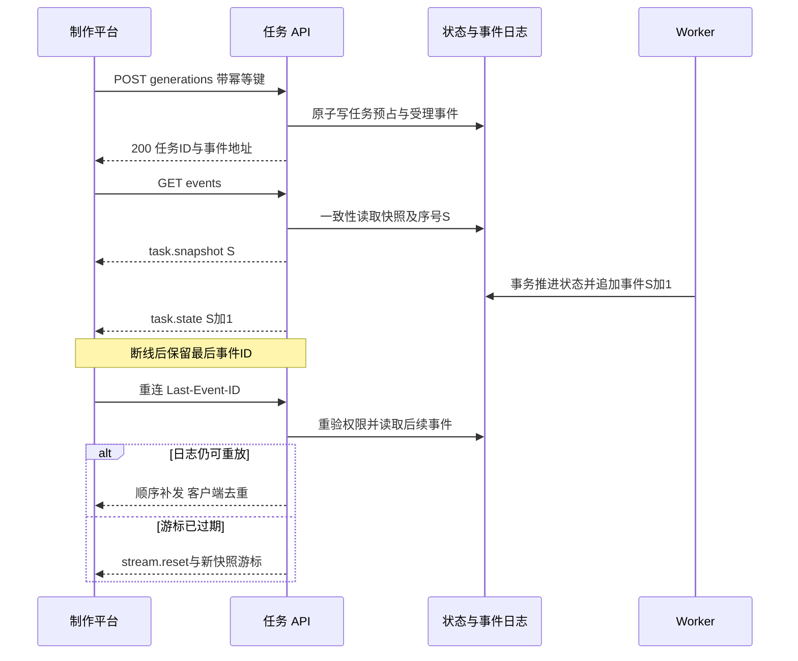
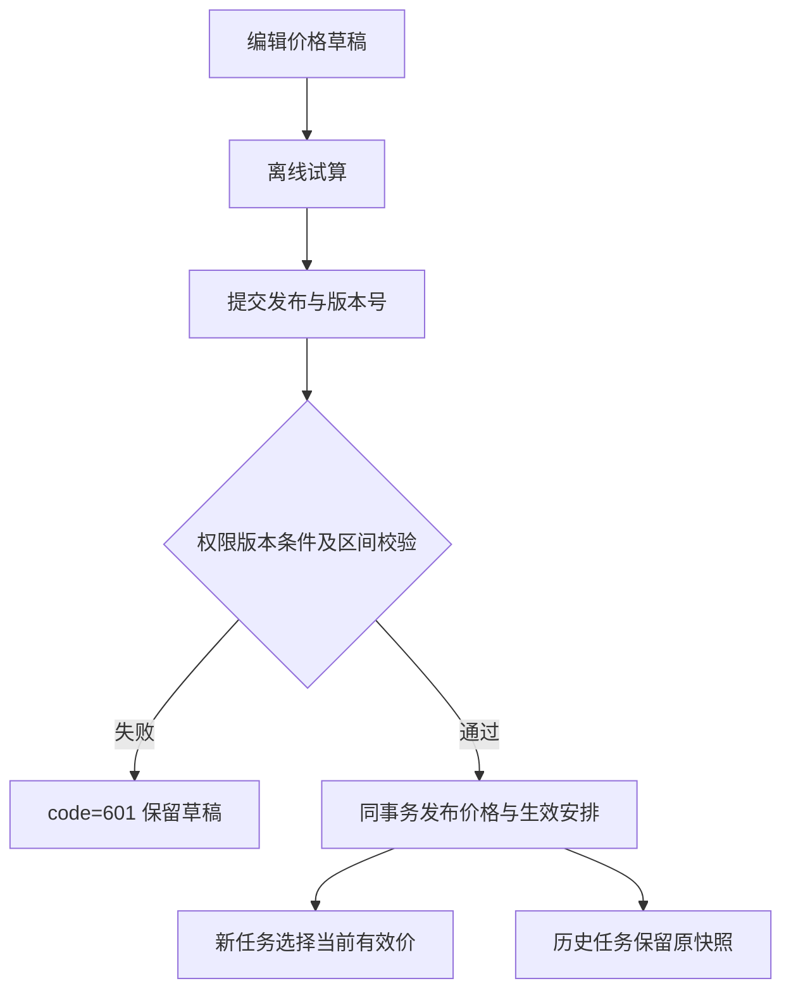

# higgsfield-ai · 平台API契约

> 范围调整（2026-10-27，用户确认）：公司公共素材暂缓。首期不实现S12公共库、发布到公共库、公共空间及其授权管理，不注册相关入口与接口；相关数据结构、安全约束和用例仅为未来保留，不计首期交付门槛。项目内素材、元素多图、@引用、NAS归档及原有跨项目受控复制不受此调整影响。


版本：1.12 评审稿  
日期：2026 年 10 月 27 日  
文档编号：P0-4  
范围：制作平台 API、管理平台 API、文件传输与任务事件  
状态：目标契约，尚未实现或执行真实接口测试

本次修订依据已导入的本地RuoYi-FastAPI源码；工程现状、证据与复用边界见[工程基线核对与文档衔接方案](工程基线核对与文档衔接方案.md)。制作平台为 `higgsfield-frontend/`，管理平台为 `ruoyi-fastapi-frontend/vue3/web/`，共用 `ruoyi-fastapi-backend/`。本次只更新文档，未实现所述新增能力。

**项目名称与本地开发基线（已确认）：** 整体项目名称为 `higgsfield-ai`。现有工作目录 `D:\laputta\higgsfield`、制作端 `higgsfield-frontend/`、管理端 `ruoyi-fastapi-frontend/vue3/web/` 和后端 `ruoyi-fastapi-backend/` 均保持不变；本次不改仓库地址、包名、模块名或数据库实例名。本地开发使用 Docker 启动 PostgreSQL 与 Redis，后端及两个前端在宿主机分别手动启动。制作端尚待初始化，未来生成/media Worker 在本机作为独立进程手动启动；正式部署在公司内网服务器，素材与视频长期保存到公司 NAS；具体服务器、挂载及生产配置参数待确认，见[内网部署与 NAS 运维方案](内网部署与NAS存储运维方案.md)。


**若依数据库设计基线（本次确认）：** 全部新增业务数据库设计遵循本地 RuoYi-FastAPI PostgreSQL 约定：hf_ 模块表名、语义 xxx_id 自增 bigint、若依审计字段、按职责使用 del_flag（0/2）、复用 sys_dict_type/sys_dict_data、关联表自增主键与联合唯一约束、禁止物理外键、服务层事务维护逻辑关联。物理表/字段/字典映射以 [P0-3 数据库详细设计](数据库详细设计.md) 为准；平台业务 ID 传输为十进制字符串，API 基础审计时间为 createTime/updateTime。不可变历史、幂等、价格版本及权限规则仍须保留。本次只更新设计，不改基础框架或业务代码。


**统一约束与优先级：** 以[项目 AGENTS.md](../AGENTS.md)为工程约束；[文档一致性与优先级索引](文档一致性与优先级索引.md)统一文档编号、需求等级和处理规则。P0-1～P0-6 是文档编号，不是需求优先级；业务规则等级以 P0-1 的规则表为唯一来源，本文引用规则 ID 时继承其等级，不另行定级。设计完成不等于实现或验收通过。


> 本轮设计同步依据：[制作平台实查功能与实现基线](制作平台实查功能与实现基线.md)及[实查设计同步报告](实查设计同步报告.md)。图片资产→元素/@引用→视频→NAS为首期主线；Tools和文本会话暂缓，角色权限配置统一后台。原站实测、设计约定和本平台运行验收分别记录。

## 1 依据与边界

本文件承接[技术架构方案](技术架构方案.md)、[首期需求与业务规则说明书 P0-1](首期需求与业务规则说明书.md)、[模型供应商接入契约 P0-2](模型供应商接入契约与差异清单.md)、[数据库详细设计 P0-3](数据库详细设计.md)。路径、DTO 与权限码是本平台的设计约定，不是对现有代码的描述。P0-1 尚未确认的产品建议仍维持评审状态；P0-6 将确认默认角色如何获得本文权限。

制作平台新增业务访问 `/api/v1`，管理平台新增业务访问 `/api/admin/v1`，二者复用统一身份校验。框架原生登录与系统管理接口保留原路径；新增业务响应、分页及异常也统一复用框架，不再采用独立信封。所有业务路径以下均省略所属前缀；表中请求/响应为业务 DTO，普通详情置于 `data`，分页字段置于顶层，通用信封见第 2 章。第三方 `/v1/chat/completions` 等接口仅存在于服务端适配器，不向浏览器透传。SSE、文件和错误响应分别定义，不能一律塞入成功信封。

本次不创建服务、ORM、数据库迁移或业务代码。第 16 章 API-DB-01～09 已同步到 P0-3《数据库详细设计》，结构和事务协议已补齐；尚未执行迁移、实现接口或完成数据库验证。

## 2 通用协议

本地开发中，API运行在宿主机后端进程，两套前端开发服务器分别代理到该进程；PostgreSQL/Redis的Docker映射端口不对浏览器作为业务API暴露。具体前端端口不写死，Cookie/Origin/CORS和代理路径随本地配置校验，业务鉴权仍采用既定Bearer协议。

### 2.1 格式与成功响应

| 项目 | 约定 |
|---|---|
| 字段风格 | JSON camelCase；数据库 snake_case 由后端映射，不直接序列化 ORM |
| ID | 所有平台业务及框架 bigint ID 均用十进制字符串，避免 JavaScript 精度丢失 |
| 金额、单价、秒数、Token | Decimal 和可能超过安全整数的 bigint 均为十进制字符串；计数/分页 pageSize/小型枚举序号为 JSON integer；不返回科学计数法金额 |
| 时间 | RFC3339 UTC 字符串，例如 `2026-10-27T08:00:00Z`；区间统一 `[from,to)`，报表明确业务时区 |
| 空值 | null 表示明确未知/无值；字段未返回表示 DTO 不适用或权限隐藏，不能当作 0；已定义的必需字段不能随意省略 |
| JSON 校验 | 请求禁止未知字段；PATCH 未提供表示不修改，提供 null 只允许清空可空字段；禁止客户端写 actorId、真实费用、归档路径、凭据版本等服务端决定字段 |
| 数组 | 必须明确上限，由接口 schema/能力决定；不允许无限批量写入。空数组为合法值时含义是清空列表 |
| 响应头 | `X-Request-Id` 由服务端生成/校验；敏感和权限相关响应 `Cache-Control: no-store`；不缓存秘密提交 |
| 普通成功 | 统一 HTTP 200、code=200、msg、success=true、time；详情放 data，无业务数据可省略 data。异步受理放 data.status/statusUrl，使用业务状态区分处理阶段 |

普通成功：

```json
{
  "data": {"id": "286341153", "name": "示例项目", "revision": "1"},
  "code": 200, "msg": "操作成功", "success": true, "time": "2026-10-27T08:00:00.000Z"
}
```

所有示例 ID 与链接均为占位，不能用于查询真实对象。示例只展示特定 DTO 的必要字段，不意味着模型能力或费用已实测。

### 2.2 通用字段简记

BusinessId 与 IdentityId 均为 PostgreSQL bigint 正整数的十进制字符串（1～9223372036854775807），拒绝 JSON number、UUID、负数、科学计数法；前端不转 Number。资源 DTO 的 id 映射 P0-3 各表语义主键，关联字段仍使用 projectId/jobId 等业务名称。基础审计时间改为 createTime/updateTime；createBy/updateBy/remark 仅按 DTO 权限需要返回，不能把全部 ORM 审计字段自动暴露给制作端。供应商 taskId/responseId、requestId、Idempotency-Key、游标均为不透明协议值，不受数据库主键类型约束。

数据库状态按 P0-3 §17.2 的若依字典编码持久化；平台 DTO 保留本文英文状态与 boolean，由服务层双向映射。逻辑删除只能通过已授权动作将 del_flag 从0改为2，不开放任意 PATCH delFlag。业务 revision 保留，审计时间不能替代乐观锁。


本文字段表中的 `?` 表示可选，`\|null` 表示允许 null；未带 `?` 为必填。`BusinessId`、`IdentityId`、`DateTime`、`Decimal`、`BigIntString` 均按上表字符串格式。`revision` 为 BigIntString 正整数。对象 DTO 的 id、createTime、revision 是否存在由各资源定义，不为不可变对象伪造可编辑 revision。

| 名称 | 结构 |
|---|---|
| ResourceRef | `{id:BusinessId}` |
| RevisionAction | `{revision:BigIntString, reason?:string}`；危险操作 reason 必填 |
| AsyncReceipt | `{id:BusinessId, resourceType:enum, status:enum, statusUrl:string, eventsUrl?:string}`；id 是业务任务/操作 ID，不是供应商任务 ID |
| Money | `{amount:Decimal\|null, currency:string, state:estimated/pending/calculated/confirmed/disputed}` |
| FieldIssue | `{path:string, code:string, message:string}`；path 采用 `/references/0/assetVersionId` 形式 |
| Page&lt;T&gt; | 顶层 `{rows:T[],pageNum:int,pageSize:int,total:int,hasNext:boolean,code:int,msg:string,success:boolean,time:DateTime}`，复用 PageResponseModel |
| ActionSet | `allowedActions:string[]`，仅作 UI 提示；每次执行重新鉴权 |

### 2.3 分页、筛选与排序

列表统一使用 pageNum/pageSize（默认 1/20，目标业务上限100），通过 PageUtil 与 PageModel/PageResponseModel 返回顶层 rows/pageNum/pageSize/total/hasNext，以及 code/msg/success/time，不再返回 data.items 或 nextCursor。过滤与权限先进入查询，再计数和分页，total 不可泄露越权数量。

默认按 createTime 降序及业务主键同向次排序；排序字段必须白名单映射到 ORM，不拼客户端 SQL。修改筛选返回第一页。并发增删可能造成页码结果变化，客户端按 ID 去重并允许刷新；不承诺事务快照翻页。筛选字段仅按各端点声明开放。目录子节点也采用页码分页，不一次返回全树。

```json
{
  "code": 200,
  "msg": "查询成功",
  "rows": [{"id": "286341153", "name": "示例项目", "status": "active", "revision": "1"}],
  "pageNum": 1,
  "pageSize": 20,
  "total": 1,
  "hasNext": false,
  "success": true,
  "time": "2026-10-27T08:00:00.000Z"
}
```

### 2.4 框架响应执行规则

普通业务请求使用 ResponseUtil：成功 code=200；ServiceWarning/模型业务校验 code=601；AuthException code=401；PermissionException code=403；ServiceException/未知异常 code=500，以上当前均为 HTTP 200。客户端先解码框架响应，再按 code/success 分支，不能把 HTTP 200 一概视为成功。业务错误细分放 data.errorCode，格式见第12章；requestId 放追踪响应头，不额外创建顶层信封。

框架 HTTPException、FastAPI 原生请求校验、OAuth/OIDC、文件 Range 和流式响应保持各自现有处理路径，不能强制套用普通 JSON 成功信封。SSE 打开前如果返回 JSON，先处理业务认证/权限码，不将其按事件流读取。详细复用入口见[后端编码与框架对齐规范](后端编码与框架对齐规范.md)。

## 3 身份、权限、并发与幂等

### 3.1 身份边界

本地框架实际使用 `Authorization: Bearer <平台登录JWT>`，并经Redis会话及用户状态校验；首期新增业务接口复用这一身份链，不采用原稿假设的HttpOnly Cookie鉴权。管理端Admin-Token是js-cookie写入的JS可读Cookie，实际HTTP调用仍靠Authorization头。制作端采用独立身份客户端，默认内存持有token，不依赖读取Admin-Token实现跨端SSO。

已核实框架原生登录为 POST /login（form-urlencoded：username/password/code/uuid）、GET /captchaImage、GET /getInfo、GET /getRouters、POST /logout，保持原响应协议；框架开发代理前缀不是这些后端实际路由的一部分。/api/v1/me为新增归一用户视图，sessionExpiresAt需适配有效会话期限，不能自行承诺刷新令牌接口。CSRF字段仅适用于未来显式启用的Cookie鉴权通道，当前Bearer业务写入不要求不存在的CSRF token。

同一用户能否同时保持两个前端会话取决于框架同账号多终端配置，需验证；OIDC源码已存在但不默认启用，不假定其access token与/login JWT可互换。

`Me={user:{id:IdentityId,displayName:string,departmentId:IdentityId\|null},permissions:string[],csrfToken?:string,sessionExpiresAt:DateTime}`。仅返回当前授权，无密码、第三方 Key 或内部密文。凭据秘密输入永不通过任何 GET 读取；不存在 secret 查询端点。

授权公式为功能权限∩项目成员/管理数据范围∩对象使用范围∩当前状态。请求中的 projectId 只是目标，不能决定调用者身份。猜测无权访问对象的 ID 统一返回 code=601 / RESOURCE_NOT_FOUND，避免泄露存在性；对已可见对象但缺少某项动作返回 code=403 / PERMISSION_DENIED。费用无权查看时 billing 字段省略，并返回 `billingVisibility:"hidden"`，不能显示为 0。

### 3.2 乐观锁

可变资源的 PATCH/PUT 与状态动作携带 body.revision，值来自最新 GET；不以客户端 updateTime 判定冲突。后端原子比较 revision 并加 1，不匹配返回 code=601 / REVISION_CONFLICT，可返回当前 revision 和资源刷新 URL，不返回越权内容。没有 revision 字段的不可变对象不可 PATCH。删除可变对象使用 query `revision`（DELETE 不依赖请求体），业务状态动作优先 POST。

### 3.3 写请求幂等

所有创建、消费、发布、导入确认、取消、归档重试等 POST，以及文件完成确认，要求 `Idempotency-Key`（建议随机 UUID，16–128 可打印 ASCII）。只读的 validate/simulate/search 不要求。hf_api_idempotency_record 保存脱敏原结果及资源定位；秘密写入只保存服务端受控 HMAC 请求摘要，不保存密钥正文。PUT/PATCH/DELETE 也支持并建议携带，因 revision 检查不能单独解决“写成功但响应丢失”。

作用域为调用主体＋API 前缀＋方法＋规范路径＋键；请求摘要包含规范 JSON、目标与 revision，不包含 Authorization、CSRF、Cookie、追踪头。相同键同摘要完成后返回原业务结果及原状态码，响应头 `Idempotent-Replayed:true`；处理中返回 code=601 / IDEMPOTENCY_IN_PROGRESS 与 Retry-After；同键不同摘要返回 code=601 / IDEMPOTENCY_KEY_REUSED。每次重放前仍须鉴权，不能用缓存响应泄露已撤权数据。

通用缓存建议至少 24 小时，具体保留期配置并文档化；生成、预算、发布及计费操作还必须使用长期业务唯一约束，不能在缓存到期后重复扣费。公共发布等无独立业务键的动作保留最小通用幂等记录及脱敏结果，不按普通 TTL 清除。POST /generations 将原键与规范请求作用域的组合摘要传入任务唯一约束，不能仅靠 Redis 去重。未确认客户端超时结果时继续用原键查询/重传，不生成新键假装重试。创建新一次生成必须显式新键，并显示新消费。

### 3.4 原生接口与新增业务接口分界

框架原生系统管理优先使用已有/system/user、/system/role、/system/dept等控制器和对应前端API模块，保持code/msg/data或rows/total、pageNum/pageSize协议。第9章列出的/users、/departments、/roles、用户roles写入是可选统一门面目标，首期不重复实现，不能称为当前已存在接口；项目治理和AI管理接口仍按本文新增。

新增业务复用框架 ResponseUtil、异常处理、页码分页和业务 code 拦截；DTO 的 Decimal/ID 字符串、幂等和 SSE 由业务模块适配。新路由同样进入框架中间件及 transport crypto 配置链，不另定义错误信封。

框架 `*:*:*` 和admin部门数据范围不能跳过项目/对象策略；新增业务必须在复用身份后继续执行授权。短时间前端防重复提交不替代后端Idempotency-Key。

## 4 制作平台资源 DTO

以下字段表定义接口复用结构，减少各端点重复；所有对象还可含 allowedActions。只读字段不能原样回传到写接口。

| DTO | 字段与语义 |
|---|---|
| Project | id,name,status(active/paused/archived/pending_delete),revision,createTime,currentUserRole:string；可选 archivedAt |
| Member | userId,displayName,roleId:BusinessId,status(active/removed),revision,joinedAt；不含登录秘密 |
| Brief | projectId,body:RichText,revision,updateTime |
| Folder | id,projectId,parentId:BusinessId\|null,name,description,color,folderKind:media/element,orderNum:int,revision,hasChildren:boolean,visibleEntryCount?:BigIntString；计数含子孙目录，与 P0-1 一致 |
| Asset | id,spaceId,name,mediaType,currentVersion:AssetVersion\|null,revision,createTime |
| AssetVersion | id,assetId,versionNo:int,file:{mimeType,byteSize:BigIntString,width?:int,height?:int,seconds?:Decimal},sourceOutputId?:BusinessId；不返回 storageKey |
| Element | id,spaceId,name,alias,category,currentRevisionId:BusinessId\|null,performerId?:BusinessId,folderId?:BusinessId,workStatus,revision,createTime |
| ElementRevision | id,elementId,revisionNo:int,description,propertyValues:PropertyValue[],media:{assetVersionId:BusinessId,ordinal:int,isPrimary:boolean}[],label?:string |
| PropertyValue | definitionId:BusinessId,definitionVersion:int,value:string\|string[]\|null；text为字符串，multi_select为去重字符串数组，选项必须合法；single_select仅兼容旧定义 |
| Reference | referenceKey:BusinessId,assetVersionId:BusinessId,elementRevisionId?:BusinessId,mediaRole:string,ordinal:int；不得提交供应商 asset:// 或任意外部 URL |
| Draft | id,projectId,kind,body:DraftBody,references:Reference[],revision,updateTime |
| LibraryItem | id,kind(asset/output/task_placeholder),name,createTime,folderId:BusinessId\|null；按 kind 恰一返回 asset/output/task 摘要，失败任务不冒充文件 |
| Output | id,jobId,ordinal:int,kind,revision,workStatus:none/working/review/approved/rejected,archiveState,file?:AssetVersion.file,text?:string,actualMetadata:object,allowedActions；有权且归档后返回 previewUrl/downloadUrl |
| Thread | id,target:{assetVersionId:BusinessId}或{outputId:BusinessId},resolvedAt:DateTime\|null,createTime |
| Comment | id,threadId,parentId:BusinessId\|null,author:{id,displayName},body,revision,createTime,videoTime?:Decimal,annotations:Annotation[] |
| Annotation | shape(point/rect/path),geometry:object,color:string,sourceWidth:int,sourceHeight:int；坐标归一到 0..1，按形状校验 |

RichText 使用版本化白名单文档：`{schemaVersion:1,type:"doc",content:Node[]}`，首期段落、文本、基本加粗/斜体、受控链接和元素 Mention；不接受任意 HTML、script、iframe。DraftBody=`{schemaVersion:1,prompt:RichText,modelVersionId?:BusinessId,folderId?:BusinessId,sourceJobId?:BusinessId,targetElementId?:BusinessId,returnContext?:object,parameters:object}`；参数仅允许已发布能力 schema 中的键。Mention 保存 referenceKey，文件引用以 Reference 列表为事实源。

## 5 制作平台：项目、成员与个人视图

表中列表响应均为 Page&lt;指定 DTO&gt;；GET 详情 200，创建默认 200，修改默认 200，删除默认 200；另有标注时以标注为准。权限码是功能门槛建议值，项目范围另行检查。

| 方法与路径 | 请求（路径参数之外） | 响应 | 权限/约束 |
|---|---|---|---|
| GET /me | 无 | Me | 已登录 |
| GET /projects | pageNum,pageSize,q?,status?,hidden?,pinned?,collectionId?,sort? | Page&lt;Project&gt; | project:read，当前成员可见 |
| POST /projects | `{name:string}` | Project | project:create；自动创建项目空间和首位负责人 |
| GET /projects/{id} | 无 | Project | project:read |
| PATCH /projects/{id} | `{revision,name:string}` | Project | project:manage |
| POST /projects/{id}/archive | RevisionAction，reason必填 | Project | project:archive；在途任务保留 |
| POST /projects/{id}/restore | RevisionAction | Project | project:archive；不重放历史生成 |
| POST /projects/{id}/pause | RevisionAction，reason必填 | Project | project:manage |
| POST /projects/{id}/resume | RevisionAction | Project | project:manage |
| GET /projects/{id}/members | pageNum,pageSize,status? | Page&lt;Member&gt; | member:read |
| 后台专用 POST /projects/{id}/members | `{userId:IdentityId,roleId:BusinessId}` | Member | member:manage；只能授予自己可授予角色 |
| 后台专用 PATCH /projects/{id}/members/{userId} | `{revision,roleId:BusinessId}` | Member | member:manage；最后负责人保护 |
| 后台专用 DELETE /projects/{id}/members/{userId} | revision | 200 ResponseBaseModel | member:manage；保留成员历史身份 |
| GET /projects/{id}/roles | 无 | `{items:{id,code,name,permissions:string[]}[]}` | member:read；不默认开放角色编辑器 |
| GET /projects/{id}/brief | 无 | Brief | project:read |
| PUT /projects/{id}/brief | `{revision,body:RichText}` | Brief | project:edit |
| POST /projects/{id}/join-requests | `{reason?:string}` | `{id,status:"pending",createTime}` | project:join；仅对管理员允许申请的可发现项目 |
| GET /api/admin/v1/projects/{id}/join-requests | pageNum,pageSize,status? | Page&lt;JoinRequest&gt; | member:manage；状态pending/approved/rejected/cancelled |
| POST /api/admin/v1/join-requests/{id}/review | `{revision,decision:"approved"或"rejected",roleId?:BusinessId,reason?:string}` | JoinRequest | member:manage及项目负责人；批准时roleId必填，拒绝时不传；必需Idempotency-Key |
| GET /project-collections | pageNum,pageSize | Page&lt;Collection&gt; | 已登录，仅本人 |
| POST /project-collections | `{name:string,orderNum?:int}` | Collection | 已登录；必需Idempotency-Key |
| PATCH /project-collections/{id} | `{revision,name?:string,description?:string\|null,color?:string\|null,orderNum?:int}` | Collection | 仅本人；必需Idempotency-Key |
| DELETE /project-collections/{id} | revision | 200 ResponseBaseModel | 仅本人；解除分组不删项目；必需Idempotency-Key |
| PUT /projects/{id}/preferences | `{revision,isPinned?:bool,isHidden?:bool,collectionId?:BusinessId\|null,orderNum?:int}` | Preference | 本人且项目可见；初始revision="0"表示尚无记录；必需Idempotency-Key |
| GET /projects/{id}/preferences | 无 | Preference | 仅本人 |
| GET /view-preferences/{viewKey} | projectId? | ViewPreference | 仅本人 |
| PUT /view-preferences/{viewKey} | `{projectId?:BusinessId,revision,settings:object}` | ViewPreference | 白名单布局/筛选，首建revision="0"；必需Idempotency-Key |

JoinRequest={id,projectId,userId,status,reason,revision,createTime,reviewedAt?:DateTime}；Collection={id,name,description:string\|null,color:string\|null,orderNum,revision}；Preference={projectId,isPinned,isHidden,collectionId:BusinessId\|null,orderNum,revision}；ViewPreference={viewKey,projectId:BusinessId\|null,settings,revision}。这些 revision 已在 P0-3 落入字段设计，对照见第16章。首期不提供匿名项目目录，申请资格如何授予由 P0-6 确认；未配置可发现策略时仅管理员邀请/添加成员，申请入口关闭。

个人集合颜色采用小写 `#rrggbb`，说明最多 2000 字符。PATCH/PUT 至少修改一个字段，省略表示保留，显式 null 仅用于清空说明、颜色或集合归属。删除集合在同一事务解除本人项目偏好中的分组，并递增受影响偏好的 revision，不修改项目和成员。项目偏好写入与幂等重放均重新校验项目可见性；归档项目允许修改个人导航偏好。上述集合与项目偏好接口已接入，集合管理和偏好编辑页面入口仍待接入；通用 view-preferences 不包含在这次实现范围中。

项目列表默认 `hidden=false`，只列出未隐藏项目；`hidden=true` 只列出已隐藏项目。`pinned` 省略时不筛选置顶状态，显式 true/false 分别筛选置顶/非置顶。`collectionId` 为本人集合 ID，过滤与成员范围均在计数、分页之前执行；默认排序先置顶、再个人 orderNum，之后应用所选项目排序与稳定 ID。列表每行附加本人 `preference:Preference`，无记录时 revision="0"、标志为 false、collectionId=null。隐藏不影响有权限的直接项目读取。

## 6 制作平台：上传、素材、目录与公共引用

视图偏好实现补充：viewKey 当前为 projects/library/elements；projects 仅支持全局范围，其他视图可按 projectId 隔离，项目范围读取和保存均实时检查 project:read。settings 为整体替换，省略的白名单字段恢复默认值；未知字段拒绝。projects 支持 sort/status/hidden/pinned/collectionId；library 支持 layout=square/masonry、fileType、activity、includeDescendants（严格bool，默认false）、dates（null或两个YYYY-MM-DD上海自然日，包含起止日期，结束不得早于开始）；elements 支持 layout=grid/board/table、category/workStatus/statusGroup。内容视图还支持 cardSize（1～8）、splitByDate、expandedFolderIds/pinnedFolderIds/folderOrderIds（分别最多500个不重复字符串ID）。这些设置只保存展示意图，不提供内容权限。删除集合会同步清空本人 projects 视图中的对应 collectionId 并递增修订，其他筛选保持不变。后端接口与制作端页面恢复/保存入口已接通；运行验收证据见本地开发手册。

### 6.1 上传会话与分片协议

文件首先上传本平台，浏览器不直连供应商。该协议为目标设计，实际文件大小上限由管理员媒体策略决定，不能直接把供应商 20MB/500MB 当作所有平台文件上限。

| 方法与路径 | 请求 | 响应 | 权限 |
|---|---|---|---|
| POST /uploads | `{projectId:BusinessId,fileName:string,byteSize:BigIntString,mimeType:string,sha256?:string}` | 200 UploadSession | asset:upload + 项目写权限 |
| GET /uploads/{id} | 无 | UploadSession | 会话所有者且仍有项目权限 |
| PUT /uploads/{id}/parts/{partNo} | 二进制流；Content-Type:application/octet-stream；Content-Range、X-Content-SHA256 | 200 `{partNo:int,byteSize:BigIntString,sha256:string}` | 同上 |
| POST /uploads/{id}/complete | `{sha256:string}` | 200 UploadSession | 同上；幂等完成，完成不自动生成素材 |
| DELETE /uploads/{id} | 无正文 | 200 ResponseBaseModel | 同上；取消暂存，不能删除已被正式引用文件 |
| POST /assets | `{projectId:BusinessId,uploadId:BusinessId,name:string,folderId?:BusinessId\|null}` | 200 Asset | asset:create；仅使用已验证完成上传 |
| POST /assets/{id}/versions | `{revision,uploadId:BusinessId}` | 200 AssetVersion | asset:edit；新版本不可覆盖旧文件 |

UploadSession={id,projectId,state:created/uploading/verifying/ready/failed/cancelled/expired,byteSize,partSize:BigIntString,partCount:int,receivedParts:int[],expiresAt,validationErrors:FieldIssue[]}。完成校验可能异步：返回 200 AsyncReceipt（resourceType=upload,statusUrl=/api/v1/uploads/{id}），客户端 GET 到 ready；已验证完成则200。前端不能把字节上传完成当作素材可生成。

partNo 从1开始，Content-Range 必须对应服务端 partSize 的预期连续区间，最后一片除外，声明总大小必须与会话一致；建议分片32MiB，最终值由响应给出。单片同编号同哈希重复 PUT 返回原结果，不同内容返回code=601业务冲突 UPLOAD_PART_CONFLICT；服务端自行计算哈希，不只信任客户端头。complete 检查所有片、整文件摘要、实际 MIME、大小与媒体安全策略。读取进度后可断点续传，过期会话410 UPLOAD_EXPIRED，新会话不冒充旧素材身份。

临时文件只在所有者授权范围内可见；complete/创建素材/新增版本不能引用其他用户或其他项目的上传会话。上传会话通过 hf_upload_binding 唯一绑定一个正式目标；素材上传目标为一个资产版本，元素模板上传也沿用此项目入口、目标为一个 hf_import_job；管理文档目标为 hf_price_source 或 hf_reconciliation_batch，不能跨用途消费。素材上传重复绑定返回原版本或冲突，不悄悄生成多个独立版本。NAS不可用返回code=601 STORAGE_UNAVAILABLE，保留会话可恢复状态。

### 6.2 目录、素材库与引用

| 方法与路径 | 请求 | 响应 | 权限/约束 |
|---|---|---|---|
| GET /projects/{id}/folders | parentId?:BusinessId\|null,pageNum,pageSize,q?,folderKind?,sort?:createdAsc/createdDesc/updatedDesc/nameAsc/nameDesc | Page&lt;Folder&gt; | asset:read；parentId缺省顶层 |
| GET /folders/{id} | 无 | `{folder:Folder,ancestors:Folder[]}` | asset:read；逐次校验项目权限，ancestors按根到父级排列；用于搜索命中后的完整面包屑和URL恢复 |
| POST /projects/{id}/folders | `{parentId?:BusinessId\|null,name:string,description?:string,color?:string,folderKind?:media/element}` | Folder | folder:write |
| PATCH /folders/{id} | `{revision,name?:string,description?:string,color?:string,orderNum?:int}` | Folder | folder:write |
| POST /folders/{id}/move | `{revision,parentId:BusinessId\|null}` | Folder | folder:write；同空间、无环 |
| DELETE /folders/{id} | revision,mode=moveEntriesToParent | 200 ResponseBaseModel | folder:write；非空目录移动内容，不递归删文件 |
| GET /projects/{id}/library | pageNum,pageSize,folderId?,includeDescendants?:bool,kind?,fileType?,q?,modelId?,from?,to?,workStatus?,activity?:generated/uploaded/liked/downloaded,showFailed?:bool | Page&lt;LibraryItem&gt; | asset:read；目标类型明确 |
| GET /assets/{id} | 无 | Asset | asset:read |
| PATCH /assets/{id} | `{revision,name:string}` | Asset | asset:edit |
| GET /assets/{id}/versions | pageNum,pageSize | Page&lt;AssetVersion&gt; | asset:read |
| DELETE /assets/{id} | revision | 200 ResponseBaseModel | asset:remove；逻辑移除 |
| POST /assets/{id}/restore | RevisionAction | Asset | asset:remove |
| POST /projects/{id}/library/move | `{entryId:BusinessId,revision,folderId:BusinessId\|null}` | `{entryId,folderId,revision}` | folder:write；不改变原素材归属 |
| GET /asset-versions/{id}/preview | Range? | 200/206 文件 | asset:read；精确版本 |
| GET/HEAD /asset-versions/{id}/thumbnail | Range? | 200/206 WebP；未就绪返回框架业务错误 | asset:read；精确版本及原文件就绪；不回退原图 |
| GET /asset-versions/{id}/download | Range? | 200/206 文件 | asset:download |
| GET /references/search | projectId必填,q?,kind?:asset/element,elementId?:BusinessId（须kind=element）,pageNum,pageSize | Page&lt;ReferenceCandidate&gt; | generation:create + 引用访问权 |
| 未来保留（首期不注册） GET /public-library | projectId必填,pageNum,pageSize,q?,kind? | Page&lt;LibraryItem&gt; | public:read；仅返回授权空间 |
| POST /projects/{id}/asset-references | `{assetId:BusinessId}` | `{id,projectId,assetId,allowedActions}` | asset:reference；来源授权与目标写权限 |
| DELETE /projects/{id}/asset-references/{refId} | 无正文 | 200 ResponseBaseModel | asset:reference；撤销当前引用，历史任务不删除 |
| 未来保留（首期不注册） POST /assets/{id}/publish-public | `{revision,targetSpaceId:BusinessId,reason:string}` | 200 Asset | public:publish；创建受控公共身份，不把原空间直接改成公共 |

ReferenceCandidate={kind:asset/element,id,displayName,projectId:BusinessId\|null,assetVersionIds:BusinessId[],elementRevisionId?:BusinessId,thumbnailUrl?:string,allowedMediaRoles:string[]}。元素候选可返回主图及可选多图，实际选择后提交精确 Reference；搜索结果不等于永久使用权，正式提交重新验证。

当前实现：候选检索覆盖当前项目已归档素材与有可用图片的元素，元素结果补充 `primaryAssetVersionId`，`assetVersionIds` 按元素修订内顺序排列。`elementId` 精确定位仍复用相同项目、对象及媒体授权条件，不绕过候选过滤。权限过滤发生在统计、分页之前；无图、已回收或任一媒体不可用的元素不进入候选。`allowedMediaRoles` 是媒体类型可表达的角色，前端与提交服务必须再与所选模型已发布能力取交集，不可据此开放供应商功能。跨项目授权引用与正式生成提交链仍待实现。

### 6.3 文件响应

Bearer模式下浏览器下载通过带Authorization的fetch；视频Range须用能附加鉴权头的媒体加载层。不能把受保护URL直接设置为video src并假定自动携带Bearer，也不能在URL拼token。此加载层须纳入真实浏览器验收，文件与SSE不应被普通JSON传输加密包装破坏。


返回受控文件字节，Content-Type 为真实类型；download 带安全编码 Content-Disposition，preview 默认 inline。有效 Range 返回206和 Content-Range，超界416；支持 HEAD 返回同样鉴权后的元数据。没有归档文件返回code=601业务冲突 OUTPUT_NOT_READY，不回退到泄露供应商签名 URL。全局默认 no-store；若后续允许缓存须明确按用户隔离与撤权策略。

## 7 制作平台：元素、草稿与协作

| 方法与路径 | 请求 | 响应 | 权限/约束 |
|---|---|---|---|
| GET /elements | projectId?,scope=project/mine,mineFilter?:all/created/favorites,pageNum,pageSize,q?,category?,workStatus?,folderId?,statusGroup?:active/drafts | Page&lt;Element&gt; | element:read；mine 仍过滤项目权 |
| POST /elements | `{projectId:BusinessId,name,alias,category,label?:string,performerId?:BusinessId,workStatus?:string,description?:string,propertyValues?:PropertyValue[],media?:ElementRevision.media}` | 200 `{element:Element,currentRevision:ElementRevision}` | element:create；无图可存，引用生成另检 |
| GET /elements/{id} | 无 | `{element,currentRevision}` | element:read |
| PATCH /elements/{id} | `{revision,name?:string,alias?:string,category?:string}` | Element | element:edit；不在此覆盖生成修订 |
| POST /elements/{id}/revisions | `{revision,description:string,propertyValues:PropertyValue[],media:ElementRevision.media}` | 200 ElementRevision | element:edit；revision为元素身份的并发版本 |
| GET /elements/{id}/revisions | pageNum,pageSize | Page&lt;ElementRevision&gt; | element:read |
| PATCH /element-revisions/{id}/label | `{revision,label:string}` | `{elementRevisionId,label,revision}` | element:edit；不变更内部修订 |
| POST /elements/{id}/copy | `{targetProjectId:BusinessId,sourceRevisionId:BusinessId,name?:string,alias:string}` | 200 Element | element:copy；来源读取/媒体使用与目标创建均允许 |
| DELETE /elements/{id} | revision | 200 ResponseBaseModel | element:remove；历史引用保留 |
| POST /elements/{id}/restore | RevisionAction | Element | element:remove |
| GET /projects/{id}/property-definitions | pageNum,pageSize | Page&lt;PropertyDefinition&gt; | element:read |
| POST /projects/{id}/property-definitions | `{propertyKey,name,valueType:text/single_select,options?:string[]}` | PropertyDefinition | element:configure |
| POST /property-definitions/{id}/versions | `{name,valueType,options?:string[]}` | PropertyDefinition | element:configure；旧定义不变 |
| POST /favorites | `{target:{elementId:BusinessId}或{assetId:BusinessId}或{outputId:BusinessId}}` | `{id,target}` | 当前对象可读 |
| GET /favorites | kind?,pageNum,pageSize | Page&lt;Favorite&gt; | 仅本人，重新过滤授权 |
| DELETE /favorites/{id} | 无正文 | 200 ResponseBaseModel | 仅本人 |
| POST /drafts | `{projectId:BusinessId,kind,body:DraftBody,references:Reference[]}` | Draft | generation:create |
| GET /drafts | projectId必填,kind?:image/video,pageNum,pageSize | Page&lt;DraftSummary&gt; | 当前项目可读，仅本人草稿，不因管理员权限放宽 |
| GET /drafts/{id} | 无 | Draft | 所有者，当前项目可读 |
| PUT /drafts/{id} | `{revision,body:DraftBody,references:Reference[]}` | Draft | 所有者 + 项目可写 |
| POST /comment-threads | `{target:Thread.target}` | Thread | comment:create + 目标可读 |
| GET /comment-threads | assetVersionId或outputId恰一,pageNum,pageSize | Page&lt;Thread&gt; | comment:read |
| GET /comment-threads/{id}/comments | pageNum,pageSize | Page&lt;Comment&gt; | comment:read |
| POST /comment-threads/{id}/comments | `{body:string,parentId?:BusinessId,videoTime?:Decimal,annotations?:Annotation[]}` | Comment | comment:create；父评论必须同线程 |
| PATCH /comments/{id} | `{revision,body:string,annotations?:Annotation[]}` | Comment | comment:edit:own 或 comment:moderate |
| DELETE /comments/{id} | revision | 200 ResponseBaseModel | 作者或治理权限，写审计 |
| POST /review-events | `{target:{elementId:BusinessId}或{outputId:BusinessId},expectedStatus:string,toStatus:string,reason?:string}` | `{id,target,fromStatus,toStatus,createTime}` | content:review；状态CAS，不等于公共发布 |
| POST /imports/elements | `{projectId:BusinessId,uploadId:BusinessId,schemaVersion:int,includeProjectName?:bool}` | 200 AsyncReceipt | element:import；解析候选并预检，人工确认前不建元素 |
| GET /imports/elements/{id} | 无 | `{id,status,summary:{total:int,valid:int,invalid:int},errors:FieldIssue[],revision}` | 操作者或项目治理 |
| POST /imports/elements/{id}/confirm | `{revision}` | 200 AsyncReceipt | element:import；重新校验授权 |

元素受控复制实施约定：固定sourceRevisionId；来源element:read/copy与逐项asset:read/reference、目标element:create分别校验，跨项目新建素材另检asset:create。目标产生新元素和素材版本，文件复用已归档对象，来源证据长期写入hf_content_copy。复制不继承负责人或审核状态。同键属性定义不兼容时建立独立来源键，不覆盖目标已有定义；原定义和值快照保留。

PropertyDefinition={id,propertyKey,versionNo,name,valueType,options}；Favorite={id,target,createTime}。批量导入行错误应可分页：`GET /imports/elements/{id}/rows?pageNum&pageSize&state` 返回 Page&lt;CandidateRow&gt;（字段见实查界面增量契约）；不能将任意大错误数组塞入一次响应，summary.errors仅最多100个摘要。支持PDF/XLSX/CSV/DOCX/TXT/MD，源格式由实际文件校验判定；候选可编辑并携来源位置，确认选中集合全部事务成功或回滚，幂等重试不重复创建。解析器质量与费用另验。

DraftSummary={id,projectId,kind,revision,updateTime,promptExcerpt:string,modelVersionId:BusinessId\|null}。个人草稿列表要求projectId，按更新时间和ID倒序分页；仅返回当前所有者在仍可读项目下的草稿，提示词摘要最多160字符、提及节点显示为“[引用]”，不返回完整正文或引用明细。完整编辑内容必须重新GET草稿详情，不用摘要重建正文。

## 8 制作平台：模型能力、生成与会话

### 8.1 可用能力与受理

| 方法与路径 | 请求 | 响应 | 权限 |
|---|---|---|---|
| GET /model-profiles | projectId必填,kind:image/video,versionId?,q?,pageNum,pageSize | Page&lt;ModelCapability&gt; | generation:create；versionId精确筛选仍须当前项目授权和发布状态 |
| POST /generations/validate | GenerationInput | 200 ValidationResult | generation:create；不产生预占或真实调用 |
| POST /generations | GenerationInput + 必需 Idempotency-Key | 200 GenerationAccepted | generation:create；事务固定价格/Key/预算 |
| GET /generations | projectId?,scope=project/mine,kind?,state?,from?,to?,pageNum,pageSize | Page&lt;TaskSummary&gt; | generation:read；mine不越权 |
| GET /generations/{id} | 无 | TaskSnapshot | generation:read |
| GET /generations/{id}/events | Last-Event-ID? | text/event-stream | generation:read，见第14章 |
| POST /generations/{id}/cancel | `{revision,reason?:string}` | `{jobId,accepted:boolean,mode:local/upstream/unsupported,cancellationState:requested/confirmed/rejected/unsupported,task:TaskSnapshot}` | generation:cancel；均使用框架200成功信封，通过accepted和cancellationState区分 |
| POST /generations/{id}/retry-archive | `{revision,outputIds?:BusinessId[]}` | 200 GenerationAccepted | output:archive；只重试指定失败输出 |
| GET /outputs/{id} | 无 | Output | asset:read |
| POST /outputs/{id}/work-status | `{revision,workStatus,reason?:string}` | 200 Output | asset:read + content:review；项目可写且作品归档就绪；必须携带Idempotency-Key |
| GET /outputs/{id}/preview 或 /download | Range? | 文件 | asset:read / asset:download |
| GET/HEAD /outputs/{id}/thumbnail | Range? | 200/206 WebP；未就绪返回框架业务错误 | asset:read；作品已归档、未回收、原文件就绪 |
| POST /outputs/{id}/to-asset | `{projectId:BusinessId,folderId?:BusinessId\|null,name:string}` | 200 Asset | asset:create + 来源使用权 |

ModelCapability={id,versionId,displayName,kind,menuMeta:{aliases:string[],family:string,releaseLabel:string,market:domestic/overseas/unspecified,tier:standard/fast/unspecified},parametersSchema:object,referenceRules:object,defaultParameters:object,availableVariants:{id,dimensions}[],availability:{available:boolean,reasonCode?:string}}。仅返回已授权发布组合，无 Key、账号内部标识或采购报价；参数 schema 是字段白名单（类型、枚举、范围、组合约束），schema 不允许任意表达式执行。

能力规则 v1：`parametersSchema` 为 `{type:"object",additionalProperties:false,properties,required,conditions}`。字段规则支持 `type:string/boolean/integer/number`、`enum`、数值 `minimum/maximum`、字符串 `minLength/maxLength`；条件使用 `{when:{字段:精确值},require:[],forbid:[],allowed:{字段:[允许值]}}`，`when` 全部匹配才生效。它是平台受控规则格式，不接受通用 JSON Schema 的远程引用、表达式或扩展关键字。`referenceRules={roles:{角色:{mediaTypes:[],minCount,maxCount}},maxTotal}`，数量按引用编译去重后的媒体计算。草稿可暂缺必填值，但已填写值仍须合法；正式提交必须满足所有必填与媒体下限。配置发布前还须校验默认值、组合规则及真实联调证据，静态规则通过不能替代联调。

GenerationInput 必填 `projectId:BusinessId,kind:image/video,modelVersionId:BusinessId,prompt:RichText,parameters:object,references:Reference[]`；可选 `folderId:BusinessId,draftId:BusinessId,draftRevision:BigIntString,sourceJobId:BusinessId,estimateToken:string`。有 draftId 时必须有 draftRevision，提交参数仍在服务端与草稿修订核对。modelVariantId 由服务端按参数唯一匹配，不由客户端挑便宜规格；createdBy、credentialVersionId、priceVersionId、amount 均拒绝输入。文本会话仅未来保留，首期不开放。folderId受理时冻结；任务运行中目录被删除时结果落项目根并记录归属回退事件。

ValidationResult={valid:boolean,issues:FieldIssue[],normalizedParameters:object,estimate?:Money,estimateVisibility:visible/hidden,estimateToken?:string,expiresAt?:DateTime,priceVersionId?:BusinessId}。原生请求格式错误沿用框架校验处理；语法正确但业务未就绪返回200 valid=false。无费用查看权限时省略金额/价格ID，只告知可否提交。估价是暂定，不预占；estimateToken绑定项目、请求摘要和价格，提交时若价格已变返回code=601业务冲突 PRICE_CHANGED，要求刷新确认；未提供token时按受理当刻价格，UI须说明最终以受理为准。

GenerationAccepted={id,resourceType:"generation",status:"accepted",statusUrl,eventsUrl,revision:BigIntString}。框架成功受理回执仅在任务、预占和Outbox持久提交后返回；不代表供应商受理或成功。

```json
{
  "projectId": "286341153",
  "kind": "image",
  "modelVersionId": "572672306",
  "prompt": {"schemaVersion": 1, "type": "doc", "content": [{"type": "paragraph", "content": [{"type": "text", "text": "清晨摄影棚"}]}]},
  "parameters": {"n": 1, "size": "1024x1024", "quality": "high", "outputFormat": "png"},
  "references": []
}
```

本平台参数示例使用 camelCase，适配器映射为供应商 output_format 等字段；前端不得直接提交 P0-2 中任意供应商参数。参数命名由已发布能力 schema 锁定。

### 8.2 任务快照

TaskSummary 为 TaskSnapshot 的列表投影：id,projectId,projectName,kind,createTime,revision,orchestrationState,upstreamState,archiveSummary,billingState,allowedActions,billingVisibility,billingSummary?。billingVisibility 为 visible/hidden/unavailable；仅 visible 返回 billingSummary={amount:DecimalString|null,currency,state}，只含平台计价及调整后的摘要，不含采购费用、用量明细或供应商证据。amount=null 表示待确认，不能显示为零。项目名称和费用摘要按每条任务当前项目范围及费用权限校验，列表分页与计数仍先按可见任务过滤。

TaskSummary 可含 cardPreview={outputId,revision,kind:image/video}，仅在具有当前任务素材读取权限且存在未删除、已归档、文件就绪的受支持媒体时返回；按输出 ordinal、ID 选首项。列表批量选择候选，图片卡片实际读取走 `GET /outputs/{id}/thumbnail`，视频主动打开走 `GET /outputs/{id}/preview`，两者均重新鉴权，不返回供应商临时地址。制作端图片按视口延迟读取独立WebP缩略图；cardPreview存在不保证派生文件已经就绪，未就绪显示重试占位，不自动读取原图。视频封面尚未实现。

图片缩略图由显式启用的 `image-thumbnail` 工作器生成，配方 `image-thumbnail-v1` 支持PNG/JPEG/WebP来源，长边至多512像素、不放大，保留方向和透明度；与源文件独立登记。两个thumbnail接口不接受裸存储文件ID，沿用原素材版本或作品权限；原图预览和下载保持独立。未生成或派生文件不可用返回 `data.errorCode=THUMBNAIL_NOT_READY`；原对象已回收、原文件不可用或无权限时返回相应现有错误，不泄露派生文件信息。错误响应可能为HTTP 200的框架JSON体，客户端必须辨别Content-Type及业务code。GET支持单区间Range，越界返回416及Content-Range；HEAD成功时只返回头部。成功响应带no-store、nosniff和inline处置，不公开NAS路径。运行前须完成76真实迁移及存储配置；上述接口测试不替代真实登录、NAS及浏览器验收。

列表 `scope=project` 必须提供 projectId；`scope=mine` 可跨当前仍有权限的项目，也可用 projectId 收窄范围。from/to 必须含时区，按创建时间采用包含起点、不包含终点；默认按创建时间、任务 ID 倒序稳定分页。项目成员与角色数据范围在分页和计数前生效，系统通配权限不绕过成员关系。未接通的写入动作不进入 allowedActions。

TaskSnapshot 完整字段：id、projectId、kind、createTime、updateTime、revision、model:{id,versionId,displayName}、orchestrationState、upstreamState、archiveSummary:{total:int,ready:int,failed:int,pending:int}、billingState、usageState、outputs:Output[]、allowedActions、eventCursor:string、billingVisibility、billing?:{platform:Money,usage:object}、failure?:{code,message,recoveryActions:string[]}、cancelState:none/requested/confirmed/rejected/unsupported。原始输入另通过已授权 `GET /generations/{id}/input` 返回 `{prompt,parameters,references,modelVersionId,createTime}`，不包含供应商秘密与原始签名地址。

状态值沿用 P0-3：orchestrationState 为 accepted/preparing/submitting/submission_unknown/running/finished/blocked；upstreamState 为 not_submitted/queued/running/succeeded/failed/cancelled/unknown；usageState 为 available/partial/unknown。archiveSummary 根据独立输出状态计算。编排 finished 不代表账单确认或全部归档；不能在 finished 时自动停止所有事件处理。

任务快照增加 `outputsVisibility:visible/hidden`：缺少素材读取权时不返回输出正文，空 outputs 不表示没有生成结果，archiveSummary 仍表达任务事实。`usageState` 从当前任务的生成计费对象及用量证据派生：没有已知用量为 unknown；每个对象仅有一份完整修订时为 available；存在部分用量、缺失对象用量或尚未裁定的多份不同修订时为 partial。完整的零用量属于 available；修订不求和，不按最后到达自动覆盖。制作端费用读取要求系统功能权限与项目范围同时包含 `project:usage:read`；无权返回 `billingVisibility:hidden` 并省略 billing，有权返回 visible 及仅平台口径金额。未知金额为 null，固定平台价格缺失时返回 unavailable。用量按计费对象返回采用修订的数量字段，不返回原始响应、采购金额或账号信息。费用权限撤销时事件流即使没有新业务事件，也发送包含隐藏费用快照的 stream.reset。eventCursor 与 SSE 使用同一 `jobId:sequence` 格式。

重复生成采用 GET input→编辑/确认→POST generations 新键，不提供会自动复用旧 Key 的 `/retry-generation`。unsupported 取消返回明确能力结果，不清除费用；请求取消和上游确认取消是两个状态。

### 8.3 会话接口（未来保留，首期关闭）

| 方法与路径 | 请求 | 响应 | 权限 |
|---|---|---|---|
| GET /chat/sessions | projectId必填,pageNum,pageSize | Page&lt;ChatSession&gt; | chat:read |
| POST /chat/sessions | `{projectId:BusinessId,title:string}` | ChatSession | chat:create |
| PATCH /chat/sessions/{id} | `{revision,title?:string}` | ChatSession | 会话所有者或治理权限 |
| POST /chat/sessions/{id}/archive | RevisionAction | ChatSession | 同上，历史费用保留 |
| GET /chat/sessions/{id}/messages | pageNum,pageSize | Page&lt;ChatMessage&gt;，sequenceNo升序 | chat:read |
| POST /chat/sessions/{id}/messages | `{sessionRevision:BigIntString,modelVersionId:BusinessId,content:RichText,references:Reference[],parameters:object,sourceMessageId?:BusinessId}` | 200 `{userMessageId:BusinessId,assistantMessageId:BusinessId,generation:GenerationAccepted,sessionRevision}` | chat:create；必需幂等键 |

ChatSession={id,projectId,title,revision,archivedAt:DateTime\|null,createTime}；ChatMessage={id,sequenceNo:BigIntString,role:user/assistant/system,content:string,state:draft/streaming/completed/interrupted,jobId:BusinessId\|null,revision,createTime}。客户端不能自行提交 assistant/system 角色或伪造历史消息，服务端在受理事务内锁会话，从已完成消息及本次问题构建固定历史输入，保存 hf_job_chat_context_message、hf_job_reference 和 input_snapshot；执行时不重新读取最新历史。同会话已有未终结生成时返回code=601业务冲突 CHAT_SESSION_BUSY，防止上下文包含未完成回答；流式消息更新同步推进会话 revision。sessionRevision 防止并发多端将不同历史静默合并；修改旧问题通过新请求形成新任务，不覆盖原费用。

同一套任务 SSE 承载回答增量；上游流式未验证时只发送等待状态和最终消息，不假装逐字流。浏览器断开不取消服务端调用。

## 9 管理平台：组织治理与供应商凭据

新增管理业务列表使用通用 Page；原生系统管理仍用框架页码与rows/total。DTO 必须是管理专用白名单，不将数据库密文直接返回。全局组织身份的物理映射依赖基础框架，以下是本平台管理门面契约，不能据此宣称 RuoYi 原接口名称相同。

| 方法与路径 | 请求 | 响应 | 权限 |
|---|---|---|---|
| GET /users | q?,departmentId?,status?,pageNum,pageSize | Page&lt;AdminUser&gt; | identity:read |
| PATCH /users/{id} | `{revision,displayName?:string,departmentId?:IdentityId\|null,status?:active/disabled}` | AdminUser | identity:write；停用撤销会话 |
| GET /departments | parentId?,pageNum,pageSize | Page&lt;{id:IdentityId,parentId:IdentityId\|null,name,status}&gt; | identity:read |
| GET /roles | pageNum,pageSize | Page&lt;{id:IdentityId,code,name,permissionCodes:string[]}&gt; | role:read |
| PUT /users/{id}/roles | `{revision,roleIds:IdentityId[],reason:string}` | AdminUser | role:assign；不得越权授予 |
| GET /projects | q?,status?,pageNum,pageSize | Page&lt;Project&gt; | project:govern；不因此返回素材正文 |
| POST /projects/{id}/governance | `{revision,action:pause/resume/archive/restore,reason:string}` | Project | project:govern；审计 |
| GET /provider-connections | environment?,status?,pageNum,pageSize | Page&lt;Connection&gt; | provider:read |
| POST /provider-connections | `{name,environment:test/production,baseUrl:string,adapterVersion:string,config:object}` | Connection | provider:write |
| GET /provider-connections/{id} | 无 | Connection | provider:read |
| PATCH /provider-connections/{id} | `{revision,name?:string,baseUrl?:string,adapterVersion?:string,config?:object}` | Connection | provider:write；连接改变创建配置版本，旧测试失效 |
| GET /cost-centers | pageNum,pageSize | Page&lt;{id,code,name,active}&gt; | credential:test 或 billing:read，只返回可用管理成本中心 |
| GET /provider-accounts | connectionId?,region?,pageNum,pageSize | Page&lt;ProviderAccount&gt; | provider:read |
| POST /provider-accounts | `{connectionId:BusinessId,accountCode,region,upstreamProject}` | ProviderAccount | provider:write |
| GET /credentials | accountId?,status?,pageNum,pageSize | Page&lt;Credential&gt; | credential:read |
| POST /credentials | `{accountId:BusinessId,name,ownerId:IdentityId,connectionVersionId:BusinessId,apiKey:string,validFrom:DateTime,validUntil?:DateTime\|null}` | 200 Credential | credential:write；秘密仅写入 |
| GET /credentials/{id} | 无 | Credential | credential:read |
| POST /credentials/{id}/versions | `{revision,connectionVersionId:BusinessId,apiKey:string,validFrom,validUntil?:DateTime\|null}` | CredentialVersion | credential:rotate |
| GET /credentials/{id}/versions | pageNum,pageSize | Page&lt;CredentialVersion&gt; | credential:read |
| POST /credential-versions/{id}/tests | `{modelVersionId?:BusinessId,costCenterId:BusinessId,acknowledgePotentialCharge:boolean}` | 200 AsyncReceipt | credential:test；必须确认可能收费 |
| GET /credential-tests/{id} | 无 | CredentialTest | credential:read |
| POST /credential-versions/{id}/activate | `{revision,testId:BusinessId,expectedConfigHash:string,reason:string}` | CredentialVersion | credential:activate；测试绑定精确配置 |
| POST /credential-versions/{id}/drain | RevisionAction，reason必填 | CredentialVersion | credential:disable |
| POST /credential-versions/{id}/disable | RevisionAction，reason必填 | CredentialVersion | credential:disable；未排空拒绝，紧急用revoke |
| POST /credential-versions/{id}/revoke | RevisionAction，reason必填 | CredentialVersion | credential:revoke；不保证供应商停止消费 |
| GET /project-provider-configs/{projectId} | 无 | RouteConfig | provider:route + 项目治理范围 |
| PUT /project-provider-configs/{projectId} | `{revision,routes:RouteInput[]}` | RouteConfig | provider:route；整组原子校验 |

管理成本中心查询已实现，要求实际授予 credential:test 或 billing:read 的有效角色具有全部管理范围；两个权限独立判断，不借用无关角色的全部范围。只返回 active=Y 的中心，过滤先于统计分页。迁移 `20261028_56` 新建 hf_cost_center 并初始化 admin_test（管理员测试），不发起消费、不自动授予权限。中心不提供删除入口，凭据真实测试的消费链路仍需单独接入与验收。

凭据测试受理 POST `/credential-versions/{id}/tests` 与 GET `/credential-tests/{id}` 已实现，分别要求 credential:test/credential:read 及全部管理范围。受理必须显式 acknowledgePotentialCharge=true，校验可用成本中心、凭据状态/有效期、当前连接配置与模型连接/区域；固定摘要覆盖凭据版本指纹、连接配置、账号作用域及可选模型内容。只创建 pending 记录，与审计和幂等同事务；不解密密钥、不调用供应商、不代表测试通过。迁移 `20261028_58` 登记测试权限，不自动授权。诊断结果已按固定契约投影，非法历史载荷不透传；独立图片测试工作器、加密响应留存和中断恢复已接入。启用接口要求完整成功证据与当前配置一致，管理端已接入按测试编号读取诊断并启用，测试发起、历史分页和记录选择均已接入。

AdminUser={id:IdentityId,displayName,departmentId:IdentityId\|null,status,roleIds:IdentityId[],revision}；创建账号、密码设置/重置和部门维护先通过已核验基础框架能力，不另开未定义的注册/密码接口。后续若需要统一入口须补对应契约，不能用PATCH用户资料代替密码管理。

Connection={id,name,environment,status,currentVersion:{id,versionNo,baseUrl,adapterVersion,configHash},revision}；ProviderAccount={id,connectionId,accountCode,region,upstreamProject,status}。config 仅允许超时、允许域名、业务标识等固定schema，无任意header注入，不允许Authorization字段。

连接实现 v1：后台 `currentVersion` 补充非秘密 `config`，包含 `allowedHosts`、固定 `bizId:"op"`、`connectTimeoutSeconds`、`readTimeoutSeconds`、`operationTimeoutSeconds`、`taskTimeoutSeconds`。地址主机须精确匹配允许域名，不接受通配符；地址不得携带用户信息、查询参数或片段。配置变更生成新版本及摘要并退回 `draft`，仅改名保留旧配置版本。HTTP 地址可登记，登记不探测、不激活；正式调用仍须验证 HTTPS 或受控加密通道，并在网络执行层校验实际连接与重定向目标。

Credential={id,accountId,name,ownerId,status,revision,versionsSummary:{id,state,maskedSuffix,validUntil:DateTime\|null,inFlightCount:BigIntString}[]}；CredentialVersion={id,credentialId,versionNo,connectionVersionId,state,maskedSuffix,validFrom,validUntil:DateTime\|null,revision,inFlightCount:BigIntString,lastTest?:{id,state,finishedAt}}；不返回密文、nonce、主密钥版本或完整指纹。apiKey写入后前端清空，错误响应也不得回显字段值。`inFlightCount` 按任务绑定的 credential_version_id 聚合：编排未结束，或上游仍为 queued/running/unknown 的任务计入；编排结束且上游为明确终态的任务排除。列表统计不是排空／撤销的并发授权依据。排空、停用和本地撤销接口已实现，使用实际授予对应权限的全部管理范围，锁连接、账号、凭据和版本后复核 revision 与任务依赖。启用版本先排空再停用，未使用的草稿可直接停用；仍有任务依赖时停用拒绝。撤销保留密文和历史任务原绑定，不更改上游状态或费用状态，也不调用供应商撤销接口。身份状态按全部版本汇总，启用版本优先于排空、草稿、停用及撤销。凭据测试执行及启用后端已实现；管理端已接入按测试编号读取诊断并启用，测试发起、历史分页和记录选择均已接入。

CredentialTest 返回 id、state、credentialVersionId、connectionVersionId、modelVersionId、configHash、costCenterId、requestedBy、providerCallId、createTime、finishedAt 和 result；result 为固定 transport/authentication/acceptance/httpStatus/modelVerified/outputCount/issue 诊断，不返回供应商原始响应。待执行时 result 为空对象，非法历史结果只投影固定错误。费用按账务权限投影 costVisibility；无权限时省略 cost，有权限时返回采购金额及独立计价状态，已计算不等于账单确认。即使测试通过也不自动启用。状态动作校验revision和测试有效性；同账号新Key不能自动接替VideoPlus旧视频查询。

RouteInput={modelId:BusinessId,accountId:BusinessId,priority:int,enabled:boolean,credentials:{credentialId:BusinessId,priority:int,maxConcurrency:int}[]}；RouteConfig={projectId,revision,routes:RouteInput[]}。revision 对应 hf_project_routing_set 聚合版本；建项目时初始化空组 revision="1"，所有子路由变更同事务递增它。部门/平台默认路由如启用，应展开为经授权的项目显式配置并审计，与P0-3一致。

路由保存实现 v1：同组不允许重复模型/账号组合，同路由不允许重复凭据；优先级为非负整数，并发上限为正整数。停用路由可登记草稿候选，但仍校验模型、账号、凭据归属及模型区域。启用要求连接已启用、账号正常、同区域存在已发布模型能力，且每个候选凭据有绑定当前连接配置、处于有效期内的启用版本。配置成功不证明供应商调用成功；执行时仍须重新检查状态并固定精确版本。

## 10 管理平台：模型、价格与预算

### 10.1 模型能力

| 方法与路径 | 请求 | 响应 | 权限 |
|---|---|---|---|
| GET /model-profiles | connectionId?,kind?,pageNum,pageSize | Page&lt;AdminModel&gt; | model:read |
| POST /model-profiles | `{connectionId:BusinessId,code,displayName,kind:chat/image/video}` | AdminModel | model:write |
| GET /model-profiles/{id}/versions | pageNum,pageSize | Page&lt;ModelVersion&gt; | model:read |
| GET /model-profile-versions/{id} | 无 | ModelVersion | model:read |
| POST /model-profiles/{id}/versions | `{gatewayAlias,underlyingModelId?:string\|null,region,capabilities:object,schemaVersion:int}` | ModelVersion | model:write |
| PATCH /model-profile-versions/{id} | `{revision,gatewayAlias?:string,underlyingModelId?:string\|null,capabilities?:object}` | ModelVersion | model:write；仅草稿 |
| POST /model-profile-versions/{id}/verify | `{revision,verificationRef:string,reason:string}` | ModelVersion | model:verify；登记已审阅的联调证据，不是点击后自动完成真实测试 |
| POST /model-profile-versions/{id}/publish | `{revision,reason:string}` | ModelVersion | model:publish；引用有效能力与证据 |
| POST /model-profile-versions/{id}/disable | `{revision,reason:string}` | ModelVersion | model:publish；阻断新任务 |
| GET /model-profile-versions/{id}/variants | pageNum,pageSize | Page&lt;ModelVariant&gt; | model:read |
| POST /model-profile-versions/{id}/variants | `{dimensions:object}` | ModelVariant | model:write；发布前规范化精确规格，variantKey服务端生成 |

AdminModel={id,connectionId,code,displayName,kind}；ModelVersion={id,modelId,versionNo,gatewayAlias,underlyingModelId: string\|null,region,capabilities,schemaVersion,status,revision,verificationRef?:string}；ModelVariant={id,modelVersionId,variantKey,dimensions}。供应商底层映射未确认时明确null，不能填官网展示名假装验证。

精确规格实现：能力配置 `variantDimensions` 使用参数字段规则声明全部计价维度；新增规格必须恰好覆盖该集合，不接受缺项或额外维度。数值整值浮点规范化为整数，字段排序后计算 SHA-256，`variantKey` 为 `v1:` 加摘要；同一版本的相同完整条件只能登记一次。无维度模型以空对象生成唯一规格。只有草稿能力版本可新增规格，新增同时递增版本 `revision`，防止后续审核发布使用过期的规格集合。

### 10.2 价格录入与发布

价格簿接口已实现 GET/POST `/api/admin/v1/price-books`：使用现有鉴权链，要求实际授予对应费用权限的有效角色具有全部管理范围；系统管理员沿用框架管理员身份。创建要求模型精确规格存在，采购账号与模型属于同一连接和区域且账号正常。相同规格、用途、账号与币种不能重复登记；相同幂等键重试返回原结果。迁移 `20261027_23` 仅登记读写权限，不自动授予角色。价格版本草稿新增、分页、详情、编辑和来源绑定已实现：数组出现时整体替换，空数组允许暂存；编辑要求 revision，已发布版本不可修改。缺少来源、分项或阶梯不完整时返回 validationIssues，不把草稿当作可用价格。离线试算接口已实现，要求 dimensions 与价格簿完整规格逐项匹配，拒绝缺失用量；布尔维度与数值维度不混同。试算不修改版本、审计或费用账本，草稿及缺少来源会返回警示。汇率版本登记、查询与发布已实现；发布按规范化币对取得事务锁，正反向已发布时段均不得重叠。试算传入 exchangeRateVersionId 时，要求版本已发布且在试算当前时点有效、币对包含原币种；目标为币对另一币种。原 currency/lines/total 不变，额外返回 conversion 换算快照；缺失或失效版本明确报错。价格发布、生效区间结束及历史查询已实现：要求 billing:price:publish 和全部管理范围，模型能力已发布、来源和分项完整；锁价格簿后检查半开区间重叠。指定旧区间替换时，旧区间必须同属价格簿且 revision 匹配，新起点须位于旧区间内部；旧区间结束、新版本发布和两侧历史同事务提交。结束接口只缩短区间，保留已发布正文；不重算历史任务。迁移 20261027_25 仅登记发布权限，不自动授权角色。

| 方法与路径 | 请求 | 响应 | 权限 |
|---|---|---|---|
| GET /price-books | modelVariantId?,purpose?,accountId?,currency?,pageNum,pageSize | Page&lt;PriceBook&gt; | billing:price:read |
| POST /price-books | `{modelVariantId:BusinessId,purpose:platform/procurement,accountId?:BusinessId\|null,currency:string,name:string}` | PriceBook | billing:price:write |
| GET /price-versions | priceBookId?,status?,pageNum,pageSize | Page&lt;PriceVersion&gt; | billing:price:read |
| POST /price-versions | `{priceBookId:BusinessId,roundingMode:"half_up",calculationScale:int,items:PriceItemInput[],sourceIds:BusinessId[]}` | PriceVersion | billing:price:write；可存不完整草稿 |
| GET /price-versions/{id} | 无 | PriceVersion | billing:price:read |
| PATCH /price-versions/{id} | `{revision,items?:PriceItemInput[],sourceIds?:BusinessId[],roundingMode?:string,calculationScale?:int}` | PriceVersion | billing:price:write；数组出现表示整体替换，仅草稿 |
| POST /price-versions/{id}/simulate | `{dimensions:object,usage:SimulationUsage,exchangeRateVersionId?:BusinessId}` | SimulationResult | billing:price:read；不调用供应商 |
| POST /price-versions/{id}/publish | `{revision,effectiveFrom:DateTime,effectiveUntil?:DateTime\|null,replaceActivationId?:BusinessId,expectedActivationRevision?:BigIntString,reason:string}` | `{version:PriceVersion,activation:PriceActivation}` | billing:price:publish；区间变更同事务 |
| GET /price-versions/{id}/history | pageNum,pageSize | Page&lt;{id,action,actorId,reason,diff,createTime}&gt; | billing:price:read |
| POST /price-activations/{id}/end | `{revision,effectiveUntil:DateTime,reason:string}` | PriceActivation | billing:price:publish；不重算历史任务 |
| POST /price-sources | `{sourceType,sourceUrl?:string,excerpt:string,uploadId?:BusinessId,observedAt:DateTime}` | PriceSource | billing:price:write |
| GET /price-sources/{id} | 无 | PriceSource | billing:price:read；附件走管理授权入口 |
| POST /exchange-rate-versions | `{baseCurrency,quoteCurrency,rate:Decimal,validFrom,validUntil?:DateTime\|null,sourceId:BusinessId}` | ExchangeRate | billing:price:write |
| GET /exchange-rate-versions | baseCurrency?,quoteCurrency?,pageNum,pageSize | Page&lt;ExchangeRate&gt; | billing:price:read |
| POST /exchange-rate-versions/{id}/publish | `{revision,reason:string}` | ExchangeRate | billing:price:publish；币对时段无重叠 |

PriceBook={id,modelVariantId,purpose,accountId:BusinessId\|null,currency,name}；PriceItemInput={itemCode,unit:token/image/second/character,unitQuantity:Decimal,unitPrice:Decimal,quantityFrom:Decimal,quantityTo:Decimal\|null,formulaTemplate:string,freeReason?:string}；PriceVersion={id,priceBookId,versionNo,status,revision,roundingMode,calculationScale,items:(PriceItemInput+id)[],sourceIds:BusinessId[],validationIssues:FieldIssue[]}。草稿缺必填业务项可存，但字段类型仍必须合法；published版本不可PATCH。

PriceActivation={id,priceBookId,priceVersionId,effectiveFrom,effectiveUntil:DateTime\|null,revision}；PriceSource={id,sourceType,sourceUrl:string\|null,excerpt,observedAt,attachmentUrl?:string}；ExchangeRate={id,baseCurrency,quoteCurrency,rate,validFrom,validUntil:DateTime\|null,status,revision}。

价格来源 POST/GET 已实现，使用相应价格权限及全部管理范围，写入与业务审计、幂等结果同事务。来源仅追加，不提供修改或删除接口；登记不抓取 URL，不证明价格已审核。`observedAt` 必须含时区、最多毫秒精度且不得为未来时间；文档／截图类型须有出处或附件，人工确认可仅登记摘录。目前管理证据上传尚未实现，传入 `uploadId` 返回 `DOCUMENT_UPLOAD_UNAVAILABLE`，不接受制作端上传会话作为替代；因此当前没有附件地址输出。

SimulationUsage 为白名单可选非负数量：inputTokens/outputTokens/videoTokens/characters均BigIntString，imageCount为integer，outputSeconds/referenceSeconds为Decimal；计费所需项缺失返回code=601校验错误，不默认0。SimulationResult={matchedVariantId,priceVersionId,currency,lines:{itemCode,quantity,unitQuantity,unitPrice,amount}[],total:Decimal,roundingMode,warnings:string[]}。

```json
{
  "data": {
    "matchedVariantId": "859003459",
    "priceVersionId": "1145334612",
    "currency": "CNY",
    "lines": [{"itemCode": "video_tokens", "quantity": "108000", "unitQuantity": "1000000", "unitPrice": "70", "amount": "7.56"}],
    "total": "7.56",
    "roundingMode": "half_up",
    "warnings": []
  },
  "requestId": "req-simulation-example"
}
```

试算的可选 `conversion` 字段为 `{exchangeRateVersionId,sourceCurrency,targetCurrency,sourceAmount,rate,direction:multiply/divide,rawAmount,amount,roundingMode,calculationScale,at:DateTime}`。原币种分项与总额仍保留，前端不得将原金额与换算金额相加；未指定汇率版本时不返回该字段。

此示例仅演示架构中的 SD2.5 720p 官网平台单价试算，不是第三方账单确认。手动粘贴价格只生成草稿，不能从截图自动启用未验证分辨率。

### 10.3 预算与用量

预算定义 GET/POST `/budgets` 与 PUT `/budgets/{id}` 已实现，主体、口径、币种、周期与 IANA 时区明确。范围取实际授予当前费用权限的有效角色，支持全部、自定义部门、部门、部门及后代、本人；项目范围按项目创建者归属判断，不授予制作内容权限。范围过滤在分页和计数之前执行。创建与启停均使用稳定主体事务锁、幂等和同事务审计；启停校验 revision，不释放已有预占。预算周期初始化、周期分页、额度调整和账本分页接口已实现，均按相应费用权限与主体范围校验。月度周期须为显式业务时区自然月，总额只允许一个无结束周期；创建周期锁预算父行防重叠。初始化与调额同事务写 change_limit 账本，业务键由周期 ID 和 revision 构成；零额度初始化或同额调整不写全零分录，仅保存审计。同额调整仍递增 revision；降额允许低于现有占用，不改消费与预占。内部多预算预占服务已实现，但未开放独立接口；调用方必须先完成生成鉴权与任务锁，将任务、固定预估快照、预占、幂等和 Outbox 一起提交。无预算策略为调用方必填参数；缺少预估或周期不按零绕过。生成受理端点及结算尚未接通。

BillingEvent={id,subjectId:BusinessId,jobId:BusinessId\|null,costCenterId:BusinessId\|null,purpose:platform/procurement,currency,amount:Decimal\|null,state,revision,createTime}；BillingEventDetail 增加 priceVersionId、usageState、usage（仅数量字段）、lines:{id,itemCode,quantity,unitQuantity,unitPrice,amount}[]、adjustments:{id,deltaAmount,reason,createTime}[]。采购字段只对相应财务数据范围返回，不能通过制作端任务详情获取。


| 方法与路径 | 请求 | 响应 | 权限 |
|---|---|---|---|
| GET /budgets | subjectType?,subjectId?,purpose?,pageNum,pageSize | Page&lt;Budget&gt; | billing:budget:read |
| POST /budgets | `{subject:{projectId:BusinessId}或{userId:IdentityId},purpose,currency,cycleKind:monthly/total,businessTimezone:string}` | Budget | billing:budget |
| PUT /budgets/{id} | `{revision,active:boolean}` | Budget | billing:budget；用途/币种/主体被引用后不可改 |
| GET /budgets/{id}/periods | pageNum,pageSize | Page&lt;BudgetPeriod&gt; | billing:budget:read |
| POST /budgets/{id}/periods | `{periodStart,periodEnd:DateTime\|null,limitAmount:Decimal,reason:string}` | BudgetPeriod | billing:budget；初始化也写账本 |
| POST /budget-periods/{id}/adjust-limit | `{revision,newLimit:Decimal,reason:string}` | BudgetPeriod | billing:budget；只追加额度调整，不改消费 |
| GET /budget-periods/{id}/ledger | pageNum,pageSize | Page&lt;LedgerEntry&gt; | billing:read |
| GET /usage/summary | UsageQuery | UsageSummary | billing:read + 管理数据范围 |
| GET /billing-events | projectId?,userId?,purpose?,state?,from?,to?,pageNum,pageSize | Page&lt;BillingEvent&gt; | billing:read |
| GET /billing-events/{id} | 无 | BillingEventDetail | billing:read |
| POST /billing-events/{id}/adjustments | `{revision,deltaAmount:Decimal,reason:string,reconciliationLineId?:BusinessId,usageRecordId?:BusinessId}` | `{id,eventId,deltaAmount,currency,createTime}` | billing:adjust；审计，不能改原单价 |

Budget={id,subject,purpose,currency,cycleKind,businessTimezone,active,revision}；BudgetPeriod={id,budgetId,periodStart,periodEnd:DateTime\|null,limitAmount,reservedAmount,consumedAmount,availableAmount:Decimal,revision}。availableAmount可负，真实消费不为满足额度强行清零。LedgerEntry={id,entryType,businessEventKey,reservedDelta,consumedDelta,limitDelta,reason,createTime}。

UsageQuery={from:DateTime,to:DateTime,timeBasis:createTime/billingPeriod,groupBy:project/user/department/model/day,projectId?:BusinessId,userId?:IdentityId,departmentId?:IdentityId,modelId?:BusinessId,purpose:platform/procurement,currency?:string,businessTimezone?:string}。GET用同名query参数，不使用GET body。时间跨度建议上限366天，未知维度拒绝；跨币种分组返回多行而非直接相加。

UsageSummary={timeBasis,businessTimezone,purpose,rows:{groupKey,displayName,currency,calculatedAmount:Decimal,confirmedAmount:Decimal,disputedAmount:Decimal,totalKnownAmount:Decimal,unknownCount:BigIntString,inputTokens:BigIntString,outputTokens:BigIntString,videoTokens:BigIntString}[]}。每个事件只进入当前state对应的一个金额分桶，分桶包含其调整后的余额；totalKnownAmount为这三个互斥分桶之和，pending不纳入且计入unknownCount。已确认金额不再同时计入calculatedAmount；前端直接用totalKnownAmount，不叠加两种用途。未知或部分用量另给usageCompleteness:available/partial/unknown，不把已知部分当作完整总用量。

制作平台增加 `GET /api/v1/projects/{id}/usage/summary` 和 `GET /api/v1/me/usage/summary`，使用受限UsageQuery；项目接口要求 project:usage:read，本人接口只返回本人且当前有权访问的项目，purpose固定platform，不接受userId或采购筛选；无权限按框架 HTTP200/code403，不返回伪造零消费。制作平台 `GET /api/v1/projects/{id}/budget-status` 返回 `{canSubmit:boolean,blockingCodes:string[],amountVisibility:visible/hidden,periods?:BudgetPeriod[]}`，额度明细需费用权限。

## 11 管理平台：对账、公共授权与异常治理

| 方法与路径 | 请求 | 响应 | 权限 |
|---|---|---|---|
| POST /document-uploads | `{purpose:price_source/reconciliation,fileName,byteSize,mimeType}` | UploadSession（管理范围） | 对应billing:price:write/billing:reconcile |
| GET /document-uploads/{id}、PUT /document-uploads/{id}/parts/{partNo}、POST /document-uploads/{id}/complete | 同第6章传输协议，完成需摘要 | UploadSession/分片收据 | 管理会话所有者+用途权限，禁止混用制作上传 |
| GET /price-sources/{id}/attachment | Range? | 文件 | billing:price:read |
| POST /reconciliations | `{accountId:BusinessId,periodStart,periodEnd,uploadId:BusinessId}` | 200 AsyncReceipt | billing:reconcile |
| GET /reconciliations | accountId?,status?,pageNum,pageSize | Page&lt;ReconciliationBatch&gt; | billing:read |
| GET /reconciliations/{id} | 无 | ReconciliationBatch | billing:read |
| GET /reconciliations/{id}/lines | status?,pageNum,pageSize | Page&lt;ReconciliationLine&gt; | billing:read |
| POST /reconciliation-lines/{id}/match | `{revision,subjectId:BusinessId,reason:string}` | ReconciliationLine | billing:reconcile；账号一致，无自动近似强配 |
| POST /reconciliation-lines/{id}/confirm | `{revision,reason:string}` | ReconciliationLine | billing:reconcile；确认后如需估值调整单独显式执行 |
| 未来保留（首期不注册） GET /public-spaces | pageNum,pageSize | Page&lt;{id,name,kind:"public"}&gt; | public:manage |
| 未来保留（首期不注册） POST /public-spaces | `{name:string}` | `{id,name,kind:"public"}` | public:manage |
| 未来保留（首期不注册） GET /public-spaces/{id}/grants | pageNum,pageSize | Page&lt;SpaceGrant&gt; | public:manage |
| 未来保留（首期不注册） PUT /public-spaces/{id}/grants/{projectId} | `{revision,canRead:boolean,canUse:boolean,canPublish:boolean}` | SpaceGrant | public:manage；首建revision="0" |
| 未来保留（首期不注册） DELETE /public-spaces/{id}/grants/{projectId} | revision | 200 ResponseBaseModel | public:manage；撤回不清历史 |
| GET /generation-incidents | projectId?,state?,pageNum,pageSize | Page&lt;Incident&gt; | operations:read + 管理数据范围 |
| GET /generation-incidents/{jobId} | 无 | Incident | operations:read |
| POST /generation-incidents/{jobId}/actions | `{revision,action:requery/retry_archive/confirm_not_accepted/close_tracking,reason:string,evidenceRef?:string}` | 200 AsyncReceipt 或200 Incident | operations:recover；高风险确认必须证据 |
| GET /provider-calls | jobId?,accountId?,state?,from?,to?,pageNum,pageSize | Page&lt;CallSummary&gt; | operations:read |
| GET /provider-calls/{id} | 无 | CallDetail | operations:read；只返回脱敏白名单证据 |
| GET /audit-logs | objectType?,objectId?,actorId?,from?,to?,pageNum,pageSize | Page&lt;AuditEntry&gt; | audit:read + 范围 |

管理文档上传当前实现：CSV/TXT 仅接受 UTF-8（允许 BOM），XLSX 校验压缩结构及工作表内容，不执行公式，拒绝宏与外部链接；PNG/JPEG/WebP 截图执行实际图片解码、像素上限和单帧校验，完整组装校验实际 MIME 与声明一致。其他类型（包括 PDF）尚未接入，不能仅改扩展名上传。会话要求本人所有及对应功能的全部管理范围；`projectId=null`，返回 `purpose`；幂等记录使用 `/api/admin/v1` 命名空间。上传完成只表示证据文件已校验归档。价格来源通过 `uploadId` 事务绑定价格用途的本人就绪会话；对账受理与独立文件处理器已接通，处理器需显式启动。

ReconciliationBatch={id,accountId,periodStart,periodEnd,status,revision,counts:{total,matched,disputed},createTime}；ReconciliationLine={id,batchId,lineNo,externalLineKey,subjectId:BusinessId\|null,currency,amount,status,revision}；SpaceGrant={id,spaceId,projectId,canRead,canUse,canPublish,revokedAt:DateTime\|null,revision}。

Incident={jobId,revision,orchestrationState,upstreamState,archiveSummary,billingState,lastKnownFact:string,nextActionAt:DateTime\|null,allowedActions:string[],evidenceRefs:string[]}。confirm_not_accepted 仅登记经证据确认未受理事实；是否在原任务安全重试由明确恢复策略决定，不在此偷偷发起新消费。close_tracking 只结束本地自动跟踪，不宣称供应商已停止或免费。

异常列表与详情读取已实现，使用有效 `operations:read` 管理范围，范围与异常条件先于计数分页。`state` 支持 submission_unknown、blocked、upstream_unknown、upstream_failed、archive_failed、source_expired、billing_disputed；省略时取这些条件的并集。归档异常仅统计未逻辑删除输出。DTO 另返回 projectId、actorId、createTime、updateTime，以满足异常队列定位要求；lastKnownFact 由持久化状态生成，不包含供应商原始错误。evidenceRefs 当前提供最近调用的 `provider-call:{id}` 定位，可用调用列表按 jobId 查完整记录。详情允许复查已经恢复并退出队列的任务。管理恢复接口已支持 retry_archive，要求 operations:recover 的实际管理范围、修订号、非空原因和幂等键；evidenceRef 可选且仅接受无 URL 的引用标识。归档重试重新调度当前任务的全部未删除失败媒体输出，任一输出源缺失或过期则整体拒绝，不创建新任务或供应商调用。详情在恢复范围有效且全部失败输出可重试时返回 retry_archive；列表不发布操作。requery 已支持图片提交未知的本地响应核查，以及已有上游任务 ID 的运行中视频查询；有效租约仍占用、准备/提交阶段、视频提交未知均拒绝。重新查询只更新调度时间和修订/事件/审计，不回退到生成提交；工作进程领取后分别执行 reconcile_submission 或 poll。close_tracking 已支持无有效租约的提交未知或运行中任务，必须填写原因与证据引用；编排转为 blocked 并清空 nextActionAt，保留上游、费用和归档事实，不设置供应商取消或成功。独立归档及费用处理继续，不释放预算预占。confirm_not_accepted 已接入同一任务未知提交的明确拒绝证据确认：evidenceRef 必须为 provider-call:编号，证据需对应原提交、账号、凭据版本且具有规范化 rejected 响应；已有受理、输出或多次提交均拒绝。确认结束本地任务，保留原未知调用及费用事实，不自动重新消费。详情仅在有效证据存在时开放动作；页面已接入。外部证据采集与真实业务验收仍需验证，不据此宣称整体闭环完成。

CallSummary={id,jobId:BusinessId\|null,costCenterId:BusinessId\|null,operation,state,acceptance,httpStatus:int\|null,businessCode:string\|null,startedAt:DateTime\|null,finishedAt:DateTime\|null}；CallDetail增加脱敏requestMetadata/responseMetadata，但禁止Authorization、秘密URL、Base64与未授权提示词正文。AuditEntry={id,actorId:IdentityId\|null,actorKind,objectType,objectId,action,reason,createTime,diff:object}。

供应商调用列表与详情 `GET /api/admin/v1/provider-calls`、`GET /api/admin/v1/provider-calls/{id}` 已实现。要求有效 `operations:read` 角色，任务调用沿项目创建者管理范围过滤，成本中心调用仅全部范围可见。列表按调用创建时间筛选，区间含起点、不含终点；状态为 planned/sending/completed/unknown，不将 completed 解释为生成成功或免费。详情只投影经字段和取值检查的配置版本、模式、受理/传输状态、恢复原因和计数，不整体透传存储 JSON。不存在与范围外使用相同业务错误。迁移 `20261028_52` 仅登记权限，不自动授权；管理调用页面已接入筛选、分页与脱敏详情，由迁移 `20261028_53` 注册入口；真实登录验收待完成。

业务审计查询 `GET /api/admin/v1/audit-logs` 已实现。要求 `audit:read`，仅合并实际授予此权限的有效角色范围；项目记录按项目创建者及其当前部门范围过滤，无项目归属记录要求全部管理范围。过滤先于统计与分页，项目逻辑删除不删除历史证据。对象类型、历史定位标识及操作者精确匹配，时间区间含起点、不含终点，输入必须包含时区。返回已持久化的非秘密差异事实，不扩展查询制作正文或供应商原始请求。迁移 `20261028_50` 只登记功能权限，不自动授予角色。管理端业务审计页面已接入筛选、分页与纯文本差异查看，由迁移 `20261028_51` 注册入口；未执行主数据库迁移或真实登录验收。

## 12 框架异常响应与业务错误细分

普通业务失败复用框架异常类和 ResponseUtil，不创建顶层 error 对象。业务细分字段放已有 data 扩展槽；不回显秘密或供应商原始错误。示例通过 ServiceWarning(data=...) 返回 HTTP 200：

```json
{
  "code": 601,
  "msg": "当前模型不支持该分辨率。",
  "data": {
    "errorCode": "MODEL_PARAMETER_INVALID",
    "fieldErrors": [{"path": "/parameters/resolution", "code": "UNSUPPORTED_VALUE", "message": "请选择已开放的分辨率。"}],
    "retryable": false,
    "details": {"refreshUrl": "/api/v1/model-profiles?projectId=286341153"}
  },
  "success": false,
  "time": "2026-10-27T08:00:00.000Z"
}
```

下表第一列为框架 JSON code。常规失败 HTTP 200，限流使用 ResponseUtil.too_many_requests 的 HTTP 429/code=429。其中业务校验和资源不存在等采用 ServiceWarning；鉴权采用 AuthException/PermissionException；服务故障采用 ServiceException。真正路由不存在等协议错误仍由框架 HTTPException 路径处理，不与业务 RESOURCE_NOT_FOUND 混为一谈。未知异常使用框架 ExceptionUtil 的安全 msg、data.errorId 和 X-Error-Id，不保证提供自定义 errorCode。

| 框架 code | data.errorCode | 前端处理 |
|---|---|---|
| 601 | MALFORMED_JSON、INVALID_QUERY | 修正格式或重新从第一页查询 |
| 401 | AUTH_REQUIRED、SESSION_EXPIRED | 重新登录；不要在登录回跳URL携带秘密 |
| 403 | PERMISSION_DENIED、CSRF_INVALID | 停止动作，刷新权限；不可自动换账号 |
| 601 | RESOURCE_NOT_FOUND | 对象不存在或当前不可见 |
| 601 | REVISION_CONFLICT、DRAFT_REVISION_CONFLICT | 保留输入，提示刷新/比较，不静默覆盖 |
| 601 | IDEMPOTENCY_KEY_REUSED、IDEMPOTENCY_IN_PROGRESS | 同键不同内容修正；处理中遵循Retry-After |
| 601 | PROJECT_READ_ONLY、LAST_OWNER_REQUIRED、FOLDER_CYCLE、NAME_CONFLICT | 根据业务原因调整 |
| 601 | PRICE_CHANGED、PRICE_RULE_CONFLICT、PRICE_VERSION_IMMUTABLE | 刷新报价或创建新草稿，不能覆盖发布版 |
| 601 | BUDGET_INSUFFICIENT、CREDENTIAL_UNAVAILABLE、MODEL_UNAVAILABLE | 提示额度/配置阻断；不自动重复提交 |
| 601 | OUTPUT_NOT_READY、TASK_ACTION_NOT_ALLOWED、UPLOAD_PART_CONFLICT | 查询当前状态或重新核对数据 |
| 601 | UPLOAD_EXPIRED | 新建上传会话，不复用过期ID |
| 601 | PAYLOAD_TOO_LARGE、FILE_TOO_LARGE | 按当前配置缩小输入 |
| 601 | MEDIA_TYPE_UNSUPPORTED | 选择允许文件格式 |
| 601 | VALIDATION_FAILED、MODEL_PARAMETER_INVALID、REFERENCE_FORBIDDEN、PRICE_INCOMPLETE | 定位字段；外部不可见引用不回显其名称/路径 |
| 429 | RATE_LIMITED | 返回Retry-After；仅重试安全请求或原幂等请求 |
| 500 | STORAGE_UNAVAILABLE、SERVICE_UNAVAILABLE | 暂不可用；写入结果不明时使用原键核查 |
| 500 | INTERNAL_ERROR | 仅显示requestId；不泄露堆栈/SQL/凭据 |
| 601 | CHAT_SESSION_BUSY、WORK_STATUS_CONFLICT、IDEMPOTENCY_KEY_REQUIRED、REVISION_REQUIRED | 刷新状态或修正输入，不自动新建消费任务 |

框架原生字段校验可能仅有 code/msg，FastAPI 原生校验可能使用 HTTP 422/detail；客户端适配现有结构，不能假定所有失败都有 data.errorCode。限流与传输加密中间件的错误按框架真实响应处理，业务主动限流也复用 ResponseUtil.too_many_requests；Retry-After 仅作为安全重试提示。

retryable 不授权新生成、更换 Key 或绕过预算。GET 已受理任务正常返回成功信封，任务失败放 data.failure；SUBMISSION_UNKNOWN 是任务状态，不是 HTTP 请求失败。details 白名单为 currentRevision、refreshUrl、allowedValues、retryAfterSeconds、existingResourceId，均须授权后返回。业务 ID/字段/revision/幂等错误不回显未授权对象详情。

## 13 权限执行与数据范围

| 权限族 | 覆盖范围 | 不可替代的校验 |
|---|---|---|
| project/member | 项目资料、成员、归档及治理 | 最后负责人、授予角色范围、项目状态 |
| asset/folder/element/reference | 内容组织、下载、引用和复制 | 来源与目标空间授权、固定媒体版本、不能跨项目猜ID |
| generation/chat/output | 生成、会话、取消及归档 | 当前成员权限、预算、能力、可执行阶段 |
| comment/content:review | 评论、标注、协作状态 | 作者权限或治理权限，版本目标不漂移 |
| provider/credential/model | 连接、Key、路由、能力 | 测试版本一致、区域范围、在途任务依赖 |
| billing | 价格、预算、用量、采购账单 | 用途/币种与数据范围，价格编辑不自动等于发布权 |
| public/operations/audit | 公共素材、异常治理及审计 | 项目内容读取需另授权；恢复操作必须记录原因 |

列表必须在数据库查询阶段施加授权范围，再分页；不能先分页再在前端隐藏。文件GET/HEAD/Range、聚合报表、导入行、SSE重连同样鉴权。管理平台不能凭“管理员登录成功”绕过所有数据范围。日志只记录必要对象ID和动作，不记录apiKey请求体。

## 14 任务事件协议（SSE）

### 14.1 连接与事件封装

`GET /api/v1/generations/{id}/events`，响应Content-Type:text/event-stream、Cache-Control:no-store。首期采用支持header的fetch流客户端携带Authorization，重连显式带Last-Event-ID；不用只能自动携带Cookie而不能自定义Bearer头的原生EventSource。不得在query中放登录token、第三方Key或签名秘密；Cookie方案仅作为未来独立评审选项。

事件ID为不透明 `jobId:sequence`，sequence是该任务的持久递增BigIntString；客户端只保存并原样回传，不根据ID推算状态。首次连接发送task.snapshot；重连使用Last-Event-ID，服务端检查属于同一任务和当前授权。连接心跳建议15秒一次，使用SSE注释 `: heartbeat`，不推进序号；`retry: 3000`仅为建议重连间隔，客户端仍需退避。

```text
id: 1431665765:12
event: task.state
data: {"schemaVersion":1,"jobId":"1431665765","sequence":"12","occurredAt":"2026-10-27T08:00:00Z","payload":{"revision":"4","orchestrationState":"running","upstreamState":"running"}}

```

每条事件 envelope={schemaVersion:1,jobId:BusinessId,sequence:BigIntString,occurredAt:DateTime,payload:object}；SSE id与sequence一致。未知新增事件类型可忽略并刷新快照，已知事件字段不得破坏兼容。事件中不含供应商Key、采购价格或无权访问内容。

| event | payload | 客户端行为 |
|---|---|---|
| task.snapshot | 完整TaskSnapshot | 替换本地任务状态，保存eventCursor |
| task.state | `{revision,orchestrationState,upstreamState,cancelState?:string}` | 仅应用更高revision，旧事件不覆盖新状态 |
| output.state | `{outputId,revision,archiveState,output?:Output}` | 按输出ID更新，不把整个任务误标全部完成 |
| chat.delta | `{messageId,offset:BigIntString,text:string}` | offset为Unicode码点位置；按位置去重/拼接，缺口则GET消息快照 |
| chat.completed | `{messageId,revision,state:completed/interrupted,content:string}` | 用最终内容替换临时增量，防止断流漏字 |
| usage.updated | `{usageState,billingVisibility,billing?:object}` | 无费用权限省略金额；已知值与未知区分 |
| task.problem | `{code,message,recoveryActions:string[]}` | 展示异常，不自动触发重新生成 |
| stream.reset | `{reason:cursor_expired/gap,snapshot:TaskSnapshot,resumeCursor:string}` | 丢弃旧增量缓存，使用快照及新游标 |
| access.revoked | `{reason:"permission_changed"}` | 立即关闭流、清理当前内容视图，不再自动重连 |

### 14.2 持久化、顺序与重连

每次状态提交在同一数据库事务写 hf_task_event/Outbox 及 hf_creation_job.event_sequence，并推进任务聚合 revision/update_time，事务提交后发布通知。事件投递至少一次，客户端必须按jobId+sequence去重；task.snapshot、stream.reset、access.revoked 和心跳是连接级消息，不占新的持久事件序号；不得将Redis Pub/Sub当作唯一可重放日志。每个任务序列分配须串行化，不能全局时间戳代替序号。

首次快照与日志接续以同一一致性边界读取：快照包含截至序号S的全部状态，随后只推送&gt;S事件，避免在取快照与开始订阅之间丢失变化。事件保留期建议至少任务活动期间加最终稳定后7天（仍有归档/费用更新时不按编排完成启动清理），最终需运维容量确认；事件过期返回stream.reset及最新快照，不让客户端永远等待缺失序号。snapshot/reset中的chat完整内容可通过消息GET补齐，不依赖无限保留token增量。

日志保存受控完整事实，发送时按订阅者权限投影；费用权限变化后重新生成安全payload，不重放旧有权限下缓存的金额。撤权通知优先触发，心跳时再次检查会话和成员状态；服务端断开会话后不能继续发送内容。连接建立前无权限按框架认证/业务不可见错误返回JSON，不先打开SSE再泄露任务存在性。

编排finished仍可能有归档和费用后续更新，不发送含糊的“任务全部结束”强制客户端停更。服务端可在空闲时关闭流，客户端按游标重连或转GET轮询。流式传输失效不影响服务端生成执行。



## 15 完整调用示例与客户端恢复规则

### 15.1 图片生成

1. GET /model-profiles?projectId=… 获得可用能力；上传并完成素材，创建Asset/Element修订。
2. 保存Draft，POST /generations/validate取得字段问题和可见费用；validate不消耗预算。
3. POST /generations携带新幂等键和固定引用；收到code=200的受理回执后记录任务ID，订阅events。
4. 若提交超时，用**原键原请求**重试；处理中按code=601与IDEMPOTENCY_IN_PROGRESS继续等待。不得换键自动再生成。
5. 输出归档ready后打开授权preview/download；归档失败只调用retry-archive。生成失败且用户决定再试时，新建草稿/新键提交。

### 15.2 价格发布

管理员上传来源附件→创建PriceSource→为精确规格建PriceBook→新建PriceVersion草稿→simulate→publish。发布请求带revision与时段；若替换现有区间，还带replaceActivationId及其revision。任一并发冲突返回code=601业务冲突，不留下“新价已生效、旧价未结束”的半成品。历史任务继续引用原价格版本，财务调整使用独立adjustment接口。



## 16 与数据库设计的补充闭环及落地门槛

本章的 9 项需求已同步到 [P0-3 数据库详细设计](数据库详细设计.md)（81 张目标表），是设计闭环，不代表数据库或接口已经实现。各项索引、约束与验收场景详见 P0-3 第 11、16 章。

| 差异 ID | API 需求 | 已同步的数据库设计 | 一致性要求 |
|---|---|---|---|
| API-DB-01 | 上传会话、分片与完成绑定 | hf_upload_session、hf_upload_part、hf_upload_binding | P0-3 §11.5，设计已补齐、实现待验收 |
| API-DB-02 | 通用写幂等及响应恢复 | hf_api_idempotency_record | P0-3 §11.6，设计已补齐、实现待验收 |
| API-DB-03 | SSE 序列、重放与一致快照 | hf_task_event、hf_creation_job.event_sequence | P0-3 §11.7，设计已补齐、实现待验收 |
| API-DB-04 | 编辑与动作并发版本 | 12 张补充 revision 表；既有可变表 update_time 补齐 | P0-3 §11.6，设计已补齐、实现待验收 |
| API-DB-05 | 整组路由 PUT | hf_project_routing_set；子路由共享聚合锁 | P0-3 §11.6，设计已补齐、实现待验收 |
| API-DB-06 | 取消、用量及快照版本 | hf_creation_job.cancel_state/update_time/revision；usageState 派生 | P0-3 §11.7，设计已补齐、实现待验收 |
| API-DB-07 | 会话串行与冻结上下文 | hf_chat_session.last_sequence_no、hf_job_chat_context_message | P0-3 §11.7，设计已补齐、实现待验收 |
| API-DB-08 | 标注替换与输出工作状态 | hf_comment、hf_annotation、hf_generated_output.work_status、hf_review_event | P0-3 §11.8，设计已补齐、实现待验收 |
| API-DB-09 | 公共发布来源 | hf_asset_version.source_asset_version_id、hf_audit_log | P0-3 §11.8，设计已补齐、实现待验收 |

上述为必要工程补充，不改变业务模型边界。身份框架接口、默认角色、加入申请发现策略、预算周期、导入回滚粒度和文件限制依然等待相关负责人确认，不靠API文档擅自批准产品建议。

## 17 契约验收清单

| 用例 ID | 验收内容 | 通过标准 |
|---|---|---|
| API-01 | 所有列表分页与权限 | pageNum/pageSize及顶层rows/total/hasNext正确，先鉴权再分页计数，撤权后无泄露 |
| API-02 | 项目与文件跨范围访问 | 详情/Range/HEAD/引用/搜索均校验；不可见业务对象按 §12 返回 HTTP200/code601、RESOURCE_NOT_FOUND；真实路由404与业务资源不可见区分 |
| API-03 | revision并发写 | 一次成功一次code=601业务冲突，保留用户输入，不静默覆盖 |
| API-04 | 生成响应丢失后原键重试 | 同任务同预算预占，不再次调用供应商 |
| API-05 | 同键不同正文、处理中重试 | 分别返回code=601业务冲突 IDEMPOTENCY_KEY_REUSED与IDEMPOTENCY_IN_PROGRESS，带稳定错误码 |
| API-06 | 分片重复、乱范围、错误摘要、过期 | 同片同内容可重放，其余拒绝；完成不绕过媒体校验 |
| API-07 | 模型/价格变更、未知参数 | 框架code=601及data.errorCode明确阻断，不接受客户端费用或Key选择 |
| API-08 | 价格草稿/试算/发布 | 草稿可不完整，试算不收费，发布原子校验范围和时段 |
| API-09 | Key读写、测试后修改配置 | 无明文/密文回显，旧测试不能激活新配置 |
| API-10 | 任务多状态及取消 | 生成/归档/费用独立；unsupported取消不伪装停止收费 |
| API-11 | SSE重复、断线、缺口、过期 | 序号去重，补发或快照reset，最终消息不丢字 |
| API-12 | SSE权限被撤回 | 不再发送内容/金额，客户端关闭流并清理视图 |
| API-13 | 费用隐藏与跨币种统计 | 无权不返回金额，null不当0，平台/采购不混加 |
| API-14 | 对账重复导入和人工确认 | 去重、冲突待处理、调整有证据，不覆盖原单价 |
| API-15 | 未知受理与运维恢复 | 只核查/重查/归档，不提供无提示一键重跑 |
| API-16 | 多端会话并发发送 | revision冲突可见，固定历史输入不漂移 |

本次检查范围是文档一致性、示例格式、图表和链接；上述HTTP与业务验收均待实现后执行。后续可将本文DTO、端点表和错误枚举转为OpenAPI与事件schema，并让前后端类型与契约测试从同一版本生成；本次不生成业务实现。


阅读提示：第 5–11 章为端点与 DTO，第 12–14 章为错误、权限与任务事件，第 16 章列出需要同步回数据库设计的补充项。

## 九项补充需求的优先级来源

API-DB-01～09 的唯一等级与配套门槛见[统一索引 §4](文档一致性与优先级索引.md)；本文件的闭环表仅记录设计落点与实现状态，不另行定级。业务规则仍继承 P0-1，不将文档编号 P0-3/P0-4 当作功能等级。


## 实查界面增量契约

以下是本平台目标协议，非原站API逆向结果，遵循统一若依信封、BusinessId字符串、revision、幂等键和Service事务。对前文创建/删除接口的新增字段在本章约束下生效。

| 方法与路径 | 请求 | 业务响应与规则 |
|---|---|---|
| POST /folders/{id}/copy | {revision,targetParentId:null或BusinessId,name?} | Folder；folder:write；同项目同folderKind，递归产生新身份；复制默认Copy of前缀，冲突返回字段错误；幂等键必需 |
| POST /folders/{id}/restore | RevisionAction及可选targetParentId | Folder；folder:write；30天内恢复原ID，原父级失效或同名则冲突 |
| GET /projects/{id}/trash | kind?:folder/element/asset/output,pageNum,pageSize | Page&lt;RecycleEntry&gt;；过滤每项可恢复权限；只列active记录 |
| POST /projects/{id}/trash/restore | {items:[{recycleId,revision}],targetParentId?} | {results:[{recycleId,success,errorCode?,targetId?}]}；最多100项，逐项事务、重复恢复返回原结果；无永久清空接口 |
| POST /elements/{id}/save | {revision,name,alias,category,label?,performerId?,workStatus,description,propertyValues,media} | {element,currentRevision}；一次保存身份与修订、标签、状态，成功才更新前端；element:edit，状态改变另检content:review，负责人检查member范围 |
| POST /elements/{id}/move | {revision,folderId:null或BusinessId} | Element；element:edit；只同空间element目录，不改变归属和历史引用 |
| PATCH /imports/elements/{id}/rows/{rowNo} | {revision,candidate,isSelected} | CandidateRow；创建者或项目治理，冻结确认后不可改 |
| POST /imports/elements/{id}/confirm | {revision} | AsyncReceipt；锁定批次及已选候选，重验后整批入库或回滚，复用前文路径而非第二套接口 |

RecycleEntry={id,projectId,targetKind,targetId,name,originalParentId,deletedTime,restoreUntil,remainingDays,revision,allowedActions}；remainingDays服务端计算。单对象delete/restore也写同一回收记录；不改变历史任务、费用和原媒体版本。删除元素后草稿校验返回REFERENCE_REMOVED，用户移除或重新选择；恢复不自动清除草稿错误或重发任务。过期返回RESTORE_EXPIRED，父级失效返回RESTORE_PARENT_UNAVAILABLE，同名返回NAME_CONFLICT；均按框架业务错误信封并附恢复建议。

CandidateRow={rowNo,sourceLocator,candidate:{name,alias,category,description,propertyValues},isSelected,state,revision,issues}；GET导入rows沿原分页契约扩展这些字段，confirm前可预览和编辑。每个row的修改同步提升批次revision，防确认旧结果。错误不能把部分已创建元素留给前端误认整批失败。

元素创建media默认[]；有图恰一主图；category中scene对应界面Locations，Auto仅是建议分类辅助，不承诺自动识别已通过。新建与原子保存可设置workStatus，非none状态需content:review。文本属性string，多选string[]；别名手动/建议由前端显式控制，后端不因改名静默重写alias。Use复用引用搜索与草稿写入，不新增隐式生成端点，不直接提交上游URL。

library的fileType支持image/video/pdf/txt/md/html/docx/pptx白名单；文档预览使用隔离或安全转换，HTML不执行脚本。筛选generated/uploaded按来源，liked按本人收藏，downloaded按本人已授权下载审计；from含、to不含，服务端UTC、界面按用户时区换算。元素active映射approved，drafts映射none/working/review；与workStatus同时给出时取交集。素材布局square/masonry和元素布局grid/board/table使用不同viewKey，cardSize为1～8，splitByDate为bool，均只影响展示。

角色/权限配置和成员申请审批接口仅在后台管理端开放，制作端保持只读授权结果与必要成员展示；原制作端成员写接口、申请列表及审批接口作为后台调用能力迁移到/api/admin/v1同相对路径并按治理权限鉴权，不保留第二份制作端角色配置入口。chat路由与chat.delta/chat.completed事件仅未来保留，首期不注册或发布。

## 供应商模型菜单与回填约束

GET /model-profiles按已授权、已发布且kind匹配的能力分页；q在过滤权限后匹配展示名及受控aliases。menuMeta来自能力版本capabilities.presentation，不下发连接地址、账号、密钥或采购价。market是供应商目录展示的国内/海外标签，不替代凭据region校验；同价不自动切换eva/nova。后端仅以modelVersionId解析gateway_alias，拒绝客户端以显示名指定上游。

图片模式支持经验证的NB系列和image2，视频模式支持经验证的Seedance与H3。一个别名如同时支持文本/图片，分别建不同kind的能力身份/版本并独立验证。文本及语音目录登记不新增首期生成kind。完整目录见[供应商模型目录与制作端选择规则](供应商模型目录与制作端选择规则.md)。

元素内生图携带DraftBody.targetElementId与returnContext；任务仍归属于明确项目和媒体目录。结果archiveState=archived且关联文件state=ready后由用户选图，调用to-asset再以当前revision调用元素save；save的media包含保留旧图与新增固定素材版本。元素失权、删除或revision冲突时不丢已归档作品，不覆盖别人修改，也不自动重发模型任务。returnContext只允许白名单站内路由与对象ID。

## 架构链路复核约束

Mention与Reference统一使用referenceKey；同一键可关联同一元素修订的多图，行主键reference_id不暴露为编辑器关联规则。编译按assetVersionId与mediaRole去重，在input_snapshot保留referenceKey到最终ordinal的映射及来源。最终顺序同时用于提示词与媒体数组。

GenerationInput.folderId只能是当前项目media目录；targetElementId所在element目录不能作为生成落点。to-asset创建新素材及首个版本，不向已有素材追加版本；前置为output.archiveState=archived且file.state=ready，使用Idempotency-Key恢复响应。元素save失败时保留素材，由用户重载修订后继续，不能重发生图。

同步图片结果直接进入输出归档流程，异步视频保持原任务查询；TaskSnapshot使用既有状态维度，不新增虚构上游ID。外部提交前重新校验可消费权限，已上游受理则继续后台归档与计费。


凭据启用实现补充：POST `/api/admin/v1/credential-versions/{id}/activate` 要求 `credential:activate` 的全部管理范围及 Idempotency-Key，输入 revision、testId、expectedConfigHash、reason。只允许草稿版本启用，检查当前有效期、账号/连接/成本中心/模型可用性及受理摘要；成功诊断、完成调用和原始响应索引必须一致。版本及身份状态、revision、幂等和审计同事务提交，重放前重新鉴权。新版本启用不自动排空其他版本，也不迁移历史任务绑定。迁移 `20261028_60` 只登记权限，不自动授予角色。


凭据测试历史实现补充：GET `/api/admin/v1/credential-versions/{id}/tests` 接收 pageNum/pageSize，返回框架分页结构。要求 `credential:read` 的全部管理范围，先检查凭据版本存在，再按该版本过滤统计和分页；按测试ID倒序，投影字段与测试详情一致。管理端启用弹窗已接入测试历史分页、刷新及选择，选择后重新读取诊断；仍保留按编号查询入口。测试发起表单已接入模型与成本中心选择及收费确认。


测试发起选择实现补充：GET `/api/admin/v1/credential-versions/{id}/test-models` 要求 `credential:test` 的全部管理范围，接收 pageNum/pageSize；复核当前凭据有效期、账号与连接配置，返回同连接同区域的未停用图片模型版本（id/name/versionNo/gatewayAlias/status）。候选项不表示已通过测试，执行器仍检查单张无参考图片探针是否适用。管理端已接入候选模型分页、可用成本中心分页、潜在费用确认及测试受理；受理后仅显示待执行，须到测试历史刷新诊断。读取测试历史只要求读取权限，启用按钮单独要求启用权限。


测试费用投影补充：测试详情与分页历史在原凭据读取授权之外，独立检查 `billing:read` 的全部管理范围。无权时仅返回 `costVisibility=hidden`，省略 cost；有权时返回 `costVisibility=visible` 和 cost={purpose:procurement,state,currency,amount,effectiveAmount,eventId}。state 包括 not_started/unpriced/unknown/pending/calculated/confirmed/disputed；缺少金额或币种保持 null，不推断零或默认币种。金额使用十进制字符串；effectiveAmount 包含已登记调整，amount 保留原始金额。批量查询费用按测试原调用、成本中心和账号关联，不通过项目权限推断非项目费用可见性。


### 价格来源附件当前实现

`POST /api/admin/v1/price-sources` 支持 `uploadId`，仅消费本人 `purpose=price_source`、已校验就绪且未绑定的管理上传；跨用途、未完成、重复绑定和文件元数据不一致均拒绝。来源、唯一上传绑定、审计及幂等结果同一事务提交。相同请求键重放返回原来源，其他请求键不得重复消费同一会话。

创建和详情响应增加 `attachment`：无附件为 `null`，有附件为 `{fileName,mimeType,byteSize,sha256,downloadUrl}`，不返回内部存储路径。`GET/HEAD /api/admin/v1/price-sources/{id}/attachment`（同时保留 `/attachment/download`）要求 `billing:price:read` 及全部管理范围，支持 Range，使用附件下载、禁止嗅探与禁止缓存响应头。绑定后的证据不因临时会话过期消失；管理会话仍不能被他人读取，价格证据读取按正式证据权限授权。

管理端来源证据卡已显示附件元数据并通过带平台鉴权的请求下载，不直接使用 NAS 地址。来源登记界面已接入文件选择、分片上传、原会话重试与附件移除；浏览器单文件上限 64 MiB，服务端容量配置仍独立生效。重试通过 GET 查询最新分片和完成状态，不依赖创建幂等回执的旧快照。刷新页面后的跨会话恢复尚未实现。


### 对账标准 CSV 输入约定（解析器已实现，导入入口待接入）

标准 CSV 使用 UTF-8（可带 BOM），表头顺序为 `externalLineKey,currency,amount`。账单项稳定键必须由来源提供，保留前导零，不允许空值或首尾空白；平台不以近似名称猜测身份。币种为三个大写字母；金额为十进制文本，最多14位整数和10位小数，支持负数退款，拒绝科学计数法、千分位、NaN 与超精度值，不进行静默舍入。默认最多100000条明细，文件字节上限由调用方显式传入。

解析结果保留文件起始行号及白名单原文，同文件重复账单项仍保留为独立观察候选，交由后续导入事务判定重复或冲突；解析器本身不匹配计费对象、不确认账单、不调整估值。XLSX 账单字段映射和解析尚未接入，不能将“附件上传支持 XLSX”解释为“对账已支持 XLSX 导入”。


### 对账文件受理及导入事务当前实现

`POST /api/admin/v1/reconciliations` 已接通，要求 `billing:reconcile` 及全部管理范围。必须使用本人 `purpose=reconciliation` 的就绪 CSV 上传，账期采用带时区、毫秒精度的半开区间。受理检查供应商账号存在、文件摘要/大小/MIME 一致以及上传未绑定；同一账号、账期、文件摘要不重复建批次。上传绑定、批次、审计和幂等回执同一事务提交，返回 `{id,accepted:true,state:pending}`；这不代表文件行解析完成或费用确认。

内部导入服务按账号事务锁串行化。相同账号稳定账单项只产生一条正式明细，每次导入保留原始/重复/冲突观察证据；币种或金额冲突不覆盖首次金额，账单项及所有引用批次进入差异状态并递增修订。完全相同的已导入批次重放不重复写入，替换证据则拒绝。该服务仅供后续文件处理器调用，尚未接入异步执行器；列表、明细查询、匹配确认及管理界面仍待实现。


### 对账独立处理器与详情诊断当前实现

已提供 `reconciliation` worker 模式，读取已绑定的持久 CSV，复核实际字节数和 SHA-256 后解析，写入前重新核对文件关联。同批次多实例重复处理由账号事务锁和导入幂等保证不重复入账。存储不可用、超时及临时数据库错误保留待处理状态并推后本轮排序；格式或文件证据不一致进入差异状态，保存固定诊断，不记录文件正文或原始异常。

`GET /api/admin/v1/reconciliations/{id}` 要求 `billing:read` 及全部管理范围；除批次基础字段外增加 `importState:pending/processed/failed`、`importError:null|{code,lineNo,message}`。`counts` 按当前批次导入观察行计数，重复行属于文件证据行但不新增正式账单项；未启动工作器时受理请求仍保持 pending。列表、行明细、匹配确认及管理界面尚待接通。


### 对账查询与人工动作当前实现

批次列表与批次行明细已接通，分页大小1–100，账号及状态筛选在计数和分页前应用；两者均要求 `billing:read` 及全部管理范围。列表批量聚合当前页统计，避免逐批次查询。行列表按本次文件观察行分页，增加 `observationId`、`canonicalBatchId`、`outcome`、`sourceEvidence:{externalLineKey,currency,amount}`；`id` 指正式账单项，重复观察可具有相同 `id`，前端必须用 `observationId` 作为行键。`amount` 始终是首次正式金额，冲突文件新值只在 `sourceEvidence` 中展示。

`POST /reconciliation-lines/{id}/match` 与 `/confirm` 已接通，要求 `billing:reconcile` 及全部管理范围、版本和非空依据。人工匹配仅允许同供应商账号的真实计费对象；确认必须先完成匹配。已确认或差异状态不允许通过这两个入口直接重匹配或再次确认。动作按账号串行化，行修订及所有引用批次修订同步递增，全部行确认后批次才变为 confirmed；存在差异时仍为 disputed。审计、状态及幂等回执同一事务提交，不改变任何计价金额或创建估值调整。差异解决/重新确认路径、管理界面及实际浏览器验收仍待后续实现。


管理端查询接入补充：对账批次和文件行查询已由 `studio/reconciliations/index` 使用。列表及明细各自分页20条；页面区分 importState 与对账状态，按 observationId 展示文件行并同时呈现 amount 和 sourceEvidence.amount。金额不转换为 JavaScript 浮点数。查询页尚不提供上传、匹配或确认按钮，不能将后端动作已实现等同于管理端流程全部可用。


管理端人工操作接入补充：对账明细已提供“匹配”“确认”文字操作，要求前端同时具有 billing:read 与 billing:reconcile，最终授权由后端重新检查。匹配弹窗输入同账号计费对象ID和依据；确认弹窗展示已匹配对象、原币金额并要求依据。差异/已确认行不允许直接重匹配，未匹配行不允许确认。提交使用打开弹窗时的版本，保留大ID为字符串；失败保留输入与幂等键，成功刷新批次和明细。操作不自动调整估值，差异解决路径仍待实现。


管理端账单受理接入补充：查询页增加“导入账单”入口，要求 billing:read 与 billing:reconcile。弹窗收集供应商账号ID、上海时间账期和标准 CSV 文件，按 reconciliation 用途创建分片会话，完整校验后调用受理接口。账号及上传ID保持十进制字符串，账期明确含起点不含终点；受理成功只显示批次ID与 pending 回执，后续解析状态通过列表刷新获取。默认价格证据上传用途保持 price_source，不允许两个用途混用。

### 费用调整引用对账证据（2026-10-28 实现补充）

费用调整请求现支持可选 `reconciliationLineId`（十进制 bigint 字符串）。新调整只能引用已确认、同账号、同计费对象且同币种的账单明细，否则返回 `BILLING_RECONCILIATION_MISMATCH`。引用纳入永久业务键的内容一致性检查；重复键更换依据返回 `IDEMPOTENCY_KEY_REUSED`。保留原始费用和原始账单金额，调整金额仍由授权人员明确输入，不自动将账单金额当作调整差额。费用详情的调整历史返回该引用。

有依据的调整在锁定费用事件与计费对象之前取得账号对账事务锁，与账单导入、确认串行校验；新增引用复用已有调整表字段，无新增数据库迁移。已有成功调整的幂等重放不因后续账单争议重新写入或撤销历史。

### 对账差异处理与采用证据（2026-10-28 实现补充）

`POST /api/admin/v1/reconciliation-lines/{id}/resolve` 请求 `{revision,subjectId,observationId,reason}`，要求 `billing:reconcile` 和全部管理范围。仅差异状态可处理；所选观察必须属于同一账单项，批次账号一致、解析成功，计费对象属于相同供应商账号。服务端从不可变观察原文重新解析金额和币种，不接受客户端金额。

处理后返回 matched，必须再调用 confirm 才能作为已确认调整依据。原 `amount/currency/raw_line` 不变；新增 `acceptedObservationId/acceptedAmount/acceptedCurrency` 保存最近人工采用值，未另选证据时均为空。每次选择的前后值、原因、人员保存在业务审计。所有引用批次同步更新状态和版本。差异处理不生成费用事件或自动调整。

新导入按最近采用值（没有人工选择时按首次值）判断是否相同；不同值重新进入 disputed，每个新冲突都递增行版本，旧处理快照不可覆盖新证据。费用调整引用采用已确认行的最近采用币种进行校验。历史成功调整保持不可变。管理端每个观察行提供“采用此行证据”，展示首次金额、本次文件金额、最近采用金额，并要求计费对象与处理依据。

### 对账原始文件授权下载（2026-10-28 实现补充）

批次详情增加 `attachment:{fileName,mimeType,byteSize,sha256,downloadUrl}|null`。`GET/HEAD /api/admin/v1/reconciliations/{id}/attachment/download` 要求 `billing:read` 及全部管理范围，逐次验证正式绑定、用途、完成状态、文件大小和摘要关联；支持 Range，使用 attachment、no-store 和 nosniff 响应头，不返回 NAS 路径或存储键。关联异常返回 `FILE_NOT_READY`，详情仍可查看处理诊断，attachment 为空。解析失败但归档关联完整的文件仍可供核对人员下载原文。

管理端批次详情通过带鉴权的 API 获取 Blob，校验响应类型和大小后下载；JSON 业务错误不会保存为账单。撤权、切换批次、关闭详情及页面离开时取消下载并隔离迟到结果。仅新增读取能力，无新数据库迁移。

### 重复账单批次状态一致性（2026-10-28）

重复导入已有且已人工确认的账单项时，新批次状态从引用明细汇总：全部已确认则为 confirmed，含未确认项则为 matching，任一项有差异则为 disputed。重复证据不创建新计费对象、不递增原明细修订、不撤销原确认，也不对新账单项自动确认。混合文件的新项仍须匹配确认；冲突仍传播到全部引用批次。

### 跨币种预算预占（2026-10-28 阶段实现）

预检和受理在缺少预算原币预估时，从同用途唯一原币预估出发，按受理时点选择正向或反向唯一已发布汇率（有效期含起点、不含终点）。无汇率或多个适用版本返回 `BUDGET_EXCHANGE_RATE_REQUIRED`，不部分预占。预占使用 Decimal 和10位小数向上舍入，避免预占低于精确换算值。

非零预占账本保存 exchange_rate_version_id 和 conversion_snapshot；任务输入快照增加内部 budgetReservations，保存各周期、用途、币种、金额及固定换算依据，零额预占也保留依据。任务再次生成接口仍按原白名单返回输入，不暴露采购预算快照。复用既有字段，无新增迁移。

本阶段仅接通跨币种预检与预占；实际费用结算仍保留跨币种待确认，尚待复用固定快照实现结算和调整舍入守恒，不能作为跨币种完整上线验收结果。

### 固定汇率预算结算与调整（2026-10-28 实现补充）

预算结算已读取受理任务的 budgetReservations 换算快照；历史非零预占可从对应 reserve 分录读取同一证据。不按结算时点重新选择汇率。校验历史版本、原币种、预算币种、方向及受理时点有效性；原汇率目前已到期不影响原任务结算。没有固定证据的跨币种历史任务仍保持待确认及剩余预占。

首次费用按原币金额换算到10位小数（half_up）记入原预算周期，同时写入汇率版本与转换快照。费用调整按“调整后的累计有效原币金额换算值－调整前累计换算值”记入差额，防止逐笔换算造成尾差累积；分录保存原币调整额、前次换算金额与本次换算差额。换算后差额为零不写零变动账本，原费用调整证据仍永久保留。重复结算按长期业务键去重，完整费用确认后释放剩余预占。

本补充接通前述预占阶段尚未实现的结算与调整；仍未完成真实登录业务流程和全项目验收。

### 预算账本换算证据展示（2026-10-28）

账本查询增加 reservationId、billingEventId、adjustmentId、exchangeRateVersionId（均为字符串或null）与 conversion 白名单对象。只返回原币/目标币种、原币金额、汇率、方向、换算前后金额、舍入尺度/方式、适用时点和调整差额字段；内部快照其他字段不透传。同币种分录 conversion=null。

管理端预算账本可展开查看关联ID与完整换算依据，金额不转换为JavaScript浮点数，复用双主题语义色。序列化白名单/精度专项2项通过，两处Vue组件编译通过；未执行真实浏览器双主题视觉验收。

### 标准 XLSX 账单导入（2026-10-28 实现补充）

对账受理、后台文件处理器及下载现支持 XLSX，与 CSV 共用账单身份、行证据、去重和差异处理事务。XLSX 必须只有一个可见工作表，严格三个模板列 externalLineKey、currency、amount；表头与所有业务值均为文本，金额仍为最多14位整数和10位小数的十进制文本。数字单元格、公式、多工作表、额外列均拒绝，不猜测字段映射或依赖公式缓存。空行跳过但保留物理行号；稳定键前导零不丢失。

沿用管理上传的 ZIP 成员/展开大小、XML 实体、宏、外链、单元格数量限制；处理前重新核对持久文件大小与摘要，并复验结构。解析失败返回既有 RECONCILIATION_FILE_INVALID 诊断，不暴露文件正文。支持标准模板不代表已实现各供应商任意 XLSX 字段映射。

### 采购预算权限对齐（2026-10-28）

采购预算沿用采购费用的全部管理范围要求：只有实际授予当前预算读取/预算管理/账本读取权限的有效角色包含全部范围，才能操作对应采购预算。部门、自定义部门或本人范围的预算列表在统计及分页前排除采购记录（显式筛选采购返回空列表）；采购周期、余额及账本读取、额度调整也不能通过猜测ID绕过范围。创建或启停采购预算要求预算管理权限具备全部范围，幂等重放前同样检查。平台口径预算继续按原主体范围执行。

### 成本中心费用读取（2026-10-28 实现补充）

费用事件列表增加 `scope=project/cost_center`（默认project）与可选 `costCenterId`。成本中心分支要求 billing:read 的有效角色具备全部管理范围，过滤先于统计和分页；不与项目/任务/项目执行用户条件混用。返回 jobId=null、costCenterId=十进制字符串，沿用用途、币种、状态、时间筛选。详情采用相同权限规则，返回原费用、用量、分项和调整历史。

管理端费用明细查询可切换项目任务与管理成本中心，项目汇总仍维持原范围。当前成本中心费用仅支持读取和追溯，调整接口明确拒绝并隐藏页面入口，尚待实现独立于项目任务的调整事务。后端管理费用6项回归、前端2项回归及页面编译通过；未执行真实登录浏览器验收。

### 成本中心费用调整（2026-10-28 实现补充）

原费用调整接口现支持成本中心事件，要求 billing:adjust 的有效角色具备全部管理范围，且每次幂等重放重新授权。内部事务显式传入已授权成本中心ID，锁定后再次验证计费对象归属；不将 job=null 视作任意费用授权。对象锁先于费用事件锁，与计价工作器保持一致；有对账依据时仍先取得账号对账事务锁。

复用非零十进制调整、有效总额非负、用量与已确认对账证据、修订和长期业务键检查。只追加费用调整并递增费用修订，审计保存成本中心ID；不结算项目预算、不修改任何项目任务修订、不发送项目任务事件。审计或写入失败同一事务回滚。管理端成本中心费用详情现提供调整表单，并明确调整归属。此段取代上一阶段“成本中心只读”的限制。

### 视频未知提交证据恢复（2026-10-28 实现补充）

视频工作器先保存并登记加密原始响应，再登记受理状态；在后者失败后可由reconcile_submission阶段读取原证据恢复任务编号，继而进入原有轮询。恢复校验当前租约、调用归属、凭据版本、证据编号、HTTP状态及受理事实，状态与事件同事务提交；不会产生第二次提交调用或直接结算预算。原始证据正文不出现在管理端响应或日志中。

异常任务动作requery现同时支持没有上游任务编号的未知图片和视频任务，沿用operations:recover对象权限、修订、幂等和审计。该动作仅提前本地证据核查；只有已有供应商任务编号且处于运行阶段的视频才调度外部轮询。allowedActions与操作校验共享判定，有有效执行租约时仍拒绝。没有原始响应或未完成证据登记的未知视频不会因点击重新查询而再次提交，也不能据此认定未受理或免费。

### 成本中心费用汇总（2026-10-28 实现补充）

管理费用汇总查询新增scope=project/cost_center（默认project）与可选costCenterId。cost_center范围只允许groupBy=cost_center/day，拒绝项目、发起人、部门和模型筛选；project范围拒绝成本中心ID或维度。制作端汇总仅接受project范围，服务层同时校验，不能通过共享查询模型读取管理费用。

成本中心汇总要求billing:read有效角色具有全部管理范围，仅取job_id为空且归属成本中心的计费对象。按成本中心分组返回字符串ID和名称，停用中心的历史费用仍计入；缺失中心名称使用“未知成本中心”，不丢弃账务事实。金额按单一用途、币种及费用状态分别汇总，计入不可变调整，未知金额保留unknownCount；不使用当前汇率混合币种。按日期分组沿用业务时区，时间窗口仍以费用事件createTime过滤且结束时刻不包含。返回结构新增scope，其余金额和用量字段沿用原汇总契约。

管理页面的费用归属切换现同时作用于明细和汇总，各范围保留自己的维度及输入；切换立即清空旧结果并取消旧请求，成本中心请求不会携带隐藏的项目筛选。

### 元素表格候选解析（2026-10-28 内部实现）

解析器element-table-v1现支持UTF-8 CSV和单张可见工作表XLSX。标准模板四列顺序为name,alias,category,description，或名称、别名、分类、描述；分类支持character/scene/prop/other及角色/场景/道具/其他。XLSX字段必须为文本，空描述可留空，不接受公式或数值别名，避免前导零和大整数丢失。includeProjectName启用时建议别名为项目名_原别名，不静默裁剪超长值。

返回schemaVersion=1的候选、从1开始的候选序号、CSV物理起始行或XLSX工作表/行位置及有界字段诊断。名称/别名/分类错误保留为可修正候选，批次重复别名标记所有相关行；这些诊断不替代确认时数据库内别名、属性定义及权限校验。结构不符、公式、非文本字段、控制字符、字段超长或候选数超限导致文件解析失败，不静默截断。单字段最多20000字符、候选默认最多10000项，文件字节限制由调用方显式提供。

本阶段仅完成内部表格解析，不创建元素、不执行文档内容。PDF/DOCX/TXT/MD解析、上传绑定、复核读写和确认事务仍待接入，不能将模板解析测试视为整个导入入口可用。

元素导入受理与读取补充：POST /imports/elements、GET /imports/elements/{id}、GET /imports/elements/{id}/rows已实现。创建要求element:import、可写项目和本人同项目的已完成上传，并复核文件状态、大小、摘要及MIME；当前仅接受CSV/XLSX。上传通过hf_upload_binding唯一绑定导入批次，受理、审计与幂等回执同事务提交。重放重新验证项目权限，不重复受理其他请求键已绑定的文件。

读取要求当前element:import权限，且为原操作者或具有project:edit的项目治理人员。候选state筛选先于计数和分页，返回逐行定位、候选、选中状态、修订和诊断；批次摘要不暴露parseHash。66号未发布迁移增加element:import菜单权限标识，不自动赋予所有角色。受理只返回pending；真实文档上传、解析工作器、候选编辑及确认仍需继续接入。

项目模板上传补充：原/api/v1/uploads分片入口现接受text/csv与application/vnd.openxmlformats-officedocument.spreadsheetml.sheet，继续使用本人项目上传和asset:upload权限，完成时校验原始大小、摘要及实际文档结构，保留原图片/视频校验。CSV/XLSX就绪文件可绑定元素导入批次，不能通过素材创建或新版本入口绑定成图片/视频；此时返回ASSET_FORMAT_UNSUPPORTED而不产生素材。文档校验只证明文件可读取，不证明元素模板字段正确；模板候选校验由解析阶段负责。

元素导入工作器补充：element-import模式已接通CSV/XLSX的受理后解析。成功后摘要status为validated，存在字段错误时仍保留候选供修正；文件结构或完整性错误时status为failed，errors仅固定代码ELEMENT_IMPORT_FILE_INVALID、安全行号和固定提示，不含文件正文。暂时存储故障保留uploaded。受理时固定项目名称用于建议别名；读取摘要不公开内部项目名快照和解析摘要。工作器不会替代人工确认创建元素。

候选复核补充：PATCH /imports/elements/{id}/rows/{rowNo}已接入，接收行revision、完整candidate及isSelected。仅可写项目且批次validated时允许修改，操作者/项目治理鉴权与读取相同；已确认或已完成批次拒绝新的修改。沿用可选幂等键，重放仍重新授权。返回CandidateRow并增加batchRevision，方便随后获取批次最新摘要。

字段错误允许暂存为待修正候选；重复别名只在已选集合内校验。每次修改在批次和候选锁下重算诊断，目标行及诊断发生变化的其他行递增修订，批次也递增修订。批次原parseHash和来源位置保留，不覆盖原始解析身份；字段修改前后写业务审计，失败全部回滚。属性定义归属、正式元素别名冲突与最终元素创建仍须由确认事务重新校验，本阶段不创建元素。

### 元素导入确认与制作端入口（2026-10-28 当前实现）

`POST /api/v1/imports/elements/{id}/confirm` 接收字符串 `revision`，要求 `Idempotency-Key`。在原导入权限、操作者/治理人员限制外，还须具有 `element:create` 且项目可写。仅 `validated` 批次允许首次确认，必须至少选中一项，全部选中候选须通过字段、重复别名及正式元素创建校验。

确认锁定项目、批次和候选，复用普通元素创建的事务内部方法创建元素及初始修订。全部成功后批次进入 `finished`，对应候选写入 `elementId`、`succeeded` 和新修订；未选候选不创建。返回 `id/accepted/state/revision/createdCount`。任一候选冲突或审计失败均回滚整批，不留下先前候选创建的元素。确认后禁止继续编辑。

批次保留确认来源版本及永久回执，通用幂等记录清理后，同一来源版本再次确认仍返回原回执，不重复创建；不同来源版本拒绝。所有重放仍先核验当前权限。普通单个元素创建仍由原入口管理事务和审计。

制作端项目元素页新增“导入元素”，按权限显示上传、复核和确认操作。支持 CSV/XLSX 分片上传、实时上传状态恢复、按批次编号重新打开、手动刷新解析状态、分页编辑与排除候选，以及明确确认全部页面的已选集合。上传重试固定文件、前缀选项及幂等键；候选使用独立编辑副本，保存后重读全页诊断，确认提交批次修订。账号变化清空候选并取消旧请求，页面离开清理请求。页面复用项目语义色和 Element Plus 主题。

当前已接通 CSV/XLSX 模板与 TXT/MD/DOCX/PDF 明确分类段落及下述剧本格式规则；PDF需要已有文字层，扫描件OCR和任意自由叙事的语义识别仍未实现。上述接口与界面实现不代表主库已迁移、工作器已部署或已通过真实登录浏览器验收。

TXT/MD 使用 UTF-8（允许 BOM），上传 MIME 分别为 `text/plain`、`text/markdown`。`element-text-v1` 识别“角色/人物/场景/道具/其他：名称”段落，允许 Markdown 标题前缀；下一个分类段落之前的正文作为描述，名称用作建议别名并按开关加项目名前缀。来源定位为原始文本从1开始的 `line`。分类标记前的标题/前言不生成候选；代码围栏内标记不生成新候选，正文不执行、不渲染、不访问外链。重复名称保留为可修正的重复别名，空名称保留字段诊断；无法识别任何候选、非法编码、未闭合围栏、控制字符、大小或数量超限均拒绝，不截断。表格继续使用原固定解析版本，工作器和登记服务共同校验格式对应版本。

DOCX 使用 `application/vnd.openxmlformats-officedocument.wordprocessingml.document`，固定解析版本 `element-docx-v1`。校验包内容类型及正文关系后，按正文顺序提取普通段落和表格内段落，合并文字片段并保留换行；沿用明确分类段落识别。候选 `sourceLocator={paragraph,line}` 均从1开始，paragraph为所提取正文段落序号，line为段内文本行号，不是Word渲染页码或屏幕折行。修订删除内容、图形、文本框不参与正文；字段指令不执行，超链接仅读取显示文字。

DOCX拒绝宏、嵌入对象、外部合并正文、非超链接的外部内容关系、XML实体声明、重复包成员以及结构/大小超限；上传完成阶段与解析阶段复核结构。文档有正文但没有分类候选时解析失败，不登记空成功批次。既有CSV/XLSX/TXT/MD批次固定版本不变，继续可重试。

PDF使用 `application/pdf` 和固定版本 `element-pdf-v1`，基于固定依赖pypdf 6.21.2提取文字层；候选 `sourceLocator={page,line}` 表示实际页序号与该页提取文本行号（均从1开始），并非屏幕视觉折行。上限200页，单页解码内容流8MiB、累计32MiB、提取文字200万字符；拒绝加密、主动动作、脚本/附件及无可提取文字的PDF。提取顺序受PDF文字层结构影响，必须人工复核；不包含OCR。

PDF上传校验和候选解析均通过独立Python子进程运行。默认30秒、768MiB进程内存额度、8MiB结果JSON上限；Windows在解析前建立Job Object提交内存限制，类Unix设置RLIMIT_AS地址空间限制，父进程另监测RSS与输出体积，超时/超限终止并等待子进程退出后清理临时文件。两种操作系统内存额度语义不同，不能当作相同RSS上限。无法设置限制时关闭此次解析，不退回无限制模式。子进程不继承用户Python站点/PYTHONPATH，正文库异常和标准输出不进入应用日志。当前已验证Windows路径；类Unix实际运行待验收。应用进程被强制结束时的孤儿子进程清理仍需部署级监督，不能以正常调用回收测试替代。

### 剧本格式规则解析版本（2026-10-28）

新受理的TXT/MD/DOCX/PDF批次固定 `element-screenplay-v2`，原有 `element-text-v1`、`element-docx-v1`、`element-pdf-v1` 仍可按原规则处理。工作器从批次快照传递版本，结果登记校验格式与版本组合；不能把旧批次的重试静默升级成新版。CSV/XLSX继续使用 `element-table-v1`。

新版保留明确分类段落，并识别内景/外景标题、INT./EXT./INT./EXT.等场景标题，可带“第1场”或“1-1”等场号。在场景出现之后，识别“人物名（语气）：对白”以及空行后的标准全大写说话人行；备注、说明、旁白等固定标签不作为说话人。候选描述保留对应场景/对白原文及后续正文，来源继续映射到文本行、DOCX段落行或PDF页行。Markdown代码围栏不参与新候选识别。

重复出场不自动断定为同一身份，保留多条来源候选并标记重复别名，复核时可合并描述、改别名或排除重复项。该规则解析不调用模型、不产生供应商费用，但不能识别任意叙事正文的隐含人物/道具；质量仍需以实际剧本人工核对，不能以格式用例通过宣称语义抽取完整。

制作端复核状态补充：摘要与分页读取后再次读取批次修订；若修订变化，重读整页，连续变化则保持“需刷新”，不展示跨修订拼接的候选。保存/确认请求发出后即取消旧确认选择，响应不明或后续查询失败时禁用旧列表编辑和整批确认；候选保存失败保留编辑副本及原幂等键供原请求重试。确认成功回执到达即显示已完成，即使后续查询失败也不恢复创建入口。刷新成功后须重新勾选复核确认。

### 个人收藏接口（2026-10-28 实现补充）

`POST /api/v1/favorites`、`GET /api/v1/favorites`、`DELETE /api/v1/favorites/{id}`已接入登录链。创建目标为elementId/assetId/outputId三选一，复用对应对象读取授权；请求不能指定userId。创建和取消支持可选Idempotency-Key，使用框架响应与Idempotent-Replayed头；创建重放仍先重新授权来源。取消只验证当前用户拥有收藏关系，即使来源删除或撤权仍可取消。关系变更、审计和幂等回执同事务提交。

分页返回本人尚未取消的关系，kind可筛选element/asset/output，pageSize最多100。每项包含id、target、kind、createTime、available；当前可读时才附source（名称、项目或任务定位及安全类型/修订），不可读时不返回source，不缓存旧名称、文件或供应商URL。total包含本人不可用关系，以便用户清理；不可用关系不赋予访问或下载权。

制作端已接入收藏页、类型筛选、分页与取消，以及元素详情、素材卡片、生成输出的收藏按钮。按钮成功后显示“已收藏”，首次展示不额外查询关系状态，重复收藏由服务端归并。元素跳转项目详情，素材经素材详情和媒体接口重新授权预览，作品通过`GET /outputs/{id}`直接读取被收藏的输出并授权预览，不额外要求生成任务读取权限；文本输出以纯文本展示，未归档输出展示暂无预览状态。不可用关系仅提供取消操作。离开页面或切换账号会清理旧列表和预览；网络失败重试复用原幂等键。真实登录浏览器交互及双主题视觉验收尚未完成。

### 作品转素材服务实现（2026-10-28）

`POST /api/v1/outputs/{id}/to-asset`已实现，必须携带Idempotency-Key，正文为`{projectId,folderId?,name}`。来源必须同时具备asset:read和asset:reference，目标项目必须具备asset:create且处于可写状态；目标目录必须属于目标空间的媒体目录。只接受已归档且持久文件ready的图片/视频，格式须与作品类型一致，文本、未归档或文件不可用均不创建素材。

复用已有hf_asset_version.source_output_id字段，创建独立hf_asset、首个不可变版本及目录归属，共享hf_stored_file，不复制文件、不改写原作品/任务。审计记录目标项目、来源输出与任务、目标素材及版本；上述变更与幂等回执同事务提交。重放前重新核验来源及目标权限，不因旧回执绕过撤权。相同键并发沿用框架IDEMPOTENCY_IN_PROGRESS响应，稍后重试原请求取得同一结果；不同键代表不同的显式创建意图。制作端入库对话框仍待接入，不将接口实现视为完整页面交付。

### 作品转素材制作端接入（2026-10-28）

制作端生成任务详情已接入“转为素材”按钮。输出投影在当前用户具备asset:reference、图片/视频已归档、持久文件ready且类型相符时返回`output:to-asset`动作；该动作只说明来源可用，目标项目创建权限仍单独校验。对话框支持活跃项目搜索/分页、媒体目录逐层浏览/分页、名称填写和显式确认；使用ElForm校验。成功显示素材并链接目标项目素材库。目标项目已打开时，folders查询参数也能切换对应页签。

网络/服务器结果不明时保留请求内容与幂等键，锁定目标和名称、阻止离开，按钮重试原请求；成功后禁止重复提交。明确业务拒绝允许修改后重新提交。账号变化或组件停用/卸载会中止读取并清理项目、目录、输入和结果，旧响应不回填。页面使用现有语义色，实际双主题视觉和真实登录端到端验收仍待完成。

### 评论与标注输入细化（2026-10-28）

评论目标只接受`{assetVersionId}`或`{outputId}`恰一，禁止绑定可变元素身份。正文为1至5000字符的非空纯文本，不接收HTML结构；保留正文换行，不接受空字符。videoTime为非负十进制字符串，对应numeric(18,6)，拒绝JSON数字、布尔、非有限值和超出六位小数精度的输入；实际媒体类型与时长范围仍由服务校验。

Annotation的geometry按shape冻结为：point使用`{x,y}`；rect使用`{x,y,width,height}`，宽高严格大于0，右/下边界不超过1；path使用`{points:[{x,y},...]}`，2至256个点。所有坐标必须是有限JSON数字且在0..1内，不接受布尔或数字字符串；禁止额外geometry字段。color为六位十六进制颜色`#RRGGBB`并规范为小写，sourceWidth/sourceHeight为1至100000的整数。每条评论最多100个标注；源图实际尺寸、媒体类型绑定及权限由业务服务再次核验。

PATCH仍须携带revision与body；annotations缺省表示不改，显式[]表示清空，null非法。使用model_fields_set区分缺省与显式空数组，不能用默认空列表覆盖原标注。

当前已实现输入VO及存储迁移，评论路由、授权与事务服务、制作端评论面板尚未接入，以上输入校验不能替代完整评论功能验收。

### 评论主题、创建与读取实现（2026-10-28）

已接入POST/GET `/comment-threads`及POST/GET `/comment-threads/{id}/comments`，写接口必须携带Idempotency-Key。主题创建和评论创建都在重放前重新验证目标可读及comment:create；读取分别验证目标可读及comment:read。项目不可写时禁止新评论/主题。素材目标始终使用原assetVersionId，作品目标使用原outputId；不得改成元素当前图片或素材最新版本。

回复parentId必须为同主题、尚未删除的既存评论，创建输入不允许指定作者。带图片标注时目标必须为ready的持久图片，sourceWidth/sourceHeight必须等于该文件尺寸；带videoTime时目标必须为可用归档视频、具有确定时长且时间点不超过时长。文本评论可以附着于当前仍可读的作品，未归档作品不允许伪造图片定位或视频时间点。正文、标注、审计和幂等结果同事务提交。

读取评论按createTime/id正序分页。返回增加deleted布尔值，删除占位预留为body空字符串、author空、annotations空，保留id/parentId/revision等结构字段；未删除评论提供作者显示名与标注。该占位是后续逻辑删除的读取约定，当前PATCH/DELETE、作者/治理操作尚未接入。制作端评论面板仍待实现。

### 评论编辑、删除与治理实现（2026-10-28）

PATCH `/comments/{id}`及DELETE `/comments/{id}?revision=...`已接入，均要求Idempotency-Key。每次重新验证固定媒体可读、comment:read及项目可写；作者须具备comment:edit:own，作者未获该权限或编辑他人评论时须具备项目范围comment:moderate。治理码的own范围不授予编辑他人能力，不能用目标素材作者代替评论作者判定。

写入锁定主题后锁评论，校验revision。PATCH的annotations缺省不变、[]清空、数组同事务整体替换；替换前重新校验固定图片及实际尺寸。正文、标注、revision、变更前后审计和幂等回执原子提交。parentId、目标和videoTime不可在PATCH中修改。DELETE仅设置del_flag=2并增加修订，原始正文与标注保留在库中供治理证据使用；普通评论列表只返回删除占位，既有回复保留，新回复不得指向已删除父项。

重放仍先重新授权。已删除评论的旧POST创建或PATCH编辑回执不再返回正文，报COMMENT_REMOVED；原DELETE重试可返回其已保存删除回执。撤销治理权限后旧回执也不得绕过权限校验。制作端编辑、删除及标注交互尚待接入。

### 制作端文字评论面板（2026-10-28）

素材预览以固定currentVersionId挂载评论面板；生成输出按outputId显式打开评论，不使用任务ID代替作品目标。已支持主题创建/分页选择、评论分页、文字发表、回复、编辑和删除确认。编辑正文不提交annotations，因此保留既有标注；标注当前只显示数量，图片绘制/定位和视频时间输入仍待接入。

GET主题评论的每项新增allowedActions数组，当前返回edit/delete或空：未删除评论、项目可写且作者本人有comment:edit:own，或具备项目范围comment:moderate时返回动作。操作服务仍重新鉴权，前端动作不能替代服务授权。删除占位没有编辑删除入口。

网络结果不明时保留原意图和幂等键，锁定编辑并提供重试；切换固定目标、账号变化和组件销毁清理旧数据，迟到响应不回填。当前未实现关闭媒体弹窗后的未确认操作恢复；真实浏览器验证前仍须补齐这一边界，不能声称完整离线恢复。

### 评论未确认操作的面板重开恢复（2026-10-28）

已补齐上一节的关闭媒体弹窗恢复缺口：发出创建主题/评论、编辑或删除请求前，将原意图、固定目标、主题、必要编辑副本和幂等键保存至账号隔离的内存记录。组件销毁、目标切换或请求中止不代表服务端未执行，记录继续保留；重开同一目标面板后锁定新操作并提供原请求重试。成功确认后按原键删除记录，迟到旧账号响应不能删除当前账号记录。同目标多个面板提交前及表单校验后再次检查，避免覆盖另一面板的未确认意图。

账号退出/过期及账号变化清空恢复记录，不使用localStorage/sessionStorage。此能力覆盖当前浏览器页面生命周期内的面板关闭/重开，不覆盖整页刷新、浏览器退出或登录失效后的恢复；不声称持久离线恢复。

### 视频时间点评论制作端接入（2026-10-28）

素材及作品视频评论面板增加可选秒数输入（非负普通十进制字符串，最多12位整数/6位小数），不将手输时间转换为浮点后提交；使用播放器当前时间时明确量化到六位小数。首次发表和回复可携带videoTime，正文编辑保持原时间点不变，不向PATCH发送videoTime。原意图恢复记录包含时间点，重试仍使用原内容与幂等键。

点击评论时间点时，以固定assetVersionId/outputId重新调用授权媒体接口；媒体加载并取得metadata后暂停定位，不自动播放。播放器时长未知或定位越界时提示失败，不静默夹到其他位置。目标/账号变化、停用和卸载取消请求并回收Blob URL；不读取供应商临时链接。最终时长合法性仍由服务端固定持久文件核验。

### 图片定位标注制作端实现（2026-10-28）

图片评论面板已提供点、矩形、路径画板及颜色选择，支持移除最后一个和清空。已有评论可按固定assetVersionId/outputId重新授权读取原图并显示标注；媒体原图不做主题反色。画板按图片实际显示边界归一化坐标，以解码原图naturalWidth/naturalHeight记录source尺寸；拖动支持反向框选，矩形禁止零面积，路径最多256点，每条评论最多100个标注。

首次发表将新增标注与正文一起提交；编辑时复制标注，未触碰画板不发送annotations，改动后整体提交，清空发送[]。只读展示不会修改评论对象。未确认意图的内存快照包含坐标、原图尺寸及标注变更标记，关闭重开重试保留原请求。目标/账号变化取消图片读取并回收Blob URL，加载新图前重置原图尺寸，不能沿用旧图尺寸绘制。

当前绘制为指针点击/拖动；浏览器实际缩放、触摸、媒体解码及双主题视觉验收尚未完成，不能把几何单元测试当成完整交互验收。

### 文档素材预览与生成引用边界（实现补充）

项目素材支持PDF、TXT、MD、HTML、DOCX、PPTX，统一mediaType=document。library按当前版本MIME筛选具体文档类型；CSV/XLSX仍用于元素导入，不开放素材绑定。文档新版本保持document类别，不要求扩展名一致。

`GET /api/v1/asset-versions/{version_id}/document-text` 使用素材读取权限，拒绝已回收素材和不可用文件，返回框架data中的 `{versionId,mimeType,sections:string[]}`。TXT/MD/HTML为单节原文本，DOCX为单节正文，PPTX按实际演示页关系顺序逐页返回。最多64MiB输入、200万字符输出；不保留Office排版，不执行HTML。前端必须按文本节点展示，不能使用v-html。PDF走原件授权读取和PDF.js页面渲染，不走document-text。

文本预览错误码包括 DOCUMENT_PREVIEW_UNSUPPORTED、DOCUMENT_PREVIEW_TOO_LARGE、DOCUMENT_PREVIEW_UNAVAILABLE。原件preview对文档设置sandbox CSP，HTML/MD/TXT按text/plain发送，Office按attachment发送；download保留原始内容与既有下载权限、审计规则。文本预览不登记下载活动。

生成引用候选在SQL分页计数之前只保留类别和MIME一致的图片/视频；元素引用必须由图片组成。文档不提供reference_video角色，也不会因新增文档素材而成为生成媒体引用。最终提交仍按供应商模型能力重新校验角色与媒体类别。文档普通评论可复用既有目标授权，但视频时间点和图片标注仍分别限于视频和图片。

### 我的元素创建与收藏聚合（实现补充）

元素列表 `scope=mine` 返回本人创建或本人未取消收藏的元素并集，保留项目成员有效性、项目访问权限、element:read及own/project对象范围限制。收藏条件使用EXISTS，在分页计数前过滤；自己创建且收藏的元素只返回一次。取消收藏不会移除本人创建的元素；他人创建的元素取消收藏后离开此聚合。撤权后不显示源内容，用户仍可通过独立收藏入口查看不可用状态及取消收藏。

### 生成任务的目标元素上下文（2026-10-28）

`POST /generations/validate` 与 `POST /generations` 增加可选 `targetElementId:string`，仅允许图片任务。预检与新受理均核验目标同项目、可读可编辑及目标素材创建权限；目标 ID 参与估价令牌和幂等请求签名，保存到任务输入快照，不作为供应商参数或引用素材。

`GET /generations/{id}` 增加 `elementDestination:{id,projectId,name}|null`。每次读取按当前目标权限重新投影；未指定目标、目标删除/失权/不可编辑时返回 `null`，不返回缓存名称或失权目标 ID。加入操作仍须再次核验作品与目标权限。旧请求未提供目标时保持原请求签名兼容；旧任务自然没有目标。


### 我的元素来源筛选（实现补充）

GET /elements 在 scope=mine 时支持 mineFilter=all（默认创建或收藏并集）、created（本人创建）、favorites（本人当前收藏）。筛选在分页和计数前执行，并始终与项目及对象读取授权取交集；取消收藏和成员失效实时影响后续查询。scope=project 不接受非 all 的 mineFilter，避免静默忽略筛选。

元素视图设置补充：`GET/PUT /view-preferences/elements` 的 settings 支持 `mineFilter: all/created/favorites`，默认 all。制作端“我的元素”保存/恢复时携带此来源范围；旧记录缺少字段按 all 规范化，项目内元素页不使用个人来源筛选。该字段沿用已有 JSON 设置存储和 revision/幂等协议，不新增表或迁移。

### 任务历史回放权限补充（2026-10-28）

任务事件历史从 PostgreSQL 的 hf_task_event 按任务序号读取，每批最多100条；Redis参与登录鉴权，不承担该接口的历史事件存储。携带 Last-Event-ID 重连时重新核验当前权限。若当前无输出读取权限且待回放批次含 output.state，返回带脱敏快照的 stream.reset，游标推进至快照序号，不返回输出编号；前端沿用快照替换及媒体清理逻辑。历史缺口仍通过快照恢复。

持续事件连接每轮重新比较授权投影，包括任务允许操作、目标元素上下文、各输出的允许操作及预览/下载入口。投影变化时，即使任务revision和事件序号未变，也发送当前授权快照的stream.reset；相同投影不重复发送。该比较仅保存在当前连接内，不写入额外任务事件或数据库版本。

新连接携带Last-Event-ID且已追平当前事件序号时，仍发送一次task.snapshot，刷新断线期间可能变化的权限和目标上下文；快照可与客户端原游标及revision相同，客户端仍须替换状态并清理旧媒体和输入。持续连接后续空批次不重复发快照，存在待回放历史时沿用事件回放/缺口恢复逻辑。

### 制作端项目归档与恢复接口

已实现 `POST /api/v1/projects/{id}/archive` 与 `/restore`。请求要求 revision 和 Idempotency-Key；归档必须提供非空 reason，恢复可选。两者同时检查当前项目成员权限与系统功能权限 `project:archive`，锁后重新鉴权，审计、状态变更和幂等结果同事务提交。归档接受活动或暂停状态，恢复仅接受归档状态；待删除状态不允许通过这两个接口恢复。重复请求仍重新鉴权，过期 revision 不覆盖最新项目状态。

迁移 `20261028_74` 注册功能按钮及 owner 项目权限，不自动授予系统角色。接口不改写任务、预占或账本，不自动重发历史任务；恢复后的新任务仍走既有路由、凭据、价格、预算及消费权限校验。制作端工作区已接入归档与恢复入口，使用 Element Plus 表单；确认前重读状态与成员权限，未知结果保持同一请求，成功后刷新项目状态和工作区权限。已完成模拟接口下的浏览器亮暗弹窗、原因校验及草稿保留检查；真实登录与数据库持久化业务验收仍待执行。

### 项目名称编辑

`PATCH /api/v1/projects/{id}` 已实现，使用 `project:manage` 功能权限与项目角色权限交集；name 和 revision 必填，名称沿用创建时去首尾空白、1–200字符及控制字符校验。请求要求 Idempotency-Key，幂等记录使用 PATCH 方法。活动项目可改名，暂停、归档及待删除项目拒绝新改名；审计、名称、修订和幂等结果原子提交，不修改素材、空间、任务或成本归属。迁移 `20261028_75` 登记按钮和 owner 项目权限，不自动授予系统角色。

制作端项目工作区已接入“编辑项目名称”，确认前读取当前权限与修订；冲突后重新核对保留用户名称输入，网络结果未知保持原意图重试。成功更新详情标题，不重建简报组件。当前已有针对性数据库、HTTP 和前端组合函数测试，模拟接口下的浏览器改名冲突重读、标题更新及草稿保留已核验；真实登录业务验收仍待执行。

### 制作端暂停与恢复运行

已实现 `POST /api/v1/projects/{id}/pause` 和 `/resume`，与名称编辑共用 `project:manage`，系统功能权限与项目成员权限同时校验。暂停仅接受活动态且原因必填；恢复运行仅接受暂停态，原因可选。归档态不能通过 resume 绕过 restore。两者要求 revision 和 Idempotency-Key，锁后鉴权、审计及幂等同事务；不改写任务、预算或账本，不重新提交历史生成。

工作区按状态展示暂停或恢复运行入口；暂停态仍返回治理所需的 project:manage，但普通改名、简报及其他写入仍受各 Service 的活动态校验约束。归档、待删除态不返回普通管理动作。表单确认前重读状态及权限，未知结果保留同一意图；切换状态后刷新项目头部与工作区权限，保留简报草稿。已完成针对性测试，暂停/恢复运行的浏览器和真实业务验收仍待执行。


### 任务输入复制与来源关联（2026-10-28 实现补充）

图片/视频 TaskSnapshot.allowedActions 在当前项目具备 generation:create 时包含 generation:copy-input。制作端读取原任务 input 后使用 POST /drafts 保存私有草稿，body.sourceJobId 保存字符串来源编号，folderId 为 null（项目根目录）；不调用生成提交接口。保存时重新验证来源属于当前项目且当前用户有 generation:read，继续执行已有模型、参数及引用校验。草稿提交生成时传入 sourceJobId；带 draftId 的请求将该字段纳入修订内容一致性校验，禁止遗漏或替换后仍声称对应原修订。新字段存入既有 JSONB body，无新增表列。复制结果未知时沿用原内容与幂等键，导航失败时复用已保存草稿。

TaskSnapshot.sourceJobId 为可空字符串，仅在来源任务存在、属于同项目且当前用户仍具备其 generation:read 权限时返回。无来源、失权或异常历史关联返回 null，不影响当前任务本身的可读性。详情的来源入口再次走正常任务鉴权，不使用固定输入快照代替实时权限。

TaskSnapshot.diagnostic 为可空 `{code,phase:prepare/submit/poll,message}`。仅对失败或提交/上游未知状态读取最近一条生成执行调用，核对任务、固定凭据及查询原任务绑定后，从已记录事实映射固定中文说明。支持明确提交拒绝（授权拒绝、频率/额度限制）、提交超时/通信未知、查询协议/身份/状态异常、上游任务失败/过期；不透传供应商错误正文、业务码、签名地址或密钥。缺失或不匹配证据返回 null，不能推断免费或自动重提。归档链接过期与上游任务过期是不同事实。准备阶段处理器异常另从只追加审计 generation.prepare.deferred 投影：只接受固定白名单代码并核对当前任务修订；进入其他阶段后不显示旧准备原因。
实时流比较范围包含 sourceJobId 和 diagnostic。来源权限或查询诊断变化即使未增加任务修订/事件，也通过 stream.reset 返回当前授权快照；游标保持当前值，不虚构新的任务事件。

作品工作状态修改复用 hf_generated_output.work_status 与只追加 hf_review_event，允许 none/working/review/approved/rejected。仅对归档及文件就绪的图片/视频开放 output:work-status 动作；服务器重新检查权限、项目可写状态和输出修订。更改时更新输出修订、任务聚合修订/事件，追加操作者、前后状态与说明，技术状态、归档文件和费用不改变；相同状态不额外写变更历史。幂等重放前仍须检查授权；旧修订拒绝覆盖。前端使用显式表单保存，结果未知时冻结原请求与幂等键重试。
### 元素固定引用更新检查（ELM-05，已实现）

`POST /api/v1/references/updates` 是授权只读查询，不要求幂等键。请求为 `{projectId: string, elementRevisionIds: string[]}`，最多200项字符串 bigint 修订ID。返回若依响应体 `data.items`，同一请求中重复修订合并，每项包含 `elementRevisionId` 及 `state`：`current`、`updated` 或 `unavailable`。只有 `updated` 返回 `candidate`，结构同引用检索的元素候选，包含当前修订及已授权固定素材版本。

项目创作权限先校验；跨项目、已删除、无元素读取权限或当前媒体不可引用时，不返回候选信息。接口不会改写草稿、历史任务或发起供应商调用。制作端仅在用户确认后替换同一引用键对应的图片；参考图采用新修订全部图片，首帧使用新主图；保留提示词引用键并校验模型数量与角色限制。升级后的本地编辑需明确保存草稿，正式提交仍重新校验权限和固定引用。

### 元素引用选图补充（ELM-04，2026-10-28）

制作端新增元素候选图片勾选，默认仅主图，显式多选按修订媒体顺序固定并沿用同一引用键。元素 Use 默认只加入主图；已有同修订同角色引用时复用其选择，不补入未选图片。首帧仍固定主图；空选、来源不符、模型数量或角色不兼容时整批拒绝。前文“参考图加入全部图片”仅适用于明确选择全部图片的操作，不再代表默认行为。ELM-05 的升级确认仍明确告知其替换全部新修订图片的范围。
