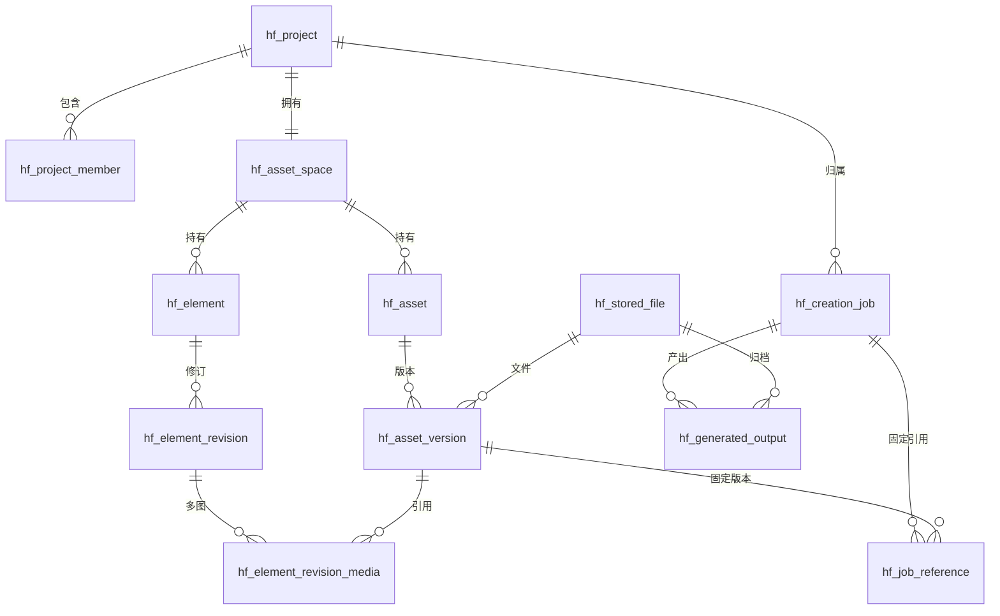
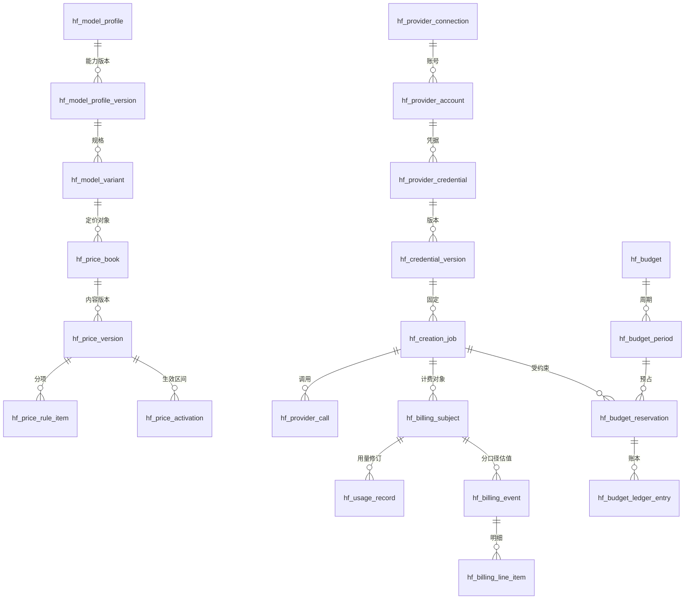
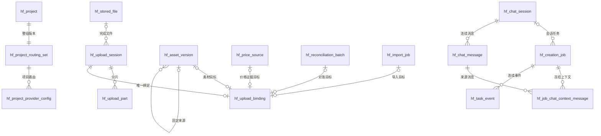
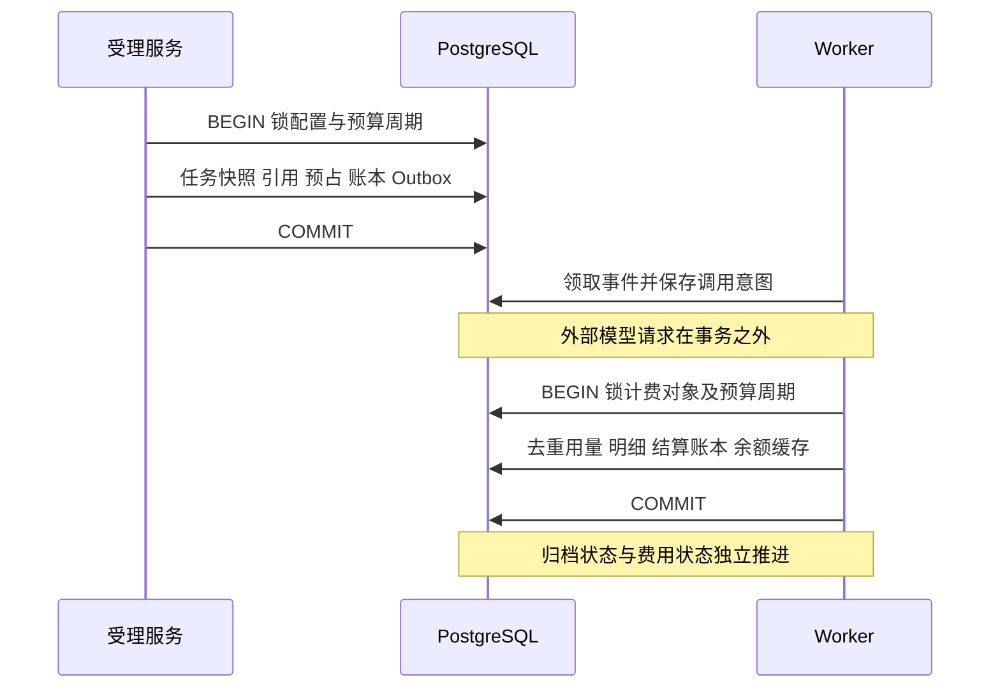

# higgsfield-ai · 数据库详细设计

> 范围调整（2026-10-27，用户确认）：公司公共素材暂缓。首期不实现S12公共库、发布到公共库、公共空间及其授权管理，不注册相关入口与接口；相关数据结构、安全约束和用例仅为未来保留，不计首期交付门槛。项目内素材、元素多图、@引用、NAS归档及原有跨项目受控复制不受此调整影响。

版本：1.10 评审稿  
日期：2026 年 10 月 27 日  
文档编号：P0-3  
数据库：PostgreSQL（已确认唯一选型），本地通过 Docker 启动，具体主版本随工程基线锁定  
状态：目标结构设计，未创建数据库、未执行迁移、未编写业务代码

本次修订依据已导入的本地RuoYi-FastAPI源码；工程现状、证据与复用边界见[工程基线核对与文档衔接方案](工程基线核对与文档衔接方案.md)。制作平台为 `higgsfield-frontend/`，管理平台为 `ruoyi-fastapi-frontend/vue3/web/`，共用 `ruoyi-fastapi-backend/`。本次只更新文档，未实现所述新增能力。

**项目名称与本地开发基线（已确认）：** 整体项目名称为 `higgsfield-ai`。现有工作目录 `D:\laputta\higgsfield`、制作端 `higgsfield-frontend/`、管理端 `ruoyi-fastapi-frontend/vue3/web/` 和后端 `ruoyi-fastapi-backend/` 均保持不变；本次不改仓库地址、包名、模块名或数据库实例名。本地开发使用 Docker 启动 PostgreSQL 与 Redis，后端及两个前端在宿主机分别手动启动。制作端尚待初始化，未来生成/media Worker 在本机作为独立进程手动启动；正式部署在公司内网服务器，素材与视频长期保存到公司 NAS；具体服务器、挂载及生产配置参数待确认，见[内网部署与 NAS 运维方案](内网部署与NAS存储运维方案.md)。

**统一约束与优先级：** 以[项目 AGENTS.md](../AGENTS.md)为工程约束；[文档一致性与优先级索引](文档一致性与优先级索引.md)统一文档编号、需求等级和处理规则。P0-1～P0-6 是文档编号，不是需求优先级；业务规则等级以 P0-1 的规则表为唯一来源，本文引用规则 ID 时继承其等级，不另行定级。设计完成不等于实现或验收通过。

> 本轮设计同步依据：[制作平台实查功能与实现基线](制作平台实查功能与实现基线.md)及[实查设计同步报告](实查设计同步报告.md)。图片资产→元素/@引用→视频→NAS为首期主线；Tools和文本会话暂缓，角色权限配置统一后台。原站实测、设计约定和本平台运行验收分别记录。

## 1 设计依据与适用边界

本设计承接[技术架构方案](技术架构方案.md)、[P0-1 首期需求与业务规则说明书](首期需求与业务规则说明书.md)、[P0-2 模型供应商接入契约与差异清单](模型供应商接入契约与差异清单.md)。并对齐 [P0-4 平台 API 契约](平台API契约.md) 第 16 章的 9 项补充需求。覆盖首期项目、素材、元素、图片与视频创作、供应商凭据、手动价格、预算账本与审计。不将文档建议冒充已确认产品决策，也不将供应商样例当作数据库内已有真实数据。

本文表结构是建议的可实施设计。当前本地实体已确认 AUTH_USER→`sys_user.user_id`、AUTH_DEPT→`sys_dept.dept_id`、AUTH_ROLE→`sys_role.role_id`，三者为 BigInteger；基础用户角色关系为sys_user_role，角色菜单为sys_role_menu。本文身份逻辑关联bigint方案据此固定，实际连接数据库的schema与迁移版本仍未核验；不新建第二套身份表。

价格与模型能力不合并；平台估值、采购估值和真实账单不混记；原始素材、不可变版本与供应商 Asset 分离。新加的辅助表用于落实已有架构约束，不扩张业务功能。

## 2 全局字段、类型与约束规范

本版以本仓库已导入的 RuoYi-FastAPI PostgreSQL 建表脚本、实体和公共 Mixin 为唯一工程依据。采用若依数据库风格，不照搬其他 Java/MySQL 分支的差异约定。旧版 UUID 通用主键、created_at/updated_at、deleted_at 和默认物理外键方案已被本节及逐表定义替代。

| 项目 | 统一规则 |
|---|---|
| 表名 | 模块前缀 + 小写下划线；本项目新增业务表统一 `hf_` 前缀和单数业务名，避开既有 sys_*、ai_models 及身份插件表。前缀 hf 是本项目模块选择，不是若依内置前缀 |
| 主键 | 实体/业务记录用有语义的 xxx_id，PostgreSQL bigserial，ORM BigInteger primary_key/autoincrement；关联表也采用 bigint 自增主键，原关系字段组合保留为联合唯一约束。无全库通用 id，无 UUID/雪花主键；序列允许回滚留空洞，不承担消息连续序号职责 |
| 基础审计字段 | 下表统一列出；复用 AuditTimeMixin/DbUtcDateTime，写入时间由框架服务填充 UTC，不另外强制数据库 now() 默认；create_by/update_by 是账号字符串，不冒充 bigint 用户外键 |
| 业务身份 | owner_id/actor_id/user_id/create_user_id/update_user_id 等 bigint 指向 sys_user.user_id；dept_id 指向 sys_dept.dept_id；业务所有者与审计账号快照各司其职。系统任务审计账号使用受控 system，不能冒用前端输入 |
| 普通字段 | 小写下划线，标识 xxx_id，名称 xxx_name，排序 order_num；业务序号 ordinal/sequence 保留语义。表和列均需中文 COMMENT；未标可空字段为 NOT NULL，审计基础字段例外见下表 |
| 状态和字典 | 正常/停用采用 sys_normal_disable 的 0/1；删除标志为 0/2；是否类采用 sys_yes_no 的 Y/N。多阶段业务状态使用本章逐表字典编码，API 可保留业务英文状态，由 DTO 明确映射 |
| 金额、用量与时间 | 保留 numeric(24,10) 金额、numeric(24,12) 汇率、bigint 计数，禁止 float 结算；时间使用 DbUtcDateTime，对应 PG timestamp(3) with time zone，业务周期保留时区，区间左闭右开 |
| JSON | JSONB 仅放版本化快照/能力/受控 payload；不代替关系字段；schema_version、白名单及体积校验仍必需 |
| 并发 | revision 是业务扩展字段，bigint 默认 1，不是若依内置公共字段；条件更新成功加一，审计字段不能代替 CAS |
| 关联关系 | 沿用本地若依 SQL/实体的逻辑关联风格，关系字段与目标主键同型，禁止建立物理 FOREIGN KEY、级联删除或跨表触发器。字段表“关联”表示目标实体；服务层锁定相关行，在同事务验证归属、引用存在性、禁止删除和审计 |
| 约束与索引 | 数据库保留 PRIMARY KEY、UNIQUE、NOT NULL、单行 CHECK；跨表不变量由受限事务服务保证，所有 API/Worker/导入都走同一服务。UQ 为唯一约束，IX 为普通/部分索引；索引命名统一 uk_hf_* / idx_hf_*，CHECK 为 ck_hf_*，超过 63 字节采用稳定缩写 |
| 逻辑删除 | 可删除主数据使用 del_flag='0'/'2'；查询默认过滤 0，关联读取也独立校验。审计、账本、不可变版本、事件和幂等事实不机械加可写删除开关；逻辑删除不是撤权、取消任务或清空费用 |

#### 若依审计基础字段

每张新增业务表均继承以下字段；字段表不重复展开。只追加的事实表创建时填写，后续不能借 update_by/remark 绕过不可变约束。

| 字段 | PostgreSQL 类型 / 默认与空值 | 约定 |
|---|---|---|
| create_by | varchar(64)，可空，默认空字符串 | 框架认证上下文中的账号快照；新业务受控写入必须填写 |
| create_time | timestamp(3) with time zone，可空，无服务器默认 | 复用 AuditTimeMixin 的 UTC 应用默认；新业务写入必须保证有值 |
| update_by | varchar(64)，可空，默认空字符串 | 本次变更账号，由服务端填写 |
| update_time | timestamp(3) with time zone，可空，无服务器默认 | 复用 Mixin 应用默认及 onupdate；禁止前端覆盖 |
| remark | varchar(500)，可空，默认 NULL | 备注；不得写秘密、完整输入或堆栈 |

### 2.1 本地源码证据与适用边界

- [PostgreSQL 基线 SQL](../ruoyi-fastapi-backend/sql/ruoyi-fastapi-pg.sql)：sys_user/sys_dept 的 bigserial、审计和 del_flag；sys_user_role 等联合主键；字典及索引风格。
- [用户实体](../ruoyi-fastapi-backend/module_admin/entity/do/user_do.py)：BigInteger 自增、create_by/update_by、CHAR 状态、逻辑删除。
- [字典实体](../ruoyi-fastapi-backend/module_admin/entity/do/dict_do.py)：复用 sys_dict_type/sys_dict_data，不另造通用字典系统。
- [审计 Mixin](../ruoyi-fastapi-backend/common/mixin.py)：create_time/update_time 使用 DbUtcDateTime 和 TimezoneUtil.utc_now；并非所有表都有同一套删除字段。

模型能力版本、价格规则、项目角色和属性定义属于有权限/版本/关联的业务实体，不能因为名称含“字典”就压进 sys_dict_data。系统字典只承载受控编码和标签。现有插件模型表也不直接替代本项目凭据版本及计费模型。

跨表一致性改由事务服务强制校验，不能误称数据库物理外键已保证。关联 ID 是否存在与当前用户是否有权限分别校验；删除事务和引用新增事务必须锁同一目标行，避免检查后被并发移除。框架直接 SQL 绕过服务不会自动得到这些保证，正式实现须限制业务表写入口。

### 2.2 表结构导航

共 81 张目标表（原73张、前次API补充7张、本次增加1张回收记录），包含主业务表、版本/关系表和可靠性辅助表；不是81个独立业务模块。基础框架身份表不计入其中。

| 分组 | 表数 | 表名与字段跳转 |
|---|---:|---|
| 项目、组织权限与个人偏好 | 9 | [hf_project](#table-hf_project)、[hf_project_role](#table-hf_project_role)、[hf_project_member](#table-hf_project_member)、[hf_project_role_permission](#table-hf_project_role_permission)、[hf_project_join_request](#table-hf_project_join_request)、[hf_project_brief](#table-hf_project_brief)、[hf_project_collection](#table-hf_project_collection)、[hf_user_project_preference](#table-hf_user_project_preference)、[hf_user_view_preference](#table-hf_user_view_preference) |
| 文件、素材、目录与元素 | 17 | [hf_asset_space](#table-hf_asset_space)、[hf_asset_space_grant](#table-hf_asset_space_grant)、[hf_upload_session](#table-hf_upload_session)、[hf_upload_part](#table-hf_upload_part)、[hf_upload_binding](#table-hf_upload_binding)、[hf_stored_file](#table-hf_stored_file)、[hf_asset](#table-hf_asset)、[hf_asset_version](#table-hf_asset_version)、[hf_project_asset_ref](#table-hf_project_asset_ref)、[hf_folder](#table-hf_folder)、[hf_folder_entry](#table-hf_folder_entry)、[hf_element](#table-hf_element)、[hf_element_revision](#table-hf_element_revision)、[hf_element_revision_label](#table-hf_element_revision_label)、[hf_element_revision_media](#table-hf_element_revision_media)、[hf_property_definition](#table-hf_property_definition)、[hf_favorite](#table-hf_favorite) |
| 草稿、会话、任务与协作 | 12 | [hf_prompt_draft](#table-hf_prompt_draft)、[hf_draft_reference](#table-hf_draft_reference)、[hf_chat_session](#table-hf_chat_session)、[hf_chat_message](#table-hf_chat_message)、[hf_creation_job](#table-hf_creation_job)、[hf_job_chat_context_message](#table-hf_job_chat_context_message)、[hf_job_reference](#table-hf_job_reference)、[hf_generated_output](#table-hf_generated_output)、[hf_comment_thread](#table-hf_comment_thread)、[hf_comment](#table-hf_comment)、[hf_annotation](#table-hf_annotation)、[hf_review_event](#table-hf_review_event) |
| 供应商、凭据、模型能力与外部素材 | 14 | [hf_provider_connection](#table-hf_provider_connection)、[hf_provider_connection_version](#table-hf_provider_connection_version)、[hf_provider_account](#table-hf_provider_account)、[hf_provider_credential](#table-hf_provider_credential)、[hf_credential_version](#table-hf_credential_version)、[hf_credential_test](#table-hf_credential_test)、[hf_model_profile](#table-hf_model_profile)、[hf_model_profile_version](#table-hf_model_profile_version)、[hf_model_variant](#table-hf_model_variant)、[hf_project_routing_set](#table-hf_project_routing_set)、[hf_project_provider_config](#table-hf_project_provider_config)、[hf_routing_policy](#table-hf_routing_policy)、[hf_provider_upload](#table-hf_provider_upload)、[hf_provider_asset_binding](#table-hf_provider_asset_binding) |
| 价格、来源、汇率与发布 | 8 | [hf_price_book](#table-hf_price_book)、[hf_price_version](#table-hf_price_version)、[hf_price_rule_item](#table-hf_price_rule_item)、[hf_price_source](#table-hf_price_source)、[hf_price_version_source](#table-hf_price_version_source)、[hf_price_activation](#table-hf_price_activation)、[hf_price_publish_event](#table-hf_price_publish_event)、[hf_exchange_rate_version](#table-hf_exchange_rate_version) |
| 调用、用量、账单与预算 | 13 | [hf_cost_center](#table-hf_cost_center)、[hf_provider_call](#table-hf_provider_call)、[hf_billing_subject](#table-hf_billing_subject)、[hf_usage_record](#table-hf_usage_record)、[hf_billing_event](#table-hf_billing_event)、[hf_billing_line_item](#table-hf_billing_line_item)、[hf_billing_adjustment](#table-hf_billing_adjustment)、[hf_reconciliation_batch](#table-hf_reconciliation_batch)、[hf_reconciliation_line](#table-hf_reconciliation_line)、[hf_budget](#table-hf_budget)、[hf_budget_period](#table-hf_budget_period)、[hf_budget_reservation](#table-hf_budget_reservation)、[hf_budget_ledger_entry](#table-hf_budget_ledger_entry) |
| 可靠性、审计与辅助记录 | 8 | [hf_api_idempotency_record](#table-hf_api_idempotency_record)、[hf_task_event](#table-hf_task_event)、[hf_outbox_event](#table-hf_outbox_event)、[hf_processed_event](#table-hf_processed_event)、[hf_audit_log](#table-hf_audit_log)、[hf_import_job](#table-hf_import_job)、[hf_import_row](#table-hf_import_row)、[hf_recycle_entry](#table-hf_recycle_entry) |

### 2.3 已导入框架表与迁移边界

81张表是目标业务设计，不是当前数据库现存表清单，不替换sys_*及认证中心/插件表。现有sys_file_info.file_id为String(36)，新hf_stored_file为自增 bigint；首期分别治理不同物理存储对象，不隐式建立跨类型外键，也不让两个回收机制管理同一文件。若后续统一文件层，必须明确单一删除责任和业务引用桥接。

本地alembic/env.py已存在，target_metadata来自框架Base；当前未见alembic/versions迁移链。启动生命周期调用create_all，不会替代既有表的列、索引、外键升级。正式实现必须规划初始化SQL与新业务迁移起点、模型导入注册、关联事务校验及生产启动行为，不能直接stamp假装已迁移。

P0-4 第 16 章的 API-DB-01～09 已在本版补齐目标表结构、索引、约束与事务协议，逐项映射见第 16 章。本次只完成设计同步；未创建 ORM、迁移或业务代码，也未执行数据库验收。

## 3 关系图

### 3.1 项目与内容

### 3.2 供应商与计费

图中为主关系，完整可空性和约束以字段表为准；公共空间没有 project_id，项目空间必须恰属一个项目。为控制图复杂度，评论、审批、个人偏好、发布审计与对账子表未全部绘入。

### 3.3 API 补充持久化关系

hf_upload_binding 四种目标恰一非空，图中的可选关系不能解释为可同时绑定四种目标。hf_api_idempotency_record 通过受控结果类型/定位恢复原响应，不为多种目标虚构单一物理外键；其身份逻辑关联仍引用 AUTH_USER。

## 4 项目、组织权限与个人偏好

### hf_project — 项目
主键：`project_id bigserial PRIMARY KEY`（ORM BigInteger，自增序列）；继承 §2 的若依审计基础字段。
逻辑删除：`del_flag char(1) NOT NULL DEFAULT '0'`，0 存在、2 删除；由本表删除策略控制。

| 字段 | PostgreSQL 类型/空值/默认 | 含义 |
|---|---|---|
| `project_id` | bigserial，NOT NULL，主键 | 自增业务主键；API 十进制字符串 |
| `project_name` | varchar(200) | 项目名称，允许同名 |
| `status` | char(1)，默认 '0' | 字典 `hf_project_status`：0=active、1=paused、2=archived、3=pending_delete； |
| `create_user_id` | bigint 关联 sys_user(user_id) | 创建者，不随负责人转交改变 |
| `revision` | bigint，默认 1 | 并发版本 |
| `archived_time` | timestamp(3) with time zone，可空 | 归档时刻 |
| `del_flag` | char(1)，NOT NULL，默认 '0' | 删除标志：0 存在，2 删除；CHECK IN ('0','2') |

**索引与约束：** IX(status,create_time,project_id)；CHECK status 枚举。archived 时 archived_time 非空。负责人由成员角色表达，不存互相矛盾的第二份 owner_id。

### hf_project_role — 项目角色字典
主键：`role_id bigserial PRIMARY KEY`（ORM BigInteger，自增序列）；继承 §2 的若依审计基础字段。
删除策略：不提供通用逻辑删除；版本/账本/事实记录不可变，关系/运行记录按本节明确生命周期治理。

| 字段 | PostgreSQL 类型/空值/默认 | 含义 |
|---|---|---|
| `role_id` | bigserial，NOT NULL，主键 | 自增业务主键；API 十进制字符串 |
| `code` | varchar(100) | owner/producer/viewer 等稳定码 |
| `role_name` | varchar(200) | 展示名 |
| `is_system` | char(1)，默认 'Y' | 首期预设角色；sys_yes_no：Y 是、N 否 |

**索引与约束：** UQ(code)；角色是否允许自定义由 P0-6 决定。

### hf_project_member — 成员
主键：`member_id bigserial PRIMARY KEY`（ORM BigInteger，自增序列）；继承 §2 的若依审计基础字段。
删除策略：不提供通用逻辑删除；版本/账本/事实记录不可变，关系/运行记录按本节明确生命周期治理。

| 字段 | PostgreSQL 类型/空值/默认 | 含义 |
|---|---|---|
| `member_id` | bigserial，NOT NULL，主键 | 自增业务主键；API 十进制字符串 |
| `project_id` | bigint 关联 hf_project(project_id) | 项目 |
| `user_id` | bigint 关联 sys_user(user_id) | 成员 |
| `role_id` | bigint 关联 hf_project_role(role_id) | 角色 |
| `status` | char(1)，默认 '0' | 字典 `hf_project_member_status`：0=active、1=removed； |
| `joined_time` | timestamp(3) with time zone | 加入时刻 |
| `removed_time` | timestamp(3) with time zone，可空 | 移除时刻 |
| `revision` | bigint，默认 1 | 并发版本 |

**索引与约束：** UQ(project_id,user_id)；IX(user_id,status,project_id)；恢复成员更新同一记录并写审计。移除最后负责人需锁项目行及事务服务提交前校验验证，不能只依赖前端。

### hf_project_role_permission — 项目角色权限
主键：`role_permission_id bigserial PRIMARY KEY`；继承 §2 若依审计公共字段；关系组合保留联合唯一约束，增删由聚合根事务及历史保留规则控制。

| 字段 | PostgreSQL 类型/空值/默认 | 含义 |
|---|---|---|
| `role_permission_id` | bigserial，NOT NULL，主键 | 自增业务主键 |
| `role_id` | bigint 关联 hf_project_role(role_id) | 角色 |
| `permission_code` | varchar(100) | 操作码，后续与 P0-6 对齐 |
| `data_scope` | varchar(32) | own/project，作用于内容权限 |

**索引与约束：** UQ(role_id,permission_code)；CHECK data_scope 枚举；全局管理权限复用框架，不因此自动获得项目内容读取权。

### hf_project_join_request — 加入申请
主键：`request_id bigserial PRIMARY KEY`（ORM BigInteger，自增序列）；继承 §2 的若依审计基础字段。
删除策略：不提供通用逻辑删除；版本/账本/事实记录不可变，关系/运行记录按本节明确生命周期治理。

| 字段 | PostgreSQL 类型/空值/默认 | 含义 |
|---|---|---|
| `request_id` | bigserial，NOT NULL，主键 | 自增业务主键；API 十进制字符串 |
| `project_id` | bigint 关联 hf_project(project_id) | 目标项目 |
| `user_id` | bigint 关联 sys_user(user_id) | 申请人 |
| `status` | char(1)，默认 '0' | 字典 `hf_project_join_request_status`：0=pending、1=approved、2=rejected、3=cancelled； |
| `reason` | text，可空 | 申请说明 |
| `reviewer_id` | bigint 关联 sys_user(user_id)，可空 | 处理人 |
| `reviewed_time` | timestamp(3) with time zone，可空 | 处理时间 |
| `revision` | bigint，默认 1 | 编辑和状态动作的 CAS 版本，CHECK revision > 0 |

**索引与约束：** 部分 UQ(project_id,user_id) WHERE status='0'；IX(project_id,status,create_time)；批准申请和写成员同事务，已处理申请不可再批准。

存储实现补充：申请说明最多5000字符，空白输入归一化为空；项目、申请人及修订为正数。待审批状态不得包含处理证据，批准/拒绝必须同时包含正数处理人和处理时间，取消状态也不允许半份处理证据。真实迁移20261028_71已提供存储基础；审批事务和项目发现仍未接通，不将表约束视为业务授权完成。

### hf_project_brief — 项目简报
主键：`brief_id bigserial PRIMARY KEY`（ORM BigInteger，自增序列）；继承 §2 的若依审计基础字段。
删除策略：不提供通用逻辑删除；版本/账本/事实记录不可变，关系/运行记录按本节明确生命周期治理。

| 字段 | PostgreSQL 类型/空值/默认 | 含义 |
|---|---|---|
| `brief_id` | bigserial，NOT NULL，主键 | 自增业务主键；API 十进制字符串 |
| `project_id` | bigint 关联 hf_project(project_id) | 项目 |
| `body` | jsonb | 白名单富文本结构 |
| `schema_version` | integer，默认 1 | 内容格式版本 |
| `revision` | bigint，默认 1 | 编辑冲突检测 |
| `update_user_id` | bigint 关联 sys_user(user_id) | 编辑者 |

**索引与约束：** UQ(project_id)；CHECK jsonb_typeof(body)=object。历史编辑差异记审计，不宣称完整简报版本历史已实现。

### hf_project_collection — 个人项目集合
主键：`collection_id bigserial PRIMARY KEY`（ORM BigInteger，自增序列）；继承 §2 的若依审计基础字段。
删除策略：不提供通用逻辑删除；版本/账本/事实记录不可变，关系/运行记录按本节明确生命周期治理。

| 字段 | PostgreSQL 类型/空值/默认 | 含义 |
|---|---|---|
| `collection_id` | bigserial，NOT NULL，主键 | 自增业务主键；API 十进制字符串 |
| `user_id` | bigint 关联 sys_user(user_id) | 所有者 |
| `collection_name` | varchar(200) | 名称 |
| `description` | text，可空，最多 2000 字符 | 个人集合说明 |
| `color` | varchar(7)，可空 | 小写十六进制颜色，格式 `#rrggbb` |
| `order_num` | integer，默认 0 | 排序 |
| `revision` | bigint，默认 1 | 编辑和状态动作的 CAS 版本，CHECK revision > 0 |

**索引与约束：** UQ(user_id,collection_name)；IX(user_id,order_num,collection_id)。名称不得为空白，用户和修订必须为正数；说明长度和颜色格式由数据库约束兜底。集合是个人平铺分组，不能当作项目授权。迁移 `20261028_72` 已实现该存储结构，集合操作接口仍须单独验收。

### hf_user_project_preference — 项目个人偏好
主键：`preference_id bigserial PRIMARY KEY`（ORM BigInteger，自增序列）；继承 §2 的若依审计基础字段。
删除策略：不提供通用逻辑删除；版本/账本/事实记录不可变，关系/运行记录按本节明确生命周期治理。

| 字段 | PostgreSQL 类型/空值/默认 | 含义 |
|---|---|---|
| `preference_id` | bigserial，NOT NULL，主键 | 自增业务主键；API 十进制字符串 |
| `user_id` | bigint 关联 sys_user(user_id) | 用户 |
| `project_id` | bigint 关联 hf_project(project_id) | 项目 |
| `collection_id` | bigint 关联 hf_project_collection(collection_id)，可空 | 个人集合 |
| `is_pinned` | char(1)，默认 'N' | 置顶；sys_yes_no：Y 是、N 否 |
| `is_hidden` | char(1)，默认 'N' | 隐藏；sys_yes_no：Y 是、N 否 |
| `order_num` | integer，默认 0 | 个人排序 |
| `revision` | bigint，默认 1 | 编辑和状态动作的 CAS 版本，CHECK revision > 0 |

**索引与约束：** UQ(user_id,project_id)；IX(user_id,is_hidden,is_pinned,order_num)；Service 在同一事务中锁定目标 hf_project_collection 行，校验其 collection_id 与 user_id 与偏好记录一致；不使用偏好表 preference_id 代替集合主键，不建立物理外键。

### hf_user_view_preference — 页面偏好
主键：`preference_id bigserial PRIMARY KEY`（ORM BigInteger，自增序列）；继承 §2 的若依审计基础字段。
删除策略：不提供通用逻辑删除；版本/账本/事实记录不可变，关系/运行记录按本节明确生命周期治理。

| 字段 | PostgreSQL 类型/空值/默认 | 含义 |
|---|---|---|
| `preference_id` | bigserial，NOT NULL，主键 | 自增业务主键；API 十进制字符串 |
| `user_id` | bigint 关联 sys_user(user_id) | 用户 |
| `view_key` | varchar(100) | 页面稳定标识 |
| `project_id` | bigint 关联 hf_project(project_id)，可空 | 全局或项目视图 |
| `settings` | jsonb | 布局、筛选、展开目录等白名单 |
| `revision` | bigint，默认 1 | 并发版本 |

**索引与约束：** 全局部分 UQ(user_id,view_key) WHERE project_id IS NULL；项目部分 UQ(user_id,view_key,project_id) WHERE project_id IS NOT NULL；偏好不包含秘密，不替代权限查询。

## 5 文件、素材、目录与元素

### hf_asset_space — 内容归属空间
主键：`space_id bigserial PRIMARY KEY`（ORM BigInteger，自增序列）；继承 §2 的若依审计基础字段。
删除策略：不提供通用逻辑删除；版本/账本/事实记录不可变，关系/运行记录按本节明确生命周期治理。

| 字段 | PostgreSQL 类型/空值/默认 | 含义 |
|---|---|---|
| `space_id` | bigserial，NOT NULL，主键 | 自增业务主键；API 十进制字符串 |
| `kind` | varchar(32) | project/public |
| `project_id` | bigint 关联 hf_project(project_id)，可空 | 项目空间绑定 |
| `space_name` | varchar(200) | 空间名称 |

**索引与约束：** CHECK (kind=project AND project_id非空) OR (kind=public AND project_id为空)；部分 UQ(project_id) WHERE project_id IS NOT NULL。创建项目与项目空间同事务。

### hf_asset_space_grant — 公共空间使用授权
主键：`grant_id bigserial PRIMARY KEY`（ORM BigInteger，自增序列）；继承 §2 的若依审计基础字段。
删除策略：不提供通用逻辑删除；版本/账本/事实记录不可变，关系/运行记录按本节明确生命周期治理。

| 字段 | PostgreSQL 类型/空值/默认 | 含义 |
|---|---|---|
| `grant_id` | bigserial，NOT NULL，主键 | 自增业务主键；API 十进制字符串 |
| `space_id` | bigint 关联 hf_asset_space(space_id) | 公共空间 |
| `project_id` | bigint 关联 hf_project(project_id) | 被授权项目 |
| `can_read` | char(1)，默认 'Y' | 读取；sys_yes_no：Y 是、N 否 |
| `can_use` | char(1)，默认 'N' | 生成引用；sys_yes_no：Y 是、N 否 |
| `can_publish` | char(1)，默认 'N' | 公共发布；sys_yes_no：Y 是、N 否 |
| `revoked_time` | timestamp(3) with time zone，可空 | 撤回时刻 |
| `revision` | bigint，默认 1 | 授权修订 |

**索引与约束：** UQ(space_id,project_id)；事务服务校验限制 space.kind=public。初版按项目授权，不新增通配用户/部门授权多态外键；更细主体在 P0-6 后扩展。

### hf_upload_session — 平台上传会话
主键：`upload_id bigserial PRIMARY KEY`（ORM BigInteger，自增序列）；继承 §2 的若依审计基础字段。
删除策略：不提供通用逻辑删除；版本/账本/事实记录不可变，关系/运行记录按本节明确生命周期治理。

| 字段 | PostgreSQL 类型/空值/默认 | 含义 |
|---|---|---|
| `upload_id` | bigserial，NOT NULL，主键 | 自增业务主键；API 十进制字符串 |
| `owner_id` | bigint 关联 sys_user(user_id) | 创建者；每次续传、完成及绑定重新鉴权 |
| `project_id` | bigint 关联 hf_project(project_id)，可空 | 制作端上传必填，管理端文档上传为空 |
| `purpose` | varchar(32) | asset/element_import/price_source/reconciliation；由受控入口确定 |
| `file_name` | varchar(255) | 展示文件名，不作为存储路径 |
| `declared_mime_type` | varchar(255) | 客户端声明；不能替代实际 MIME 检查 |
| `byte_size` | bigint | 总字节数，CHECK > 0 |
| `part_size` | bigint | 服务端固定片大小，CHECK > 0 |
| `part_count` | integer | CHECK > 0；等于总大小除以片大小向上取整 |
| `expected_sha256` | char(64)，可空 | 创建时可省略；首次 complete 固定，随后不得换摘要 |
| `verified_sha256` | char(64)，可空 | 服务端整文件校验结果 |
| `state` | char(1)，默认 '0' | 字典 `hf_upload_session_state`：0=created、1=uploading、2=verifying、3=ready、4=failed、5=cancelled、6=expired； |
| `expires_time` | timestamp(3) with time zone | 续传和未绑定暂存有效期 |
| `completed_file_id` | bigint 关联 hf_stored_file(file_id)，可空 | 验证成功后唯一完成结果 |
| `validation_errors` | jsonb，默认 [] | FieldIssue[] 白名单，不含文件正文或秘密 |
| `schema_version` | integer，默认 1 | 错误信息格式版本 |
| `revision` | bigint，默认 1 | 内部状态竞争控制，不要求上传 API 客户端传 revision |

**索引与约束：** CHECK purpose 属于 asset/element_import 时 project_id 非空，属于 price_source/reconciliation 时为空；CHECK expires_time > create_time。ready 必须 completed_file_id、verified_sha256、expected_sha256 非空且两摘要一致，文件必须处于 ready；由事务服务校验文件摘要/大小。IX(owner_id,project_id,create_time,upload_id)、IX(state,expires_time)。receivedParts 从 hf_upload_part 派生，不重复存数组。状态 ready 不代表已创建素材；已绑定会话不得取消、过期或改完成文件。

### hf_upload_part — 平台上传已接收分片
主键：`part_id bigserial PRIMARY KEY`（ORM BigInteger，自增序列）；继承 §2 的若依审计基础字段。
删除策略：不提供通用逻辑删除；版本/账本/事实记录不可变，关系/运行记录按本节明确生命周期治理。

| 字段 | PostgreSQL 类型/空值/默认 | 含义 |
|---|---|---|
| `part_id` | bigserial，NOT NULL，主键 | 自增业务主键；API 十进制字符串 |
| `session_id` | bigint 关联 hf_upload_session(upload_id) | 上传会话 |
| `part_no` | integer | 从 1 开始 |
| `byte_offset` | bigint | 零起点字节偏移 |
| `byte_size` | bigint | 本片实际字节数 |
| `sha256` | char(64) | 服务端计算的内容摘要 |
| `storage_key` | text | 平台内部暂存定位，不返回物理路径 |

**索引与约束：** UQ(session_id,part_no)；CHECK part_no > 0、byte_offset >= 0、byte_size > 0。锁会话后校验 part_no <= part_count、byte_offset=(part_no-1)*part_size、byte_size=min(part_size,会话总大小-byte_offset)，并校验 Content-Range 总大小。同编号同摘要且同长度为幂等重放，不同内容返回 UPLOAD_PART_CONFLICT；已提交分片不可覆盖。分片存储成功才写记录，孤立暂存对象可延迟回收。

### hf_upload_binding — 上传完成结果的唯一业务绑定
主键：`binding_id bigserial PRIMARY KEY`（ORM BigInteger，自增序列）；继承 §2 的若依审计基础字段。
删除策略：不提供通用逻辑删除；版本/账本/事实记录不可变，关系/运行记录按本节明确生命周期治理。

| 字段 | PostgreSQL 类型/空值/默认 | 含义 |
|---|---|---|
| `binding_id` | bigserial，NOT NULL，主键 | 自增业务主键；API 十进制字符串 |
| `session_id` | bigint 关联 hf_upload_session(upload_id) | 一次上传只能消费一次 |
| `asset_version_id` | bigint 关联 hf_asset_version(version_id)，可空 | 素材版本绑定 |
| `price_source_id` | bigint 关联 hf_price_source(source_id)，可空 | 价格证据附件绑定 |
| `reconciliation_batch_id` | bigint 关联 hf_reconciliation_batch(batch_id)，可空 | 对账文件绑定 |
| `import_job_id` | bigint 关联 hf_import_job(import_id)，可空 | 元素导入文件绑定 |
| `bound_by` | bigint 关联 sys_user(user_id) | 执行绑定的上传所有者 |

**索引与约束：** UQ(session_id)；CHECK 四种目标恰一非空；四个目标分别建立非空部分唯一索引。绑定只追加。事务服务提交前校验检查会话 ready、用途与目标类型匹配、bound_by=owner_id、目标文件=completed_file_id、项目归属一致。asset 用途可绑定同项目 hf_import_job（现有 /uploads 为元素模板上传入口），element_import 仅绑定 hf_import_job；两者均不能用于管理附件。价格证据及对账要求对应管理权限。应用在事务内锁上传会话、创建目标并写绑定，失败全部回滚；重复绑定同目标返回原结果，绑定不同目标冲突。

### hf_stored_file — 受控持久文件
主键：`file_id bigserial PRIMARY KEY`（ORM BigInteger，自增序列）；继承 §2 的若依审计基础字段。
删除策略：不提供通用逻辑删除；版本/账本/事实记录不可变，关系/运行记录按本节明确生命周期治理。

| 字段 | PostgreSQL 类型/空值/默认 | 含义 |
|---|---|---|
| `file_id` | bigserial，NOT NULL，主键 | 自增业务主键；API 十进制字符串 |
| `storage_key` | text | 服务端生成 NAS 相对键，非用户输入路径 |
| `sha256` | char(64) | 内容摘要 |
| `byte_size` | bigint | 字节数 |
| `mime_type` | varchar(100) | 实际 MIME |
| `width` | integer，可空 | 图像/视频实际像素 |
| `height` | integer，可空 | 图像/视频实际像素 |
| `seconds` | numeric(18,6)，可空 | 媒体时长 |
| `state` | char(1) | 字典 `hf_stored_file_state`：0=staging、1=ready、2=quarantined、3=missing、4=purged； |
| `purged_time` | timestamp(3) with time zone，可空 | 物理清理证据 |

**索引与约束：** UQ(storage_key)；IX(sha256,byte_size)，摘要不全局唯一，避免跨权限空间的上传去重泄露。CHECK 大小>=0、像素/时长正数（有值时）。同一文件可复用，但物理清理必须验证所有引用。

### hf_asset — 素材身份
主键：`asset_id bigserial PRIMARY KEY`（ORM BigInteger，自增序列）；继承 §2 的若依审计基础字段。
逻辑删除：`del_flag char(1) NOT NULL DEFAULT '0'`，0 存在、2 删除；由本表删除策略控制。

| 字段 | PostgreSQL 类型/空值/默认 | 含义 |
|---|---|---|
| `asset_id` | bigserial，NOT NULL，主键 | 自增业务主键；API 十进制字符串 |
| `space_id` | bigint 关联 hf_asset_space(space_id) | 归属空间 |
| `asset_name` | varchar(200) | 名称 |
| `media_type` | varchar(32) | image/video/audio/document |
| `create_user_id` | bigint 关联 sys_user(user_id) | 作者 |
| `current_version_id` | bigint 关联 hf_asset_version(version_id)，可空 | 当前已就绪版本 |
| `revision` | bigint，默认 1 | 元数据并发版本 |
| `del_flag` | char(1)，NOT NULL，默认 '0' | 删除标志：0 存在，2 删除；CHECK IN ('0','2') |

**索引与约束：** UQ(asset_id,space_id)；IX(space_id,create_time,asset_id) WHERE del_flag='0'。current_version_id 使用 (asset_id,current_version_id)→hf_asset_version(asset_id,version_id) 逻辑归属校验，防指向其他素材版本。

### hf_asset_version — 素材不可变版本
主键：`version_id bigserial PRIMARY KEY`（ORM BigInteger，自增序列）；继承 §2 的若依审计基础字段。
删除策略：不提供通用逻辑删除；版本/账本/事实记录不可变，关系/运行记录按本节明确生命周期治理。

| 字段 | PostgreSQL 类型/空值/默认 | 含义 |
|---|---|---|
| `version_id` | bigserial，NOT NULL，主键 | 自增业务主键；API 十进制字符串 |
| `asset_id` | bigint 关联 hf_asset(asset_id) | 素材身份 |
| `version_no` | integer | 递增版本号 |
| `file_id` | bigint 关联 hf_stored_file(file_id) | 持久文件 |
| `source_output_id` | bigint 关联 hf_generated_output(output_id)，可空 | 作品转素材来源 |
| `create_user_id` | bigint 关联 sys_user(user_id) | 创建者 |
| `metadata` | jsonb，默认 {} | 媒体分析快照 |
| `source_asset_version_id` | bigint 关联 hf_asset_version(version_id)，可空 | 公共发布副本固定来源版本，发布后不可改 |

**索引与约束：** UQ(asset_id,version_no)、UQ(asset_id,version_id)；CHECK version_no>0；版本不可修改。分配版本号锁 asset 行。关联 source_output_id 为后置创建约束以解除建表依赖环。

**公共发布约束（API-DB-09）：** CHECK source_asset_version_id IS NULL OR source_asset_version_id <> version_id；CHECK source_asset_version_id 与 source_output_id 至多一个非空。IX(source_asset_version_id) WHERE source_asset_version_id IS NOT NULL。发布事务锁源 hf_asset 并校验请求 revision、源版本访问和目标空间发布权限，创建新公共 hf_asset 与 hf_asset_version，保存来源后写 hf_audit_log（操作者、源版本、目标空间、原因、请求 ID）。事务服务校验禁止来源环、保证来源属于不同资产且发布目标为公共空间；来源不可变，源版本的物理删除由事务服务锁行检查并拒绝。普通上传两来源均空。源资产不改变空间，源权限不自动扩散；公共副本按目标空间权限读取，来源详情仍单独鉴权。共享 hf_stored_file 时回收必须检查所有版本引用。

### hf_project_asset_ref — 跨空间素材使用关系
主键：`ref_id bigserial PRIMARY KEY`（ORM BigInteger，自增序列）；继承 §2 的若依审计基础字段。
删除策略：不提供通用逻辑删除；版本/账本/事实记录不可变，关系/运行记录按本节明确生命周期治理。

| 字段 | PostgreSQL 类型/空值/默认 | 含义 |
|---|---|---|
| `ref_id` | bigserial，NOT NULL，主键 | 自增业务主键；API 十进制字符串 |
| `project_id` | bigint 关联 hf_project(project_id) | 使用项目 |
| `asset_id` | bigint 关联 hf_asset(asset_id) | 来源素材 |
| `space_grant_id` | bigint 关联 hf_asset_space_grant(grant_id)，可空 | 公共授权证据 |
| `source_project_id` | bigint 关联 hf_project(project_id)，可空 | 跨项目授权来源 |
| `create_user_id` | bigint 关联 sys_user(user_id) | 执行人 |
| `revoked_time` | timestamp(3) with time zone，可空 | 撤销引用 |

**索引与约束：** UQ(project_id,asset_id)；公共授权或跨项目来源必须恰一非空。事务服务校验来源资产空间匹配；运行时复核最新授权，保存关系不代表永久授权。跨项目场景需额外通过两项目权限校验。

### hf_folder — 空间目录
主键：`folder_id bigserial PRIMARY KEY`（ORM BigInteger，自增序列）；继承 §2 的若依审计基础字段。
逻辑删除：`del_flag char(1) NOT NULL DEFAULT '0'`，0 存在、2 删除；由本表删除策略控制。

| 字段 | PostgreSQL 类型/空值/默认 | 含义 |
|---|---|---|
| `folder_id` | bigserial，NOT NULL，主键 | 自增业务主键；API 十进制字符串 |
| `space_id` | bigint 关联 hf_asset_space(space_id) | 归属空间 |
| `parent_id` | bigint 关联 hf_folder(folder_id)，可空 | 空为顶层目录 |
| `folder_name` | varchar(200) | 显示名 |
| `description` | text，默认空串 | 目录描述 |
| `color` | varchar(16)，默认 lime | 七色标识lime/cyan/slate/violet/purple/pink/yellow，CHECK白名单 |
| `folder_kind` | varchar(16)，默认 media | media素材目录或element元素目录，父子必须同类型 |
| `normalized_name` | varchar(200) | 去首尾空白并按确定规则规范化 |
| `order_num` | integer，默认 0 | 排序 |
| `revision` | bigint，默认 1 | 并发版本 |
| `del_flag` | char(1)，NOT NULL，默认 '0' | 删除标志：0 存在，2 删除；CHECK IN ('0','2') |

**索引与约束：** UQ(folder_id,space_id)；复合逻辑关联(parent_id,space_id)→hf_folder(folder_id,space_id)；CHECK parent_id<>folder_id。活跃顶层 UQ(space_id,normalized_name) WHERE parent_id IS NULL AND del_flag='0'；活跃子层 UQ(space_id,parent_id,normalized_name) WHERE parent_id IS NOT NULL AND del_flag='0'。移动锁空间行后递归检查无环，禁止并发交叉移动成环。

### hf_folder_entry — 主目录归属
主键：`entry_id bigserial PRIMARY KEY`（ORM BigInteger，自增序列）；继承 §2 的若依审计基础字段。
删除策略：不提供通用逻辑删除；版本/账本/事实记录不可变，关系/运行记录按本节明确生命周期治理。

| 字段 | PostgreSQL 类型/空值/默认 | 含义 |
|---|---|---|
| `entry_id` | bigserial，NOT NULL，主键 | 自增业务主键；API 十进制字符串 |
| `space_id` | bigint 关联 hf_asset_space(space_id) | 展示空间 |
| `folder_id` | bigint 关联 hf_folder(folder_id)，可空 | 空表示全部素材根层 |
| `asset_id` | bigint 关联 hf_asset(asset_id)，可空 | 本空间素材 |
| `output_id` | bigint 关联 hf_generated_output(output_id)，可空 | 本项目作品 |
| `project_asset_ref_id` | bigint 关联 hf_project_asset_ref(ref_id)，可空 | 外部素材在本项目的引用 |
| `order_num` | integer，默认 0 | 目录内排序 |
| `revision` | bigint，默认 1 | 编辑和状态动作的 CAS 版本，CHECK revision > 0 |

**索引与约束：** CHECK num_nonnulls(asset_id,output_id,project_asset_ref_id)=1；每个目标分别建部分 UQ(space_id,目标列) WHERE 目标列 IS NOT NULL。复合逻辑关联(folder_id,space_id) 保证目录同空间；目标归属由事务服务校验。业务唯一主目录，移动不改素材空间。

### hf_element — 元素身份
主键：`element_id bigserial PRIMARY KEY`（ORM BigInteger，自增序列）；继承 §2 的若依审计基础字段。
逻辑删除：`del_flag char(1) NOT NULL DEFAULT '0'`，0 存在、2 删除；由本表删除策略控制。

| 字段 | PostgreSQL 类型/空值/默认 | 含义 |
|---|---|---|
| `element_id` | bigserial，NOT NULL，主键 | 自增业务主键；API 十进制字符串 |
| `space_id` | bigint 关联 hf_asset_space(space_id) | 所属空间 |
| `element_name` | varchar(200) | 展示名 |
| `alias` | varchar(100) | 空间内业务别名 |
| `category` | varchar(32) | character/scene/prop/other |
| `create_user_id` | bigint 关联 sys_user(user_id) | 作者 |
| `current_revision_id` | bigint 关联 hf_element_revision(revision_id)，可空 | 当前修订 |
| `performer_id` | bigint 关联 sys_user(user_id)，可空 | 元素负责人；必须是当前有效项目成员 |
| `folder_id` | bigint 关联 hf_folder(folder_id)，可空 | 元素目录；同空间且folder_kind=element |
| `work_status` | char(1)，默认 '0' | 字典 `hf_element_work_status`：0=none、1=working、2=review、3=approved、4=rejected； |
| `revision` | bigint，默认 1 | 身份元数据版本 |
| `del_flag` | char(1)，NOT NULL，默认 '0' | 删除标志：0 存在，2 删除；CHECK IN ('0','2') |

**索引与约束：** UQ(space_id,alias)，逻辑删除也保留别名防历史歧义；IX(space_id,category,create_time,element_id) WHERE del_flag='0'。复合逻辑关联(element_id,current_revision_id)→hf_element_revision(element_id,revision_id)。

### hf_element_revision — 元素不可变修订
主键：`revision_id bigserial PRIMARY KEY`（ORM BigInteger，自增序列）；继承 §2 的若依审计基础字段。
删除策略：不提供通用逻辑删除；版本/账本/事实记录不可变，关系/运行记录按本节明确生命周期治理。

| 字段 | PostgreSQL 类型/空值/默认 | 含义 |
|---|---|---|
| `revision_id` | bigserial，NOT NULL，主键 | 自增业务主键；API 十进制字符串 |
| `element_id` | bigint 关联 hf_element(element_id) | 元素 |
| `revision_no` | integer | 内部修订号 |
| `description` | text | 参与生成的描述，可空串 |
| `property_snapshot` | jsonb | 属性键、定义版本及值快照 |
| `create_user_id` | bigint 关联 sys_user(user_id) | 修订作者 |

**索引与约束：** UQ(element_id,revision_no)、UQ(element_id,revision_id)；CHECK revision_no>0。生成相关内容不可改；用户版本显示标签放单独标签表，不修改修订身份。

### hf_element_revision_label — 修订展示标签
主键：`label_id bigserial PRIMARY KEY`（ORM BigInteger，自增序列）；继承 §2 的若依审计基础字段。
删除策略：不提供通用逻辑删除；版本/账本/事实记录不可变，关系/运行记录按本节明确生命周期治理。

| 字段 | PostgreSQL 类型/空值/默认 | 含义 |
|---|---|---|
| `label_id` | bigserial，NOT NULL，主键 | 自增业务主键；API 十进制字符串 |
| `element_revision_id` | bigint 关联 hf_element_revision(revision_id) | 修订 |
| `label` | varchar(100) | 用户可改的版本标签 |
| `revision` | bigint，默认 1 | 编辑冲突版本 |
| `update_user_id` | bigint 关联 sys_user(user_id) | 修改人 |

**索引与约束：** UQ(element_revision_id)；标签不参与任务外键，不可用作内部修订号。

### hf_element_revision_media — 修订多图
主键：`media_id bigserial PRIMARY KEY`（ORM BigInteger，自增序列）；继承 §2 的若依审计基础字段。
删除策略：不提供通用逻辑删除；版本/账本/事实记录不可变，关系/运行记录按本节明确生命周期治理。

| 字段 | PostgreSQL 类型/空值/默认 | 含义 |
|---|---|---|
| `media_id` | bigserial，NOT NULL，主键 | 自增业务主键；API 十进制字符串 |
| `element_revision_id` | bigint 关联 hf_element_revision(revision_id) | 所属修订 |
| `asset_version_id` | bigint 关联 hf_asset_version(version_id) | 固定素材版本 |
| `ordinal` | integer | 顺序 |
| `is_primary` | char(1)，默认 'N' | 主图；sys_yes_no：Y 是、N 否 |

**索引与约束：** UQ(element_revision_id,ordinal)、UQ(element_revision_id,asset_version_id)；部分 UQ(element_revision_id) WHERE is_primary='Y'；有图修订必须恰一主图，由事务服务在提交前检查。无图元素允许零条媒体，工作状态可为none/working/review/approved；Approved不代表具有有效图片。以该元素作图片引用时须先补图，提交时再按模型能力校验。

### hf_property_definition — 元素属性定义版本
主键：`property_id bigserial PRIMARY KEY`（ORM BigInteger，自增序列）；继承 §2 的若依审计基础字段。
删除策略：不提供通用逻辑删除；版本/账本/事实记录不可变，关系/运行记录按本节明确生命周期治理。

| 字段 | PostgreSQL 类型/空值/默认 | 含义 |
|---|---|---|
| `property_id` | bigserial，NOT NULL，主键 | 自增业务主键；API 十进制字符串 |
| `space_id` | bigint 关联 hf_asset_space(space_id) | 定义范围 |
| `property_key` | varchar(100) | 稳定属性键 |
| `version_no` | integer | 定义版本 |
| `property_name` | varchar(200) | 展示名 |
| `value_type` | varchar(32) | 首期 text/multi_select；single_select仅兼容历史定义 |
| `options` | jsonb，默认 [] | 单选/多选合法选项；多选值为去重字符串数组 |

**索引与约束：** UQ(space_id,property_key,version_no)；旧定义不可覆盖，修订快照携带定义 property_id/version 与值；JSON 校验属于事务服务校验或受控写服务，不用普通 CHECK 跨表查询。

### hf_favorite — 个人收藏
主键：`favorite_id bigserial PRIMARY KEY`（ORM BigInteger，自增序列）；继承 §2 的若依审计基础字段。
删除策略：收藏是可取消的个人业务关系，按项目规范使用del_flag（0存在、2取消），不物理删除。再次收藏同一对象复用关系身份；不影响原对象、历史引用或授权。

| 字段 | PostgreSQL 类型/空值/默认 | 含义 |
|---|---|---|
| `favorite_id` | bigserial，NOT NULL，主键 | 自增业务主键；API 十进制字符串 |
| `user_id` | bigint 关联 sys_user(user_id) | 用户 |
| `element_id` | bigint 关联 hf_element(element_id)，可空 | 元素 |
| `asset_id` | bigint 关联 hf_asset(asset_id)，可空 | 素材 |
| `output_id` | bigint 关联 hf_generated_output(output_id)，可空 | 作品 |
| `del_flag` | char(1)，NOT NULL，默认0 | 0存在、2取消 |

**索引与约束：** CHECK 恰一目标非空且用户/目标ID为正；每种目标部分 UQ(user_id,目标列)，以目标列非空为条件且包含已取消记录；本人状态/时间/ID分页索引。收藏不创建授权，读取时重新过滤权限。67号迁移已实现表与中文注释，无物理外键；主库是否执行以迁移记录为准。

## 6 草稿、会话、任务与协作

### hf_prompt_draft — 创作草稿
主键：`draft_id bigserial PRIMARY KEY`（ORM BigInteger，自增序列）；继承 §2 的若依审计基础字段。
删除策略：不提供通用逻辑删除；版本/账本/事实记录不可变，关系/运行记录按本节明确生命周期治理。

| 字段 | PostgreSQL 类型/空值/默认 | 含义 |
|---|---|---|
| `draft_id` | bigserial，NOT NULL，主键 | 自增业务主键；API 十进制字符串 |
| `project_id` | bigint 关联 hf_project(project_id) | 项目 |
| `owner_id` | bigint 关联 sys_user(user_id) | 草稿所有者 |
| `kind` | varchar(32) | chat/image/video |
| `body` | jsonb | Tiptap 与生成参数草稿 |
| `schema_version` | integer，默认 1 | 草稿结构契约 |
| `revision` | bigint，默认 1 | 乐观锁 |

**索引与约束：** UQ(draft_id,project_id)；IX(owner_id,project_id,update_time,draft_id)；草稿不直接计费。JSON 内资源 ID 仅为编辑展示，真实引用必须写 hf_draft_reference。

### hf_draft_reference — 草稿结构化引用
主键：`reference_id bigserial PRIMARY KEY`（ORM BigInteger，自增序列）；继承 §2 的若依审计基础字段。
删除策略：不提供通用逻辑删除；版本/账本/事实记录不可变，关系/运行记录按本节明确生命周期治理。

| 字段 | PostgreSQL 类型/空值/默认 | 含义 |
|---|---|---|
| `reference_id` | bigserial，NOT NULL，主键 | 自增业务主键；API 十进制字符串 |
| `draft_id` | bigint 关联 hf_prompt_draft(draft_id) | 草稿 |
| `reference_key` | bigint | 编辑器 Mention 稳定键 |
| `asset_version_id` | bigint 关联 hf_asset_version(version_id) | 固定媒体 |
| `element_revision_id` | bigint 关联 hf_element_revision(revision_id)，可空 | 可选元素来源 |
| `media_role` | varchar(32) | reference_image/first_frame 等 |
| `ordinal` | integer | 顺序 |

**索引与约束：** UQ(draft_id,reference_key,ordinal)；IX(draft_id,ordinal)；元素修订有值时验证媒体属于该修订。同一媒体不同角色允许存在，提交时按素材版本+角色去重。

### hf_chat_session — 项目会话
主键：`session_id bigserial PRIMARY KEY`（ORM BigInteger，自增序列）；继承 §2 的若依审计基础字段。
删除策略：不提供通用逻辑删除；版本/账本/事实记录不可变，关系/运行记录按本节明确生命周期治理。

| 字段 | PostgreSQL 类型/空值/默认 | 含义 |
|---|---|---|
| `session_id` | bigserial，NOT NULL，主键 | 自增业务主键；API 十进制字符串 |
| `project_id` | bigint 关联 hf_project(project_id) | 归属项目 |
| `owner_id` | bigint 关联 sys_user(user_id) | 创建者 |
| `title` | varchar(200) | 会话名称 |
| `revision` | bigint，默认 1 | 并发版本 |
| `archived_time` | timestamp(3) with time zone，可空 | 隐藏历史会话 |
| `last_sequence_no` | bigint，默认 0 | 已分配的最后消息序号，CHECK >= 0 |

**索引与约束：** UQ(session_id,project_id)；IX(project_id,create_time,session_id)；归档会话不删调用用量。

### hf_chat_message — 会话消息
主键：`message_id bigserial PRIMARY KEY`（ORM BigInteger，自增序列）；继承 §2 的若依审计基础字段。
删除策略：不提供通用逻辑删除；版本/账本/事实记录不可变，关系/运行记录按本节明确生命周期治理。

| 字段 | PostgreSQL 类型/空值/默认 | 含义 |
|---|---|---|
| `message_id` | bigserial，NOT NULL，主键 | 自增业务主键；API 十进制字符串 |
| `session_id` | bigint 关联 hf_chat_session(session_id) | 会话 |
| `sequence_no` | bigint | 显示顺序 |
| `role` | varchar(32) | user/assistant/system |
| `text_content` | text | 文本或已保存的部分回答 |
| `job_id` | bigint 关联 hf_creation_job(job_id)，可空 | assistant 对应调用任务 |
| `state` | char(1) | 字典 `hf_chat_message_state`：0=draft、1=streaming、2=completed、3=interrupted； |
| `revision` | bigint，默认 1 | 流式持久化并发控制 |

**索引与约束：** UQ(session_id,sequence_no)；assistant job_id 建部分唯一索引（首期一候选）；完成消息不覆盖，重生成建立新消息/新任务。消息媒体引用最终由任务 hf_job_reference 固定，未提交附件放草稿。

### hf_creation_job — 生成任务及运行状态
主键：`job_id bigserial PRIMARY KEY`（ORM BigInteger，自增序列）；继承 §2 的若依审计基础字段。
删除策略：不提供通用逻辑删除；版本/账本/事实记录不可变，关系/运行记录按本节明确生命周期治理。

| 字段 | PostgreSQL 类型/空值/默认 | 含义 |
|---|---|---|
| `job_id` | bigserial，NOT NULL，主键 | 自增业务主键；API 十进制字符串 |
| `project_id` | bigint 关联 hf_project(project_id) | 费用与内容项目 |
| `actor_id` | bigint 关联 sys_user(user_id) | 发起者 |
| `dept_id` | bigint 关联 sys_dept(dept_id)，可空 | 发生时部门身份 |
| `department_snapshot` | jsonb | 部门名称与路径历史 |
| `kind` | varchar(32) | chat/image/video |
| `idempotency_key` | varchar(128) | 原请求作用域（API 前缀、方法、规范路径）与原键的 SHA-256 组合摘要；永久去重 |
| `request_hash` | char(64) | 规范化提交摘要 |
| `model_version_id` | bigint 关联 hf_model_profile_version(model_version_id) | 能力快照版本 |
| `model_variant_id` | bigint 关联 hf_model_variant(variant_id) | 具体计价规格 |
| `credential_version_id` | bigint 关联 hf_credential_version(credential_version_id) | 原创建 Key 版本 |
| `platform_price_version_id` | bigint 关联 hf_price_version(price_version_id) | 平台价格版本 |
| `procurement_price_version_id` | bigint 关联 hf_price_version(price_version_id)，可空 | 采购报价；未知必须标记待确认 |
| `exchange_rate_version_id` | bigint 关联 hf_exchange_rate_version(exchange_rate_id)，可空 | 跨币种时必需 |
| `input_snapshot` | jsonb | 提示词、参数、模型及适配器版本，不含秘密 |
| `orchestration_state` | char(1)，默认 '0' | 字典 `hf_creation_job_orchestration_state`：0=accepted、1=preparing、2=submitting、3=submission_unknown、4=running、5=finished、6=blocked； |
| `upstream_state` | char(1)，默认 '0' | 字典 `hf_creation_job_upstream_state`：0=not_submitted、1=queued、2=running、3=succeeded、4=failed、5=cancelled、6=unknown； |
| `billing_state` | char(1)，默认 '0' | 字典 `hf_creation_job_billing_state`：0=pending、1=calculated、2=confirmed、3=disputed； |
| `upstream_task_id` | varchar(255)，可空 | 内层视频任务 ID |
| `upstream_response_id` | varchar(255)，可空 | 外层响应 ID |
| `revision` | bigint，默认 1 | 运行态 CAS |
| `next_action_time` | timestamp(3) with time zone，可空 | 下次调度 |
| `lease_owner` | varchar(100)，可空 | 执行实例 |
| `lease_until` | timestamp(3) with time zone，可空 | 租约截止 |
| `fencing_token` | bigint，默认 0 | 每次领取单调递增 |
| `attempt_count` | integer，默认 0 | 阶段执行计数 |
| `finished_time` | timestamp(3) with time zone，可空 | 编排完成，非归档/费用全部完成 |
| `cancel_state` | char(1)，默认 '0' | 字典 `hf_creation_job_cancel_state`：0=none、1=requested、2=confirmed、3=rejected、4=unsupported；与编排及费用状态独立 |
| `event_sequence` | bigint，默认 0 | 最后已提交持久事件序号，CHECK >= 0 |
| `chat_session_id` | bigint 关联 hf_chat_session(session_id)，可空 | chat 任务必填，其余任务为空 |
| `context_session_revision` | bigint，可空 | 会话提交时校验通过的版本；chat 必填且 > 0 |

**索引与约束：** UQ(actor_id,project_id,idempotency_key)；UQ(job_id,project_id)；IX(project_id,create_time DESC,job_id DESC)、IX(actor_id,create_time DESC,job_id DESC)；部分 IX(next_action_time,job_id) WHERE orchestration_state <> '5'；平台金额/凭据关系由受理事务验证。任务输入与归属列不可更新，状态列 CAS 更新。上游任务唯一性在 hf_billing_subject 中按账号约束，不能用全局 task_id 唯一。

**任务快照约束（API-DB-03/06/07）：** CHECK (kind=chat 且 chat_session_id、context_session_revision 均非空且 context_session_revision>0) 或 (kind<>chat 且两字段均空)；非 chat 时两字段都必须为空；跨表校验项目一致。IX(chat_session_id,create_time,job_id)。usageState 不重复存列，按任务关联计费对象的最新 hf_usage_record 及能力要求计算：全部必要用量可得为 available、部分可得为 partial、无可靠用量为 unknown；未知不等于零。hf_creation_job.revision 是完整 TaskSnapshot 聚合版本；输出、消息、用量、计价及取消状态的展示变化均须在同一事务锁任务并递增 revision、更新 update_time 和事件序号。只刷新内部租约不产生展示事件。取消请求不等于供应商已取消，confirmed 需已阻止提交或供应商确认；不得据此自动认定免费。

### hf_job_chat_context_message — 任务冻结的会话上下文
主键：`context_message_id bigserial PRIMARY KEY`（ORM BigInteger，自增序列）；继承 §2 的若依审计基础字段。
删除策略：不提供通用逻辑删除；版本/账本/事实记录不可变，关系/运行记录按本节明确生命周期治理。

| 字段 | PostgreSQL 类型/空值/默认 | 含义 |
|---|---|---|
| `context_message_id` | bigserial，NOT NULL，主键 | 自增业务主键；API 十进制字符串 |
| `job_id` | bigint 关联 hf_creation_job(job_id) | chat 任务 |
| `message_id` | bigint 关联 hf_chat_message(message_id) | 固定的历史消息身份 |
| `ordinal` | integer | 发送顺序，从 1 开始 |
| `message_revision` | bigint | 取快照时消息版本 |
| `role` | varchar(32) | user/assistant/system |
| `content_snapshot` | text | 提交时固定正文，不再读取可变最新历史 |
| `schema_version` | integer，默认 1 | 快照格式 |

**索引与约束：** UQ(job_id,ordinal)、UQ(job_id,message_id)；CHECK ordinal > 0、message_revision > 0；IX(message_id)。只追加不可修改，事务服务校验消息会话=任务 chat_session_id。媒体引用固定在 hf_job_reference，input_snapshot 保存模型参数和上下文选择规则/版本。系统提示如不是会话消息，保存 input_snapshot 中的受控系统提示版本及正文，不伪造客户端角色。

### hf_job_reference — 任务不可变输入引用
主键：`reference_id bigserial PRIMARY KEY`（ORM BigInteger，自增序列）；继承 §2 的若依审计基础字段。
删除策略：不提供通用逻辑删除；版本/账本/事实记录不可变，关系/运行记录按本节明确生命周期治理。

| 字段 | PostgreSQL 类型/空值/默认 | 含义 |
|---|---|---|
| `reference_id` | bigserial，NOT NULL，主键 | 自增业务主键；API 十进制字符串 |
| `job_id` | bigint 关联 hf_creation_job(job_id) | 任务 |
| `asset_version_id` | bigint 关联 hf_asset_version(version_id) | 精确文件版本 |
| `element_revision_id` | bigint 关联 hf_element_revision(revision_id)，可空 | 元素来源 |
| `media_role` | varchar(32) | 引用角色 |
| `ordinal` | integer | 编译顺序 |
| `reference_snapshot` | jsonb | 授权来源与显示信息快照，无签名 URL |

**索引与约束：** UQ(job_id,ordinal)；UQ(job_id,asset_version_id,media_role)；元素来源有值时检查修订包含该版本。角色不同不去重；授权快照不免除提交时权限复核。

### hf_generated_output — 输出与独立归档状态
主键：`output_id bigserial PRIMARY KEY`（ORM BigInteger，自增序列）；继承 §2 的若依审计基础字段。
逻辑删除：`del_flag char(1) NOT NULL DEFAULT '0'`，0 存在、2 删除；由本表删除策略控制。

| 字段 | PostgreSQL 类型/空值/默认 | 含义 |
|---|---|---|
| `output_id` | bigserial，NOT NULL，主键 | 自增业务主键；API 十进制字符串 |
| `job_id` | bigint 关联 hf_creation_job(job_id) | 任务 |
| `ordinal` | integer | 供应商输出序号 |
| `kind` | varchar(32) | image/video/text |
| `file_id` | bigint 关联 hf_stored_file(file_id)，可空 | 归档完成文件 |
| `text_content` | text，可空 | 文本结果 |
| `archive_state` | char(1)，默认 '0' | 字典 `hf_generated_output_archive_state`：0=not_started、1=archiving、2=archived、3=archive_failed、4=source_expired、5=not_applicable； |
| `source_url_ciphertext` | bytea，可空 | 加密临时签名 URL |
| `source_expires_time` | timestamp(3) with time zone，可空 | 源到期 |
| `actual_metadata` | jsonb，默认 {} | 实际尺寸/时长/格式及优化提示词 |
| `next_retry_time` | timestamp(3) with time zone，可空 | 归档调度 |
| `revision` | bigint，默认 1 | 状态 CAS |
| `work_status` | char(1)，默认 '0' | 字典 `hf_generated_output_work_status`：0=none、1=working、2=review、3=approved、4=rejected；与 archive_state 独立 |
| `del_flag` | char(1)，NOT NULL，默认 '0' | 删除标志：0 存在，2 删除；CHECK IN ('0','2') |

**索引与约束：** UQ(job_id,ordinal)；IX(archive_state,next_retry_time) WHERE archive_state IN ('3','0')；archived 要求 file_id 非空；text 要求文本非空且 not_applicable；归档成功后文件身份不可换。URL 加密封装含 nonce/tag/key_version（见秘密规范）。

### hf_comment_thread — 评论主题及版本目标
主键：`thread_id bigserial PRIMARY KEY`（ORM BigInteger，自增序列）；继承 §2 的若依审计基础字段。
删除策略：不提供通用逻辑删除；版本/账本/事实记录不可变，关系/运行记录按本节明确生命周期治理。

| 字段 | PostgreSQL 类型/空值/默认 | 含义 |
|---|---|---|
| `thread_id` | bigserial，NOT NULL，主键 | 自增业务主键；API 十进制字符串 |
| `asset_version_id` | bigint 关联 hf_asset_version(version_id)，可空 | 素材版本目标 |
| `output_id` | bigint 关联 hf_generated_output(output_id)，可空 | 作品目标 |
| `create_user_id` | bigint 关联 sys_user(user_id) | 发起人 |
| `resolved_time` | timestamp(3) with time zone，可空 | 协作处理状态 |

**索引与约束：** CHECK 恰一目标非空；IX(asset_version_id,create_time)、IX(output_id,create_time)。元素详情评论必须落到具体媒体版本，不仅关联可变元素身份。

### hf_comment — 评论与回复
主键：`comment_id bigserial PRIMARY KEY`（ORM BigInteger，自增序列）；继承 §2 的若依审计基础字段。
逻辑删除：`del_flag char(1) NOT NULL DEFAULT '0'`，0 存在、2 删除；由本表删除策略控制。

| 字段 | PostgreSQL 类型/空值/默认 | 含义 |
|---|---|---|
| `comment_id` | bigserial，NOT NULL，主键 | 自增业务主键；API 十进制字符串 |
| `thread_id` | bigint 关联 hf_comment_thread(thread_id) | 主题 |
| `parent_id` | bigint 关联 hf_comment(comment_id)，可空 | 回复父项 |
| `author_id` | bigint 关联 sys_user(user_id) | 作者 |
| `body` | text | 评论 |
| `video_time` | numeric(18,6)，可空 | 视频时间点 |
| `revision` | bigint，默认 1 | 编辑冲突 |
| `del_flag` | char(1)，NOT NULL，默认 '0' | 删除标志：0 存在，2 删除；CHECK IN ('0','2') |

**索引与约束：** UQ(comment_id,thread_id)；复合逻辑关联(parent_id,thread_id) 保证同线程；IX(thread_id,create_time,comment_id)；回复只能指向已存在评论且 parent 不可变，CHECK parent_id<>comment_id，防循环；时间点非负且不超过目标时长由服务验证。

### hf_annotation — 图片定位标注
主键：`annotation_id bigserial PRIMARY KEY`（ORM BigInteger，自增序列）；继承 §2 的若依审计基础字段。
删除策略：不提供通用逻辑删除；版本/账本/事实记录不可变，关系/运行记录按本节明确生命周期治理。

| 字段 | PostgreSQL 类型/空值/默认 | 含义 |
|---|---|---|
| `annotation_id` | bigserial，NOT NULL，主键 | 自增业务主键；API 十进制字符串 |
| `comment_id` | bigint 关联 hf_comment(comment_id) | 评论 |
| `shape` | varchar(32) | point/rect/path |
| `geometry` | jsonb | 归一化坐标，全部在 0..1 |
| `color` | varchar(16) | 受控颜色 |
| `source_width` | integer | 标注时原图尺寸 |
| `source_height` | integer | 标注时原图尺寸 |

**索引与约束：** IX(comment_id)；CHECK 尺寸>0；geometry 按 shape 校验点数与坐标边界；目标随评论主题固定，不迁移到新图片。

### hf_review_event — 工作状态变更记录
主键：`review_event_id bigserial PRIMARY KEY`（ORM BigInteger，自增序列）；继承 §2 的若依审计基础字段。
删除策略：不提供通用逻辑删除；版本/账本/事实记录不可变，关系/运行记录按本节明确生命周期治理。

| 字段 | PostgreSQL 类型/空值/默认 | 含义 |
|---|---|---|
| `review_event_id` | bigserial，NOT NULL，主键 | 自增业务主键；API 十进制字符串 |
| `element_id` | bigint 关联 hf_element(element_id)，可空 | 元素目标 |
| `output_id` | bigint 关联 hf_generated_output(output_id)，可空 | 作品目标 |
| `actor_id` | bigint 关联 sys_user(user_id) | 操作者 |
| `from_status` | varchar(32) | 协作状态 |
| `to_status` | varchar(32) | 协作状态 |
| `reason` | text，可空 | 说明 |

**索引与约束：** CHECK 恰一目标非空；IX(element_id,create_time)、IX(output_id,create_time)。当前工作状态以 hf_element.work_status 或 hf_generated_output.work_status 为权威值，事件只追加用于历史审计，不用时间戳推断当前状态。

## 7 供应商、凭据、模型能力与外部素材

### hf_provider_connection — 供应商连接身份
主键：`connection_id bigserial PRIMARY KEY`（ORM BigInteger，自增序列）；继承 §2 的若依审计基础字段。
删除策略：不提供通用逻辑删除；版本/账本/事实记录不可变，关系/运行记录按本节明确生命周期治理。

| 字段 | PostgreSQL 类型/空值/默认 | 含义 |
|---|---|---|
| `connection_id` | bigserial，NOT NULL，主键 | 自增业务主键；API 十进制字符串 |
| `connection_name` | varchar(200) | 连接名称 |
| `environment` | varchar(32) | test/production |
| `status` | char(1) | 字典 `hf_provider_connection_status`：0=draft、1=active、2=disabled； |
| `current_version_id` | bigint 关联 hf_provider_connection_version(connection_version_id)，可空 | 当前配置 |
| `revision` | bigint，默认 1 | 编辑和状态动作的 CAS 版本，CHECK revision > 0 |

**索引与约束：** UQ(environment,connection_name)；当前版本复合逻辑关联 保证属于本连接；任务通过凭据绑定精确连接版本，不跟随地址修改漂移。

### hf_provider_connection_version — 连接配置版本
主键：`connection_version_id bigserial PRIMARY KEY`（ORM BigInteger，自增序列）；继承 §2 的若依审计基础字段。
删除策略：不提供通用逻辑删除；版本/账本/事实记录不可变，关系/运行记录按本节明确生命周期治理。

| 字段 | PostgreSQL 类型/空值/默认 | 含义 |
|---|---|---|
| `connection_version_id` | bigserial，NOT NULL，主键 | 自增业务主键；API 十进制字符串 |
| `connection_id` | bigint 关联 hf_provider_connection(connection_id) | 连接 |
| `version_no` | integer | 版本号 |
| `base_url` | text | 已校验目标地址 |
| `adapter_version` | varchar(100) | 解析器/适配器版本 |
| `config` | jsonb | X-Biz-Id、超时、域名白名单等非秘密配置 |
| `config_hash` | char(64) | 规范化配置摘要 |

**索引与约束：** UQ(connection_id,version_no)、UQ(connection_id,connection_version_id)；不可变；生产传输安全按 P0-2 DIF-01 验证，不凭数据库地址判断已通过验证。

### hf_provider_account — 供应商账号作用域
主键：`account_id bigserial PRIMARY KEY`（ORM BigInteger，自增序列）；继承 §2 的若依审计基础字段。
删除策略：不提供通用逻辑删除；版本/账本/事实记录不可变，关系/运行记录按本节明确生命周期治理。

| 字段 | PostgreSQL 类型/空值/默认 | 含义 |
|---|---|---|
| `account_id` | bigserial，NOT NULL，主键 | 自增业务主键；API 十进制字符串 |
| `connection_id` | bigint 关联 hf_provider_connection(connection_id) | 供应商连接 |
| `account_code` | varchar(100) | 公司登记账号码 |
| `region` | varchar(32) | eva/nova/other，明确值 |
| `upstream_project` | varchar(100) | 上游项目，不能用业务项目名代替 |
| `status` | char(1) | 字典 `sys_normal_disable`：0=active、1=disabled； |

**索引与约束：** UQ(connection_id,account_code,region,upstream_project)；UQ(account_id,connection_id)。Key 是账号下凭据，不代替账号身份。

### hf_provider_credential — 凭据身份
主键：`credential_id bigserial PRIMARY KEY`（ORM BigInteger，自增序列）；继承 §2 的若依审计基础字段。
删除策略：不提供通用逻辑删除；版本/账本/事实记录不可变，关系/运行记录按本节明确生命周期治理。

| 字段 | PostgreSQL 类型/空值/默认 | 含义 |
|---|---|---|
| `credential_id` | bigserial，NOT NULL，主键 | 自增业务主键；API 十进制字符串 |
| `account_id` | bigint 关联 hf_provider_account(account_id) | 所属账号 |
| `credential_name` | varchar(200) | 管理名称 |
| `owner_id` | bigint 关联 sys_user(user_id) | 责任人 |
| `status` | char(1) | 字典 `hf_provider_credential_status`：0=draft、1=active、2=draining、3=disabled、4=revoked； |
| `revision` | bigint，默认 1 | 元数据修订 |

**索引与约束：** UQ(account_id,credential_name)；UQ(credential_id,account_id)；凭据身份不含明文。

### hf_credential_version — 加密 Key 版本
主键：`credential_version_id bigserial PRIMARY KEY`（ORM BigInteger，自增序列）；继承 §2 的若依审计基础字段。
删除策略：不提供通用逻辑删除；版本/账本/事实记录不可变，关系/运行记录按本节明确生命周期治理。

| 字段 | PostgreSQL 类型/空值/默认 | 含义 |
|---|---|---|
| `credential_version_id` | bigserial，NOT NULL，主键 | 自增业务主键；API 十进制字符串 |
| `credential_id` | bigint 关联 hf_provider_credential(credential_id) | 凭据 |
| `connection_version_id` | bigint 关联 hf_provider_connection_version(connection_version_id) | 精确连接配置 |
| `version_no` | integer | 版本号 |
| `secret_ciphertext` | bytea | 加密密文 |
| `nonce` | bytea | 唯一加密随机值 |
| `auth_tag` | bytea | 认证标签 |
| `master_key_version` | varchar(100) | 主密钥版本，主密钥不落库 |
| `fingerprint` | varchar(128) | 不可逆指纹，非可解密秘密 |
| `masked_suffix` | varchar(8) | 末尾掩码展示 |
| `state` | char(1) | 字典 `hf_credential_version_state`：0=draft、1=active、2=draining、3=disabled、4=revoked； |
| `valid_from` | timestamp(3) with time zone | 有效期 |
| `valid_until` | timestamp(3) with time zone，可空 | 有效期 |
| `revoked_time` | timestamp(3) with time zone，可空 | 撤销时刻 |
| `revision` | bigint，默认 1 | 编辑和状态动作的 CAS 版本，CHECK revision > 0 |

**索引与约束：** UQ(credential_id,version_no)、UQ(master_key_version,nonce)；IX(credential_id,state)。秘密与绑定配置不可原地改，只能新增版本；connection_version 必须属于 account 的连接，事务服务校验。nonce/tag 长度按固定算法验证。

### hf_credential_test — 配置测试证据
主键：`test_id bigserial PRIMARY KEY`（ORM BigInteger，自增序列）；继承 §2 的若依审计基础字段。
删除策略：不提供通用逻辑删除；版本/账本/事实记录不可变，关系/运行记录按本节明确生命周期治理。

| 字段 | PostgreSQL 类型/空值/默认 | 含义 |
|---|---|---|
| `test_id` | bigserial，NOT NULL，主键 | 自增业务主键；API 十进制字符串 |
| `credential_version_id` | bigint 关联 hf_credential_version(credential_version_id) | Key 版本 |
| `connection_version_id` | bigint 关联 hf_provider_connection_version(connection_version_id) | 测试连接版本 |
| `config_hash` | char(64) | 完整测试相关配置摘要 |
| `model_version_id` | bigint 关联 hf_model_profile_version(model_version_id)，可空 | 被测模型 |
| `cost_center_id` | bigint 关联 hf_cost_center(cost_center_id)，NOT NULL | 请求时固定管理消费归属，未发出调用时也必须保留 |
| `requested_by` | bigint 关联 sys_user(user_id)，NOT NULL | 测试发起者，独立于后台执行实例 |
| `state` | char(1) | 字典 `hf_credential_test_state`：0=pending、1=passed、2=failed； |
| `provider_call_id` | bigint 关联 hf_provider_call(call_id)，可空 | 真实探测调用 |
| `finished_time` | timestamp(3) with time zone，可空 | 完成时间 |
| `result` | jsonb | 脱敏诊断 |

**索引与约束：** IX(credential_version_id,create_time DESC)；启用事务必须比对当前 Key/连接/测试配置摘要，不仅检查存在任何 passed 记录。测试消费通过管理成本中心记账。

实现补充：迁移 `20261028_57` 创建上述测试证据表及待执行状态索引；pending 不得有完成时间，passed/failed 必须有完成时间，passed 必须关联调用ID。此数据库约束不能替代 Service 对真实调用结果、配置一致性和启用条件的校验。测试受理与查询已接入；执行和凭据启用链路尚未接通。

### hf_model_profile — 模型身份
主键：`model_id bigserial PRIMARY KEY`（ORM BigInteger，自增序列）；继承 §2 的若依审计基础字段。
删除策略：不提供通用逻辑删除；版本/账本/事实记录不可变，关系/运行记录按本节明确生命周期治理。

| 字段 | PostgreSQL 类型/空值/默认 | 含义 |
|---|---|---|
| `model_id` | bigserial，NOT NULL，主键 | 自增业务主键；API 十进制字符串 |
| `connection_id` | bigint 关联 hf_provider_connection(connection_id) | 供应商连接 |
| `code` | varchar(100) | 平台稳定码 |
| `display_name` | varchar(200) | 名称 |
| `kind` | varchar(32) | chat/image/video |

**索引与约束：** UQ(connection_id,code)；不根据底层显示名自动替换供应商别名。

### hf_model_profile_version — 不可变能力版本
主键：`model_version_id bigserial PRIMARY KEY`（ORM BigInteger，自增序列）；继承 §2 的若依审计基础字段。
删除策略：不提供通用逻辑删除；版本/账本/事实记录不可变，关系/运行记录按本节明确生命周期治理。

| 字段 | PostgreSQL 类型/空值/默认 | 含义 |
|---|---|---|
| `model_version_id` | bigserial，NOT NULL，主键 | 自增业务主键；API 十进制字符串 |
| `model_id` | bigint 关联 hf_model_profile(model_id) | 模型 |
| `version_no` | integer | 版本 |
| `gateway_alias` | varchar(100) | 精确网关别名 |
| `underlying_model_id` | varchar(255)，可空 | 未知可空 |
| `region` | varchar(32) | 作用域 |
| `capabilities` | jsonb | 参数范围、媒体模式、注册要求 |
| `schema_version` | integer，默认 1 | 能力 JSON schema |
| `status` | char(1) | 字典 `hf_model_profile_version_status`：0=draft、1=verified、2=published、3=disabled； |
| `verification_ref` | text，可空 | 脱敏联调证据位置 |
| `revision` | bigint，默认 1 | 编辑和状态动作的 CAS 版本，CHECK revision > 0 |

**索引与约束：** UQ(model_id,version_no)、UQ(model_id,model_version_id)；发布后配置不可变，disabled 为运行控制；能力下线不删除旧版本。

### hf_model_variant — 精确计价规格
主键：`variant_id bigserial PRIMARY KEY`（ORM BigInteger，自增序列）；继承 §2 的若依审计基础字段。
删除策略：不提供通用逻辑删除；版本/账本/事实记录不可变，关系/运行记录按本节明确生命周期治理。

| 字段 | PostgreSQL 类型/空值/默认 | 含义 |
|---|---|---|
| `variant_id` | bigserial，NOT NULL，主键 | 自增业务主键；API 十进制字符串 |
| `model_version_id` | bigint 关联 hf_model_profile_version(model_version_id) | 能力版本 |
| `variant_key` | varchar(200) | 规范化非空条件键 |
| `dimensions` | jsonb | 分辨率、视频输入、质量、服务等级等白名单条件 |

**索引与约束：** UQ(model_version_id,variant_key)、UQ(variant_id,model_version_id)。键由固定算法生成并校验 JSON 与键一致；每个规格是完整条件，禁止隐藏通配符与重叠默认价。请求映射到唯一规格，否则阻断。

### hf_project_routing_set — 项目整组路由版本
主键：`routing_set_id bigserial PRIMARY KEY`（ORM BigInteger，自增序列）；继承 §2 的若依审计基础字段。
删除策略：不提供通用逻辑删除；版本/账本/事实记录不可变，关系/运行记录按本节明确生命周期治理。

| 字段 | PostgreSQL 类型/空值/默认 | 含义 |
|---|---|---|
| `routing_set_id` | bigserial，NOT NULL，主键 | 自增业务主键；API 十进制字符串 |
| `project_id` | bigint 关联 hf_project(project_id) | 一项目一组，建项目时同事务初始化空组 |
| `revision` | bigint，默认 1 | RouteConfig.revision，整组 PUT 的唯一 CAS 依据 |

**索引与约束：** UQ(project_id)。hf_project_provider_config.project_id 增加逻辑关联 → hf_project_routing_set(project_id)，仍保留项目归属关系。整组 PUT 锁本行并比较 revision，校验全部模型/账号/凭据归属和权限，再替换候选行与 hf_routing_policy、递增本行 revision、写审计并提交；任一步失败整体回滚。所有路由子行修改必须经过该聚合锁，不允许单行接口绕过。已有行 revision 仅内部控制，不能作为整组版本。任务仍固定已选凭据及配置版本，不因路由变化改写历史。

### hf_project_provider_config — 项目供应商路由配置
主键：`config_id bigserial PRIMARY KEY`（ORM BigInteger，自增序列）；继承 §2 的若依审计基础字段。
删除策略：不提供通用逻辑删除；版本/账本/事实记录不可变，关系/运行记录按本节明确生命周期治理。

| 字段 | PostgreSQL 类型/空值/默认 | 含义 |
|---|---|---|
| `config_id` | bigserial，NOT NULL，主键 | 自增业务主键；API 十进制字符串 |
| `project_id` | bigint 关联 hf_project(project_id) | 项目 |
| `model_id` | bigint 关联 hf_model_profile(model_id) | 模型 |
| `account_id` | bigint 关联 hf_provider_account(account_id) | 允许账号 |
| `status` | char(1) | 字典 `sys_normal_disable`：0=active、1=disabled； |
| `priority` | integer，默认 100 | 优先级 |
| `revision` | bigint，默认 1 | 配置修订 |

**索引与约束：** UQ(project_id,model_id,account_id)；IX(project_id,model_id,status,priority)；模型区域与账号区域一致。

### hf_routing_policy — 路由候选凭据
主键：`policy_id bigserial PRIMARY KEY`（ORM BigInteger，自增序列）；继承 §2 的若依审计基础字段。
删除策略：不提供通用逻辑删除；版本/账本/事实记录不可变，关系/运行记录按本节明确生命周期治理。

| 字段 | PostgreSQL 类型/空值/默认 | 含义 |
|---|---|---|
| `policy_id` | bigserial，NOT NULL，主键 | 自增业务主键；API 十进制字符串 |
| `project_provider_config_id` | bigint 关联 hf_project_provider_config(config_id) | 显式项目路由 |
| `credential_id` | bigint 关联 hf_provider_credential(credential_id) | 候选凭据身份 |
| `priority` | integer，默认 100 | 优先级 |
| `max_concurrency` | integer | 正整数 |
| `enabled` | char(1)，默认 'N' | 是否启用；sys_yes_no：Y 是、N 否 |

**索引与约束：** UQ(project_provider_config_id,credential_id)；账号一致性事务服务校验。首期将部门/平台默认策略解析为项目显式配置并审计，避免通配路由与项目权限混淆；选中的精确版本固定到任务。

### hf_provider_upload — 外部临时上传
主键：`provider_upload_id bigserial PRIMARY KEY`（ORM BigInteger，自增序列）；继承 §2 的若依审计基础字段。
删除策略：不提供通用逻辑删除；版本/账本/事实记录不可变，关系/运行记录按本节明确生命周期治理。

| 字段 | PostgreSQL 类型/空值/默认 | 含义 |
|---|---|---|
| `provider_upload_id` | bigserial，NOT NULL，主键 | 自增业务主键；API 十进制字符串 |
| `asset_version_id` | bigint 关联 hf_asset_version(version_id) | 源版本 |
| `account_id` | bigint 关联 hf_provider_account(account_id) | 账号范围 |
| `credential_version_id` | bigint 关联 hf_credential_version(credential_version_id) | 上传实际 Key |
| `provider_call_id` | bigint 关联 hf_provider_call(call_id) | 本次请求 |
| `state` | char(1) | 字典 `hf_provider_upload_state`：0=uploading、1=ready、2=failed、3=unknown、4=expired； |
| `url_ciphertext` | bytea，可空 | 加密签名 URL 封装 |
| `expires_time` | timestamp(3) with time zone，可空 | URL 到期 |

**索引与约束：** IX(asset_version_id,account_id,expires_time DESC)；UQ(provider_call_id)。不把版本+账号唯一化，允许过期后重新上传；准备阶段加锁避免无意义并发上传。

### hf_provider_asset_binding — 注册素材绑定
主键：`binding_id bigserial PRIMARY KEY`（ORM BigInteger，自增序列）；继承 §2 的若依审计基础字段。
删除策略：不提供通用逻辑删除；版本/账本/事实记录不可变，关系/运行记录按本节明确生命周期治理。

| 字段 | PostgreSQL 类型/空值/默认 | 含义 |
|---|---|---|
| `binding_id` | bigserial，NOT NULL，主键 | 自增业务主键；API 十进制字符串 |
| `asset_version_id` | bigint 关联 hf_asset_version(version_id) | 本地素材版本 |
| `account_id` | bigint 关联 hf_provider_account(account_id) | 账号 |
| `upstream_project` | varchar(100) | eva/nova 等精确范围 |
| `group_key` | varchar(100)，默认 default | 未指定组的本地规范键，不冒充上游 GroupId |
| `registration_policy_version` | varchar(100) | 注册策略版本 |
| `credential_version_id` | bigint 关联 hf_credential_version(credential_version_id) | 原注册 Key |
| `upstream_asset_id` | varchar(255)，可空 | 上游 Id |
| `upstream_group_id` | varchar(255)，可空 | 原始 GroupId |
| `status` | char(1) | 字典 `hf_provider_asset_binding_status`：0=pending、1=processing、2=active、3=failed、4=unknown； |
| `url_ciphertext` | bytea，可空 | 查询获得签名 URL 封装 |
| `expires_time` | timestamp(3) with time zone，可空 | 到期 |
| `revision` | bigint，默认 1 | 状态 CAS |

**索引与约束：** UQ(asset_version_id,account_id,upstream_project,group_key,registration_policy_version)；部分 UQ(account_id,upstream_project,upstream_asset_id) WHERE upstream_asset_id IS NOT NULL；重试记录在 hf_provider_call，不删除绑定绕过唯一性；默认项目返回值冲突保留证据并阻断。

## 8 价格、来源、汇率与发布

### hf_price_book — 价格用途与作用域
主键：`price_book_id bigserial PRIMARY KEY`（ORM BigInteger，自增序列）；继承 §2 的若依审计基础字段。
删除策略：不提供通用逻辑删除；版本/账本/事实记录不可变，关系/运行记录按本节明确生命周期治理。

| 字段 | PostgreSQL 类型/空值/默认 | 含义 |
|---|---|---|
| `price_book_id` | bigserial，NOT NULL，主键 | 自增业务主键；API 十进制字符串 |
| `model_variant_id` | bigint 关联 hf_model_variant(variant_id) | 精确规格 |
| `purpose` | varchar(32) | platform/procurement |
| `account_id` | bigint 关联 hf_provider_account(account_id)，可空 | 采购账号或特定报价范围 |
| `currency` | varchar(3) | 计价币种 |
| `price_book_name` | varchar(200) | 便于管理的名称 |

**索引与约束：** 无账号部分 UQ(model_variant_id,purpose,currency)；有账号部分 UQ(model_variant_id,purpose,currency,account_id)。采购报价要求 account_id 非空；平台价首期 account_id 为空。一个任务不能随意选择不同币种价格，币种由项目预算/配置明确。

### hf_price_version — 不可变价格内容
主键：`price_version_id bigserial PRIMARY KEY`（ORM BigInteger，自增序列）；继承 §2 的若依审计基础字段。
删除策略：不提供通用逻辑删除；版本/账本/事实记录不可变，关系/运行记录按本节明确生命周期治理。

| 字段 | PostgreSQL 类型/空值/默认 | 含义 |
|---|---|---|
| `price_version_id` | bigserial，NOT NULL，主键 | 自增业务主键；API 十进制字符串 |
| `price_book_id` | bigint 关联 hf_price_book(price_book_id) | 价格簿 |
| `version_no` | integer | 版本号 |
| `status` | char(1) | 字典 `hf_price_version_status`：0=draft、1=published； |
| `rounding_mode` | varchar(32) | 首期 half_up |
| `calculation_scale` | integer，默认 10 | 计算保留位 |
| `schema_version` | integer，默认 1 | 模板 schema |
| `create_user_id` | bigint 关联 sys_user(user_id) | 编辑者 |
| `revision` | bigint，默认 1 | 草稿编辑版本 |

**索引与约束：** UQ(price_book_id,version_no)、UQ(price_book_id,price_version_id)；CHECK scale 在 0..10；已发布不修改内容。生效时段独立存 hf_price_activation，避免改旧价格正文来结束有效期。

### hf_price_rule_item — 计费分项与阶梯
主键：`item_id bigserial PRIMARY KEY`（ORM BigInteger，自增序列）；继承 §2 的若依审计基础字段。
删除策略：不提供通用逻辑删除；版本/账本/事实记录不可变，关系/运行记录按本节明确生命周期治理。

| 字段 | PostgreSQL 类型/空值/默认 | 含义 |
|---|---|---|
| `item_id` | bigserial，NOT NULL，主键 | 自增业务主键；API 十进制字符串 |
| `price_version_id` | bigint 关联 hf_price_version(price_version_id) | 价格版本 |
| `item_code` | varchar(100) | input/output/video_tokens/reference_seconds 等 |
| `unit` | varchar(32) | token/image/second/character |
| `unit_quantity` | numeric(18,6) | 单价基数，如 1000000 或 1 |
| `unit_price` | numeric(24,10) | 单价，允许明确免费 0 |
| `quantity_from` | numeric(24,6)，默认 0 | 阶梯起点，含 |
| `quantity_to` | numeric(24,6)，可空 | 阶梯终点，不含；空为无穷 |
| `formula_template` | varchar(100) | 白名单模板键，不可执行脚本 |
| `free_reason` | text，可空 | 零价依据 |

**索引与约束：** UQ(price_version_id,item_code,quantity_from)；CHECK 单价>=0、基数>0、0<=from<to（to有值时）、零价须有说明；同 item 阶梯不重叠且必要区间无缺口，在发布锁价格簿后校验。单位本身不可隐式转换。

### hf_price_source — 价格来源证据
主键：`source_id bigserial PRIMARY KEY`（ORM BigInteger，自增序列）；继承 §2 的若依审计基础字段。
删除策略：不提供通用逻辑删除；版本/账本/事实记录不可变，关系/运行记录按本节明确生命周期治理。

| 字段 | PostgreSQL 类型/空值/默认 | 含义 |
|---|---|---|
| `source_id` | bigserial，NOT NULL，主键 | 自增业务主键；API 十进制字符串 |
| `source_type` | varchar(32) | vendor_document/official_screenshot/manual_confirmation |
| `source_url` | text，可空 | 出处 URL |
| `excerpt` | text | 原文摘录 |
| `file_id` | bigint 关联 hf_stored_file(file_id)，可空 | 受控证据附件 |
| `observed_time` | timestamp(3) with time zone | 获取时刻 |
| `create_user_id` | bigint 关联 sys_user(user_id) | 录入人 |

**索引与约束：** IX(source_type,observed_time)；附件不是个人临时目录；无 URL 的截图可仅有 file_id。

### hf_price_version_source — 版本来源关系
主键：`version_source_id bigserial PRIMARY KEY`；继承 §2 若依审计公共字段；关系组合保留联合唯一约束，增删由聚合根事务及历史保留规则控制。

| 字段 | PostgreSQL 类型/空值/默认 | 含义 |
|---|---|---|
| `version_source_id` | bigserial，NOT NULL，主键 | 自增业务主键 |
| `price_version_id` | bigint 关联 hf_price_version(price_version_id) | 版本 |
| `source_id` | bigint 关联 hf_price_source(source_id) | 证据 |

**索引与约束：** UQ(price_version_id,source_id)；发布前至少一份来源，使用发布事务检查。

### hf_price_activation — 价格生效区间
主键：`activation_id bigserial PRIMARY KEY`（ORM BigInteger，自增序列）；继承 §2 的若依审计基础字段。
删除策略：不提供通用逻辑删除；版本/账本/事实记录不可变，关系/运行记录按本节明确生命周期治理。

| 字段 | PostgreSQL 类型/空值/默认 | 含义 |
|---|---|---|
| `activation_id` | bigserial，NOT NULL，主键 | 自增业务主键；API 十进制字符串 |
| `price_book_id` | bigint 关联 hf_price_book(price_book_id) | 价格簿 |
| `price_version_id` | bigint 关联 hf_price_version(price_version_id) | 已发布版本 |
| `effective_from` | timestamp(3) with time zone | 含起点 |
| `effective_until` | timestamp(3) with time zone，可空 | 不含终点 |
| `revision` | bigint，默认 1 | 区间修改并发检查 |

**索引与约束：** 复合逻辑关联(price_book_id,price_version_id)→hf_price_version(price_book_id,price_version_id)；CHECK until>from；IX(price_book_id,effective_from)。同价格簿区间不得重叠：所有写入在事务中锁 hf_price_book 行并检查重叠，不引入 btree_gist/EXCLUDE 扩展依赖；不是普通 CHECK 可实现。调整时段写审计，不改变已受理任务快照。

### hf_price_publish_event — 发布审计
主键：`publish_event_id bigserial PRIMARY KEY`（ORM BigInteger，自增序列）；继承 §2 的若依审计基础字段。
删除策略：不提供通用逻辑删除；版本/账本/事实记录不可变，关系/运行记录按本节明确生命周期治理。

| 字段 | PostgreSQL 类型/空值/默认 | 含义 |
|---|---|---|
| `publish_event_id` | bigserial，NOT NULL，主键 | 自增业务主键；API 十进制字符串 |
| `price_version_id` | bigint 关联 hf_price_version(price_version_id) | 发布版本 |
| `activation_id` | bigint 关联 hf_price_activation(activation_id) | 生效安排 |
| `actor_id` | bigint 关联 sys_user(user_id) | 发布者 |
| `action` | varchar(32) | publish/reschedule/end_activation |
| `reason` | text | 变更原因 |
| `diff` | jsonb | 非秘密差异 |

**索引与约束：** IX(price_version_id,create_time)；只追加；发布与时段修改同事务。

### hf_exchange_rate_version — 汇率快照
主键：`exchange_rate_id bigserial PRIMARY KEY`（ORM BigInteger，自增序列）；继承 §2 的若依审计基础字段。
删除策略：不提供通用逻辑删除；版本/账本/事实记录不可变，关系/运行记录按本节明确生命周期治理。

| 字段 | PostgreSQL 类型/空值/默认 | 含义 |
|---|---|---|
| `exchange_rate_id` | bigserial，NOT NULL，主键 | 自增业务主键；API 十进制字符串 |
| `base_currency` | varchar(3) | 1 基础币兑换多少计价币 |
| `quote_currency` | varchar(3) | 1 基础币兑换多少计价币 |
| `rate` | numeric(24,12) | 正数，例如 USD→CNY 为 6.69 |
| `valid_from` | timestamp(3) with time zone | 有效区间 |
| `valid_until` | timestamp(3) with time zone，可空 | 有效区间 |
| `source_id` | bigint 关联 hf_price_source(source_id) | 来源 |
| `status` | char(1) | 字典 `hf_exchange_rate_version_status`：0=draft、1=published； |
| `revision` | bigint，默认 1 | 编辑和状态动作的 CAS 版本，CHECK revision > 0 |

**索引与约束：** CHECK rate>0、两币不同、until>from；已发布同币对区间排他，采用与价格一致的服务层区间检查；按规范币对取得 advisory 事务锁后检查重叠。任务固定版本，反向换算取倒数规则明确，不能重复录入互相矛盾的反向值。

## 9 调用、用量、账单与预算

### hf_cost_center — 管理消费归属
主键：`cost_center_id bigserial PRIMARY KEY`（ORM BigInteger，自增序列）；继承 §2 的若依审计基础字段。
删除策略：不提供通用逻辑删除；版本/账本/事实记录不可变，关系/运行记录按本节明确生命周期治理。

| 字段 | PostgreSQL 类型/空值/默认 | 含义 |
|---|---|---|
| `cost_center_id` | bigserial，NOT NULL，主键 | 自增业务主键；API 十进制字符串 |
| `code` | varchar(100) | 管理测试/公共素材等成本中心 |
| `cost_center_name` | varchar(200) | 名称 |
| `active` | char(1)，默认 'Y' | 是否允许新消费；sys_yes_no：Y 是、N 否 |

**索引与约束：** UQ(code)；管理员测试不伪造业务项目归属。

### hf_provider_call — 每次真实外部请求
主键：`call_id bigserial PRIMARY KEY`（ORM BigInteger，自增序列）；继承 §2 的若依审计基础字段。
删除策略：不提供通用逻辑删除；版本/账本/事实记录不可变，关系/运行记录按本节明确生命周期治理。

| 字段 | PostgreSQL 类型/空值/默认 | 含义 |
|---|---|---|
| `call_id` | bigserial，NOT NULL，主键 | 自增业务主键；API 十进制字符串 |
| `job_id` | bigint 关联 hf_creation_job(job_id)，可空 | 生成任务来源 |
| `cost_center_id` | bigint 关联 hf_cost_center(cost_center_id)，可空 | 非项目测试消费来源 |
| `account_id` | bigint 关联 hf_provider_account(account_id) | 供应商账号 |
| `credential_version_id` | bigint 关联 hf_credential_version(credential_version_id) | 本次实际 Key |
| `operation` | varchar(32) | chat/image/video_submit/video_poll/upload/register/asset_get/test |
| `request_hash` | char(64) | 请求摘要，不存授权头 |
| `request_metadata` | jsonb | 白名单脱敏参数和配置版本 |
| `state` | char(1) | 字典 `hf_provider_call_state`：0=planned、1=sending、2=completed、3=unknown； |
| `acceptance` | varchar(32) | accepted/rejected/unknown/not_applicable |
| `http_status` | integer，可空 | HTTP 状态 |
| `business_code` | varchar(100)，可空 | 供应商业务码 |
| `response_metadata` | jsonb，可空 | 脱敏响应证据；不含 Base64/秘密 URL |
| `response_id` | varchar(255)，可空 | 外层响应 ID |
| `actor_id` | bigint 关联 sys_user(user_id)，可空 | 管理测试发起者；任务调用从 job 追溯 |
| `started_time` | timestamp(3) with time zone，可空 | 真实调用时间 |
| `finished_time` | timestamp(3) with time zone，可空 | 真实调用时间 |

**索引与约束：** CHECK job_id 与 cost_center_id 恰一非空；IX(job_id,create_time)、IX(account_id,create_time)；每次轮询均新调用行，但不因此新建收费对象。预先记录意图，发送后崩溃保持 unknown。

### hf_billing_subject — 上游计费对象身份
主键：`subject_id bigserial PRIMARY KEY`（ORM BigInteger，自增序列）；继承 §2 的若依审计基础字段。
删除策略：不提供通用逻辑删除；版本/账本/事实记录不可变，关系/运行记录按本节明确生命周期治理。

| 字段 | PostgreSQL 类型/空值/默认 | 含义 |
|---|---|---|
| `subject_id` | bigserial，NOT NULL，主键 | 自增业务主键；API 十进制字符串 |
| `account_id` | bigint 关联 hf_provider_account(account_id) | 供应商账号 |
| `job_id` | bigint 关联 hf_creation_job(job_id)，可空 | 项目生成归属 |
| `cost_center_id` | bigint 关联 hf_cost_center(cost_center_id)，可空 | 管理消费归属 |
| `origin_call_id` | bigint 关联 hf_provider_call(call_id) | 首次提交/测试/注册调用 |
| `subject_kind` | varchar(32) | generation/test/registration/query_fee |
| `provider_object_id` | varchar(255)，可空 | 视频任务 ID/可用供应商计费 ID |
| `identity_key` | varchar(255) | 稳定本地对象键，受理时创建 |

**索引与约束：** CHECK 恰一归属非空；UQ(account_id,subject_kind,identity_key)；部分 UQ(account_id,subject_kind,provider_object_id) WHERE provider_object_id IS NOT NULL；UQ(origin_call_id,subject_kind)。同步无上游 ID 时用本地原始调用身份，不能按提示词摘要合并两次合法生成；补 ID 不另建对象。

### hf_usage_record — 原始及归一用量修订
主键：`usage_id bigserial PRIMARY KEY`（ORM BigInteger，自增序列）；继承 §2 的若依审计基础字段。
删除策略：不提供通用逻辑删除；版本/账本/事实记录不可变，关系/运行记录按本节明确生命周期治理。

| 字段 | PostgreSQL 类型/空值/默认 | 含义 |
|---|---|---|
| `usage_id` | bigserial，NOT NULL，主键 | 自增业务主键；API 十进制字符串 |
| `subject_id` | bigint 关联 hf_billing_subject(subject_id) | 计费对象 |
| `call_id` | bigint 关联 hf_provider_call(call_id) | 来源调用 |
| `revision_no` | integer | 对象用量修订序号 |
| `input_tokens` | bigint，可空 | 不同语义分开，未知空 |
| `output_tokens` | bigint，可空 | 不同语义分开，未知空 |
| `video_tokens` | bigint，可空 | 不同语义分开，未知空 |
| `image_count` | integer，可空 | 图片数 |
| `output_seconds` | numeric(18,6)，可空 | 时长 |
| `reference_seconds` | numeric(18,6)，可空 | 时长 |
| `completeness` | varchar(32) | available/partial/unknown |
| `source_path` | varchar(200) | usage 字段路径 |
| `parser_version` | varchar(100) | 归一规则 |
| `is_cumulative` | char(1) | 是否累计；sys_yes_no：Y 是、N 否 |
| `payload_hash` | char(64) | 规范化用量证据哈希 |
| `raw_usage` | jsonb | 脱敏原始 usage |

**索引与约束：** UQ(subject_id,revision_no)、UQ(subject_id,payload_hash)；数值有值必须非负。新查询重复相同用量不新建修订，call 自身仍保留。不同修订不能求和为总消耗。

### hf_billing_event — 分口径计价结果
主键：`event_id bigserial PRIMARY KEY`（ORM BigInteger，自增序列）；继承 §2 的若依审计基础字段。
删除策略：不提供通用逻辑删除；版本/账本/事实记录不可变，关系/运行记录按本节明确生命周期治理。

| 字段 | PostgreSQL 类型/空值/默认 | 含义 |
|---|---|---|
| `event_id` | bigserial，NOT NULL，主键 | 自增业务主键；API 十进制字符串 |
| `subject_id` | bigint 关联 hf_billing_subject(subject_id) | 上游对象 |
| `usage_record_id` | bigint 关联 hf_usage_record(usage_id)，可空 | 用量未知时空 |
| `purpose` | varchar(32) | platform/procurement |
| `price_version_id` | bigint 关联 hf_price_version(price_version_id) | 定价快照 |
| `currency` | varchar(3) | 原币种 |
| `amount` | numeric(24,10)，可空 | 未知为空而非0 |
| `state` | char(1) | 字典 `hf_billing_event_state`：0=pending、1=calculated、2=confirmed、3=disputed； |
| `revision` | bigint，默认 1 | CAS |

**索引与约束：** UQ(subject_id,purpose)；CHECK amount>=0（非空时）；calculated/confirmed 必须 amount 非空。价格用途与 event purpose 一致，由事务服务校验；usage 必须同 subject。初次确定金额后修订写调整，不覆盖已确认明细。

### hf_billing_line_item — 计价分项证据
主键：`line_item_id bigserial PRIMARY KEY`（ORM BigInteger，自增序列）；继承 §2 的若依审计基础字段。
删除策略：不提供通用逻辑删除；版本/账本/事实记录不可变，关系/运行记录按本节明确生命周期治理。

| 字段 | PostgreSQL 类型/空值/默认 | 含义 |
|---|---|---|
| `line_item_id` | bigserial，NOT NULL，主键 | 自增业务主键；API 十进制字符串 |
| `event_id` | bigint 关联 hf_billing_event(event_id) | 计价事件 |
| `rule_item_id` | bigint 关联 hf_price_rule_item(item_id) | 命中分项 |
| `quantity` | numeric(24,6) | 用量 |
| `unit_quantity` | numeric(18,6) | 基数快照 |
| `unit_price` | numeric(24,10) | 单价快照 |
| `amount` | numeric(24,10) | 分项金额 |
| `calculation_snapshot` | jsonb | 公式/舍入/输入规格快照 |

**索引与约束：** UQ(event_id,rule_item_id)；数量和金额非负、基数>0；规则属于 event.price_version。与初次计价事务原子写入，事件总额与明细合计按舍入规则核对。

### hf_billing_adjustment — 估值调整
主键：`adjustment_id bigserial PRIMARY KEY`（ORM BigInteger，自增序列）；继承 §2 的若依审计基础字段。
删除策略：不提供通用逻辑删除；版本/账本/事实记录不可变，关系/运行记录按本节明确生命周期治理。

| 字段 | PostgreSQL 类型/空值/默认 | 含义 |
|---|---|---|
| `adjustment_id` | bigserial，NOT NULL，主键 | 自增业务主键；API 十进制字符串 |
| `event_id` | bigint 关联 hf_billing_event(event_id) | 被调整事件 |
| `usage_record_id` | bigint 关联 hf_usage_record(usage_id)，可空 | 用量修订依据 |
| `reconciliation_line_id` | bigint 关联 hf_reconciliation_line(line_id)，可空 | 账单差异依据 |
| `adjustment_key` | varchar(200) | 业务去重键 |
| `delta_amount` | numeric(24,10) | 有正负号的调整，不可0 |
| `reason` | text | 原因 |
| `actor_id` | bigint 关联 sys_user(user_id)，可空 | 系统或人工 |

**索引与约束：** UQ(event_id,adjustment_key)；只追加；调整币种沿用 event，跨币种账单必须记录换算依据后计算差额。调整不能改变原始单价和发起者归属。

### hf_reconciliation_batch — 账单导入批次
主键：`batch_id bigserial PRIMARY KEY`（ORM BigInteger，自增序列）；继承 §2 的若依审计基础字段。
删除策略：不提供通用逻辑删除；版本/账本/事实记录不可变，关系/运行记录按本节明确生命周期治理。

| 字段 | PostgreSQL 类型/空值/默认 | 含义 |
|---|---|---|
| `batch_id` | bigserial，NOT NULL，主键 | 自增业务主键；API 十进制字符串 |
| `account_id` | bigint 关联 hf_provider_account(account_id) | 供应商账号 |
| `period_start` | timestamp(3) with time zone | 账期 |
| `period_end` | timestamp(3) with time zone | 账期 |
| `source_file_id` | bigint 关联 hf_stored_file(file_id) | 账单文件 |
| `file_hash` | char(64) | 文件摘要 |
| `status` | char(1) | 字典 `hf_reconciliation_batch_status`：0=imported、1=matching、2=confirmed、3=disputed； |
| `revision` | bigint，默认 1 | 编辑和状态动作的 CAS 版本，CHECK revision > 0 |

**索引与约束：** UQ(account_id,period_start,period_end,file_hash)；同账期可以有不同修订账单，不能仅凭账期禁止所有后续文件；版本差异必须行级去重。

### hf_reconciliation_line — 真实账单明细
主键：`line_id bigserial PRIMARY KEY`（ORM BigInteger，自增序列）；继承 §2 的若依审计基础字段。
删除策略：不提供通用逻辑删除；版本/账本/事实记录不可变，关系/运行记录按本节明确生命周期治理。

| 字段 | PostgreSQL 类型/空值/默认 | 含义 |
|---|---|---|
| `line_id` | bigserial，NOT NULL，主键 | 自增业务主键；API 十进制字符串 |
| `batch_id` | bigint 关联 hf_reconciliation_batch(batch_id) | 批次 |
| `account_id` | bigint 关联 hf_provider_account(account_id) | 账号冗余校验 |
| `line_no` | integer | 文件行号 |
| `external_line_key` | varchar(255) | 供应商账单项稳定键；无原生键则受控规范化身份 |
| `subject_id` | bigint 关联 hf_billing_subject(subject_id)，可空 | 未匹配可空 |
| `currency` | varchar(3) | 账单实际币种 |
| `amount` | numeric(24,10) | 可负数退款 |
| `status` | char(1) | 字典 `hf_reconciliation_line_status`：0=unmatched、1=matched、2=confirmed、3=disputed； |
| `raw_line` | jsonb | 受控原始行 |
| `revision` | bigint，默认 1 | 编辑和状态动作的 CAS 版本，CHECK revision > 0 |

**索引与约束：** UQ(batch_id,line_no)、UQ(account_id,external_line_key)；同一账单项新文件重复不重复写入，金额冲突进入差异队列；无可靠稳定键不能自动确认。账号必须与批次一致。

### hf_budget — 额度定义
主键：`budget_id bigserial PRIMARY KEY`（ORM BigInteger，自增序列）；继承 §2 的若依审计基础字段。
删除策略：不提供通用逻辑删除；版本/账本/事实记录不可变，关系/运行记录按本节明确生命周期治理。

| 字段 | PostgreSQL 类型/空值/默认 | 含义 |
|---|---|---|
| `budget_id` | bigserial，NOT NULL，主键 | 自增业务主键；API 十进制字符串 |
| `project_id` | bigint 关联 hf_project(project_id)，可空 | 项目额度 |
| `user_id` | bigint 关联 sys_user(user_id)，可空 | 用户额度 |
| `purpose` | varchar(32) | platform/procurement |
| `currency` | varchar(3) | 额度币种 |
| `cycle_kind` | varchar(32) | monthly/total |
| `business_timezone` | varchar(100) | 如 Asia/Shanghai |
| `active` | char(1)，默认 'Y' | 新任务是否受约束；sys_yes_no：Y 是、N 否 |
| `revision` | bigint，默认 1 | 编辑和状态动作的 CAS 版本，CHECK revision > 0 |

**索引与约束：** CHECK 恰一主体非空；每种主体部分 UQ(主体列,purpose,currency,cycle_kind)；同任务同时检查适用用户/项目额度，不能任意挑一个。

### hf_budget_period — 具体预算周期与余额缓存
主键：`period_id bigserial PRIMARY KEY`（ORM BigInteger，自增序列）；继承 §2 的若依审计基础字段。
删除策略：不提供通用逻辑删除；版本/账本/事实记录不可变，关系/运行记录按本节明确生命周期治理。

| 字段 | PostgreSQL 类型/空值/默认 | 含义 |
|---|---|---|
| `period_id` | bigserial，NOT NULL，主键 | 自增业务主键；API 十进制字符串 |
| `budget_id` | bigint 关联 hf_budget(budget_id) | 定义 |
| `period_start` | timestamp(3) with time zone | 显式周期，总额可无结束 |
| `period_end` | timestamp(3) with time zone，可空 | 显式周期，总额可无结束 |
| `limit_amount` | numeric(24,10) | 额度 |
| `reserved_amount` | numeric(24,10)，默认 0 | 未结算预占余额 |
| `consumed_amount` | numeric(24,10)，默认 0 | 已记费用余额 |
| `revision` | bigint，默认 1 | CAS |

**索引与约束：** UQ(budget_id,period_start)；周期无重叠，写入锁 budget 父行验证；CHECK limit/reserved/consumed>=0、end>start。不得 CHECK consumed+reserved<=limit：真实费用可能超出预算。总额周期只允许一条且 end 空。

### hf_budget_reservation — 任务各预算预占
主键：`reservation_id bigserial PRIMARY KEY`（ORM BigInteger，自增序列）；继承 §2 的若依审计基础字段。
删除策略：不提供通用逻辑删除；版本/账本/事实记录不可变，关系/运行记录按本节明确生命周期治理。

| 字段 | PostgreSQL 类型/空值/默认 | 含义 |
|---|---|---|
| `reservation_id` | bigserial，NOT NULL，主键 | 自增业务主键；API 十进制字符串 |
| `job_id` | bigint 关联 hf_creation_job(job_id) | 任务 |
| `period_id` | bigint 关联 hf_budget_period(period_id) | 提交所属周期 |
| `original_amount` | numeric(24,10) | 原始预占快照 |
| `remaining_amount` | numeric(24,10) | 尚未释放/结算预占 |
| `state` | char(1) | 字典 `hf_budget_reservation_state`：0=reserved、1=partial、2=settled、3=released、4=pending_confirmation； |
| `revision` | bigint，默认 1 | 并发控制 |

**索引与约束：** UQ(job_id,period_id)；CHECK 0<=remaining<=original；跨月任务继续用原 period，不移到新月份。一次任务多预算约束不是多笔供应商费用，财务统计不能合计预占表当成本。

### hf_budget_ledger_entry — 额度不可变账本
主键：`entry_id bigserial PRIMARY KEY`（ORM BigInteger，自增序列）；继承 §2 的若依审计基础字段。
删除策略：不提供通用逻辑删除；版本/账本/事实记录不可变，关系/运行记录按本节明确生命周期治理。

| 字段 | PostgreSQL 类型/空值/默认 | 含义 |
|---|---|---|
| `entry_id` | bigserial，NOT NULL，主键 | 自增业务主键；API 十进制字符串 |
| `period_id` | bigint 关联 hf_budget_period(period_id) | 周期 |
| `reservation_id` | bigint 关联 hf_budget_reservation(reservation_id)，可空 | 预占来源 |
| `billing_event_id` | bigint 关联 hf_billing_event(event_id)，可空 | 费用来源 |
| `adjustment_id` | bigint 关联 hf_billing_adjustment(adjustment_id)，可空 | 调整来源 |
| `business_event_key` | varchar(200) | 唯一业务事件 |
| `entry_type` | varchar(32) | reserve/settle/release/adjust/change_limit |
| `reserved_delta` | numeric(24,10) | 预占变动 |
| `consumed_delta` | numeric(24,10) | 已记费用变动 |
| `limit_delta` | numeric(24,10)，默认 0 | 额度调整 |
| `exchange_rate_version_id` | bigint 关联 hf_exchange_rate_version(exchange_rate_id)，可空 | 费用币种转预算币种时使用的固定汇率 |
| `conversion_snapshot` | jsonb，默认 {} | 原金额、币种、方向、换算结果及舍入依据 |
| `reason` | text | 说明 |

**索引与约束：** UQ(period_id,business_event_key)；IX(period_id,create_time,entry_id)；三 delta 至少一个非0；按 entry_type 校验符号和允许列；行币种继承 period，事件币种不同时必须先固定换算证据。缓存必须等于账本累计，初始化额度也写 change_limit 事件。

## 10 可靠性、审计与辅助记录

### hf_api_idempotency_record — 通用写请求幂等
主键：`record_id bigserial PRIMARY KEY`（ORM BigInteger，自增序列）；继承 §2 的若依审计基础字段。
删除策略：不提供通用逻辑删除；版本/账本/事实记录不可变，关系/运行记录按本节明确生命周期治理。

| 字段 | PostgreSQL 类型/空值/默认 | 含义 |
|---|---|---|
| `record_id` | bigserial，NOT NULL，主键 | 自增业务主键；API 十进制字符串 |
| `actor_id` | bigint 关联 sys_user(user_id) | 调用主体 |
| `api_prefix` | varchar(100) | 制作端/管理端 API 前缀 |
| `http_method` | varchar(10) | 大写规范方法 |
| `normalized_path` | varchar(512) | 含目标 ID 的规范路径；有业务语义的 query 同时纳入摘要 |
| `idempotency_key` | varchar(128) | 16–128 可打印 ASCII |
| `request_hash` | char(64) | 规范请求摘要，包含 revision |
| `hash_key_version` | varchar(100)，可空 | 秘密请求 HMAC 密钥版本，非秘密本身；普通 SHA-256 时为空 |
| `state` | char(1) | 字典 `hf_api_idempotency_record_state`：0=processing、1=completed、2=recovery_required； |
| `http_status` | smallint，可空 | 完成时原 HTTP 状态码 |
| `result_type` | varchar(100)，可空 | 受控结果类型 |
| `result_id` | text，可空 | 资源定位；与类型一起验证，非通用业务外键 |
| `safe_result` | jsonb，可空 | 脱敏不可变原结果投影；不得缓存密钥、密文、签名链接、令牌或原请求 |
| `schema_version` | integer，默认 1 | 结果投影版本 |
| `expires_time` | timestamp(3) with time zone | 保留截止，建议完成后至少 24 小时 |
| `lease_until` | timestamp(3) with time zone，可空 | 处理租约 |
| `fencing_token` | bigint，默认 0 | 执行者栅栏，CHECK >= 0 |
| `completed_time` | timestamp(3) with time zone，可空 | 完成时间 |

**索引与约束：** UQ(actor_id,api_prefix,http_method,normalized_path,idempotency_key)；限制规范路径长度和字符，确保联合索引键不超过 PG B-tree 上限（规范路径只允许受控路由+十进制 ID/短业务码，不写 query）。CHECK key 长度及 ASCII 范围；completed 必须 http_status、completed_time、safe_result 非空（无业务数据成功结果用空对象），且状态码 100–599；expires_time > create_time。IX(state,expires_time)、IX(state,lease_until)。摘要涉及秘密字段时使用服务端受控 HMAC，不存可离线猜测的裸秘密摘要；不纳入认证、CSRF、追踪头。结果定位不赋予权限；重放必须重新鉴权并裁剪原投影，失权返回授权错误，不能回放秘密。处理中同摘要返回 IDEMPOTENCY_IN_PROGRESS，不同摘要返回 IDEMPOTENCY_KEY_REUSED。

### hf_task_event — 可重放任务事件
主键：`event_id bigserial PRIMARY KEY`（ORM BigInteger，自增序列）；继承 §2 的若依审计基础字段。
删除策略：不提供通用逻辑删除；版本/账本/事实记录不可变，关系/运行记录按本节明确生命周期治理。

| 字段 | PostgreSQL 类型/空值/默认 | 含义 |
|---|---|---|
| `event_id` | bigserial，NOT NULL，主键 | 自增业务主键；API 十进制字符串 |
| `job_id` | bigint 关联 hf_creation_job(job_id) | 所属任务 |
| `sequence` | bigint | 任务内严格递增提交序号，从 1 开始 |
| `event_type` | varchar(32) | task.state/output.state/chat.delta/chat.completed/usage.updated/task.problem |
| `schema_version` | integer，默认 1 | SSE payload 契约版本 |
| `payload` | jsonb | 受控事实，不包含供应商秘密与临时签名链接 |
| `occurred_time` | timestamp(3) with time zone | 事实产生时间，不作为排序键 |

**索引与约束：** UQ(job_id,sequence)；CHECK sequence > 0、schema_version > 0；IX(occurred_time) 用于保留治理。业务提交锁 hf_creation_job，分配 event_sequence+1 并写本表及 hf_outbox_event，回滚不能留下序号空洞；一事务多事件分配连续区间。task.snapshot、stream.reset、access.revoked 和心跳为连接级消息，不入持久序列、不占新序号；快照携带当前游标。Redis 仅通知，持久事实以本表为准；Outbox 通知携带 jobId、sequence 供重读，不复制秘密。

### hf_outbox_event — 事务事件
主键：`event_id bigserial PRIMARY KEY`（ORM BigInteger，自增序列）；继承 §2 的若依审计基础字段。
删除策略：不提供通用逻辑删除；版本/账本/事实记录不可变，关系/运行记录按本节明确生命周期治理。

| 字段 | PostgreSQL 类型/空值/默认 | 含义 |
|---|---|---|
| `event_id` | bigserial，NOT NULL，主键 | 自增业务主键；API 十进制字符串 |
| `event_type` | varchar(100) | 任务受理/归档/结算事件 |
| `aggregate_type` | varchar(100) | 聚合类别 |
| `aggregate_id` | bigint | 业务聚合 ID，技术事件定位键 |
| `payload` | jsonb | 只含资源引用和必要非秘密参数 |
| `state` | char(1)，默认 '0' | 字典 `hf_outbox_event_state`：0=pending、1=published； |
| `next_attempt_time` | timestamp(3) with time zone | 重投递时间 |
| `attempt_count` | integer，默认 0 | 尝试次数 |
| `published_time` | timestamp(3) with time zone，可空 | 成功投递时间 |

**索引与约束：** IX(next_attempt_time,event_id) WHERE state='0'；event_id 即事件唯一身份；aggregate_id 为技术多态定位不参与业务 FK，payload 不作为资源事实源。与业务写入同事务。

### hf_processed_event — 消费者去重
主键：`processed_id bigserial PRIMARY KEY`（ORM BigInteger，自增序列）；继承 §2 的若依审计基础字段。
删除策略：不提供通用逻辑删除；版本/账本/事实记录不可变，关系/运行记录按本节明确生命周期治理。

| 字段 | PostgreSQL 类型/空值/默认 | 含义 |
|---|---|---|
| `processed_id` | bigserial，NOT NULL，主键 | 自增业务主键；API 十进制字符串 |
| `consumer_name` | varchar(100) | 消费者稳定名 |
| `event_id` | bigint 关联 hf_outbox_event(event_id) | 事件 |
| `processed_time` | timestamp(3) with time zone | 处理完成 |

**索引与约束：** UQ(consumer_name,event_id)；业务写入与去重记录同事务；仅记录完成，不能提前插入后导致崩溃丢执行。

### hf_audit_log — 审计记录
主键：`audit_id bigserial PRIMARY KEY`（ORM BigInteger，自增序列）；继承 §2 的若依审计基础字段。
删除策略：不提供通用逻辑删除；版本/账本/事实记录不可变，关系/运行记录按本节明确生命周期治理。

| 字段 | PostgreSQL 类型/空值/默认 | 含义 |
|---|---|---|
| `audit_id` | bigserial，NOT NULL，主键 | 自增业务主键；API 十进制字符串 |
| `actor_id` | bigint 关联 sys_user(user_id)，可空 | 操作者 |
| `actor_kind` | varchar(32) | user/system |
| `project_id` | bigint 关联 hf_project(project_id)，可空 | 数据范围 |
| `object_type` | varchar(100) | 对象类型 |
| `object_id` | varchar(255) | 历史审计定位，不作为业务外键 |
| `action` | varchar(100) | 操作 |
| `request_id` | varchar(100) | 关联请求 |
| `before_after` | jsonb | 白名单差异，禁止秘密/完整媒体 |
| `reason` | text，可空 | 敏感操作原因 |

**索引与约束：** IX(project_id,create_time,audit_id)、IX(object_type,object_id,create_time)、IX(actor_id,create_time)；只追加；actor_kind=user 时 actor_id 非空。技术审计定位允许对象已归档，业务关系仍使用明确逻辑关联。

### hf_import_job — 剧本与表格导入复核任务
主键：`import_id bigserial PRIMARY KEY`（ORM BigInteger，自增序列）；继承 §2 的若依审计基础字段。
删除策略：不提供通用逻辑删除；版本/账本/事实记录不可变，关系/运行记录按本节明确生命周期治理。

| 字段 | PostgreSQL 类型/空值/默认 | 含义 |
|---|---|---|
| `import_id` | bigserial，NOT NULL，主键 | 自增业务主键；API 十进制字符串 |
| `project_id` | bigint 关联 hf_project(project_id) | 导入目标 |
| `actor_id` | bigint 关联 sys_user(user_id) | 操作者 |
| `file_id` | bigint 关联 hf_stored_file(file_id) | 受控模板文件 |
| `schema_version` | integer | 候选结构版本 |
| `source_format` | varchar(16) | pdf/xlsx/csv/docx/txt/md |
| `include_project_name` | char(1)，默认 Y | 建议别名是否包含项目名，sys_yes_no |
| `parser_version` | varchar(100) | 解析器或受控模型配置版本，便于追溯 |
| `status` | char(1) | 字典 `hf_import_job_status`：0=uploaded、1=validated、2=confirmed、3=finished、4=failed； |
| `idempotency_key` | varchar(128) | 创建导入的作用域与原幂等键组合摘要；确认动作通过通用记录和本行状态 CAS 去重 |
| `validation_report` | jsonb | 逐行错误及预检摘要 |
| `revision` | bigint，默认 1 | 编辑和状态动作的 CAS 版本，CHECK revision > 0 |

**索引与约束：** UQ(project_id,actor_id,idempotency_key)；支持白名单格式解析为候选，不执行宏、脚本或文档中的指令；确认前不创建元素。可复用受控解析器或已验证模型，模型参与时须单独记录调用与费用，不以文本会话首期关闭阻止受控解析。确认时重新校验授权。

### hf_import_row — 导入逐行结果
主键：`row_id bigserial PRIMARY KEY`（ORM BigInteger，自增序列）；继承 §2 的若依审计基础字段。
删除策略：不提供通用逻辑删除；版本/账本/事实记录不可变，关系/运行记录按本节明确生命周期治理。

| 字段 | PostgreSQL 类型/空值/默认 | 含义 |
|---|---|---|
| `row_id` | bigserial，NOT NULL，主键 | 自增业务主键；API 十进制字符串 |
| `import_job_id` | bigint 关联 hf_import_job(import_id) | 批次 |
| `row_no` | integer | 候选序号，不假定源文件是表格 |
| `source_locator` | jsonb，默认 {} | 页码、段落或表格行的来源位置 |
| `candidate` | jsonb，默认 {} | 待复核名称/分类/别名/描述/属性；包含schemaVersion |
| `is_selected` | char(1)，默认 Y | 是否确认导入此候选 |
| `revision` | bigint，默认 1 | 候选编辑并发版本 |
| `element_id` | bigint 关联 hf_element(element_id)，可空 | 成功创建目标 |
| `state` | char(1) | 字典 `hf_import_row_state`：0=pending、1=succeeded、2=failed； |
| `error_code` | varchar(100)，可空 | 错误 |

**索引与约束：** UQ(import_job_id,row_no)；成功必须 element_id 非空；确认所选集合前重新预检，锁批次及候选；本次采用所选集合事务全部成功或回滚，重复确认返回原结果；解析失败与入库失败分开，不以修改候选覆盖审计。

## 11 关键一致性约束与事务边界

### 11.1 数据库约束与应用职责

| 不变量 | 数据库保证方式 | 应用/事务要求 |
|---|---|---|
| 关联目标存在且不误指其他父对象 | 主键/业务唯一键用于定位，不建物理 FK | 服务层锁目标行后校验关联元组与归属，引用新增/目标删除使用相同锁协议 |
| 当前素材/元素版本属于本对象 | 版本主键和归属字段 | 插入身份→插入版本→设置当前指针，同事务提交 |
| 目录无环与主图唯一 | 部分唯一索引、事务服务提交前校验 | 目录移动锁 space 行；有图修订提交前检查恰一主图；无图修订允许零主图 |
| 公共引用与内容权限 | 授权记录唯一键 | 同事务检查授权记录存在；每次读取/下载/生成重新检查成员、归属与撤销状态 |
| 已发布价格无覆盖、区间不重叠 | 唯一键、行锁；不新增 PG 扩展依赖 | 草稿到发布时校验全部规格与阶梯，原子关闭旧区间并开新区间 |
| 同一次生成受理一次 | 任务提交唯一约束 | 同键请求摘要一致则返回原任务，不一致报冲突 |
| 同上游对象不重复收费 | hf_billing_subject/event 唯一键、usage 内容去重 | 每种口径一份基准事件，修订/账单差异追加调整 |
| 预算不被并发绕过 | 周期行锁、账本事件唯一键 | 同一事务检查全部适用周期并预占，稳定排序获取锁 |
| Worker 旧执行者不能覆盖新执行者 | revision 与 fencing_token 条件更新 | 租约过期不证明上游未执行；submitting 必须转未知核查 |
| 保持历史价格/归属/输入 | 引用限制及不可变列保护 | 允许修改状态，不允许覆盖历史快照；权限撤回不删除历史 |

跨表 CHECK 不可实现权限、无环、有效价格和最后负责人等条件。必须保证所有写入通过受限事务服务；重要不变量不能靠“开发注意”实现。权限采用应用层统一校验，RLS 可后续增加，但未落地前不宣称数据库已经按用户隔离。

### 11.2 任务受理事务

1. 校验用户/项目/资源授权，规范化参数并计算请求摘要；按唯一幂等键查询/插入，发生并发冲突时比较摘要。
2. 锁定必要的项目/配置行，确定唯一可用能力规格、价格生效版本与凭据版本；校验三者的模型、账号、区域、用途一致。
3. 按 period_id 稳定顺序锁所有适用预算周期，检查 limit-consumed-reserved 是否足够；换算时固定汇率。
4. 同事务写 hf_creation_job、hf_job_reference、每周期 reservation、reserve 账本、余额缓存与 Outbox。任一步失败全部回滚。
5. 提交后才调度 Worker。外部 HTTP 不放在数据库事务中等待；任务外部调用前再次复核最新撤销状态。

### 11.3 调用与结果事务

先提交 hf_provider_call 的 planned/sending 意图，再发请求；成功响应后写内外层 ID 和受理事实。进程在发出请求后崩溃，扫描器只能标 unknown，不直接重发。轮询有自己的调用记录但沿用原 billing_subject。

归档采用 staging 文件→验证完成→写 hf_stored_file ready 及 output archived；文件写入不是数据库事务，应有孤儿扫描和补偿。数据库已成功而响应丢失时，通过 task+ordinal 唯一键找回结果，不生成重复作品。

### 11.4 费用与预算结算事务

先按 §11.7 锁相关任务（对账影响多任务时按 ID 顺序），再先按 §11.7 锁相关任务（对账影响多任务时按 ID 顺序），再锁定 subject/event 及关联预算周期；按 payload_hash 检查已有用量；第一次确定金额时写 usage/event/line_items。对每项 reservation 写唯一 settle 事件：reserved_delta 为本次释放预占的负数，consumed_delta 为实际费用；释放剩余预占时只影响 reserved。实际超预占允许 consumed 超额度并触发后续阻断，不能丢记真实费用。

未知用量保持 pending_confirmation，不自动把预占释放为免费。新增真实用量/账单证据改变费用时追加 hf_billing_adjustment 和唯一 adjust 账本事件。一个任务在用户额度和项目额度各记一次约束变动，不代表供应商发生两笔消费。

### 11.5 上传完成与绑定（API-DB-01）

分片写入和 complete 均锁 hf_upload_session 校验状态、期限与所有者。首次 complete 固定 expected_sha256，将状态推进 verifying；后台在事务外合并并检查整文件哈希、实际 MIME、安全策略，结果事务通过 revision CAS 固定 completed_file_id 并推进 ready。重复 complete 返回同一会话和完成结果，verifying 和 ready 均返回框架 HTTP 200/code=200，以 data.state 区分。校验失败记录安全错误；NAS 暂时不可用不伪造 ready。外部文件写入与数据库不具备原子提交，采用确定性内部存储定位、CAS 和延迟孤立文件清理，不能因重试生成多个完成结果。

素材创建、素材新版本、价格附件、账单导入、元素导入在自己的事务内锁会话并写 hf_upload_binding；绑定前重新校验权限、用途、项目和有效期。绑定后的 ready 会话不再按 expires_time 回收；删除上传接口只能取消未绑定会话。清理只删除未绑定且未被其他业务引用的暂存，不得级联删除正式文件。管理文档入口 purpose 必须为 price_source/reconciliation；制作端元素模板沿用 /uploads 的项目作用域，绑定目标决定其导入用途。hf_provider_upload 是上游临时文件记录，不能用于本地断点续传。

### 11.6 幂等、整组版本与偏好首次写（API-DB-02/04/05）

幂等记录先由唯一键竞争占有；业务事务在持有该记录锁及有效 fencing_token 时提交业务写入与 completed 结果，响应丢失可恢复原结果。占有后崩溃可接管租约，但先按任务、账本、发布等业务唯一键核查；外部调用结果未知时保持 recovery_required，绝不能因租约到期重发消费请求。只读模拟不登记消费幂等。处理中/未知记录不得按 TTL 直接清除；普通完成记录保留期建议至少 24 小时；result_type 为公共发布等无独立业务键的消费动作时保留最小幂等记录及安全结果，不执行通用 TTL 清除。过期清理不清除任务、账本和发布永久去重证据。任务/导入的业务 idempotency_key 存规范作用域与原键的组合摘要，避免不同方法路径同键相互误判；请求摘要仍单独比较。凭据写接口重放只回脱敏身份，绝不重放 apiKey。

新增 revision 表的编辑、审批、激活、停用、发布、确认等动作均使用条件更新，失败通过 ServiceWarning 返回 code=601、data.errorCode=REVISION_CONFLICT。hf_model_profile_version、hf_exchange_rate_version 的 revision 不授权覆盖已发布内容，只允许契约规定的状态动作。对账确认锁批次后按 ID 顺序锁行；任何行匹配/状态变化同时递增行和批次 revision，防止确认旧批次快照。导入逐行摘要变化同步递增 hf_import_job.revision。项目/视图偏好未持久化时 GET 可返回虚拟 revision="0"；首次 PUT 由业务唯一键插入 revision=1，并发首次写只有一个成功，另一方返回框架 code=601 业务冲突；数据库不存 revision=0。

路由选择采用 hf_project_routing_set 整组版本。项目创建时初始化空组 revision=1，旧项目在迁移中补齐；GET 返回空 routes 也具有实际聚合 revision。锁序统一为聚合根在前、子行按 ID 在后，避免整组替换和任务选择读到半组配置。

### 11.7 任务快照、事件和会话冻结（API-DB-03/06/07）

所有可见任务变化先锁 hf_creation_job，再改输出/用量/计价等子记录，递增任务聚合 revision、update_time，并同事务追加 hf_task_event 与 Outbox。后台过程也必须遵守。SSE 首次读取使用 PostgreSQL REPEATABLE READ 只读事务获得快照和序号 S，之后从数据库查询 sequence>S；无论通知何时抵达都不能只依赖 Redis 丢弃日志补读。按 jobId+sequence 至少一次投递，发送前按订阅者当前权限投影。权限失效发送无内容 access.revoked 并断开；快照/事件不能复用其他用户的金额投影。

日志建议保留任务活动期间及最终稳定后至少 7 天；仅 orchestration finished 而仍有归档/费用更新不能开始最终清理。容量和期限仍待运维确认。只清理连续前缀，绝不重置 event_sequence；过期或检测到缺口用 stream.reset+最新快照恢复。chat.delta 可按批次持久化以控制体积，每一已发增量均须先提交，offset 按 Unicode 码点计；最终消息正文持久化后发送 chat.completed，快照恢复可通过消息 GET 获取完整正文。

会话发送事务先锁 hf_chat_session、核对 sessionRevision、拒绝同会话已有未终结生成（通过 ServiceWarning 返回 code=601、data.errorCode=CHAT_SESSION_BUSY），再从已完成消息构建历史、分配两条连续序号（用户消息和助手占位）、创建任务、保存 hf_job_chat_context_message、固定媒体引用和参数、更新 last_sequence_no 与会话 revision，并与预占/Outbox 一起提交。失败整体回滚；幂等重放不重复分配消息号。受理后执行器只读冻结快照，不再查询“最新历史”；当前助手占位不进入自身上下文。助手流式更新锁序为会话→任务→消息，同步消息、会话和任务版本；终结时保存 completed/interrupted 正文。会话标题编辑也遵守会话锁，因此发送会检测并发变更。上下文截断规则需固定版本，不能执行时随新消息漂移。

### 11.8 标注、工作状态与公共副本（API-DB-08/09）

评论 PATCH 锁 hf_comment 并核对 revision；API 的 annotations 缺省表示不变，传 [] 清空，传数组在同事务整体替换，校验坐标/尺寸及目标媒体类型。成功后评论 revision 加一；任一标注失败全部回滚，不向 hf_annotation 独立暴露绕过评论版本的编辑接口。

工作状态接口在锁定元素/输出后比较 expectedStatus 与 work_status，相同才更新状态、增加目标 revision 并追加 hf_review_event；不相同通过 ServiceWarning 返回 code=601、data.errorCode=WORK_STATUS_CONFLICT。输出变更还须遵循任务聚合锁/事件协议，返回的 Output 包含 workStatus。公共发布沿用源资产 revision 和通用幂等协议，source_asset_version_id 固定来源，重复发布重放不能创建第二份公共身份。个人任务隐藏不在首期 API 范围，不新增隐藏表，不以删除任务或输出代替隐藏。

## 12 索引、查询与容量策略

| 查询场景 | 首选索引/策略 | 避免 |
|---|---|---|
| 项目素材与任务时间线 | space/project + create_time DESC + 对应业务主键 DESC，按框架 pageNum/pageSize 翻页；限制 pageSize 并按需缩小时间范围 | 大 offset、对全部素材先取出再做权限过滤 |
| 文件夹子节点与素材计数 | hf_folder(space,parent)、hf_folder_entry(folder_id)；计数按权限过滤 | 将资产总数误认为树节点数量、全量深树每次递归回传 |
| 当前用户项目 | hf_project_member(user_id,status,project_id) 联 hf_project | 凭个人隐藏偏好当作访问控制 |
| 待查询/归档任务 | 状态过滤的 next_action_time/next_retry_time 部分索引 | 全表循环扫描所有已完成任务 |
| 供应商对象查找 | 账号+对象类型+上游 ID 唯一索引 | task_id 无账号限定造成串号 |
| 用量与费用报表 | jobs 项目/时间、subjects 归属、events purpose，再聚合 | 将 raw JSON 全文扫描作为主报表；将两种估值相加 |
| 文本搜索 | 首期限定项目与名称前缀；需包含匹配时评估 pg_trgm | 未验证安装扩展就宣称任意中文检索性能 |
| 自定义属性筛选 | 根据确定需求增加表达式索引/受控 GIN | 为所有 JSON 字段无差别建 GIN |

不预先按年分区核心业务表。hf_provider_call、hf_audit_log、hf_usage_record 增长到实测阈值后评估分区，必须先解决分区表全局唯一键与引用关系；不能直接分区后丢失幂等唯一性。报表汇总表属于派生数据，可重建，账本与原始计费证据是事实源。

## 13 删除、保留、安全与恢复

业务身份、版本、已发布配置、任务与账本的引用保护由事务服务锁行检查；普通主数据删除只更新逐表定义的 del_flag，终止/撤销等独立业务状态不等于删除。恢复不能自动再提交模型任务。尚未确认的保留期不设置自动物理清理计划。

所有秘密/签名 URL 的加密封装必须带 ciphertext、nonce、auth_tag、master_key_version；字段表中以单列 bytea 表达 URL 封装，不表示可以只存裸密文缺失元数据。密钥材料不进入数据库备份；单独安全备份并验证恢复。应用数据库账号不能任意更新账本或读取无关秘密；读取秘密的 Worker 使用受限权限。

数据库引用计数仅可作为缓存。清理 hf_stored_file 前必须在事务/清理租约内验证 hf_asset_version、hf_generated_output、hf_price_source、账单附件、导入附件等所有逻辑引用，先标记待清理，再安全删除文件并记证据。NAS 删除失败不得标 purged；文件删除与事务之间的故障由扫描器核对。

备份恢复验证包括表结构/迁移版本、文件哈希、逻辑关联关系、价格历史、账本总额、预算缓存和密钥解密。恢复环境默认禁止真实模型提交；先与上游核对在途任务，再恢复调度。

本地初始化与迁移由宿主机后端环境连接 Docker 中的 PostgreSQL 执行；Redis不承担数据库事实源。容器启动不等于数据库迁移已经完成，开发数据卷必须保留。

## 14 迁移顺序与设计验收

### 14.1 迁移分组

1. 核验基础框架身份表与 PG 版本、扩展权限；建立公共约束函数和状态字典基线。
2. 项目角色、项目、成员、空间、文件与内容身份表；循环引用按身份记录→版本记录→当前指针的事务顺序写入；Service 锁行验证复合归属，不创建延迟外键。
3. 供应商连接/账号/凭据、模型能力与规格、价格及生效区间。
4. 草稿/会话、任务、素材版本/输出循环关系与引用；建立全部关联服务校验和并发验收，不生成后置物理 FK。
5. 调用、计费对象、用量、账单、预算与账本；最后加 hf_credential_test→hf_provider_call 等后置约束。
6. 协作、偏好、导入、Outbox、审计；装载最少角色/状态/模板字典，不植入真实 Key，不默认把报价草稿发布。

每批迁移校验已有数据、执行结构约束测试并提供兼容回滚说明。正式 DDL/ORM/Alembic 文件属于后续实施，本次不生成或执行。

### 14.2 数据库设计验收矩阵

| 验收 ID | 必须验证的情形 | 通过标准 |
|---|---|---|
| DB-01 | 把素材当前指针指向另一个素材的版本 | Service 在事务中验证复合归属并拒绝，整体回滚 |
| DB-02 | 两事务同时把目录互相移动为子目录 | 串行化检查后至少一个失败，不出现环 |
| DB-03 | 修订中两个主图/有图无主图 | 唯一索引或延迟事务服务校验拒绝 |
| DB-04 | 移除最后负责人并发竞争 | 项目锁与提交前检查拒绝不合法结果 |
| DB-05 | 并发发布重叠价格或同分项重叠阶梯 | 发布事务失败，旧版本与区间保持一致 |
| DB-06 | 同键重复生成与不同摘要重放 | 同摘要返回同任务；不同摘要冲突 |
| DB-07 | 同时消耗最后预算余额 | 一个受理成功，其他拒绝，不出现额外预占 |
| DB-08 | 一任务在月底提交、次月结束 | 结算原 period，不侵占新周期 |
| DB-09 | 同一 usage 重复或后续修订 | 重复不计费，修订追加调整 |
| DB-10 | 同一供应商任务 ID 出现在不同账号 | 可以分离；同账号同类型不可重复计费对象 |
| DB-11 | 同一对象两种计价用途 | 各一条独立事件，报表不当作两笔供应商扣款 |
| DB-12 | 图片一张归档失败、其他完成 | 输出状态独立，重试不新建生成任务 |
| DB-13 | 密钥测试后连接版本被改 | 原测试不能启用新配置 |
| DB-14 | 对已发布价格、快照、账本直接覆盖/删除 | 受限权限/事务服务校验拒绝，调整必须追加 |
| DB-15 | 账单重复导入、相同行不同金额 | 去重或差异待处理，不重复入账 |
| DB-16 | Worker 租约过期后的旧执行者写回 | fencing_token/revision 条件拒绝 |
| DB-17 | 清理被历史版本或证据引用的文件 | 事务服务引用/清理检查阻断，历史可读 |
| DB-18 | 重算预算账本与缓存 | reserved/consumed/limit 完全一致，差异告警而非静默改账 |

以上为待实施验证标准，不代表本次已运行数据库约束测试。

## 15 待确认项与后续契约衔接

| 事项 | 当前设计与边界 | 最迟确认 |
|---|---|---|
| 运行库schema、PG 主版本、扩展权限 | 源码身份表映射已确认bigint；运行库待核验；区间重叠统一通过事务锁检查 | 编写首个迁移前 |
| 名称长度、属性类型、媒体限制 | 本文长度为建议值，不能据此称产品已确认 | P0-4 字段契约冻结前 |
| 权限矩阵与公共授权主体 | 首期公共空间按项目授权；全局角色不自动访问全部内容 | P0-6 冻结前 |
| 预算周期/项目总额与时区 | period 显式建模，支持 monthly/total；采用哪种需费用负责人确认 | P0-5 冻结前 |
| 价格规则与币种选择 | 精确 variant+purpose+scope+currency，不支持隐藏通配价 | P0-5 规则匹配定稿前 |
| 历史修订留存/物理删除期限 | 默认保留，未确认前不自动物理清理 | 生产上线前 |
| 模型差异与用量定义 | 按 P0-2 保留 unknown/partial，不能用空字段默认免费 | 对应模型发布前 |
| 私有草稿、评论与跨项目复制权限 | schema 提供身份与关系，最终授权逻辑由 P0-6 确定 | 业务 API 实现前 |

本文件所有核心表都有字段和关键约束；模型能力/草稿/快照中的 JSON schema 是 P0-4/P0-2 版本化契约的内容，不能当作无限扩展字段随意写入。后续数据库实现若改变关系、精度、唯一性或交易口径，必须同步更新本文、API 契约与验收用例。

## 16 P0-4 数据库补充闭环对照

本节与 [P0-4 第 16 章](平台API契约.md) 同步。下列“已补齐”只指设计，迁移实现与真实 PostgreSQL 并发验证仍未执行。

| 编号 | 需求 | 已补齐结构 | 事务协议 |
|---|---|---|---|
| API-DB-01 | 上传会话、分片与完成绑定 | hf_upload_session、hf_upload_part、hf_upload_binding | §11.5 |
| API-DB-02 | 通用写幂等及响应恢复 | hf_api_idempotency_record | §11.6 |
| API-DB-03 | SSE 序列、重放与一致快照 | hf_task_event、hf_creation_job.event_sequence | §11.7 |
| API-DB-04 | 编辑与动作并发版本 | 12 张补充 revision 表；既有可变表 update_time 补齐 | §11.6 |
| API-DB-05 | 整组路由 PUT | hf_project_routing_set；子路由共享聚合锁 | §11.6 |
| API-DB-06 | 取消、用量及快照版本 | hf_creation_job.cancel_state/update_time/revision；usageState 派生 | §11.7 |
| API-DB-07 | 会话串行与冻结上下文 | hf_chat_session.last_sequence_no、hf_job_chat_context_message | §11.7 |
| API-DB-08 | 标注替换与输出工作状态 | hf_comment、hf_annotation、hf_generated_output.work_status、hf_review_event | §11.8 |
| API-DB-09 | 公共发布来源 | hf_asset_version.source_asset_version_id、hf_audit_log | §11.8 |

### 16.1 新增数据库验收场景（待实现后执行）

| 编号 | 场景 | 预期不变量 |
|---|---|---|
| DB-19 | 上传分片重复/并发 complete/跨用户绑定 | 同片同摘要幂等、不同摘要冲突，完成文件唯一；越权和跨项目绑定失败 |
| DB-20 | 素材/导入竞争绑定同一上传 | 仅一条 hf_upload_binding 成功，另一事务回滚；已绑定文件不被过期清理 |
| DB-21 | 写成功响应丢失/租约接管/撤权后重放 | 原结果恢复、无二次消费、旧 fencing_token 拒绝、无秘密泄露 |
| DB-22 | 并发任务/输出/费用变更与 SSE 首次订阅 | 任务版本和连续事件同事务；快照 S 后无漏事件、重复事件可去重 |
| DB-23 | 12 类资源并发动作及首次偏好写 | CAS 仅一次成功；初始 0 不落库；对账行变化使批次旧版本失效 |
| DB-24 | 整组路由 PUT 并发与失败回滚 | 只提交完整一组，失败不留下半组，历史任务固定配置不漂移 |
| DB-25 | 取消与完成竞态、用量未知 | 取消与费用独立；unknown 不按零结算；展示变化推进快照版本 |
| DB-26 | 多端会话发送与执行延迟 | 冲突/忙状态明确；消息序号唯一，任务只使用提交时上下文 |
| DB-27 | 标注替换失败、工作状态竞争 | 原评论/标注整体保留；expectedStatus CAS 和审计同事务 |
| DB-28 | 公共发布重放及源删除 | 公共身份不重复、来源不可变可追溯、事务服务锁行拒绝物理删除源版本 |

### 16.2 迁移编排补充

在 §14.1 原分组中插入：文件组增加上传会话/分片，路由组增加聚合根并为已有项目回填，任务组增加上下文与事件表，可靠性组增加幂等表；hf_upload_binding 的四类目标逻辑关联 在所有目标表创建后添加。已有行新增 revision 回填 1，update_time 以可证明的旧更新时间或 create_time 回填，不伪造历史事件；存量任务 event_sequence 初始化 0，首次订阅从快照开始。存量会话 last_sequence_no 取现有最大 sequence_no；无法恢复的旧任务上下文须标记迁移例外并禁止冒充已冻结快照。若已有数据，来源/用途/绑定关系逐项核验后再加 NOT NULL/CHECK，不能凭文件相同推断授权。以上仅迁移设计，不是已执行记录。

## 17 若依数据库规范落地清单

### 17.1 81 张表名称、主键与逻辑删除

旧名仅用于评审追溯，不是继续使用的物理表名。关联目标主键以本表为准，不再默认引用 id。API 的资源 id 由 DTO 映射到对应业务主键。

| 原设计名 | 物理表名 | 主键 | 删除规则 |
|---|---|---|---|
| projects | [hf_project](#table-hf_project) | project_id / bigserial | del_flag：0/2 |
| project_roles | [hf_project_role](#table-hf_project_role) | role_id / bigserial | 按生命周期治理，无通用删除开关 |
| project_members | [hf_project_member](#table-hf_project_member) | member_id / bigserial | 按生命周期治理，无通用删除开关 |
| project_role_permissions | [hf_project_role_permission](#table-hf_project_role_permission) | role_permission_id / bigserial | 按生命周期治理，无通用删除开关 |
| project_join_requests | [hf_project_join_request](#table-hf_project_join_request) | request_id / bigserial | 按生命周期治理，无通用删除开关 |
| project_briefs | [hf_project_brief](#table-hf_project_brief) | brief_id / bigserial | 按生命周期治理，无通用删除开关 |
| project_collections | [hf_project_collection](#table-hf_project_collection) | collection_id / bigserial | 按生命周期治理，无通用删除开关 |
| user_project_preferences | [hf_user_project_preference](#table-hf_user_project_preference) | preference_id / bigserial | 按生命周期治理，无通用删除开关 |
| user_view_preferences | [hf_user_view_preference](#table-hf_user_view_preference) | preference_id / bigserial | 按生命周期治理，无通用删除开关 |
| asset_spaces | [hf_asset_space](#table-hf_asset_space) | space_id / bigserial | 按生命周期治理，无通用删除开关 |
| asset_space_grants | [hf_asset_space_grant](#table-hf_asset_space_grant) | grant_id / bigserial | 按生命周期治理，无通用删除开关 |
| upload_sessions | [hf_upload_session](#table-hf_upload_session) | upload_id / bigserial | 按生命周期治理，无通用删除开关 |
| upload_parts | [hf_upload_part](#table-hf_upload_part) | part_id / bigserial | 按生命周期治理，无通用删除开关 |
| upload_bindings | [hf_upload_binding](#table-hf_upload_binding) | binding_id / bigserial | 按生命周期治理，无通用删除开关 |
| stored_files | [hf_stored_file](#table-hf_stored_file) | file_id / bigserial | 按生命周期治理，无通用删除开关 |
| assets | [hf_asset](#table-hf_asset) | asset_id / bigserial | del_flag：0/2 |
| asset_versions | [hf_asset_version](#table-hf_asset_version) | version_id / bigserial | 按生命周期治理，无通用删除开关 |
| project_asset_refs | [hf_project_asset_ref](#table-hf_project_asset_ref) | ref_id / bigserial | 按生命周期治理，无通用删除开关 |
| folders | [hf_folder](#table-hf_folder) | folder_id / bigserial | del_flag：0/2 |
| folder_entries | [hf_folder_entry](#table-hf_folder_entry) | entry_id / bigserial | 按生命周期治理，无通用删除开关 |
| elements | [hf_element](#table-hf_element) | element_id / bigserial | del_flag：0/2 |
| element_revisions | [hf_element_revision](#table-hf_element_revision) | revision_id / bigserial | 按生命周期治理，无通用删除开关 |
| element_revision_labels | [hf_element_revision_label](#table-hf_element_revision_label) | label_id / bigserial | 按生命周期治理，无通用删除开关 |
| element_revision_media | [hf_element_revision_media](#table-hf_element_revision_media) | media_id / bigserial | 按生命周期治理，无通用删除开关 |
| property_definitions | [hf_property_definition](#table-hf_property_definition) | property_id / bigserial | 按生命周期治理，无通用删除开关 |
| favorites | [hf_favorite](#table-hf_favorite) | favorite_id / bigserial | 按生命周期治理，无通用删除开关 |
| prompt_drafts | [hf_prompt_draft](#table-hf_prompt_draft) | draft_id / bigserial | 按生命周期治理，无通用删除开关 |
| draft_references | [hf_draft_reference](#table-hf_draft_reference) | reference_id / bigserial | 按生命周期治理，无通用删除开关 |
| chat_sessions | [hf_chat_session](#table-hf_chat_session) | session_id / bigserial | 按生命周期治理，无通用删除开关 |
| chat_messages | [hf_chat_message](#table-hf_chat_message) | message_id / bigserial | 按生命周期治理，无通用删除开关 |
| creation_jobs | [hf_creation_job](#table-hf_creation_job) | job_id / bigserial | 按生命周期治理，无通用删除开关 |
| job_chat_context_messages | [hf_job_chat_context_message](#table-hf_job_chat_context_message) | context_message_id / bigserial | 按生命周期治理，无通用删除开关 |
| job_references | [hf_job_reference](#table-hf_job_reference) | reference_id / bigserial | 按生命周期治理，无通用删除开关 |
| generated_outputs | [hf_generated_output](#table-hf_generated_output) | output_id / bigserial | del_flag：0/2 |
| comment_threads | [hf_comment_thread](#table-hf_comment_thread) | thread_id / bigserial | 按生命周期治理，无通用删除开关 |
| comments | [hf_comment](#table-hf_comment) | comment_id / bigserial | del_flag：0/2 |
| annotations | [hf_annotation](#table-hf_annotation) | annotation_id / bigserial | 按生命周期治理，无通用删除开关 |
| review_events | [hf_review_event](#table-hf_review_event) | review_event_id / bigserial | 按生命周期治理，无通用删除开关 |
| provider_connections | [hf_provider_connection](#table-hf_provider_connection) | connection_id / bigserial | 按生命周期治理，无通用删除开关 |
| provider_connection_versions | [hf_provider_connection_version](#table-hf_provider_connection_version) | connection_version_id / bigserial | 按生命周期治理，无通用删除开关 |
| provider_accounts | [hf_provider_account](#table-hf_provider_account) | account_id / bigserial | 按生命周期治理，无通用删除开关 |
| provider_credentials | [hf_provider_credential](#table-hf_provider_credential) | credential_id / bigserial | 按生命周期治理，无通用删除开关 |
| credential_versions | [hf_credential_version](#table-hf_credential_version) | credential_version_id / bigserial | 按生命周期治理，无通用删除开关 |
| credential_tests | [hf_credential_test](#table-hf_credential_test) | test_id / bigserial | 按生命周期治理，无通用删除开关 |
| model_profiles | [hf_model_profile](#table-hf_model_profile) | model_id / bigserial | 按生命周期治理，无通用删除开关 |
| model_profile_versions | [hf_model_profile_version](#table-hf_model_profile_version) | model_version_id / bigserial | 按生命周期治理，无通用删除开关 |
| model_variants | [hf_model_variant](#table-hf_model_variant) | variant_id / bigserial | 按生命周期治理，无通用删除开关 |
| project_routing_sets | [hf_project_routing_set](#table-hf_project_routing_set) | routing_set_id / bigserial | 按生命周期治理，无通用删除开关 |
| project_provider_configs | [hf_project_provider_config](#table-hf_project_provider_config) | config_id / bigserial | 按生命周期治理，无通用删除开关 |
| routing_policies | [hf_routing_policy](#table-hf_routing_policy) | policy_id / bigserial | 按生命周期治理，无通用删除开关 |
| provider_uploads | [hf_provider_upload](#table-hf_provider_upload) | provider_upload_id / bigserial | 按生命周期治理，无通用删除开关 |
| provider_asset_bindings | [hf_provider_asset_binding](#table-hf_provider_asset_binding) | binding_id / bigserial | 按生命周期治理，无通用删除开关 |
| price_books | [hf_price_book](#table-hf_price_book) | price_book_id / bigserial | 按生命周期治理，无通用删除开关 |
| price_versions | [hf_price_version](#table-hf_price_version) | price_version_id / bigserial | 按生命周期治理，无通用删除开关 |
| price_rule_items | [hf_price_rule_item](#table-hf_price_rule_item) | item_id / bigserial | 按生命周期治理，无通用删除开关 |
| price_sources | [hf_price_source](#table-hf_price_source) | source_id / bigserial | 按生命周期治理，无通用删除开关 |
| price_version_sources | [hf_price_version_source](#table-hf_price_version_source) | version_source_id / bigserial | 按生命周期治理，无通用删除开关 |
| price_activations | [hf_price_activation](#table-hf_price_activation) | activation_id / bigserial | 按生命周期治理，无通用删除开关 |
| price_publish_events | [hf_price_publish_event](#table-hf_price_publish_event) | publish_event_id / bigserial | 按生命周期治理，无通用删除开关 |
| exchange_rate_versions | [hf_exchange_rate_version](#table-hf_exchange_rate_version) | exchange_rate_id / bigserial | 按生命周期治理，无通用删除开关 |
| cost_centers | [hf_cost_center](#table-hf_cost_center) | cost_center_id / bigserial | 按生命周期治理，无通用删除开关 |
| provider_calls | [hf_provider_call](#table-hf_provider_call) | call_id / bigserial | 按生命周期治理，无通用删除开关 |
| billing_subjects | [hf_billing_subject](#table-hf_billing_subject) | subject_id / bigserial | 按生命周期治理，无通用删除开关 |
| usage_records | [hf_usage_record](#table-hf_usage_record) | usage_id / bigserial | 按生命周期治理，无通用删除开关 |
| billing_events | [hf_billing_event](#table-hf_billing_event) | event_id / bigserial | 按生命周期治理，无通用删除开关 |
| billing_line_items | [hf_billing_line_item](#table-hf_billing_line_item) | line_item_id / bigserial | 按生命周期治理，无通用删除开关 |
| billing_adjustments | [hf_billing_adjustment](#table-hf_billing_adjustment) | adjustment_id / bigserial | 按生命周期治理，无通用删除开关 |
| reconciliation_batches | [hf_reconciliation_batch](#table-hf_reconciliation_batch) | batch_id / bigserial | 按生命周期治理，无通用删除开关 |
| reconciliation_lines | [hf_reconciliation_line](#table-hf_reconciliation_line) | line_id / bigserial | 按生命周期治理，无通用删除开关 |
| budgets | [hf_budget](#table-hf_budget) | budget_id / bigserial | 按生命周期治理，无通用删除开关 |
| budget_periods | [hf_budget_period](#table-hf_budget_period) | period_id / bigserial | 按生命周期治理，无通用删除开关 |
| budget_reservations | [hf_budget_reservation](#table-hf_budget_reservation) | reservation_id / bigserial | 按生命周期治理，无通用删除开关 |
| budget_ledger_entries | [hf_budget_ledger_entry](#table-hf_budget_ledger_entry) | entry_id / bigserial | 按生命周期治理，无通用删除开关 |
| api_idempotency_records | [hf_api_idempotency_record](#table-hf_api_idempotency_record) | record_id / bigserial | 按生命周期治理，无通用删除开关 |
| task_events | [hf_task_event](#table-hf_task_event) | event_id / bigserial | 按生命周期治理，无通用删除开关 |
| outbox_events | [hf_outbox_event](#table-hf_outbox_event) | event_id / bigserial | 按生命周期治理，无通用删除开关 |
| processed_events | [hf_processed_event](#table-hf_processed_event) | processed_id / bigserial | 按生命周期治理，无通用删除开关 |
| audit_logs | [hf_audit_log](#table-hf_audit_log) | audit_id / bigserial | 按生命周期治理，无通用删除开关 |
| import_jobs | [hf_import_job](#table-hf_import_job) | import_id / bigserial | 按生命周期治理，无通用删除开关 |
| recycle_entries | [hf_recycle_entry](#table-hf_recycle_entry) | recycle_id / bigserial | 回收证据，不开放通用删除 |
| import_rows | [hf_import_row](#table-hf_import_row)、[hf_recycle_entry](#table-hf_recycle_entry) | row_id / bigserial | 按生命周期治理，无通用删除开关 |

### 17.2 字典类型与持久编码

复用 sys_dict_type(dict_type) 和 sys_dict_data(dict_type,dict_value,dict_label,dict_sort,status)。不新增业务通用字典表，因此仍为 81 张目标业务表。下列种子由后续迁移幂等初始化；dict_type 唯一，(dict_type,dict_value) 在服务层校验不重复，不擅自改造框架字典表约束。停用字典项只阻止新选择，历史编码仍须回显；状态机编码不可由后台随意删除或改值，新增值需同步契约和迁移。API 英文值与数据库编码映射如下，不能直接把编码与英文混写。

| 表.字段 | dict_type | 持久值 → API 业务值 |
|---|---|---|
| hf_project.status | hf_project_status | 0 → active；1 → paused；2 → archived；3 → pending_delete |
| hf_project_member.status | hf_project_member_status | 0 → active；1 → removed |
| hf_project_join_request.status | hf_project_join_request_status | 0 → pending；1 → approved；2 → rejected；3 → cancelled |
| hf_upload_session.state | hf_upload_session_state | 0 → created；1 → uploading；2 → verifying；3 → ready；4 → failed；5 → cancelled；6 → expired |
| hf_stored_file.state | hf_stored_file_state | 0 → staging；1 → ready；2 → quarantined；3 → missing；4 → purged |
| hf_element.work_status | hf_element_work_status | 0 → none；1 → working；2 → review；3 → approved；4 → rejected |
| hf_chat_message.state | hf_chat_message_state | 0 → draft；1 → streaming；2 → completed；3 → interrupted |
| hf_creation_job.orchestration_state | hf_creation_job_orchestration_state | 0 → accepted；1 → preparing；2 → submitting；3 → submission_unknown；4 → running；5 → finished；6 → blocked |
| hf_creation_job.upstream_state | hf_creation_job_upstream_state | 0 → not_submitted；1 → queued；2 → running；3 → succeeded；4 → failed；5 → cancelled；6 → unknown |
| hf_creation_job.billing_state | hf_creation_job_billing_state | 0 → pending；1 → calculated；2 → confirmed；3 → disputed |
| hf_creation_job.cancel_state | hf_creation_job_cancel_state | 0 → none；1 → requested；2 → confirmed；3 → rejected；4 → unsupported |
| hf_generated_output.archive_state | hf_generated_output_archive_state | 0 → not_started；1 → archiving；2 → archived；3 → archive_failed；4 → source_expired；5 → not_applicable |
| hf_generated_output.work_status | hf_generated_output_work_status | 0 → none；1 → working；2 → review；3 → approved；4 → rejected |
| hf_provider_connection.status | hf_provider_connection_status | 0 → draft；1 → active；2 → disabled |
| hf_provider_account.status | sys_normal_disable | 0 → active；1 → disabled |
| hf_provider_credential.status | hf_provider_credential_status | 0 → draft；1 → active；2 → draining；3 → disabled；4 → revoked |
| hf_credential_version.state | hf_credential_version_state | 0 → draft；1 → active；2 → draining；3 → disabled；4 → revoked |
| hf_credential_test.state | hf_credential_test_state | 0 → pending；1 → passed；2 → failed |
| hf_model_profile_version.status | hf_model_profile_version_status | 0 → draft；1 → verified；2 → published；3 → disabled |
| hf_project_provider_config.status | sys_normal_disable | 0 → active；1 → disabled |
| hf_provider_upload.state | hf_provider_upload_state | 0 → uploading；1 → ready；2 → failed；3 → unknown；4 → expired |
| hf_provider_asset_binding.status | hf_provider_asset_binding_status | 0 → pending；1 → processing；2 → active；3 → failed；4 → unknown |
| hf_price_version.status | hf_price_version_status | 0 → draft；1 → published |
| hf_exchange_rate_version.status | hf_exchange_rate_version_status | 0 → draft；1 → published |
| hf_provider_call.state | hf_provider_call_state | 0 → planned；1 → sending；2 → completed；3 → unknown |
| hf_billing_event.state | hf_billing_event_state | 0 → pending；1 → calculated；2 → confirmed；3 → disputed |
| hf_reconciliation_batch.status | hf_reconciliation_batch_status | 0 → imported；1 → matching；2 → confirmed；3 → disputed |
| hf_reconciliation_line.status | hf_reconciliation_line_status | 0 → unmatched；1 → matched；2 → confirmed；3 → disputed |
| hf_budget_reservation.state | hf_budget_reservation_state | 0 → reserved；1 → partial；2 → settled；3 → released；4 → pending_confirmation |
| hf_api_idempotency_record.state | hf_api_idempotency_record_state | 0 → processing；1 → completed；2 → recovery_required |
| hf_outbox_event.state | hf_outbox_event_state | 0 → pending；1 → published |
| hf_import_job.status | hf_import_job_status | 0 → uploaded；1 → validated；2 → confirmed；3 → finished；4 → failed |
| hf_import_row.state | hf_import_row_state | 0 → pending；1 → succeeded；2 → failed |

所有是否字段统一映射 sys_yes_no：Y→true、N→false；del_flag：0→存在、2→删除，不作为 API 任意可写字段。字典只负责标签和合法值，状态转移、预算、权限仍由业务服务控制。

### 17.3 索引、逻辑删除与引用校验

索引以真实查询路径设计：先等值范围（项目/所有者/账号），再状态与时间、最后业务主键用于稳定分页；不单独给低选择性的 del_flag、是否字段普遍建索引。支持删除的主数据列表使用 WHERE del_flag='0' 部分索引；需要允许删除后重名的业务名采用相同部分唯一索引。不可变业务码、历史账本去重键和任务幂等键保持全量唯一。禁止简单使用 UNIQUE(业务键,del_flag)：多次删除同名记录会冲突。恢复操作在事务内重查有效唯一性和权限，冲突不可静默覆盖。

不配置数据库级联删除。素材、版本、任务、账本等被引用记录的删除检查和新引用建立，均锁对应目标行；不可变历史目标不物理删除。纯关系表清理依父级事务及审计。关联查询须同时检查目标存在、del_flag 和业务授权，不因逻辑关系取消物理 FK 就忽略完整性。CHECK 用于单行数值、编码、恰一目标等，不能以跨表 CHECK 实现权限或引用检查。

### 17.4 实施与验收修订

本次为设计调整，未发生 UUID 数据迁移。未来初始化按本版 bigserial 和语义主键建表，顺序号由数据库返回，不用 MAX(id)+1；数据导入显式指定主键后必须正确校准序列。P0-3 的所有关联/禁止删除验收应验证事务服务的锁与并发行为，不能再以“物理 FK 拒绝”为通过依据。新增验收：审计字段不能由客户端伪造；两个前端处理超过 JavaScript 安全整数的 ID 无精度损失；逻辑删除过滤/恢复唯一性；字典历史回显；关联新增与目标删除并发无悬空；关系联合唯一约束去重；账本及发布记录不能逻辑删除绕过去重。

P0-4 API-DB-01～09 全部保留，表名与字段按本版映射；revision、event_sequence、消息 sequence_no 仍为业务并发/顺序协议，不用自增主键替代。来源追溯、固定上下文、价格与凭据不可变要求不因命名和基础字段统一而取消。

字段表中的状态字典必须生成同值域的单行 CHECK；正文事务协议中的 active/ready/finished 等英文均为业务状态名称，执行数据库查询前按 §17.2 映射为编码。时间字段使用框架 UTC 类型；语义 xxx_name 在 API 仍可映射为 name。基础 create_time/update_time 可空是沿用框架声明，不代表业务写入可以遗漏审计时间。

领域 create_user_id/update_user_id 只在需要稳定用户身份关系的表保留；基础 create_by/update_by 永远是 varchar(64) 账号快照。表名/主键映射只改变存储命名，不改变制作端和管理端目录、HTTP 资源路径或供应商请求字段。

### 17.5 最终统一约束

新增业务表统一下划线命名、bigint 自增主键（PG bigserial）、create_by/create_time/update_by/update_time 公共字段；关联表同样适用，自增主键不替代业务联合唯一约束。既有若依 sys_* 表保持框架原结构，不因本项目规范重建。

禁止创建物理外键，关联完整性、归属和删除保护通过服务层事务及锁保证。支持业务删除的实体使用 del_flag（0 存在、2 删除），不使用 deleted_at 代替；不可变账本、审计及历史证据不开放删除动作，避免以逻辑删除规避去重和追溯。所有表和字段（包括主键、公共字段、字典编码及关系字段）必须有中文数据库 COMMENT；字段表说明是注释依据，后续迁移必须落实 COMMENT ON TABLE/COLUMN，不能只写 Python 注释或文档。

后端实现统一 controller → service → dao → entity/do，VO 位于 entity/vo；DAO 只使用 AsyncSession。Service 管理本文跨表事务和锁；响应、分页、异常及日志复用若依框架。P0-4 的受理回执改用 HTTP 200/code=200，幂等记录重放原框架结果，不能依据 HTTP 200 单独判断业务成功；用户/权限 Redis 缓存是待实现要求，变更须失效。

通用幂等记录 safe_result 保存脱敏的完整框架业务结果（code/msg/success/time 及适用的 data/rows 等），http_status 另存传输状态；不能只保存 data 后把原失败重放为成功。重放先重新鉴权，秘密和签名链接仍不缓存。

## PostgreSQL 方言与统一执行约束

项目整体强制规则已记录于[根目录 AGENTS.md](../AGENTS.md)。数据库唯一选型为 PostgreSQL；下划线表名、bigint 自增主键、del_flag、若依公共字段、无物理外键及表/字段中文注释均保持既定规范。

本项目新增 DDL、查询、类型声明和迁移不得使用 MySQL 专属语法：反引号标识符、AUTO_INCREMENT、ENGINE、UNSIGNED、ON DUPLICATE KEY UPDATE、MySQL 内联 COMMENT 等。自增沿用已确定的 bigserial；时间、JSON、金额分别按本文 PostgreSQL 类型定义；表及字段注释通过 COMMENT ON TABLE/COLUMN 落实。SQLAlchemy ORM 与迁移必须使用同一 PostgreSQL 方言，不能仅将 MySQL 连接字符串换成 PostgreSQL 后宣称兼容。

框架自带 MySQL 示例可以保留，但不是本项目初始化、迁移或运行验证入口。后续验证须包括在 PostgreSQL 上执行迁移、检查自增序列、字段类型、注释、唯一约束和事务行为；本次仅更新规则，未执行上述运行验证。

## 九项补充需求的优先级来源

API-DB-01～09 的唯一等级与配套门槛见[统一索引 §4](文档一致性与优先级索引.md)；本文件的闭环表仅记录设计落点与实现状态，不另行定级。业务规则仍继承 P0-1，不将文档编号 P0-3/P0-4 当作功能等级。

## 配套契约核对与实施边界

当前仍为81张目标业务表，API-DB-01～09为设计闭环，不是已执行迁移。金额 numeric(24,10)、汇率 numeric(24,12) 与 P0-5 Decimal 计算/舍入方案对齐；预算可用额可负，不能添加 consumed+reserved≤limit 的约束裁掉真实超额费用。公开申请的发现策略、成员候选接口尚待补齐；导入本轮采用选中集合原子确认，解析质量仍待验证，不因已有关系表而认为入口已批准。NAS只存媒体，PG存存储键与关联，不把正式PG数据目录默认放NAS；恢复时无物理外键仍须核对Service维护的引用完整性。详见[全量核对记录](文档全量核对与编码前确认清单.md)。

## 实查交互所需持久化与事务补充

本节与前文逐表字段共同构成目标设计，均未执行迁移。数据库仍为PostgreSQL、bigserial、无物理外键；全部新增表列在真实迁移中写中文COMMENT。文本相关hf_chat_session、hf_chat_message、hf_job_chat_context_message仅未来保留，首期不开放对应产品链路。

### hf_recycle_entry — 内容回收记录

主键 recycle_id bigserial；继承create_by/create_time/update_by/update_time。回收记录是删除恢复证据，不开放通用删除；目标实体使用del_flag=2，恢复为0，不用时间字段替代del_flag。

| 字段 | PostgreSQL 类型/默认 | 中文含义 |
|---|---|---|
| recycle_id | bigserial PRIMARY KEY | 回收记录主键 |
| project_id | bigint NOT NULL | 所属项目 |
| target_kind | varchar(16) NOT NULL | folder/element/asset/output；生成记录仅回收展示作品，不删任务账本 |
| target_id | bigint NOT NULL | 对象稳定主键 |
| original_parent_id | bigint，可空 | 原父目录或原内容目录 |
| deleted_time | timestamptz NOT NULL | 删除时间证据 |
| restore_until | timestamptz NOT NULL | 默认删除后30天恢复截止 |
| actor_id | bigint NOT NULL | 删除操作者 |
| state | varchar(16)，默认 active | active/restored/expired |
| restored_time | timestamptz，可空 | 恢复时间 |
| restored_by | bigint，可空 | 恢复操作者 |
| revision | bigint，默认1 | 并发版本 |
| snapshot | jsonb，默认 {} | 原名称、分类、影响范围及展示归属快照，不代替不可变业务修订 |

约束：CHECK target_kind/state白名单、restore_until>deleted_time、revision>0；部分唯一索引(target_kind,target_id) WHERE state='active'；查询索引(project_id,state,deleted_time,recycle_id)。Service校验对象与项目一致，锁对象和回收记录，设置逻辑删除与记录原父级同事务提交。恢复保留身份；父级删除、重名或失权时返回可操作冲突，不静默覆盖，可指定合法目标。过期只结束自助恢复窗口，不直接删除NAS历史引用文件；NAS物理清理独立鉴权、引用检查和审计。

目录复制采用同空间受控树遍历与新身份，复用不可变文件版本而非重复复制NAS字节；事务锁空间、防循环并验证源目标权限。非空目录删除采用将内容迁至父级再回收目录的本平台策略，恢复只恢复目录本身，不擅自拉回之后已移动的内容。元素无图创建也创建空媒体修订；生成使用时再校验模型所需媒体。有图修订恰一主图，审核状态与媒体修订分别管理。

元素原子保存锁hf_element，校验revision后一起写身份、标签、负责人、属性和新媒体修订；失败全部回滚。多选值在property_snapshot以数组保存，校验definition版本与options。建议alias算法是前端辅助，后端仍执行唯一校验，历史任务固定内部ID和修订。

hf_prompt_draft的body增加folderId、targetElementId及returnContext（白名单页面/对象ID），生成input_snapshot固定folderId；目标目录提交前已删除则阻断，任务受理后目录删除则结果入项目根并记录归属回退事件。targetElementId仅表示将结果加入目标元素的创作意图，用户选中结果后才绑定新修订，不自动把所有候选加入元素。

hf_user_view_preference.settings白名单增加目录排序/置顶ID、素材square/masonry、splitByDate/cardSize、元素grid/board/table及筛选条件；偏好不赋权。activity筛选中generated/uploaded按来源，liked读取hf_favorite，downloaded读取本人已授权下载审计；不从浏览器下载成功反推服务器证据。

## 供应商目录到能力版本的存储约束

20项映射的来源为[供应商模型目录与制作端选择规则](供应商模型目录与制作端选择规则.md)。hf_model_profile.display_name保存展示名，kind区分chat/image/video；hf_model_profile_version.gateway_alias保存精确调用名。capabilities.presentation保存aliases、family、releaseLabel、market、tier，作为版本化白名单JSON字段，与API的menuMeta一一映射。market不替代region的账号/素材作用域约束。Fast必须显式标记，不从价格猜测。

NB的图片能力与未来文本能力采用不同profile code和kind，允许版本的gateway_alias相同，分别验证和发布；不能因一个文本版本通过而开启图片。m3及语音在文档目录/报价证据登记，首期不为语音增加生成任务类型。H3视频版本独立保留解析与计量证据；供应商确认的底层名称保存为capabilities.identity.underlyingModelName（例如NB、image2、H3），并在capabilities.identity.mappingEvidence记录映射证据及确认日期；underlying_model_id只存精确版本标识，未提供时可空，不能据此把已确认名称也视为未知。目录登记不新增表，不写入虚假的verified/published状态。

## 架构链路复核的持久化约束

hf_draft_reference.reference_key对应API的referenceKey，reference_id仅行主键。一个键可指同一元素修订的多条固定媒体；去重后的hf_job_reference按既有唯一约束写入，input_snapshot保存键到ordinal的映射与全部来源，避免同图多处Mention丢来源。

hf_generated_output在结果发现时按(job_id,ordinal)幂等建立，归档前file_id可空；成功后archive_state=archived且hf_stored_file.state=ready。同步图片结果不要求伪造上游任务ID；未持久化响应丢失不可自动当作未消费。to-asset新建素材及首个版本，source_output_id追溯原任务，不增加平行字段或表。

任务input_snapshot.folderId只接收本项目media目录并保持不可变；当前归属写hf_folder_entry，删除后回退写审计/任务事件。目标元素的element目录与此独立。回填失败保留素材，重新save时按当前revision校验，NAS文件不重复复制。

### 凭据测试原始响应证据补充

迁移 `20261028_59` 新增 `hf_credential_test_response`，用于管理成本中心测试的原始响应索引，复用加密文件存储而不伪造生成任务归属。`response_evidence_id` 为 bigint 自增主键；`test_id`、`provider_call_id`、`storage_key` 分别唯一；记录 `sha256`、`byte_size`、`http_status`、`format_version` 及若依审计字段。校验身份为正数、文件键和摘要格式、字节数及HTTP状态范围。全字段中文注释、无物理外键，不提供删除或覆盖入口；Service 锁定测试和调用校验关联。加密认证身份域为凭据测试专用，与生成任务证据隔离。正式数据库迁移和真实存储验收另行执行。

### 对账存储实现补充（迁移 20261028_61）

已新增 `hf_reconciliation_batch`、`hf_reconciliation_line` 与 `hf_reconciliation_observation` 的 PostgreSQL 真实迁移及 ORM；未在主数据库执行迁移。批次按账号、半开账期与文件摘要唯一，同账期允许不同修订文件；正式明细按账号与供应商账单项稳定键唯一，原币金额采用 `numeric(24,10)`，允许退款负数，拒绝 NaN。匹配或确认状态要求存在计费对象，服务层仍须校验账号一致与对象存在。

新增观察表用于保留每次导入的行证据，不能用账号级明细去重代替来源追踪：`observation_id bigserial`、`batch_id bigint`、`line_no integer`、`canonical_line_id bigint`、`outcome varchar(16)`（original/duplicate/conflict）、`raw_line jsonb`，沿用若依审计字段。`(batch_id,line_no)` 唯一；无物理外键，不开放删除。重复行与冲突行均可保留本次文件原始值，正式账单项不因此重复计入或覆盖原金额。

当前完成存储和标准 CSV 解析，导入事务、异步执行、匹配确认和管理界面仍待接入；不能据此宣称对账业务可用。

对账解析诊断补充：迁移 `20261028_63` 为 `hf_reconciliation_batch` 增加可空 `import_error jsonb`，非空时批次必须为差异状态，内容仅固定错误码、安全行号和固定说明。无效模板或摘要校验失败不产生正式账单项；暂时存储异常不写永久格式错误。主数据库尚未执行该迁移。

### 对账人工采用证据补充（迁移 20261028_65）

`hf_reconciliation_line` 新增 `accepted_observation_id bigint`、`accepted_currency varchar(3)`、`accepted_amount numeric(24,10)`。三列必须同时为空或同时有效，观察ID为正、币种为三位大写字母、金额有限；允许零额及负额。使用中文数据库注释，无物理外键。Service 在账号事务锁内验证观察归属、原始行身份、批次状态和对象账号，再从观察原文读取数值。

首次金额、首次币种和所有观察原文不可覆盖。最近采用字段用于记录人工差异处理结果，历次决策通过不可变业务审计保留。处理只将差异转为已匹配，独立确认后才可供费用调整引用。迁移禁止自动降级删除证据字段；尚未执行主数据库迁移。

### 元素导入复核存储补充（迁移 20261028_66）

已按既有hf_import_job与hf_import_row设计新增真实迁移及ORM实体。批次保存项目、操作者、持久来源文件、结构/解析器版本、原始格式、项目名选项、状态、永久请求去重键、有界校验报告和并发修订。逐行保存来源定位、候选JSON、是否选中、行修订、确认结果及错误码；候选序号在批次内唯一，成功必须已选中、具有有效元素ID且无错误码，待处理或失败不能绑定正式元素。

两表使用bigserial、若依审计字段与中文数据库注释，无物理外键，不提供删除或自动降级。项目与文件归属、上传绑定、批次与行一致性以及确认整批原子提交仍须由后续Service实现；本次建表不代表这些跨表流程已经完成。独立schema已验证唯一约束、结构和状态约束以及事务回滚，主数据库未执行迁移。

候选登记补充：未发布、未迁移主库的66号迁移增加hf_import_row.issues JSONB，默认空数组，单行最多32条诊断并有中文注释。逐行诊断完整持久化，批次validation_report只保留total/valid/invalid、有界errors（最多100项）及parseHash。内部结果服务锁批次并复核源文件、格式、结构和解析器版本，重新验证候选字段及诊断后，原子登记全部候选、摘要与批次修订。相同原解析摘要重试不覆盖人工编辑，冲突摘要拒绝；解析错误候选进入行失败状态供复核，不创建正式元素。项目权限、上传关联和最终确认仍待接通。

### 评论存储实现补充（2026-10-28）

迁移20261028_68将既定hf_comment_thread、hf_comment、hf_annotation三表落地，无物理外键。视频定位采用numeric(18,6)；图片标注geometry的形状结构与坐标校验在输入模型执行，数据库只限制对象JSON、形状枚举、颜色格式及尺寸范围。父项同线程和媒体目标/尺寸/时长校验必须由Service完成，不能因为CHECK允许一条记录就视为业务引用有效。评论逻辑删除保留历史，标注编辑必须与评论revision更新及审计同事务；目前服务和路由尚待实现。
