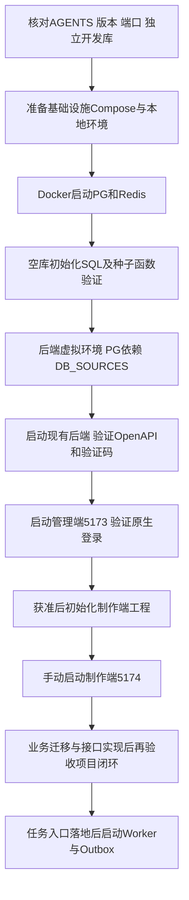

# higgsfield-ai · 本地开发与工程初始化手册

版本：1.4 启动入口与验收进程核对
日期：2026 年 10 月 27 日  
范围：Windows PowerShell 本地开发、基础设施、框架初始化及检查  
状态：包含初始工程核查快照及后续实现/验证记录；初始章节中的“待初始化”等描述仅代表当时状态，当前实现与执行结果以文末带日期记录及实际源码为准。

人工逐步验收另见[人工验收操作手册](人工验收操作手册.md)。本手册中的历史测试通过记录不代表用户已完成真实供应商、NAS或全部浏览器验收。

### 当前启动速查（2026-10-28）

以下是当前源码入口，不是已启动清单。先按第4—6章核对独立环境、配置和数据库；真实迁移完成后，再分别在宿主机终端手动启动。不要把下表整段作为自动批处理执行。恢复核验环境保持工作器关闭。

| 验收功能 | 工作目录及入口 | 启动后如何确认 |
|---|---|---|
| 登录与业务API | `ruoyi-fastapi-backend`：`.\.venv\Scripts\python.exe app.py --env dev` | 按实际监听地址访问文档及登录，不能只凭进程存在判断正常 |
| 管理平台 | `ruoyi-fastapi-frontend/vue3/web`：`pnpm dev --host 127.0.0.1 --port 5173 --strictPort` | 浏览器能打开并通过实际账号登录 |
| 制作平台 | `higgsfield-frontend`：`pnpm dev --host 127.0.0.1 --port 5174 --strictPort` | 能打开项目，API代理与目标后端一致 |
| 图片任务 | 工作器 `image` | 已受理图片任务推进；供应商请求可能收费 |
| 视频任务 | 工作器 `video` | 已受理视频持续查询；供应商请求可能收费 |
| 视频/URL结果归档 | 工作器 `archive` | 已生成的URL输出归档到受控存储，不重新生成 |
| 图片响应证据恢复 | 工作器 `image-recovery` | 从已保存的图片响应证据恢复本地结果，不重新生成 |
| 用量计价与预算结算 | 工作器 `billing` | 原任务费用与预算结算推进，不以生成成功代替计费完成 |
| 图片卡片缩略图 | 工作器 `image-thumbnail` | 原文件不变，派生缩略图就绪后卡片可读 |
| 凭据测试 | 工作器 `credential-test`，仅对应测试阶段启动 | 明确确认费用的测试申请被处理，可能收费 |
| 元素文件导入 | 工作器 `element-import` | 已上传文件出现待复核候选，不自动确认创建元素 |
| 账单对账 | 工作器 `reconciliation` | 已提交对账批次推进，可查看匹配与差异 |

工作器均在后端目录用以下模式分别启动。`<模式>`必须替换为表中的英文名称，每个进程使用不同的`--worker-id`；实际环境名称也须按配置替换。图片、视频、归档、计费和缩略图分别运行，不能用一个video进程替代全部后台能力。

```powershell
# 示例：本地费用结算进程；只在已确认的验收环境手动执行。
.\.venv\Scripts\python.exe -m module_higgsfield.worker --env dev --mode billing --worker-id local-billing-1 --concurrency 2 --enable-consumption
```

各模式的存储、密钥、出口策略前置见第9章及对应模式章节。`--once`只处理一批，也会写入或产生调用，不能作为健康检查。只读查看入口用`--help`；查看源码迁移头用`python -m alembic heads`，当前为`20261028_76`。`heads`不读取目标库，必须另以第5章的`current`核对实际库版本。停止常驻进程时在对应终端按Ctrl+C，并等待退出；关闭浏览器不会停止工作器。

后端整体业务回归必须在后端根目录指定`-t .`，避免`tests/module_identity`遮蔽真实业务包。以下命令启用随机schema数据库测试；只对已核对的独立开发/验收数据库执行，不能指向生产库。`-f`在首次失败后停止，便于直接排查。完整数据库回归可能耗时较长，运行期间保留同一进程，不反复重启。

```powershell
$env:HF_RUN_DB_TESTS='1'
.\.venv\Scripts\python.exe -m unittest discover -s tests -t . -p 'test_higgsfield*.py' -v -f
```

**正式部署基线（用户已确认）：** 平台部署在公司内网服务器，素材、图片、视频及其长期归档文件存放公司 NAS。员工通过平台访问受授权内容，浏览器不直接访问 NAS 共享目录。内网服务器的操作系统、数量、正式环境容器化方式、域名及 NAS 协议/挂载路径仍待运维确认；本地 Docker 启动 PostgreSQL/Redis、后端及两前端手动启动的方式不变。

> 本轮设计同步依据：[制作平台实查功能与实现基线](制作平台实查功能与实现基线.md)及[实查设计同步报告](实查设计同步报告.md)。图片资产→元素/@引用→视频→NAS为首期主线；Tools和文本会话暂缓，角色权限配置统一后台。原站实测、设计约定和本平台运行验收分别记录。

## 1 依据与执行边界

遵循[AGENTS.md](../AGENTS.md)、[技术架构方案](技术架构方案.md)、[P0-1 需求](首期需求与业务规则说明书.md)、[P0-2 供应商契约](模型供应商接入契约与差异清单.md)、[P0-3 数据库设计](数据库详细设计.md)、[P0-4 平台 API](平台API契约.md)、[P0-5 价格用量预算](价格用量预算说明.md)、[P0-6 权限矩阵](权限矩阵.md)及[工程基线](工程基线核对与文档衔接方案.md)。优先级与规则 ID 沿用[统一索引](文档一致性与优先级索引.md)，本手册不新增等级。

**本地 Docker 只运行 PostgreSQL 与 Redis；后端、管理端、制作端在宿主机分别手动启动。** 后续生成/media Worker 和 Outbox 调度也作为独立开发进程手动启动，不把框架 APScheduler 当作已经完成的生成 Worker。

本地 Compose、环境变量示例及制作端工程已提供，按第4章配置并由开发者手动启动。现有目录、包名和仓库位置保持不变。

## 2 源码核对与目标配置

| 项目 | 当前源码事实 | 本手册目标 |
|---|---|---|
| 后端入口 | [app.py](../ruoyi-fastapi-backend/app.py) 使用 server:create_app factory；默认端口9099 | 宿主机虚拟环境执行 python app.py --env dev |
| 数据库配置 | [config/env.py](../ruoyi-fastapi-backend/config/env.py) 使用 DB_DEFAULT_SOURCE + DB_SOURCES JSON | primary 显式设 PostgreSQL；不照抄旧 DB_HOST 配置 |
| PG 依赖 | [requirements-pg.txt](../ruoyi-fastapi-backend/requirements-pg.txt) 包含 asyncpg、SQLAlchemy 和本地 CLI 包 | 使用该文件；业务 ORM 仍全部异步 |
| 管理端 | [package.json](../ruoyi-fastapi-frontend/vue3/web/package.json) 有 dev=vite 和 pnpm-lock.yaml | 使用 vue3/web；手动固定5173 |
| 管理代理 | [vite.config.js](../ruoyi-fastapi-frontend/vue3/web/vite.config.js) 默认80；/dev-api去前缀转9099 | 命令行覆盖端口；后端端口保持9099 |
| 制作端 | higgsfield-frontend 已有Vue3/TS工程、路由、状态及业务组件 | 宿主机手动启动，固定5174并启用strictPort |
| 原 Compose | [docker-compose.pg.yml](../docker-compose.pg.yml) 同时定义前端/后端/PG/Redis | 保留参考；不直接执行其全栈 up |
| 初始 SQL | [ruoyi-fastapi-pg.sql](../ruoyi-fastapi-backend/sql/ruoyi-fastapi-pg.sql) 包含 drop table、种子及 find_in_set 函数 | 仅向独立、全新空库首次导入 |
| 迁移 | 已有真实业务版本链，2026-10-28核对单一head为20261028_76 | 核对目标库后执行真实迁移；禁止以create_all或修改版本号代替 |

## 3 端口与运行时基线

以下为本项目约定端口；基础设施端口的当前检查结果见第4章，未启动服务。冲突时统一更新 Compose、后端 DB_SOURCES、两个前端代理及检查地址，不允许 Vite 自动悄悄换端口。

| 服务 | 运行位置 | 访问地址/端口 | 用途 |
|---|---|---|---|
| PostgreSQL | Docker | 宿主127.0.0.1:35432 → 容器5432 | 数据库 higgsfield_ai_dev（新本地库建议名，不重命名既有库） |
| Redis | Docker | 宿主127.0.0.1:36379 → 容器6379 | 框架缓存/会话使用逻辑库2 |
| 后端 | 宿主机 | 127.0.0.1:9099 | 统一接口；本地 root_path 空 |
| 管理前端 | 宿主机 | http://127.0.0.1:5173 | Vue3 管理工程 |
| 制作前端 | 宿主机，待初始化 | http://127.0.0.1:5174 | Vue3 + TS，双组件库 |
| Worker/Outbox | 视频Worker已有宿主机入口；归档与Outbox运行入口待接通 | 不预设HTTP端口 | 视频Worker使用PostgreSQL租约，见第9章 |

宿主机应用连接127.0.0.1及映射端口，不能用 Compose 服务名 postgres/redis；容器健康检查使用容器内端口。两前端建议始终使用127.0.0.1，不混用localhost导致Cookie/Origin差异；不同端口的Cookie并不天然隔离，不依赖复制Admin-Token实现SSO。

运行时核对：管理 package.json 声明 Node `^22.22.2 || ^24.15.0`、pnpm `11.28.6`，根 .nvmrc 已固定22.22.2。两端已使用独立Node 24.19.0运行时构建通过，固定22.22.2版本尚未实测；不要使用低于声明下限的补丁版本。后端 pyproject.toml 声明Python≥3.10，Docker参考为3.10；本地建议选Python3.12进行依赖解析验证，未实测兼容前不标记通过。PostgreSQL沿现有14主版本；Redis本地配置沿用7.4，初始化时记录确切镜像digest。都不使用latest作为可复现基线，也不在本文宣称这些是官网最新版本。

```powershell
Set-Location D:\laputta\higgsfield
git status --short
docker version
docker compose version
py -0p
node --version
pnpm --version
Get-NetTCPConnection -State Listen -ErrorAction SilentlyContinue |
  Where-Object { $_.LocalPort -in 35432,36379,9099,5173,5174 } |
  Select-Object LocalAddress,LocalPort,OwningProcess
```

检查命令不替代授权：若发现既有容器、数据库或端口，先辨认所属项目；不停止或删除其他环境。工作区已有大量导入文件，不以清空目录作为初始化方式。

## 4 基础设施配置与启动

以下操作全部在 `D:\laputta\higgsfield` 执行，由开发者手动启动容器。已提供 `docker-compose.local.yml` 与 `.env.local-infra.example`，无需安装教程或自行拼接模板。

### 4.1 配置环境变量

```powershell
Set-Location D:\laputta\higgsfield
# 仅首次复制，不覆盖已有本地配置。
if (-not (Test-Path .env.local-infra)) {
  Copy-Item .env.local-infra.example .env.local-infra
}
notepad .env.local-infra
```

填写 `LOCAL_PG_PASSWORD` 为本机独立随机密码（建议至少32位字母数字），保存并关闭编辑器。该文件已加入 `.gitignore`，不要提交密码。`LOCAL_PG_PORT=35432`、`LOCAL_REDIS_PORT=36379` 是宿主机端口；PostgreSQL 用户固定为 `higgsfield_dev`，数据库固定为 `higgsfield_ai_dev`。后端配置见第6.2节，密码必须相同，后端不会自动读取此文件。

本地入口沿用 PostgreSQL 14、Redis 7.4、UTC 及 PostgreSQL UTF8/C 排序规则。Redis仅绑定本机回环且无密码，后端使用逻辑库2；不用于共享或正式环境。

### 4.2 检查端口及项目归属

```powershell
docker ps -a --format "table {{.Names}}\t{{.Ports}}"
Get-NetTCPConnection -State Listen -ErrorAction SilentlyContinue |
  Where-Object { $_.LocalPort -in 35432,36379 } |
  Select-Object LocalAddress,LocalPort,OwningProcess
netsh interface ipv4 show excludedportrange protocol=tcp
docker volume ls --filter label=com.docker.compose.project=higgsfield-ai-local
docker compose --env-file .env.local-infra -f docker-compose.local.yml ps -a
```

2026年10月27日检查时，35432和36379未监听、不在IPv4 TCP排除范围，且现有运行或停止容器均未配置这两个宿主端口。原约定15432/16379及候选25432/26379已被其他停止容器配置（通过docker inspect检查PortBindings确认），故改用35432/36379，避免其他项目恢复时冲突；5432和6379已有占用。这是检查时快照，启动前仍须确认。如果选定端口已占用或受系统保留，修改环境文件中的对应端口，并同步第6.2节的 `db_port` / `REDIS_PORT` 及检查命令；不停止其他项目进程或容器。若发现同名项目资源，先确认归属，不复用未知数据卷。

顶层固定 `name: higgsfield-ai-local`，不设置 `container_name`、网络或卷的显式 `name`。默认自动生成 `higgsfield-ai-local-postgres-1`、`higgsfield-ai-local-redis-1`、`higgsfield-ai-local_default` 及下述数据卷。不要额外传入 `-p` 或设置 `COMPOSE_PROJECT_NAME` 覆盖项目名，否则会指向不同资源。

其他四份框架参考Compose也已设置各自的项目名，并移除固定容器/网络名称。参考全栈PG的15432/16379、参考MySQL的16379与其他项目容器配置重叠；测试参考的80/9099当前已有占用。它们不作为本地启动入口，不与本地入口并行启动；保留其原有镜像、端口和框架用途。

### 4.3 启动、状态与日志

密码保存后，按顺序执行。`config --quiet` 失败时先修正配置，不继续启动。

```powershell
docker compose --env-file .env.local-infra -f docker-compose.local.yml config --quiet
if ($LASTEXITCODE -ne 0) { throw 'Compose 配置校验失败，请先修正配置' }
docker compose --env-file .env.local-infra -f docker-compose.local.yml up -d postgres redis
docker compose --env-file .env.local-infra -f docker-compose.local.yml ps
docker compose --env-file .env.local-infra -f docker-compose.local.yml logs --tail 80 postgres redis
# 持续查看日志；Ctrl+C仅退出日志查看。
docker compose --env-file .env.local-infra -f docker-compose.local.yml logs -f --tail 80 postgres redis
```

首次启动会按需拉取镜像并初始化数据库，等待两个服务显示healthy，再执行第5章的数据核验。配置校验使用 `--quiet`，不要把包含密码的展开配置粘贴到日志。这里不启动或构建后端和前端。

首次初始化仅向专属空数据卷导入现有框架SQL `ruoyi-fastapi-backend/sql/ruoyi-fastapi-pg.sql`。该脚本含DROP，不得手工重跑到已有库；它是框架种子基线，不替代后续业务迁移。初始化目录只在空数据目录首次执行，修改SQL或环境文件密码不会自动更新旧卷。若初始化失败，保留日志定位，不能靠反复up或删除卷宣称恢复。

### 4.4 数据持久化位置

PostgreSQL数据位于命名卷 `higgsfield-ai-local_pg_data`，挂载到容器 `/var/lib/postgresql/data`；Redis数据位于 `higgsfield-ai-local_redis_data`，挂载到 `/data`，已开启AOF，沿用Redis默认每秒fsync策略。突然断电仍可能丢失最近约一秒的写入。

这两个卷由Docker管理，实际存放在Docker Desktop的Linux数据磁盘内，不是仓库下的Windows文件夹。创建后可查看引擎内挂载位置：

```powershell
docker volume inspect higgsfield-ai-local_pg_data higgsfield-ai-local_redis_data --format '{{.Name}} -> {{.Mountpoint}}'
```

卷会随stop/start及容器重建保留；不要执行 `down -v`、`volume prune` 或Docker Desktop清空数据。镜像主版本升级必须另行备份及迁移。停止与再次启动命令见第12章。

## 5 框架数据库初始化与验证

新空库使用框架PG SQL建立sys_*等基础表、字典和初始数据，再核验后启动后端。不要先让create_all建空表后认为框架菜单/用户种子已经具备。框架初始管理员口令应从受控交付渠道确认，本文不传播默认口令；首次登录后改为独立开发口令，不连接生产身份库。

从仓库根目录执行下列检查（只读取目标容器）：

```powershell
docker compose --env-file .env.local-infra -f docker-compose.local.yml exec postgres psql -U higgsfield_dev -d higgsfield_ai_dev -c "SELECT current_database(), current_user, version();"
docker compose --env-file .env.local-infra -f docker-compose.local.yml exec postgres psql -U higgsfield_dev -d higgsfield_ai_dev -c "SELECT count(*) FROM sys_user; SELECT count(*) FROM sys_menu; SELECT count(*) FROM sys_dict_type; SELECT find_in_set(1::bigint, '0,1,2'::varchar);"
docker compose --env-file .env.local-infra -f docker-compose.local.yml exec redis redis-cli -n 2 ping
Test-NetConnection 127.0.0.1 -Port 35432
Test-NetConnection 127.0.0.1 -Port 36379
```

预期：库名/用户与本手册一致，系统种子表有数据，find_in_set存在且匹配结果正确，Redis返回PONG，宿主端口可达。记录表计数及初始化日志，不能仅凭容器healthy判定框架可登录。find_in_set来自框架PG脚本，不是PG内置函数。

已有数据库路径：先记录库名、schema、系统表计数、Alembic revision和备份；禁止导入上述整套初始化SQL。需要新环境时采用新的数据库/卷命名，不能直接改旧实例名或复用未知卷。

### 5.1 新业务迁移门槛

P0-3的81张业务表仍是设计，当前没有对应真实迁移。工程实施阶段须建立审核过的Alembic版本链，验证模型metadata注册、中文COMMENT、bigserial/序列、公共字段、逻辑删除、唯一约束、无物理外键及Service关系校验。框架基线SQL与业务迁移必须明确分工，不能重复创建sys_*或仅stamp一个版本。

以下仅在真实版本链已落地、审核通过、确认目标库且已备份后执行：

```powershell
Set-Location D:\laputta\higgsfield\ruoyi-fastapi-backend
.\.venv\Scripts\python.exe -m alembic heads
.\.venv\Scripts\python.exe -m alembic current
.\.venv\Scripts\python.exe -m alembic upgrade head
.\.venv\Scripts\python.exe -m alembic current
```

alembic.ini的[settings] env当前为dev；env.py会加载相应配置并可能创建versions目录。当前无迁移时不执行上述命令冒充初始化完成。autogenerate也不是最终DDL，必须审阅，尤其不能把未导入metadata的表误判为待删除。

## 6 后端环境与手动启动

### 6.1 虚拟环境和依赖

在后端目录创建独立.venv，使用已选Python版本；以下3.12为建议目标，本机没有该版本时先安装/选择经依赖验证的版本。不要绕过依赖失败自行混装MySQL依赖。

```powershell
Set-Location D:\laputta\higgsfield\ruoyi-fastapi-backend
py -3.12 -m venv .venv
.\.venv\Scripts\python.exe -m pip install -r requirements-pg.txt
.\.venv\Scripts\python.exe -m pip check
```

不要求激活脚本，因此不必为启动放宽PowerShell全局执行策略。requirements-pg包含本地CLI包“.”，须在后端目录执行。psycopg2是框架已有依赖，不意味着新业务允许同步Session。无法获得指定依赖版本或本机wheel时记录失败与平台信息，先核定依赖来源，不静默升级/降级整套框架。

### 6.2 .env.dev 目标值

保留已有文件，逐项核对和调整，不整份覆盖未知本地配置。以下为目标示例，真实密码/JWT密钥由本地生成；DB_SOURCES是一行合法JSON，不把它拆成DB_HOST/DB_PASSWORD。示例不代表已修改当前.env.dev。

```dotenv
APP_ENV=dev
APP_NAME=higgsfield-ai
APP_HOST=127.0.0.1
APP_PORT=9099
APP_ROOT_PATH=
APP_RELOAD=true
APP_WORKERS=1
APP_DEMO_MODE=false
APP_DISABLE_SWAGGER=false
APP_DISABLE_REDOC=false
APP_TIMEZONE=Asia/Shanghai
APP_DEFAULT_ENABLED_PLUGINS=
DB_DEFAULT_SOURCE=primary
DB_SOURCES={"primary":{"db_type":"postgresql","db_host":"127.0.0.1","db_port":35432,"db_username":"higgsfield_dev","db_password":"替换为与基础设施一致的本机密码","db_database":"higgsfield_ai_dev","db_echo":false}}
REDIS_HOST=127.0.0.1
REDIS_PORT=36379
REDIS_USERNAME=
REDIS_PASSWORD=
REDIS_DATABASE=2
JWT_SECRET_KEY=替换为本机独立随机密钥
TRANSPORT_CRYPTO_ENABLED=false
TRANSPORT_CRYPTO_MODE=off
```

DB_ECHO不是当前多数据源设置的独立控制入口，db_echo放入对应DB_SOURCES对象。JSON密码含引号/反斜线时必须合法转义；.env不会自动把另一文件的密码替换进此JSON。后端不读取.env.local-infra，它只供Compose插值。

APP_ROOT_PATH空是本手册的本地目标，后端实际路由不加/dev-api；管理Vite负责剥离开发代理前缀。不能同时剥两次或手工给后端controller加/dev-api。生产/studio、/admin部署另行设计。

传输加密关闭仅为回环隔离环境的初始诊断方案，不是生产政策；接入真实业务前还需用目标加密策略测试Axios、SSE、分片和Range。现有插件是否启用可能受数据库状态影响，APP_DEFAULT_ENABLED_PLUGINS空不等于禁用已安装插件；首次环境不配置模型供应商Key，不调用真实付费接口。

load_dotenv保留已有进程环境变量优先。若终端残留APP_ENV、DB_SOURCES等指向其他环境，必须先核实并在专用开发终端处理，不能只看文件判断连接目标。启动时不要打印完整DB_SOURCES/JWT到聊天或日志。

### 6.3 启动和后端检查

保持数据库/Redis检查通过，在终端A执行现有入口：

```powershell
Set-Location D:\laputta\higgsfield\ruoyi-fastapi-backend
.\.venv\Scripts\python.exe app.py --env dev
```

该命令前台运行，保留终端查看日志，Ctrl+C停止。现有CLI也提供app run入口，但不同时启动两套9099进程。启动会访问数据库/Redis并执行框架初始化，不是纯只读检查；只连接已确认的开发库。create_all只补缺表，不能完成现有表迁移。

在另一个终端检查：

```powershell
Invoke-WebRequest http://127.0.0.1:9099/openapi.json -UseBasicParsing | Select-Object StatusCode
Invoke-RestMethod http://127.0.0.1:9099/captchaImage | Select-Object code,msg,captchaEnabled
```

预期OpenAPI可取、验证码接口返回框架成功结构；浏览器打开http://127.0.0.1:9099/docs。文档页可能依赖外部静态资源，空白时先检查openapi.json与浏览器资源错误，不能直接判断后端故障。本手册不假设已有/health端点。

## 7 管理端手动启动

目录固定为ruoyi-fastapi-frontend/vue3/web。依赖使用其现有锁文件与声明的pnpm版本，不在父目录运行其他框架工程。

```powershell
Set-Location D:\laputta\higgsfield\ruoyi-fastapi-frontend\vue3\web
pnpm --version
pnpm install --frozen-lockfile
```

若锁文件与package.json不一致应停止并记录原因，不能为“能启动”擅自删除锁文件或改用npm生成第二份锁。安装完成后，在此目录准备.env.development.local覆盖本地值（真实文件需排除提交）：

```dotenv
VITE_APP_TITLE=higgsfield-ai 管理平台
VITE_APP_ENV=development
VITE_APP_BASE_API=/dev-api
VITE_APP_PLUGIN_BASE=
```

VITE_APP_PLUGIN_BASE空与后端APP_ROOT_PATH空配套；原.env.development中该值为/dev-api，需明确覆盖。普通请求仍使用/dev-api代理。VITE_*会进入前端产物，禁止存数据库密码、供应商Key、JWT签名密钥。

终端B手动启动：

```powershell
Set-Location D:\laputta\higgsfield\ruoyi-fastapi-frontend\vue3\web
pnpm run dev --host 127.0.0.1 --port 5173 --strictPort
```

访问http://127.0.0.1:5173。原配置open=true可能自动打开页面；端口80被本命令覆盖。检查网络请求：浏览器/dev-api/captchaImage→Vite→9099/captchaImage；登录后的/system/*同样只去掉/dev-api一次。新增管理业务将使用/dev-api/api/admin/v1/...，不能写成/dev-api/admin/...。

用获准开发账户验证登录、getInfo、getRouters、菜单与退出；既有Admin-Token是JS可读Cookie，仍通过Authorization Bearer调用。HTTP200不一定业务成功，检查code；框架登录通过不等于项目权限、费用或新增AI接口已实现。

## 8 制作端工程初始化与启动条件

**当前higgsfield-frontend没有package.json，不能现在执行pnpm install/dev并宣称制作平台可运行。** 以下为后续获准工程初始化的交付清单，当前不执行脚手架生成或覆盖目录内AGENTS.md。

| 初始化项 | 必须结果 |
|---|---|
| 基础工程 | Vue3.4+、TypeScript、Vite，锁定版本与pnpm-lock.yaml；dev脚本为vite |
| 应用分层 | views/components/composables/api/router/stores/styles/utils；script setup lang=ts，禁止Options API |
| 请求与登录 | Axios统一若依code/分页处理、独立平台身份客户端；不从管理Cookie复制会话 |
| 组件与主题 | Element Plus与shadcn-vue共存，统一变量、弹层与亮暗切换；不机械反色媒体 |
| 路由 | Vue Router，先有基础登录/框架路由；未实现业务不伪装可用 |
| 状态与绑定 | Pinia、use组合函数、defineModel、多参数v-model；组件不直接请求或改props |
| 开发代理 | /dev-api→http://127.0.0.1:9099，剥离一次；仅开发代理，不是业务API前缀 |
| 环境 | 建议VITE_APP_BASE_API=/dev-api；必须由新工程api客户端读取，变量名字本身不会自动生效 |
| 能力开关 | 没有已验证供应商/价格/预算时生成入口关闭，不放测试Key在浏览器 |

建议制作端统一请求示例：浏览器/dev-api/api/v1/projects→后端/api/v1/projects；原生登录为/dev-api/login→/login。SSE经专用fetch模块携带Bearer，处理Content-Type及JSON错误；文件Range鉴权与上传流另做联调。

工程清单完成并提交锁文件后，终端C运行：

```powershell
Set-Location D:\laputta\higgsfield\higgsfield-frontend
pnpm install --frozen-lockfile
pnpm run dev --host 127.0.0.1 --port 5174 --strictPort
```

制作端基础页与主题切换可先验收；P0-4业务接口尚未实现时必须标为未接入，不用空数据冒充完整项目流程。两个前端不共享运行时Store。

## 9 完整初始化顺序与后续Worker



业务迁移应在启动相应业务版本前执行，不在应用运行中靠create_all追表。视频Worker入口为 `module_higgsfield.worker`，使用PostgreSQL任务租约，注册VideoPlus提交和轮询处理器；不使用框架APScheduler或Celery代替生成调度。媒体归档和Outbox的完整运行接入仍待完成。

### 9.1 视频工作器启动

在后端目录执行，读取既有 `.env.dev` 和运行时凭据主密钥配置。目标数据库须已执行对应真实业务迁移；启动入口不会自动迁移或建表。

```powershell
Set-Location D:\laputta\higgsfield\ruoyi-fastapi-backend
.\.venv\Scripts\python.exe -m module_higgsfield.worker --help
.\.venv\Scripts\python.exe -m module_higgsfield.worker --enable-consumption --env dev --worker-id local-video-1 --concurrency 4
```

`--once` 执行一批后退出，**不是只读检查**：任务匹配时会调用配置中的供应商生成接口并可能产生费用。单批没有任务或全部处理成功返回0，存在未处理／失败任务返回2，启动错误返回1。常驻模式接收Ctrl+C后停止领取新任务，等待当前批次退出并释放连接池；强制终止后的发送中任务由租约恢复为提交未知。

运行时需提供 `HF_CREDENTIAL_MASTER_KEYS`、`HF_CREDENTIAL_ACTIVE_KEY_VERSION`、`HF_CREDENTIAL_FINGERPRINT_KEY`；凭据和输出加密使用该密钥环，不能将其写入日志。连接配置的固定适配器版本须为 `videoplus-v1`。默认video模式只领取视频任务，视频提交、查询及图片／视频直接上传引用已接通；供应商素材注册、音频上传、未知受理核查和结算尚未全部接通；结果归档使用下节独立模式，图片生成与恢复见9.3节。未知提交或上传不会自动重发。

直传引用还需配置 `HF_PROVIDER_MEDIA_POLICY` JSON，按精确模型版本ID登记 `roles`、`mimeLimits`（精确字节数）、`requiredSeconds`（生成提交前要求的剩余有效期）和 `evidenceRef`（已核实的契约证据）。结构为 `{"modelVersions":{"模型版本ID":{"roles":["first_frame"],"mimeLimits":{"image/png":已核实的字节上限},"requiredSeconds":所需有效秒数,"evidenceRef":"证据位置"}}}`；其中中文占位符须替换成真实ID和整数，不能直接作为JSON配置。缺少策略时不上传；不把供应商“MB”说明自动换算为默认值，不把需要注册的模型开放成直接URL引用。平台存储同时沿用 `HF_STORAGE_ROOT`、`HF_STORAGE_MODE` 等已有配置，工作器只打开受控内部存储键，不发送NAS路径。上传结果按固定素材、账号与原凭据缓存，并加密保存临时URL。

### 9.2 结果归档工作器

使用同一宿主机入口的 `--mode archive` 独立运行，读取结果表中的待归档图片和视频；不调用生成接口。配置 `HF_OUTPUT_DOWNLOAD_POLICY`，例如 `{"allowed_hosts":["已核实的供应商媒体域名"],"max_bytes":104857600,"timeout_seconds":120}`。字节上限是本地下载限制，示例值不代表供应商限制；域名必须替换成真实精确主机名，不支持通配符。启动入口仅允许 HTTPS 的443端口，拒绝解析到内网／回环的地址，不跟随重定向，不发送供应商Key。

```powershell
.\.venv\Scripts\python.exe -m module_higgsfield.worker --enable-consumption --env dev --mode archive --worker-id local-archive-1 --concurrency 4
```

归档沿用平台存储配置和输出加密密钥环。启动时校验存储根目录，下载时验证实际媒体类型、尺寸、时长和摘要；文件记录、输出绑定及事件同事务提交。执行期间定时续期，失去占用后旧版本不能登记；失败延迟重试，来源过期则记录为源过期。进程异常留下的已下载未绑定文件暂不自动删除，提交结果不确定时需先核实数据库绑定事实，避免误删已归档文件。

目前通过的是隔离PostgreSQL事务、归档调度竞争／失败恢复、下载器本机回环HTTP测试，以及启动帮助检查。另有真实本地TLS服务→输出地址解密→下载校验→文件落盘→数据库登记的集成测试：注入测试CA但保留证书与主机名校验，覆盖超过初始租约的续期归档、文件字节／摘要一致性及证书主机名错误拒绝。该测试使用临时本地存储，未验证生产NAS；未用开发主库常驻运行，也未完成真实供应商联调。

### 9.3 图片生成与证据恢复工作器

数据库需已执行至 `20261027_38` 的真实迁移。两种模式均要求平台存储配置、凭据密钥环，以及 `HF_IMAGE_MAX_DECODED_BYTES` 正整数字节上限；它限制一次响应全部图片的解码总量。HTTP及证据文件容量按Base64膨胀量另加有限元数据空间计算，不能超过256 MiB传输硬上限。并发批量会影响总内存占用，应结合部署资源配置。单图还受 `HF_UPLOAD_MAX_BYTES` 和 `HF_IMAGE_MAX_PIXELS` 限制。

```powershell
# 示例为本地总解码限制，非供应商规格；请按实际容量规划调整。
$env:HF_IMAGE_MAX_DECODED_BYTES='33554432'
.\.venv\Scripts\python.exe -m module_higgsfield.worker --enable-consumption --env dev --mode image --worker-id local-image-1 --concurrency 2
# 在另一个宿主机终端启动，仅恢复已完成图片任务中的归档失败项，不调用生成接口。
.\.venv\Scripts\python.exe -m module_higgsfield.worker --enable-consumption --env dev --mode image-recovery --worker-id local-image-recovery-1 --concurrency 2
```

图片模式只领取图片任务，固定模型能力、供应商账号和凭据；参考图直传另需9.1节的精确模型版本策略。收到完整JSON响应后，先将响应加密保存至受控 `provider-evidence` 目录并登记索引，再逐图校验落盘。响应证据不提供普通素材预览接口，数据库不保存Base64正文。图片结果登记会在同一事务写入计费对象和请求级用量修订；重复证据不新增用量，未知值不补零，尚不执行计价或预算结算。

图片恢复模式从加密证据按原输出序号重新归档，保留已成功文件，不重新生成。证据文件和数据库均不可用时不能保证恢复；证据已登记但任务完成事务尚未提交时进程退出，任务先进入“提交未知”；image模式重新领取后会认证读取原调用证据并恢复结果登记，不重新生成。缺少证据、证据损坏或内容不能证明成功时保留未知状态并延后处理，不自动重发。当前验证使用隔离PostgreSQL、本机HTTP服务及临时文件；没有向真实供应商发起收费请求，没有在生产NAS运行。

建议预留Redis逻辑库3用于后续队列、4用于结果（是否需要结果存储由实现确认）；逻辑库不是安全隔离，仍需独立项目键前缀。现阶段只配置框架库2，不提前配置不存在的CELERY_*环境变量。Windows原生Worker运行模式/并发能力须验证；若需WSL，单独说明环境及127.0.0.1访问差异，不能自行把Worker迁入Docker改变约定。

本地文件/NAS：框架既有上传路径不自动等于P0-3受控素材仓库。新业务需确定独立暂存/归档根目录、访问权限、媒体工具、预览Range和清理策略；未完成前只报告框架启动，不报告素材闭环。不得用生产NAS路径或实际供应商Key验证基本启动。

### 9.4 独立计价工作器

完成真实迁移至 `20261027_39` 后，在后端目录手动启动：

```powershell
.\.venv\Scripts\python.exe -m module_higgsfield.worker --enable-consumption --env dev --mode billing --worker-id local-billing-1 --concurrency 20
```

该模式读取图片／视频结果已登记的计费对象与用量，使用任务固定的平台价及采购价版本计算，不调用供应商、不读取媒体。`--concurrency` 在此模式表示每批任务数量（1至100），短事务逐个执行；多实例通过任务行锁跳过竞争。扫描游标循环推进，失败任务会在下一轮重试，重复扫描不重复记账。`--once` 只执行一批，不代表全部历史任务已处理。

计价事件、不可变明细、预算结算、任务计价状态、任务版本及通知在同一事务提交。未知必要用量保留待定金额；完整零用量正常计算为零；缺少采购价不以平台价代替。不同用量修订尚未裁定时标记争议，保留原金额和明细。制作端任务仅聚合平台计价状态，任务快照按系统及项目范围的 project:usage:read 权限返回平台费用；迁移20261027_40登记功能权限，但不自动授予系统角色或项目负责人。事件不携带采购金额。

同币种首次费用结算至任务原预占周期，预算后来停用或跨月不改变归属；实际费用超过预占仍据实入账。已明确费用先释放至多相应金额的预占，只有编排结束且所有已登记计费对象在该口径均有完整费用时释放剩余尾差。未知、争议或缺少固定汇率的跨币种费用保留预占。后续费用修订不重复结算原始金额；同币种人工调整已接通原周期差额账本（见9.5节）；跨币种换算及账单确认尚未接通。

已在隔离PostgreSQL验证多工作器去重、重复扫描、通知失败后的整体回滚及下一轮恢复；未在主开发库或生产库启动常驻计价进程。

### 9.5 项目费用人工调整

管理端 `GET /api/admin/v1/billing-events` 支持 purpose（默认platform）、currency、projectId、jobId、userId（任务执行人）、state、from、to、pageNum、pageSize，按管理范围在数据库中先过滤再统计总数及分页。from/to按费用事件createTime筛选，要求显式时区，区间左闭右开；同时提供时跨度不超过366天，不等同预算期间归属。当前仅覆盖项目费用；日期维度汇总已接通（见9.6节），成本中心费用与账号级采购范围尚待接通。

管理端 `GET /api/admin/v1/billing-events/{id}` 按 `billing:read` 功能权限和项目管理范围读取详情，返回原始 amount、含调整的 effectiveAmount、版本、采用用量数量、分项及调整历史。不会返回供应商原始响应或凭据。采购详情当前同样要求该功能的全部管理范围，不能仅凭费用调整权限读取。

迁移 `20261028_41` 登记 `billing:adjust`，不自动授予角色。管理端 `POST /api/admin/v1/billing-events/{id}/adjustments` 接收 revision、非零十进制字符串 deltaAmount、reason 及可选 usageRecordId，使用框架幂等请求头。仅接受已有确定原始金额的项目费用；用量依据必须属于同一计费对象，调整后有效金额不得为负。

项目管理范围与功能权限每次重验，包括幂等重放。采购调整当前额外要求该功能的全部管理范围；账号级财务授权、非项目成本中心费用及 reconciliationLineId 对账依据尚未接通。调整、原预算期间差额账本、任务版本、通知及审计同事务提交；原始金额不覆盖，已释放预占不因退款恢复。费用版本构成稳定业务去重键，即使请求幂等记录过期也不重复调整。

管理端页面 `studio/billing/index.vue` 已接入列表、明细、人工调整与汇总，迁移 `20261028_42` 登记“费用记录”菜单，不自动授权。查询按上海时间输入，明细查询可不限定时间，汇总必须限定不超过366天的区间。人工调整表单要求 `billing:adjust`，原始金额未知时不可操作；金额保留字符串精度，失败重试复用同一请求键，提交中阻止关闭明细和路由离开。菜单迁移仅在隔离测试库验证，主开发库和生产库尚未应用本轮迁移。

### 9.6 制作端预算状态与用量汇总

制作端 `GET /api/v1/projects/{id}/budget-status` 读取当前预算阻断原因，复用生成入口的无预算策略；不创建周期或预占。平台额度明细需 project:usage:read，own范围不显示整个项目额度；采购额度只影响阻断状态而不返回金额。canSubmit表示当前权限、项目状态及基础预算检查结果，不替代模型预检和实际估价；受理仍须重新校验并原子预占。

管理端 `GET /api/admin/v1/usage/summary` 已接入已登记费用事件的 createTime 口径汇总：必填 from、to、purpose、groupBy；支持 project/user/department/model/day 五种分组、业务时区及项目/用户/历史部门/模型/币种筛选。金额按事件当前状态互斥分桶并包含调整，不同币种独立返回；用量来自费用采用修订，缺失采用修订显示未知完整性。当前不包含尚未生成费用事件的对象，不支持 billingPeriod 和成本中心。制作端项目入口 GET /api/v1/projects/{id}/usage/summary 已接入，固定platform，按 project:usage:read 实时项目范围过滤；own 范围仅包含当前用户任务，禁止指定其他用户或采购用途。本人跨项目入口 GET /api/v1/me/usage/summary 已接入：固定本人和platform，仅纳入当前有效成员且有费用读取范围的项目；移除成员或撤权后不再返回该项目，无任何可读项目范围时报权限错误。

制作端创作表单已接入预算状态；“我的用量”和项目“项目用量”页签已接入汇总，日期按上海自然日输入并包含结束日。权限隐藏时不返回额度；切换项目、筛选或离开缓存页面时清除旧结果并取消读取，重新进入时重新鉴权。前端展示不能替代服务端实时授权。

### 9.7 管理端预算操作

管理端 `studio/budgets/index.vue` 已接入预算定义筛选、创建、启停、周期初始化、总额度调整和账本分页读取。迁移 `20261028_43` 登记入口，读取定义及周期需要 `billing:budget:read`，写操作需要 `billing:budget`，读取账本另需 `billing:read`；界面权限不是服务端授权的替代。

创建定义后还需初始化周期。月度周期按预算的业务时区生成自然月起止，总额周期没有结束时间；调整填写的是新总额度而非增减额，不修改已有消费和预占。金额保留十进制字符串，提交附原因和幂等键，额度调整附原版本。提交中禁止关闭弹窗和切换路由；失败保留输入并复用同内容请求键。时区转换复用框架工具，无法唯一解释的当地时刻会报错，不自动猜测偏移。

上述页面已进行组件编译和定向状态测试，迁移已进行隔离PostgreSQL幂等检查；尚未在主开发库应用本轮菜单迁移，也未完成真实登录下的预算操作或双主题浏览器验收。

## 10 分层检查与验收记录

费用相关前端已经通过定向单元测试、制作端类型检查及管理端组件编译；这些检查不等同真实登录业务验收。浏览器目前只确认本地管理端登录页可打开，费用页面、真实调整以及亮暗主题的浏览器验收尚未完成。

| 检查ID | 执行内容 | 通过证据 | 不代表 |
|---|---|---|---|
| DEV-01 | 版本、端口、目录和Compose服务清单 | 实际版本、占用检查、仅两个基础设施服务 | 应用已运行 |
| DEV-02 | PG/Redis启动与宿主连接 | healthy、端口、PONG、目标库名 | 种子/迁移已完整 |
| DEV-03 | 框架种子及函数 | sys_user/menu/dict计数、find_in_set验证 | 新业务81表已建 |
| DEV-04 | 后端依赖与启动 | pip check、无启动异常、OpenAPI和验证码 | 所有业务权限正确 |
| DEV-05 | 管理端代理与会话 | 登录/getInfo/getRouters/退出，业务code正常 | 项目对象权限和AI功能已实现 |
| DEV-06 | 制作端初始化 | 工程锁文件、5174启动、路由与亮暗基础检查 | 完整制作页面验收 |
| DEV-07 | 业务迁移（后续） | 实际Alembic revision、schema/注释/索引、事务测试 | 仅stamp或空upgrade通过 |
| DEV-08 | 权限与计费（后续） | P0-6 AUTH、P0-5 FIN用例结果 | 普通启动健康即可替代 |
| DEV-09 | 任务与文件（后续） | Worker重启恢复、归档、SSE/Range、幂等 | 框架定时任务就是生成队列 |
| DEV-10 | 真实模型（单独授权） | P0-2联调证据、可控费用、正确原Key查询 | 本地启动即授权收费调用 |

记录模板：日期/操作者、代码revision、Node/pnpm/Python版本、镜像digest、数据库名称与迁移版本、端口、DEV项结果（通过/失败/未执行）、脱敏证据及遗留问题。禁止将密码、完整.env、供应商Key放入检查报告。当前所有运行验收均为未执行，本轮已通过Compose静态配置校验、项目资源命名及端口检查，未启动容器或执行数据库初始化。

## 11 常见故障定位

| 现象 | 优先核对 | 处理边界 |
|---|---|---|
| 后端仍连MySQL或错误数据库 | DB_SOURCES、进程环境优先级、启动cwd/--env | 不只修改旧DB_HOST变量；不打印密码 |
| 容器健康但无用户/菜单 | 初始SQL日志、目标库、卷是否已存在 | 不重跑含DROP的全库SQL到已有库 |
| 改POSTGRES_PASSWORD后连接失败 | 旧卷内用户密码未改变 | 受控修改数据库角色凭据，不删除卷碰运气 |
| 管理端访问80或端口跳号 | 启动命令是否带5173及strictPort | 检查占用进程，不强杀未知服务 |
| /dev-api返回404或代理502 | root_path、Vite重写、9099是否运行 | 保持代理只去一次前缀，不修改所有后端路由 |
| 登录成功但菜单/操作失败 | code、原生权限、种子、Redis会话、目标用户 | 不能靠授予超级管理员掩盖数据权限问题 |
| SSE/上传/文件被当JSON解密 | 传输加密模式、Content-Type、代理流处理 | 基础关闭加密验证与目标配置兼容验收分别记录 |
| 制作端无dev脚本 | 当前尚未初始化 | 不把AGENTS.md当应用；先完成工程授权与清单 |
| 依赖版本安装失败 | 源、锁文件、Python/Node兼容及网络 | 保留错误，不删除锁或随意换依赖系列 |
| /docs空白但OpenAPI成功 | 文档JS/CSS网络请求 | 区分静态资源失败和API故障 |

## 12 停止、重启与数据保留

先Ctrl+C停止制作端、管理端，再停止后端；未来有Worker时先停止新任务受理并按租约策略退出。基础设施保留数据停止命令（仓库根目录）：

```powershell
docker compose --env-file .env.local-infra -f docker-compose.local.yml stop postgres redis
```

停止后再次启动（保留原容器和数据）：

```powershell
docker compose --env-file .env.local-infra -f docker-compose.local.yml start postgres redis
docker compose --env-file .env.local-infra -f docker-compose.local.yml ps
```

若容器已被移除，使用第4章同一组文件及up命令重建，原命名卷仍会复用。修改端口等Compose配置后也需使用up应用变更，start不会更新配置。不要默认down -v、volume prune或删除数据库目录；本手册不提供无差别重置命令。换镜像主版本不等于数据库升级，需另制定备份与迁移方案。

本手册为初始化操作方案，后续实际执行后才能将记录改为已验证。数据库与Redis的本地容器、三个宿主机应用、未来独立Worker与生产部署是不同边界，不能混写成“全栈Docker已部署”。

### 模型能力与项目路由管理入口

管理端新增模型身份登记、能力版本创建及草稿修改、精确规格登记、验证证据登记、发布和停用入口。能力版本目前使用完整 JSON 配置编辑，语义校验以服务端为准；验证操作登记人工核实的证据，不代表自动执行供应商探测。

项目模型路由页面通过项目 ID 读取治理范围内的整组配置，支持模型、账号、优先级、启用状态、候选凭据和并发上限。保存使用版本号及幂等键进行整组替换；移除全部条目并保存将清空路由。服务端校验同连接、同区域已发布能力及当前有效凭据，保存成功不等同于实际供应商调用成功。

模型和路由入口分别由迁移 `20261028_44`、`20261028_45` 注册，不自动授予角色权限；路由页面需要 `provider:route` 以及对应项目治理范围。当前尚未对本地主数据库执行这些迁移，也未完成登录后的浏览器操作、双主题视觉验收或真实供应商调用验收。

### 价格管理页面实现状态

管理端价格页面支持按精确规格、用途、账号和币种查询价格簿，登记平台/采购价格簿，查看价格版本、完整计价分项、校验问题、来源 ID 及发布区间变更历史。金额按接口返回的十进制字符串展示，不转换为浮点数或跨币种合计。版本“已发布”不表示当前生效。

菜单迁移为 `20261028_46`，读取需要 `billing:price:read`，登记需要 `billing:price:write`；服务端继续执行全局管理范围检查，不自动给角色授权。页面已接入价格草稿创建与编辑，支持计价分项、阶梯、免费依据、来源 ID 与计算小数位；金额及数量保持十进制字符串，发布后禁止编辑。页面已支持查看绑定来源的类型、获取时间、出处地址及不可变摘录；来源内容以纯文本呈现。页面已接入来源证据登记，获取时间按上海时间输入，成功后显示来源 ID 供草稿绑定；页面已接入离线试算，支持精确规格 JSON、已知用量和可选汇率版本；未知用量省略，零用量显式提交，修改输入清除旧结果。页面已接入价格发布与显式替换旧区间，时间按上海时间输入，并提交价格修订号及旧区间预期修订号；页面已接入独立结束区间操作，从历史快照携带区间修订号；只能缩短区间，发生冲突需刷新历史后选择最新修订记录，不能据此认为价格配置全流程已经完成。

本轮完成价格簿登记及切换/撤权隔离的前端针对性测试、组件编译与隔离 PostgreSQL 菜单迁移测试。未执行主数据库迁移或登录后业务验收。

价格草稿编辑补充验证：针对性测试覆盖十进制边界、等值阶梯重复、零价依据、编辑快照、版本号及失败幂等重试；价格页面和草稿组件编译通过。尚未执行登录后价格编辑验收。

价格来源查看补充验证：针对性测试覆盖绑定 ID 限制、切换版本/来源、撤权、卸载及迟到响应隔离；组件编译通过。管理证据附件上传仍未接通，不能用制作端上传会话替代。

价格来源登记补充验证：地址类型和内嵌凭据校验、未来时间、上海时间转换、输入保留及幂等重试测试通过；组件编译通过。官方截图来源当前通过出处 URL 和原文摘录登记，附件上传仍待实现。

价格试算补充验证：针对性测试覆盖未知/零用量、大整数及秒数精度、输入改变和撤权后的迟到响应隔离，组件编译通过。未执行登录后的价格试算验收。

价格发布补充验证：时间转换、区间顺序、替换参数成对校验、修订快照和幂等重试测试通过；组件编译通过。未实际发布价格或执行登录后业务验收。

结束区间补充验证：范围缩短、起点保留、开放区间、上海时间、修订快照与失败幂等重试测试通过，组件编译通过。未实际修改业务价格区间。

### 失败输出归档重试接口

已实现 `POST /api/v1/generations/{jobId}/retry-archive`，接收任务 `revision` 与可选 `outputIds`，使用幂等键。仅接受当前任务中未删除、归档失败且加密媒体源仍有效的图片/视频输出；已归档、正在归档、过期源、跨任务输出均拒绝。省略输出列表时选择该任务全部未删除的失败输出，任一不满足条件则整组回滚。接口只重置归档调度，不创建新的生成任务或供应商请求，不释放或新增预算。

迁移 `20261028_47` 注册 `output:archive` 功能权限，项目负责人范围为项目、制作成员范围为本人；系统角色授权仍需按既有权限流程配置。重放时重新检查当前项目权限。重试调度、任务修订、输出修订、事件和审计在同一事务中提交。

已通过3项隔离 PostgreSQL 测试，覆盖幂等重放、任务状态保留、非法目标/过期源拒绝及非成员隔离。制作端任务详情已按输出权限接入单输出重试，网络结果不确定时保留原任务修订号、输出ID与幂等键；主数据库未迁移，未执行实际 NAS 归档重试。缺少已保存加密媒体源的输出仍不支持此入口。

制作端归档重试补充验证：两项前端测试覆盖网络重试、实时修订变化、冲突刷新和任务切换；类型检查通过。隔离 PostgreSQL 测试验证输出权限、失败状态及源有效性共同控制按钮动作投影。尚未完成浏览器实际重试和 NAS 归档验收。

归档重试联调补充：6项隔离 PostgreSQL 测试全部通过，新增覆盖手动受理→工作进程领取→文件事实登记、任务不重复生成、事件序列连续、并发只受理一次，以及事件失败回滚后原键可重新受理。此测试使用模拟下载器，不证明真实媒体下载、校验和 NAS 落盘。任务详情与重试前端共8项测试通过，新增证明输出事件刷新任务快照，任务修订号与输出修订号不会混用。

### 模型目录与生成预检的状态边界

模型目录不再固定返回“执行未接通”。目录依据项目状态、运行策略/估价签名配置和模型估价策略，返回 `PROJECT_READ_ONLY`、`GENERATION_POLICY_UNAVAILABLE`、`GENERATION_ESTIMATE_UNAVAILABLE` 或 `GENERATION_PREFLIGHT_REQUIRED`；制作端展示对应说明。由于目录没有完整生成输入，`available` 仍为 false，表示目录阶段未证明可受理，不能用其替代生成预检。价格、预算、引用及当前路由容量仍以预检和实际受理的实时校验为准。

本轮两项状态单元测试、模型目录隔离 PostgreSQL 权限投影测试及制作端类型检查通过；未调用真实模型。

价格管理新增汇率版本查询区，按需展开，支持基准币/报价币过滤、分页及来源证据查看。汇率保留十进制字符串，已发布状态与当前有效期分别说明。筛选切换、关闭、离开和撤权会清空旧结果。针对性状态测试及组件编译通过；汇率登记和发布界面已接入，登记需要价格写权限、发布需要价格发布权限。

汇率登记/发布补充验证：汇率12位小数、来源大整数、币对与区间检查，以及修订快照、失败幂等重试和分离权限的2项测试通过，组件编译通过。未实际登记/发布业务汇率，未执行登录后的业务验收。

### 项目治理接口实现状态

已接入 `POST /api/admin/v1/projects/{id}/governance`，复用 `project:govern` 管理范围，接收修订号、动作和原因。允许进行中→暂停、暂停→进行中、进行中/暂停→归档、归档→进行中；待删除项目不通过此接口恢复。状态、归档时间、修订号、审计及幂等响应同事务提交。该操作不取消既有供应商任务，不开放素材或提示词正文。

迁移 `20261028_48` 注册功能权限，不自动授予系统角色。两项隔离 PostgreSQL 测试覆盖范围隔离、状态流转、幂等、撤权与审计失败回滚。管理项目列表接口已接入，治理页面已接入列表、状态筛选与四种治理操作，主数据库未执行此迁移，未实际改变业务项目状态。

管理项目列表 `GET /api/admin/v1/projects` 已实现名称、状态筛选及分页。管理角色范围在 SQL 统计与分页前过滤，复用既有创建人/部门范围谓词；不要求制作成员身份，也不返回制作内容。项目治理3项隔离数据库测试通过，新增覆盖无关角色不扩大范围、同部门/子部门边界、总数与分页、字面通配字符查询。未完成真实登录接口和页面验收。

项目治理页面由迁移 `20261028_49` 注册，不自动授予角色权限。前端针对性测试覆盖筛选迟到响应、状态门禁、修订快照、幂等重试和撤权清理；组件编译及菜单隔离数据库迁移测试通过。尚未执行主数据库迁移或登录后治理验收。

项目治理 HTTP 契约补充：`tests/test_higgsfield_project_governance_http.py` 的4项 ASGI 测试通过，覆盖未登录拦截、分页参数与框架分页响应、大整数项目标识保留、非法路径/操作/原因/修订号拒绝，以及 OpenAPI 必填幂等请求头和请求体。该测试替换认证及服务依赖，不代表真实 JWT、数据库与页面联合验收。

包含汇率与治理页面的管理端 Vite 构建通过（退出码0），输出到忽略目录 `node_modules/.cache/hf-governance-build-20261028`；这项检查不替代双主题浏览器交互验收。

### 业务审计查询实现状态

新增 `GET /api/admin/v1/audit-logs`，沿用 controller → service → dao 分层及框架分页响应。有效 `audit:read` 角色限定项目创建者/部门范围；无项目归属证据仅全部范围可读。对象、操作者、时间筛选在计数和分页之前执行，历史记录不随项目逻辑删除消失，无写入或删除接口。迁移 `20261028_50` 登记功能权限，不自动授权。

`tests/test_higgsfield_audit_read.py` 的3项检查通过（其中2项使用隔离 PostgreSQL 和真实迁移），覆盖无关角色隔离、部门范围、全局证据边界、分页、历史保留、撤权、精确过滤、半开时间区间和输入校验。`tests/test_higgsfield_audit_http.py` 的2项 ASGI 检查通过，覆盖鉴权入口、只读路由、参数别名、大整数及框架分页。管理审计页面已接入；未执行主数据库迁移，真实登录业务验收待完成。

管理审计页面补充：支持对象类型、历史标识、操作者及上海时间区间筛选，分页和纯文本 JSON 差异弹窗；共享主题状态与 Element Plus 语义变量。筛选、离页、撤权同步清理列表和弹窗并中止旧请求，迟到响应不能恢复旧证据。前端针对性测试及 Vue 组件编译通过，迁移 `20261028_51` 的隔离 PostgreSQL 测试证明菜单重复执行不重复注册、不自动授予项目角色。未执行浏览器双主题与真实登录验收。

### 供应商调用查询实现状态

已实现管理端调用列表与详情接口，支持任务、账号、状态及调用创建时间筛选。权限为 `operations:read`，项目调用按创建者部门范围筛选后统计分页，非项目调用仅全部管理范围可读。详情不返回凭据、原始请求或整体元数据，只返回显式白名单事实；调用完成和生成结果状态不混同。迁移 `20261028_52` 注册功能权限，不自动授予角色。

`tests/test_higgsfield_provider_call_read.py` 的3项检查通过，其中隔离 PostgreSQL 测试覆盖范围隔离、详情投影、成本中心全局边界、分页筛选、未知对象和即时撤权；另验证嵌套秘密及错误类型不输出、查询时间与标识校验。新增后端文件编译通过。未执行主数据库迁移，调用管理页面已接入，HTTP 契约检查已通过，真实登录验收待完成，未调用真实供应商。

调用管理页面补充：任务/账号大整数筛选、状态与上海时间筛选、分页、脱敏请求/响应详情已实现。列表与详情独立取消，切换记录、筛选、撤权、离页清理旧证据。前端针对性测试及组件编译通过，迁移 `20261028_53` 的隔离数据库菜单检查通过；未执行浏览器双主题与真实登录验收。

供应商调用 HTTP 补充：`tests/test_higgsfield_provider_call_http.py` 的3项 ASGI 检查通过，覆盖未登录拦截、只读路由、分页与筛选参数、含时区时间、大整数详情路径、非法标识拒绝及框架响应。使用依赖替身，不代表真实 JWT/数据库联合验收。包含新增审计和调用页面的管理端 Vite 构建通过（退出码0），输出到忽略目录 `node_modules/.cache/hf-operations-build-20261028`；未替代真实登录和双主题浏览器验收。

### 异常任务查询实现状态

异常队列与详情接口已实现，复用运行治理读取权限，按项目创建者管理范围和真实异常条件过滤。覆盖提交未知、阻塞、上游未知/失败、归档失败/源过期及费用争议；详情提供项目、发起者、修订、状态、归档计数、调度时间及最近调用证据定位，不包含输入正文。恢复后的任务可继续按身份复查，但不再出现于无异常条件的队列。管理归档恢复已接入，详情按实际恢复权限与源有效性发布 retry_archive；其他恢复动作待实现。

`tests/test_higgsfield_incident_read.py` 的2项隔离 PostgreSQL 测试通过，验证范围隔离、状态筛选、证据定位、恢复后出队但可复查、归档计数及已删除输出边界。新增后端文件编译通过。异常管理页面已接入，其他恢复操作及真实登录验收待完成。

管理归档恢复补充：`POST /api/admin/v1/generation-incidents/{id}/actions` 已支持 retry_archive，复用制作端输出调度事务，使用独立管理范围与幂等路径，写入操作原因和可选证据引用。迁移 `20261028_54` 只登记 operations:recover，不自动授权。管理新增2项与原制作端6项隔离 PostgreSQL 测试共8项通过，覆盖范围、撤权重放拒绝、审计回滚、源过期、幂等、并发及既有工作进程消费；未新增模型调用。工作进程测试使用模拟下载器，不证明真实 NAS 归档。相关后端文件编译通过。

异常管理页面补充：项目/异常类别筛选、分页、状态与证据详情、归档恢复表单已接入。恢复表单使用 ElForm 校验、冻结修订号、稳定幂等键和明确原因；写入期间限制关闭/离页，撤权忽略迟到响应。读取详情独立取消，主题切换复用项目状态。2项前端针对性测试及组件编译通过；菜单迁移 `20261028_55` 的隔离数据库检查通过，不自动授予角色。未执行主库迁移或真实登录双主题验收。

重新查询恢复补充：后端及页面已开放 requery，限定图片提交未知和带上游任务 ID 的运行中视频，拒绝有效租约占用和未支持阶段。事务中只提前调度、递增栅栏/修订、写事件和审计，不创建供应商提交。新增3项重新查询与2项管理归档隔离 PostgreSQL 检查通过，证明领取动作分别为 reconcile_submission/poll、幂等与审计回滚、租约及任务编号门禁；前端恢复表单测试及组件编译通过。未执行真实供应商查询；close_tracking 已补齐，confirm_not_accepted 仍待实现。

关闭追踪补充：后端与页面已接入 close_tracking，强制原因和安全证据引用。仅无有效执行租约的提交未知/运行中任务可关闭；本地编排置为 blocked 并清空调度时间，保留上游、费用、结束时间及输出归档事实，同事务写事件/审计/幂等。5项后端检查通过（4项隔离数据库测试及1项输入校验），覆盖工作进程不再领取、原始事实保留、重放撤权、租约拒绝、审计回滚和归档恢复回归；前端表单测试与组件编译通过。未执行真实登录业务验收。

确认未受理补充：接口与页面已接入 confirm_not_accepted，仅接受同一未知提交的已保存规范化拒绝查询证据。校验任务/账号/凭据/关联原调用，拒绝任意工单编号及相互矛盾的受理/输出/多次提交事实；保留原未知调用，不调整费用、不重发生成。2项隔离 PostgreSQL 测试通过，覆盖幂等、记录保留、错误账号/引用/输出冲突及详情动作投影；前端证据格式与提交测试、组件编译通过。未执行真实供应商证据采集或真实登录验收。

异常治理接口与构建补充：`tests/test_higgsfield_incident_http.py` 的2项 ASGI 检查通过，覆盖异常列表参数、未登录拦截、四种恢复动作分派、必填原因/证据/修订/幂等头，以及重放响应头。认证上下文、业务服务与日志队列使用测试替身，不证明真实登录或日志入库。包含四种恢复操作页面的管理端 Vite 构建通过（退出码0），输出到忽略目录 `node_modules/.cache/hf-incidents-build-20261028`。真实登录、双主题浏览器、外部证据采集及 NAS 验收仍待完成。

### 管理成本中心实现状态

迁移 `20261028_56` 创建 hf_cost_center，保留唯一编码、中文注释、若依审计字段、Y/N 可用状态且无物理外键，初始化 admin_test 管理员测试归属。GET `/api/admin/v1/cost-centers` 已实现可用状态过滤和分页，要求凭据测试或费用读取权限具备全部管理范围；没有业务项目替代归属或默认授予权限。

`tests/test_higgsfield_cost_centers.py` 的2项隔离 PostgreSQL 检查通过，覆盖有效角色范围、两个功能权限独立授权、即时撤权、停用不计数、大整数标识和唯一编码/中文注释/无外键；新增后端文件编译通过。未执行主数据库迁移，未发起凭据真实测试或供应商消费。

### 凭据测试存储基础

迁移 `20261028_57` 及 ORM 已新增测试证据记录，固定凭据版本、连接版本、模型版本、配置摘要、成本中心及发起者；包含待执行/通过/失败状态、真实调用定位和脱敏结果。约束防止待执行记录伪装为已完成、通过但无调用ID、无效摘要或非对象结果。全字段中文注释，无物理外键、无删除入口。

`tests/test_higgsfield_credential_test_storage.py` 的2项隔离 PostgreSQL 检查通过，验证真实迁移、状态约束、身份约束、中文注释与无外键。此处仅完成持久化基础，不代表已完成凭据真实测试；测试受理、执行、启用和消费记账链路仍待接入，未执行主数据库迁移或真实供应商调用。

凭据测试受理补充：受理/查询接口、严格收费确认、管理范围、可用成本中心、凭据/连接有效性及模型匹配校验已接入。精确配置摘要与待执行记录、幂等和审计同事务；受理不触发供应商调用。3项检查通过（2项隔离 PostgreSQL 测试与1项输入校验），覆盖幂等、配置绑定、撤权、停用中心、撤销凭据和错误模型拒绝；新增文件编译通过。执行器、测试结果诊断投影及凭据启用仍待实现。

凭据测试诊断补充：新增固定结果契约，区分未发送、收到响应、超时和网络失败；模型通过必须具备成功响应、已受理事实及有效输出数量，不能仅凭HTTP 200。查询端按契约投影，历史非法载荷仅返回 RESPONSE_INVALID，不透传原始响应或秘密。3项针对性测试通过。供应商资料未确认余额/独立鉴权端点，执行器不得虚构该类接口；真实测试执行与消费链路仍待接入。


凭据测试发送准备补充：受理与执行准备共用绑定校验，执行前重新检查凭据有效期、撤销状态、账号/连接、成本中心、模型及精确配置摘要。内部调用意图服务在测试行锁内编译请求，原子提交成本中心供应商调用及测试关联；已有调用意图或已终结测试不再领取。请求只保存摘要和固定元数据，不保存测试正文。该服务尚未连接网络执行器、结果回收及消费入账，不代表真实测试已经可用。

本轮受理、发送准备和诊断共9项针对性检查通过，覆盖独立会话并发领取、重复领取、编译失败回滚、绑定变化和停用/撤销拒绝；新增服务与DAO编译通过。仅使用隔离 PostgreSQL schema 执行真实迁移，未迁移主数据库，未运行真实供应商或浏览器业务端到端验收。


凭据测试回收与图片探针补充：新增内部完成服务，将测试终态与供应商调用响应/未知状态同事务提交；严格核对调用身份、成本中心、凭据及配置摘要，不覆盖已结束记录。尚无调用意图的准备失败可结束为未发送；已有意图不能改写为未发送。未绑定模型版本不能记录模型通过。

图片探针复用 `videoplus-v1` 已核实图片请求与响应契约，按模型能力编译固定提示词并限制单张输出，不虚构余额或独立鉴权接口。复用生产媒体校验进行真实像素解码、格式及尺寸验证，失败不确认模型通过；返回解析出的用量事实，缺失用量不补零。非图片类型及不满足无参考单张输入的模型当前返回不支持探针。网络执行调度、原始响应留存、消费入账、超时意图回收与凭据启用仍待接入；这些内部组件不代表真实测试端到端可用。

本轮完成服务与诊断7项检查通过，受理/图片探针/诊断回归13项检查通过（合计17项不重复检查）；包含隔离 PostgreSQL 下调用绑定拒绝、未知终态原子提交、迟到结果不覆盖、未发送终结和并发领取回归，以及真实图片解码和资源边界验证。修改服务编译通过，未触发真实供应商消费、主数据库迁移或浏览器业务端到端验证。


凭据测试执行器补充：已接入单张图片探针、供应商 HTTP 传输、加密原始响应留存与结果回收，发送和文件操作均在数据库事务之外。发送前完成配置校验、请求编译和密钥解密；先提交调用意图，再调用传输；再次执行已有意图的测试不会重复发送。准备失败按固定原因结束为未发送，传输超时记录未知；发送后取消保留意图，等待后续回收而非重新提交。

迁移 `20261028_59` 新增 `hf_credential_test_response` 不可变证据索引，保存测试/调用身份、加密文件摘要及HTTP状态，沿用若依审计字段、中文注释及无物理外键。加密文件复用现有响应存储实现，采用独立测试身份域绑定测试ID和调用ID，不能按同ID的生成任务解密。模型通过还必须已经登记同次调用的响应证据。此处不自动启用凭据，也未新增业务项目代替成本中心归属。

执行器当前提供内部按测试ID执行入口，尚未接入常驻轮询调度、发送中断回收、消费入账、凭据启用及管理前端操作。模拟传输验证不能替代真实供应商联调或NAS验收。

执行器与完成服务最终8项隔离 PostgreSQL 检查通过：真实迁移与中文注释、无外键、真实加密文件解密及跨域拒绝、响应索引幂等与不可覆盖、成功/超时/取消不重发、成本中心停用前置拒绝及既有回收事务回归。相关文件编译通过。使用模拟传输和临时本地存储，未运行真实供应商、NAS、主数据库迁移或浏览器业务端到端验收。


### 凭据测试工作器与中断回收

已接入独立工作器模式 `credential-test`。在后端目录使用 `.venv/Scripts/python.exe -m module_higgsfield.worker --enable-consumption --mode credential-test --env dev --once` 执行一批，去掉 `--once` 持续轮询。启动会校验存储、凭据主密钥和 `HF_IMAGE_MAX_DECODED_BYTES`；必须先执行包含 `20261028_59` 的真实迁移。该命令可能执行已经受理并确认收费的图片测试，不应作为无副作用健康检查。本轮只运行 `--help`，未启动连接真实供应商的工作器。

工作器分别读取未发送与超时意图，限制并发，失败返回固定状态而不输出异常正文；失败项调整队列排序，避免阻塞后续请求。单次执行超时默认300秒，`--test-stale-seconds` 默认600秒且必须大于处理超时加60秒。各实例须使用一致的超时策略，回收窗口还应覆盖部署存储最长耗时。

超时回收只读本地证据，不重新生成：已有加密响应索引则认证读取并重新解析；证据暂不可读时保留待回收，不能伪造通过；没有响应索引则在测试行锁保护下原子记录 EXECUTION_INTERRUPTED 和受理未知。超时不证明供应商未消费，也不自动返还预算。已终结记录不被迟到响应覆盖。消费入账、凭据启用和管理端测试交互仍待完成。

本轮中断回收2项、工作器队列及配置3项检查通过，使用隔离 PostgreSQL、真实加密临时文件和模拟传输，覆盖近期意图等待、无证据未知终结、有证据恢复、文件失败保留待回收、队列执行不重发、失败项后移及窗口配置拒绝。新增文件编译与命令帮助检查通过；未运行真实供应商、NAS或浏览器业务端到端验收，未迁移主数据库。


### 管理测试消费对象与用量归属

测试发送意图现在同时登记 `hf_billing_subject` 的 `test` 对象，固定供应商账号、原始调用及成本中心，项目任务ID为空；初始追加未知用量，不能因超时、拒绝或缺少用量而假定费用为零。消费对象登记失败会回滚调用意图，执行器不发送请求。无需新增表，复用真实迁移 `20261027_38` 已定义的成本中心归属。

图片响应的实际 Token 用量按既有白名单解析器追加不可变用量修订，完成诊断、用量和调用状态同事务提交。用量必须有本次调用的响应证据；恢复执行复用同一追加逻辑，按对象和摘要去重，不能按查询或恢复次数增加消费对象。未知修订保留为证据，不能与后续实际修订求和。未发送测试不创建消费对象。

此处完成消费身份及用量持久化，不代表金额结算已完成；测试尚未固定采购价格快照或产生采购金额事件，不能将缺少金额解释为免费。管理端展示、采购计价及凭据启用仍需继续实现。

本轮用量归属、执行器及中断恢复共8项隔离 PostgreSQL 检查通过，覆盖未知到实际用量的修订追加、成本中心唯一消费对象、登记失败前置阻止发送、超时未知不补零及恢复去重；修改文件编译通过。未执行主数据库迁移或真实供应商消费，未验证金额结算或浏览器业务端到端。


### 凭据启用后端

已实现契约中的启用接口，以当前 revision、成功测试ID、完整配置摘要及操作原因提交，复用全局管理权限、幂等与审计。启用前复核当前绑定、草稿状态、有效期及模型可用性，验证测试诊断、调用完成/受理事实、响应索引和HTTP状态一致。成功后只更新目标凭据版本和身份状态，不修改其他版本或历史任务。迁移 `20261028_60` 登记 `credential:activate`，不授予默认角色；管理端启用交互仍待接入。

本轮启用服务3项隔离 PostgreSQL 检查通过，使用模拟供应商执行后生成的真实加密证据，覆盖成功启用、错误版本/摘要/测试ID拒绝、幂等及审计单次写入、撤权重放拒绝、配置变化拒绝及调用证据不一致拒绝；权限迁移重复执行无重复菜单。新增文件编译通过。未迁移主数据库，未运行HTTP鉴权或浏览器业务端到端验收，也未调用真实供应商。


### 管理端凭据启用交互

凭据版本列表已增加“查看测试并启用”入口，按启用权限及草稿状态显示；弹窗输入测试记录编号后读取固定诊断，只有当前凭据版本的成功模型测试才开放提交。提交携带打开弹窗时的凭据 revision、测试ID、配置摘要和原因，使用 ElForm 校验与稳定幂等键。查询更新、撤权和离开会清理旧诊断；待提交时阻止重复提交、关闭及路由离开。只使用项目现有 Element Plus 主题样式，主题切换不重置表单。

当前需要已有测试记录编号，测试发起和测试列表选择交互仍待接入；不能将此阶段描述为管理界面已完成完整测试流程。

启用组合函数及原状态操作共7项前端检查通过，覆盖失败重试键复用、固定版本/摘要提交、迟到响应隔离、撤权清理、重复提交/离开拦截、成功刷新与无效测试拒绝；管理前端 Vite 构建通过，输出位于忽略目录 node_modules/.cache。尚未进行认证浏览器业务验收或亮暗主题实际视觉检查。


凭据测试历史补充：新增按凭据版本分页读取历史的接口，启用弹窗直接展示最新记录并支持分页、刷新、选择诊断，不再仅依赖手输测试编号。查询版本范围在统计和分页之前应用，接口复用全局管理范围；前端不同页及不同弹窗会话隔离迟到响应，关闭或撤权后清空历史。1项隔离 PostgreSQL 综合测试覆盖跨凭据隔离、倒序分页、无秘密投影、不存在版本及撤权拒绝；5项启用前端测试通过，包含分页乱序响应检查。两个涉及的 Vue 组件编译通过。未执行认证浏览器业务验收或主数据库迁移。


### 管理端凭据测试申请

草稿或启用版本可在授权后申请测试。表单按该凭据连接/区域分页选择图片模型版本，分页选择可用成本中心，并要求显式确认可能收费。选项加载完成且 ElForm 校验通过后才提交，失败重试复用幂等键；待提交时禁止重复申请和离开。受理回执显示测试编号与等待执行提示，不标记通过或自动启用；需要主动到测试记录查看最新诊断。

测试历史查看与启用权限已分离，已启用、停用等版本仍可读取历史；只有启用权限和成功证据同时满足才允许启用草稿。撤权、关闭及页面销毁会清理表单及选项，迟到加载结果不回填其他会话。表单沿用 Element Plus 主题变量与现有主题切换。

本轮候选模型接口1项隔离 PostgreSQL 检查通过，覆盖区域/停用版本过滤、测试权限独立使用、撤销及撤权拒绝；申请与启用共9项前端检查通过，覆盖明确收费确认、受理后防重、失败重试、撤权清理、校验期间防重和只读历史访问。后端编译及管理前端 Vite 构建通过，构建仍提示大体积代码分块。未执行主数据库迁移、真实供应商消费、认证浏览器业务或双主题视觉验收。测试金额计价与费用展示仍未完成。


### 测试发送前采购价格固定

测试工作器启动时读取既有 `HF_GENERATION_POLICY` 中明确配置的 procurementCurrency，不推断默认币种。发送意图事务内按实际图片探针参数及模型能力匹配唯一规格，只查询本账号、本规格、本币种的采购价格簿和已发布生效区间；不要求平台价存在，也不使用平台价替代采购价。

采购快照保存在调用 request_metadata 的 procurementPricing 内部字段，包含已发布版本、生效区间与修订、价格分项、来源及舍入规则；调用查询接口仍按原白名单投影，不因此向运维权限暴露采购价格。缺规格或缺价时记录 unpriced 与固定原因，保留未知金额，不写零。独立测试装配未提供币种时记录 CURRENCY_UNCONFIGURED；正式工作器启动要求完整既有生成策略配置。后来新增价格不能回填为该次发送时已固定的价格。

此阶段尚未将测试采购快照换算为金额事件，费用展示也未接入；不能把价格快照或测试成功当作已结算。

本轮原生成价格与独立采购价格共3项隔离 PostgreSQL 检查、测试调用及用量2项检查通过，覆盖账号/币种/规格精确匹配、半开区间、历史快照保持、原双口径价格回归和缺规格未定价状态随调用登记。修改文件编译通过。未执行真实供应商消费、主数据库迁移或测试金额结算验收。


### 测试采购金额计算

测试完成及证据恢复事务已接入采购计价，复用 `hf_billing_event`、`hf_billing_line_item` 和十进制定价引擎。只计算发送意图内固定的采购版本，复核账号、规格、币种、分项及舍入内容一致；没有固定价格时不创建伪造的零价事件。

初始无计数的未知用量修订仅作占位，不与实际修订相加，也不单独造成争议。价格所需用量不足时事件保持 pending 且 amount 为空；实际用量充分时形成 calculated 金额与不可变明细，不代表供应商账单确认。重复计算不追加事件或明细；出现多个实际用量修订时标记 disputed 并保留已经写入的原金额，等待后续裁定。

两项隔离 PostgreSQL 检查通过，使用真实价格、用量和账务迁移及模拟图片响应，验证发送前固定采购价、100/200 Token 精确计为0.58 USD、重复计算不增明细、冲突用量不覆盖原金额，以及未知用量保持空金额待定。费用权限投影和管理界面金额展示尚待接入；未运行真实供应商账单对账、主数据库迁移或浏览器业务验收。


### 测试费用权限与展示

测试详情及历史已接入采购费用批量投影。只有账务读取权限且具备全部管理范围时返回费用；其他用户仍可按凭据读取权限查看诊断，但费用标记隐藏且不含金额、币种或事件字段。金额与有效调整金额保留十进制字符串，未定价、待定或未知不显示成零。

测试记录弹窗展示采购费用状态和有效金额，已计算明确标为未对账确认；撤销账务权限后立即清除已加载金额，并阻止迟到响应重新回填。3项隔离 PostgreSQL 检查、7项前端检查通过，覆盖精确金额授权投影、隐藏费用、待定空值、历史读取及撤权后的响应隔离；费用组件编译通过。尚未执行真实供应商账单对账、认证浏览器及双主题视觉验收，也未迁移主数据库。


### 凭据管理流程 HTTP 契约检查

新增 ASGI 路由检查覆盖测试历史、候选模型、成本中心、测试受理、启用及详情费用投影。3项检查通过：未认证不进入业务服务，分页和大整数ID正确传递，写操作要求幂等键并保留重放响应头，收费确认拒绝隐式布尔值，隐藏费用不由路由补充。凭据测试路由现复用凭据专用校验边界，错误提交的秘密字段不会在422响应中回显。

这些检查使用认证依赖与业务服务替身，保留真实 FastAPI 路由、输入模型、日志装饰器和响应协议，不等同真实 JWT、数据库和浏览器联合验收。

共享路径回归结果：受理、凭据启用和测试工作器共12项检查通过（其中包含隔离 PostgreSQL 用例），确认费用投影与价格固定接入后，幂等、撤权、配置绑定、并发领取和队列处理仍成立。下一阶段明确缺口为管理文档上传与账单对账，现有 asset 上传授权不能直接用于管理证据。


### 管理文档分片上传实现与定向验证

新增管理文档创建、进度、分片及完成入口，复用既有上传表、随机存储键、摘要校验及断点续传。管理上传校验本人所有、用途对应权限和全部管理范围，与项目素材入口互相隔离；完成接口采用独立管理幂等命名空间。当前接收 UTF-8 CSV/TXT、XLSX，限制结构规模并拒绝宏、外链及 XML 实体声明，不执行工作簿公式。

运行 `HF_RUN_DB_TESTS=1` 下的 `tests.test_higgsfield_document_uploads` 与 `tests.test_higgsfield_assets`：8 项通过，包含真实 PostgreSQL 独立 schema 迁移、本地文件分片完成、重复完成不重复落库、跨入口拒绝及撤销权限后拒绝重放。新增控制器和服务语法编译通过。没有修改主数据库，未验证真实 NAS、认证浏览器流程或全量回归。PDF、价格证据附件绑定、管理前端上传交互及对账导入尚需继续实现。


### 价格证据附件绑定与授权下载

复用既有 `hf_price_source.file_id` 和 `hf_upload_binding.price_source_id`，未新增表。价格来源登记现在可消费本人就绪的价格证据上传；通过锁会话和唯一绑定约束阻止并发重复消费，来源、绑定、审计和幂等回执原子提交。附件下载复用受控存储流，先校验正式价格读取权限和元数据关联，再释放数据库事务读取文件。管理端证据卡提供附件名、大小、摘要和下载按钮；切换证据或撤销权限后忽略迟到下载，JSON 业务错误不保存为附件。

验证：`HF_RUN_DB_TESTS=1` 下运行 `tests.test_higgsfield_price_sources`、`tests.test_higgsfield_price_attachments`，5 项通过，包含真实上传、完成、绑定、重复与并发冲突、用途/所有者/就绪校验、过期后正式证据保留及 Range 下载。前端 `price-source.test.mjs` 通过，证据组件 SFC 编译、后端修改文件语法编译通过。测试使用独立 PostgreSQL schema 和本地测试存储，未做真实 NAS、浏览器登录及完整业务 E2E。

下一步仍需管理端上传选择与分片提交、PDF 等所需证据格式及对账导入；整个项目功能目标尚未完成。

补充回归：价格版本测试 `tests.test_higgsfield_price_versions` 的 4 项检查通过，确认来源附件扩展未破坏价格草稿与来源引用流程。


### 管理端价格证据上传界面

来源登记表单已接入 CSV/TXT/XLSX 文件选择、SHA-256 摘要、分片上传进度、原会话重试、服务端完成校验及附件移除。只有完成校验的附件 ID 才能进入登记请求；已有出处地址仍可不带附件登记。上传与登记中锁定表单和路由离开，卸载或撤权时中断上传；主题切换复用现有语义样式且不重建表单。

浏览器采用 Web Crypto，要求 HTTPS 或支持安全上下文的本机地址，单文件限制 64 MiB 以限制摘要内存；服务端仍独立校验大小、格式与摘要。失败重试保留当前文件、请求键及上传会话，查询当前分片状态后跳过已保存分片；刷新页面后的恢复尚未实现。二进制分片显式禁用 JSON 加密封装，仍使用统一 Axios 鉴权链。

定向测试 `document-upload.test.mjs`、`price-source-editor.test.mjs`、`price-source.test.mjs` 共 8 项通过，含真实摘要、分片与完成响应丢失、失效/跨用途拒绝、附件就绪后登记、二进制请求配置及下载迟到结果隔离。尚未做浏览器登录业务 E2E 或真实 NAS 验收。
前端生产构建通过（21.40 秒），输出到 node_modules/.cache/hf-price-upload-build；存在体积较大分块提示，未做部署。


### 官方截图证据上传补齐

管理证据上传及来源登记界面增加 PNG/JPEG/WebP。服务端复用实际解码、像素限制和单帧约束，整文件组装验证实际 MIME 与声明一致；截图保留原始字节及摘要，不进行主题反色或重编码。来源详情的下载仍受正式价格证据读取权限控制，新增契约中的 `/price-sources/{id}/attachment` GET/HEAD 入口，与既有下载后缀入口共用实现。

定向验证：`tests.test_higgsfield_document_uploads` 与 `tests.test_higgsfield_price_attachments` 共 6 项通过，包含三种图片格式、伪造内容、MIME 不符、像素超限及截图从真实上传到正式来源绑定、下载字节一致的 PostgreSQL 服务测试。前端上传及来源登记 7 项测试、编辑组件 SFC 编译通过。未进行真实浏览器操作或 NAS 验收；PDF 与对账批次、行级匹配及确认仍需继续实现。


### 对账存储与标准 CSV 解析阶段

新增迁移 `20261028_61_reconciliation.py`：账单批次、账号范围唯一明细及不可变导入观察证据。补充标准 CSV 解析器，保留稳定键、行号及原始文本，使用 Decimal 精确解析金额；不猜测币种或自动匹配对象。

`HF_RUN_DB_TESTS=1` 下 `tests.test_higgsfield_reconciliation_parser` 和 `tests.test_higgsfield_reconciliation_storage` 共4项通过，包含真实隔离 schema 迁移、跨批次稳定键唯一、同账期不同文件、退款小数、匹配状态约束、中文注释与无物理外键。代码语法编译通过。主数据库未迁移；导入受理、事务去重、异步处理、匹配确认及管理界面尚待接入，整个目标仍在推进。


### 对账受理与原子导入事务

已实现对账文件受理控制器、VO、Service 和 DAO，以及内部原子导入服务。受理仅绑定本人就绪的对账 CSV，使用管理幂等命名空间，重复文件和跨用途引用拒绝。内部导入以账号事务锁保证跨批次去重；冲突保留原金额和新观察证据，撤销所有相关批次的旧确认状态。没有自动调整计价事件。新增权限迁移 `20261028_62`，不自动授予角色。

验证：内部导入3项真实 PostgreSQL 测试通过，覆盖并发去重、账号隔离、退款冲突传播、原金额保留及中途失败回滚后重试；受理3项测试通过，覆盖真实上传绑定、幂等重放、权限撤销、重复文件与用途/所有者/就绪状态。新增后端文件语法编译通过。未执行主数据库迁移，未启动异步处理器；目前受理结果保持 pending，后续需接通文件读取解析执行、查询与匹配确认流程。
补充验证：对账权限迁移在独立 schema 连续执行两次，只登记一条功能权限，测试通过。


### 对账文件处理器与批次详情

新增独立对账 worker，文件读取与解析不持有数据库事务；按已绑定文件校验大小及摘要，导入前复核关联，再进入已有原子事务。重复执行不重复生成账单项；存储暂时不可用保留待处理，格式/摘要失败进入差异状态并保存白名单诊断。批次详情接口已返回处理状态、诊断和行数统计，读取仍要求账单读取权限及全部管理范围。

部署前须应用迁移63并配置现有 HF_STORAGE_ROOT、HF_STORAGE_MODE、HF_UPLOAD_MAX_BYTES、HF_IMAGE_MAX_PIXELS 等存储配置。手动运行示例：

```powershell
.\.venv\Scripts\python.exe -m module_higgsfield.worker --enable-consumption --mode reconciliation --env dev --once
```

本轮仅检查 CLI help，没有对主数据库启动该命令。内部文件处理、导入和存储联合测试8项通过，使用独立 PostgreSQL schema 和本地测试文件，覆盖并发重复、损坏文件、无效模板及暂时存储故障恢复。尚未验证真实 NAS、浏览器业务流程，列表、行明细和人工匹配确认仍待实现。
批次详情与撤权读取断言补充后，文件处理器3项测试再次通过，确认 processed/failed 诊断和行数统计返回正确。


### 对账列表、文件观察明细与人工动作

新增批次列表、观察行分页及人工匹配/确认接口，复用全局管理权限、框架分页、幂等和审计。行明细明确区分首次正式金额与本次文件证据金额，避免冲突值覆盖原值。匹配校验供应商账号一致；确认需要已匹配和最新版本，所有关联批次按当前行状态重算并递增版本。不自动变更估值。

实现中核实生产 AsyncSession 使用 `autoflush=False`，已在行状态统计和批次重读前显式 flush，导入与查询测试夹具同步采用该配置。独立查询测试2项通过，覆盖分页边界、状态/账号筛选、重复观察身份、冲突金额区分及撤权拒绝。业务前端与差异解决流程尚未完成。
补充联合验证：人工动作、导入事务和查询共7项测试在 autoflush=False 下通过（46.608秒），覆盖同账号匹配、未匹配拒绝确认、旧版本拒绝、动作重放、批次修订与确认联动、跨账号及差异状态拒绝。后端修改文件语法编译通过；未执行主库迁移或真实浏览器验收。


### 管理端对账查询页面

新增 `studio/reconciliations/index` 页面及菜单迁移64，沿用 `billing:read`，不自动给角色授权。页面提供账号/状态筛选、批次分页、解析状态和错误诊断、观察行分页、状态筛选及刷新；正式金额与本次文件金额分列显示，金额始终为十进制字符串，重复行以 observationId 区分。页面提供可见亮暗主题切换，使用现有 Element Plus 语义色。

请求状态分为列表和详情，查询采用已提交筛选快照；切换批次、撤权、失活或卸载会取消旧请求并清空可见数据，迟到响应不回填。前端请求隔离测试通过，页面 SFC 编译通过；真实 PostgreSQL 菜单迁移重复执行测试通过，未变更角色授权。主库尚未执行菜单迁移。管理端上传、人工匹配确认操作以及真实浏览器双主题验收仍待接入。
管理端生产构建通过（16.27秒），输出 node_modules/.cache/hf-reconciliation-build；仍有大分块提示，未部署。


### 管理端人工匹配与确认接入

对账文件明细新增同尺寸文字操作和独立 ElForm 弹窗。匹配仅接受正 bigint 范围计费对象ID、必填依据；确认展示已匹配对象和正式金额。表单不修改父级行对象，固定打开时版本，避免刷新中隐式接受新版本；同内容重试使用原幂等键。提交期间阻止关闭、路由离开及浏览器刷新，撤权或失活后清空对话框并忽略迟到结果。成功后刷新批次列表与当前文件行，亮暗主题切换不会重建表单。

前端操作和查询共3项定向测试通过，覆盖版本快照、大ID、失败重试键复用、未匹配/差异/已确认状态限制、账号对象ID边界和撤权后迟到成功不回填；页面及操作弹窗 SFC 编译通过。未做本轮全量构建或真实浏览器 E2E。管理端账单上传受理入口、差异解决及业务验收仍需继续。


### 管理端账单上传与受理入口

新增标准 CSV 账单上传弹窗，复用管理分片 API 和有界摘要计算，显式指定 reconciliation 用途；价格证据仍默认 price_source。表单使用 ElForm 验证账号ID与上海时间半开账期，上传期间锁定输入，阻止离开与刷新。文件校验后受理批次，失败保留文件对象、上传会话及原内容幂等键；成功展示“已受理、等待解析”，并刷新列表，不自动宣称费用确认。现阶段只支持标准 CSV，不能将文件通用上传支持 XLSX 等同于对账解析支持 XLSX。

本轮相关前端13项测试通过，覆盖用途隔离、分片和完成响应丢失、账号大ID、账期转换、受理重试同键、撤权迟到响应及匹配确认操作。真实浏览器登录、NAS、差异解决与跨页面业务 E2E 仍未完成；整个功能目标继续推进。
生产构建通过（15.41秒），输出 node_modules/.cache/hf-reconciliation-create-build；仍有大分块提示，未部署。

### 对账差异处理验证（2026-10-28）

新增迁移 `20261028_65`，独立 schema 验证真实 DDL 与采用证据字段约束，未迁移主数据库。管理端新增按当前观察选择证据的操作，处理后仍需独立确认；不会自动写费用调整。

验证记录：后端对账动作、导入、查询、计价组合14项初跑13项通过，1项因测试样例使用11位小数失败；修正样例后，差异处理完整流程与存储约束3项重跑通过（21.557秒）。存储约束测试也将无穷值样例改为NaN，以直接验证有限金额CHECK约束；PostgreSQL本身仍拒绝无穷值。另行验证持续争议的新冲突递增版本1项通过（5.700秒），修订币种费用依据专项通过。前端动作及查询4项通过、两处Vue组件编译通过，相关Python源码编译通过。

尚未执行真实登录浏览器流程、双主题视觉验收或主库迁移；这组结果不能代表全项目验收完成。

### 原始账单下载验证（2026-10-28）

已接通批次详情的授权原始文件下载。独立数据库测试2项通过（20.781秒），覆盖原始字节、Range、HEAD、响应头、撤权和摘要关联异常；前端查询/下载生命周期测试1项通过，覆盖JSON错误拒绝、实际保存及撤权取消，修改后的Vue页面编译通过。未执行真实登录浏览器下载或NAS环境验收。

### 固定汇率结算验证（2026-10-28）

结算服务已复用预占时汇率，按累计有效金额换算差额追加调整账本。结算/计费工作器/管理端调整组合20项通过（152.960秒），部分退款舍入证据专项1项通过（8.952秒），Python编译通过。覆盖原汇率到期后结算、零额换算、累计小额调整、全额及部分退款、重复执行、无固定证据保留预占，以及既有工作器与管理端回滚路径。

首轮专项发现数值相同但小数尾零不同的汇率文本被误判，现以Decimal数值比较历史汇率，随后组合回归通过。未执行真实供应商/NAS业务流程或生产操作，不代表全项目验收完成。

### XLSX 对账验证（2026-10-28）

标准XLSX导入链路测试通过：解析器与文件处理器8个独立用例（本次运行因测试类导入重复收集，实际执行12项，42.909秒；已修正重复导入方式），覆盖文本精度、前导零、空行行号、公式/数值/多表拒绝、实际上传受理、处理入库和原始字节下载。前端上传及受理8项测试通过，上传弹窗Vue编译通过。未执行浏览器真实登录上传或正式NAS验收。

### 近期费用与对账改动集成检查（2026-10-28）

管理端 test:studio 67项全部通过；管理端生产构建通过（Vite 46.01秒），仍有大于2000kB的分包警告。制作端完整build通过，包含 vue-tsc --noEmit 与 Vite 打包（Vite 17.81秒）。两端产物输出到各自 node_modules/.cache/hf-integration-build，不替换正式发布目录。Alembic heads 确认单一版本头20261028_65；仅检查迁移图，未执行主数据库迁移。

本轮属于源码集成检查，不代表已完成真实登录、双主题交互、供应商计费、NAS归档或正式部署验收；全项目目标仍未完成。

### 视频工作器恢复链路基线（2026-10-28）

视频提交、轮询、媒体直传与提交核查组合10项测试通过（120.239秒），使用隔离PostgreSQL schema和回环HTTP服务；未调用真实供应商。验证正常受理、固定请求、轮询产物发现及未知提交不重复发送。

源码核查发现：视频运行装配仅注册prepare和poll，尚未注册reconcile_submission；现有响应证据登记仅接受图片发送意图。因此测试通过不表示视频未知提交已具备自动恢复能力。下一步需接通视频加密响应保存、租约及调用身份校验和基于原始响应的恢复。已收到但尚未写入任务状态的受理响应可以作为恢复依据；完全未收到响应且没有供应商任务ID的情况仍保留未知，不能自动重发或假定未计费。当前传输适配器只有按任务ID轮询，没有已实现的按提交请求追查接口。

### 视频加密响应恢复接入（2026-10-28）

上述基线缺口现已补充实现：video运行装配注册提交、原始响应恢复和轮询三个处理器。提交处理器收到可解析JSON后先加密保存并登记响应证据，再提交受理状态；若后续状态事务失败，下一轮领取将发送中任务转为未知，并从已登记的响应恢复供应商任务ID。恢复只接受原适配器明确识别的受理成功，响应不明确、缺失或损坏都不能触发再次生成。供应商完全没有返回响应、文件尚未登记前进程退出等情况，仍不具备自动追查能力。

video模式现在也必须提供存储配置，启动时验证存储根目录；证据复用既有密钥环、provider-evidence目录及hf_provider_response表，无新增迁移。响应正文上限沿用HTTP默认8MiB，文件保存和解密在数据库事务外执行。启动前须完成已有响应证据表迁移；不能仅凭视频提交和轮询表启动旧schema。恢复不产生新的供应商调用、不直接结算费用或释放预算。

验证记录：首轮视频、提交结果及图片组合14项中10项通过，4项图片测试因共享夹具重复执行响应证据表迁移而失败；删除重复迁移后，图片与异常任务重新调度8项全部通过（78.759秒）。新增证据身份、HTTP状态、事件事务回滚和旧租约专项1项通过（13.804秒），本轮累计19个后端用例验证通过。前端异常任务与恢复2项通过，Python编译通过。管理端requery已开放未知视频的本地证据核查，仍不创建新提交。

本轮使用隔离PostgreSQL schema、临时存储和回环HTTP；未运行真实供应商、NAS、主库迁移或登录浏览器验收，不能据此宣布全项目完成。

### 成本中心汇总验证（2026-10-28）

管理费用汇总已支持成本中心及日期维度，按权限隔离项目与管理消费。后端数据库汇总和金额计算组合7项通过（37.183秒）、查询参数校验1项通过，前端范围切换/迟到响应与时间处理2项通过，费用页面SFC编译通过。覆盖调整金额、停用中心历史费用、大整数ID、时区、右开时间边界、筛选、权限撤销与制作端拒绝管理费用。复用已有表，无新增迁移；未运行真实登录浏览器或双主题视觉验收。

### 元素文档导入存储基础（2026-10-28）

首期ELM-08导入能力尚未接入。已新增20261028_66迁移及导入批次/候选ORM，准备支撑“解析候选→人工复核→整批确认”流程。真实PostgreSQL独立schema测试1项通过（4.479秒），覆盖多组唯一/结构/状态/结果约束、中文注释、无外键和回滚；Python编译通过，Alembic heads确认单一版本头20261028_66。

未修改主库，尚无可用导入入口；后续仍需完成受控上传、六种要求格式的解析、分页候选读取与编辑、重新授权确认事务、幂等及前端复核。不能把存储测试视为ELM-08已交付。

### 元素表格解析验证（2026-10-28）

内部CSV/XLSX候选解析器4项测试通过（0.121秒），覆盖中文/英文表头、CSV多行描述的真实起始行号、工作表来源定位、前导零和大整数文本别名、项目名前缀、可编辑字段错误、重复别名、公式/数值/多工作表拒绝以及大小/行数限制。解析器不访问数据库或供应商，不执行文档内容；上传解析工作器、其他四种格式、候选复核与确认尚未完成。

### 元素候选事务登记验证（2026-10-28）

内部结果服务、真实存储和解析组合8项通过（16.142秒），覆盖并发去重、文件身份冲突、解析摘要冲突、重试保留人工编辑、伪造诊断拒绝、全批回滚及150条错误候选的完整诊断与100项摘要上限。未发布66号迁移已补充逐行issues字段，主库仍未执行。该服务仅为内部解析结果入口，尚不能代替上传受理、鉴权候选接口、确认入库和前端业务验收。

### 元素导入受理与读取验证（2026-10-28）

新增受理、摘要和候选分页接口，2项隔离数据库测试通过（11.163秒），源码编译通过。覆盖文件关联校验、跨用户上传拒绝、上传唯一绑定、审计与幂等、分页状态筛选和撤权后拒绝读取/重放。测试预置完成文件元数据，不代表真实文件上传或NAS验收；文档上传、解析工作器、候选编辑确认和界面仍未完整接通。主库未迁移。

### 元素模板真实上传验证（2026-10-28）

项目上传已接通CSV/XLSX实际格式校验，模板字节上传与既有素材回归8项通过（39.707秒），Python编译通过。CSV和XLSX经真实分片、组装、摘要核验、文件持久化与导入受理，原字节读取一致；伪造工作簿拒绝，模板不能绑定媒体素材。验证使用临时本地存储和隔离PostgreSQL，并非NAS或浏览器验收。解析工作器、其他格式、候选编辑及确认仍需接入。

### 元素导入工作器（2026-10-28）

新增宿主机模式：在后端目录执行 `.venv/Scripts/python.exe -m module_higgsfield.worker --enable-consumption --mode element-import --env dev --once` 可处理一批已上传模板；不加--once则持续扫描。先配置既有PostgreSQL与受控存储，完成业务迁移。该模式仅读取本地文件，不调用供应商或创建正式元素；concurrency限制每批1至32项，handler-timeout为1至3600秒。

工作器校验上传绑定、项目/操作者、实际文件类型、大小和SHA256，文件IO在数据库事务外，写回前重新比对固定事实。受理时在validation_report内部保存projectName，确保改名不改变本批次建议别名。解析成功登记候选，格式/摘要异常进入failed并保留固定诊断，临时存储异常保持uploaded供后续重试，不记录原文异常。多实例依靠批次锁与已登记状态避免重复入库。

工作器及受理组合4项通过（24.628秒），同长度文件篡改专项1项通过（6.136秒）；CLI help已验证，未对主库实际启动命令。验证使用真实分片文件、临时目录和隔离schema。候选编辑确认、其余文档格式和前端复核尚未完成。

### 元素候选复核修改（2026-10-28）

候选PATCH接口与诊断重算已接入。2项隔离数据库测试通过（13.283秒），覆盖取消重复项、关联行与批次版本联动、旧版本拒绝、内容修正、幂等重放、撤权、冻结批次和审计失败全批回滚；Python编译通过。修改保留来源定位和原解析摘要，不创建正式元素。确认事务、其余文档格式和前端复核仍待完成，未进行真实浏览器验收。

### 元素整批确认与制作端导入（2026-10-28）

确认事务和普通元素创建回归共10项通过（66.886秒）；空选择、旧批次版本、排除项不创建专项1项通过（8.892秒）。覆盖初始修订创建、永久确认回执、不同请求键重放、撤权拒绝、第二项别名冲突时第一项回滚、审计失败时全部回滚及重试。数据库验证使用隔离schema和真实迁移；主库未执行66号迁移。

制作端已接入项目元素页导入对话框。前端专项4项通过，覆盖编辑副本隔离、保存/确认响应丢失后沿用幂等键、批次版本、账号切换取消旧请求、跨项目拒绝及上传跳过已有分片。类型检查和生产构建通过（Vite构建8.24秒）。运行专项命令：在制作端目录执行 `node --test tests/element-import.test.cjs`。

使用前须按既有流程授予项目角色与用户对应权限：`element:import` 用于受理和复核，上传还需要 `asset:upload`，确认需要 `element:create`。迁移不会自动给所有角色开放导入。启动 `element-import` 工作器后，界面上传 CSV/XLSX 模板并刷新等待解析结果；复核并保存候选，勾选确认整个批次后创建正式元素。批次编号可用于关闭页面后重新打开。

尚未进行真实登录浏览器、亮暗主题交互、NAS或正式环境验收；PDF/DOCX/TXT/MD解析仍待实现。测试通过不等同于整个项目或全部导入格式验收完成。

### TXT/MD明确分类段落导入（2026-10-28）

后续已接通 TXT/MD 上传、独立固定解析版本、原文行定位和工作器候选登记，制作端可选择这两种文件。使用 UTF-8，以“角色：记者”“场景：车站”等分类标记开始段落，后续正文为描述；MD可添加标题前缀。无需调用外部模型，不产生供应商费用。当前属于明确分类文本解析，不代表任意自由剧本已能自动识别全部元素；PDF/DOCX及语义识别仍待完成。

文本解析、原表格解析及真实上传工作器组合11项通过（26.409秒），包括TXT/MD实际分片上传、文件校验、隔离数据库迁移、候选来源/内容登记、代码围栏处理及重复别名诊断。前端类型检查通过。主库未迁移，未进行浏览器或NAS验收。

### DOCX正文导入（2026-10-28）

已接通DOCX项目上传、正文包校验、分类段落解析、候选来源登记和制作端文件选择。来源展示为提取正文的段落号与段内行号，不冒充Word页码；普通段落和表格均可提取，图片/文本框及修订删除内容不提取。未安装新依赖，不执行宏、域或外部内容，不调用供应商。输入仍须按角色/场景/道具等明确标记分段，自由剧本识别及PDF仍待继续实现。

DOCX、文本解析与上传工作器组合12项通过（32.946秒），覆盖分片上传、真实文件校验与隔离PostgreSQL登记、文字片段合并、表格、段内多个候选定位、删除内容排除、重复别名、异常包及来源顺序拒绝。前端5项回归与类型检查通过，其中扩展名/MIME归一化覆盖DOCX。未执行主库迁移、真实浏览器、NAS或正式部署验收。

### PDF文字层导入（2026-10-28）

已新增并在后端虚拟环境安装pypdf 6.21.2，两个requirements入口均固定版本。项目上传、文件校验、PDF分类候选解析、页码定位及制作端入口已接入。中文文字层提取、跨页来源映射、空白/加密/伪造文件拒绝、数量限制及真实分片上传到隔离数据库登记组合3项通过（6.462秒）。测试PDF由代码构造文字层，不能替代真实剧本质量验收。

解析依赖与限制参考[pypdf官方文本提取说明](https://github.com/py-pdf/pypdf/blob/main/docs/user/extract-text.md)。当前不做OCR；复杂PDF内存隔离和解析进程强制终止仍需补强，不能把解码后的内容流上限称作进程内存上限。未迁移主库，未做真实浏览器、NAS或正式环境验收。

### PDF独立进程资源限制（2026-10-28 后续实现）

已将PDF上传校验和候选提取共同入口切换到独立进程。默认30秒解析超时、768MiB内存额度和8MiB结果上限；子进程建立Windows Job Object内存限制，父进程监督退出、RSS及结果大小，异常路径终止并等待退出后删除临时源文件和结果。类Unix使用RLIMIT_AS，但本机仅验证Windows。子进程库异常和正文不透传到日志。

资源与PDF解析组合6项通过（2.477秒），覆盖真实中文PDF子进程提取、超时终止、64MiB额度下256MiB分配被阻止、无效/超大输出拒绝及子进程和临时目录清理。真实分片上传到隔离数据库候选登记专项1项通过（7.040秒）。没有修改主库或部署；父应用被强制结束时的孤儿进程清理、类Unix运行和真实复杂剧本文档仍需进一步验证。

### 剧本场景与对白识别（2026-10-28）

新增固定版本 `element-screenplay-v2`，用于新受理TXT/MD/DOCX/PDF。支持常见内外景标题、场号和场景后的对白说话人；旧版本批次仍按原版本解析，表格不变。重复出场保留多个候选及诊断，人工复核合并或排除。界面已说明识别范围，不宣称能理解任意自由叙事，也不调用供应商模型。

规则解析与真实上传工作器组合11项通过（46.896秒），覆盖中英文格式、重复人物、代码围栏、DOCX/PDF来源映射，以及旧批次和新批次按不同固定规则登记。随后收紧“只有场景出现后才识别对白”条件，解析与旧文本回归7项通过（0.368秒）；前端类型检查通过。未迁移主库、未做真实剧本质量或浏览器/NAS验收。

### 导入复核失败恢复与跨格式确认（2026-10-28）

制作端新增需刷新状态：保存/确认后查询失败不再保留可操作的旧候选；确认回执成功后立即冻结创建入口。读取摘要、分页后复核批次修订，持续变化不展示混合版本。前端8项测试及类型检查通过，新增覆盖保存成功后断网、确认成功后断网、修订持续变化以及刷新恢复必须重新确认。

TXT、MD、DOCX、PDF实际字节上传→解析→原子确认专项1项通过（10.768秒），四种格式分别创建2个正式元素，共8个元素及8个初始修订，候选均关联正式元素。该测试使用临时文件存储、隔离PostgreSQL和真实迁移，不是HTTP鉴权/浏览器/NAS验收；未迁移主库或部署。

### 元素导入HTTP契约与数据库串联（2026-10-28）

新增ASGI路由契约6项通过（0.356秒）：所有入口缺登录时在服务执行前拒绝；创建/确认必须携带合法幂等键，候选PATCH允许可选键；字符串bigint ID不丢精度；未知字段、非法版本/布尔值和超限分页不进入写服务；候选分页返回框架顶层分页结构，重放返回Idempotent-Replayed头，OpenAPI登记全部入口。

HTTP与隔离数据库串联1项及既有确认服务回归5项组合通过（49.031秒）。真实路由读取候选、排除一项、拒绝旧批次版本、确认创建1个元素、重复请求返回相同回执，以及撤权后拒绝重放均通过。串联测试使用真实Service/DAO、真实迁移和框架异常处理，但登录身份由测试注入；不代表真实JWT、Redis会话、浏览器或NAS端到端验收。后续可分别运行 `tests.test_higgsfield_element_import_http` 和显式启用HF_RUN_DB_TESTS的 `tests.test_higgsfield_element_import_http_db`。

### 首页创作入口接通（2026-10-28）

首页原禁用生成占位已替换为“继续创作”：输入图片/视频描述后选择活跃项目，实时核验generation:create，复用原草稿API保存未指定模型的草稿，再跳转项目创作页读取该草稿。模型、参数、预算预览和正式提交继续使用现有项目创作流程；首页保存不发起供应商调用。路由仅携带项目/草稿ID，不携带提示词正文。已有项目草稿有未保存修改时沿用打开草稿的确认保护，不静默覆盖。

首页与既有草稿组合13项通过，后续幂等键生命周期调整后首页4项再验通过。类型检查和生产构建通过（Vite 8.47秒）。覆盖提示词/类型保留、同请求失败重试、输入变化换键、权限拒绝、账号切换阻断后续写入/跳转及旧搜索取消。未进行真实登录浏览器和供应商消费验收。整体检查同时发现“我的收藏”仍为占位，属于后续需继续完成的功能缺口。

### 个人收藏存储基础（2026-10-28）

新增67号真实迁移、HfFavorite、收藏目标VO和DAO。支持元素/素材/作品三选一，字符串bigint，用户/目标唯一，取消逻辑删除及再次收藏原子恢复；本人分页与取消条件包含当前用户ID，不允许取消其他用户的关系。业务对象授权仍须由后续Service层检查，DAO本身不授予内容权限。

输入和隔离PostgreSQL存储/DAO组合3项通过（7.340秒），覆盖非法/多目标、用户伪造字段、取消后唯一约束、身份恢复、跨用户取消拒绝、分类分页、完整中文数据库注释及无物理外键。主库未执行67号迁移；收藏服务、HTTP接口和制作端页面仍待接通。

### 收藏授权服务与接口（2026-10-28）

收藏创建、本人分页、取消控制器及服务已接通，复用元素/素材/作品读取权限。分页对撤权或删除对象返回不可用关系，不返回旧名称或其他来源资料；取消本人关系不要求来源继续可读。关系、业务审计和可选幂等记录同事务写入，创建重放先重新授权。

真实数据库服务3项通过（20.788秒），覆盖元素收藏撤权、不可用投影、撤权后取消、重复/并发收藏同身份、恢复、对象删除、审计失败回滚和跨用户取消拒绝。素材/作品安全投影2项通过（0.054秒），这两项使用授权读取替身，不代表其真实对象全链路验收。控制器OpenAPI注册已检查，制作端及真实登录HTTP/浏览器仍待接入或验证；主库未迁移。

### 制作端收藏入口与列表（2026-10-28）

- `/favorites` 已替换占位页，提供元素/素材/作品筛选、每页30条、取消收藏及不可用关系清理。元素详情、素材卡片和生成输出均可添加收藏。
- 视图通过组合函数和独立API模块调用接口，字符串bigint不转换为Number。取消失败保留幂等键，成功后刷新；当前页清空时回退有效页。缓存页面停用、账号变化或组件卸载后中断读取并清理内容。
- 素材预览重新读取授权详情和媒体，关闭时回收对象URL；作品复用生成详情。使用项目语义色和统一Element Plus主题，不改变媒体原图。
- `node --test tests/favorites.test.cjs`：5项通过，覆盖创建重试和重复点击、目标/账号切换、迟到列表响应、分页筛选、取消重试、不可用素材和预览资源回收。`pnpm typecheck`与`pnpm build`通过（Vite构建8.45秒）。这些是前端隔离行为测试与静态/构建验证，不替代真实登录、NAS媒体、浏览器操作及双主题视觉验收；未执行主库迁移或正式部署。

### 收藏查看权限边界与补充验证（2026-10-28）

- 修正收藏作品打开任务详情带来的权限不匹配：作品详情直接使用`GET /outputs/{id}`及对应预览接口，按outputId定位，不再间接要求generation:read。文本输出按纯文本渲染；未归档不请求媒体；不使用响应中的供应商或任意远程地址直连。
- 前端收藏测试现为7项通过，新增精确输出定位、文本、未归档状态和媒体清理用例；类型检查通过。
- `tests.test_higgsfield_favorite_http`：5项通过（0.269秒），验证全部路由的登录前置、字符串bigint、可选幂等键和重放头、目标互斥/非法输入、分页顶层结构及取消参数。ASGI中注入身份并替换服务，不能当作JWT业务端到端验收。
- `FavoriteOutputTests`：1项隔离PostgreSQL测试通过（6.562秒），验证无generation:read仍可收藏并读取输出、撤销asset:read后来源隐藏及可取消。`FavoriteAssetTests`：1项通过（5.969秒），真实临时文件上传/分片/完成/绑定后收藏，成员停用后来源隐藏及可取消。均使用真实迁移创建隔离schema并清理，不修改主库，不连接正式NAS。
- 上一节“作品复用生成详情”描述由本节取代；真实登录浏览器及双主题视觉验收仍未执行。

### 作品转素材后端实现与验证（2026-10-28）

- 新增OutputAssetService与`POST /outputs/{id}/to-asset`，使用既有素材版本来源字段，无新增迁移。图片/视频归档完成后共享不可变存储文件，独立创建素材身份、首版和目录记录，保留原输出与任务。
- 来源读取/使用权和目标创建权分别验证；归档、停用项目不可写。服务复用任务→输出锁序、目标项目/空间与文件锁，DAO落库、Service管理事务；审计失败全部回滚。
- 隔离PostgreSQL测试4项通过（前3项21.670秒，目标权限/归档项目场景6.886秒）：同键并发与重放、文件复用和来源证据、未归档拒绝、撤权后拒绝旧回执、无效目录、审计失败回滚、目标权限及只读状态。并发测试遵循框架try-lock的处理中响应，不能要求两个同时成功。
- HTTP路由契约3项通过（0.174秒）：未登录前置、bigint与幂等重放头、必需幂等键及非法输入。身份及服务为替身，不代表真实JWT E2E。
- 未修改主库、未部署或调用外部供应商；制作端作品入库入口、项目/目录选择及真实浏览器验收仍待实现。

### 作品入库制作端与动作投影（2026-10-28）

- 已接通生成任务详情→转为素材→项目/媒体目录选择→显式提交→成功结果与素材库跳转。分层为OutputToAssetDialog→useOutputToAsset→assets API；按ElForm规则校验，不使用原生表单提交。
- 已补充服务端output:to-asset动作投影，来源使用权限、归档状态和文件类型/可用状态不满足时隐藏入口；目标创建权限仍由服务端提交时重新判断。
- `node --test tests/output-to-asset.test.cjs`4项通过，覆盖字符串ID与目录、禁止重复提交、原键重试/不明结果锁定、确定业务拒绝、账号切换迟到响应、目标权限拒绝及目录旧响应丢弃。
- 前端类型检查及生产构建通过，Vite构建9.27秒。真实PostgreSQL输出基础读取回归1项通过（6.446秒），新增动作授予/撤回和未归档隐藏1项通过（6.154秒）。未执行主库迁移或启动正式服务，真实登录浏览器、NAS和双主题视觉仍待验收。
- 上一节制作端待接入状态已由本节更新；当前入口在生成任务详情中，收藏独立预览尚不提供此入库按钮。

### 评论协作存储基础（2026-10-28）

- 新增真实迁移`20261028_68`（接`20261028_67`），创建hf_comment_thread、hf_comment、hf_annotation，沿用bigserial、若依审计时间字段、中文注释和无物理外键。评论用del_flag逻辑删除，主题无通用删除入口；标注随评论修订整体替换。
- ORM对应固定目标互斥、正数身份、评论修订、自指回复禁止、非负视频时间、标注形状/颜色/尺寸约束。父评论同线程、父项不可变、防多层循环、对象读取/使用和作者治理权限仍由后续Service实现，当前不宣称数据库已替代关联完整性检查。
- 输入模型明确point/rect/path结构、有限归一化坐标、矩形边界、路径数量、颜色格式、原图尺寸、正文长度和十进制时间精度；PATCH标注按字段是否显式提交区别不变与清空。
- `HF_RUN_DB_TESTS=1 .venv/Scripts/python.exe -m unittest tests.test_higgsfield_comment_storage -q`：3项通过（4.529秒）。真实迁移只执行于隔离schema并清理，验证数据库约束和完整中文注释/无外键；未执行主库迁移，未开放评论HTTP接口及页面。

### 评论授权服务与读写接口（2026-10-28）

- 已实现CommentDao、CommentService与四个主题/评论创建及分页接口。精确媒体读取与项目评论权限分别校验，创建重放重新鉴权；评论与标注创建、审计及幂等回执原子提交。同主题锁串行处理回复创建，拒绝跨主题或已删除父项。
- 图片标注校验实际持久文件状态与尺寸；视频定位校验媒体类型、持久文件状态及已知时长。无权限或目标被删除时不得从评论路径读取原内容。
- `tests.test_higgsfield_comment_service`两项真实PostgreSQL测试通过（16.336秒）：主题/评论重放、回复/分页、撤销asset:read后读取及重放拒绝、跨主题父项拒绝、图片尺寸错误和视频类型错误拒绝、审计失败整体回滚。
- 新增20261028_69注册comment:read与comment:create按钮，接20261028_68，未自动扩大已有系统/项目角色权限；管理员仍需沿既有授权界面配置。OpenAPI已核对四条操作，当前唯一迁移头为20261028_69；未执行主库迁移，未做真实JWT HTTP/浏览器端到端验收。
- 评论编辑/删除、作者与治理判定、原子标注替换、制作端评论面板仍待接入；本节不代表协作模块完整交付。

### 评论编辑删除与并发控制（2026-10-28）

- 已实现作者/治理权限判定、PATCH正文及标注原子替换、DELETE逻辑删除、删除占位与回复保留。审计记录变更前后内容并转为JSON安全结构，普通日志不输出正文；删除后禁止通过旧创建/编辑幂等回执恢复正文。
- 迁移20261028_70注册comment:edit:own、comment:moderate，不自动扩大既有角色授权；隔离测试重复执行迁移确认权限菜单不重复。唯一迁移头20261028_70，未迁移主库。
- `tests.test_higgsfield_comment_edit`前三项通过（25.542秒）：缺省标注保留、显式清空、修订冲突、审计失败整体回滚；删除重放与占位、回复保留及旧创建回执阻断；本人权限不可编辑他人、own范围治理不可越权、项目范围治理及撤权后重放拒绝。新增并发修订测试单独通过（8.225秒），两个不同请求编辑同一revision只允许一个成功，正文与标注保持一致。
- `tests.test_higgsfield_comment_http`3项通过（0.154秒）：六个操作的登录前置、PATCH缺省/空数组语义、字符串bigint、重放头、DELETE查询修订及非法输入。HTTP测试注入身份和服务替身，不代表JWT真实业务E2E。
- 制作端评论/回复面板、标注绘制与编辑删除入口仍待实现，真实浏览器交互验收尚未执行。

### 制作端文字评论接入与验证（2026-10-28）

- 新增comments API、useMediaComments和MediaComments面板，接入素材预览及作品详情。具备主题/评论分页、文字发表与回复、保留原标注的正文编辑、删除确认/占位；使用ElForm与显式处理函数。
- 后端评论分页新增当前有效edit/delete动作，作者身份、角色数据范围及项目状态参与投影。按钮仅用于交互提示，变更服务仍重新检查权限。
- `node --test tests/media-comments.test.cjs`4项通过：标注保留/父评论ID、结果不明锁定与原键重试、目标切换迟到列表丢弃、账号变化后的写响应不回填。TypeScript检查及生产构建通过（10.94秒）。后端作者治理与删除安全回归2项通过（17.339秒）。
- 图片标注绘制/显示、视频时间定位输入、关闭媒体弹窗后的不明操作恢复、真实登录浏览器及双主题视觉验收尚未完成。本轮不把文字面板视为协作模块完整交付；未执行主库迁移或部署。

### 评论未确认操作内存恢复（2026-10-28）

- 新增commentRecovery内存意图登记，评论提交前保存快照，重开固定目标恢复正文/编辑对象/主题及原幂等键；成功确认清理，账号退出或过期由Auth Store直接清空，避免面板已经卸载时遗留数据。
- 同目标多面板不会覆盖已有待确认意图；旧账号或旧请求的完成回调只可清理其匹配记录。组件停用/卸载继续清理视图和取消读取，恢复记录只保存已发出的意图。
- `node --test tests/media-comments.test.cjs`现为7项通过，新增关闭后重建恢复/同键确认、发送中关闭及旧账号迟到结果隔离、同目标多面板防覆盖。生产构建通过（含vue-tsc，Vite8.51秒）。未运行真实浏览器交互，本机制不跨整页刷新或账号失效恢复。
- 图片标注绘制/显示和视频时间输入仍待接入，整体协作功能尚未全部完成。

### 视频评论时间定位验证（2026-10-28）

- 已接入视频时间字符串输入、当前播放时间取点、已有评论点击定位。定位播放器只读取授权固定媒体版本；等待元数据后暂停跳转，未知/越界时长拒绝；账号或目标变化回收媒体。
- media-comments测试现9项通过，包含视频时间原样提交、编辑不改时间、失败重开恢复、格式及六位小数边界。comment-video测试2项通过，覆盖授权输出定位、等待元数据、越界拒绝、账号释放URL和目标切换丢弃迟到响应。
- PostgreSQL新增精度/时长测试1项通过（8.849秒）：1.234567秒目标接受相等时间，拒绝超出一微秒；未知时长拒绝定位但允许纯文本。TypeScript检查及生产构建通过（Vite10.02秒）。
- 以上播放器测试使用替身验证时序，未完成真实浏览器媒体解码、拖动播放和双主题视觉验收；图片标注绘制/展示仍待实现。

### 图片标注画板与原子替换（2026-10-28）

- 已接入CommentImageAnnotations、授权图片加载组合函数与归一化几何工具，支持点/矩形/路径、颜色、移除最后一个、清空及已有标注只读展示。媒体按固定版本授权加载，坐标与原图尺寸随评论保存，图片不随主题反色。
- 评论状态增加标注副本及显式变更标志；正文编辑不触碰画板仍保留原标注，主动清空发送[]。恢复快照保存完整坐标和变更标志，不通过修改父对象/嵌套props更新状态。
- `node --test tests/media-comments.test.cjs tests/comment-annotation.test.cjs`14项通过：含缩放偏移归一化/边缘约束、反向矩形、零面积拒绝、路径点数及复制隔离、显式清空不改原对象、标注重开恢复和同键重试。类型检查及生产构建通过（Vite8.70秒）。
- 浏览器组件核验已使用实际画板和隔离的1280×720媒体响应，验证点、矩形、路径绘制、归一化坐标、原图尺寸读取，以及缩放和切换主题后数据保持。截图保存在制作端output/playwright目录；未覆盖真实登录、NAS、触摸设备及完整业务端到端流程。
- 浏览器发现并修复同值目标对象重新渲染导致图片被清空的问题；图片、视频预览均改为分别监听目标值和账号。新增回归验证同值目标保持媒体、目标变化和账号变化清理媒体；评论相关18项前端定向测试、类型检查与生产构建通过。未执行主库迁移或部署。

### 元素详情评论接入（2026-10-28）

- 元素详情增加信息/图片评论切换，复用MediaComments绑定当前选中assetVersionId；已有元素且选中图片时提供入口，评论独立于元素保存。页签切换保留两侧面板实例和未提交输入；切换图片仍按目标变化重新加载，写请求的不明结果沿用内存恢复。
- 修复评论切换媒体仍沿用旧主题页码的问题，并修正只读标注展开状态对同值目标对象重建的误清理。media-comments定向测试12项通过，包含同值目标保留正文、切换目标复位分页及原有恢复/并发隔离用例；类型检查和生产构建通过。
- 此入口未执行真实登录浏览器、双主题完整状态或NAS业务验收；后端继续逐请求验证媒体读取与评论权限，入口可见不代表授权成功。未迁移主库、未部署。

### 历史图片评论与离开保护（2026-10-28）

- 历史修订详情接入固定assetVersionId评论，查看旧修订图片时读取该文件版本的评论及标注，不迁移到当前主图。历史修订切换、图片切换、分页、刷新和关闭均先检查评论未发送修改。
- 评论组合函数增加dirty与confirmLeave：正文相对编辑原文变化、视频时间或画板修改需要确认；取消保留输入，未修改编辑无需提示，发送中或结果不明不允许离开。确认期间目标/账号变化或开始提交时，迟到确认不放行。
- 元素详情、素材预览、作品详情关闭与作品评论切换接入保护；评论内切换主题、新建讨论、回复/编辑其他评论、取消编辑、删除及路由离开复用相同检查。页签切换继续保留输入。整页刷新仍未提供持久草稿恢复。
- media-comments定向测试14项通过；类型检查通过，接入历史修订及素材预览后的生产构建通过（8.75秒），后续作品弹窗保护通过类型检查。尚未执行真实浏览器确认弹窗与完整登录业务验收，不据此宣称全部UX验收通过。

### 评论读取状态与制作端回归（2026-10-28）

- 对照UX-01拆分评论主题和评论列表的加载/错误状态。主题读取中有明确提示；请求失败不显示空内容提示；成功刷新清理对应读取错误，不覆盖提交错误或未发送正文。取消与迟到请求不能提前结束后续请求的加载状态。
- 修改前制作端全部18个CJS测试文件共77项通过；修改后评论测试16项通过（新增2项状态隔离回归）。最终生产构建通过，含类型检查，Vite9.08秒。检查范围为现有自动化用例，不等同于全部需求、浏览器交互或真实业务端到端验收。
- 价格来源附件复核确认已有实现与此前验证记录，未重复新增上传链路；未执行主库迁移、外部供应商调用或部署。

### 制作端成员读取隔离（2026-10-28）

- 成员及角色读取API支持AbortSignal，列表筛选、重新加载、账号变化和卸载取消旧请求。账号变化或缓存页面停用立即清空成员、角色、总数与加载状态；重新激活重新读取，首次挂载不重复请求。失败页不再同时显示“暂无成员”。
- 新增project-members测试4项通过：账号切换与迟到结果隔离、筛选分页与加载竞态、缓存停用/恢复、角色拒绝后无成员和旧分页残留。生产构建通过（含类型检查，Vite8.66秒）。未执行真实登录浏览器或后端权限集成验收。
- 核对发现加入申请流程仍未实现，平台API契约中的可发现项目策略仍标为待确认；不能将现有后台成员添加/角色管理视为已经实现申请审批。本轮没有开放非成员项目发现入口，整体协作范围尚未完成。

### 项目简报异步隔离（2026-10-28）

- 简报读取/保存均支持请求取消与会话隔离：账号变化或卸载清空正文和权限，迟到成功/错误不回填；收到401/403清除已显示内容。缓存停用保留当前账号的未保存草稿并停用写入口，重新激活读取授权后才恢复编辑能力。
- 新读取替代旧读取，保存使进行中的读取失效；保存响应更新基准revision，但不覆盖发送之后继续编辑的内容。确认重新加载后若等待期间又产生新输入，仍保留该输入及旧基准供冲突检测。
- project-members测试文件现共8项通过，包含4项简报新增回归：账号中断保存、保存期间继续编辑、读写竞态、撤权与缓存恢复。类型检查通过。本轮未运行真实浏览器、主库迁移或部署；申请项目的发现规则已向用户询问，仍待答复。

### 加入申请存储与输入基础（2026-10-28）

- 新增20261028_71真实迁移、HfProjectJoinRequest ORM及申请/审批/分页输入模型。待审批按项目与用户部分唯一，处理证据与状态一致，中文注释齐全且无物理外键；申请历史不提供通用删除或自动降级删表。
- 输入禁止指定申请人或结果状态；批准必须提供字符串角色ID，拒绝不能分配角色；说明最多5000字符且拒绝空字符。审批理由后续须写入既有审计记录，不覆盖申请说明。
- 独立PostgreSQL schema执行真实迁移，输入与存储2项测试通过（复核2.608秒），覆盖待审批去重、处理后重新申请、非法状态/修订/证据、中文注释及无外键。Alembic唯一头为20261028_71；主库未迁移。
- 此轮仅完成存储和输入基础，尚无申请/审批服务、HTTP入口和页面；非成员项目发现策略仍待用户答复，不代表申请流程已交付。

### 加入申请审批事务（2026-10-28）

- 新增ProjectJoinDao与ProjectJoinService，提供内部审批分页和批准/拒绝服务；项目锁后重新读取申请并验证revision，成员写入、申请状态、项目修订、审批原因审计及幂等回执同事务提交。批准和现有成员添加共用不提交事务的grant_member规则，拒绝不写成员。
- 复用member:manage和项目负责人限制，批准要求有效用户与可授予角色，暂停/归档项目禁止审批；旧回执重放仍先验证当前权限。申请说明不被审批理由覆盖，已处理申请不能用新请求再次批准。
- 真实隔离PostgreSQL测试5项通过（14.661秒），包括4项审批用例及原成员添加/移除/恢复回归，覆盖批准与重放、撤权、审计失败整体回滚、拒绝与已处理状态、停用申请人、只读项目及并发审批仅一个成功。未迁移主库。
- 尚未开放HTTP入口或管理页面，未实现申请提交与项目发现；整体加入申请流程仍未交付。

### 后台申请审批HTTP接口（2026-10-28）

- 已注册/api/admin/v1下项目申请分页和申请审批接口，复用PreAuthDependency、平台用户依赖、框架分页、字符串bigint及幂等重放头。实际项目权限、负责人、只读状态及审批事务继续由Service核验；不自动扩大角色授权。
- test_higgsfield_project_join_http共3项通过（0.149秒）：两个接口登录前置、状态分页参数、超JavaScript安全整数ID、审批重放头、缺少键/角色或非法输入拒绝。身份与服务为替身，不能代替真实JWT和数据库业务端到端验证。
- 管理页面、申请提交及非成员发现仍未实现；本轮不迁移主库或启动正式服务。

### 后台成员页申请审批（2026-10-28）

- 现有后台项目成员页接入JoinRequests面板，支持状态筛选、分页、刷新、待审批角色选择及批准/拒绝。沿用项目选择和可授予角色，不新增角色授权或菜单；采用ElForm和独立API/组合函数分层。
- 审批发出后锁定意图，响应不明只能复用原内容和幂等键重试，阻止切项目和离开路由；确定业务拒绝允许修正或关闭刷新，服务端revision冲突不会静默覆盖。账号/权限变化清空状态并取消请求，旧响应不回填。共享请求工具仅在显式businessErrorDetails配置时附加601业务错误元数据，其他调用保持原行为。
- `pnpm test:join-requests`三项通过：不明结果原键重试、明确业务拒绝、账号退出与撤权，以及申请组件/成员页面Vue编译。未执行管理端完整构建、真实登录浏览器或业务E2E；项目发现与申请提交仍待接入。

### 后台审批缓存生命周期与构建（2026-10-28）

- 按后台AppMain的KeepAlive机制增加审批停用/激活处理：停用取消列表和写请求、清空列表，但保留已发出审批的原意图与幂等键；恢复重新读列表，原审批继续确认，迟到结果不清除待确认状态。无权限时显示权限提示而非空列表。
- 审批测试现4项通过，新增缓存停用/恢复和首次激活不重复请求；测试已纳入test:studio。管理端pnpm build:prod退出码0，产物成功生成；构建存在当前Node24.14.0不满足声明范围、CSS :export解析及插件耗时警告。未执行真实浏览器及登录业务E2E，不把构建成功视作上述警告或业务验收已经消除。

### 管理端主题样式导出修复（2026-10-28）

- 将Sass常量移至tokens.scss、全局主题规则移至theme.scss，variables.module.scss仅保留JavaScript变量导出；普通及scoped样式改用纯常量，全局入口单独加载主题。原主题变量取值和规则保持，避免:export被当作普通伪类输出，也避免全局主题被scoped或CSS Modules处理。
- 定向Sass编译验证纯常量不输出CSS、导出字段与配色保留、全局暗黑规则存在。修复拆分时的私有变量跨模块引用后，最终pnpm build:prod成功（Vite15.19秒）；日志不再出现:export伪类警告，CSS产物无:export规则并包含暗黑侧栏变量。
- Node版本范围警告仍存在；未执行真实浏览器逐页双主题视觉验收，不能以CSS编译替代视觉验收。

### 后台成员父页面会话隔离（2026-10-28）

- 成员管理父页面在账号/权限变化时清空项目、成员、角色、候选和添加弹窗；递增请求代次使旧读取和旧写响应失效。添加表单校验及角色修改确认结束后再次核验会话和项目，避免等待期间切换账号仍发送写请求。
- 缓存停用清理读取结果并关闭弹窗，重新激活重读项目及成员角色；响应式停用标记保证canManage在恢复后重新计算。成员写入期间阻止路由离开；账号重置后不会被旧审批面板残留锁阻止选择项目。
- member-session新增3项与join-requests既有4项联合通过，包含账号迟到响应、确认期间撤权、缓存恢复及组件编译；新增测试已纳入test:studio，组合函数语法检查通过。本轮未重跑完整构建或真实登录浏览器，未修改主库。

### 个人项目集合与导航偏好存储（2026-10-28）

- 新增真实迁移 `20261028_72`、对应异步 ORM 使用的模型及输入模型，覆盖本人集合、置顶、隐藏、集合归属和排序。集合说明与颜色字段对应现有 PATCH 契约。
- 输入区分省略字段与显式清空；仅集合归属、说明和颜色允许清空。置顶与隐藏要求布尔类型，ID 和 revision 使用有界十进制字符串，首次创建偏好允许 revision="0"。
- 隔离 PostgreSQL 测试 `tests.test_higgsfield_project_preference_storage` 共 2 项通过，验证真实迁移、用户范围唯一约束、字段检查、中文注释及无物理外键。未迁移开发主数据库。
- 当前只完成存储与输入约束；集合归属的事务内校验、接口幂等和页面入口尚未接入，不能据此宣称项目个人偏好功能已完成。

### 个人项目导航服务与接口（2026-10-28）

- 已接入个人集合分页、创建、修改、删除及项目偏好读取/保存，复用现有登录链、框架响应、分页和幂等记录。写入必需 Idempotency-Key，修改携带修订号。
- 本人导航写入按用户串行；删除集合同时清空所属偏好的 collection_id 并递增修订，避免删除与移入并发导致悬空归属。项目偏好在项目锁内实时校验读取权限，允许归档项目的个人导航操作，撤权后不返回旧幂等结果。
- 真实数据库服务测试 2 项、HTTP 契约测试 2 项通过（联合 4 项，6.456 秒），覆盖用户隔离、外人集合拒绝、修订冲突、幂等重放、删除/移入并发、归档偏好与撤权；HTTP 验证省略/清空、字符串大整数、登录要求及无效请求拒绝。
- HTTP 测试使用身份和服务替身，不代表真实登录 E2E。前端页面入口及项目列表偏好筛选仍待接入；开发主数据库未执行本次迁移。

### 项目列表个人偏好筛选（2026-10-28）

- 后端列表在成员范围内关联本人偏好，隐藏、置顶和集合筛选先于计数及分页；默认排除已隐藏项目，并按置顶、个人排序、项目排序稳定返回。列表输出本人偏好及其修订，直接项目访问不因个人隐藏而改变。
- 制作端加入查看已隐藏、仅置顶入口，筛选写入 Vue Router 查询；API 模块补齐集合 CRUD 和偏好读取/保存类型。账号或权限变化立即清空列表并废弃旧请求，卸载阻止迟到结果回填。
- 后端项目/偏好相关 15 项测试通过（39.469 秒）；前端新增 2 项路由筛选及会话隔离测试通过，vue-tsc 类型检查通过。未运行本次真实浏览器和双主题验收。
- 集合管理、项目置顶/隐藏/移入集合的编辑入口仍待接入。测试夹具已纳入真实 72 迁移，开发主数据库未迁移。

### 项目个人偏好编辑入口（2026-10-28）

- 制作端项目卡片增加个人偏好按钮；弹窗读取当前偏好及分页集合，支持置顶、隐藏、移入/移出集合和整数排序，使用 ElForm 校验及独立 API/composable 分层，保存后刷新列表。
- 请求开始即保留内容快照和幂等键；网络不确定或 IDEMPOTENCY_IN_PROGRESS 时锁定编辑/关闭/路由离开，只允许原请求重试。明确业务冲突要求重新读取；账号/权限变化清空状态，缓存离开保留未确认请求，恢复后仍用原键重试。
- Axios 业务错误增加可选 errorCode，区分业务处理中与明确失败。请求只提交契约字段，不把读取响应中的 projectId 传入写入模型。
- 新增偏好编辑 3 项测试，与列表导航 2 项联合通过；vue-tsc 通过。集合创建/重命名/删除的页面和集合筛选控件仍待接入，真实浏览器双主题及认证 E2E 未运行。当前未确认请求只保存在组件内存，不承诺刷新页面后恢复。

### 个人集合管理与筛选入口（2026-10-28）

- 项目列表新增个人集合筛选与管理入口。集合列表完整分页加载，创建支持名称/排序，编辑支持名称/排序/说明/颜色，删除前说明只解除个人分组；删除当前筛选集合后清除筛选并回到第一页。
- 集合写入保留请求快照及幂等键，不确定结果锁定编辑和路由离开；缓存恢复仍重试原请求。明确冲突退出旧编辑并刷新列表，账号/权限变化清空个人数据，确认或校验期间切换账号不会继续提交。
- 集合管理新增 3 项测试，与偏好编辑、导航筛选联合 8 项通过；vue-tsc 通过。真实认证浏览器及双主题视觉验收仍未运行，刷新浏览器后的未确认写入恢复尚不具备。

### 项目导航联动回归（2026-10-28）

- 修改前制作端现有 95 项 CJS 测试全部通过，核对共享 ApiError 增加 errorCode 后的现有行为。
- 修复隐藏或移出当前页最后一项导致页码越界的问题：保留现有筛选并回到最后有效页。空状态同时识别隐藏、置顶、集合筛选，不再错误引导新建首个项目。
- 修复集合手动刷新成功后仍保留旧读取错误，以及业务冲突后刷新期间切换账号可能回填旧错误的问题。
- 新增 3 项回归，项目导航专项共 11 项通过，vue-tsc 通过；新增脚本 pnpm test:project-navigation。95 项全量结果是本次修复之前的证据，修复后仅重跑上述专项与类型检查。真实认证浏览器与双主题视觉验收仍未完成。

### 项目导航真实浏览器组件核验（2026-10-28）

- 使用 Playwright CLI、真实 Vue 组件和现有入口样式运行本地受控页面，接口由浏览器路由模拟。验证个人偏好打开、置顶选择、整数排序输入、切换亮暗主题保留输入、保存后卡片显示置顶；集合表格显示、新建空名称校验、填写名称、切换主题保留输入并保存后新增表格行。
- 发现并补齐实际 main.ts 缺少 Checkbox/InputNumber/Table 样式引入；集合筛选空值占位改为中文“全部集合”，项目工具栏允许在任意宽度换行。
- 已检查截图：higgsfield-frontend/output/playwright/navigation-preference-light.png、navigation-preference-dark.png、navigation-collections-dark.png、navigation-collection-edit-light.png。最后一张包含先空提交产生的校验状态；后续有效提交成功，表格出现“浏览器核验集合”。
- 浏览器无控制台错误；警告为受控页面未配置项目详情路由。首次导航等待 load 超时后检查页面已正常加载，未重复启动服务。浏览器和本次 5199 Vite 服务均已关闭。
- 此证据是模拟接口下的浏览器组件交互及有限视觉核验，不证明真实登录/数据库/NAS E2E，不覆盖所有状态与屏幕尺寸。开发主数据库未迁移。

### 页面偏好存储与服务（2026-10-28）

- 真实迁移 `20261028_73` 新增 hf_user_view_preference，按用户/页面区分全局与项目范围部分唯一索引，中文注释、无物理外键，revision 从 1 开始。未持久化读取返回虚拟 revision="0"。
- GET/PUT /api/v1/view-preferences/{viewKey} 已接入本人范围及现有登录链；viewKey 白名单 projects/library/elements。项目范围每次访问重新检查项目读取权限，PUT 使用项目锁、本人导航锁、CAS 和必需 Idempotency-Key。projects 仅支持全局范围。
- 白名单分别区分项目排序/状态/隐藏/置顶/集合，素材 square/masonry 与文件类型/活动筛选，元素 grid/board/table 与分类/状态，以及 1～8 的 cardSize、splitByDate 和有界去重的目录ID数组。目录ID只保存展示意图，不提供内容读取能力，后续页面仍须按实时权限查询实际目录。
- 3 项输入与真实数据库测试通过（7.004 秒），覆盖白名单、跨布局拒绝、并发首写、本人隔离、撤权后幂等拒绝、全局空值唯一及中文注释。OpenAPI 路由生成通过。
- 页面恢复/保存入口尚未接入；删除集合后已保存视图内的集合筛选清理仍待实现。本次未迁移开发主数据库，未做真实登录 E2E。

### 视图偏好与集合生命周期联动（2026-10-28）

- 集合删除在原事务中同步清空本人 projects 全局视图 settings.collectionId，保留其他布局/筛选字段并递增 revision；与视图保存共用本人导航锁，防止删除与保存同时发生时留下悬空筛选。
- 相关真实数据库/输入/服务测试 7 项通过（18.699 秒），新增并发删除/保存、旧修订拒绝及不影响其他用户的验证；视图偏好 HTTP 契约 2 项通过（0.103 秒），覆盖登录、项目范围 bigint、幂等重放、未知视图和非法输入。
- 项目基础测试夹具纳入真实 73 迁移。未迁移开发主数据库；视图偏好页面恢复/保存入口仍待接入。

### 项目列表视图保存与恢复（2026-10-28）

- 制作端项目列表接入保存当前视图、恢复已保存视图、重新读取版本入口，保存排序、状态、隐藏、置顶和集合筛选；搜索词保持当前输入，恢复后分页回到第一页。页面加载读取当前版本但不自动覆盖路由筛选，未保存过的视图恢复时保留当前筛选并提示。
- 请求期间用户改变筛选时不会被迟到恢复结果覆盖；保存使用提交快照，未确认结果和缓存恢复继续使用同一幂等键，明确修订冲突要求重新读取，账号变化阻断迟到结果。
- 新增视图偏好 3 项回归，项目导航专项共 14 项通过，vue-tsc 通过。本轮未重新运行浏览器；素材和元素页面的视图偏好恢复/保存仍待接入。

### 项目元素视图保存与恢复（2026-10-28）

- 元素页面接入按项目隔离的视图保存与恢复，覆盖 grid/board/table 布局、分类、制作状态和 active/drafts 分组，新增制作状态筛选并传入现有后端 workStatus 契约。恢复保持搜索词，重置分页并重新查询。
- 提取共享视图偏好状态逻辑，由元素专用 composable 对接 API；保存合并服务端已有白名单字段，避免当前未提供控件的设置被默认清空。提交内容做 JSON 深拷贝，嵌套数组不随后续修改影响重试。
- 元素筛选区使用 v-show 保留回收站切换时的未确认请求状态。项目导航专项 15 项通过（含新增嵌套设置保留测试），vue-tsc 和生产构建通过（9.78 秒；之后仅将筛选区 v-if 改为 v-show）。
- 素材页面的视图保存恢复仍待接入；元素 cardSize/splitByDate/目录偏好的实际展示能力仍未齐备，本轮不宣称这些字段已在页面生效。真实浏览器验证未重跑。

### 元素尺寸与日期分组实际展示（2026-10-28）

- 项目元素新增 1～8 卡片尺寸及按日期分组控件，与视图保存恢复一起传递。默认尺寸4保持原200像素网格基线，网格最小宽度与看板列宽随尺寸变化；表格禁用尺寸编辑但保留数值。
- 按当前界面一致的上海日期对当前页记录分组，支持网格、看板、表格，明确提示仅当前页；无效日期归入“日期未知”，保留记录引用、字符串ID和组内顺序，不重新分页或赋权。
- 新增2项尺寸边界和跨日分组测试，项目导航专项17项通过，vue-tsc通过。尚未针对新控件运行真实浏览器或两主题视觉检查。素材视图接入和目录偏好实际展示仍待完成。

### 项目素材视图接入（2026-10-28）

- 项目素材接入保存/恢复布局、尺寸、日期分组及图片/视频筛选；复用 CAS、幂等重试及会话隔离逻辑。方形网格使用等比例预览区域，瀑布流按文件宽高使用原比例占位；本次未增加媒体缩略图读取能力。
- 素材列表已有 createTime 响应，前端补齐类型并按上海日期分组当前页，保留分页及业务操作入口。尺寸控制实际网格列宽和瀑布流列宽。
- 当前素材查询接口仍仅支持图片/视频，恢复文档类型明确报错且不应用；不静默退化为全部类型。文档与 generated/liked/downloaded 等活动筛选、目录偏好实际应用仍待后续完成。
- 现有前端104项测试通过，新增素材偏好范围/恢复边界1项单独通过；生产构建通过。真实浏览器及双主题视觉未重跑。

### 素材来源与本人收藏活动筛选（2026-10-28）

- LibraryQuery/DAO/Service 接入 generated/uploaded/liked，前端新增活动控件并纳入视图保存恢复。所有条件在分页、计数前执行，现有项目/目录权限保持生效。
- 来源沿素材当前不可变版本的 source_asset_version_id 追溯：generated 需 source_output_id 证据，uploaded 需上传绑定证据。递归 UNION 去重，复制生成素材保留生成来源；缺乏证据不推断为上传。liked 使用当前用户未取消的素材收藏，不读取其他用户收藏，也不绕过逻辑删除。
- 真实 PostgreSQL 活动筛选测试1项通过（5.874秒），覆盖来源、复制链、无来源、本人隔离、取消收藏、逻辑删除、分页总数和关键词交集。前端类型检查及素材视图范围测试通过。
- 下载授权流程当前尚无对应下载审计事实写入，downloaded 仍不开放，恢复该设置明确提示未应用。文档类型、下载活动及目录偏好仍待完成；未运行真实NAS或认证E2E。

### 本人获准下载活动与审计（2026-10-28）

- 素材下载在文件打开、大小和范围检查之后，响应发送之前重新获取项目锁并校验下载权限、素材及文件状态，写入 hf_audit_log action=download_authorized 后提交。审计失败关闭文件句柄并拒绝响应；预览和 HEAD 不记下载活动。
- 审计只记录授权事实、不可变版本、字节起点与长度，不写NAS路径或秘密，不宣称浏览器完整接收（transferComplete=false）。原媒体流式读取仍在文件IO前释放原事务。
- downloaded 筛选按本人资产授权下载审计 EXISTS 过滤，重复下载不放大分页总数；前端标签为“本人获准下载”，支持视图保存恢复。
- 两项真实数据库/本地测试文件验证通过（13.893秒），覆盖范围字节、预览/HEAD、审计失败、权限拒绝、本人隔离和重复计数；前端类型检查及素材偏好范围测试通过。使用隔离schema和显式local-test存储，不代表公司NAS或真实登录E2E。

### 文档素材扩展前的内容校验（2026-10-28）

- 新增受限 PPTX 文本解析：按 presentation.xml 和关系文件的页面顺序读取，不以文件名排序；检查主文档类型、页关系、重复ID、XML实体、节点与体积、压缩包展开总量，拒绝宏/嵌入对象/ActiveX及外部页面内容。最多200页、200万文本字符。
- DocumentStorageService 复用该PPTX校验，并允许受控调用方校验HTML的UTF-8文本编码和控制字符。HTML不执行、不渲染；本次未扩大公开上传输入白名单、素材绑定或预览入口。
- PPTX新增2项测试与既有文档存储2项测试联合通过（4项，0.390秒），覆盖真实页序、伪造包、宏/嵌入、路径穿越、实体、重复/缺失页关系及体积限制。素材文档完整上传绑定和受限预览仍待下一步接入。

### 文档素材绑定与受限预览后端（2026-10-28）

- 项目上传新增HTML/PPTX公开输入，文档素材允许PDF、TXT、MD、HTML、DOCX、PPTX绑定；素材列表按当前版本的精确MIME筛选文档类型。CSV/XLSX仍只用于既有导入流程，不开放素材绑定。
- 原件预览对文档增加sandbox CSP；HTML/Markdown按纯文本发送，Office原件按附件发送，下载保持原始内容。新增 `GET /api/v1/asset-versions/{version_id}/document-text`，复用项目素材读取权限并拒绝已回收素材、不可用文件；文件IO前释放数据库事务，文本提取在线程池执行。
- 文本接口以字符串数组sections返回正文：DOCX单节、PPTX按演示页顺序、文本格式保留源码。限制64MiB输入和200万字符输出，不执行HTML/Office内容，不承诺还原Office排版。前端必须使用文本节点展示，禁止v-html。
- 独立PostgreSQL schema测试覆盖五种实际上传绑定、类型筛选、原件字节、文本页序、HTML源码与未授权用户在打开文件前拒绝，1项通过（8.920秒）；此前与下载审计联合回归3项通过（21.420秒）。未迁移开发主库，未验证真实NAS、登录HTTP链路或浏览器文档展示；制作端文档上传和预览尚待接入。

### 制作端文档素材接入（2026-10-28）

- 上传队列支持PDF/TXT/MD/HTML/DOCX/PPTX，浏览器空MIME及通用ZIP声明按文档扩展名归一，服务端仍负责实际内容验证；共用上传API保留既有元素CSV/XLSX导入格式。
- 素材筛选、视图恢复、文档图标及下载扩展名已接入；Office和文本通过授权document-text接口展示，Vue文本节点保留HTML源码，不使用v-html。切换、关闭、缓存停用和身份变更清除正文，迟到请求不能覆盖新预览。
- 3项前端测试通过，覆盖MIME兼容、未知文件拒绝、原件下载、正文竞争响应和偏好恢复；类型检查及生产构建通过（8.88秒）。PDF当前为授权Blob沙箱iframe，浏览器兼容与两主题实际展示尚未验收，不能据构建通过声称PDF展示成功。其余文档浏览器验证及真实登录/NAS端到端验证也尚未运行。

### PDF页面渲染接入中（2026-10-28）

- 将PDF沙箱iframe替换为独立AssetPdfPreview组件，授权Blob交给PDF.js Worker解析，新增翻页、缩放、错误提示及加密文件提示。每次渲染使用独立画布，旧任务取消并用序号隔离迟到结果；关闭时释放解析任务与画布。正文像素不随主题反色。
- 实现参考 [PDF.js官方示例](https://mozilla.github.io/pdf.js/examples/)。渲染取消测试与文档素材测试合计3项通过；浏览器验证页位于制作端output/playwright/pdf-check.html。
- 当前PDF.js依赖安装仍在运行，尚未完成安装后的类型检查、构建与浏览器验证；不能将本节标记为PDF预览已验收。上节构建证据属于替换PDF组件之前的版本。
- 后续补齐KeepAlive恢复重新加载，并在单项渲染测试中验证停用清理、恢复页数与重新渲染；文档正文调整到评论区之前。镜像源出现多次80至105秒请求延迟后，已明确终止原安装进程并以命令级npm官方源重试；PDF.js 6.4.299主包已下载，安装其余依赖仍在进行，不据此宣称完整安装或构建成功。

### PDF构建与实际浏览器验证（2026-10-28）

- PDF.js 6.4.299已完成安装；按当前版本类型定义移除已不存在的isEvalSupported参数。新增Vite资源插件，将CMaps、标准字体、WASM解码器和ICC资料随站点发布，开发服务只按预先枚举的文件集合提供读取，不接受任意路径。
- 前端4项相关测试通过；类型检查与生产构建通过（19.96秒），构建仍有大于500kB分块提示。dist/pdf-assets包含四类资源目录，Worker作为构建资源发布。
- Playwright实际打开真实AssetPdfPreview组件，第一页显示Page One，翻页显示Page Two，放大到125%，切换暗黑主题后仍为第2页、125%，PDF纸面保持白色。已查看截图output/playwright/pdf-light.png和pdf-dark.png；浏览器记录仅有验证页favicon.ico 404，没有PDF运行错误。
- 证据范围为本地两页样例和真实组件交互，不是项目登录、NAS读取或复杂中文/扫描/加密PDF的端到端验收。真实业务文档与文本预览的浏览器检查仍需继续。

### 文档素材的生成引用边界修复（2026-10-28）

- 检查发现旧引用候选将所有非图片归为视频；新增文档绑定后会误显示文档候选，虽最终提交仍有模型类型校验，但候选及分页总数不准确。现于DAO计数和分页前限制图片/视频及对应MIME，元素候选进一步要求图片；Service明确映射角色，不默认将未知类别归为视频。
- 元素编辑器添加媒体时也显式拒绝非图片，既有候选查询fileType=image和后端图片校验继续保留。文档普通评论沿用目标权限，时间点和图片标注维持原类别限制。
- 真实隔离PostgreSQL引用回归4项通过（33.833秒），新增覆盖真实文档上传绑定、关键词和分页排除、异常元素引用；补充视频角色验证单项通过（8.906秒）。前端类型检查通过。未执行主库迁移或部署；未将此查询层测试表述为真实视频生成验收。

### 个人目录视图接入（2026-10-28）

- 素材目录树新增个人置顶、个人顺序上移；同级置顶优先，未指定顺序维持接口返回顺序。只调整已加载的同级节点，搜索结果与目录列表的服务端分页、全局排序不变，界面明确说明范围，不把当前页排序冒充全项目排序。
- 展开ID、置顶ID、个人顺序复用library视图设置，由“保存素材视图／恢复素材视图”统一保存恢复；设置按projectId与用户隔离，不修改目录本体或公共order_num。恢复逐个读取已保存展开节点，切换账号清空本地偏好，重复恢复停止旧的后续加载序列。
- 7项前端范围测试通过，覆盖大整数ID、数组不变、置顶与上移、500项上限、迟到恢复、幂等保存和视图版本；类型检查通过。未运行此次目录按钮的实际浏览器双主题验证，未新增数据库迁移或部署。

### 目录异步请求隔离（2026-10-28）

- 目录树按父节点维护AbortController；刷新同节点取消旧请求，连续加载更多不重复请求同页，分页合并按字符串ID去重并保留最新记录。耗尽后不再回到第一页；卸载取消全部树请求。
- 账号token变化时清理目录、面包屑、回收站、目标选择器、树展开及请求序号；旧写入结果不能刷新新账号页面。删除确认与表单验证跨账号后不发起写入。刷新展开目录过程中也检查身份，避免继续旧账号加载序列。
- 4项目录展示/请求测试通过，覆盖旧响应、分页重入、去重、退出清理和确认对话框跨身份；前端类型检查通过。测试转译使用ES2022以保留Map/Set迭代语义。未进行这轮目录交互的浏览器验证或真实登录E2E，未部署。

### 目录个人偏好浏览器验证（2026-10-28）

- 使用真实ProjectFolders、FolderTreeNode、ProjectAssets和视图保存组件，模拟目录列表与偏好HTTP接口。实际点击参考文档上移、人物素材置顶、展开场景素材、保存，再手动取消置顶/收起并恢复，确认恢复后的顺序、置顶和室内场景子节点与保存时一致。
- 查看亮色/暗黑截图output/playwright/folders-light.png、folders-dark.png，主题切换保留目录状态；过程中发现素材类型选择器英文Select占位，已改为“全部类型”，浏览器快照确认生效。未出现前端控制台错误。
- 本次只证明前端真实组件交互与模拟接口契约，未使用真实登录或数据库保存偏好，不能代替认证E2E。测试浏览器与临时Vite服务已关闭。

### 我的元素收藏并集补齐（2026-10-28）

- 对照首期S04要求，修正“我的元素”原先仅显示本人创建的偏差：现为本人创建或本人有效收藏的有权访问元素。DAO在分页、总数之前使用EXISTS并集，不用收藏关系赋予访问权，不重复返回本人同时创建和收藏的元素；页面说明已同步。
- 使用已有67号收藏迁移，不新增表或版本。真实隔离PostgreSQL两项测试通过（14.954秒），覆盖真实收藏写入、本人创建去重、分页总数、关键词、取消收藏、own权限限制、成员停用和原元素事务/列表回归。未迁移开发主库，未部署，尚未验证真实登录下的聚合页面。

### 我的元素个人视图与请求生命周期（2026-10-28）

- 全局“我的元素”接入状态组与工作状态筛选、卡片尺寸、日期分组，复用ElementViewCollection和元素视图保存组件；省略projectId保存全局elements偏好，与项目内elements偏好隔离。恢复不覆盖搜索词，筛选回第一页；日期分组仍仅覆盖当前页。
- 首次挂载读取，KeepAlive首次激活不重复请求；停用、卸载和账号/权限信息变化清理列表并取消旧请求，重新激活再读取。后端scope=mine始终保留，状态组和工作状态共同传递以取交集。
- 8项前端范围测试通过，覆盖筛选、分页请求次数、缓存/账号隔离、偏好修订与幂等、日期与卡片尺寸；类型检查和生产构建通过（11.47秒），仍存在大分块提示。尚未运行此次“我的元素”页面浏览器交互和真实认证验收，未新增迁移或部署。

### 素材创建日期筛选（2026-10-28）

- library查询接入from/to带时区时间；from包含、to不包含，按素材身份create_time过滤，位于分页/总数之前，与目录、类型、关键词和活动条件取交集。缺少时区、相同或逆序起止时间拒绝。
- 制作端新增创建日期范围控件，明确上海时间和包含结束日；转换为UTC起点与结束日次日零点，清空后不发送日期条件。日期是本次查询条件，目前不写入视图偏好白名单。
- 两项真实隔离数据库测试通过（11.355秒），覆盖上海跨UTC日期边界、起止精确包含关系、分页总数与收藏交集；三项前端范围测试及类型检查通过。首次测试失败为测试夹具向asyncpg传入时间字符串，修正为datetime后重跑通过。新增日期控件尚未运行真实浏览器验证，未迁移主库或部署。

### 制作端集成回归与素材缓存隔离（2026-10-28）

- 本轮开始时运行制作端现有全部测试，115项全部通过（3.420秒）。该结果覆盖当时版本，不替代真实浏览器/后端认证验收。
- 随后检查发现素材列表停用仅关闭预览，旧列表请求仍可能回填；现停用时取消请求并清理行、总数、加载和错误状态，激活重新读取，首次激活不重复请求。账号或权限信息变化同步清理，退出后不再读取或打开预览；旧下载进度不再更新当前预览。
- 新增缓存/权限边界测试，并与文档预览、日期范围测试联合4项通过；类型检查通过。此次后续修改只运行相关测试，未重新跑全套或浏览器。未修改数据库或部署。

### 素材移动入口接通（2026-10-28）

- 对照S03要求，为已有项目内library/move接口补齐“移动到”按钮、分层目录选择器和根目录目标。入口沿用项目folder:write可操作状态，选择器仅读取media目录；提交使用目录归属entryId/revision，不用素材revision替代目录归属修订。
- 结果不确定时冻结提交快照与幂等键，禁止改目标和离开，重试同一请求；明确业务/客户端错误可关闭刷新后重新选择。账号切换取消请求并忽略旧成功回调，前端撤权禁止继续提交；后端仍负责最终授权及事务。
- 两项前端测试与类型检查通过，覆盖大整数ID、原修订/原键重试、同目录不提交、撤权、账号切换及成功刷新。未进行新增移动弹窗的浏览器或真实HTTP数据库联调；新版本上传入口仍待补齐。本轮未改后端或数据库，未部署。

### 素材新版本上传入口（2026-10-28）

- 素材卡片在具备上传能力及对象asset:edit动作时提供“上传新版本”，复用原分片上传队列，条目显示目标素材和新文件名。选中时复制素材ID、类别和revision；完成上传后调用/assets/{id}/versions，不调用新建素材绑定。
- 新版本须保持image/video/document类别，前端提前拒绝跨类别，服务端继续实际内容和类别校验。失败/暂停重试保留uploadId、原目标revision和幂等键，不自动读取新修订后覆盖；明确修订冲突需刷新后重新选择上传。
- 各异步阶段新增取消检查，暂停后的迟到响应不会继续分片、绑定或触发完成刷新。4项前端相关测试及类型检查通过；后端真实隔离数据库的上传/绑定重放/不可变版本回归1项通过（6.740秒）。尚未执行文件选择器至真实登录接口的浏览器端到端验证，未迁移主库或部署。

### 素材移动与新版本浏览器回归（2026-10-28）

- 使用真实制作端组件与严格断言的模拟HTTP接口，走通文件选择、摘要计算、分片上传、完成和原素材新版本绑定；队列显示完成，验证目标大整数ID、原revision与绑定接口。随后从素材卡片打开移动弹窗、进入目标目录、确认移动，根目录不再出现该素材，目标目录可见该素材。此结果补充前两节未执行的浏览器验证，但不代表真实登录、数据库或NAS端到端验收。
- 浏览器发现首次上传时Vite才优化摘要模块，引发开发页面刷新；现提前配置@noble/hashes/sha2.js预打包。日期范围控件在当前Element Plus版本还需el-date-picker-panel.css，已补齐并检查计算样式及亮/暗主题截图。主题截图需等待颜色过渡结束，避免把中间帧误判为最终配色。
- 制作端当前全部120项测试通过（3.672秒），类型检查通过，浏览器控制台无错误或警告。截图位于higgsfield-frontend/output/playwright/asset-actions-light.png与asset-actions-dark.png。未迁移开发主库，未部署。
- 后续生产构建通过（13.70秒）；仍有大于500kB的代码块提示，尚未进行包体拆分优化。

### 素材移动缓存生命周期与提交快照（2026-10-28）

- 移动弹窗随缓存页面停用而隐藏，取消目录读取、清空目录列表，禁止停用期间发起读取或写入。已经发出的移动继续确认结果，不因停用丢弃幂等意图；成功后仅在恢复页面时刷新一次，失败且结果不确定时恢复原请求重试。
- 路由离开与同组件路由更新均在提交中或结果不确定时拦截。打开弹窗即复制目录归属ID、revision等顶层字段，避免列表后台变化替换用户最初选择的修订；退出后不可重新打开或提交，账号切换清除待刷新状态。
- 4项素材移动测试及制作端类型检查通过，覆盖缓存停用、后台成功、原快照重试、路由更新拦截、账号切换和原有错误隔离。本轮没有新增真实浏览器缓存页切换验证，也未修改数据库或部署。

### 目录移动复制目标搜索与排序（2026-10-28）

- 目标选择器补齐项目内名称搜索、清除、名称正反序、创建时间正反序及最近更新排序，沿用现有目录分页接口。查询条件变化后从第一页重取，加载更多去重，读取期间禁止重复追加。
- 搜索结果为项目内平铺目录，进入目标时读取真实祖先并还原面包屑；拒绝源目录自身及其后代、其他项目或类型不匹配的目标。搜索状态不允许直接提交“当前位置”，需进入明确目标；服务端仍执行最终引用与循环校验。
- 目录请求相关3项测试通过，覆盖搜索与排序参数、分页重置、源目录过滤、子树拒绝及真实祖先恢复；制作端类型检查通过。尚未执行本次新增控件的浏览器验证；目标选择器内联新建仍待补齐。未修改数据库或部署。

### 目录目标选择器内新建（2026-10-28）

- 移动/复制弹窗支持在当前位置新建目录，复用ElForm名称、描述与颜色表单及现有创建接口。搜索状态须先进入明确目标；保存时使用启动新建时的父目录与目录类别，成功后进入新目录并保留原移动/复制弹窗，仍需用户确认转移。
- 创建失败保留输入，原参数重试复用幂等键；账号切换清除新建上下文。新增保存校验后的pending复查，避免并发校验通过后重复提交。
- 目录请求相关4项测试及类型检查通过，覆盖表单失败不调用、网络失败保留、原键重试、父路径恢复及不自动转移源目录。新增双弹窗的真实浏览器操作仍待验证；未修改数据库或部署。

### 目录目标操作浏览器验证与布局修正（2026-10-28）

- 使用真实组件与严格模拟HTTP接口走通：打开移动、搜索跨分支子目录、恢复真实祖先路径、在目标内新建、保存后进入新目录、明确确认移动；断言创建parentId与幂等键，以及移动parentId/revision，最终根目录不再展示源目录。
- 暗色主题实际操作名称倒序、搜索、打开并取消新建，保留原目标路径。检查亮色创建、暗色双弹窗截图；控制台无错误或警告。模拟脚本最初缺少视图偏好响应已补齐后重跑；排序控件点击采用可点击外层，未以强制点击绕过遮挡。
- 浏览截图发现原筛选栏把排序文字截断、搜索按钮挤成两行，现改为搜索独占首行、排序和按钮并排次行，保持完整标签。制作端类型检查通过。证据在higgsfield-frontend/output/playwright/destination-*.png；这不是实际登录、数据库持久化或NAS验收。未迁移主库或部署。

### 素材日期筛选随视图保存恢复（2026-10-28）

- library视图白名单新增dates，保存上海自然日起止文本，恢复时重新按既有日期查询规则转换UTC区间。前端保存与恢复均复制数组，未包含日期的旧视图恢复为不限日期；不是保留上次临时筛选。
- 后端拒绝不完整范围、非法日历日期、倒序、紧凑日期格式和非字符串值；同日起止与闰日合法。沿用既有JSONB设置，无新增数据库字段或迁移。
- 后端输入测试2项通过；隔离PostgreSQL并发首次保存/范围撤权测试1项通过（3.358秒），新增验证日期真实持久化与同键重放。制作端类型检查通过，日期区间与视图相关前端回归通过。未进行本次日期保存恢复的浏览器验证，未迁移主库或部署。

### 视图保存超时与集成回归（2026-10-28）

- 本轮修改前制作端全部124项测试通过（3.357秒）。随后发现通用视图保存将HTTP 408超时当作确定失败，现保留原设置快照、revision与幂等键；项目、素材和元素视图共同受益。同组件路由更新在保存中或结果不确定时也拦截，相同URL不拦截。
- 新增408回归覆盖日期数组在失败后被修改仍按原快照重试、同键、同组件路由拦截及成功解锁。修改后相关7项前端测试和类型检查通过；未再次跑全套。
- 后端视图HTTP契约与素材活动/日期筛选联合4项通过（11.390秒），其中素材测试使用隔离PostgreSQL。未执行实际登录的跨页面浏览器回归，未迁移开发主库、提交或部署。

### 文件夹回收站批量恢复（2026-10-28）

- 文件夹回收站新增逐项选择、选择当前页可恢复项及批量恢复。过期项不可选，确认说明恢复不会自动拉回已移至父级的内容；顺序调用既有恢复接口，不假装具有后端原子批量事务。
- 每项固定原修订和幂等键，成功后移出选择，网络等不确定失败保留原请求供重试；确定拒绝允许刷新后重新取修订。结果显示成功、失败及权限变化导致未执行数量。账号切换隔离迟到响应，处理中拦截离开及页内路由变化，禁止同时逐项恢复。
- 6项批量恢复与目录请求相关测试通过；后续反馈文案与刷新失败处理调整后，2项批量恢复回归及类型检查再次通过。覆盖过期不可选、部分成功、原键/原修订重试、确认期间退出及执行中撤权。新增多选UI尚未做浏览器验证；未迁移主库、提交或部署。

### 文件夹批量恢复浏览器验证（2026-10-28）

- 真实制作端组件配合严格模拟接口：全选只纳入两项有效记录，过期项禁用；首次确认后第一项成功、第二项503失败，页面显示成功1项/失败1项并只保留失败项选择；切换暗色主题后再次确认，断言第二项仍使用原revision/幂等键，第一项没有重复请求，最终只剩过期记录。
- 已检查亮色部分失败及暗色重试成功截图：higgsfield-frontend/output/playwright/batch-restore-partial.png、batch-restore-dark.png。控制台唯一错误为主动注入的503响应，没有额外运行时错误。Element Plus原生复选输入被视觉隐藏，自动化改点可见标签完成操作，未强制点击。
- 本轮没有业务代码变更。证据验证浏览器交互和请求契约，不代表真实登录、数据库恢复事务或NAS链路验收；未迁移主库、提交或部署。

### 素材写操作账号隔离（2026-10-28）

- 核对素材批量恢复准备工作时发现单项操作缺少账号隔离，先修复基础链路：重命名编辑复制对象快照；校验完成后复查账号代次和pending；删除/恢复固定确认前ID/revision，确认后复查账号与并发状态；过期项不进入恢复确认。
- 账号切换同步取消回收站读取、清理编辑/回收站/幂等键状态；旧写响应不能关闭新编辑、刷新当前页面或覆盖当前错误。卸载同样隔离迟到结果，退出后禁止打开编辑与读取回收站。
- 素材操作账号边界及列表会话相关4项测试通过，制作端类型检查通过。素材批量恢复尚未接入；本轮未做新增浏览器场景验证，未修改后端、数据库或部署。

### 素材回收站批量恢复接入（2026-10-28）

- 从文件夹批量恢复抽出useBatchRestore，文件夹与素材通过各自组合函数适配既有API，统一顺序执行、逐项快照和幂等键、部分失败、账号隔离及路由保护。未新增后端批量事务，也不把多个请求描述为原子操作。
- 素材回收站新增单项选择、当前页全选和恢复所选；只选择canRestore有效项。批量期间禁用单项恢复、翻页及弹窗关闭，结束刷新回收站与当前素材列表。恢复成功不自动提交生成任务。
- 6项共享恢复、素材API适配及账号边界测试通过，类型检查通过。素材适配测试验证targetId/revision/restore=true、部分成功后的失败项原键原修订重试及成功项不重复请求。新增素材多选界面尚未做浏览器验证；未修改数据库、提交或部署。

### 素材批量恢复浏览器验证与模板修复（2026-10-28）

- 真实组件与模拟HTTP接口完成有效项全选、部分成功/503失败、原键原修订重试、过期项禁用和暗色主题重开。确认阶段断言关闭按钮隐藏；成功项无重复提交。截图为higgsfield-frontend/output/playwright/asset-batch-partial.png、asset-batch-dark.png。
- 浏览器发现新增结果提示使原template v-else绑定到了提示而非加载状态，导致提示出现时条目隐藏。已改为显式v-if=!trashLoading，并重跑确认失败项和提示同时可见、可重试。
- 修改前制作端全量131项测试通过（3.677秒）；模板修复后类型检查与上述浏览器流程通过。唯一浏览器网络错误是故意注入的503。此验证不代替真实认证/数据库恢复验收，未迁移主库、提交或部署。

### 恢复接口真实数据库幂等与撤权回归（2026-10-28）

- 素材生命周期及文件夹测试新增恢复成功后的同键原修订重放断言，验证返回同一结果；素材修订保持4，不因重放重复递增。随后删除对应角色权限，使用成功请求的原键重放必须抛出PermissionException。
- 隔离PostgreSQL联合运行14项（包含导入的素材基础测试），首轮13项通过，1项目录测试因新增断言遗漏PermissionException导入而报NameError；补齐导入后该用例单独重跑通过（5.882秒）。不是声称首轮全绿。
- 覆盖实际上传/版本、目录复制与并发循环、删除冲突事务、恢复期限、原目录不可用时不部分恢复及恢复回放重新鉴权。本轮仅增强测试，未改业务实现或迁移开发主库；不等同真实浏览器登录/NAS生产验收，未提交部署。

### 元素回收站批量恢复与账号隔离（2026-10-28）

- 元素回收站新增当前页可恢复项选择及批量恢复，使用共用useBatchRestore并适配recycleElement。入口要求element:remove，执行中禁用分页、刷新、回收站切换与单项恢复；过期项不可选，部分失败沿用原修订和幂等键重试。
- useElements新增账号代次与卸载保护：退出取消读取并清空列表/编辑器/恢复键，旧响应不回填；单项恢复在确认前复制修订，确认后复查账号与pending，拒绝过期项。读取失败同时清空总数。
- 5项共享恢复/元素适配/账号隔离测试通过，制作端类型检查通过。新增元素多选界面尚未执行浏览器验证，未修改后端或数据库，未提交部署。

### 元素批量恢复浏览器验证（2026-10-28）

- 真实ProjectElements组件配合模拟HTTP接口完成全选有效项、确认、第一项成功/第二项503失败、保留失败行与选择、仅重试失败项及暗色主题检查。断言原revision/幂等键复用、成功项不重复请求、过期项禁用；确认期间“返回元素”禁用。
- 另使用总数61的分页夹具，确认期间下一页按钮禁用，取消确认后下一页恢复可操作。该夹具仅验证分页锁定，不证明真实多页数据查询。
- 已查看output/playwright/element-batch-partial.png及element-batch-dark.png截图。失败流程仅有主动注入的503网络错误，分页取消流程控制台无错误或警告。本轮未改业务代码；不是实际登录/数据库持久化验收，未迁移主库或部署。

### 项目元素缓存生命周期与批量停用边界（2026-10-28）

- 核实StudioLayout使用KeepAlive后，useElements新增停用时取消读取并清空受保护列表/总数，激活重新读取且保留搜索筛选；首次激活不重复请求。账号或权限集合变化同步清理并按活动状态重新加载。
- 单项恢复确认后增加活动状态检查，停用后不新发请求。共用批量恢复在停用后停止后续条目，不在后台刷新；已发出的结果仍完成记账，原幂等意图保留供后续手动重试。
- 6项元素会话/共用批量回归及类型检查通过，覆盖首次激活、停用取消、筛选保留、权限变化、后台停止后续写入和激活后手动继续。尚未执行真实路由缓存切换浏览器验证；未修改数据库或部署。

### 素材包含子目录筛选入口（2026-10-28）

- 制作端素材列表新增“包含子目录素材”，接通既有includeDescendants查询；切换按既有filter回到第一页，搜索提示随范围变化。library视图偏好新增严格bool includeDescendants，默认false，保存/恢复同步该设置；旧视图恢复当前目录范围。
- 隔离PostgreSQL新增父/子/旁支/项目根测试，验证根目录默认只含根、启用后包含全项目，指定父目录递归只含本支，分页总数与收藏筛选取交集；关闭后回到直接子项。该数据库测试与2项视图输入测试合计3项通过（5.683秒）。
- 前端类型检查及相关读取/偏好回归通过，补充默认false和缓存激活后true传参断言通过。新增筛选控件尚未做浏览器验证；无新增数据库字段或主库迁移，未提交部署。

### 素材日期与子目录视图组合浏览器验证（2026-10-28）

- 真实组件与模拟接口恢复2024-02-29至2024-03-01及includeDescendants=true，断言日期输入与复选框一致；关闭子目录后保存，检查dates、includeDescendants=false与revision=1，再临时开启并恢复，确认保存状态还原。
- 素材请求断言上海自然日转换为UTC的from=2024-02-28T16:00:00.000Z、to=2024-03-01T16:00:00.000Z。切换主题后日期与范围保持，查看library-filters-light.png、library-filters-dark.png，控制台无错误或警告。
- 空结果文案现随范围明确显示当前目录或当前目录及子目录；浏览器验证切换和恢复后的文案，类型检查通过。该流程为模拟HTTP，不替代真实账号持久化端到端；未迁移主库或部署。

### 素材筛选摘要与清除操作（2026-10-28）

- 素材筛选区域展示名称、类型、活动、日期和子目录范围的条件摘要及数量，支持逐项移除和清除全部。清除保留当前目录、布局、卡片尺寸和分组，不自动覆盖已保存视图；按当前目录范围重新查询第一页。
- 修正filter从后续页回第一页时直接刷新和分页watch重复触发的问题；现在页码变化交给watch，已在第一页才直接刷新。
- 新增测试验证移除类型保留其他条件、清空查询范围但不改变folderId、清除后第一页且只发一次请求；联合素材会话和文档预览4项通过，类型检查通过。新增摘要控件尚未做浏览器验证，未修改后端/数据库或部署。

### 素材筛选摘要浏览器与全量前端回归（2026-10-28）

- 真实组件模拟HTTP验证：恢复日期/子目录条件，点击日期摘要只清空日期且保留范围；名称查询后展示条件；清除全部请求q为空、不带from/to、includeDescendants=false、pageNum=1，摘要隐藏；再次恢复仍取出原保存日期与范围，证明清除没有自动覆盖视图。
- 820像素宽度暗色主题下检查长中文名称截图filter-chips-long.png，并以200连续英文字母验证documentElement.scrollWidth未超过视口。控制台无错误或警告。本轮没有业务代码修改。
- 当前制作端全量135项测试通过（4.010秒）。浏览器流程使用模拟接口，不等于实际登录/数据库端到端验收；未迁移主库或部署。


### 元素移动入口与目录移动复用（2026-10-28）

- 元素详情接入“移动到目录”，复用后端已有元素移动接口；只读取当前项目的元素目录，使用元素原修订及字符串 ID。未保存修改时禁用移动入口，避免移动后关闭详情丢失输入。
- 素材与元素共用 `useDirectoryMove`、`DirectoryMoveDialog`；不确定结果保留目录、修订和幂等键，支持原请求重试。移动结果未确认时阻止关闭详情和路由切换；账号切换隔离迟到结果。
- 验证：前端类型检查通过，前端 Node 测试 136 项全部通过，其中目录移动相关 5 项覆盖原请求重试、缓存停用、权限与账号变化和元素接口适配。
- 本轮未执行浏览器交互、真实登录业务端到端验证、构建或数据库迁移；接口复用不代表正式环境已验收。批量移动等首期剩余功能仍需继续实现。


### 元素列表选择与批量删除（2026-10-28）

- 项目元素网格、看板、表格及日期分组共用选中 ID；支持选择当前页、取消选择、批量删除。明确不含删除权限的行不可选；列表未提供对象权限时仍由每次删除请求在服务端授权，不能把项目级入口视为对象授权。
- 抽取 `useBatchAction`，原有文件夹、素材、元素批量恢复沿用同一执行器。删除使用现有逻辑删除接口，确认后顺序执行；结果分别报告成功、失败与未执行项，成功项不重复提交，结果不确定的失败项重试保留原修订和幂等键。
- 执行期间锁定选择、翻页与筛选交互；账号变化阻止旧批次继续，撤权或缓存停用停止后续项。批量移动、复制、下载等未因此视为完成。
- 验证：前端类型检查通过，138 项 Node 测试全部通过；其中批量执行相关 7 项覆盖三类恢复适配及元素删除、原请求重试、账号变化、撤权和缓存停用。
- Playwright 使用真实 Vue 组件与模拟 HTTP 验证网格到看板、表格的选择保持，只读项禁选、部分成功、失败项重试；重试请求校验原修订与键，成功项未重复提交。已查看暗色看板与亮色表格截图，控制台仅有刻意注入的 503。产物位于制作端 `output/playwright/element-delete-*`，不代表真实登录、数据库或正式环境端到端验收。
- 本轮未迁移主数据库、未提交或部署。末页删除后的自动页码回退仍需继续完善。


### 素材批量删除与列表末页回退（2026-10-28）

- 素材列表新增选择当前页可删除项、取消选择及批量删除；按素材 ID 去重，使用素材修订而非目录条目修订，复用批量执行器的部分失败和原请求重试处理。明确无删除权限项不参与选择。
- 元素列表、元素回收站和素材列表在删除/恢复后页码超出总数时回退到最后有效页；筛选与目录保持不变，等待回退读取完成才结束刷新，不触发重复查询。无记录时直接归第一页。
- 验证：类型检查通过，143 项前端 Node 测试全部通过。新增覆盖元素/回收站末页回退、回退期间账号切换、素材目录与日期等筛选保留、素材身份去重及原修订重试。
- Playwright 真实组件配合模拟 HTTP 验证素材第二页删除最后一项、成功选择清除、回到第一页；请求验证素材字符串 ID、素材修订和幂等键，浏览器控制台无错误。脚本位于制作端 `output/playwright/asset-delete-*`。
- 此结果不代表真实登录或数据库业务端到端验收；素材回收站自身分页回退尚未在本轮修改。未执行主数据库迁移、提交或部署。


### 素材回收站分页与缓存页面操作边界（2026-10-28）

- 素材回收站恢复后页码越界时自动回退到有效页，等待新页读取完成；总数为零时直接回第一页，避免重复请求。
- 素材单项删除/恢复从确认阶段即锁定重复操作和路由切换；确认期间账号、权限或缓存页面状态变化后不继续提交旧操作。页内路由参数切换也应用未保存名称和进行中请求检查。
- 缓存停用取消回收站读取、隐藏操作弹窗并保留重命名输入；停用期间禁止发起读写。已发出的写请求可继续确认结果，成功后的列表刷新延至激活且仅执行一次。
- 权限变化清理旧编辑授权并重新读取已打开的回收站，旧响应不能回填。账号变化清除待激活刷新状态。
- 验证：类型检查通过，147 项前端 Node 测试全部通过；素材操作相关 7 项覆盖上述确认、缓存、权限和回退边界。本轮未运行浏览器弹窗/缓存切换验证，未运行真实登录数据库端到端验证、构建、主数据库迁移或部署。


### 素材批量下载与独立选择状态（2026-10-28）

- 素材列表选择独立于删除权限：没有删除权限的条目仍可选中下载。下载和删除共享选择，删除只执行可删除项并保留其他选择。
- 批量下载沿用固定素材版本下载接口，顺序读取并逐项授权；显示当前文件与已读字节，支持停止。成功交给浏览器的项移出选择，失败项保留，重试不重复已交付项。页面停用、账号或权限变化中断读取并阻断迟到下载。
- 用户界面明确区分“已交给浏览器”与文件保存完成，提示到浏览器下载列表确认；多文件下载可能需要浏览器授权。本实现为逐文件下载，不生成 ZIP 包。
- 验证：类型检查通过，151 项前端 Node 测试全部通过。新增覆盖固定版本快照、顺序处理、失败选择、停止/缓存/权限/账号隔离，以及删除保留无删除权限的下载选择。
- Playwright 使用真实组件与模拟 HTTP 验证部分失败重试：两个下载事件均完成，分别保存 68 字节测试 PNG，第二项第一次 403 后仅重试该项，第一项未重复读取。控制台仅刻意注入的 403。证据在制作端 `output/playwright/batch-download-*`。
- 本轮未进行真实登录/NAS、大文件下载及浏览器不同多文件下载策略验收，未迁移主数据库、提交或部署；元素批量下载与其他批量操作仍需继续实现。


### 素材批量移动（2026-10-28）

- 素材列表新增“移动所选”，复用项目内目录选择器和现有目录条目移动接口。按目录条目 ID 去重，提交时固定整批目标、原条目修订和逐项幂等键；不使用素材修订代替目录归属修订。
- 同目录项跳过；成功项从待处理批次及选择中移除，部分失败保留。未知结果锁定目标与关闭操作，仅重试原请求；明确业务错误允许关闭后刷新重新选择。缓存停用或撤权停止后续项，激活后可继续未完成批次。
- 单项素材移动和元素移动继续共用该实现；元素列表批量入口尚未在本轮接入，不能据此视为所有批量操作完成。
- 验证：类型检查通过，154 项前端 Node 测试全部通过；移动相关 8 项覆盖原单项行为、同目录跳过、部分失败原键重试、明确冲突、撤权及缓存停用。
- Playwright 使用真实组件与模拟 HTTP 验证两项移动中第二项首次 503、目标与关闭锁定、原目标/原条目修订/原键重试、成功项未重复提交，以及完成后弹窗关闭与列表刷新。已查看部分失败弹窗截图，控制台仅刻意注入的 503。证据位于制作端 `output/playwright/batch-move-*`。
- 未进行真实登录数据库端到端或正式环境验收，未迁移主数据库、提交或部署。


### 元素批量移动与操作独立选择（2026-10-28）

- 元素列表新增“移动所选”，复用项目元素目录选择器与批量移动执行逻辑；逐项使用元素 ID、修订和幂等键调用已有元素移动接口。
- 网格、看板、表格选择独立于删除权限。移动和删除各自依据项目操作权限及已有对象权限筛选；明确只读项可保留选择但不参与移动，只有编辑权限的用户不显示删除入口。列表未返回对象权限时最终仍由服务端逐项校验，前端不替代授权。
- 成功移动项从选择移除，未参与操作的项保留；结果未知时锁定目标和关闭操作，重试保留原请求，不重复成功项。
- 验证：类型检查通过，156 项前端 Node 测试全部通过。新增元素批量接口适配/部分失败原键重试，以及删除保留仅编辑项选择的验证。
- Playwright 真实组件与模拟 HTTP 验证仅编辑权限入口、跨布局选择、只读项排除、元素目录查询、部分失败重试、成功选择清理及非参与项保留；控制台仅刻意注入的 503。脚本位于制作端 `output/playwright/element-move-*`。
- 未运行真实登录数据库端到端、正式环境或构建验收，未迁移主数据库、提交或部署。批量复制、元素下载及 Use 等仍需继续落实。


### 元素 Use 列表入口与原子回填（2026-10-28）

- 引用候选检索新增可选 `elementId`，必须配合 `kind=element`，复用既有项目、对象和媒体授权过滤，在统计/分页前按 ID 精确定位。
- 项目元素列表接入“使用所选”：通过项目工作区调用现有创作组件，逐项读取授权候选；当前修订变化、跨项目、无有效图片或无引用权限时拒绝整批回填。全部检查通过后一次追加固定版本引用和可读名称/提及，不覆盖现有正文，不改变图片/视频模式，不发起生成。
- 引用追加校验模型角色和数量、提示词/引用上限；重复使用已有修订复用引用键，补齐同一角色缺少的媒体。读取期间创作内容变化、账号/权限变化或页面停用不回填旧结果。
- 验证：类型检查通过，160 项前端 Node 测试全部通过，其中新增 Use 4 项。隔离 PostgreSQL 的精确元素候选测试 1 项通过（8.188 秒），验证当前修订、跨项目/不存在 ID 无结果及撤销引用权限后的过滤。测试使用隔离 schema 和真实迁移，未迁移主业务数据库。
- 尚未完成 Use 的参考缩略图显示、详情单项入口和浏览器跨面板完整交互验证，不能将本轮入口接通视为 Use 全面验收。未提交或部署。


### Use 详情入口、授权缩略图与浏览器回填验证（2026-10-28）

- 元素详情新增“使用元素”。未保存修改时禁用，评论离开检查通过后才发起引用检查；失败保留详情和提示，成功后关闭详情并切到现有创作区。检查期间禁用详情编辑和关闭，避免回填时丢失输入。
- 草稿图片引用新增固定版本授权缩略图，复用平台预览 API。通过可见区观察延迟读取；离开可视区、页面停用、版本/账号/权限变化及卸载时取消请求并释放 Blob URL，不直接暴露 NAS 地址。非图片与失败结果可见并支持重试。
- 验证：类型检查通过，162 项前端 Node 测试全部通过，新增缩略图可见性、释放、旧响应隔离与非图片错误 2 项。
- Playwright 使用完整项目工作区真实组件、模拟 HTTP 验证：视频模式及原提示词保留、详情脏输入拦截、Use 后详情关闭/切换创作区、可读名称与固定引用、授权图片自然尺寸加载、保存草稿请求保留视频模式/原文/素材版本/元素修订；无图列表项 Use 被拒绝且草稿不变。未调用生成接口。
- 已查看亮/暗引用区域截图，图片原色不反转，主题切换保留原文；最终运行控制台无错误或警告。脚本、截图在制作端 `output/playwright/element-use-*`。
- 以上仍为模拟接口浏览器证据；真实登录、NAS 和供应商生成端到端尚未验收。未迁移主数据库、提交或部署。

### 元素单项复制的会话与不确定结果保护（2026-10-28）

- 复制开始时固定源元素与已保存修订；表单异步校验完成后重新检查账号、页面状态、目标权限及字段是否变化，避免旧校验发起新会话写入。
- 网络失败或服务端仍处理中时保留目标、名称、别名、源修订及幂等键，锁定输入、关闭和路由离开，仅允许重试同一请求。明确业务拒绝后允许修改并使用新键提交。
- 缓存停用停止读取和新提交，恢复后重新核验目标权限；账号变化清空状态，旧响应不回填。详情外层关闭同步遵守复制锁定状态。
- 验证：类型检查通过，166 项前端 Node 测试全部通过。新增 4 项覆盖未知结果原请求重试、异步校验期间账号/字段变化、迟到响应隔离、缓存恢复和明确冲突后的新请求。
- 本轮未运行浏览器或真实登录端到端；批量复制尚未接入。未迁移主数据库、提交或部署。

### 元素列表批量受控复制（2026-10-28）

- 项目元素列表新增“复制所选”，复用跨布局的本页选择，依据项目与已有对象 `element:copy` 权限筛选参与项；读取每项详情并核对所选固定修订，变化时要求刷新重选。
- 新弹窗统一选择目标项目，逐项填写新名称和唯一别名，名称默认 `Copy of` 前缀；使用 ElForm 校验空输入和批内重复别名。目标元素创建权限以及跨项目图片所需素材创建权限在提交前检查，后端仍逐项执行双向授权和媒体校验。
- 顺序调用已有复制接口，各项固定源修订、内容和幂等键。成功项显示新身份并移除原列表选择；未知项锁定目标、输入、关闭和路由，重试不重复成功项。明确冲突释放该项意图，修改后使用新键提交；部分失败不撤销成功项。
- 缓存停用不继续后续请求，恢复后重新核验目标权限并刷新后台已成功项；账号变化清空状态并隔离旧响应，权限变化停止后续项。
- 验证：类型检查通过；170 项前端 Node 测试通过，新增批量复制 4 项，覆盖部分成功、固定请求重试、明确冲突、重复别名、缓存、账号与撤权。
- Playwright 使用真实列表及复制弹窗、模拟 HTTP，验证空别名拦截、目标选择、固定版本请求、503 后输入/关闭锁定、原键重试、成功选择清理及非参与项保留。已查看亮暗截图，弹窗内容可滚动，标题与按钮保持可见，主题切换保留输入。最终运行仅有刻意注入的 503，无警告；脚本和截图在制作端 `output/playwright/element-copy-*`。
- 本轮没有真实登录、NAS 或供应商端到端验收，未迁移主数据库、提交或部署。元素下载等剩余首期功能继续实施，不能据此宣称整个项目完成。

### 元素多图下载与详情滚动修正（2026-10-28）

- 项目元素列表新增“下载所选图片”，详情新增“下载元素图片”，均下载已保存固定修订的全部图片。读取详情先核对项目与修订，空图或修订变化显示原因；未保存编辑须先保存。
- 逐图调用现有带鉴权媒体 download 接口，不直接使用 NAS 或供应商 URL。非图片结果拒绝保存；名称清理路径字符并包含图片序号和字符串版本 ID。
- 部分失败保留元素选择，同一组件会话内重试跳过已交给浏览器的同修订图片；全部交付后才清除该元素选择。明确提示浏览器多下载许可及实际保存结果需在下载列表确认，不能把触发下载宣称为已保存。
- 显示当前文件及字节进度，支持停止；缓存停用、撤权或账号变化中断读取并阻止迟到文件与后续下载。下载期间锁定相关操作和路由，完成/停止后解锁。
- 浏览器发现详情表单在较矮窗口遮挡底部停止按钮，已将详情弹窗限制为视口高度并使正文独立滚动；文字/描边按钮显式使用主题前景色。
- 验证：类型检查通过，173 项前端 Node 测试全部通过，新增元素下载 3 项覆盖固定版本多图、部分重试、空图/版本变化/错误类型、停止/缓存/撤权/账号隔离。
- Playwright 真实列表和详情组件、模拟接口验证两图中一图 403 后仅重试失败版本、成功选择清理、无图项保留、详情全图下载、停止按钮实际可点击及停止后无后续请求。两份 PNG 文件实际落盘均为 68 字节；亮暗截图已查看，媒体原色保留、底部按钮可见。最终控制台仅刻意注入的 403，无警告；脚本/图片在制作端 `output/playwright/element-download-*`。
- 以上不是实际登录或 NAS 端到端验收；没有新增后端接口、数据库迁移、提交或部署，整体首期目标仍需继续核对和实施。

### 我的元素生成入口与目标上下文（2026-10-28）

- “我的元素”支持选择一个目标，并通过“为所选元素生成图片”进入所属项目创作区。跳转前重新读取元素与项目权限，要求目标可编辑、项目可生成及创建素材；列表缓存不替代授权。
- 路由携带字符串 `targetElement` 与固定 `returnTo=elements` 标识，创作区显示目标名称/别名及返回入口。刷新、权限变化和缓存恢复重新核验；无效 ID、跨项目、不可编辑目标不进入可预检状态，返回参数不接受任意外部 URL。
- 目标流程限图片模式；现有视频草稿不会被静默重置，切换仍通过既有草稿保护逻辑。进入页面不自动保存、生成或覆盖目标元素。
- 验证：类型检查通过，177 项前端 Node 测试全部通过，新增 4 项覆盖入口授权、字符串 ID/返回标识、非法与跨项目目标、缓存和账号/权限变化。
- Playwright 真实“我的元素”和项目工作区、模拟接口验证选择→目标创作区→显示目标→返回列表，整个过程没有 POST 请求，控制台无错误/警告。脚本在制作端 `output/playwright/element-generation-*`。
- 当前只完成入口和授权上下文。满意作品归档后直接加入目标元素的写入流程尚未接入，不能视为“生成图片到元素”完整验收；真实登录/供应商/NAS 端到端仍未执行。未迁移主数据库、提交或部署。

### 已归档生成图片加入目标元素（2026-10-28）

- 创作提交受理时保存本次目标元素快照，传给该受理任务的生成详情；后续目标页面变化不直接改写已经受理任务的目标。目标不作为后台授权依据，账号变化清除目标快照。
- 生成详情对本项目目标、已归档且文件可用的图片展示“加入目标元素”，并要求作品转素材权限。确认弹窗再次读取作品、目标元素和项目权限，核验任务归属、图片类型、归档状态及目标可编辑。
- 复用作品转素材与元素保存两个现有接口：创建素材后再次读取目标最新修订，追加固定素材版本，保留现有主图、名称、别名、工作状态、负责人、描述、展示标签与属性；空图目标的新图设为主图。
- 两步分别保留幂等请求。未知结果重试原键与原内容；明确保存冲突后重新读取再追加，复用已创建素材，不再次转素材。不把两步操作描述为单一事务；素材创建后关闭弹窗可在编辑器从项目素材手动添加。
- 停用缓存不继续第二步，账号变化隔离迟到结果，权限变化停止后续写入。未知结果锁定关闭和路由；完成后提供查看目标元素入口。
- 验证：类型检查通过，181 项前端 Node 测试全部通过，新增 4 项覆盖字段/主图保留、原请求重放、修订冲突、素材复用、停用恢复、空图主图及账号/权限变化。
- Playwright 真实加入弹窗与模拟接口验证保存 503 后关闭锁定、原键重试、素材只创建一次、旧字段/图片保持、成功不再重复提交及跳转目标元素。最终控制台仅刻意注入的 503，无警告；脚本在制作端 `output/playwright/output-to-element-*`。
- 本轮浏览器证据是独立加入弹窗，不等同于整个生成提交到作品归档的浏览器验收。真实登录/供应商/NAS 链路、刷新页面后的任务目标恢复仍未验证或补齐；未迁移主数据库、提交或部署。

### 任务目标元素持久化与刷新恢复（2026-10-28）

- 生成预检/提交新增可选 `targetElementId`，仅图片类型可用。输入准备阶段复核同项目、目标可读可编辑及素材创建权限，ID 写入既有 JSON 输入快照；不进入模型参数或编译媒体。没有新增数据库表或迁移。
- 目标 ID 参与估价和幂等签名；未提供目标时序列化不增加空字段，保留旧请求签名兼容。任务详情新增当前授权投影 `elementDestination`，目标删除、失权、不可编辑时为 null，不返回旧名称或 ID。
- 前端提交携带目标 ID，生成详情直接使用服务端目标，不再依赖受理时的组件内快照。因此重新打开或刷新任务仍可恢复目标；老任务无目标不显示入口。任务详情同时增加账号/权限变化、缓存停用清理及恢复读取。
- 验证：新增后端检查 3 项通过（16.344 秒），其中契约测试 1 项、隔离 PostgreSQL 测试 2 项，覆盖真实元素授权投影、撤权/删除/跨项目、JSON 任务快照持久化及同键换目标拒绝。任务受理测试复用受控准备结果，不代表供应商调用。隔离 schema 使用真实迁移，未迁移主数据库。
- 旧生成输入、估价令牌与估价规则的 7 项定向回归通过；类型检查通过，182 项前端 Node 测试通过。
- Playwright 真实生成详情、模拟任务接口验证页面 reload 后仍可打开目标确认弹窗，服务端随后返回 null 时刷新移除入口，未沿用旧目标。控制台无错误/警告，脚本在制作端 `output/playwright/generation-target-*`。
- 真实登录、完整生成受理到供应商/NAS 的端到端仍未验收。未提交、部署或修改主数据库。

### 生成提交与创作草稿的会话隔离（2026-10-28）

- 生成预检在账号、权限或缓存激活状态变化后失效；账号切换清除旧受理信息，迟到响应不回填新会话。未知提交结果保留原请求、目标元素和幂等键，408 超时及 `IDEMPOTENCY_IN_PROGRESS` 均允许原请求重试；未知状态阻止页内路由切换。
- 草稿在账号切换后清除旧内容并重读列表；权限变化清除旧模型授权，保留未保存输入。缓存停用使在途读取失效，恢复后重新加载。保存前的异步表单校验再次核验账号、页面状态和内容签名，避免校验期间变化后误写；请求深拷贝正文与引用，旧账号迟到保存结果不回填。
- 验证：`pnpm typecheck` 通过，188 项前端 Node 测试全部通过。本轮新增 6 项测试，覆盖生成未知结果、会话变化、预检失效，以及草稿迟到读取/保存、校验中停用和缓存恢复。
- 本轮未运行浏览器或后端测试；上述结果不等同于真实登录、供应商调用及 NAS 归档端到端验收。草稿保存未知结果后的编辑与重新保存仍沿用原有策略，尚未完成冻结整个草稿写入意图的专项改造。未执行数据库迁移、提交或部署。

### 元素引用的模型媒体类型校验（2026-10-28）

- 元素 Use 操作选择引用角色时同时校验模型角色的 `mediaTypes` 包含图片及 `maxCount` 大于零，避免将元素图片放进仅接受视频或音频的角色。优先兼容的参考图角色，其次首帧；首帧继续固定主图版本。
- 所有角色均不兼容时拒绝整批回填，原提示词与引用保持不变；既有总数、角色数量及提示词限制继续执行。
- 定向测试 5 项通过，包含新增的媒体类型不匹配、兼容首帧回退、零容量及失败不修改输入用例。本轮未运行浏览器、后端或真实供应商/NAS 验收。

### 草稿未知保存结果的原请求恢复（2026-10-28）

- 保存前深拷贝完整草稿写入意图，包含目标草稿及修订、模式、正文、引用和幂等键。网络错误、408、服务端异常和幂等处理中保留该意图；重试不重新取当前内容或要求当前表单通过校验，避免因输入变化另建重复草稿。
- 未知结果锁定编辑、新建/打开草稿、模式切换、元素 Use、生成预检和路由离开；展示说明及可操作的“重试原保存请求”。缓存停用保留意图，恢复后可以重试；账号切换清除旧意图。
- 明确拒绝释放锁，允许修正后新键提交。成功保存采用服务端 ID/修订，保存签名对应原请求；如果外部输入已发生变化仍保留脏状态，下一次更新已创建的草稿。
- 类型检查通过，191 项前端 Node 测试全部通过。新增测试覆盖超时/处理中、固定正文及引用、缓存恢复、路由锁定、成功后继续更新、明确拒绝后新键。
- Playwright 实际创作组件与模拟接口验证 408 后输入/模式/预检锁定、重试按钮可用、原正文原键重试成功及编辑恢复。脚本位于制作端 `output/playwright/draft-retry-*`；控制台仅模拟 408 请求错误，无警告。临时浏览器及 Vite 已关闭。
- 本节补齐此前会话隔离章节所列草稿未知结果策略缺口；尚未验证真实登录和真实后端草稿保存端到端。本轮未运行后端测试、数据库迁移、提交或部署。

### 手动添加引用的模型限制（2026-10-28）

- 创作区参考素材选择器接收当前完整模型能力，复用元素 Use 的角色兼容规则，过滤媒体类型不匹配及容量为零的角色。角色对应的媒体类型遵循后端引用检索接口的图片/视频角色契约。
- 点击加入时先在副本中计算实际新增版本，核验模型总数和目标角色数量限制，再一次替换引用列表；超限不截断元素图片、不修改原引用。未选择模型时仍可保存草稿引用，生成预检负责最终完整校验。
- 模型变化后当前选择角色若失效，展示及加入统一采用新的首个兼容角色，避免界面显示与提交不一致。提示文案明确区分加入时校验与生成预检。
- 类型检查及草稿/元素 Use 共 20 项定向测试通过，覆盖图片与视频角色、首帧主图、总数/角色超限、去重后的新增数量及失败不修改输入。本轮未执行浏览器、后端或真实端到端验证。

### 素材与元素移动目标搜索、排序（2026-10-28）

- 对照实查基线核对发现，文件夹操作窗口已有目标搜索/排序，素材和元素共用移动窗口此前只支持逐层目录浏览。本轮补齐项目内目录搜索，以及名称升降序、最早/最新创建、最近修改排序；仍限定对应 media/element 目录类型。
- 搜索不改变当前移动路径。搜索结果模式下禁止确认移动，点击结果后读取目录详情与真实祖先，核对项目和目录类型后进入目标，再允许提交；避免将平铺搜索结果拼接到错误父目录。
- 搜索和排序重新从第一页加载；搜索路径读取支持取消，账号切换、缓存停用、关闭及后续读取使旧响应失效。保留既有批量移动原修订/原键重试与部分成功处理。
- 类型检查、11 项移动相关测试通过，新增覆盖搜索/排序参数、路径保留、真实祖先恢复、实际移动目标、跨项目拒绝及停用后的迟到结果。本轮未执行新增控件浏览器验证或真实登录业务端到端；未迁移数据库、提交或部署。

### 移动目标搜索浏览器验证（2026-10-28）

- Playwright 实际 `DirectoryMoveDialog` 配合模拟接口，验证进入原目录后搜索保持路径、搜索模式禁用移动确认、切换最近修改排序、点击结果恢复真实父目录、确认请求携带目标目录和原修订、成功触发刷新。
- 独立挂载发现弹窗间接依赖项目文件夹页面加载目录样式；已在弹窗显式导入公共目录样式，恢复面包屑与目录条目的项目外观，避免独立使用时出现原生按钮。修复后重复浏览器流程通过，并查看亮暗截图确认文字、边框、输入和操作区显示。
- 脚本及截图位于制作端 `output/playwright/move-search-*`。首次排序步骤因测试定位器命中 Element Plus 内部输入容器而超时，修正定位器后通过；不是业务请求失败。本轮不代表真实登录/后端移动端到端验收，未迁移数据库、提交或部署。

### 元素导入的账号切换与缓存停用（2026-10-28）

- 导入组合函数新增活动会话门禁；停用缓存页时隐藏弹窗、取消读取与上传、保留文件/复核输入供恢复使用，并要求重新刷新批次后再确认。页内路由变化同样受进行中操作和复核编辑保护。
- 文件哈希及上传会话创建结果在写回状态前检查取消；会话读取、每个分片哈希与发送、上传完成及创建解析批次之间检查取消，避免停用后继续发出后续写请求。
- 账号变化同步取消旧操作并清空文件、批次、候选、分页、前缀选项和幂等身份，新账号可以重新选择文件；迟到的旧上传会话编号不会覆盖新会话。
- 类型检查通过，10 项元素导入测试通过。新增用例覆盖上传会话迟到响应、新账号立即重新上传、分片发送中停用、恢复后重读分片并跳过已上传部分。本轮未做浏览器或真实上传/解析/确认端到端验收，未迁移数据库、提交或部署。

### 元素导入操作权限变化（2026-10-28）

- 导入弹窗从项目动作传入必填权限上下文：元素导入、素材上传、元素创建。组合函数逐项限制读取/编辑、文件选择/上传和整批确认，避免只在模板隐藏按钮却仍允许调用操作。
- 权限变化同步取消当前流程，标记复核结果需刷新；撤销导入权限清除批次正文、候选及编辑副本并显示无权限提示。撤销上传权限停止后续分片，恢复后可通过原会话重新读取已完成分片再继续。确认创建需要重新复核并具备创建权限。
- 类型检查和12项导入测试通过，新增覆盖上传中撤权、恢复继续、导入撤权阻止读写与清空内容、创建权限单独限制确认。服务端授权仍是最终依据；本轮未执行浏览器或真实鉴权端到端验证。

### 元素导入真实事务与六种格式回归（2026-10-28）

- 扩展真实上传/解析/确认测试，将 CSV、XLSX 加入 TXT、MD、DOCX、PDF 链路；六种格式使用实际字节、分片上传存储、解析 Worker 和确认 Service，断言各批次创建2个元素并回填候选结果，最终12个元素和12条元素修订。扩展后的检查通过（13.940秒）。
- 新增真实 HTTP 路由与隔离 PostgreSQL 用例：单独撤销 `element:create` 后仍能读取候选，确认返回业务403，元素、修订和候选关联均未创建；恢复权限后原键成功创建，重放返回幂等标记且仅2个元素。通过（8.507秒）。
- 原 HTTP 编辑、旧修订冲突、确认重放和撤销导入权限用例也通过。本轮使用真实迁移建立隔离 schema及临时本地存储，未迁移主业务库。
- HTTP 测试注入登录身份，不覆盖真实 JWT、Redis 权限缓存失效或浏览器到服务端整条链路；本机临时存储不代表公司 NAS 验收。未调用供应商、提交或部署。

### 导入复核弹窗窄屏操作区（2026-10-28）

- 导入弹窗限制为视口90%高度，头部与底部保持可见、正文独立滚动。候选保存和放弃编辑移至固定底部操作区，避免长描述/窄屏下被正文推离视口；复核勾选说明允许换行。
- Playwright 在390×740视口挂载真实导入组件，以40项批次、20项当前页及长描述模拟接口验证打开批次、编辑名称、底部保存按钮位置、真实保存请求内容、刷新候选和未勾选复核时确认禁用。亮暗截图均已查看，脚本与截图位于制作端 `output/playwright/import-review-*`。
- 类型检查及198项前端测试全部通过。临时浏览器和Vite已关闭。本轮浏览器使用模拟接口，不代表真实JWT/数据库业务端到端；未提交或部署。

### 评论请求恢复与缓存生命周期（2026-10-28）

- 评论新增408超时、`IDEMPOTENCY_IN_PROGRESS`未知结果识别，保留原正文、标注、修订与幂等键，通过既有恢复记录在缓存恢复或面板重开后重试。页内路由变化沿用未发送内容确认及未知结果锁定。
- 读取、编辑、回复和提交统一检查活动会话；表单校验结束再次检查活动状态。缓存停用或卸载取消读取且禁止后续请求，首次激活不重复读取；停用期间切换目标不会后台加载，恢复后重新读取。权限变化清理旧显示并重新请求服务端授权。
- 编辑/回复使用评论副本，外部列表刷新改变对象修订不会悄悄影响正在编辑的请求。
- 类型检查和26项评论/图片标注/视频定位相关测试通过，新增覆盖超时与处理中原请求恢复、页内路由锁定、停用中校验与目标变化、首次激活、修订副本和权限变化。本轮未做浏览器或真实鉴权评论端到端验收。

### 评论图片与视频授权预览生命周期（2026-10-28）

- 图片/视频预览新增活动会话门禁，缓存停用与卸载后不发起读取；权限变化取消在途请求并释放已显示的对象URL，迟到响应不会恢复媒体。恢复后由用户重新打开，重新走授权读取。
- 视频清理时暂停播放并清除待定位时间；没有有效媒体时不返回旧播放器时间。等待Vue更新后定位前再次核验原请求，避免切换目标期间旧定位继续执行。
- 类型检查和7项媒体定位/生命周期测试通过，新增覆盖停用禁读、权限变化、迟到媒体、卸载禁读及暂停/时间清除。本轮未执行真实媒体浏览器播放或鉴权端到端验证。

### 新评论提交后的分页定位（2026-10-28）

- 核对后端评论按创建时间正序分页，删除保留占位记录，不减少总条数。新评论提交成功后先读取最新总数，再跳至最新一页显示新内容；编辑与删除仍保留当前页。
- 当前页越界时回到有效末页，空结果回第一页；内部页码调整抑制重复读取。切换主题仍从第一页读取一次，保留原未知结果恢复和会话隔离逻辑。
- 类型检查及20项评论测试通过，新增验证新评论跳页、编辑/删除保页、越界回退及切换主题不重复读取。本轮未做浏览器或真实评论数据库端到端验证。

### 评论跨页提交浏览器验证（2026-10-28）

- Playwright 使用实际评论组件与模拟接口，选择讨论主题，在已有30条评论时发表第31条，验证自动显示第2页的新正文、成功提示、编辑器清空，并能返回第1页读取旧评论。
- 浏览器发现成功清空编辑器后Element Plus仍显示必填错误；已在Vue更新后清除过期表单校验，同时重新核验会话，避免迟到操作影响新页面。修复后重复流程通过。
- 类型检查和20项评论测试通过；脚本位于制作端 `output/playwright/comment-paging-*`，临时浏览器与Vite已关闭。此证据为模拟接口浏览器验证，不代表真实鉴权/数据库端到端。

### 评论系统权限入口（2026-10-28）

- 评论组合函数按当前系统权限计算阅读与创建能力，支持框架全权限标识。无阅读权限时不读取主题/评论或恢复旧正文；仅阅读权限时不允许新建讨论、回复及发表评论。提交表单校验后再次核验权限。
- 页面隐藏无创建权限的发帖/回复入口，展示无阅读权限提示；编辑、删除仍使用服务端逐条 `allowedActions`。系统权限仅是前端入口条件，不替代后端项目范围、目标所有者和写状态授权。
- 类型检查及22项评论测试通过，新增只读、撤销阅读与校验期间撤销创建权限检查。本轮未做新增权限界面浏览器验证或真实鉴权端到端。

### 评论恢复请求撤权后的退出路径（2026-10-28）

- 未知发帖/新建讨论结果遇到创建权限撤销时，禁用原请求重试并提示可先关闭；离开守卫允许退出，账号隔离的内存恢复记录仍保留，当前登录内恢复权限后可继续原键核对。
- 无阅读权限、登录失效或页面非活动时不阻挡路由离开，避免评论守卫拦截登录失效后的登录跳转。未撤权的未知操作仍保持原有离开锁定。
- 类型检查及24项评论测试通过，新增覆盖未知结果撤权→允许退出→恢复权限→原键重试，以及失效登录路由放行。本轮未执行新增场景浏览器验证或真实鉴权端到端。

### 制作端传输加密核心（2026-10-28，接入中）

- 核对发现制作端登录在后端启用传输加密时仍明确拒绝，属于尚未接通的功能。本轮以现有管理端 `transportCrypto.js` 协议为依据新增TypeScript信封核心：RSA-OAEP/SHA-256包装每次请求AES-256-GCM密钥、随机IV与nonce、方法/路径AAD、响应方向和密钥版本校验。
- 不持久化明文或密钥，不设置加密失败后明文回退。公钥过期或协议不支持时拒绝；响应算法、版本、请求绑定或密文认证失败时拒绝。
- Web Crypto真实加解密3项测试通过，包含私钥解开请求、重复加密随机性、响应解密、错路径/密钥/算法/方向及篡改拒绝；类型检查通过。
- 当前仅完成协议核心，尚未接入统一Axios请求层、策略/公钥读取、表单与查询信封及登录。原登录保护保持，不能视为加密模式可用或真实后端互操作验收完成。

### 制作端传输加密请求接入（2026-10-28）

- 普通 API 与登录统一读取后端传输策略；启用时使用 RSA-OAEP/AES-256-GCM 封装查询、JSON 或登录表单，并解密带标记的响应。HTTP 错误响应同样先解密，保留业务 errorCode。
- 策略与公钥仅缓存于内存，遵循有效期；策略最多缓存 60 秒，公钥提前 5 秒刷新。元数据读取失败中止请求，不回退发送密码，也不自动重放业务写入。策略读取期间账号变化会阻止旧令牌请求。
- 查询与正文共享单次请求密钥，分别使用随机 nonce/IV；检查查询长度、路径绑定、响应密钥与算法。启用范围与后端中间件一致，requiredPaths 不越过 enabledPaths。
- 二进制上传、下载及 SSE 继续使用原有通道，未声称支持全路径 required 模式下这些通道的加密。启用策略时应核对其排除范围；真实登录 HTTP 链路、Redis 防重放及生产配置仍待集成验收。
- 验证：前端类型检查通过；加密专项 9 项通过，包括显式启用的跨语言验证：前端真实 WebCrypto 信封由后端 TransportCryptoUtil 解密，后端加密响应再由前端解密。该验证未调用真实登录、数据库或 Redis。
- 本次中央客户端接入后前端全量测试 216 项通过、1 项跨语言测试默认跳过；随后补充启用范围测试并完成最新 9 项专项及类型检查。跨语言测试通过设置 HF_RUN_CRYPTO_INTEROP=1 显式运行，使用本机后端 .venv。

### 传输中间件跨语言验证（2026-10-28）

- 新增可重复运行的 tests/transport_middleware_bridge.py 测试桥接，通过 httpx ASGITransport 驱动真实 TransportCryptoMiddleware；前端实际 prepareTransportRequest 生成表单与 DELETE 查询/正文，响应由实际前端解密工具还原。
- 验证表单内容、数组查询参数、JSON 正文及 HTTP 409 业务错误保留；同一信封第二次发送被拒绝，不进入业务端点；required 模式下防重放存储不可用时拒绝请求，错误响应仍加密。
- 单独覆盖实际 auth.login → client.request 链路，验证用户名去空格、验证码与 UUID 保留、密码进入加密表单、登录不携带旧账号令牌。
- 显式设置 HF_RUN_CRYPTO_INTEROP=1 后，两组加密专项共 11 项通过。回显端点不验证真实账号，ReplayStore 仅模拟 Redis SET NX；未将此结果作为真实登录、真实 Redis 或部署验收。测试桥接不启动监听服务，不执行迁移或修改业务数据。

### 传输密钥与策略变化恢复（2026-10-28）

- 修复公钥在本地仍有效但已被后端撤换时持续使用旧缓存的问题：根据现有中间件的 kid_mismatch 状态清除对应旧公钥，下一次显式请求读取新公钥；不自动重放本次业务请求。
- required_missing、protocol_version_invalid、algorithm_invalid 使本次使用的策略缓存失效，下一次显式请求重新获取策略。缓存按当前引用或密钥版本比较，避免迟到失败清除已经刷新的元数据。
- 新增轮换并发回归：两个旧密钥请求之一延迟返回，刷新新密钥后再收到旧失败，确认后续继续复用新密钥且不重复读取；新增后端切换强制加密后的策略刷新回归。
- 当前请求专项 8 项通过、2 项需显式启用 Python 互通的测试默认跳过，类型检查通过。真实密钥轮换部署尚未执行，不能以模拟响应测试替代部署验证。

### 移动弹窗撤权与导航恢复（2026-10-28）

- 素材/元素共用移动弹窗在 allowed 失效后隐藏；关闭事件不清除同一会话的未确认请求。撤权、退出或页面停用时允许离开，避免结果未确认但已无法重试时阻断导航。
- 撤权同步取消目录读取并清空目录列表与分页状态；恢复权限且没有未确认写入时重新读取目录。未确认写入继续使用原目标、修订与幂等键；账号变化和卸载仍清理本地状态。
- 13 项移动专项测试及类型检查通过，新增撤权/恢复后的原请求重试、普通目录重读和缓存停用后的路由放行回归。未运行本轮浏览器权限切换验收。

### 我的元素创建/收藏来源筛选（2026-10-28）

- 对照 S04 补齐“创建或收藏 / 我创建的 / 我收藏的”选择器，切换回第一页并取消旧查询，晚到结果不能覆盖新筛选。
- 元素查询新增 mineFilter=all/created/favorites，默认保留旧并集行为，仅 scope=mine 支持非 all 筛选。DAO 在项目/对象授权条件之内、分页计数之前筛选，使用 EXISTS 避免重复收藏造成重复行；无需数据库结构迁移。
- 前端 3 项专项测试与类型检查通过；后端 2 项测试通过，其中真实 PostgreSQL 隔离 schema 测试覆盖创建/收藏交集、分页、取消收藏、成员失效。测试使用已有真实迁移建立隔离数据，未迁移主业务 schema。
- 接口契约已同步。尚未执行本轮来源选择器的浏览器交互与亮暗主题验收。

### 我的元素筛选分页回退（2026-10-28）

- 来源筛选后，取消收藏或授权变化可能减少总数。列表刷新发现页码越界时回退到最后有效页，保留来源、分类、状态与搜索条件，并等待有效页结果后结束加载。
- 总数归零仅将页码重置为 1，不重复请求；显式固定每页 30 条，与页面分页器一致。内部页码修正不会同时触发重复查询。
- 5 项我的元素专项测试和类型检查通过，覆盖来源切换、末页回退、空集合及回退请求期间退出后的迟到响应隔离。本轮未运行浏览器或业务端到端验收。

### 我的元素来源筛选浏览器验证（2026-10-28）

- 使用实际 MyElementsView、Pinia 和统一 API 客户端，在 Playwright 浏览器中依次操作创建或收藏、我收藏的、我创建的。断言仅产生三次元素查询，mineFilter 依次为 all/favorites/created，scope=mine 且 pageNum=1；对应卡片内容随响应更新。
- 实际切换亮暗主题，筛选和列表保持；等待动画结束后查看并留存两套主题截图。验证文件与截图在 higgsfield-frontend/output/playwright/my-elements-scope-*。
- 接口响应使用浏览器拦截数据，未使用真实登录与业务数据；这次结果验证页面交互与双主题显示，不替代后端鉴权 E2E。验证浏览器与临时 Vite 服务已关闭。

### 我的元素来源范围随视图保存（2026-10-28）

- 将 mineFilter 纳入元素视图设置白名单，“我的元素”保存时携带来源范围、恢复时应用；旧视图默认 all，兼容此前未保存该字段的记录。项目内元素页不因此改变查询范围。
- 类型检查及两项后端专项测试通过，包含真实 PostgreSQL 隔离 schema 中保存、读取、原键重放、修订更新和另一用户默认值隔离。未执行主业务迁移；本轮未运行浏览器保存/恢复交互。

### 元素视图来源保存/恢复浏览器验证（2026-10-28）

- Playwright 驱动实际 MyElementsView：选择收藏范围并保存、切换创建范围、恢复保存视图，确认列表查询顺序 all → favorites → created → favorites；保存请求含 mineFilter、revision 与 Idempotency-Key。
- 将模拟历史设置移除 mineFilter 后再次恢复，列表范围回到 all，确认旧设置兼容路径；查看暗色主题恢复成功状态截图。
- 证据脚本及截图：higgsfield-frontend/output/playwright/my-elements-view-flow.js、my-elements-view-restored.png。使用浏览器拦截接口验证前端链路，不代表真实身份会话 E2E；持久化另由上一节隔离 PostgreSQL 测试证明。临时浏览器与 Vite 服务已关闭。

### 我的元素空态与清除筛选（2026-10-28）

- 区分默认范围无可见元素与已执行筛选无结果；查询失败不同时展示空态。默认空态说明进入有权限的项目创建或收藏，避免将不可见错误描述为从未创建。
- 清除筛选重置来源、名称搜索、分类、工作状态和状态组，回到第一页且只发一次查询，不改变卡片布局与尺寸。空态依据完成查询时的筛选快照，不因尚未提交的搜索输入改变。
- 我的元素 6 项专项测试及类型检查通过，本轮尚未执行新增空态的浏览器视觉检查。

### 制作端组合回归与生产构建（2026-10-28）

- 设置 HF_RUN_CRYPTO_INTEROP=1 执行 node --test tests/*.test.cjs：228 项全部通过，0 失败、0 跳过，包含实际 Python 加解密和 ASGI 传输中间件互通，以及近期来源筛选、分页、视图和权限恢复回归。
- pnpm build 成功（含 vue-tsc），Vite 生成生产资源和 PDF 附属文件。ProjectDetailView 主分块约 803.97 KB、gzip 241.25 KB，触发默认 500 KB 分块体积警告，仍需后续按实际加载成本评估拆分。
- 本次仅证明当前制作端测试集与生产打包通过，不证明全项目完成、生产部署成功、真实账号鉴权 E2E 或供应商/NAS 联调；未提交、推送或部署。

### PDF解析器按需加载（2026-10-28）

- usePdfPreview 将 PDF.js 改为打开 PDF 文件时动态加载，类型声明和 Worker 资源地址保留静态引用；模块加载与文件读取完成后再次检查当前任务代次及停用状态，避免关闭后的迟到解析。
- 两项 PDF 专项测试通过，覆盖无文件时不加载解析器、延迟加载时关闭/重新打开、快速翻页和页面停用后的旧渲染隔离。
- pnpm build 成功（含类型检查）。项目详情分块从 803.97 KB/gzip 241.25 KB 降至 320.00 KB/gzip 95.67 KB；PDF解析器独立分块 483.74 KB/gzip 144.80 KB，本次无默认 500 KB 分块警告。该优化延后解析器加载，不减少其本身大小；真实浏览器生产包 PDF 预览尚未复验。

### PDF动态分块浏览器验证（2026-10-28）

- 使用项目 Vite 配置及实际 AssetPdfPreview 组件构建独立验证入口，产物位于 higgsfield-frontend/output/pdf-production-check，实际生成与主工程相同的 pdf-BtCWNl9F.js 分块；不是开发模式源码预览。
- Playwright 检查打开前没有请求 PDF解析器/Worker，打开后两者加载、两页 PDF 正常渲染、翻页画布发生变化、关闭后画布宽度归零。查看暗色主题下第二页截图，文档保持原白底。
- 首次网络断言误把验证入口 pdf-lazy-check 分块认作解析器，已修正断言并重跑通过。无 pageerror；控制台唯一错误为验证页 favicon.ico 404，与解析资源无关。
- 脚本 output/playwright/pdf-lazy-production-flow.js、截图 pdf-lazy-production-dark.png。独立生成的测试 PDF 不经过授权下载接口，不代表完整生产部署或真实媒体链路验收。浏览器和临时 preview 服务已关闭。

### 分片上传兼容强制传输封装（2026-10-28）

- 二进制/Multipart 请求不再一律跳过传输上下文：启用策略命中时通过加密查询建立会话，原始文件正文及 Content-Range 保持不变，上传 JSON 回执通过现有客户端解密。文件字节本身未使用此 JSON 信封加密，仍依赖 HTTPS；不能将此实现描述为文件端到端加密。
- 与现有中间件协议一致：查询信封解密后保留非 JSON 正文，required 模式允许进入业务端点。二进制错误声明为 JSON/form-urlencoded 时在发送前拒绝；未声明类型的普通二进制补为 application/octet-stream。
- 12 项请求专项全部通过（含显式跨语言验证）；真实 ASGI 中间件在 required 模式下收到含 0/255 等字节的原始分片、查询参数和范围头，并返回前端可解密回执。类型检查通过。
- 本轮为中间件回显验证，不包含真实上传会话、Redis 或 NAS。下载与 SSE 仍未接入传输查询封装，不据此宣称全路径 required 模式完整可用。

### 授权下载传输上下文接入（2026-10-28）

- requestBlob 跟随后端策略封装查询参数，保留 Range 与原始文件响应；读取策略/公钥期间身份变化时阻止使用旧令牌发送下载请求。
- JSON 错误若带加密标记，校验响应密钥并解密后再读取 code/msg/errorCode；撤权响应继续触发当前会话失效，不将错误信封交给文件预览或下载。策略/密钥失效缓存处理与普通请求共用，不自动重放请求。
- 14 项请求专项全部通过，类型检查通过。新增下载测试通过模拟 Axios 响应结合真实 WebCrypto 覆盖原始字节、Range、加密401及准备期间身份变化；本轮未验证实际媒体下载路由与真实文件存储。此前 ASGI 上传/表单测试同步通过。
- 文件字节仍依赖 HTTPS；SSE 尚未接入加密查询，不能宣称所有通道已支持全路径 required。

### SSE传输上下文接入（2026-10-28）

- requestEventStream 跟随后端策略封装 GET 查询，保留 Authorization、Last-Event-ID、AbortSignal 和原始事件流逐块读取；连接期间 JSON 加密错误先校验密钥与 AAD 再解密，沿用401会话失效及 errorCode。
- 策略关闭时保留原路径查询；准备期间身份变化禁止使用旧令牌建立连接。正常事件内容仍依赖 HTTPS，不使用逐事件JSON加密。
- 请求与事件解析专项共18项全部通过（显式启用跨语言测试），类型检查通过。新增SSE验证使用模拟fetch结合真实WebCrypto，覆盖游标、查询、流内容及加密撤权错误；真实SSE路由与任务历史回放尚未联调。
- 回归暴露已有密钥轮换测试依赖并发完成顺序而互等，已明确控制旧请求响应顺序后重跑通过；此处调整的是测试调度，不改变业务重试策略。

### 下载/SSE中间件互通与断开修复（2026-10-28）

- 实际客户端 requestBlob/requestEventStream 经测试适配器调用真实 Python TransportCryptoMiddleware（required），确认206下载字节/Range、SSE游标/查询及两条事件正文保持，下载/SSE的401加密错误可由客户端解密。
- 检查发现加密正文回放器在再次读取时重复返回空 http.request，可能使ASGI 2.3流式响应断开监听忙循环。修复为正文仅回放一次，之后转发服务器原始 receive，真实断开与取消不被吞掉。
- 请求/事件解析跨语言专项19项通过；首次使用ASGI 2.4，修复后将桥接默认改为2.3并重跑全部通过。另2项后端专项验证等待真实断开及可取消性。
- 使用有限StreamingResponse和HTTPX ASGITransport验证正文及协议兼容，不证明真实网络分块时序；真实登录、任务事件路由、任务历史回放及NAS仍未联调。

### 共用传输中间件框架回归（2026-10-28）

- 对断开修复补跑 tests/middlewares/test_transport_crypto_receive.py、test_transport_crypto_oidc_exclusion.py、tests/plugins/core/runtime/test_bundle_transport.py：9项通过。
- 覆盖框架加密会话与插件接口、带/不带部署根前缀、错误AAD及OIDC固定排除规则，确认本次中间件修改未破坏这些既有协议路径。
- 后端虚拟环境无pytest，临时在sys.path末尾复用本机Python312的pytest；pytest-asyncio缺失，仅安装1.4.1至后端output/test-runtime并显式加载插件，关闭插件自动发现。未修改应用依赖文件、虚拟环境或数据库。
- 这些框架夹具使用内存Redis，不替代真实登录/Redis/NAS联调，也不等同于后端全套测试通过。

### 真实本地Redis防重放验证（2026-10-28）

- 新增 tests/middlewares/test_transport_replay_redis.py，显式 HF_RUN_REDIS_TESTS=1 后只允许连接本地Redis配置，使用随机 hf-test-* 密钥版本与nonce，不扫描或清空业务键。
- 实际调用 TransportSecurityUtil.validate_replay：同一nonce并发两次只有一次成功，另一次重放拒绝；检查真实TTL为正且不超过配置值，不同nonce可通过。
- 另以SET连接异常注入验证required模式失败关闭；该用例不是实际断网。两项测试通过，清理仅删除本次精确测试键并验证全部不存在，未停止Redis或修改业务配置。
- 本次证明防重放工具的Redis原子性，不代表真实登录完整链路、任务历史回放或NAS联调通过。

### 任务历史回放隔离与分页验证（2026-10-28）

- 核对 TaskEventDao/TaskEventService：任务历史保存在 PostgreSQL hf_task_event，Redis用于登录鉴权；已纠正此前记录中的“Redis事件回放”称谓。
- 修复无asset:read时历史output.state仍暴露输出编号的问题：改发带脱敏快照的stream.reset，并推进游标。无需新增数据库迁移，沿用前端快照替换和媒体清理。
- HF_RUN_DB_TESTS=1 执行 tests.test_higgsfield_task_events：7项全部通过（47.233秒）。隔离schema运行真实迁移；新增隐藏输出重连及105条事件分100+5跨会话连续回放验证，检查游标、顺序、无重复和末尾空批次。
- 该结果证明持久事件服务及数据库路径；登录撤权测试仍模拟身份解析，不代表真实JWT/Redis登录、HTTP网络断线续传、供应商或NAS端到端验收。

### 任务详情媒体随快照失效（2026-10-28）

- useGenerationDetail 的普通任务/输出事件刷新后，若正在预览的输出被移除、修订变化、预览入口取消，或当前下载入口取消，立即中止媒体请求并释放本地Blob地址，避免只在整个输出列表hidden时才清理。
- 媒体预览/下载始终从当前详情快照重新查找输出；旧组件对象携带的previewUrl/downloadUrl不再作为发起请求的依据。服务端仍负责最终授权。
- generation-detail.test.cjs 共9项通过；新增输出移除释放地址、在途请求撤销、迟到Blob不回填及旧对象不能绕过最新下载权限。pnpm typecheck通过。
- 本轮为组合函数行为与类型验证，未执行真实浏览器/登录/供应商/NAS端到端验收，未改动数据库。

### 任务事件流授权投影刷新（2026-10-28）

- 持续连接原来只比较输出/费用可见性，可能遗漏角色撤销取消或下载权限，以及目标元素上下文变化。现在同时比较任务操作、目标元素及各输出操作/媒体入口，变化时返回当前授权快照的stream.reset；不修改任务版本或新增事件。
- HF_RUN_DB_TESTS=1 执行 tests.test_higgsfield_task_events，9项全部通过（61.317秒）。新增真实隔离PostgreSQL验证：撤销asset:download后保留预览但移除下载，撤销generation:cancel后移除取消动作；两者均无新任务事件，稳定投影不重复重置。
- 测试日志：后端 output/task-event-permissions-test.log。目标元素已纳入比较，本轮未另做其真实授权变化专项；本结果不替代真实JWT/Redis身份刷新及网络端到端验证。

### 无新增事件时的重连权限同步（2026-10-28）

- 修复Last-Event-ID已追平时新连接不返回任何快照、导致断线期间旧权限仍停留在页面的问题。新连接没有前次授权投影且没有待回放事件时发送一次task.snapshot，保留当前事件游标；持续连接空批次不重复发送。
- 后端HF_RUN_DB_TESTS=1运行tests.test_higgsfield_task_events：9项通过（61.693秒），包括下载撤权后仅携带旧游标重连，保留预览而不返回下载入口。日志位于后端output/task-event-reconnect-test.log。
- 前端generation-detail.test.cjs：10项通过，新增模拟断线/重连后接收相同游标与revision快照，确认旧输入、Blob地址、取消入口和目标元素被清理。
- 本次为隔离数据库服务验证及模拟前端订阅，尚不代表真实JWT/Redis会话和HTTP网络断线端到端验收。

### 制作端累计回归与首期退出条件核对（2026-10-28）

- 默认运行node --test tests/*.test.cjs：235通过、4个跨语言用例跳过；随后显式HF_RUN_CRYPTO_INTEROP=1重跑，239项全部通过、无跳过（13.177秒）。完整日志在制作端output/frontend-regression-interop.log。
- pnpm build通过，包含vue-tsc类型检查与Vite生产打包。ProjectDetailView为320.00kB，PDF解析器独立块483.74kB；日志output/frontend-build.log。本轮未部署或启动应用服务。
- 回归覆盖现有测试中的请求加密、中间件互通、任务详情、素材/元素操作等逻辑，不替代UI-01至UI-29逐项真实浏览器持久化验收，更不代表UAT-01至UAT-19全部通过。
- 对照首期需求第13章及运维方案OPS-14/15，真实供应商图片/视频、NAS联合恢复及凭据恢复证据仍缺失。本轮检索未定位到完整备份恢复工具；工作器入口module_higgsfield/worker.py由命令行直接启动消费，下一步须核对恢复环境默认关闭消费及配套恢复工具，不能凭设计文档认定UAT-18完成。

### 工作器默认关闭消费（2026-10-28）

- module_higgsfield.worker所有8种模式默认拒绝消费，必须显式传入--enable-consumption；--once同样受控。未启用时命令退出码2，在加载框架配置、建立数据库连接及调用供应商前退出。直接调用run也执行相同开关检查；--help仍可直接使用。
- 已更新本手册8处实际消费命令；部署脚本或服务启动参数也须显式更新。恢复核验环境不要复制启用参数或自动启动生产消费服务，核对恢复集、在途任务与费用后再启用。
- tests.test_higgsfield_worker_startup共4项通过（2.115秒），含8种模式真实子进程拒绝启动、直接调用导入前拒绝、显式启用参数解析和帮助入口。未启动任何真实消费、数据库迁移或供应商调用。
- 这是启动门槛，不是运行中暂停开关。受控备份仍须先停止已运行工作器及其他写入并确认安全阶段；不能用本门槛证明NAS/数据库/凭据联合恢复完成。

### 恢复文件清单只读核验（2026-10-28）

- 新增recovery_check命令、RecoveryFileDao和RecoveryFileService，分批只读hf_stored_file，在数据库会话释放后复用StorageService核对实际文件长度和SHA-256；输出有限脱敏异常样本，不修改数据库或文件。
- HF_RUN_DB_TESTS=1运行tests.test_higgsfield_recovery_files共6项全部通过。包括真实临时文件损坏/缺失与路径限制、模拟分页的会话释放/样本上限，以及真实迁移创建的隔离PostgreSQL清单查询、损坏检出和数据库状态不变。日志output/recovery-files-test.log。
- CLI帮助检查通过；未对主业务库或真实NAS执行核验。用法、退出码及范围见[内网部署与NAS存储运维方案](内网部署与NAS存储运维方案.md)的文件完整性只读核验工具小节；完整恢复集创建/还原和UAT-18仍未完成。

### 恢复核验覆盖供应商响应证据（2026-10-28）

- 核验清单扩展到hf_provider_response与hf_credential_test_response，两类不可变响应证据不允许按媒体清理状态跳过。通过同一受控文件接口校验密文字节长度和SHA-256，不解密、不输出内部路径或正文。
- 报告scope调整为persistent_file_integrity，sources提供三类统计；异常项使用source+recordId区分媒体/生成响应/凭据测试响应中的同号记录。任何来源查询失败均使核验未完成，不将缺表视作空表通过。
- HF_RUN_DB_TESTS=1运行tests.test_higgsfield_recovery_files，6项通过（7.573秒）。真实迁移创建隔离表，验证三类文件分页读取、响应证据损坏与缺失识别、同号来源区分及不泄露正文。日志output/recovery-evidence-test.log。
- 本结果不证明真实主密钥可解密、业务引用完整、NAS真实挂载或完整备份恢复；这些仍是后续独立验收项。

### 恢复主键序列核验（2026-10-28）

- 新增RecoverySequenceDao/Service并接入recovery_check，读取可见hf_表单列bigint主键及其真实关联序列，识别落后、缺失、异常策略和耗尽，不调用nextval/setval。
- HF_RUN_DB_TESTS=1执行tests.test_higgsfield_recovery_sequences与tests.test_higgsfield_recovery_files，共8项通过（14.859秒）。真实隔离PostgreSQL测试将序列设为最大主键且is_called=false，连续两次核验均检出落后且序列未改变；测试夹具修复后该项消失。边界测试覆盖空表、is_called及bigint上界。
- 测试日志output/recovery-integrity-test.log。只在独有测试schema制造/修复故障，未修改主业务库序列。报告files/sequences分组及检查边界已同步运维文档；完整灾备恢复仍未验收。

### 恢复素材与作品引用检查（2026-10-28）

- 新增RecoveryReferenceDao/Service并接入recovery_check，在固定白名单SQL和只读可重复读事务中统计9类引用异常，样本只含规则与记录ID。历史逻辑删除记录同样参与核验，不修改恢复数据。
- HF_RUN_DB_TESTS=1运行tests.test_higgsfield_recovery_references通过：真实隔离PostgreSQL中先确认干净夹具无异常，再制造跨素材当前版本、孤立版本、缺失来源/任务/文件及不可用文件，9条规则均检出；核验样本上限1及0不影响总数，重复扫描后故障数据未被修改。
- 日志output/recovery-references-test.log。本轮为固定核心关系验证，不等于全业务引用或完整恢复验收；范围与计数语义已补充运维文档。

### 恢复元素修订与多图核验（2026-10-28）

- RecoveryReferenceDao新增7条元素规则，核验当前修订归属、孤立修订、媒体/标签引用、主图数量和同空间素材关系，references范围扩展为asset_output_element_references，共16条规则。
- HF_RUN_DB_TESTS=1运行tests.test_higgsfield_recovery_references：2项隔离PostgreSQL综合测试通过（16.370秒）。原9类素材/作品故障继续检出；新增7类元素故障各检出1项，合法无图修订与逻辑删除历史不误报，核验不修复故障指针。
- 测试使用真实元素迁移，未新增生产迁移或修改主业务库。日志output/recovery-element-references-test.log。属性快照、生成冻结引用、评论和账务关系及完整恢复演练仍待覆盖。

### 恢复凭据认证解密与指纹核验（2026-10-28）

- 新增RecoveryCredentialDao/Service并接入recovery_check，读取所有凭据版本，复用CredentialCryptoService按固定身份上下文认证解密，再验证指纹密钥一致性。报告只含版本ID与分类，不改变状态或调用供应商。
- HF_RUN_DB_TESTS=1运行tests.test_higgsfield_recovery_credentials，2项测试通过。真实AES-GCM验证正常、历史主密钥缺失、错误主密钥、错误指纹密钥及上下文变化；真实迁移的隔离PostgreSQL验证撤销历史密文损坏仍被检出、样本截断、报告不泄露秘密且状态/认证标签未修改。
- 日志output/recovery-credentials-test.log。只使用自动化夹具密钥，未读取或验证真实供应商Key。其他加密域、完整恢复集及实际NAS联合演练仍待覆盖。

### 恢复响应证据认证检查（2026-10-28）

- RecoveryFileDao增加响应调用与上下文ID投影，新增RecoveryEvidenceService并接入recovery_check的evidence分组，复用业务证据加载器验证大小、摘要、认证解密与JSON格式，不返回明文。
- HF_RUN_DB_TESTS=1运行tests.test_higgsfield_recovery_files：7项通过（14.680秒）。新增真实隔离PostgreSQL+真实AES-GCM落盘验证：两类正常证据通过、历史密钥缺失拒绝、绑定test_id改变拒绝，以及替换为另一域密文且同步摘要后仍拒绝。样本上限0不影响失败数，报告无正文/存储键，文件未被核验修改。
- 日志output/recovery-response-auth-test.log。测试仅使用临时目录和测试密钥，不代表真实NAS/主密钥保管恢复演练或所有加密域通过。

### 恢复命令综合入口验证（2026-10-28）

- recovery_check的page-size/sample-limit范围检查前移到框架配置加载前，非法参数退出2；全部检查和数据库引擎清理完成后才输出JSON，避免dispose失败时已打印complete报告。
- HF_RUN_DB_TESTS=1执行tests.test_higgsfield_recovery_cli，2项测试通过（16.689秒）。真实子进程复用框架环境解析与main，只替换数据库引擎工厂以限定测试独有schema；文件、序列、引用、凭据、证据核验服务全部真实运行，未模拟报告。
- 验证成功返回0及五组报告、损坏临时文件返回2、后段缺表返回3且stdout为空、注入连接清理异常返回3且不输出完成报告或异常正文。另验证未确认及非法范围在加载配置前拒绝。清理异常为显式故障注入，不代表真实网络故障。
- 日志output/recovery-cli-test.log。基线的凭据/证据表为空，其非空认证验证见各专项测试；本轮不是完整生产恢复演练，也未启动工作器或真实供应商请求。

### 恢复预算余额一致性核验（2026-10-28）

- 新增RecoveryBudgetDao/Service并接入recovery_check的budgets分组，精确比较周期三类缓存与账本累计，以及预占缓存与所有剩余预占。按周期分页只读，不修改账本/缓存/预占。
- HF_RUN_DB_TESTS=1执行tests.test_higgsfield_recovery_budgets和tests.test_higgsfield_recovery_cli，共3项通过（25.873秒）。隔离PostgreSQL验证0.0000000001差异可检出、待确认预占计入、允许超额但一致的周期不误报，样本截断不影响计数，故障缓存与分录未被修改。
- 综合子进程验证继续通过，报告包含第六组budgets；日志output/recovery-budget-test.log。检查不包含全部费用引用/汇率/账单裁定，真实联合恢复仍未验收。

### 恢复预算引用完整性（2026-10-28）

- 在原4项预算守恒检查之外新增7项孤立引用、跨周期关系和逐笔预占账本检查，独立扫描源记录，不让缺失周期的数据从分页汇总中消失。
- HF_RUN_DB_TESTS=1运行tests.test_higgsfield_recovery_budgets，2项隔离PostgreSQL综合测试通过（15.327秒）。原精度/合法超额验证保留；新增7项规则均检出故障，其中缺失周期的两条分录全部计数，样本上限0不影响总数，引用与分录保持原值。
- 日志output/recovery-budget-references-test.log。此次未运行完整恢复命令或真实生产恢复；费用事件、汇率、账单裁定仍需单独核验。

### 恢复预算费用依据核验（2026-10-28）

- 预算检查新增5条费用事件/调整/汇率引用及口径归属规则；即使累计金额相符，历史依据缺失或平台/采购口径串用仍报告异常，不按币种不同误报合法换算。
- HF_RUN_DB_TESTS=1执行tests.test_higgsfield_recovery_budgets与tests.test_higgsfield_recovery_cli，共5项通过（44.917秒）。新增隔离PostgreSQL场景的余额完全相符，5项依据故障分别检出；原十位小数、孤立记录及真实子进程综合验证继续通过。
- 日志output/recovery-budget-evidence-test.log。核验不修改费用或分录；汇率冻结快照计算与账单裁定仍未作为本轮完成项。

### 恢复预算汇率快照核验

预算恢复报告新增 `ledger_conversion_invalid`，累计为 17 条预算规则。分页扫描带汇率版本或非空换算快照的账本记录，复用业务换算内核检查历史版本、发布状态、有效时间、币种方向、目标预算币种、汇率、原始结果和十位小数舍入结果。预占使用向上舍入，首次结算使用四舍五入；费用调整按累计金额换算，重新计算调整前金额与差额，支持负向冲正。

核验只报告账本编号与规则，不修改快照、账本或缓存。缺失汇率版本可能同时命中引用缺失与快照无效，失败数是规则命中数。此项不替代原始用量、计费事件及调整来源的完整业务重放，也不能证明空快照且未保存汇率引用的历史数据原本无需换算。仍须停写、停消费者后运行恢复检查；未执行正式环境恢复验收。

### 制作端项目生命周期接口验证

新增项目归档、恢复接口与真实权限迁移 `20261028_74`。隔离 PostgreSQL schema 已验证状态转换、幂等重放、撤权拒绝、并发修订冲突与审计失败整体回滚；该次执行 14 项测试通过（含复用的项目基础测试）。HTTP 层另有 2 项 ASGI 测试通过，使用认证替身验证功能权限、请求校验及 OpenAPI 必填字段，不代表真实登录端到端验收。未在本地业务主库或正式环境执行迁移；制作端按钮及业务浏览器验收尚未完成。

### 制作端项目生命周期交互接入

工作区按实时 allowedActions 展示“归档项目 / 恢复项目”，弹窗确认影响并使用 ElForm 校验原因。确认前重读项目修订与权限；并发双击只提交一次，未知结果保持固定 body 和幂等键，明确冲突允许重新核对且保留原因。切换账号取消旧请求，迟到响应不能更新页面；成功更新项目头部并刷新工作区权限，保持组件身份和未保存简报输入。归档与恢复表单共用项目双主题变量。

新增 6 项生命周期组合函数测试通过，既有 12 项成员/简报测试通过；TypeScript 类型检查通过。尚未完成该入口的浏览器双主题和真实登录业务验收，也未在业务主库执行权限迁移。

### 项目归档恢复浏览器核验（模拟接口）

使用 Playwright 实际操作项目详情页、工作区和生命周期弹窗，接口由本地夹具响应，未连接业务数据库或供应商。已验证：空归档原因显示错误且不发送写请求；填写原因后归档，头部状态和恢复入口更新，未保存简报保留且编辑控件禁用；切暗色后恢复（原因可空），头部回到进行中，简报重新可编辑且正文保持不变。捕获的写请求恰为归档 revision=1、恢复 revision=2，各自携带幂等键。控制台无错误；一个警告来自夹具没有注册返回项目列表的路由。

亮色校验截图：[lifecycle-light-validation.png](../higgsfield-frontend/output/playwright/lifecycle-light-validation.png)；暗色恢复截图：[lifecycle-dark-restore.png](../higgsfield-frontend/output/playwright/lifecycle-dark-restore.png)。已人工查看两张截图，弹窗、文本、错误提示、输入及按钮均可见。夹具为 `higgsfield-frontend/output/playwright/lifecycle-check.html` 与 `lifecycle-mock.js`，复用真实项目组件及入口样式。本次证明前端交互，不证明真实登录鉴权、数据库持久化、任务保持或 NAS 行为；这些仍须真实业务验收。

### 项目改名冲突浏览器核验（模拟接口）

复用真实 ProjectDetailView、ProjectWorkspace 和 ProjectLifecycleDialog，通过 `output/playwright/project-rename-mock.js` 注入一次明确修订冲突。实际点击保存后，弹窗保留“最终项目名称”、禁用保存并提供重新核对；重读后显示同事修改的当前名称，输入仍保留用户值。再次保存发送 revision=2 和新幂等键，成功更新详情标题；整个流程未保存简报“改名期间保留简报”保持不变，切暗色后仍可编辑。捕获的 PATCH 请求仅两次，分别对应 revision=1 的冲突请求和 revision=2 的成功请求；没有发送简报保存请求。

已查看截图：[冲突重读后对照](../higgsfield-frontend/output/playwright/project-rename-conflict-reviewed.png)、[暗色改名成功及草稿保留](../higgsfield-frontend/output/playwright/project-renamed-dark.png)。控制台零错误；夹具未注册返回列表路由产生一条警告。本轮是模拟接口浏览器交互证据，不代表真实登录或数据库持久化验收。核验后已关闭专用浏览器和本轮 Vite 进程。

### 制作端暂停与恢复运行验证

项目生命周期隔离 PostgreSQL 与 HTTP 契约测试合计 15 项通过，覆盖暂停后普通写入拒绝、保留恢复治理权限、暂停/恢复幂等、非法状态、管理权限及审计故障回滚。制作端相关测试 21 项、TypeScript 检查通过。未在业务主库执行迁移，未调用供应商；当前证据不能替代在途任务、真实登录与浏览器验收。

### 供应商发送前项目状态门槛

修复准备态任务在项目暂停后仍可能创建发送意图的缺口。`ProviderSubmitIntentService.begin` 在创建调用记录前锁定原项目行并确认活动态、未逻辑删除；与项目暂停/归档共享行锁。若暂停或归档先提交，新的供应商发送意图返回 `PROJECT_READ_ONLY`，事务回滚，不改任务和预算事实。边界是发送意图提交时点：此前已提交意图或已上游受理的任务仍按既有查询、结果、归档和计费流程维护，不能声称暂停撤销了已经发送的请求。

隔离数据库验证：3 项发送意图测试通过，新增场景实际调用项目 pause/resume/archive/restore 服务，逐次比较完整任务记录与预算账本，确认停止阶段无供应商调用、恢复动作本身不创建调用、重新合法提交只创建一次。另 1 项已受理视频测试通过，暂停及归档后仍能记录原上游编号和原凭据的查询，供应商提交记录始终只有一次。测试使用合成响应，没有实际外部请求。此项只证明项目状态门槛，发送前用户/成员/系统权限变更的完整核验仍须单独覆盖。

### 发送前原执行用户与项目授权复核

新发送意图除项目活动态外，还实时检查原 actor 用户存在、未停用、未删除，以及当前有效项目成员关系、项目读取与生成权限。用户、成员和相关项目角色授权记录在意图事务内加共享锁；不使用任务受理时的权限快照作为永久授权。拒绝返回 `GENERATION_ACTOR_UNAVAILABLE`，不会新增调用或改写任务事实。固定任务身份仍用于已受理视频的后台查询，该查询不因用户停用或成员移除而取消。

边界仍是发送意图提交顺序，不能撤回已发送请求。本轮覆盖用户状态和项目授权；系统角色/菜单功能权限的发送前重新计算已在后续小节补齐；本节历史测试只覆盖用户与项目授权。

### 发送前系统功能权限复核

`GenerationActorDao.system_access` 读取原 actor 的有效系统角色及当前菜单授权，不依赖旧登录缓存或任务快照。有效角色1沿用若依管理员规则；其他角色要求启用菜单的 generation:create 或框架通配授权。用户角色、角色、角色菜单及菜单记录持共享锁直到发送意图事务结束，使撤权与提交有确定先后。停用/删除角色、移除用户角色、删除菜单授权、停用菜单或改动权限码均可阻止新消费，返回 GENERATION_FUNCTION_REVOKED；不能用管理员功能权限绕过前置项目成员检查。

已受理视频仍以固定任务身份查询，不重新验证交互用户功能权限，也不新建提交调用。所有门槛均以发送意图提交时点为边界，不能宣称撤权可撤回已经提交的外部请求。

隔离 PostgreSQL 验证：发送意图模块 5 项测试及已受理视频撤权查询 1 项测试全部通过（71.109 秒）。覆盖有效角色、角色停用/删除、用户角色移除、角色菜单撤回、菜单停用、权限码变更、通配权限及管理员角色；拒绝时无新增供应商调用、任务记录不变。测试夹具显式建立系统角色与菜单授权，未执行业务主库迁移、未调用外部供应商，不代表真实登录或正式环境验收。

图片和视频实际提交工作器补充回环 HTTP 测试 2 项通过（30.145 秒）：依次模拟项目暂停、用户停用和系统角色停用，服务端收到请求数始终为零，供应商调用表无新增、输入快照与预算账本不变；任务保持准备态并释放租约，重试延迟内不会立即重新领取。恢复授权并使任务到达调度时间后，各处理器只发送一次生成请求。本验证使用隔离数据库、本地模拟供应商和无媒体输入，不覆盖带媒体上传链路或真实供应商服务。

### 带参考媒体的上传前授权复核

上传意图和生成意图统一调用 `GenerationAccessService.require`，在短事务内锁定项目并复核执行用户的项目与系统授权。修复此前生成请求虽被拒绝、参考媒体仍可能先上传的缺口。项目暂停、用户停用或系统角色停用后，新上传意图不会落库，也不会发出媒体上传请求。共享锁不跨越外部网络调用；已提交上传意图的返回结果仍应登记，不能声称撤权撤销了已发出的上传。

回环 HTTP 场景还验证上传期间撤回系统授权：上传成功事实保存，但后续生成被拒绝；恢复授权后复用仍有效的上传地址，只发送生成请求，不重复上传。媒体解析与发送意图测试共 9 项通过（124.600 秒），上传服务并发去重、加密失败回滚及未知上传防重传测试 3 项通过（47.885 秒）。使用隔离 PostgreSQL、本地文件及本地 HTTP 服务；不代表正式 NAS、真实供应商或真实登录验收。

### 取消和归档重试的请求确认

制作端取消任务与重试归档收到 `IDEMPOTENCY_IN_PROGRESS` 时保留原幂等键、修订和请求正文；重试不能改变取消原因或输出目标。取消已经确认而任务刷新失败时，仅显示刷新错误，不再把取消标为结果未知。任务身份切换同步清理旧取消状态，迟到响应不修改新任务界面。相关组合函数测试 7 项及 TypeScript 检查通过；未进行本轮真实登录浏览器验收。

后续补齐登录与缓存页面生命周期：两个操作 API 支持 AbortSignal；退出登录、令牌/权限变化、任务切换和组件卸载会中止当前等待并隔离迟到响应。KeepAlive 隐藏页面时禁止继续提交，保留未确认操作的原请求；返回后以原幂等键确认，不自动发新操作。请求中止只影响客户端等待，不宣称撤回已提交的服务端事务。新增退出及隐藏/返回场景后，相关测试合计 11 项及 TypeScript 检查通过。

### 制作端累计回归检查（2026-10-28）

在制作端目录设置 `$env:HF_RUN_CRYPTO_INTEROP='1'` 后运行 `node --test tests/*.test.cjs`，现有 49 个测试文件共 259 项全部通过，零失败、零跳过，包含 Python/前端加密互通与 ASGI 中间件场景。输出见 `higgsfield-frontend/output/studio-regression.log`。随后 `pnpm build` 成功（含 `vue-tsc --noEmit`），构建记录见 `higgsfield-frontend/output/studio-regression-build.log`。本检查覆盖仓库已有自动化断言和构建，不替代需求逐项验收、真实登录、供应商调用或 NAS 归档验证。

### 管理端异常处理请求确认

异常治理的归档重试、重新查询、关闭追踪和确认未受理共用固定请求确认流程。网络响应不明或返回 `IDEMPOTENCY_IN_PROGRESS` 后，保留原任务、修订、动作、原因、证据及幂等键；锁定编辑、关闭和路由离开，提供“重试确认原请求”。明确业务拒绝后允许关闭或重新选择任务，权限撤回仍立即清理界面并忽略迟到响应。修复此前修改原因可能生成新键、关闭弹窗可能丢失原待确认请求的问题。异常列表与处理测试 2 项通过（含上述多场景断言），异常页面 SFC 脚本/模板编译通过；未执行本轮管理端完整构建或真实登录浏览器验收。

会话隔离补充：异常列表和处理表单同步监听令牌、用户 ID 与权限集合；同权限用户切换也清理旧数据和待确认操作，中止旧请求并忽略迟到结果。没有令牌时禁止读取和处理。恢复 API 支持 AbortSignal，但中止等待不等于撤销服务端事务。相关场景测试通过，管理端 `pnpm run test:studio` 共 74 项全部通过、零跳过；该结果不覆盖框架其他模块或真实浏览器会话。

异常恢复 API 另启用框架 `businessErrorDetails`，并保留 HTTP 错误响应供表单区分明确拒绝与结果未知。此前仅组合函数桩返回错误码，真实请求配置未传递该信息；现用真实请求拦截器验证 `REVISION_CONFLICT`、`IDEMPOTENCY_IN_PROGRESS` 和 HTTP 409 均不丢失判定依据。相关请求与恢复测试 4 项通过，未修改其他请求的默认错误处理。

真实拦截器验证随后扩展到价格发布、结束价格区间及费用调整 API，同时检查原幂等键、禁用客户端重复提交拦截和 AbortSignal 传递。请求拦截与价格/费用调整定向测试合计 8 项通过；网络层仍为测试替身，没有实际发布价格或记账。

价格发布与结束生效区间也固定未确认请求的对象、修订、时间、原因和幂等键，结果未知期间禁止改参、关闭及路由离开。成功或明确业务拒绝后解除限制；两个 API 启用业务错误详情，保留 HTTP 拒绝供表单判断。定向测试 4 项及两个价格操作页面 SFC 编译通过，覆盖失败后同键同正文重试、明确修订冲突解除限制和原有时间区间规则；未执行真实价格发布或完整浏览器验收。

价格操作的会话与 KeepAlive 生命周期已补齐：用户 ID、令牌或权限集合变化时同步清理旧表单、终止请求等待，旧响应不能关闭新会话的表单；无令牌或页面隐藏时不发送操作。缓存停用保留未确认原请求，恢复后可使用原键确认。新增上述场景后，价格定向测试 4 项及管理端业务模块 74 项通过；中止客户端等待不代表撤销已提交的价格事务。

价格操作填写后离开路由会提示未提交修改，选择继续编辑保留原输入；提交中或结果未知仍直接阻止离开。确认弹窗等待期间会话变化或开始提交，旧确认不能放行。价格定向测试 4 项通过，新增取消离开、确认离开及旧会话确认失效断言。

管理端累计验证：上述价格及异常治理修改后，`pnpm run test:studio` 74 项全部通过，`pnpm run build:prod` 成功退出，Vite 报告构建耗时 1 分 7 秒。日志为管理端目录 `test-studio-final-regression.log`、`build-studio-regression.log`。构建仍提示当前 Node 24.14.0 不满足工程声明的 `^22.22.2 || ^24.15.0`，以及部分压缩后分块超过 2000 kB；本次成功不消除运行版本差异或验证首屏性能。未修改 Node 安装、分块阈值或正式环境。

费用调整已固定未确认请求的金额字符串、修订、原因、对账依据及幂等键；网络失败后不能改参创建新调整，详情关闭与路由离开保持阻止，原请求可重试确认。API 保留业务错误详情并支持中止等待，明确拒绝解除限制；身份、令牌、权限或费用对象变化清理旧状态，迟到响应不触发新会话刷新。缓存隐藏时保留未确认请求。定向测试 1 项通过（含金额精度、同键同正文重试、明确冲突及用户切换断言），费用调整组件 SFC 编译通过，未向业务数据库实际追加费用调整。

费用列表、汇总和详情补齐同权限会话切换清理：令牌、用户 ID 或权限变化会中止旧请求并移除旧金额；无令牌或缺少 `billing:read` 时不发送读取请求，页面显示权限/会话提示。有权限的新会话重新读取，迟到结果不复用。费用读取及调整测试 2 项通过；后端仍负责项目、部门和成本中心的数据范围鉴权，前端检查不替代服务端授权。

### 后端业务模块累计检查与列表夹具修复

后端根目录执行 `$env:HF_RUN_DB_TESTS='0'`，再运行 `.venv/Scripts/python.exe -m unittest discover -s tests -t . -p 'test_higgsfield*.py' -q`：发现 680 项，实际执行 206 项通过，474 项因未启用数据库测试而跳过。必须保留 `-t .`，否则测试目录中的 `module_identity` 会遮蔽真实业务包，造成导入失败；不能把该发现方式的错误解释为运行时缺模块。

累计检查还发现生成列表测试引用了输入准备夹具中不存在的方法。现改为复用任务快照夹具，显式准备任务、输出和权限数据。单独启用隔离数据库后，该模块 4 项通过（24.645 秒），覆盖查询参数、个人范围与撤权、稳定分页与时间边界、角色范围在总数统计前过滤。非数据库累计检查不代表其余 474 项数据库场景通过。日志分别为 `ruoyi-fastapi-backend/output/backend-domain-regression.log` 与 `ruoyi-fastapi-backend/output/generation-list-regression.log`。

生成主流程定向数据库回归：启用 `HF_RUN_DB_TESTS=1` 后执行 `tests.test_higgsfield_generation_accept`、`tests.test_higgsfield_generation_cancel`、`tests.test_higgsfield_generation_snapshot` 和 `tests.test_higgsfield_generation_pipeline`，15 项全部通过（125.898 秒）。覆盖永久幂等与单次预占、目标元素固定、预算不足/事件故障回滚、预览不占额度及费用权限、取消只释放一次并使旧工作器失效、提交未知/运行中不可本地取消、审计失败整体回滚、快照与归档事件串行化、输出权限和价格变化后的拒绝。日志为 `ruoyi-fastapi-backend/output/generation-core-regression.log`；未调用真实供应商或正式 NAS。

### 完整业务数据库回归完成（2026-10-28）

在后端根目录设置 `$env:HF_RUN_DB_TESTS='1'`，执行 `.venv/Scripts/python.exe -m unittest discover -s tests -t . -p 'test_higgsfield*.py' -v -f`，最终退出码 0：680 项测试全部通过，零跳过，耗时 3533.469 秒。完整日志为 `ruoyi-fastapi-backend/output/backend-full-db-regression.log`。计数是 unittest 发现并执行的条目数，包含跨模块导入夹具带入的测试，不宣称 680 个互不重复的业务需求。

本轮实际启用了隔离 PostgreSQL 场景，覆盖现有业务测试中的权限、真实迁移与约束、事务回滚、并发幂等、项目和媒体生命周期、供应商提交/上传/轮询、用量计费、对账及恢复核验工具。供应商请求使用测试 HTTP 服务，文件使用测试存储；不代表真实供应商消费、公司 NAS、真实登录浏览器和全量视觉验收已完成。

费用页面会话隔离修改后的管理端累计检查也已完成：`pnpm run test:studio` 74 项全部通过，零跳过；`pnpm run build:prod` 退出码 0。日志为管理端目录 `test-studio-billing-session.log`、`build-studio-billing-session.log`。此前记录的 Node 版本及大分块告警不因构建成功而取消。

用户已确认真实图片/视频调用及 NAS 验收由其手动执行，开发继续本地功能和隔离验证；按[测试与验收方案](测试与验收方案.md)中的人工验收交付约定，逐步给出入口、操作、目的、成功标准、费用和失败处理。手工结果当前仍为待执行，不要求现在提供真实凭据或 NAS 配置，也不能把本轮自动化结果登记为人工通过。

### 首页未保存描述与会话隔离

按 UX-03 补齐首页创作描述的路由离开确认和浏览器刷新/关闭提示；选择继续编辑保留输入，正常保存草稿后的主动跳转直接放行。缓存隐藏期间不弹出旧首页的刷新提示，卸载移除监听。切换令牌、用户或权限时同步清空旧描述、项目搜索、列表和请求状态；旧请求的结束回调不能解除新会话的保存锁。退出或隐藏首页后不再发起项目读取和草稿保存。首页定向测试 8 项通过，包含两会话请求交错与离开确认；不代表真实登录浏览器操作已经验收。

### 项目设置交互累计回归（2026-10-28）

项目个人偏好、项目名称/状态操作及个人集合补齐未提交修改的关闭与路由离开确认，取消时保留输入，成功提交直接关闭。偏好缓存恢复不覆盖编辑值；集合返回列表也执行放弃确认，关闭使等待中的表单校验失效。集合明确保存失败保留表单，版本冲突阻止直接覆盖，并提供确认放弃本地输入后重新载入最新版本的入口；未知结果仍使用原幂等键确认。会话变化使旧确认失效。

包含首页修复后的制作端累计检查：`HF_RUN_CRYPTO_INTEROP=1 node --test tests/*.test.cjs` 共 270 项全部通过、零跳过（16.127 秒），`pnpm build` 成功退出（含 TypeScript 检查，Vite 构建 39.96 秒）。日志分别为 `higgsfield-frontend/output/studio-interaction-regression.log`、`higgsfield-frontend/output/studio-interaction-build.log`。本次未重新执行后端完整回归，未修改后端；未把组合函数断言与构建成功视为真实登录的浏览器验收。

### 元素编辑请求确认与浏览器定向检查

元素编辑补齐同路由切换项目保护、账号/权限变化清理、迟到初始化与校验隔离。保存及删除结果未知时固定原正文、修订和幂等键，锁定编辑/关闭并提供原请求确认；明确拒绝保留输入。缓存隐藏停止操作，返回后可确认原请求，旧响应不解除新的等待状态。相关组合函数测试 8 项、TypeScript 检查及元素组件编译通过。

使用 Playwright 在真实 Chromium 中挂载实际 ElementEditor 和实际请求模块，隔离接口首次中断保存响应、第二次返回成功。已操作确认：关闭提示后选择继续编辑保留名称/别名；首次失败后字段与关闭按钮禁用，原请求重试按钮可用；亮/暗主题下保留输入和锁定状态；重试后显示保存已确认。捕获到两次 HTTP 请求，幂等键相同、正文相同。控制台唯一网络错误为主动注入的中断。

浏览器夹具与截图位于制作端 `output/playwright/element-editor-check.html`、`element-editor-mock.js`、`element-editor-unknown-light.png`、`element-editor-unknown-dark.png`。截图为滚动到页脚的局部视口，只证明该位置的表单/按钮状态；不是完整项目页布局比对、真实登录、真实后端写入或人工验收。浏览器会话及本轮 Vite 服务检查后关闭。

### 新建元素别名建议与无图提交

按页面规格 S07 补齐新建名称/分类/版本联动的建议别名，支持中文名称并限制 100 字符；手动覆盖后停止联动，提供重置建议。已有元素不自动改写别名。建议不保证唯一，服务端 ALIAS_CONFLICT 显示在别名字段，保留输入并允许修正。版本冲突则阻止旧修订继续保存/删除，提示先保留需要的内容，关闭重开读取最新版本。

元素定向测试扩展至 10 项通过，TypeScript 检查和组件编译通过。真实 Chromium、实际组件与模拟接口验证：名称“无图角色”生成 `char_无图角色`；手动 `custom-role` 在改版本 V2 后保留；重置得到 `char_无图角色_v2`；实际请求 media 为空数组，首次中断后的确认请求幂等键相同，最终显示保存已确认。没有调用真实后台或供应商；使用既有 `output/playwright/element-editor-check.html` 夹具，检查后关闭浏览器和 Vite。

### 元素编辑累计回归（2026-10-28）

本批元素编辑及项目切换保护合并后，制作端执行 `HF_RUN_CRYPTO_INTEROP=1 node --test tests/*.test.cjs`：281 项通过，零失败、零跳过，耗时 16.497 秒；`pnpm build` 成功退出，包含 TypeScript 检查，Vite 构建 16.03 秒。日志分别为 `higgsfield-frontend/output/studio-element-regression.log` 与 `higgsfield-frontend/output/studio-element-build.log`。这些结果不替代真实供应商调用、真实登录业务及公司 NAS 人工验收。

### 元素确认弹窗的缓存生命周期隔离（2026-10-28）

修复元素编辑器隐藏后重新显示仍接受旧确认的问题：关闭放弃确认及属性定义升级确认均记录发起时的生命周期，返回后的迟到确认不能关闭当前草稿或改写属性。当前页面重新发起确认仍可正常完成。元素编辑定向测试 12 项通过，覆盖旧关闭确认拒绝、旧属性升级保留原值及重新确认升级；`pnpm exec vue-tsc --noEmit` 通过。本轮未重跑全量构建和真实浏览器，未修改后端。

### 评论刷新与关闭保护（2026-10-28）

按 UX-03 补齐评论面板浏览器刷新/关闭标签页的 beforeunload 提示：未发送正文、标注、发送中或未知结果时请求浏览器确认离开。隐藏面板、失去阅读权限及卸载时不阻塞退出，卸载移除监听；成功确认原请求后解除提示。26 项评论定向测试通过，覆盖发送中与未知结果、成功恢复、隐藏/重新激活、撤权及监听清理。浏览器实际是否弹出原生提示受用户交互与浏览器策略约束，本轮未执行真实浏览器原生提示验收，也不承诺刷新后恢复未发送草稿。

### 元素属性配置请求与会话隔离（2026-10-28）

项目元素属性配置补齐创建/版本更新的未知结果保护：固定原属性 ID、字段、选项和幂等键，等待确认时锁定表单、切换定义及关闭，提供“重试确认原请求”。明确业务拒绝保留输入供修正，处理中继续等待确认。编辑属性使用独立副本；账号/权限变化清空旧数据并要求重新打开，迟到校验与写响应不能继续提交或回填。缓存隐藏保留原请求，恢复后重试不重复创建意图；同路由切换项目执行未保存确认，旧生命周期的确认失效。

新增 6 项属性配置定向测试全部通过，覆盖创建、版本更新、明确/未知错误、账号切换、隐藏后交错响应及迟到确认；TypeScript 检查通过。本轮未执行真实登录浏览器写入或数据库验收。

### 导入候选未知保存保护（2026-10-28）

补齐导入候选编辑响应丢失后的恢复：冻结批次 ID、候选正文、选中状态、行修订及幂等键，未知时禁用输入和放弃按钮，提供“重试确认原请求”；重试不依赖已冻结表单的再次校验。缓存隐藏返回保留原请求，明确业务拒绝允许修正，超时/处理中继续锁定；账号变化或撤销导入权限清除旧候选与本地等待状态。确认批次仍沿用现有刷新复核门槛，不把解析或候选保存视为已创建元素。

导入定向测试 14 项通过，覆盖原有批次重试/刷新失败/上传恢复及新增候选正文冻结、隐藏恢复、错误分类与账号清理；TypeScript 检查通过。未执行真实后端浏览器导入，本轮不代表人工导入验收通过。

### 导入候选放弃确认与校验隔离（2026-10-28）

导入候选关闭、路由离开及“放弃本次编辑”共用未保存确认；未改动候选可以直接退出，取消确认保留副本，确认放弃不修改已保存批次。将 ElForm 校验移入导入组合函数，在等待校验期间放弃、隐藏或切换账号使该次校验失效，避免误提交后来的候选；未知请求重试仍绕过重复校验并沿用冻结内容。旧生命周期的放弃确认不影响返回后的编辑。

导入定向测试 16 项通过，TypeScript 检查通过；本批累计制作端测试 `HF_RUN_CRYPTO_INTEROP=1 node --test tests/*.test.cjs` 共 295 项通过、零失败、零跳过，耗时 13.821 秒，日志为 `higgsfield-frontend/output/studio-import-regression.log`。仍未执行真实后端浏览器导入与用户人工验收。

同批制作端生产构建（pnpm build，含 TypeScript 检查）成功退出，日志为 higgsfield-frontend/output/studio-import-build.log。

### 单个元素复制配置离开确认（2026-10-28）

补齐 UX-03：单个元素复制修改目标项目、名称或别名后，关闭与路由离开均提示放弃确认；取消保留配置，复制成功后不再提示。迟到确认不能跨缓存生命周期放行，也不能关闭正在提交或结果未知的请求。明确别名冲突保留输入，离开时仍需要确认放弃。

6 项元素复制定向测试通过，TypeScript 检查通过。既有跨项目目标权限与未知请求恢复测试继续通过；本轮未运行真实后端跨项目复制或双主题浏览器验收。

### 批量元素复制未完成配置保护（2026-10-28）

批量复制关闭、路由离开及重新打开选择前检查未完成条目的目标项目、名称和别名修改，提示放弃确认；取消保留配置。部分成功后只计算未成功条目的修改，确认关闭不撤销已创建元素；全部成功后不再弹未保存提示。确认等待期间隐藏返回或请求状态变化不会错误关闭当前弹窗。

6 项批量复制定向测试通过，包含部分成功后仅重试未知项、已成功项不重复制、明确冲突修正、账号与权限隔离，以及新增关闭取消/确认和迟到确认保护；TypeScript 检查通过。本轮未执行真实后端跨项目复制验收。

### 素材重命名校验与未知结果保护（2026-10-28）

素材重命名在校验前后核对对象、名称与交互生命周期，避免等待校验时切换素材或改名后误提交。未知结果固定原素材快照、修订、名称及幂等键，锁定修改/取消与其他单项生命周期操作，提供原请求重试；明确业务拒绝保留输入并解锁。取消与关闭共用未保存确认，迟到确认不能跨隐藏/恢复周期放弃新草稿。账号/权限变化清除等待意图，旧响应不回填。

10 项素材操作定向测试通过，新增覆盖未知重命名、校验期间换对象/名称、迟到取消、明确拒绝和账号清理；既有恢复、回收站分页与权限隔离用例继续通过。TypeScript 检查通过；未执行真实登录浏览器与后端素材写入验收。

### 素材删除恢复未知结果确认（2026-10-28）

单项删除与恢复在发送前固定素材 ID、修订、操作方向及幂等键。响应未知时保留意图，页面与回收站展示操作名称和“重试确认原请求”，不再要求重复删除确认；锁定冲突重命名、单项操作、列表选择及批量操作入口。明确业务拒绝解除等待，隐藏页面不发送重试，恢复后可继续原请求；账号/权限变化清空本地意图，迟到响应不能回填。

12 项素材操作定向测试通过，新增覆盖删除/恢复方向、原修订和原键、隐藏恢复、明确拒绝及重试期间切换账号；TypeScript 检查通过。未运行真实后端素材删除/恢复浏览器验收。

### 移动目标内联新建目录（2026-10-28）

按 S06 补齐素材/元素移动选择器的“在当前位置新建目录”：复用目录创建接口与 ElForm，填写名称、描述、七色标识，固定当前父级和 media/element 类型。素材入口沿用 ProjectFolders 传入的 folder:write 能力，元素列表与元素编辑器显式检查 folder:write；无创建权限仍保留已有移动能力。搜索结果需先进入具体目录才能新建。创建后进入该目录并提示确认移动，不自动提交条目移动。

创建请求结果未知时冻结原内容、父级、类型与幂等键，提供原请求重试；等待校验时取消并重开、隐藏或切换账号不能发出旧操作，账号变化后的响应不能回填。移动期间与新建期间互斥。新增功能使用既有语义主题样式与 Element Plus 控件，双主题真实浏览器展示尚待验收。

移动定向测试 16 项通过；累计制作端 `HF_RUN_CRYPTO_INTEROP=1 node --test tests/*.test.cjs` 共 307 项通过、零失败、零跳过（15.900 秒），日志 `higgsfield-frontend/output/studio-directory-regression.log`。本轮不代表真实后端创建目录与移动人工验收通过。

同批 pnpm build（含 TypeScript 检查）成功退出，日志 higgsfield-frontend/output/studio-directory-build.log。

### 内联新建目录的未保存保护（2026-10-28）

移动目标中新建目录填写名称、描述或颜色后，取消新建、关闭弹窗和路由离开提示放弃确认；取消保留所有配置，确认放弃不创建目录也不移动条目。切换目标路径保留草稿并使等待中的校验失效；重复打开选择器不覆盖正在编辑的新目录。改用 ElDialog before-close，在确认前保持弹窗可见。旧确认不能跨隐藏/恢复生命周期放行，也不能结束已开始的创建。

18 项移动定向测试通过，TypeScript 检查通过；本轮未重跑累计构建，未执行真实浏览器确认框及公司环境业务验收。

### 内联目录新建真实浏览器定向检查（2026-10-28）

使用 Playwright CLI 在真实 Chromium 挂载实际 DirectoryMoveDialog、Pinia、Vue Router 与实际 Axios 请求模块，接口全部隔离模拟。实测：空名称创建按钮禁用，表单打开时移动按钮禁用；填写名称/描述后关闭弹出放弃确认，继续编辑保留输入。模拟首次创建网络中断后，名称/描述/颜色及关闭、取消、导航全部锁定，原请求重试可用。捕获两次创建请求的正文与幂等键完全相同；创建成功后显示新目录面包屑，移动请求数量仍为零。点击移动后才发出一次 library/move，entryId=7、folderId=new、revision=3，最终显示“移动已确认”。控制台唯一网络错误为故意注入的首次中断。

夹具为制作端 output/playwright/directory-create-check.html 与 directory-create-mock.js，等待确认截图为 directory-create-unknown.png。检查后关闭本轮浏览器及 Vite。未使用真实登录、真实后端数据或 NAS，未据此宣称完整页面双主题视觉比对和业务人工验收通过。

### 目录删除确认与编辑快照（2026-10-28）

核对目录移动/复制目标选择器已有搜索、排序及内联新建。修复目录删除确认期间未锁定重复操作的问题；删除使用确认前的独立 ID/修订快照，外部列表变化不改变原操作对象。新建、编辑、目标操作在等待写入/确认期间不能覆盖当前表单。编辑使用副本，保存校验后核对对象、字段、父级、目标创建模式及弹窗状态，变更或关闭后不发出迟到写入。

6 项目录请求测试通过，新增覆盖重复删除确认、外部修订变化、编辑副本及校验期间改字段/关闭；TypeScript 检查通过。未执行真实后端目录删除或浏览器业务验收。

### 目录保存未知结果恢复（2026-10-28）

根目录、子目录、移动/复制目标中新建目录及已有目录编辑，发送前固定 ID/修订、字段、父级、目录类型、目标路径和幂等键。未知结果锁定表单及冲突操作，显示“重试确认原请求”，重试跳过重复校验并使用原数据。明确业务拒绝解除锁定保留输入；成功后刷新树与面包屑，目标目录创建成功按原路径进入。等待确认期间路由离开受阻，账号变化清除意图，迟到成功不回填。

8 项目录请求定向测试通过，新增覆盖未知创建的原字段/父级/键，以及明确冲突与跨账号迟到响应；TypeScript 检查通过。未执行真实后端目录创建/编辑或浏览器验收。

### 目录移动复制的原请求确认（2026-10-28）

目录移动与复制在首次发送时固定源目录 ID/修订、操作方向、目标目录及幂等键。未知结果锁定目标选择、关闭及其他目录写操作，提供“重试确认原请求”；明确拒绝保留目标供修正。成功后关闭目标弹窗，并阻止关闭后的重复提交。账号变化清除等待意图；处理成功后的当前目录返回判断使用原请求源对象和操作方向。

10 项目录请求测试通过，新增覆盖移动/复制原目标/修订/方向/键、成功后不重复提交及明确拒绝/账号清理。TypeScript 检查通过；未执行真实后端整目录复制或移动浏览器验收。

### 目录页权限变化隔离（2026-10-28）

目录页身份监听扩展到用户 ID 与权限集合，覆盖同令牌下撤权；清理旧列表/树、编辑字段、创建父级、目标路径/搜索/分页和未确认意图，重新通过接口鉴权读取。刷新链使用身份代次而不是仅比较令牌，权限变化后的旧刷新不能继续读取展开子树；退出登录后显式刷新与树加载不再发请求。迟到写入不能恢复旧表单或等待状态。

12 项目录请求定向测试通过，新增覆盖权限变化期间刷新/写入、草稿及目标清理、退出后的读取拦截；TypeScript 检查通过。未把前端隔离测试视为真实权限缓存失效或登录业务验收。

### 目录表单未保存关闭确认（2026-10-28）

目录新建与编辑的取消、标题关闭及路由离开共用未保存检查，名称/描述/颜色相对初始表单改变时提示放弃确认。使用 before-close 保持确认前弹窗可见。编辑生命周期独立编号，旧确认或旧校验不能影响随后重新打开的表单，即使新旧内容完全相同也不允许旧校验提交；成功保存与未改动关闭不额外确认。

14 项目录请求定向测试通过，新增覆盖等待确认时保留表单、重新打开后的迟到确认隔离、确认关闭及相同内容重开的旧校验拒绝；TypeScript 检查通过。本轮未执行真实浏览器目录表单验收。

### 目录页缓存生命周期处理（2026-10-28）

目录页缓存隐藏时取消树读取，使列表/目标/路径读取及旧确认、旧校验失效，禁止隐藏页发起新建、编辑、删除恢复、移动复制等新请求；编辑表单和未知请求仍保留。两个目录弹窗随页面激活状态显示，不以隐藏事件清空草稿。已发出的写请求可确认结果，后台不刷新；返回重新读取当前目录与树。后台确认删除/移动当前目录时延后到激活再返回根目录，避免影响用户正在浏览的其他页面。

16 项目录请求测试通过，新增隐藏期间不读取、返回保留草稿、旧确认/校验隔离及在途保存成功后不后台刷新。TypeScript 检查通过。本轮未执行真实浏览器缓存页面切换验收。

### 目录缓存恢复保留筛选与累计回归（2026-10-28）

修复缓存恢复统一同步路径导致清空搜索、回到第一页的问题：记录已读取的目录/回收站位置，同位置恢复仍重新读取路径与数据，但保留搜索、排序和页码；隐藏期间路由切到其他目录则按新位置重置搜索和分页。身份变更清除位置记录，不沿用旧身份筛选恢复判断。

目录定向测试 17 项通过，TypeScript 检查通过。累计制作端 `HF_RUN_CRYPTO_INTEROP=1 node --test tests/*.test.cjs` 共 322 项通过、零失败、零跳过（16.927 秒），日志 `higgsfield-frontend/output/studio-folder-regression.log`。未执行真实登录目录浏览器流程与人工验收。

同批 pnpm build（含 TypeScript 检查）成功退出，日志 higgsfield-frontend/output/studio-folder-build.log。

### 素材库空态与筛选无结果引导（2026-10-28）

按 S06 将素材列表空态分为目录为空和筛选无结果。筛选无结果提供清除筛选入口，沿用现有 clearFilter，保留当前目录并回第一页；普通空目录按权限显示上传素材、开始创作及对应说明，无上传/生成权限时只说明可读内容来源。上传复用既有文件选择器；开始创作经 ProjectAssets→ProjectFolders→ProjectWorkspace 事件切换创作页签，不自动提交生成，不修改已有创作输入。空态使用已有表面/边框语义变量及可换行按钮排列。

TypeScript 检查通过；素材列表定向测试 3 项通过，包括单项/全部筛选清除、分页回退与缓存/权限读取。未执行空态双主题截图比对或真实浏览器点击验收。

### 目录工作区页签可见状态接入（2026-10-28）

核实 ProjectWorkspace 的目录页使用 v-show，单靠 KeepAlive 生命周期不能覆盖真实页签切换。新增 visible 输入由 tab===folders 传至 ProjectFolders/useFolders，与 KeepAlive 激活状态共同决定目录读取和写操作可用性。初始隐藏不读目录；切走停止读取并隔离待确认/校验；切回按已有位置恢复筛选。KeepAlive 未激活时仅改变 visible 不触发读取，必须同时可见且已激活才恢复。目录编辑与目标弹窗使用同一 active 状态。

19 项目录请求测试通过，新增初始隐藏、v-show显隐、与KeepAlive叠加及隐藏期间删除确认失效；TypeScript 检查通过。范围是目录组合函数及其弹窗，不将此结果扩展为所有子组件的可见状态验收。

### 素材页签显隐与预览请求（2026-10-28）

素材列表现接收工作区目录页签及回收站的实际可见状态。仅隐藏页签时取消尚未完成的列表、媒体读取，保留筛选、分页、列表和选中素材；返回后重新查询列表并重新授权读取所选媒体，迟到的旧响应不能覆盖当前预览。上传队列不由这次显隐处理清空。完整 KeepAlive 停用仍沿用清空预览的行为，退出登录清空受保护数据。

定向验证：`node --test higgsfield-frontend/tests/asset-library-session.test.cjs higgsfield-frontend/tests/asset-documents.test.cjs`，6 项通过；制作端 `pnpm exec vue-tsc --noEmit` 通过。上述为组合函数及类型检查，不代表真实浏览器的评论草稿、全部操作弹窗或双主题验收完成。其他子组件的实际页签显隐生命周期仍需核查。

### 素材操作弹窗的页签生命周期（2026-10-28）

重命名与素材回收站接入实际可见状态，不再仅依赖 KeepAlive。页签隐藏收起对应弹窗、取消回收站读取并使尚未确认的删除/恢复操作失效；返回保留重命名草稿。已经发送的写请求仍正常结算，隐藏期间成功则延迟到返回后通知刷新。缓存停用与页签隐藏同时存在时，单独改变其中一个状态不会错误恢复读取。

定向素材操作测试 14 项通过，TypeScript 检查通过；制作端累计回归开启 `HF_RUN_CRYPTO_INTEROP=1` 后 327 项通过、0 跳过，日志 `higgsfield-frontend/output/studio-visibility-regression.log`。覆盖组合函数生命周期与既有回归，不代表实际浏览器全部弹窗、批量操作或 NAS/供应商人工验收完成。

### 素材移动目标的页签显隐（2026-10-28）

移动目录选择器新增独立可见状态，素材页签将实际显隐传入；不将页签隐藏伪装为撤销业务权限。隐藏时收起弹窗、取消目录读取，保留目标路径、新建草稿和原移动意图。批量移动停止发送尚未执行项，已发送请求继续结算；返回后通知已成功项并允许按原目标、修订和幂等键继续剩余项。KeepAlive 与页签显隐共同约束恢复读取。

`asset-move.test.cjs` 20 项通过，制作端 TypeScript 检查通过。新增证据覆盖页签显隐及批次暂停恢复，尚未替代真实浏览器弹窗和双主题人工检查；元素页其他调用方尚需按其页面生命周期单独核查。

### 素材批量操作的隐藏与返回（2026-10-28）

素材批量删除、恢复、下载的可执行条件现包含页签实际可见状态。共享批量写入逻辑记录交互代次：确认期间停用或条件失效后，即使立即返回，旧确认也不再提交；执行中的批次保留已成功结果并停止后续项，用户重新发起时处理剩余选择。下载复用现有条件失效时取消读取的机制，不启动后续文件。

批量恢复/删除与下载定向测试共 15 项通过，制作端 TypeScript 检查通过。测试覆盖共享批次时序及下载中止机制；实际浏览器批量下载保存、真实权限与 NAS 验收仍须人工执行。

### 元素单项恢复确认锁定（2026-10-28）

对照 S07 恢复交互检查后，修复元素回收站单项恢复在确认框打开期间未锁定的问题：重复点击不再弹出第二个确认，确认文案与请求均使用同一对象快照；KeepAlive 停用后即使重新激活，旧确认也不能提交。取消及会话仍有效的失效确认会释放操作锁，切换账号不会改写新会话状态。

元素会话及分页定向检查共 4 项通过，制作端 TypeScript 检查通过。此处证明缓存生命周期及确认锁定，不表示 ProjectElements 的 v-show 页签可见状态已接入；该页面列表及各子弹窗仍需继续核查。

### 元素列表实际页签可见状态（2026-10-28）

ProjectWorkspace 将元素页签状态传入 ProjectElements/useElements。首次隐藏不请求列表，隐藏中取消读取但保留已显示行、筛选及分页，返回重新鉴权加载；账号变化仍清除受保护数据。完整 KeepAlive 停用保持原清理策略。批量删除、恢复、下载的可执行条件及移动选择器同步接入页签状态。

元素会话与分页测试共 5 项通过；制作端 `pnpm build`（含 TypeScript 检查）通过，日志 `higgsfield-frontend/output/studio-element-visibility-build.log`。本次不证明编辑器、导入、属性和复制弹窗的全部隐藏行为，后续继续核查；真实浏览器双主题及供应商/NAS仍按人工验收约定执行。

### 元素属性配置的页签可见状态（2026-10-28）

属性配置弹窗接收元素页签可见状态，隐藏时收起弹窗、取消列表读取并使旧校验/确认失效，保留未保存字段和已有未确认请求意图；返回后重新读取定义。缓存尚未激活时，单独切回页签不会开始请求。身份或权限失效时保留可关闭的提示，不将失效状态变成无法关闭的隐藏组件。

属性定义定向测试 7 项通过，制作端 TypeScript 检查通过。本次证据为组合函数与类型检查；实际浏览器中各弹窗及双主题仍须统一核验。

### 元素导入弹窗的页签显隐（2026-10-28）

导入弹窗接收实际页签状态。隐藏时取消正在执行的请求、阻止后续分片和旧候选校验提交，保留原文件/上传意图、批次 ID、候选草稿及未确认的候选保存意图。返回后沿原批次手动刷新或重试；现有实现是手动刷新，不宣称已有后台轮询。缓存尚未激活时，单独恢复页签不能重新开始操作。

导入定向测试 17 项通过；新增测试覆盖隐藏读取取消、原批次与草稿保留及旧校验隔离。实际供应商/NAS和浏览器导入闭环仍按人工验收约定执行。

### 元素批量复制的页签显隐（2026-10-28）

批量复制弹窗接收元素页签可见状态；隐藏取消目标项目读取与权限校验、收起弹窗、保留配置和固定复制意图。已发送请求继续结算，成功项延迟通知，后续项停止发送。返回后重新校验目标权限并读取项目，用户可继续原批次，已成功项不重复复制。缓存仍停用时，单独返回页签不会恢复操作。

批量复制定向测试 7 项通过，制作端 TypeScript 检查通过。该证据不覆盖真实浏览器多弹窗焦点和双主题显示，元素编辑器及其嵌套单项复制等交互仍需继续核查。

### 元素编辑器主弹窗的页签显隐（2026-10-28）

元素编辑器主弹窗接收实际页签状态，隐藏保留表单和未确认保存意图，使旧校验/确认失效，取消候选与媒体预览读取并释放预览 URL。返回恢复当前媒体读取；尚未完成初始化的旧响应不回填，未初始化时重新读取。下载及移动入口同时接入可见状态。

元素编辑会话定向测试 13 项通过，制作端 TypeScript 检查通过。当前改动仅覆盖主弹窗及已接入入口，嵌套评论、历史、单项复制的页签显隐仍需独立核查，不能据此声称全部弹窗已验收。

### 历史修订弹窗可见状态与权限清理（2026-10-28）

历史修订列表和图片预览接入父编辑器可见状态及 KeepAlive 生命周期，隐藏取消读取并释放预览 URL；返回重新读取权限内列表，仍存在的修订和所选图片保持不变，再通过授权媒体接口读取。登录身份或权限变化同步清空列表、选中修订、图片版本及计数；旧响应不能回填，退出后不再读取。

新增 `element-history-session.test.cjs` 2 项通过，制作端 TypeScript 检查通过。验证范围是历史列表与预览的状态隔离；嵌套评论和单项复制弹窗尚需继续核查，不视为全部浏览器验收完成。

### 单项复制页签显隐及累计回归（2026-10-28）

元素编辑器中的单项复制弹窗接入父层可见状态；隐藏取消项目列表和目标权限读取，保留名称、别名、目标项目与未确认复制意图。返回重新校验目标权限，旧校验和迟到关闭确认不能跨显隐周期生效。KeepAlive 未激活时不因页签变化而恢复。

单项复制定向测试 7 项通过，制作端 TypeScript 检查通过。开启 `HF_RUN_CRYPTO_INTEROP=1` 的制作端累计回归 339 项通过、0 跳过，日志 `higgsfield-frontend/output/studio-dialog-regression.log`。该结果覆盖本批组合函数回归，不替代真实浏览器多层弹窗焦点、双主题以及供应商/NAS验收；嵌套评论显隐仍需继续核查。

### 媒体评论页签显隐与草稿保留（2026-10-28）

元素编辑器、历史修订及素材预览向评论面板传递实际可见状态。仅页签隐藏时保留正文、回复/编辑对象、时间点和标注，取消读取及在途写请求的本地等待，未确认写入继续保留原请求恢复信息；返回重新读取主题与评论，旧放弃确认不能生效。完整缓存停用仍沿用原清理及未确认请求恢复策略。评论视频播放器隐藏时暂停、取消读取并释放URL。

评论定向测试 27 项通过，既有评论媒体/视频回归 7 项通过，制作端 TypeScript 检查通过。图片标注组件的独立媒体读取尚需继续接入与验证，不能把本次结果扩展为全部嵌套媒体已验收。

### 评论图片标注媒体显隐闭环（2026-10-28）

评论正文编辑与历史标注展示均向图片标注组件传递可见状态；隐藏取消图片读取、释放媒体URL、禁止开启新绘制。标注数组仍由父层保存，不随媒体清理修改；尚未完成的绘制笔画随画布失效取消。视频沿同一显隐条件停止读取和播放，返回由用户再次打开原媒体，缓存未激活时不可读取。

评论图片/视频回归共 9 项通过，新增显隐测试分别验证图片和视频请求取消、迟到响应隔离、缓存与页签共同控制及原媒体重新读取；制作端 TypeScript 检查通过。实际浏览器画板指针交互、弹层焦点与双主题仍须统一验收。

### 属性配置实际浏览器显隐与双主题检查（2026-10-28）

使用 Playwright CLI 的隔离 Chromium 页面挂载真实 PropertyDefinitionsDialog、Pinia、内存路由、Axios 和项目主题/元素样式，网络全部由模拟接口响应。填写“浏览器保留草稿”后通过测试容器切换可见状态：隐藏时弹窗消失，返回后名称及稳定标识保持；返回只增加一次属性列表读取。切换暗色再亮色后草稿仍保留。关闭时出现放弃确认，选择“继续编辑”保持弹窗与内容。全程只有两次配置读取和两次属性列表 GET，无业务写请求。

检查了 `higgsfield-frontend/output/playwright/property-visibility-dark.png`、`property-visibility-light.png`，两主题下表单文字、未保存提示和操作按钮可见。测试容器与模拟脚本位于同目录 `property-visibility-check.html`、`property-visibility-mock.js`。浏览器及临时 Vite 服务已关闭。该证据仅覆盖真实组件的隔离交互，不证明实际工作区导航、完整弹窗焦点、截图逐项还原或真实后端业务闭环。

### 素材库底部共用创作面板（2026-10-28）

对照页面规格 S06/S08，确认原实现仅提供独立创作页签，素材库缺少底部共用创作面板。现将同一个 ProjectCreation 实例放在工作区内容末尾，在素材目录及独立创作页签显示；目录回收站隐藏。实例不随页签切换重建，保留既有提示词、参数、草稿与生成状态，生成权限仍由原项目动作控制。

制作端 TypeScript 检查通过。本次只完成共用面板布局入口；当前素材目录尚未自动传入新创作内容，已识别为后续必补项，不能宣称目录归属链路已完成。浏览器布局、输入保持及目录归属仍需结合下一步一起验证。

### 创作草稿继承发起目录（2026-10-28）

ProjectCreation 从当前项目路由读取合法字符串目录 ID，传入 useCreationDraft；草稿正文明确携带 folderId，现有生成请求装配继续读取同一字段。空白新草稿跟随浏览目录且不制造未保存状态；已有输入或已保存草稿保持发起目录，避免导航改变历史归属。新建草稿或切换创作类型时取当前目录，回项目根目录使用 null。面板展示保存位置并说明新建规则。服务端目录权限及项目归属校验仍是最终约束，路由值不作为授权依据。

草稿定向测试 17 项通过，制作端 TypeScript 检查通过。新增测试覆盖大整数目录、已有内容/已保存草稿不漂移、新建及根目录、未知保存结果原目录原键重试。真实生成结果归档到目录及完整浏览器创作闭环尚未实测，不能由正文装配测试代替。

### 生成目录后端核查与入库超时恢复（2026-10-28）

源码核查：GenerationInputService 在创建任务前调用 FolderService.check_target 校验目标空间及 media 目录，并将 folderId 固定到 inputSnapshot；OutputAssetService 的作品转素材操作独立接收目标项目/目录，再校验并创建 HfFolderEntry。当前素材库查询 HfAsset/HfFolderEntry，生成任务快照并不自动等价于已创建素材；作品归档与转素材应分别验收，不能将两者混称为已完成入库。

修复作品转素材在 HTTP 408 或 IDEMPOTENCY_IN_PROGRESS 时错误解除锁定的问题。现在继续保持原目录、正文与幂等键，禁止改目录另建意图，确认原请求成功后解锁。入库定向测试 5 项通过，制作端 TypeScript 检查通过。目录后端本轮为源码核查，未重新执行数据库/供应商归档链路；真实闭环仍待验收。

### 作品入库异步校验与目标快照（2026-10-28）

入库校验开始前冻结名称、项目与目录，校验返回后比较当前字段及目标权限检查代次，再检查登录、目标可写、提交状态和成功结果。校验期间改变目标、名称或目录不提交后来内容；目标项目离开再返回也必须重新校验，防止旧表单校验复用新目标的权限结果。

作品转素材定向测试 7 项通过，制作端 TypeScript 检查通过。新增验证覆盖改名、目录变化和项目往返；服务端仍负责提交时最终权限校验，本次不是实际授权变更的浏览器端到端验收。

### 模态弹窗内真实主题切换入口（2026-10-28）

核查发现侧栏主题按钮会被模态遮罩阻挡，隔离容器的外部主题按钮不能证明实际弹窗内可操作。新增共用 DialogHeading，元素编辑与属性配置标题栏内复用 ThemeToggle/同一Pinia主题状态，保留Element Plus标题ID以维持可访问名称，不需要关闭弹窗或重建表单。

TypeScript 检查通过。Playwright实际点击属性弹窗中的“切换到暗黑主题”，再对聚焦按钮按Enter切回亮色；名称“弹窗内切换保留草稿”和稳定标识保留，焦点仍在主题按钮。请求仅为初始配置GET及属性列表GET，无保存写入。截图 `higgsfield-frontend/output/playwright/property-modal-theme.png`；浏览器及临时Vite服务已关闭。其他弹窗的同类入口仍待逐项接入，不据此宣称全站双主题验收完成。

### 项目业务弹窗共用主题入口及累计回归（2026-10-28）

另将 DialogHeading 接入 16 个制作端组件中的 19 个弹窗，覆盖项目创建与设置、目录操作、素材重命名/回收站/预览、元素复制/导入/历史/图片选择、生成详情与作品入库。标题继续使用原有动态文本和 Element Plus 标题 ID；素材预览没有名称时显示“素材预览”。共用主题按钮更新同一主题状态，不重建表单。

制作端构建通过（含 TypeScript 检查），日志 `higgsfield-frontend/output/studio-dialog-theme-build.log`；开启 `HF_RUN_CRYPTO_INTEROP=1` 的累计回归 347 项通过、0 失败、0 跳过，日志 `higgsfield-frontend/output/studio-theme-regression.log`。新增接入弹窗未逐一进行浏览器视觉及键盘检查，管理端和 MessageBox 确认框不在本次接入范围；不能据此判定全站双主题或真实业务端到端验收通过。

### 共用创作草稿的同项目导航保护（2026-10-28）

修复草稿路由守卫将同项目内目录/筛选变化当作离开创作页面的问题。同一路径且前后项目 ID 均匹配当前项目时，允许查询参数导航，复用现有草稿实例；已有内容保持发起目录，未知保存仍保留原正文及幂等键。跨项目及离开页面继续检查未保存内容、正在打开和未确认保存状态。

草稿定向测试 19 项通过，TypeScript 检查通过。新增测试验证同项目导航无放弃提示、原目录保持、跨项目取消，以及未知保存导航后的原请求重试。旧测试的路由替身补齐实际路由具备的 path/params 字段。此项尚未进行完整工作区浏览器验收。

### 模型切换兼容性比较与输入恢复（2026-10-28）

按 S08 补齐模型切换前的参数及引用比较。参数按目标类型、枚举、数值上下界和 Unicode 字符长度判断，合法值保留，非法值回到目标默认值或留空；引用按角色、媒体类型及数量上限提示，不静默删除。用户取消不修改任何草稿输入，确认后保留提示词和引用。当前草稿会话按模型版本保留参数副本，切回可恢复；新建、成功打开另一草稿、切换类型或账号时清空，不新增隐式持久保存。

草稿定向测试 21 项通过，TypeScript 检查通过，覆盖取消/确认、兼容零值、布尔假值、模型往返及新建清理、非法类型/枚举/小数整数及 Unicode 长度。人工验收手册新增 A11。服务端仍负责最终引用授权、真实媒体规格和生成预检；尚未进行此流程的真实浏览器验收或供应商调用。

### 创作组件浏览器核验与 Element Plus 导入修复（2026-10-28）

在真实 ProjectCreation 组件的隔离浏览器核验中，发现 ProjectCreation、PromptEditor、DraftReferences、UsageSummaryPanel 使用 Element Plus 标签却未导入；工程没有全局注册或自动导入，导致类型检查可通过但浏览器无法解析部分表单控件。现补齐这 4 个组件的显式导入，并在 main.ts 引入开关样式。新增模板编译检查，遍历制作端单文件组件，拒绝 Element Plus 标签遗留运行时组件解析。

修复后使用 Playwright CLI 操作真实创作组件：填写提示词，选择模型 A 并设置 seed=0；切换 B 时出现 quality 不兼容确认，取消保留 A 与原值；确认切换后 B 保留 seed=0；改为8再切回 A，恢复 seed=0 和 quality=high。切换暗色再亮色，提示词和参数均保留。模拟接口记录只有配置、模型、草稿列表、预算 GET，无保存或生成请求。截图 `higgsfield-frontend/output/playwright/creation-model-dark.png` 为完整暗色页面，`creation-model-light.png` 为亮色视口；均已查看。浏览器及临时 Vite 已关闭。此证据不覆盖真实后端、已有引用图片的模型切换或整个工作区导航。

模型切换后的累计回归 351 项通过、0 跳过（`higgsfield-frontend/output/studio-model-transition-regression.log`，先于本次导入修复）；导入修复后新增组件绑定检查通过，制作端构建通过且包含类型检查（`higgsfield-frontend/output/studio-component-bindings-build.log`）。不将此前累计回归描述为包含随后新增的检查。

### 创作估价可见性与缺失金额口径（2026-10-28）

核对 S08 及 ValidationResult 契约，修复前端仅凭 estimate 对象存在就展示金额的问题。只有 estimateVisibility=visible 才提供展示金额；hidden 时说明无查看权限，visible 但无金额时说明估价未返回，不伪造零金额或误报无权限。预算明细同样要求 amountVisibility=visible。合法隐藏费用预检仍可按有效估价令牌提交，费用查看权限不替代生成权限。后端现有 GenerationValidationService 已按权限省略金额，本次没有改动服务端权限逻辑。

生成提交定向测试 7 项通过，TypeScript 检查通过。新增验证覆盖隐藏标记与金额同时出现时不展示、隐藏费用正常提交、可见零金额、权限变化清除估价及可见但金额缺失。尚未进行真实账号费用授权与撤权的浏览器端到端验收。

### 生成实时快照防回退（2026-10-28）

按 S09 修复 task.snapshot 和 stream.reset 直接覆盖当前任务详情的缺口。快照及普通事件触发的详情读取统一验证任务身份、修订和游标，使用 BigInt 比较；低于当前修订或已处理游标的响应不更新详情，也不降低下一次重连游标。同修订同游标快照仍应用，因为权限变化可能不提升业务修订，需要清除旧金额、原始输入及媒体。

任务详情定向测试 12 项通过，TypeScript 检查通过。新增覆盖大整数修订/游标、旧快照与重置不回退终态、普通事件迟到读取不回退游标、错误任务身份/游标拒绝，以及同版本费用撤权仍生效。当前证据为状态流定向测试，不替代真实 SSE 网络重连和账号撤权的端到端验收。

### 作品工作状态与实际输出规格（2026-10-28）

核查后端 OutputReadService 已投影 workStatus 与 actualMetadata，制作端此前未声明或展示。现补齐类型，并在任务每项输出的归档状态下独立展示作品工作状态、实际宽高、视频时长和格式；无证据时显示“未记录”，不从生成请求参数推断实际规格。供应商修订提示词单独折叠展示、作为普通文本转义，并注明不替代原始输入快照。

新增真实 Vue 组件渲染测试 2 项通过，覆盖精确时长、修订提示词转义、未知工作状态和缺失规格；组件绑定检查通过，TypeScript 检查通过。尚未对真实供应商结果或完整任务详情进行浏览器视觉验收。

### 生成列表授权变化与缓存清理（2026-10-28）

修复 useGenerations 未监听账号/权限变化、隐藏及缓存停用后残留卡片的问题。令牌、用户身份或权限变更时同步取消旧请求并清空列表、计数和错误，重置页码后重新读取；退出后不读取。页签隐藏与缓存停用同样清理，恢复仅在组件激活且登录时读取，卸载后不允许手动刷新复活请求。

生成列表定向测试 4 项通过，TypeScript 检查通过，覆盖账号切换迟到响应、权限变化同步清理、退出、缓存与页签共同控制。S03 项目筛选入口及列表缩略图/费用摘要的契约覆盖仍需继续核查；此项不代表整个列表页面已验收。

### 我的生成项目筛选（2026-10-28）

按 S03 补齐“我的生成”项目筛选，复用已授权项目分页接口，不另建项目目录。选择器支持名称搜索、分页、清除及失败重试，同名项目显示字符串 ID 区分；不限定 active 状态，以便查询暂停或归档项目的历史任务。仅打开选择器时读取候选，隐藏/停用取消请求，账号或权限变化清空候选和当前选择。

任务查询将固定项目上下文与个人筛选分开：我的生成选择项目后仍发送 scope=mine+projectId，不扩大为项目所有人的任务；项目工作区保持 scope=project 及固定项目 ID。筛选变化重置页码并取消旧请求。生成列表、项目筛选及组件绑定检查合计 8 项通过，TypeScript 检查通过。尚未进行此选择器的浏览器交互及真实授权项目验收。

### 生成记录创建日期筛选（2026-10-28）

按 S03 和 GET /generations 已有 from/to 契约补齐日期筛选。制作端复用现有自然日转换函数，界面明确上海时间且包含结束日，向服务端传递 UTC 右开区间；清除后不发送时间限制，不引入用量报表的366天限制。ElForm 提供日期校验，组合函数在发送请求前再次检查，无效范围不查询。日期变化取消旧请求并回到第一页。

生成列表测试与组件绑定检查共 7 项通过，TypeScript 检查通过。新增测试验证跨月UTC换算、含结束日、非法日期不请求、迟到数据隔离和清除范围。最初测试失败来自测试隔离环境的 Error 构造器不一致，统一构造器后通过；未改动业务错误语义。真实浏览器日期选择及日期边界任务仍需人工验收。

### 生成筛选浏览器核验与累计回归（2026-10-28）

Playwright CLI 挂载真实 GenerationCollection、项目选择器、Pinia、路由及 Axios，接口使用隔离模拟响应。搜索“同名验收”后翻至第二页，选中字符串项目 ID 9007199254740993；记录请求保持 scope=mine、pageNum=1。输入2026-10-01至2026-10-28并离焦后，查询使用 from=2026-09-30T16:00:00.000Z、to=2026-10-28T16:00:00.000Z。切换暗色保留项目和日期；清除项目仍保留日期，清除日期后恢复无项目/日期限制的本人查询。全程无写请求，控制台错误及警告均为0。

检查截图 `higgsfield-frontend/output/playwright/generation-filters-dark.png`、`generation-filters-light.png`，并补上类型/阶段未筛选时“全部类型”“全部阶段”的明确提示。浏览器及临时 Vite 已关闭。本次验证证明前端控件与请求装配，不证明真实服务器返回的任务归属、日期边界数据或权限隔离。

制作端累计回归363项通过、0失败、0跳过，日志 `higgsfield-frontend/output/studio-generation-filters-regression.log`；构建通过（含类型检查），日志 `higgsfield-frontend/output/studio-generation-filters-build.log`。两项执行先于最后两处默认提示文案修改；文案在随后的实际浏览器中验证，未因此重复全量构建。

### 任务卡片项目名称与平台费用摘要（2026-10-28）

按 S03 扩展现有 TaskSummary，新增 projectName、billingVisibility 和可选 billingSummary，并同步平台API契约。列表分页和计数仍先按成员及任务权限过滤，随后逐任务复核 generation:read 与费用数据范围，复用 TaskBillingReadService 读取平台费用，白名单投影 amount/currency/state；不发布用量明细、采购或供应商证据。制作端卡片显示所属项目名称，费用独立区分隐藏、不可用、未知及已知金额，十进制字符串不转浮点数。

新增后端摘要投影测试2项通过；本地127.0.0.1:35432/higgsfield_ai_dev独立随机schema的列表数据库回归4项通过，日志 `ruoyi-fastapi-backend/output/generation-list-summary-regression.log`；前端卡片真实组件渲染测试1项、组件绑定检查和TypeScript检查通过。逐任务授权/费用读取增加查询次数，尚未做列表性能测试；真实费用权限浏览器验收和卡片缩略图仍未完成，不将本轮作为S03全部完成。

### 任务卡片归档媒体入口（2026-10-28）

TaskSummary 新增可选 cardPreview，DAO 使用 PostgreSQL DISTINCT ON 在一条查询内按任务选择首个就绪归档媒体，只接受未删除输出、就绪文件及匹配的受支持图片/视频类型。Service 在任务授权后按 asset:read 决定是否发布标识，媒体读取仍经已有输出预览接口再次鉴权。前端图片进入视口后读取，视频主动打开后读取，隐藏、缓存停用、修订或权限变化取消请求并释放对象URL；类型不匹配给出错误。预览组件不阻断任务详情入口。

后端数据库/查询/投影测试共7项通过（`ruoyi-fastapi-backend/output/generation-card-preview-regression.log`），包含文件失效及素材权限撤销不发布预览；前端媒体与组件绑定检查共3项、TypeScript检查通过。人工验收手册新增A14。当前是归档原媒体的卡片预览，未生成独立压缩缩略图或视频封面；视频读取完整文件，媒体性能和真实浏览器预览仍需验证。

### 卡片媒体解码失败与浏览器恢复验证（2026-10-28）

补齐 HTTP 成功且 MIME 正确但浏览器无法解码的路径。图片/视频 error 事件释放当前对象URL，显示重试入口；按URL隔离旧媒体错误，避免迟到事件清除新预览。每个URL对应独立媒体节点，重试重新经平台预览接口读取。

媒体定向测试3项及TypeScript检查通过。Playwright CLI 对真实 GenerationCollection/GenerationCardMedia 模拟第一次返回损坏PNG：出现“预览不可用，重试”，任务详情入口保留；点击重试后返回有效1×1测试PNG，浏览器报告 complete=true、naturalWidth=1。记录两次输出预览GET，另有配置及列表GET，无业务写请求。模拟脚本为 `higgsfield-frontend/output/playwright/generation-media-mock.js`；浏览器及临时Vite已关闭。此项证明解码错误与恢复行为，不证明真实图片质量、视频播放、NAS可用性或整页视觉还原。

### 复制任务输入为新草稿（2026-10-28）

任务详情按服务端 generation:copy-input 动作显示复制入口；复制图片/视频的固定提示词、参数和引用，保存私有草稿后进入原项目创作页。来源任务编号以字符串保存在既有 JSONB body.sourceJobId，创作页显示来源及新任务费用提醒，并在正式提交时传递来源。草稿重新打开、编辑及保存保留关联；无新列迁移。后端保存再次检查来源项目和读取权限，带草稿修订提交时把来源纳入内容一致性校验。模型或引用不可用时沿用原验证并明确报错，不静默替换。

前端固定重试内容和幂等键，保存成功但导航失败时仅重试打开；账号/权限或任务切换隔离晚到响应。当前复制到项目根目录，不推断旧任务目录和元素回填目标。复制只保存草稿，不触发模型生成。

验证：前端复制、草稿、提交及详情定向回归44项通过（output/generation-copy-regression.log），包含完整富文本/引用/来源保留、0/false参数、未知结果同键重试、导航失败复用草稿、权限切换晚响应与不支持参数；TypeScript和组件模板绑定检查通过。后端首次16项回归有2项测试断言/夹具问题（异常message读取及夹具缺创作权限），修正后重跑来源3项和受影响的真实PostgreSQL权限/取消事务1项，共4项通过（output/generation-copy-recheck.log）；其余首次14项通过。未将首次日志改写为全绿，未重跑后端全量套件。

人工手册新增A15，所有人工步骤仍待执行。本次未进行真实账号浏览器复制流程、供应商调用、实际计费或NAS验收，不据定向自动测试宣布业务E2E通过。
### 生成后来源任务追溯（2026-10-28）

TaskSnapshot 投影可空 sourceJobId；只发布同项目且当前仍可读的来源任务编号。不存在、跨项目、自引用、非法编号或读取权限已撤销均不发布入口，不隐藏当前仍可读取的任务。详情通过现有任务弹窗打开来源，切换保留评论未保存确认规则；等待确认期间再核对来源仍有效。

后端来源投影和任务快照回归8项通过，包含真实PostgreSQL来源关联及将读取范围从项目调整为本人后隐藏来源（output/generation-source-regression.log）。前端详情和组件绑定回归14项通过，覆盖同版本权限快照清除来源入口；TypeScript检查通过。新增人工步骤A16，未执行真实账号浏览器追溯和真实再次生成计费验收。
### 异常任务状态说明（2026-10-28）

任务详情新增 GenerationGuidance，仅依据授权快照的编排、上游、取消、归档状态生成操作说明，不透传供应商原文或内部错误。分别说明提交未知需核查、失败/取消不自动免费、归档重试不重新生成、链接过期恢复原任务、上游成功不等于长期文件已就绪；隐藏输出时不从输出明细推断链接过期。样式复用双主题语义变量。

组件实际SSR渲染4项和全制作端组件绑定检查1项通过，TypeScript检查通过。未执行浏览器双主题视觉或真实异常任务验收，新增人工步骤A17。

本轮核查发现：生成失败状态有持久记录，但 HfCreationJob 没有完整的用户可见失败原因字段，当前详情也未提供从调用证据映射的具体脱敏原因。首期8.3“查看脱敏原因”仍未完成；此次状态说明不替代该项。后续须核查准备失败、提交拒绝和轮询失败的证据来源，再按白名单记录并展示可证实原因，不能转发异常正文或凭据。
### 从调用事实投影脱敏失败原因（2026-10-28）

补齐上一节中提交与视频查询阶段的原因展示。GenerationDiagnosticService 从当前任务最近的生成执行调用映射固定 code/phase/message，验证同任务、固定凭据和查询任务绑定；健康任务不查询旧失败证据。支持明确提交拒绝（授权/频率或额度限制）、提交超时或通信未知、查询协议/身份/状态异常、上游执行失败或任务过期。原始业务码、响应文本、签名URL、凭据和任意metadata不进入详情，无法证明原因时返回null。前端显示阶段、诊断代码并保留费用独立结算提示。

后端投影及真实PostgreSQL任务快照回归11项通过（output/generation-diagnostic-regression.log，50.912秒）；测试夹具已补上现有供应商调用表迁移。前端原因组件实际渲染5项、组件模板绑定检查以及TypeScript检查通过。未执行真实供应商失败/超时验收；人工A17更新了原因核对方式。

准备阶段异常仍缺少完整持久诊断，供应商未提供的细分业务原因也不得从HTTP状态或自由文本臆测。该剩余项未标记完成；未新增业务数据库列、未执行应用数据库迁移或真实模型调用。
### 准备异常持久诊断（2026-10-28）

实际准备处理器异常原先仅由调度器延后重试，并不一定进入阻塞状态。本次复用既有只追加审计表保存 generation.prepare.deferred，DAO限定任务、项目和动作；仅记录固定代码及任务修订，不存异常正文。Service 在租约释放事务内追加审计、更新任务修订/事件及下次处理时间；同修订同原因重复失败不追加。失去租约不能写回，已经进入提交阶段的异常不误标为准备失败。诊断读取核对修订和阶段，恢复后隐藏旧原因，审计历史保留。

白名单包含账号绑定不完整、原凭据/连接不可用、适配器不兼容、准备超时；其他异常以待管理员核查的通用类别表示，不冒充具体原因。现有重试与提交未知核查策略不变，没有新增业务数据库结构。

后台调度/取消回归8项通过（output/preparation-diagnostic-regression.log，61.403秒）；分类及真实PostgreSQL审计失败回滚2项通过（output/preparation-diagnostic-rollback.log）。包含连续重试去重、恢复后旧诊断隐藏、秘密正文不持久化、修订/释放事务整体回滚、提交异常只进入核查。前端原因组件与绑定检查6项、TypeScript检查通过。人工A17已更新，真实账号异常与恢复验收未执行。
### 生成链路跨模块回归与实时投影修复（2026-10-28）

制作端整体测试377项：373通过、4项跨语言加密因默认开关跳过（output/studio-current-regression.log）；随后显式启用HF_RUN_CRYPTO_INTEROP，传输模块17项全部通过、无跳过，覆盖上述4项（output/studio-crypto-current-regression.log）。制作端生产构建和类型检查通过，Vite构建23.97秒（output/studio-current-build.log）。计数不把重跑的传输用例算作额外独立测试。

后端事件、任务快照、诊断、后台调度及取消跨模块30项通过，193.914秒（output/generation-cross-module-regression.log）。该回归启动后发现两处投影遗漏：来源读取权限变化以及查询诊断变化可能不增加任务事件/修订，原实时流不会主动更新。已把sourceJobId与diagnostic纳入实时比较，变化通过stream.reset发布当前快照并保留当前游标。

新修复另经真实PostgreSQL来源撤权无新任务事件测试1项通过（output/source-permission-stream-regression.log）；诊断模块6项通过，包含同游标诊断变化触发重置。较早30项回归不冒充覆盖后来新增的2个用例。人工A16补充保持详情打开时的撤权检查。本轮未运行真实账号浏览器、真实供应商或NAS验收。
### 作品工作状态修改（2026-10-28）

补齐COL-03作品状态仅可展示的缺口。新增POST /outputs/{id}/work-status和制作端独立表单弹窗，复用content:review、既有work_status及hf_review_event。只接受项目可写且文件归档就绪的图片/视频，服务器再次校验素材读取/审核权限、输出revision、幂等键；相同标签不追加历史，变更与历史及实时事件在同事务落库。归档、生成、费用和文件身份不改变，无新增业务表列。

前端保留打开弹窗时的基准修订，实时流更新不自动提高编辑基准；冲突后显式载入当前状态再编辑。未知结果冻结原内容及幂等键重试；账号/权限切换、输出消失隔离旧响应并关闭弹窗，避免详情被隐藏弹窗持续锁住。表单异步校验期间身份或输入变化不会发送旧提交，主题切换沿用共享弹窗主题入口。

真实PostgreSQL状态写入3项、既有输出读取4项及HTTP边界2项通过；日志为output/output-status-regression.log、output/output-read-status-regression.log和output/output-status-http-regression.log。前端状态组合函数4项与组件绑定1项通过，TypeScript检查通过。覆盖幂等去重、旧修订拒绝、事件失败整体回滚、失权/只读/未归档拒绝，以及技术状态和费用不随协作标签改变。人工步骤新增A18，真实账号浏览器双主题、并发编辑及历史查询验收未执行。
### 作品状态弹窗真实浏览器验证（2026-10-28）

使用Playwright CLI加载真实OutputStatusDialog、Pinia和项目主题，所有/dev-api请求由隔离测试夹具拦截，未连接实际业务后端。验证选“待审核”并填写说明后切换暗黑主题，状态和文本保留；模拟服务器已到修订5而弹窗仍基于4，第一次保存明确冲突且保留编辑。点击“载入当前状态”才改为服务器状态并清空说明，改选“已通过”再次保存成功并关闭弹窗。证据脚本确认前两次写请求分别使用修订4/5，明确冲突后使用不同幂等键，最终模拟状态approved。

截图检查发现通用project-error有整页48px内边距，不适合弹窗。已改用局部status-error紧凑样式，亮暗主题冲突截图均已查看；控制台0错误、0警告。截图：higgsfield-frontend/output/playwright/output-status-light-conflict-fixed.png、output-status-dark-conflict-fixed.png；夹具与证据脚本为同目录output-status-check.html、output-status-mock.js、output-status-evidence.js。临时浏览器与Vite已关闭。

此项证明真实组件的浏览器交互与双主题显示，不证明真实账号鉴权、数据库写入、生产历史查询或供应商/NAS端到端。人工A18仍待用户执行。
### 2026-10-28 元素引用新修订提示验证

- 已补充 ELM-05 的只读检查、授权候选提示、图片预览及明确确认升级；保留提示词引用键，取消或检查本身不改草稿。
- 前端 `node --test tests/reference-updates.test.cjs` 4项通过：固定编号、其他引用及输入不可变、首帧主图、模型限制、取消、确认期间编辑/身份变化和停用晚响应。`pnpm typecheck` 通过。
- 后端 `HF_RUN_DB_TESTS=1 .venv/Scripts/python.exe -m unittest tests.test_higgsfield_reference_updates -v` 2项通过，使用真实迁移的隔离 PostgreSQL schema：当前修订、跨项目隐藏、已删除隐藏和新修订建议；证据为 `ruoyi-fastapi-backend/output/reference-updates.log`。首轮测试夹具字段及动作名称错误已修正，重跑通过。
- 人工验收见《人工验收操作手册》A19。尚未进行此功能的真实浏览器及人工业务验收，不将这些测试等同于真实供应商、费用或 NAS 验收。

### 2026-10-28 元素默认主图与多图选择对齐

- ELM-04 默认主图、显式多图选择已落实到制作端候选选择器及元素 Use；重复 Use 保留已有选择。没有新增后端接口或改变历史固定引用。
- `node --test tests/element-use.test.cjs tests/reference-updates.test.cjs tests/creation-draft.test.cjs` 共31项通过，`pnpm typecheck` 通过。
- Playwright CLI 加载真实 DraftReferences 组件、隔离接口数据：验证非首张主图默认勾选、多选加入两项同键固定引用、主题切换及重开后保留选择；双主题截图已查看，修复查询按钮挤压换行；控制台0错误0警告。证据为 `higgsfield-frontend/output/playwright/reference-selection-*.png` 和对应隔离脚本。预览使用测试PNG，不代表真实NAS验收。
- 人工步骤见《人工验收操作手册》A20；真实项目权限、模型调用、费用及NAS仍按单独人工流程验收。

### 2026-10-28 引用选择器生命周期与身份隔离

- `useReferencePicker` 改为读取当前项目 getter，只有登录、页面激活、选择器打开且非禁用时查询。账号、用户身份、权限、项目或禁用状态变化关闭弹窗、取消请求、清空候选及计数；停用与卸载同样清理，激活不自动打开。
- 加入操作仅接受当前可见查询的同一候选，分页加载时先清除旧候选，旧成功或失败响应均不能恢复内容。身份/上下文变化清除本地角色及图片勾选；普通关闭仍保留同修订选择及搜索条件。
- 新增 `reference-picker.test.cjs` 5项通过，与引用升级、元素 Use 合计15项通过；类型检查通过。制作端当前全测试集391项，387通过、4项默认关闭的加密互操作跳过、0失败，日志 `higgsfield-frontend/output/reference-lifecycle-regression.log`。本轮未重跑启用加密开关的独立测试，也未执行真实管理员撤权端到端验收。
- 人工验收新增 A21，区分前端收到权限变化后的清理与真实全链路撤权；不宣称此次修复覆盖所有下载和SSE路径。

### 2026-10-28 评论异步上下文检查

- 修复评论异步表单校验期间主题或编辑内容变化仍可能继续提交的问题：校验前后比较主题、正文、回复/编辑对象、视频时间及图片标注快照，变化后不发送写请求。
- 离开确认同时核对编辑快照；回复、编辑、新讨论、取消、主题切换及删除前的第一层确认统一使用 `runConfirmed`，防止确认等待或无需弹窗的微任务间隙切换媒体后继续执行旧界面动作。未知写入的原幂等键与恢复逻辑保持。
- `node --test tests/media-comments.test.cjs tests/comment-annotation.test.cjs tests/comment-video.test.cjs` 42项通过，`pnpm typecheck` 通过；其中3项新增用例覆盖异步校验变化、确认期间变化及无需弹窗的异步间隙。本轮未执行真实登录评论端到端测试。
- 人工验收新增 A22，说明固定版本、图片标注、视频时间、回复编辑和删除的操作、目的、成功标准及影响；难以复现的竞态与人工业务验收分别记录。

### 2026-10-28 作品入库权限复核与停用保护

- 作品转素材弹窗在前端权限变化后重新检查目标项目并刷新项目候选；先撤销旧允许状态，使正在等待的表单校验失效。复核保留原目录和名称，结果未知时不丢弃原幂等键，权限恢复后可核对原写入。
- 缓存停用及卸载后阻止项目、目录查询和入库提交；激活按当前身份重读项目候选，不使用旧授权。旧读取通过取消或序号隔离。
- `node --test tests/output-to-asset.test.cjs tests/output-to-element.test.cjs` 14项通过，`pnpm typecheck` 通过。新增3项覆盖权限校验竞态、未知结果撤权恢复原意图、停用读取保护；既有元素追加并发冲突与部分成功复用测试通过。
- 人工验收补充A23：作品转素材、文件哈希、来源证据、元素追加及部分成功重试。本轮未执行真实权限变更或NAS下载验收，不将前端单元测试等同于全链路验收。

### 2026-10-28 未确认入库在撤权后的退出与恢复

- 修复“入库结果未知且目标权限不可用”时重试与关闭同时被锁定的问题。没有在途写入且权限复核已结束、目标不可用时，允许关闭或路由离开；原请求仍保存在本次登录内存中。
- 新增按登录令牌及输出ID隔离的入库恢复记录，保存已发送目标、目录、名称和幂等键。关闭重开/缓存恢复后按原请求核对；同一作品的另一面板不能覆盖未确认意图；成功只清除匹配键，账号变化清空记录，不写入浏览器持久存储。
- `node --test tests/output-to-asset.test.cjs` 13项通过，`pnpm typecheck` 通过；新增关闭重开、跨面板隔离、卸载在途与迟到成功用例。尚未执行此异常路径的真实浏览器端到端验收。
- A23及界面明确恢复边界：刷新或退出登录会丢失本地记录，必须先核查目标素材库，不将提示消失视为服务端未执行。

### 2026-10-28 作品入库服务端证据与制作端构建复核

- 制作端 `pnpm build` 通过（包含类型检查；Vite构建17.13秒），日志 `higgsfield-frontend/output/current-studio-build.log`。这是本地构建证据，不是部署或真实登录验收。
- 运行 `HF_RUN_DB_TESTS=1 .venv/Scripts/python.exe -m unittest tests.test_higgsfield_output_asset tests.test_higgsfield_output_asset_http -v`，原有7项通过；新增跨项目用例首轮因测试查询误写空间表名失败，已更正为真实表 `hf_asset_space`。随后单独重跑新增用例通过（7.391秒）。证据分别为 `ruoyi-fastapi-backend/output/output-asset-current-regression.log` 和 `output/output-asset-cross-project.log`，不把首轮汇总标成全通过。
- 新增用例以真实迁移隔离schema核对目标项目的新素材身份、原文件ID、source_output_id，并比较原任务/输出完整行未变化；撤销源项目成员资格后，即使目标项目仍有创建权限，新建和原幂等请求重放均拒绝，素材/版本/文件数量不增长。
- 既有用例验证并发幂等不重复、未归档拒绝、源引用权限撤销后拒绝重放、错误目录及审计失败整笔回滚、目标项目归档阻止写入；HTTP测试覆盖登录、字符串大ID和幂等请求参数。未调用供应商、未访问真实NAS或执行生产变更。

### 2026-10-28 多文件上传停用隔离与续传验证

- 上传队列增加激活、卸载及登录状态边界；隐藏后暂停且不自动恢复，失活或卸载后不能通过旧回调新增/重试。账号变化同步取消并清队列，权限变化同步暂停；重试仅接受当前队列中的项。
- `node --test tests/asset-versions.test.cjs` 5项通过，类型检查通过。新增用例验证单项失败不影响成功项、按实时分片跳过已收分片、重试复用上传与绑定意图、缓存停用/明确恢复和账号隔离。未运行真实浏览器网络中断或NAS写入测试。
- 人工验收新增A24，覆盖多文件、暂停续传、单浏览器离线、不可变新版本、权限变化及影响。当前本地队列没有持久化，不能宣称跨刷新续传；已在步骤中明确区分。

### 2026-10-28 元素受控复制授权候选与事务复核

- 单项/批量复制在权限变化时取消旧项目查询并同步清空候选与计数；重新读取授权候选。批量操作失去入口权限后不再发起项目查询。加载新分页时不保留旧候选。
- 前端复制相关16项通过，类型检查通过；新增迟到项目查询与失权清空用例。首轮新增测试装配的括号错误已修正并重跑通过。
- `HF_RUN_DB_TESTS=1 .venv/Scripts/python.exe -m unittest tests.test_higgsfield_element_copy -v` 4项通过（31.398秒），证据 `ruoyi-fastapi-backend/output/element-copy-current-regression.log`。验证独立身份/固定来源/共享不可变文件、缺源媒体使用权拒绝、属性冲突不覆盖目标定义、复制证据失败时全部新增记录回滚。
- 人工验收新增A25，涵盖跨项目、副本独立编辑、别名及属性冲突、批量部分成功和双向授权。本轮未执行真实账号界面复制或NAS读取验收。

### 2026-10-28 导入候选编辑与多格式确认复核

- 候选表单异步校验前后比较完整编辑快照，期间修改字段时不提交未校验的新内容；放弃确认也比较快照，防止旧确认丢弃后续输入。结果未知的冻结原请求仍按原键重试。
- 前端 `node --test tests/element-import.test.cjs` 19项通过，类型检查通过。新增校验期间修改候选和放弃确认期间继续编辑两项。
- 后端 `HF_RUN_DB_TESTS=1 .venv/Scripts/python.exe -m unittest tests.test_higgsfield_element_import_confirm -v` 5项通过（47.889秒），日志 `ruoyi-fastapi-backend/output/import-confirm-current.log`。实际测试覆盖CSV/XLSX/TXT/MD/DOCX/PDF上传解析至创建、空选择/旧修订/排除行、永久确认回执与授权复核、第二行别名冲突回滚首行、审计失败回滚及重试。
- A26新增六格式人工复核流程、确认前不创建、冲突处理、批次恢复及解析能力边界。隔离数据库与本地文件解析通过不等于真实NAS、登录界面或实际业务文档全部验收。

### 2026-10-28 图片缩略图处理层（尚未接入业务）

- 核对架构媒体处理流程后确认独立缩略图仍缺失；新增 `ImageThumbnailService` 固定配方 `image-thumbnail-v1`。只读取受控存储内已知文件，先核对大小、SHA-256和真实媒体类型/像素限制，再校正EXIF方向并等比缩至最长512像素；不放大小图，保留透明度，输出独立WebP并去除源元数据。
- 输出使用受控随机media键，fsync后返回文件事实，原文件不覆盖；处理失败只清理当前新建未绑定文件。服务设计为后台工作器在线程中调用，不在数据库事务内执行图像解码。
- `python -m unittest tests.test_higgsfield_image_thumbnail -v` 5项通过，含真实PNG/JPEG/WebP、透明度、EXIF方向、元数据去除、摘要/类型/像素边界、多帧与损坏文件拒绝、磁盘同步失败清理。证据 `ruoyi-fastapi-backend/output/image-thumbnail-tests.log`。
- 未完成：派生文件关系真实迁移与DAO、后台领取/重试/登记、授权缩略图读取接口、前端切换、存量图片补齐及恢复集核对。当前列表仍读取原媒体，视频封面也未实现。本条仅记录处理层进度，不构成缩略图功能完成或人工验收通过。

### 2026-10-28 图片派生关系与租约持久化（待接入工作器及接口）

- 新增真实迁移 `20261028_76_media_derivatives.py`，承接75；派生表使用bigserial、中文表/字段注释、若依审计字段、无物理外键。原文件+配方唯一，已完成派生文件唯一且不可指回原文件；就绪状态、租约状态及修订由约束保护，不开放业务删除。
- 新增异步DAO与Service短事务：重复入队去重、SKIP LOCKED领取、租约过期重新领取、revision栅栏拒绝旧工作器、独立存储文件登记与关系同事务、相同事实重放、已完成文件不可替换。失败仅记白名单错误，暂时错误退避最长300秒，损坏/不支持的源终止重试。
- `HF_RUN_DB_TESTS=1 .venv/Scripts/python.exe -m unittest tests.test_higgsfield_media_derivative -v` 3项隔离数据库测试通过（21.258秒），证据 `ruoyi-fastapi-backend/output/media-derivative-tests.log`。覆盖真实迁移注释、并发去重领取、过期写回拒绝、就绪不可变、退避、错误脱敏和不可用源拒绝。
- 本轮仅在测试随机schema执行新迁移，未迁移开发业务库。剩余：工作器发现存量/新增图片并执行处理、登记不确定结果的恢复、备份/恢复关系核对、授权读取和前端缩略图接入。图片列表仍使用原图，不声称独立缩略图端到端完成。

### 图片缩略图工作器（2026-10-28，授权读取与前端接入尚未完成）

独立工作器命令如下。执行前须在目标测试库完成真实迁移至76，配置 `HF_STORAGE_ROOT`、`HF_STORAGE_MODE`、`HF_NAS_SOURCE`（NAS模式）、`HF_UPLOAD_MAX_BYTES`、`HF_IMAGE_MAX_PIXELS`，并核对实际指向测试存储。它扫描已有关联的就绪图片，新增派生文件及数据库记录，不提交供应商请求。不要把开发配置推断为生产挂载方式。

```powershell
.venv/Scripts/python.exe -m module_higgsfield.worker --mode image-thumbnail --env dev --enable-consumption --once --concurrency 2 --lease-seconds 120
```

去掉 `--once` 后持续发现和消费；原图、任务、费用及原素材版本保持不变。发现范围为素材版本或已归档作品引用的就绪 PNG/JPEG/WebP，跳过已入队来源及派生文件，避免递归缩略图。同一轮为空返回skipped并不证明全库已处理，持续运行才能补齐较大存量。

领取、解码、登记分离，解码在线程中且不持有数据库事务。登记响应丢失后锁定任务核对存储键：已提交则视为完成；确定未绑定才清理本次文件；数据库仍不可核实时保留文件并返回 `registration_unknown`，不得手工盲删。进程硬中断可能留下未登记文件，后续须按备份/恢复及孤立文件核对流程处理，不能声明无孤立文件。

本轮仅运行隔离测试，未在开发业务库启动消费或执行76迁移。尚需接入授权缩略图读取、制作端选择、派生关系恢复核对；视频封面未实现。

验证结果：`tests.test_higgsfield_media_derivative` 5项真实迁移隔离数据库测试通过（34.470秒），新增真实PNG生成WebP、登记已提交但响应丢失恢复、登记未执行时只清理未绑定派生文件。日志 `ruoyi-fastapi-backend/output/media-derivative-worker-tests.log`。`tests.test_higgsfield_worker_startup` 4项通过，image-thumbnail未显式启用消费时拒绝启动，帮助命令可独立读取。未执行真实NAS联调。

### 图片缩略图授权读取（2026-10-28，前端尚待接入）

新增 `GET/HEAD /api/v1/asset-versions/{version_id}/thumbnail` 和 `GET/HEAD /api/v1/outputs/{output_id}/thumbnail`。复用原素材版本/作品的项目、对象及素材读取权限；源文件必须就绪，作品必须归档，回收对象不可读。不开放按存储文件编号读取的公共入口。未生成或派生文件不可用返回 `THUMBNAIL_NOT_READY`，不会静默返回原图。读取沿用Range、HEAD、no-store与文件大小校验，并在文件IO前释放数据库事务。

专项验证：`tests.test_higgsfield_media_derivative.MediaDerivativeTests.test_authorized_thumbnail_stream_range_head_and_revocation` 在真实迁移的随机schema中通过（7.634秒）；实际PNG生成512×256 WebP，验证完整读取、分段、HEAD、原图不变、隔离源文件/回收作品/停用成员后的拒绝。日志 `ruoyi-fastapi-backend/output/thumbnail-read-tests.log`。素材版本路由专项测试、HTTP接口验证、前端卡片接入与真实NAS验证仍待完成；本轮未迁移业务库。

### 制作端图片缩略图接入（2026-10-28）

任务图片卡片和引用图片选择器改用独立授权缩略图API，沿用视口懒加载、取消旧请求、撤权/隐藏时释放对象URL；未就绪或解码失败显示可重试占位，不自动回退原图。原图预览/下载路径不变，视频仍为主动预览，未实现视频封面。

前端 `node --test tests/generation-card-media.test.cjs tests/reference-thumbnail.test.cjs tests/thumbnail-api.test.cjs` 8项通过；`pnpm typecheck`通过。覆盖图片/视频路径区分、固定版本、取消与迟到响应、错误后重试、解码失败清理及独立API路径。素材端 `tests.test_higgsfield_media_derivative.MediaDerivativeTests.test_asset_thumbnail_uses_version_source_and_rejects_recycled_or_foreign_access` 隔离数据库测试通过（7.545秒），真实生成512×256 WebP，验证无权用户及已回收素材拒绝读取，日志 `ruoyi-fastapi-backend/output/asset-thumbnail-read-tests.log`。

人工手册新增A27。真实登录浏览器、实际NAS、HTTP完整链及派生关系备份恢复仍待验收/实现；未对业务库执行76迁移或启动图片消费。

### 图片派生关系恢复检查验证（2026-10-28）

恢复引用核验新增5条派生关系规则，总数21。`HF_RUN_DB_TESTS=1 .venv/Scripts/python.exe -m unittest tests.test_higgsfield_recovery_references tests.test_higgsfield_recovery_cli -v` 共5项通过（42.902秒），日志 `ruoyi-fastapi-backend/output/derivative-recovery-tests.log`。隔离schema使用真实76迁移，覆盖正常待处理与就绪关系、五类故障计数、样本截断、检查不改数据及真实CLI聚合输出。未对业务库运行迁移或恢复核验；磁盘未登记对象扫描、真实备份恢复和NAS演练仍未验证。

### 图片缩略图HTTP边界验证（2026-10-28）

`tests.test_higgsfield_thumbnail_http` 3项通过（0.648秒），日志 `ruoyi-fastapi-backend/output/thumbnail-http-tests.log`。实际装配素材和作品路由、框架全局异常处理、临时WebP文件及流服务，验证GET内容、206字节范围、HEAD空正文与长度、416越界、未就绪JSON错误和匿名请求不进入媒体服务。身份与DAO使用替身，不代表真实JWT/Redis或NAS联调。平台API契约已更新独立缩略图路径及异步未就绪语义，移除卡片仍只读原图的过时描述。
