# Higgsfield AI 制作平台产品需求文档

## 界面统一命名

| 界面名称 | 展示形式与用途 | 窗口标题 |
| --- | --- | --- |
| 素材详情 | 全屏弹窗，查看固定版本的图片或视频、素材信息与评论 | 素材详情 |
| 元素编辑器 | 弹窗，维护元素的素材、主图、名称与自定义属性 | 新建时为“新建元素”，已有元素为“编辑元素” |

新建与编辑复用同一个元素编辑器组件，使用相同的素材区、表单、主图工具栏和底部布局；仅初始数据、标题及“创建／保存”按钮按模式区分。编辑器不额外展示评论页签、内部修订信息或一排管理操作。

项目元素列表中，点击名称单元格打开元素编辑器；点击缩略图打开该缩略图对应固定素材版本的素材详情。关闭素材详情返回元素列表。名称与图片入口相互独立，不同时打开两个弹窗。

## 1. 文档概述

**文档目的：**明确企业制作团队从项目组织、参考素材准备、图片与视频生成，到审阅、归档及费用核对的业务规则，为研发、测试和 UI 提供验收依据。

**适用范围：**制作工作空间与平台管理工作空间。本文为轻量化 PRD，不包含技术实现方案。

| 版本 | 日期 | 说明 |
|---|---|---|
| 1.0 | 2026-11-05 | 基于当前项目代码重新梳理业务范围、交互、权限与验收标准 |

**阅读对象：**产品、UI、研发、测试、制作负责人、平台管理人员及费用核对人员。

本文以当前可见业务入口及业务规则为依据，不因存在历史页面而将其列为主要产品入口。验收标准描述应达到的结果，不代表已经完成真实供应商、全量浏览器或生产环境验收；未确认的新增目标标记为【业务假设】。

## 2. 业务背景与产品目标

**产品名称：**Higgsfield AI 制作平台。

**一句话业务：**面向企业制作团队，以项目统一组织素材、可复用元素、AI 图片与视频生成、内容审阅和费用追踪。

| 当前痛点 | 本次版本目标 | 衡量指标与口径 |
|---|---|---|
| 素材分散，任务与作品难以对应 | 项目内完成准备、生成、保存和复用 | 已保存生成结果中，可追溯原任务及生成输入的比例 |
| 点击生成后无法判断是否开始 | 展示发送前过程、生成进度和最终结果 | 有明确阶段或异常原因的任务占比；提交至首次反馈耗时 |
| 重复点击可能重复付费 | 区分原任务重试和主动再次生成 | 原提交重试导致的重复生成数，验收目标为 0 |
| 成员权限和责任不清 | 按项目角色及内容归属控制操作 | 越权测试通过率，必测场景全部通过 |
| 产出临时失效或保存失败 | 生成与保存分别显示状态 | 生成成功后的保存成功率、保存异常恢复率 |
| 费用与用量缺少依据 | 区分项目消费、管理测试和费用调整 | 可追溯任务、用量和适用价格的费用占比 |

供应商生成耗时、成功率及保存耗时分别统计，不将供应商失败与平台保存失败合并评价。当前缺少完整线上基线，不虚构达标数值；目标阈值经试运行确认。

## 3. 用户角色与用户画像

系统管理职责与项目角色独立；同一用户可在不同项目承担不同角色。

| 角色或职责 | 典型用户 | 核心诉求 |
|---|---|---|
| 项目 Owner（所有者） | 建项负责人 | 管理项目、成员和授权，掌握全部项目内容 |
| 项目负责人 | 制作统筹 | 管理项目内容、检查产出并协调制作；治理权限以实际授权为准 |
| 制作人 | 图片、视频制作人员 | 快速准备参考、提交生成、复用结果并处理本人内容 |
| 查看者 | 审阅或交付接收人员 | 查看获准内容、预览与下载；不默认获得编辑权限 |
| 平台管理员 | 内部平台运营人员 | 管理账号、授权与可用功能 |
| 供应商与模型管理人员 | 模型接入负责人 | 配置模型、测试可用性、控制启停并定位生成异常 |
| 费用管理人员 | 财务、成本核对人员 | 查看用量、核对账单、识别差异并保留调整依据 |

管理职责可由一人兼任，但拥有项目不等于拥有供应商配置、费用调整或平台用户管理权限。

## 4. 业务范围与整体业务流程

**本次包含：**登录与首页、项目及成员、个人项目导航、文件夹与素材版本、元素管理、图片和视频创作、创作参数保存、生成记录、标注评论、回收站、模型配置与测试、用量费用及对账。

**本次不包含：**平台内视频剪辑、模型训练、公开作品发布与社区、AI 导演、通用聊天创作、个人项目集合分组、项目永久删除、用户主动取消已提交生成。首页不提供无项目归属的生成入口；个人跨项目历史页面不作为重复的一级导航。

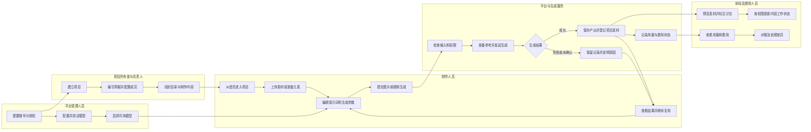

失败或结果未确认时，“查看结果”指查看任务说明，不代表已有可用作品；再次生成必须是用户明确的新操作。

## 5. 全局通用规则

| 类别 | 业务规则 |
|---|---|
| 分页 | 展示当前范围及数量；翻页、加载更多不得重复展示同一条内容。批量选择明确作用于当前已加载的可操作内容，不默认选择未展示内容 |
| 筛选 | 条件组合生效；变更条件后回到首批结果。无匹配结果与加载失败分开呈现 |
| 搜索 | 按页面明确的名称、别名或评论内容搜索；保留搜索词并支持清空。不暗示所有页面均有全文搜索 |
| 删除 | 素材、元素、文件夹进入项目回收站；说明影响范围。任务、调用证据和历史费用不提供普通删除入口 |
| 编辑 | 校验必填和长度，保存成功后同步关联视图；他人已修改时提示重新读取，不静默覆盖 |
| 导出与下载 | 仅对具备入口和权限的内容开放；说明导出范围。下载媒体与导出业务清单是不同操作 |
| 消息 | 提交、完成、失败分别反馈；耗时任务在列表持续可查，不能仅依赖短暂提示。切换页面、关闭详情不取消任务 |
| 通用报错 | 显示发生了什么、是否已完成和下一步；保留输入。不能用“空列表”代替报错，不把未确认结果直接宣判为失败 |
| 个人偏好 | 置顶、隐藏和拖动排序只影响本人导航，不改变项目状态、成员或其他人的顺序；拖动完成自动保存 |
| 时间 | 业务时间统一按上海时间展示；日期范围含结束日，避免用户因时差漏查 |
| 双主题 | 亮暗主题使用同一业务布局；切换不丢失页面、输入、筛选和选择，媒体原图不变色 |

## 6. 功能需求（核心）

### 6.1 登录、首页与项目导航

- **功能简述：**提供统一登录入口和以项目为中心的首页。
- **前置条件：**用户持有有效企业账号及使用权限。
- **用户操作流程：**登录 → 首页 → 查看参与项目 → 进入项目；侧栏切换项目，项目右侧菜单处理置顶、隐藏及获准编辑，拖动调整个人顺序。
- **字段说明：**账号用于识别用户；密码用于验证身份；项目名称、项目状态和本人角色用于辨识工作范围。参与项目包括本人创建和别人创建但本人已加入的项目。
- **状态流转：**

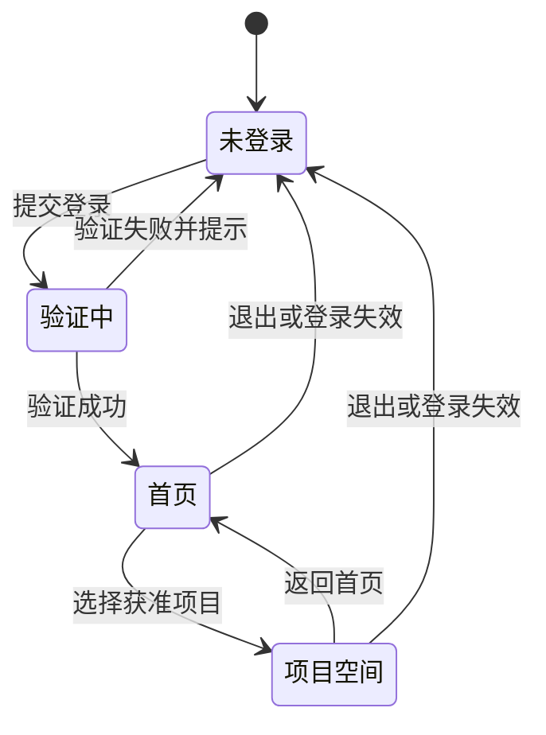

- **异常场景：**账号停用、密码错误、登录失效、项目授权被撤销、个人排序保存失败。
- **验收标准：**① 无权限项目不能通过直接访问打开；② 首页显示成员参与的项目，不限创建者；③ 侧栏包含全部未隐藏的获准项目，数量多时可滚动，不只显示置顶项目；④ 项目菜单操作后关闭菜单，刷新后保留已保存偏好；⑤ 首页无生成组件，侧栏无重复的“我参与的项目”一级入口。

### 6.2 项目设置、简报与成员

- **功能简述：**维护项目制作说明、成员角色及项目运行状态。
- **前置条件：**创建项目须有创建权限；修改简报、成员或项目状态须分别具备相应权限。
- **用户操作流程：**创建项目 → 编辑简报 → 添加或调整成员 → 开始制作；需要暂停或结束阶段性工作时，在当前项目菜单选择暂停或归档并填写原因；获准用户可恢复。
- **字段说明：**名称用于项目识别；简报用于描述制作目标；成员与角色确定协作范围；状态表示进行中、暂停或归档；原因记录暂停或归档的业务背景。项目名称为 1～200 字。
- **状态流转：**

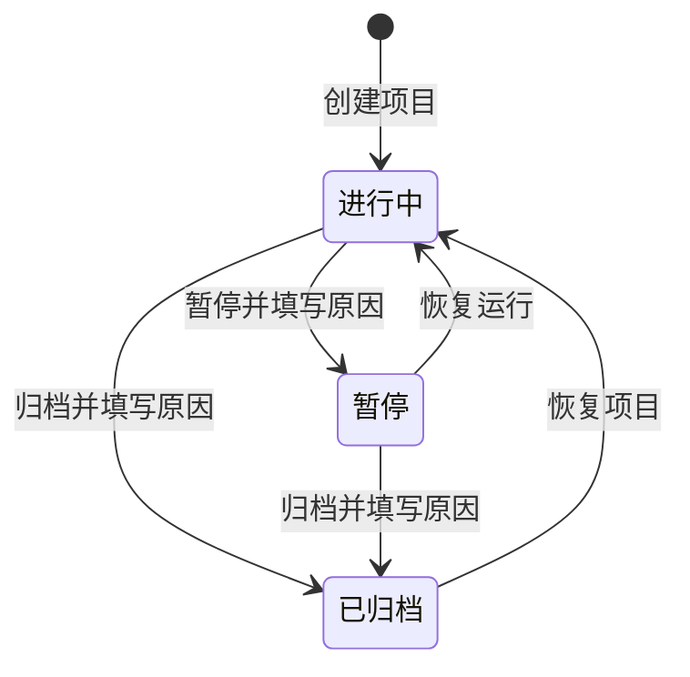

- **异常场景：**无权限、成员已失效、项目状态被他人改变、保存结果未确认。
- **验收标准：**① 暂停及归档项目不能继续普通内容修改或新增生成；② 暂停、归档不等于删除，也不宣称取消供应商已经接收的任务；③ 个人隐藏不改变项目状态；④ 修改名称后首页、侧栏及项目页名称一致；⑤ 重复确认同一次状态操作不产生重复变更。

### 6.3 文件夹、素材与版本

- **功能简述：**以项目目录组织图片和视频，支持上传、预览、下载、版本查看及作为生成参考。
- **前置条件：**项目可编辑；用户拥有对应素材或目录操作权限。
- **用户操作流程：**选择目录 → 上传素材 → 查看上传结果 → 预览或下载 → 选择作为创作参考；按权限调整目录、素材信息和版本。
- **字段说明：**素材名称用于识别；类型表示图片或视频；所属目录表示组织位置；版本表示一次固定内容；尺寸、时长等描述媒体属性；工作状态表示团队审阅进度，与生成结果无关。
- **状态流转：**

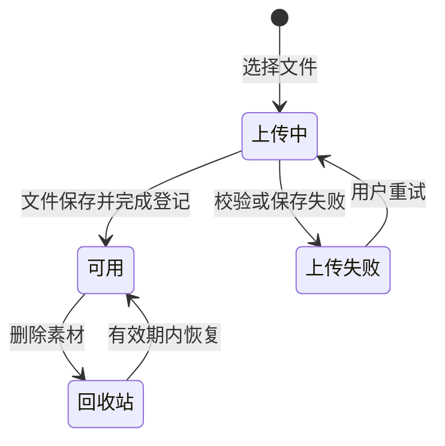

- **异常场景：**文件不符合允许类型或大小、媒体不可读、上传中断、目录失效、下载无权限。
- **验收标准：**① 上传失败不显示为完整可用素材；② 当前版本变化不改变既有任务引用的旧版本；③ 只有存在子文件夹时才提供展开操作；④ 素材变动后列表和目录数量一致；⑤ 长文件名截断后仍可查看完整名称，操作按钮不遮挡数量或状态。

### 6.4 元素库与参考引用

- **功能简述：**将角色、场景、道具等组织为可重复使用的元素，并用于生成。
- **前置条件：**用户可访问元素及其参考素材，具备对应创建、编辑、导入或复制权限。
- **用户操作流程：**从项目素材建立元素 → 填写名称、分类和描述 → 组织参考内容 → 在创作栏输入或点击“@” → 选择元素或已加入的素材 → 与提示词连续编辑。跨项目复用通过获准复制完成。
- **字段说明：**名称是用户识别元素的标签；分类包括角色、场景、道具及其他；别名辅助查找；参考内容提供实际媒体；修订表示某次固定的元素内容。元素不是训练好的专属模型。
- **状态流转：**

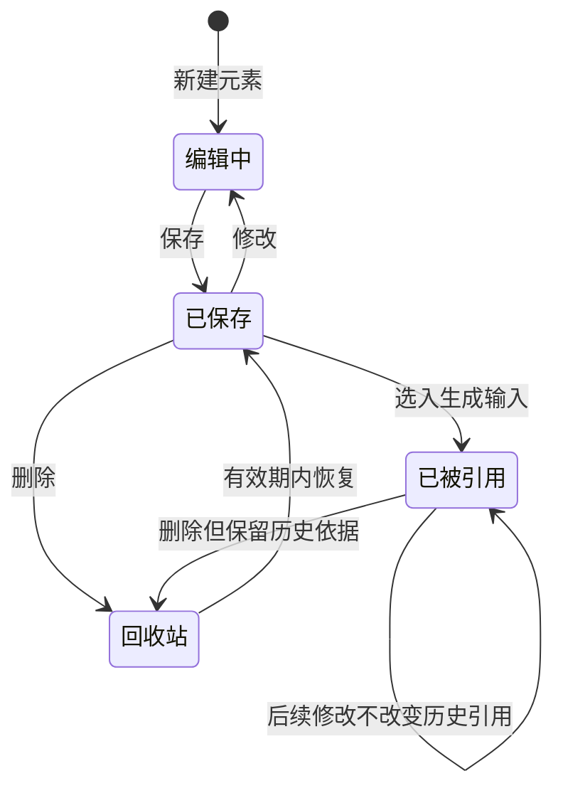

- **异常场景：**元素或素材失效、名称无法匹配、跨项目复制无权限、批量导入部分失败。
- **验收标准：**① 输入“@”与点击“@”均可选择引用；② 标签显示元素或素材名称，与提示词在同一编辑区连续输入；③ 候选项仅在提示词实际引用时打勾；④ 同一对象多处引用只显示一份对应缩略图；⑤ 最后一处元素引用删除后清理由引用带入的缩略图，主动加入的素材可保留但不打勾；⑥ 剪切、粘贴、撤销、重做及重开草稿后引用关系一致，无重复或残留。

### 6.5 图片与视频创作、创作参数保存

- **功能简述：**在明确项目及目录归属下，提交图片或视频生成，并保存可复用的创作参数。
- **前置条件：**项目进行中，用户有生成权限；模型可用，提示词及参考符合所选模型要求。
- **用户操作流程：**选择图片或视频 → 选择模型 → 编辑提示词和参考 → 设置参数 → 点击生成 → 查看发送前进度 → 请求发出后可继续新创作 → 接收结果消息 → 在目录中查看已保存产出。
- **字段说明：**提示词描述创作意图；模型决定可用能力；图片参数包括数量、比例、画质和分辨率；视频参数按模型提供时长、比例、分辨率、声音及参考方式；目标目录决定结果归属；保存的创作参数用于以后继续编辑，不代表已提交任务。
- **状态流转：**

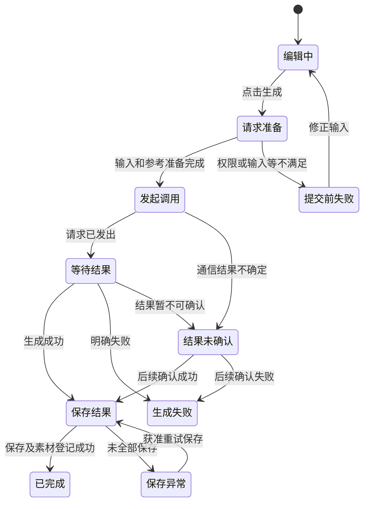

- **异常场景：**等待启动、参考准备失败、模型停用、供应商排队或拒绝、响应中断、视频结果延迟、保存失败、目标目录失效。无进展应显示实际停留阶段，不能伪造完成比例。
- **验收标准：**① 请求准备及发起调用阶段按钮禁用并显示具体进度；② 确认请求发出后按钮恢复，新任务不必等待上一任务产出；③ 同一提交的重试不重复生成，明确新生成可创建另一任务；④ 结果未确认不自动重新生成；⑤ 完成或失败有可追踪通知及任务入口；⑥ 结果保存到提交时的项目和目录，切换页面不改变归属；⑦ 保存成功自动成为素材，无需“转为素材”；⑧ 草稿恢复提示词、模型、参数及有效引用，恢复草稿本身不生成；⑨ 空提示词不新增无意义草稿；⑩ 当前版本不提供用户取消已提交生成的操作。

### 6.6 生成记录与结果查看

- **功能简述：**回答谁在何时生成、使用什么输入、是否成功以及产出是什么。
- **前置条件：**拥有相应生成记录及输出查看权限。
- **用户操作流程：**进入项目生成记录 → 按类型、阶段及日期筛选 → 查看详情 → 查看原提示词、参数、参考和输出 → 按权限预览或下载。
- **字段说明：**任务状态反映生成进度；输入为当时使用的内容；输出为产出集合；保存状态表示是否已成为可用素材；费用状态表示是否已完成核算；创建时间与更新时间区分开始和最新进展。
- **状态流转：**

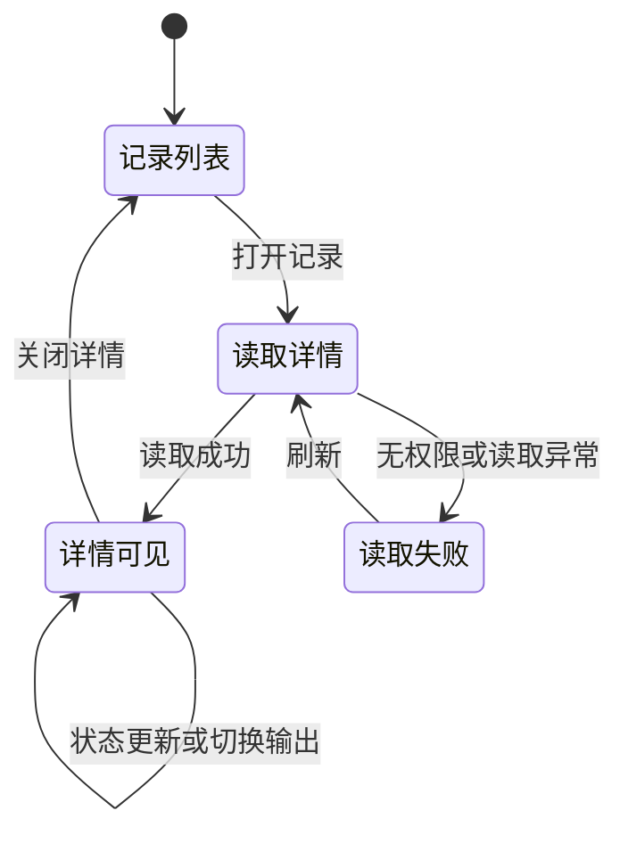

- **异常场景：**暂无结果、结果部分保存、预览不可用、输入不可见、费用无查看权限。
- **验收标准：**① 刷新、打开或关闭详情不发起新生成；② 失败、结果未确认、生成成功和保存异常可区分；③ 多个输出逐项可查，部分失败不掩盖成功输出；④ 生成详情不混入旧版作品评论、工作状态修改或“转为素材”；⑤ 无费用权限不展示金额；⑥ 不能仅因等待时间较长将任务改为失败。

### 6.7 素材详情、标注评论与审阅

- **功能简述：**围绕具体素材版本提出反馈，支持文字、图像标注及视频相关定位讨论。
- **前置条件：**可查看目标素材；发表评论、编辑本人评论或管理讨论须分别授权。
- **用户操作流程：**打开素材详情 → 切换评论 → 定位画面或视频位置 → 添加标注和文字 → 回复或回应 → 按权限处理讨论及内容工作状态。
- **字段说明：**评论内容表达反馈；标注位置或时间表示反馈对象；作者与时间用于追溯；回复与回应组织协作；讨论处理状态与内容工作状态分别维护。
- **状态流转：**

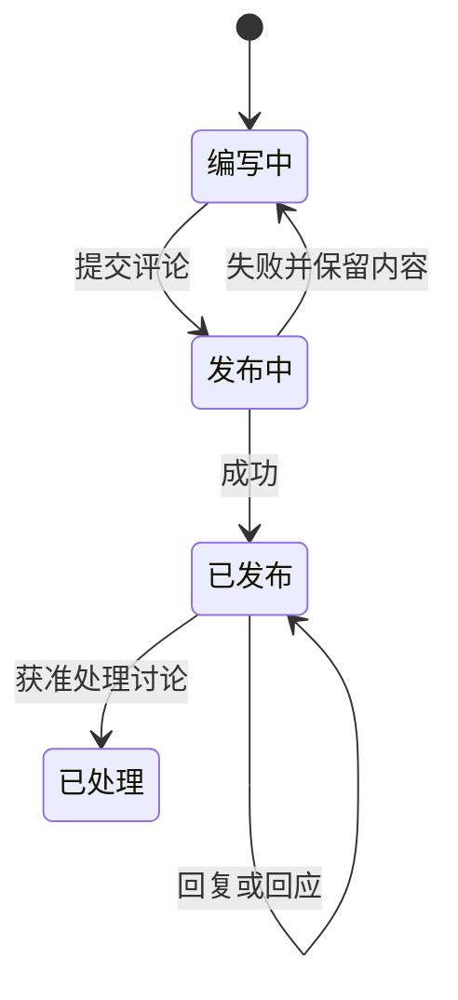

- **异常场景：**版本切换、权限撤销、评论提交失败、原素材已移除。
- **验收标准：**① 标注对应当前固定版本，不漂移到其他版本；② 评论定位可回到关联画面或视频位置；③ 发表失败保留文字；④ 无编辑他人评论权限时不能修改他人内容；⑤ 生成成功不自动将内容设为审核通过；⑥ 生成详情删减旧评论入口不影响素材详情中的标注评论。

### 6.8 项目回收站

- **功能简述：**统一恢复当前项目已删除的素材、元素和文件夹。
- **前置条件：**拥有对应类别的操作权限，内容在删除后 30 天恢复期限内并满足恢复条件。
- **用户操作流程：**打开回收站 → 选择全部或内容分类 → 单项恢复或选择可恢复内容批量恢复 → 查看逐项结果 → 对失败或未确认项继续处理。
- **字段说明：**名称、类别、删除时间、恢复期限及可恢复性说明对象当前情况；批量结果区分成功、失败和未确认。
- **状态流转：**

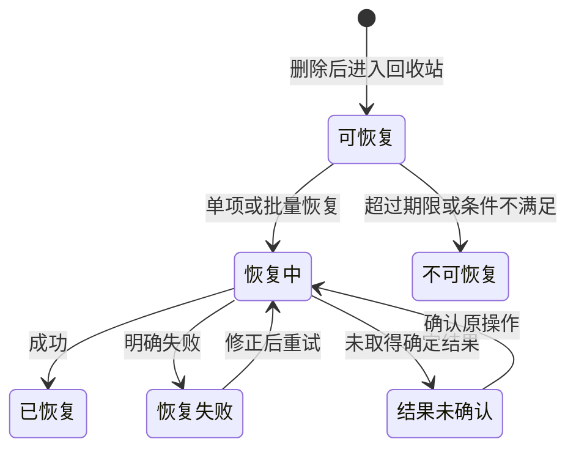

- **异常场景：**恢复过期、权限不足、目标位置失效、部分恢复成功、恢复后刷新列表失败。后者不能误报为恢复操作失败。
- **验收标准：**① 三类内容均支持单项及批量恢复；② 成功项移出回收站并同步相关列表、侧栏和数量；③ 批量结果逐项呈现，失败项不会冒充成功；④ 重试确认不会产生重复内容或重复计数；⑤ 恢复文件夹不将已经移到其他位置的内容强行移回；⑥ 超期内容不提供有效恢复操作，不承诺超期即永久销毁。

### 6.9 供应商、模型配置与测试

- **功能简述：**管理制作端可用模型及其能力、价格与使用状态，提供明确的测试流程。
- **前置条件：**具备模型和供应商管理权限，拥有有效服务账号及测试所需资源。
- **用户操作流程：**配置供应商及模型 → 设置支持参数和价格 → 打开测试详情预览本次测试内容 → 点击“开始测试” → 查看进度和结果 → 满足条件后启用模型；后续按权限修改价格或停用。
- **字段说明：**供应商标识服务来源；服务账号承载调用资格；模型名称和类型供用户选择；能力限制确定可选参数；价格和生效规则用于费用计算；测试记录保留测试输入及结果。
- **状态流转：**下图为模型测试流程，不代替模型启停状态。

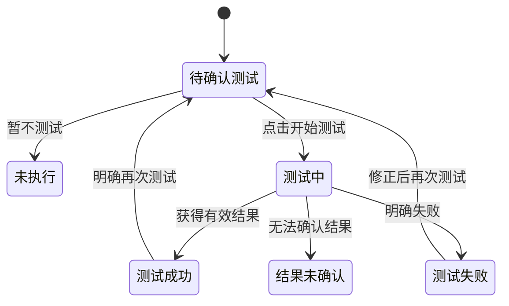

- **异常场景：**服务账号失效、模型能力不匹配、服务额度不足、测试结果未知、未满足启用条件。
- **验收标准：**① 首次及再次测试均先预览，未点击开始不产生测试消耗；② 刷新或查看历史测试不再次生成；③ 已停用模型不能新提交生成，停用不等于取消已提交任务；④ 价格修改不隐式触发付费测试；⑤ 价格表存在某档位不代表制作端可开放该能力；⑥ 管理测试消耗与项目消费分开归属。

### 6.10 用量、费用与对账

- **功能简述：**基于可核实用量记录费用，并支持差异核对和有依据的调整。
- **前置条件：**具备相应费用、价格或对账权限；已有消费记录或待核对账单。
- **用户操作流程：**筛选消费记录 → 查看所属项目或管理测试 → 核对模型、用量及适用价格 → 导入供应商账单 → 匹配并检查差异 → 按授权确认或调整并填写原因。
- **字段说明：**消费归属标识项目或非项目用途；用量表示实际使用量；供应商成本与项目计价为两个费用视角；价格与汇率适用版本固定历史依据；调整原因与证据解释金额变化。
- **状态流转：**下图为费用核对业务过程；生成和保存状态独立。

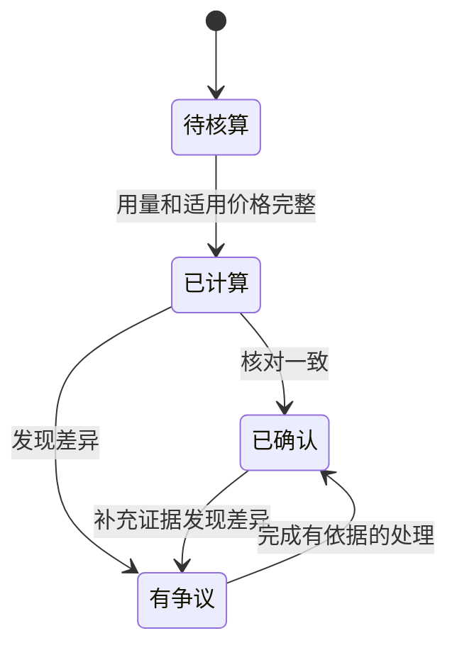

- **异常场景：**用量缺失、价格不匹配、账单格式不支持、部分记录无法匹配、费用争议或调整权限不足。
- **验收标准：**① 未核算显示待确认，不能冒充零费用；② 供应商成本和项目计价不相加造成重复统计；③ 修改价格不追溯改写历史费用；④ 每次调整保留原因及原始依据；⑤ 供应商已生成但保存失败时，不自动判定无费用；⑥ 实际账单格式及完整对账流程须独立验收，不能用测试消费替代正式对账验收。

## 7. 权限设计

以下为默认项目角色基线；实际授权可配置，并受本人或项目范围限制。表中的“删除”仅指可回收的业务内容，不包括历史记录删除。

| 操作 | Owner | 负责人 | 制作人 | 查看者 |
|---|---|---|---|---|
| 查看项目素材与元素 | 项目范围 | 项目范围 | 项目范围 | 项目范围 |
| 下载获准素材 | 允许 | 允许 | 允许 | 允许 |
| 上传素材、新建元素、提交生成 | 允许 | 允许 | 允许 | 不允许 |
| 修改、删除素材与元素 | 项目范围 | 项目范围 | 本人范围 | 不允许 |
| 新增或调整文件夹 | 允许 | 允许 | 允许 | 不允许 |
| 查看生成记录 | 项目范围 | 项目范围 | 按获准范围 | 按获准范围 |
| 发表评论、编辑本人评论 | 允许 | 允许 | 允许 | 不允许 |
| 管理他人评论 | 允许 | 允许 | 不允许 | 不允许 |
| 调整内容工作状态 | 项目范围 | 项目范围 | 本人范围 | 不允许 |
| 修改简报、管理成员、暂停或归档 | 允许 | 需额外授权 | 需额外授权 | 不允许 |
| 恢复已删除内容 | 按对象权限 | 按对象权限 | 按对象及归属权限 | 不允许 |
| 跨项目复制元素 | 两端均须授权 | 两端均须授权 | 两端均须授权 | 不默认开放 |
| 查看费用或调整金额 | 单独授权 | 单独授权 | 单独授权 | 单独授权 |

| 管理职责 | 查看 | 新增与修改 | 删除或停用边界 |
|---|---|---|---|
| 账号与授权管理 | 获准用户和角色 | 分配账号及权限 | 按管理授权停用，不抹除历史操作归属 |
| 供应商与模型管理 | 模型、测试及调用记录 | 配置、测试、启停及获准价格维护 | 不以删除模型清理既有消费证据 |
| 费用管理 | 获准用量、费用和账单 | 获准价格维护、对账、费用调整 | 历史费用与调整证据不允许普通删除 |

验收时至少使用四种项目角色、本人和他人内容、两个项目验证权限。页面隐藏按钮不能代替实际限制；授权变化后，旧页面继续操作也必须重新判定资格。

## 8. 埋点需求

【业务假设】下表为本次产品分析需求，尚不能认定已完整采集。仅采集完成目标所需事件，不采集密码、服务密钥、完整提示词、原始媒体或评论正文。

| 用户行为事件 | 关键业务信息 | 用途 |
|---|---|---|
| 登录结果 | 成功或失败、失败类别 | 识别登录阻碍 |
| 进入项目 | 入口、项目、本人角色 | 评估首页与侧栏导航 |
| 项目菜单操作、拖动排序 | 操作类型、成功或失败 | 验证个人偏好易用性 |
| 上传结果 | 媒体类型、大小区间、耗时、结果 | 分析素材准备问题 |
| 插入或移除引用 | 元素或素材、操作入口 | 评估参考使用体验 |
| 点击生成、发送确认 | 任务、媒体类型、模型、耗时 | 衡量发送前等待与中断 |
| 生成完成、失败或未确认 | 任务、阶段、原因类别、耗时 | 定位耗时和失败分布 |
| 结果保存完成或异常 | 任务、结果数量、耗时 | 区分生成与保存体验 |
| 查看任务详情、下载结果 | 来源、任务或素材 | 评估结果发现与使用 |
| 发布标注评论 | 类型、发布结果 | 评估协作使用情况 |
| 恢复内容 | 类型、单项或批量、逐项结果 | 检验恢复成功率和重试问题 |
| 模型测试确认 | 模型、开始或暂不测试、结果 | 监测误操作及测试质量 |

一次业务结果只统计一次；重新打开页面不能重复计为成功。用户点击次数与实际创建任务数分别统计。事件访问范围、保存期限及个人信息处理规则在正式启用前由业务负责人确认。

## 9. 非功能需求

- **页面响应：**【业务假设】在约定办公网络及验收数据量下，按钮点击 300 毫秒内出现反馈；普通列表首屏第 95 百分位响应时间不超过 2 秒，媒体完整加载及供应商生成另计。数据量和网络条件须在测试报告中记录。
- **长任务：**等待期间持续显示可解释状态；允许离开页面后再次查看。关闭详情不取消任务；不得通过持续转圈掩盖已经确定的错误。
- **浏览器兼容：**【业务假设】首轮验收覆盖 Windows 上 Chrome、Edge 当前及前一个稳定版本；其他浏览器和移动端列为待确认范围，不宣称已兼容。
- **布局：**【业务假设】在 1280×720 与 1920×1080 下，主要操作不被遮挡；长表格可局部滚动，弹层可完整访问关闭及确认按钮。
- **易用性：**图标有可识别名称；支持键盘进入表单和关闭弹层；错误与状态不能仅靠颜色区分。每步突出一个主要操作。
- **文案：**业务结论在前，原因和下一步在后；“等待启动”“生成中”“保存结果中”“失败”“结果未确认”含义不得混用。不要求普通制作人员执行运维操作。
- **主题：**亮暗主题均验证默认、选中、禁用、聚焦和错误状态；素材预览保持原色。
- **可靠性：**重复操作不得重复收费或重复恢复内容；部分成功须逐项可见；未完成保存不能宣称已进入素材库。

## 10. 外部依赖、业务约束与风险

| 依赖或风险 | 业务约束及处理原则 |
|---|---|
| 第三方图片与视频生成服务 | 当前对接 VideoPlus 相关生成服务；能力、额度、排队和内容限制以有效配置及服务实际结果为准 |
| 生成耗时不确定 | 不承诺固定完成时间；区分平台等待、参考准备、服务生成和结果保存 |
| 结果未确认 | 不自动再次付费生成；保留原任务，后续确认不能抹除之前的异常过程 |
| 第三方临时结果失效 | 平台保存成功前不承诺永久可用；源结果过期时说明无法完成保存的原因 |
| 公司长期媒体存储 | 正式保存和访问能力需专项验收；不能将本地测试视为正式交付证明 |
| 参考素材的版权与人物使用资格 | 上传者及制作团队须具备适当使用权；模型参考不保证身份或风格完全一致 |
| 权限与成员变更 | 离开项目或权限被撤销后，不得继续读取或修改失去授权的内容 |
| 模型停用、项目暂停及归档 | 限制新的业务操作，不保证撤销第三方已接收的生成；费用仍按可核实事实处理 |
| 批量并发与公平性 | 多用户可提交任务，但不承诺无限同时执行；等待状态必须真实且可追踪 |
| 价格、汇率与供应商账单 | 新价格不覆盖历史计价；账单差异保留证据，不以界面金额代替正式对账 |
| 回收期限 | 30 天内仅在条件满足时恢复；超期不可恢复不等于承诺已永久清除全部历史依据 |
| 未完整验收能力 | 埋点、性能阈值、浏览器矩阵、真实供应商全流程及正式存储须分别提供验收记录 |

## 11. 附录：术语说明

| 术语 | 业务含义 |
|---|---|
| 项目 | 组织制作目标、成员、素材及任务的协作空间 |
| Owner | 项目所有者，拥有固定的项目治理权限 |
| 素材 | 可预览、下载或继续创作的图片、视频等内容 |
| 素材版本 | 素材在某一时点固定的媒体内容 |
| 元素 | 具有名称、分类、描述及参考素材的可复用创作对象 |
| 元素修订 | 元素某次保存的固定内容，供历史引用追溯 |
| 参考引用 | 在本次生成中明确使用的元素或素材内容 |
| 创作参数／草稿 | 保存的提示词、模型、参数和参考，不等于生成任务 |
| 生成任务 | 用户明确提交的一次生成工作及其过程、结果记录 |
| 生成产出 | 生成服务返回的图片、视频或其他结果 |
| 结果保存／归档 | 将产出保存为平台可持续使用的内容；不等于项目归档 |
| 项目归档 | 项目停止日常修改并保留历史内容，可按权限恢复 |
| 工作状态 | 团队对内容的制作或审阅状态，与生成成功与否独立 |
| 结果未确认 | 缺少足够依据判定成功或失败，不能等同失败 |
| 原操作重试 | 确认或继续同一次操作，不代表新一轮付费生成 |
| 供应商成本 | 平台使用生成服务产生的采购费用 |
| 项目计价 | 归属于项目的费用视角，不与供应商成本重复相加 |
| 回收站 | 当前项目已删除素材、元素和文件夹的恢复入口 |

### 元素编辑器：添加素材的需求口径

“＋”为当前元素添加素材，不创建另一个元素，不提交生成任务。元素表示一个可复用的角色、场景或道具；素材表示用于描述它的具体图片或视频。多张素材应补充同一对象的角度、外观或细节，系统不自动判断对象身份是否一致。

- 入口提示为“为当前元素添加素材”，选择器仅提供上传素材与生成素材。
- 一个元素仅包含图片或仅包含视频；空元素由首次添加确定媒体类型。
- 选择后先修改当前表单，点击“创建／保存”才保存元素关联；取消编辑不撤销已经完成的文件上传。
- 主图代表当前元素，缩略图显示实心星标并排第一；选中附图时可用工具栏星星设为主图，其他素材相对顺序保持不变。
- 移除只解除当前元素与素材的关联，不删除素材库原文件。只有一张素材时隐藏工具栏移除按钮。
- 元素素材集合与单次生成引用分别管理。当前创作引用面板的图片引用默认选主图，用户可显式选择附图；实际可用数量和角色遵循当前模型规则。视频引用及首尾帧遵循各自规则，不据此承诺全部素材自动参与生成。
- 主图不表示模型权重；保存元素不自动修改已经固定的历史任务输入。

验收使用一个元素的三张同类型素材：添加后元素数量不变；保存重开后素材集合、主图和顺序一致；移除关联后原文件仍可用；创作引用中的素材版本与本次选择一致。页面不增加常驻解释段落，通过入口提示、选中状态、星标与保存按钮表达操作。

元素编辑器的新建、编辑表单均不展示“版本”输入框，用户无需填写或管理版本名称。系统继续自动保留内容修订与固定素材引用；已有版本名称在编辑保存时保留，不因隐藏字段而清空。
