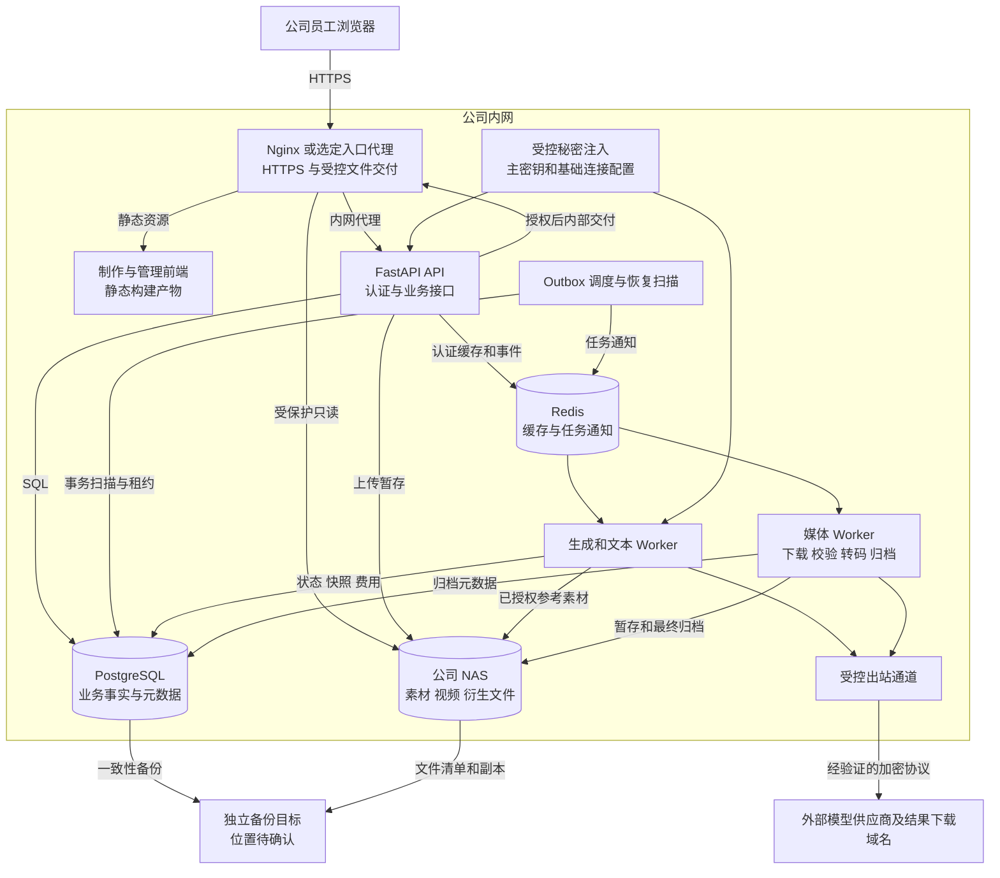
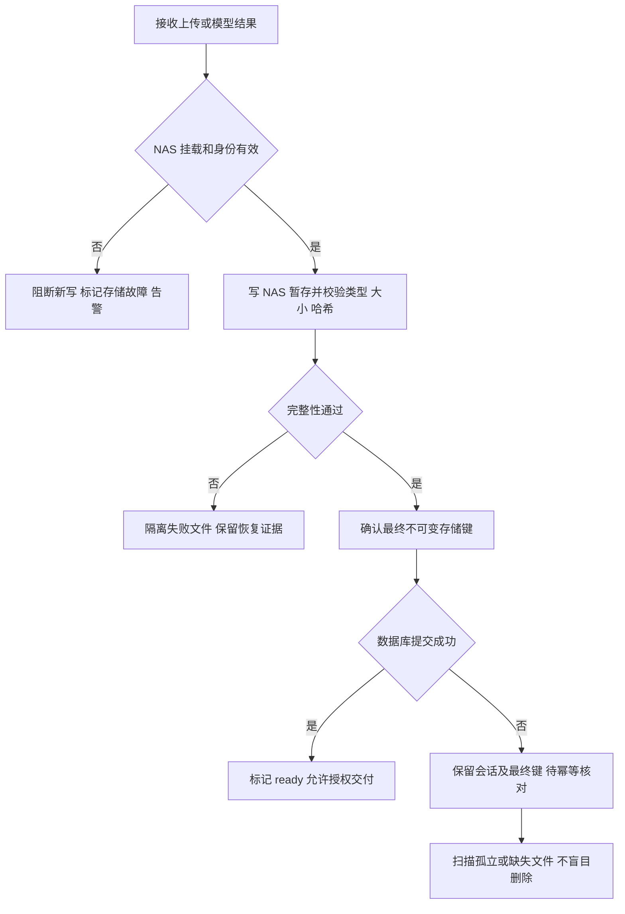
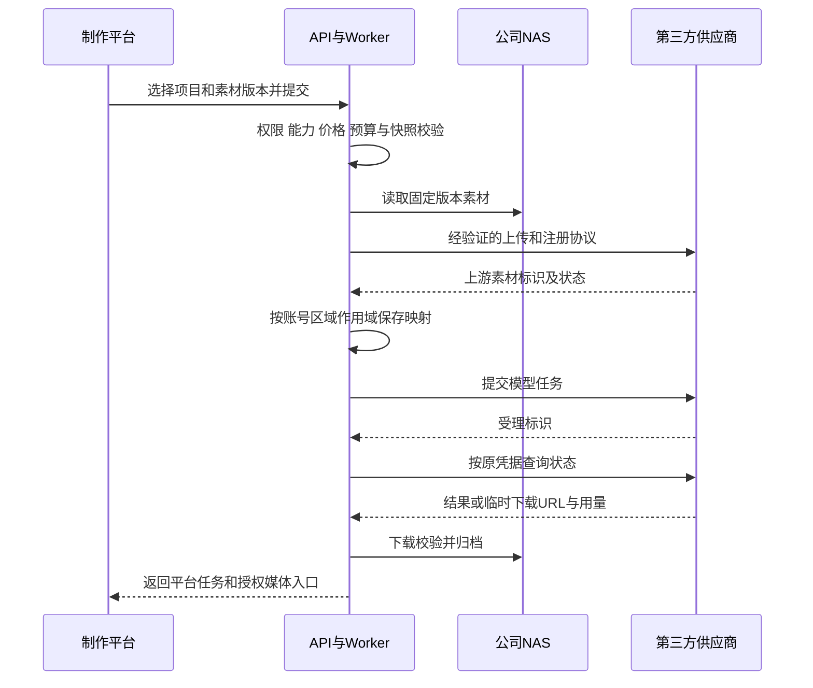
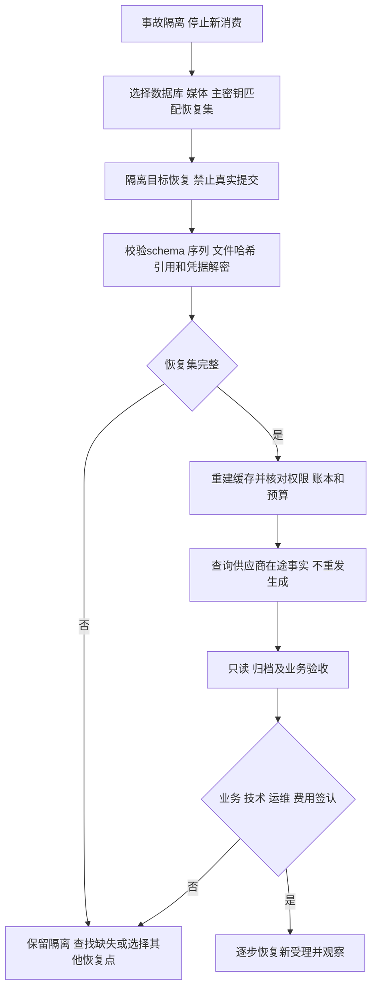

# higgsfield-ai · 内网部署与 NAS 存储运维方案

版本：1.0  
日期：2026 年 10 月 27 日  
状态：部署与运维设计评审稿；未配置服务器、挂载 NAS 或执行上线

## 1 已确认基线与适用范围

正式环境部署在公司内网服务器，素材、图片、视频及长期媒体归档存放公司 NAS。PostgreSQL 保存业务事实、文件元数据、权限与关联；Redis 承担框架缓存及任务通知等职责。制作平台、管理平台共用若依后端，所有模型调用经服务端处理，员工浏览器不持有供应商 APIKey、不直接访问 NAS 共享目录。

依据：[AGENTS.md](../AGENTS.md)、[技术架构方案](技术架构方案.md)、[测试与验收方案](测试与验收方案.md)、[P0-1 需求](首期需求与业务规则说明书.md)、[P0-2 供应商接入](模型供应商接入契约与差异清单.md)、[P0-3 数据库](数据库详细设计.md)、[P0-4 API](平台API契约.md)、[P0-5 价格用量预算](价格用量预算说明.md)、[P0-6 权限](权限矩阵.md)、[页面规格](页面规格与交互说明书.md)及[本地开发手册](本地开发与工程初始化手册.md)。

本文承接现有源契约，不改变业务等级。OPS-xx 是运维检查编号，继承关联业务规则的开放门槛；文档编号、检查编号均不是新优先级。本轮只维护 Markdown 和 HTML；所有挂载、备份、网络、费用与恢复结论均待真实环境验证。

| 已确认 | 尚未确认，不在本文擅自落定 |
|---|---|
| 公司内网部署、公司 NAS 长期保存媒体 | 服务器系统、数量、规格、地址及高可用方式 |
| PostgreSQL、Redis、若依异步后端与双 Vue3 前端 | 正式环境容器化还是宿主机服务管理 |
| 平台鉴权后预览/下载，NAS 不直接对员工或公网开放 | NAS 型号、SMB/NFS 协议版本、路径、服务账号和容量 |
| 后端受控访问第三方模型 | 出站代理、域名白名单、供应商可用加密路径 |
| 本地 Docker 仅启动 PG/Redis，其余手动启动 | 生产端口、域名、证书、备份目的地、实际 RPO/RTO |

本地开发方式不推导正式部署方式。正式前端部署构建后的静态产物，不以 Vite 开发服务器作为生产入口；正式 API/Worker 应由运维选定的进程或容器管理机制监管，而不是要求人工终端长期挂着。

## 2 参数登记与冻结时点

以下占位名是登记字段，不是现有环境变量，也不是可直接执行的配置。填写实际值后，应再产出对应环境的配置和操作手册，禁止把“待确认”直接填入可执行配置。

| 登记项 | 当前值/状态 | 确认责任建议 | 最迟时点 |
|---|---|---|---|
| APP_HOSTS / OS | 待确认；Linux 仅为架构建议 | 运维 | 选定部署工具前 |
| CPU / RAM / 本地盘 / 主机数量 | 待确认；按并发与媒体处理实测 | 运维＋技术负责人 | 容量试运行前 |
| DEPLOY_MODE | 待确认：容器或宿主机服务 | 运维 | 编制发布脚本前 |
| 内网域名 / IP / TLS证书 / 信任链 | 待确认 | 网络运维 | 联调入口开放前 |
| 正式端口 / 安全组 / 防火墙 | 待确认；不沿用本地映射值 | 网络运维 | 网络联通检查前 |
| PG / Redis 版本及拓扑 | 待确认；数据库选型不变 | DBA/运维 | 首次正式迁移前 |
| NAS_ADDRESS / SHARE / PROTOCOL | 待确认；SMB 或 NFS 须验证 | 存储运维 | 挂载验证前 |
| NAS_ROOT / 环境目录 / 服务身份 | 待确认；禁止复用员工个人账号 | 存储运维＋后端 | 文件联调前 |
| NAS 容量/配额/IOPS/吞吐 | 待确认；含原片、版本、缩略图、备份增长 | 存储运维 | 容量验收前 |
| 文件大小/类型/处理资源上限 | 沿 P0-1 D04，待冻结 | 产品＋后端 | 相关写入口开放前 |
| 出站域名/CDN/代理/DNS | 待确认；逐模型实际链路验证 | 网络运维＋接入负责人 | 真实模型联调前 |
| 供应商加密访问路径 | 待验证，资料中的 HTTP 地址不等于 HTTPS 已可用 | 接入负责人 | 正式消费前 |
| 主密钥保管/注入/恢复方式 | 待确认；与业务数据库分离 | 安全/运维 | 凭据启用前 |
| 备份目的地/频率/保留期 | 待确认；需独立故障域副本 | 运维＋业务 | 试点开放前 |
| RPO / RTO | 建议≤24小时/≤4小时，待评审和演练 | 运维＋业务 | 试点签认前 |
| 告警阈值/接收人/值班与升级 | 待确认 | 运维＋模块负责人 | 试点开放前 |
| 真实联调预算/成本中心 | 待确认，按测试方案批准范围 | 费用负责人 | 首次收费测试前 |

未确定参数不阻止无依赖的设计工作；会影响部署、挂载、正式消费、容量或恢复验证的参数未冻结时，不能将相应检查标为通过。

## 3 部署拓扑和运行单元

### 3.1 逻辑部署视图

下图表达职责与信任边界，不代表已采购的主机数量，也不承诺高可用。PG/Redis 可与应用同机起步或独立部署，须由实际容量及恢复要求决定；媒体文件位置始终为 NAS。

### 3.2 部署单元与持久性

| 单元 | 运行职责 | 持久数据与运行要求 |
|---|---|---|
| 入口与两个 SPA | HTTPS、静态资源、API/SSE代理、授权文件交付 | 保留可回退构建产物和代理配置；不能存供应商 Key |
| FastAPI | 若依认证、权限、项目/价格/任务受理 | 无本地会话依赖；数据库/Redis/NAS依赖异常要反映到对应功能 |
| Outbox 调度 | 投递、到期扫描、租约恢复 | 数据库为事实；重复通知不产生新消费 |
| 生成/文本 Worker | 适配器调用、状态查询、会话处理 | 独立进程；固定凭据/路由/输入快照；外部调用不保证恰好一次 |
| 媒体 Worker | 下载、校验、缩略图、转码、归档 | 限 CPU/内存/临时盘/执行时长；任务完成前核实 NAS 最终文件 |
| PostgreSQL | 元数据、权限、版本、任务、账本 | 独立持久卷/目录及备份；不因媒体使用 NAS 自动把 PG 数据放 NAS |
| Redis | 登录/权限缓存、通知及框架运行数据 | 持久化与淘汰策略待确认；不是唯一任务/费用事实来源 |
| NAS | 输入、输出、不可变版本及衍生媒体 | 专用服务身份、受控路径、容量告警、备份恢复验证 |
| 主密钥与基础秘密 | 解密供应商凭据、连接基础设施 | 运行时注入，与数据库及数据库备份分离保管，单独恢复验证 |

正式部署保留原目录身份，不重命名制作/管理/后端工程。后端仍为 controller→service→dao→entity/do，VO 在 entity/vo，ORM 使用 AsyncSession；迁移遵循 PostgreSQL 与若依字段规范，无物理外键。运维不得直接改业务表绕过状态机或删除账本使任务“恢复正常”。

### 3.3 入口、网络与路由

架构建议同站点 `/studio/`、`/admin/`；该子路径方案须在前端 base、Vue Router、代理及刷新回退均验证后使用，不视为仓库已配置。新增业务 `/api/v1/`、管理 `/api/admin/v1/` 与框架原生登录/system路径并存；不能因改入口前缀破坏原生认证和错误信封。

| 来源→目标 | 目的 | 访问规则 |
|---|---|---|
| 员工终端→入口 | 页面、API、授权媒体 | 仅批准内网入口，HTTPS；实际端口待确认 |
| 入口→API | 路由代理、SSE、授权判断 | 仅服务间访问；超时/缓冲按事件与大文件测试确定 |
| API/Worker/调度→PG/Redis | 数据、权限、任务通知 | 仅授权服务身份和网段；不向员工网络直接开放 |
| API/媒体/生成/入口→NAS | 各自最小范围的读写 | 协议及端口按实际选型；员工不直接挂该业务共享 |
| 指定服务→供应商/CDN | 提交、查询、参考上传、结果下载 | 域名/协议允许清单、代理与限流；默认无公网入站 |
| 运维→管理通道 | 发布、诊断、备份恢复 | 公司批准的管理入口和账号，记录操作；不共用业务用户身份 |
| 服务→DNS/时钟/监控/备份 | 基础运行 | 按公司基础设施白名单，时间保持同步 |

PG/Redis、NAS 和主密钥管理面不映射到网页站点。前端不能通过公开静态目录绕过媒体鉴权；每个新 GET/HEAD/Range 请求都须授权。已下载到员工设备的文件无法远程撤回，不作相反承诺。

## 4 NAS 目录、挂载与服务权限

### 4.1 存储布局与元数据

以下是逻辑目录建议，不是实际共享名；冻结路径后由 NAS adapter 映射。开发、测试、正式使用不同根目录和凭据，恢复演练使用独立目录，不能写回正式目录。

| 逻辑区域 | 内容 | 生命周期与权限 |
|---|---|---|
| upload-staging | 上传会话分片/完成校验前文件 | API/上传服务可写；按会话到期与绑定状态受控清理 |
| archive-staging | 模型结果下载及校验中间文件 | 媒体服务可写；未验证完整性不对用户标 ready |
| media | 不可变输入/输出/版本原件 | 归档服务写新键；交付和引用读取；不覆盖旧版本 |
| derivatives | 缩略图、预览、转码衍生文件 | 媒体服务写；和源文件建立可追踪关系 |
| quarantine | 损坏/异常文件或待核对孤立文件 | 受控隔离，不对普通用户开放；保留期待确认 |
| manifest | 备份/核对清单 | 运维受控写读；不包含密钥或签名URL |

逻辑存储键由服务端生成，不能把用户文件名、项目显示名或传入绝对路径直接拼成 NAS 路径。数据库保留存储键、大小、哈希、类型和关系，挂载路径由环境配置映射，不能把某台服务器绝对路径当业务 ID。文件删除标记与物理文件清理不同；被任务、修订、评论或证据引用的文件不得直接清理。

如采用原子改名完成归档，暂存与最终目标必须落在经验证的同一文件系统/共享范围。服务器本地临时盘到 NAS 的复制不等于原子改名：须先复制到 NAS 暂存、校验完整性，再执行已验证的最终确认步骤；不把跨设备 rename 假定为安全原子操作。

### 4.2 权限矩阵

以下为服务身份职责建议，账号名及协议 ACL 待确认。操作系统/NAS 目录权限提供基础隔离，不替代平台项目/对象权限。

| 身份 | 暂存区 | 原件/衍生区 | 删除/治理 | 秘密与数据库 |
|---|---|---|---|---|
| API 上传服务 | 仅所属上传区域读写 | 元数据所需读取，不任意覆盖 | 只经应用事务清理自己可清理会话 | 按API职责访问；不向用户回显秘密 |
| 生成/文本 Worker | 仅工作所需读取 | 经业务授权选取引用内容读取 | 无通用物理删除职责 | 最小任务数据权限，按需解密指定凭据版本 |
| 媒体 Worker | 下载/处理暂存读写 | 写新归档/衍生键及校验读取 | 受控临时文件清理，不删除历史引用原件 | 写归档状态；出站下载不持久化供应商秘密 |
| Nginx/文件交付服务 | 不对外提供暂存文件 | 仅只读最终可交付文件 | 无删除/写权限 | 不持有供应商密钥 |
| 清理任务 | 批准区域 | 经 Service 引用检查及锁后处理允许清理对象 | 独立受限身份，审计原因/范围 | 不删除账本、审计或发布历史 |
| 备份身份 | 需要覆盖的正式文件读取 | 读取和生成备份清单 | 无日常删除业务原件权限 | 备份权限单独授权，主密钥备份单独保管 |
| 运维恢复身份 | 演练/批准恢复窗口写入 | 仅批准目标写入 | 恢复需记录审批范围与前后清单 | 权限临时授予与回收，操作审计 |
| 员工浏览器 | 无直接权限 | 无NAS账号/挂载权限 | 通过平台动作 | 仅平台登录身份 |

同主机进程如果共享同一读写挂载，不能声称已经实现上述隔离；实际需通过不同服务账号、目录 ACL、只读挂载视图或容器只读绑定等选定机制落实，并用越权写入测试证明。不得为省事将全部目录权限开放给所有用户。

### 4.3 挂载实施步骤（待参数冻结后执行）

1. 存储运维登记 NAS 地址、共享、协议及版本、容量、环境目录和服务身份；检查共享 ACL 与文件系统 ACL 的最终效果。
2. 按服务器系统选定挂载机制。Linux 下 SMB 需确认凭据注入、UID/GID映射和协议安全配置；NFS 需确认导出范围、身份映射及认证策略。Windows 下确认服务账号在非交互会话中的共享访问，不依赖员工登录后映射的盘符。以上均为待选方案，不在本稿给可直接执行的挂载命令。
3. 由受控秘密机制提供挂载凭据，避免命令行、代码仓库或普通环境日志暴露。若使用凭据文件，限制文件和目录访问，登记轮换流程。
4. 应用未启动前验证实际共享来源、挂载点、预期存储身份、读写权限和容量；文件夹存在或可创建文件本身不证明挂载正确。
5. 在专用探测目录按 API/媒体/交付账号分别测试创建、读取、校验、改名和删除；交付账号的写入必须被拒绝。探测文件不进入业务库。
6. 测试正常重启、启动时 NAS 不可达、运行中断连、重挂、凭据轮换和同机多实例路径一致性。验证超时不会耗尽整个 API/Worker 资源。
7. 在真实 NAS 测试目录做上传、视频 Range、并发归档和故障恢复，保留哈希、服务身份、挂载信息和日志证据，再允许连接正式文件根目录。

挂载参数、重试次数、I/O 超时、自动重挂和协议安全设置由运维结合设备验证后冻结；不把未知设备套用固定 SMB/NFS 参数。

### 4.4 断挂保护与文件一致性

依赖 NAS 的服务启动和写入路径必须确认实际挂载来源与预期身份；定期探测和挂载元数据核验共同使用，不能只凭残留哨兵文件判断。挂载点底层本地目录应限制业务身份写入，容器/服务必须依赖正确挂载；NAS 失效后不得静默落盘到本地主机同名目录。

NAS 与 PostgreSQL 不具有跨系统原子事务。最终文件写入后数据库失败需按既有会话/任务恢复；数据库记录存在但文件缺失则标记异常并核对，不宣称归档完成。存储中断时阻断新上传和依赖该存储的新消费，优先处理已接受任务的查询与结果归档恢复；不得为释放预算把未知费用改为零。

## 5 模型接口出站与参考素材交换

### 5.1 出站边界

第三方模型不在公司内网运行；Gemini 底层多模态、GPT-image2 底层图片、Seedance 视频的网关别名和能力映射沿 P0-2 验证。公司内网部署不等于断网部署，也不意味着供应商可以访问公司 NAS。

供应商资料地址为 `http://llm-gw.videoplus.cc/`。正式消费前必须核实供应商支持的 HTTPS 地址或经确认的受控加密路径，不能通过直接替换字符串声称 HTTPS 可用，也不能关闭证书验证绕过失败。网络代理到出口的加密若未覆盖供应商侧明文链路，不视为整条路径已解决。

| 出站动作 | 实施与验证要求 |
|---|---|
| 模型提交/查询 | 仅指定 Worker/接入服务出站；认证头由服务端临时注入；真实连接测试可能收费，独立确认 |
| 参考上传/注册 | 先核验源项目/对象权限和文件 ready；按已验证上传协议传输，不发送NAS共享路径 |
| 视频轮询 | 固定内层任务 ID 和创建时 Key 版本；正常轮换排空，未经证据不换Key查询旧任务 |
| 结果下载 | 允许经过验证的结果域名/CDN；逐跳检查重定向与地址策略，控制文件大小和超时 |
| 日志与代理 | 不记录 Authorization、完整签名URL、Base64或敏感提示词正文；保留必要请求/调用标识 |
| DNS/证书/代理变更 | 记录白名单、实际解析、证书链、代理路径和变更版本；变更后复测提交/查询/下载链路 |

出站白名单包含实际 API 与上传/下载链路，不能只验证首页域名可访问。禁止将“支持用户填写任意 URL”变成可探测内网或云元数据地址的代理；合法 NAS 访问与供应商 URL 下载是不同适配器路径。网络规则和应用 URL 校验都需执行，不能互相替代。

### 5.2 参考素材与结果流向

供应商只接受拉取 URL 的模式不能直接传内网 URL。须先设计受控中转，明确存储位置、有效期、撤销、范围、日志和清理并完成安全/接入验证；本方案不默认采购公网对象存储、不默认建立公网穿透，更不直接暴露 NAS。未确定中转前关闭依赖该模式的能力，其他经上传协议验证的能力可独立开放。

默认由后端主动查询，不依赖供应商入站回调；将来若使用回调，另行补充公网入口、验签、重放保护、事件幂等和网络审批。外部参考素材上传是数据离开内网的明确动作，需由公司确认允许的素材范围与供应商使用约定，不能把“内网部署”宣传为素材绝不外传。

## 6 配置、密钥与变更管理

正式、测试、开发配置分离。每次发布记录代码/静态产物版本、依赖锁定、数据库迁移版本、事件 schema、NAS 映射、入口路由、能力/价格/路由版本及所用凭据版本标识；不在发布记录保存秘密值。

供应商 Key 通过管理平台写入，经服务端加密保存；管理员只能写或替换，不能读回明文或密文。数据库凭据密文与解密主密钥分离，主密钥通过选定的受控机制注入 API/需要解密的 Worker。缺失解密能力时相应调用拒绝，不退回明文配置。主密钥轮换和供应商 Key 轮换是两种不同变更，均要保留历史解密/查询能力并演练恢复。

正式环境关闭 SQL 参数回显和敏感请求体采样；诊断接口、API 文档访问、错误栈与调试模式的开放策略上线前确定。员工登录令牌不放 URL，前端构建配置只含可公开的地址等信息，不能包含供应商 Key 或 NAS 凭据。

挂载、代理、价格、凭据和模型能力变更需记录影响范围。价格发布不覆盖旧版本；模型路由修改不改变在途快照；Key 测试通过后再改配置，旧测试结果失效。配置回退不能简单覆盖数据库历史或撤销已发生的外部消费。

## 7 上线执行与回退

### 7.1 发布前准备与顺序

以下是实施顺序，服务健康端点、启停命令、部署文件和自动化脚本均须在实现后补齐并验证，本轮不创建。

1. 冻结本次发布范围、主机/目录/网络参数、回退版本和负责人；核对 P0 阻断项及首期必需能力，未验证规格保持关闭。
2. 准备构建产物及依赖，核对两前端 base/路由和 API 兼容；准备真实迁移、升级说明、数据库与媒体备份、主密钥恢复材料。
3. 将系统置于选定的维护/停止新受理模式，保留已受理任务查询与归档能力；需要破坏性迁移时按阶段排空并记录未知/在途任务，不强行清空队列。
4. 验证 PG/Redis、NAS、DNS/时钟、秘密注入和备份可读性。空库初始化与已有库升级分开；不运行框架含 DROP 的示例脚本覆盖已有环境。
5. 由单一迁移执行者实施迁移并检查实际 schema、序列、字段注释、索引/约束与升级数据。不能仅修改版本号，也不能让每个 Worker 并发迁移。
6. 启动后端和入口，只开放受控检查；部署两前端静态产物；确保正式入口刷新、登录、错误响应和受保护文件可用。
7. 启动调度、查询/媒体及生成/文本执行单元，按已实现的配置隔离新生成；先核对在途状态与租约，避免重启自动重放未知提交。
8. 执行 §10 上线检查和已批准少量真实模型联调，记录费用与结果归档；检查通过后按试点用户/项目开放，再按容量证据扩大。

若尚无可靠的停止新消费/只恢复查询归档机制，应先补实现与测试，不能将该运维步骤当已存在能力。

### 7.2 回退原则

| 情况 | 处理 |
|---|---|
| 前端静态产物错误 | 兼容当前 API 时回退前端版本，核对缓存和路由；不回退数据库 |
| API/Worker 版本不兼容 | 停止受影响新受理，核查事件/schema兼容；成组回退或向前修复，保留在途事实 |
| 迁移失败 | 核实事务是否回滚及部分DDL状态；按已验证恢复/修复方案处理，禁止仅改版本号 |
| 迁移成功但应用回退 | 先确认旧应用可使用当前 schema；不可兼容则不能盲目启动旧版本 |
| 数据库需恢复 | 进入完整恢复流程；结合NAS和供应商真实状态核对，不能仅回档PG后自动开Worker |
| Key/路由变更失败 | 新任务关闭或切回经验证配置；已受理任务仍使用原版本查询，撤销凭据不能假装排空完成 |
| 发布后出现重复消费/越权 | 立即隔离受影响新请求，保留证据、在途查询与账务核查；完成修复和复测后再开放 |

回退不撤销供应商已接受任务、不自动退还费用；不得删除账本、任务或审计让环境看似回到发布前。只有满足恢复后的引用与费用核对，才可重新放开消费。

## 8 备份策略与一致性恢复

### 8.1 备份集合

| 对象 | 必须保存 | 注意事项 |
|---|---|---|
| PostgreSQL | 全部业务/框架必要数据、schema、迁移版本、序列与恢复信息 | 备份方式按PG版本/规模选择；若采用PITR须完整验证基础备份和WAL链 |
| NAS 媒体 | 原件、不可变版本、必要衍生文件、目录/ACL、大小/哈希清单 | 不能只保存当前可见素材；历史引用文件同属恢复集 |
| 凭据主密钥 | 所有恢复集所需密钥版本及恢复说明 | 单独加密保管和授权；不能仅备份数据库密文 |
| 配置与产物 | 服务/入口/挂载映射、依赖、构建版本、能力/路由关联版本 | 秘密值独立保管；可重建部署不等于可恢复业务数据 |
| Redis | 经评估需保留的运行数据/持久化配置 | 不作为唯一任务或费用依据；恢复旧缓存前先评估登录与授权失效 |
| 备份目录 | 备份ID、时间窗口、文件清单、数据库恢复点、校验结果、负责人 | 必须能确定哪份PG备份对应哪些媒体和主密钥版本 |

频率、保留期、容量和离线/异地副本位置待确认。至少设计独立故障域副本并验证恢复，不把同台 NAS 的快照或 RAID 当作完整灾难备份；备份任务“执行成功”不能代替备份内容可读取、可还原。

### 8.2 数据库与 NAS 一致性方法

首期建议采用受控备份窗口：暂停新写和新消费，将归档/上传写入暂停在已记录的安全阶段→记录在途外部任务与用量状态→取得数据库一致性备份及NAS恢复点/文件清单→核对时间窗口与主密钥版本→恢复服务。不能只暂停网页入口而让 Worker 持续写入，再宣称获得一致备份。

外部供应商任务可能在窗口内继续完成；将其标识、原凭据版本及最后已知状态加入恢复清单，恢复后重新查询，不能因为备份时未完成就新发生成。暂停时长须小于已接收结果的剩余有效期并保留余量；无法安全暂停时需采用经验证的在线一致性方案，不强行执行窗口备份。

后续若采用在线备份/时间点恢复，须证明“数据库恢复点引用的每个不可变文件均包含在媒体恢复集”，并保护备份期间所需文件不被清理。精确冻结/解冻、备份方式和操作命令待实现和运维选型后补齐。

### 8.3 恢复操作与准出

具体步骤：

1. 记录事故和最后健康时间，隔离写入及新增模型提交，保存故障证据。备份恢复目标必须是明确的隔离路径/实例，避免覆盖唯一可用副本。
2. 选择成套恢复集，恢复 PG、NAS 和主密钥所需版本；复核配置指向恢复环境，不误连正式供应商消费入口。
3. 校验迁移、bigserial序列、公共审计字段、逻辑删除状态、文件大小/哈希和历史关系。无物理外键，仍要通过服务检查/核对清单确认无悬空引用。
4. 对任务、Outbox、租约、幂等、费用事件、调整和预算缓存核对。Redis 登录/权限缓存按策略失效/重建，不能用旧快照重新授予已撤权限；旧队列不盲目重放。
5. 按原Key和上游ID核实在途任务，已接受只查询，已生成未归档只补归档，受理未知保持核查。供应商状态和账单比本地恢复点新时，补齐事实和必要追加调整，不覆盖原始历史。
6. 验证只读访问、文件Range、撤权、费用隔离和归档；逐步恢复相应服务。确认真实消费开关前由业务/技术/运维/费用责任人核对未决事项。
7. 记录实际数据丢失范围和从事故到恢复服务的耗时；与确认后的 RPO/RTO 比较。架构建议≤24小时/≤4小时仍不是当前承诺或实测结果。

密钥缺失、文件清单缺项、预算不一致、未知提交未隔离时，不能宣称恢复完成。演练必须包含真实NAS目录与主密钥恢复，只有数据库导入成功不算通过。

## 9 监控、故障处理与日常巡检

### 9.1 监控项和处理

| 信号 | 观察内容 | 初步处理 |
|---|---|---|
| 应用/入口 | 可达性、认证、错误码、API P95、SSE连接、代理超时 | 区分入口/API/依赖故障；HTTP200仍检查若依业务码 |
| PostgreSQL | 连接、锁等待、磁盘、事务失败、备份与WAL状态 | 限制新增写压力，核对失败事务；不直接删账本解决锁 |
| Redis | 可达性、内存/淘汰、队列积压、权限失效 | 授权回查或拒绝；从PG核对待处理任务，不按缓存猜业务状态 |
| NAS | 实际挂载身份、读写延迟、剩余容量、配额、异常I/O | 阻断依赖写入，避免本地落盘，保护已生成结果归档时效 |
| Worker/Outbox | 队列最老时间、阶段停留、租约过期、重复通知 | 分阶段查询与恢复；旧执行者写回必须被拒绝 |
| 模型出站 | 认证、429/5xx、DNS/TLS/代理、未知受理、URL临期 | 区分安全查询重试与收费新提交；不换Key绕限流 |
| 成本 | 未知用量、预占积压、负可用额度、账单差异 | 按P0-5对账追加调整；不自动归零或释放未知预占 |
| 备份与秘密 | 最近成功且可读备份、恢复演练、证书/Key到期 | 按明确接收人升级；泄漏凭据撤销并评估在途影响 |

阈值和接收人上线前冻结。归档告警基于供应商结果真实到期时间及安全余量，不把资料中的12/24小时描述当保证；无法确认到期时间的结果应尽早归档并跟踪。对外展示故障不泄漏SQL、主密钥、授权头或完整签名URL。

### 9.2 故障处理手册摘要

| 事件 | 先做 | 恢复前核对 | 禁止 |
|---|---|---|---|
| NAS 断连/只读/满 | 阻断新写，停止增加归档负担，告警 | 挂载来源/权限、临时文件和最终键、积压及哈希 | 临时改成本机目录并宣称成功 |
| 外部模型提交超时 | 保存未知状态与调用证据 | 是否已受理、原ID/Key可查询性 | 自动换幂等键或重新生成 |
| Key 撤销 | 停止新选用，标记受影响在途任务 | 原Key查询是否可行及供应商证据 | 默认换同账号Key查询或删除旧版本 |
| 归档失败 | 保留生成成功事实和费用状态 | 原结果有效期、NAS、下载完整性 | 把归档重试改为模型重试 |
| 预算/账本不一致 | 限制受影响消费，保留证据 | 账本重算、去重键、调整、事务 | 手改历史金额或删行 |
| 服务重启/队列重复 | 根据PG快照和租约恢复 | fencing/revision、幂等、在途事实 | 清空队列后把所有任务重新提交 |
| 备份缺失/恢复失败 | 停止破坏性操作，保存现有副本 | 是否有其他完整恢复集 | 覆盖最后一份备份或假标恢复完成 |

日常巡检建议按每日运行/费用/备份检查、每次发布后完整冒烟、每次NAS/网络/凭据变更后专项复测、定期恢复演练组织；具体周期和责任人待确认。异常恢复动作按 P0-4 运维接口留原因与证据，不能用临时数据库脚本替代正常治理。

## 10 上线检查与验收证据

下列检查均为待执行。OPS 不新增等级，关联测试方案 TST/源用例；任何对应开放门槛失败或参数未冻结均不可勾选通过。模拟通过、NAS实测、真实供应商和生产检查分别记录。

| ID | 检查内容 | 通过证据 | 关联 |
|---|---|---|---|
| OPS-01 | 主机、部署方式、域名、端口和责任人冻结 | §2参数表、版本与变更记录 | TST-15/18 |
| OPS-02 | 内网HTTPS、双前端刷新和API代理 | 登录、子路径刷新、原生与业务API响应；无开发服务器暴露 | API、UI |
| OPS-03 | PG/Redis隔离及真实迁移 | 实际schema/序列/注释/索引检查，员工网不可直连 | DB-01～28、TST-15 |
| OPS-04 | NAS正确挂载与多身份权限 | 来源/身份记录，读写探测，交付账号写入拒绝 | TST-03/17 |
| OPS-05 | 断挂、重挂、重启不落本地 | 故障前后路径/文件/状态证据，无假ready | UAT-08、TST-07 |
| OPS-06 | 上传和视频交付 | 大小/哈希、重复绑定、HEAD/Range及撤权 | UAT-03、AUTH-09 |
| OPS-07 | 出站API、上传、注册与下载全链路 | DNS/TLS/代理及域名记录，受控访问成功/拒绝证据 | INT-01/13/14/15 |
| OPS-08 | 密钥保护与正常轮换 | 无回显，原Key查旧任务，新版本处理新任务 | UAT-01/15、AUTH-17 |
| OPS-09 | 三类核心模型逐开放组合 | 真实脱敏请求/响应、用量、账单与NAS归档 | INT-02/05/07/16 |
| OPS-10 | 未知受理和重启恢复 | 无自动二次生成；原任务查询、租约和调用证据 | UAT-07、DB-16/21 |
| OPS-11 | 价格预算与财务隔离 | CALC/FIN结果、并发账本及未知预占正确 | UAT-10/11/17、FIN |
| OPS-12 | 项目权限及文件/SSE撤权 | 跨项目、无成员管理员、无费用权限负向证据 | AUTH-01～18 |
| OPS-13 | 两端亮暗主题与保存状态 | 固定视口两主题截图、切换未丢输入/上传/订阅 | UAT-19、UI-19/20 |
| OPS-14 | 备份全套可读取 | PG/NAS/配置/主密钥恢复集目录和校验记录 | TST-13 |
| OPS-15 | 隔离恢复及默认关闭消费 | 实际NAS/数据库/凭据恢复，在途核查、预算一致、RPO/RTO | UAT-18、TST-13 |
| OPS-16 | 监控、容量与告警升级 | 测量P95、归档余量、容量及告警演练，接收人确认 | TST-18 |
| OPS-17 | 发布及回退 | 兼容性、迁移备份、静态产物/API/Worker回退或向前修复记录 | QLT、TST-15 |
| OPS-18 | 试点开放与交接 | 业务/技术/运维/费用签认，关闭能力与遗留项清单 | B1～B4、UAT |

每项记录执行人、环境、实际版本、时间、预期/实际、证据路径和未决项。真实模型测试需已批准测试项目、成本中心及消费上限；费用未知不能被文件已归档替代。OPS-09未覆盖的规格保持关闭；不能用单个成功请求替所有别名/输入模式签认。

## 11 运维交接与后续产出

| 交付物 | 必须包含 | 当前状态 |
|---|---|---|
| 环境参数与网络清单 | §2实际值、边界、出站域名、NAS共享与权限 | 待确认 |
| 部署配置与执行手册 | 选定工具、启动/停止/健康检查、维护/消费隔离、发布回退 | 待实现；本文只给顺序 |
| NAS运行手册 | 实际挂载参数、服务身份、探测、断挂恢复、容量和清理 | 待设备/系统确认 |
| 备份恢复手册 | 工具命令、计划、恢复集、密钥保管、演练及RPO/RTO | 待实施验证 |
| 值班与事件交接 | 负责人、告警、处理权限、费用联系人、升级路径 | 待确认 |
| 上线签认包 | OPS执行记录、TST/UAT证据、遗留风险及关闭能力 | 待执行 |

本文与[测试与验收方案](测试与验收方案.md)互补：测试方案定义跨层业务不变量，本方案将其落到内网服务器、NAS、网络、秘密、备份及上线操作。后续具体配置不得偏离 AGENTS、P0-2 原Key/未知受理边界、P0-5 账本预算规则和 P0-6 对象权限。

本轮仅完成设计文档、图示及索引同步，没有真实挂载、部署、网络验证、备份恢复或收费调用；未确定参数均保留待确认状态。
