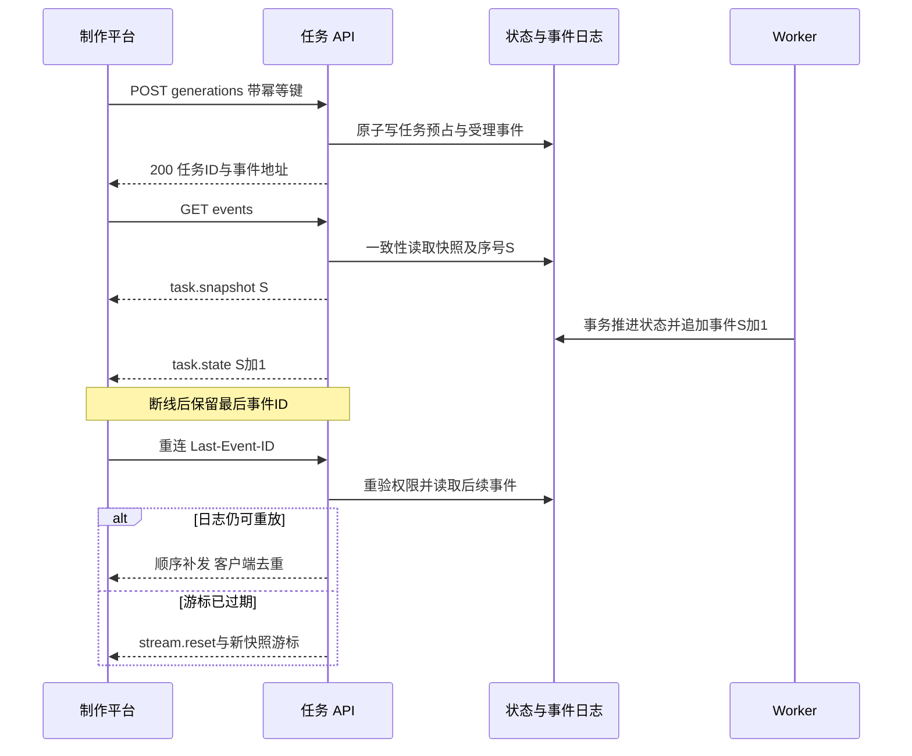
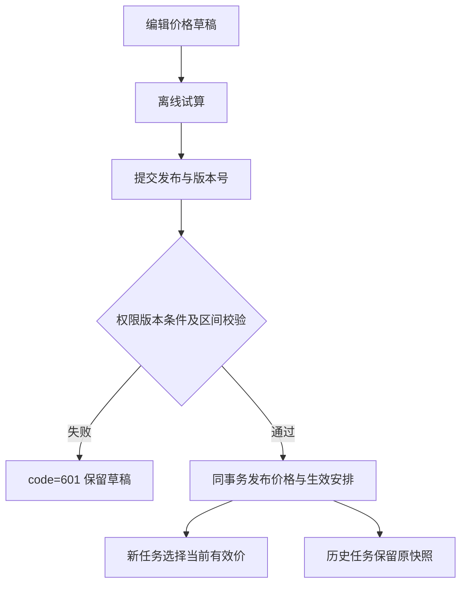

# higgsfield-ai · 平台API契约

版本：1.8 评审稿  
日期：2026 年 10 月 27 日  
文档编号：P0-4  
范围：制作平台 API、管理平台 API、文件传输与任务事件  
状态：目标契约，尚未实现或执行真实接口测试

本次修订依据已导入的本地RuoYi-FastAPI源码；工程现状、证据与复用边界见[工程基线核对与文档衔接方案](工程基线核对与文档衔接方案.md)。制作平台为 `higgsfield-frontend/`，管理平台为 `ruoyi-fastapi-frontend/vue3/web/`，共用 `ruoyi-fastapi-backend/`。本次只更新文档，未实现所述新增能力。

**项目名称与本地开发基线（已确认）：** 整体项目名称为 `higgsfield-ai`。现有工作目录 `D:\laputta\higgsfield`、制作端 `higgsfield-frontend/`、管理端 `ruoyi-fastapi-frontend/vue3/web/` 和后端 `ruoyi-fastapi-backend/` 均保持不变；本次不改仓库地址、包名、模块名或数据库实例名。本地开发使用 Docker 启动 PostgreSQL 与 Redis，后端及两个前端在宿主机分别手动启动。制作端尚待初始化，未来生成/media Worker 在本机作为独立进程手动启动；正式部署在公司内网服务器，素材与视频长期保存到公司 NAS；具体服务器、挂载及生产配置参数待确认，见[内网部署与 NAS 运维方案](内网部署与NAS存储运维方案.md)。


**若依数据库设计基线（本次确认）：** 全部新增业务数据库设计遵循本地 RuoYi-FastAPI PostgreSQL 约定：hf_ 模块表名、语义 xxx_id 自增 bigint、若依审计字段、按职责使用 del_flag（0/2）、复用 sys_dict_type/sys_dict_data、关联表自增主键与联合唯一约束、禁止物理外键、服务层事务维护逻辑关联。物理表/字段/字典映射以 [P0-3 数据库详细设计](数据库详细设计.md) 为准；平台业务 ID 传输为十进制字符串，API 基础审计时间为 createTime/updateTime。不可变历史、幂等、价格版本及权限规则仍须保留。本次只更新设计，不改基础框架或业务代码。


**统一约束与优先级：** 以[项目 AGENTS.md](../AGENTS.md)为工程约束；[文档一致性与优先级索引](文档一致性与优先级索引.md)统一文档编号、需求等级和处理规则。P0-1～P0-6 是文档编号，不是需求优先级；业务规则等级以 P0-1 的规则表为唯一来源，本文引用规则 ID 时继承其等级，不另行定级。设计完成不等于实现或验收通过。


## 1 依据与边界

本文件承接[技术架构方案](技术架构方案.md)、[首期需求与业务规则说明书 P0-1](首期需求与业务规则说明书.md)、[模型供应商接入契约 P0-2](模型供应商接入契约与差异清单.md)、[数据库详细设计 P0-3](数据库详细设计.md)。路径、DTO 与权限码是本平台的设计约定，不是对现有代码的描述。P0-1 尚未确认的产品建议仍维持评审状态；P0-6 将确认默认角色如何获得本文权限。

制作平台新增业务访问 `/api/v1`，管理平台新增业务访问 `/api/admin/v1`，二者复用统一身份校验。框架原生登录与系统管理接口保留原路径；新增业务响应、分页及异常也统一复用框架，不再采用独立信封。所有业务路径以下均省略所属前缀；表中请求/响应为业务 DTO，普通详情置于 `data`，分页字段置于顶层，通用信封见第 2 章。第三方 `/v1/chat/completions` 等接口仅存在于服务端适配器，不向浏览器透传。SSE、文件和错误响应分别定义，不能一律塞入成功信封。

本次不创建服务、ORM、数据库迁移或业务代码。第 16 章 API-DB-01～09 已同步到 P0-3《数据库详细设计》，结构和事务协议已补齐；尚未执行迁移、实现接口或完成数据库验证。

## 2 通用协议

本地开发中，API运行在宿主机后端进程，两套前端开发服务器分别代理到该进程；PostgreSQL/Redis的Docker映射端口不对浏览器作为业务API暴露。具体前端端口不写死，Cookie/Origin/CORS和代理路径随本地配置校验，业务鉴权仍采用既定Bearer协议。

### 2.1 格式与成功响应

| 项目 | 约定 |
|---|---|
| 字段风格 | JSON camelCase；数据库 snake_case 由后端映射，不直接序列化 ORM |
| ID | 所有平台业务及框架 bigint ID 均用十进制字符串，避免 JavaScript 精度丢失 |
| 金额、单价、秒数、Token | Decimal 和可能超过安全整数的 bigint 均为十进制字符串；计数/分页 pageSize/小型枚举序号为 JSON integer；不返回科学计数法金额 |
| 时间 | RFC3339 UTC 字符串，例如 `2026-10-27T08:00:00Z`；区间统一 `[from,to)`，报表明确业务时区 |
| 空值 | null 表示明确未知/无值；字段未返回表示 DTO 不适用或权限隐藏，不能当作 0；已定义的必需字段不能随意省略 |
| JSON 校验 | 请求禁止未知字段；PATCH 未提供表示不修改，提供 null 只允许清空可空字段；禁止客户端写 actorId、真实费用、归档路径、凭据版本等服务端决定字段 |
| 数组 | 必须明确上限，由接口 schema/能力决定；不允许无限批量写入。空数组为合法值时含义是清空列表 |
| 响应头 | `X-Request-Id` 由服务端生成/校验；敏感和权限相关响应 `Cache-Control: no-store`；不缓存秘密提交 |
| 普通成功 | 统一 HTTP 200、code=200、msg、success=true、time；详情放 data，无业务数据可省略 data。异步受理放 data.status/statusUrl，使用业务状态区分处理阶段 |

普通成功：

```json
{
  "data": {"id": "286341153", "name": "示例项目", "revision": "1"},
  "code": 200, "msg": "操作成功", "success": true, "time": "2026-10-27T08:00:00.000Z"
}
```

所有示例 ID 与链接均为占位，不能用于查询真实对象。示例只展示特定 DTO 的必要字段，不意味着模型能力或费用已实测。

### 2.2 通用字段简记

BusinessId 与 IdentityId 均为 PostgreSQL bigint 正整数的十进制字符串（1～9223372036854775807），拒绝 JSON number、UUID、负数、科学计数法；前端不转 Number。资源 DTO 的 id 映射 P0-3 各表语义主键，关联字段仍使用 projectId/jobId 等业务名称。基础审计时间改为 createTime/updateTime；createBy/updateBy/remark 仅按 DTO 权限需要返回，不能把全部 ORM 审计字段自动暴露给制作端。供应商 taskId/responseId、requestId、Idempotency-Key、游标均为不透明协议值，不受数据库主键类型约束。

数据库状态按 P0-3 §17.2 的若依字典编码持久化；平台 DTO 保留本文英文状态与 boolean，由服务层双向映射。逻辑删除只能通过已授权动作将 del_flag 从0改为2，不开放任意 PATCH delFlag。业务 revision 保留，审计时间不能替代乐观锁。


本文字段表中的 `?` 表示可选，`\|null` 表示允许 null；未带 `?` 为必填。`BusinessId`、`IdentityId`、`DateTime`、`Decimal`、`BigIntString` 均按上表字符串格式。`revision` 为 BigIntString 正整数。对象 DTO 的 id、createTime、revision 是否存在由各资源定义，不为不可变对象伪造可编辑 revision。

| 名称 | 结构 |
|---|---|
| ResourceRef | `{id:BusinessId}` |
| RevisionAction | `{revision:BigIntString, reason?:string}`；危险操作 reason 必填 |
| AsyncReceipt | `{id:BusinessId, resourceType:enum, status:enum, statusUrl:string, eventsUrl?:string}`；id 是业务任务/操作 ID，不是供应商任务 ID |
| Money | `{amount:Decimal\|null, currency:string, state:estimated/pending/calculated/confirmed/disputed}` |
| FieldIssue | `{path:string, code:string, message:string}`；path 采用 `/references/0/assetVersionId` 形式 |
| Page&lt;T&gt; | 顶层 `{rows:T[],pageNum:int,pageSize:int,total:int,hasNext:boolean,code:int,msg:string,success:boolean,time:DateTime}`，复用 PageResponseModel |
| ActionSet | `allowedActions:string[]`，仅作 UI 提示；每次执行重新鉴权 |

### 2.3 分页、筛选与排序

列表统一使用 pageNum/pageSize（默认 1/20，目标业务上限100），通过 PageUtil 与 PageModel/PageResponseModel 返回顶层 rows/pageNum/pageSize/total/hasNext，以及 code/msg/success/time，不再返回 data.items 或 nextCursor。过滤与权限先进入查询，再计数和分页，total 不可泄露越权数量。

默认按 createTime 降序及业务主键同向次排序；排序字段必须白名单映射到 ORM，不拼客户端 SQL。修改筛选返回第一页。并发增删可能造成页码结果变化，客户端按 ID 去重并允许刷新；不承诺事务快照翻页。筛选字段仅按各端点声明开放。目录子节点也采用页码分页，不一次返回全树。

```json
{
  "code": 200,
  "msg": "查询成功",
  "rows": [{"id": "286341153", "name": "示例项目", "status": "active", "revision": "1"}],
  "pageNum": 1,
  "pageSize": 20,
  "total": 1,
  "hasNext": false,
  "success": true,
  "time": "2026-10-27T08:00:00.000Z"
}
```

### 2.4 框架响应执行规则

普通业务请求使用 ResponseUtil：成功 code=200；ServiceWarning/模型业务校验 code=601；AuthException code=401；PermissionException code=403；ServiceException/未知异常 code=500，以上当前均为 HTTP 200。客户端先解码框架响应，再按 code/success 分支，不能把 HTTP 200 一概视为成功。业务错误细分放 data.errorCode，格式见第12章；requestId 放追踪响应头，不额外创建顶层信封。

框架 HTTPException、FastAPI 原生请求校验、OAuth/OIDC、文件 Range 和流式响应保持各自现有处理路径，不能强制套用普通 JSON 成功信封。SSE 打开前如果返回 JSON，先处理业务认证/权限码，不将其按事件流读取。详细复用入口见[后端编码与框架对齐规范](后端编码与框架对齐规范.md)。

## 3 身份、权限、并发与幂等

### 3.1 身份边界

本地框架实际使用 `Authorization: Bearer <平台登录JWT>`，并经Redis会话及用户状态校验；首期新增业务接口复用这一身份链，不采用原稿假设的HttpOnly Cookie鉴权。管理端Admin-Token是js-cookie写入的JS可读Cookie，实际HTTP调用仍靠Authorization头。制作端采用独立身份客户端，默认内存持有token，不依赖读取Admin-Token实现跨端SSO。

已核实框架原生登录为 POST /login（form-urlencoded：username/password/code/uuid）、GET /captchaImage、GET /getInfo、GET /getRouters、POST /logout，保持原响应协议；框架开发代理前缀不是这些后端实际路由的一部分。/api/v1/me为新增归一用户视图，sessionExpiresAt需适配有效会话期限，不能自行承诺刷新令牌接口。CSRF字段仅适用于未来显式启用的Cookie鉴权通道，当前Bearer业务写入不要求不存在的CSRF token。

同一用户能否同时保持两个前端会话取决于框架同账号多终端配置，需验证；OIDC源码已存在但不默认启用，不假定其access token与/login JWT可互换。

`Me={user:{id:IdentityId,displayName:string,departmentId:IdentityId\|null},permissions:string[],csrfToken?:string,sessionExpiresAt:DateTime}`。仅返回当前授权，无密码、第三方 Key 或内部密文。凭据秘密输入永不通过任何 GET 读取；不存在 secret 查询端点。

授权公式为功能权限∩项目成员/管理数据范围∩对象使用范围∩当前状态。请求中的 projectId 只是目标，不能决定调用者身份。猜测无权访问对象的 ID 统一返回 code=601 / RESOURCE_NOT_FOUND，避免泄露存在性；对已可见对象但缺少某项动作返回 code=403 / PERMISSION_DENIED。费用无权查看时 billing 字段省略，并返回 `billingVisibility:"hidden"`，不能显示为 0。

### 3.2 乐观锁

可变资源的 PATCH/PUT 与状态动作携带 body.revision，值来自最新 GET；不以客户端 updateTime 判定冲突。后端原子比较 revision 并加 1，不匹配返回 code=601 / REVISION_CONFLICT，可返回当前 revision 和资源刷新 URL，不返回越权内容。没有 revision 字段的不可变对象不可 PATCH。删除可变对象使用 query `revision`（DELETE 不依赖请求体），业务状态动作优先 POST。

### 3.3 写请求幂等

所有创建、消费、发布、导入确认、取消、归档重试等 POST，以及文件完成确认，要求 `Idempotency-Key`（建议随机 UUID，16–128 可打印 ASCII）。只读的 validate/simulate/search 不要求。hf_api_idempotency_record 保存脱敏原结果及资源定位；秘密写入只保存服务端受控 HMAC 请求摘要，不保存密钥正文。PUT/PATCH/DELETE 也支持并建议携带，因 revision 检查不能单独解决“写成功但响应丢失”。

作用域为调用主体＋API 前缀＋方法＋规范路径＋键；请求摘要包含规范 JSON、目标与 revision，不包含 Authorization、CSRF、Cookie、追踪头。相同键同摘要完成后返回原业务结果及原状态码，响应头 `Idempotent-Replayed:true`；处理中返回 code=601 / IDEMPOTENCY_IN_PROGRESS 与 Retry-After；同键不同摘要返回 code=601 / IDEMPOTENCY_KEY_REUSED。每次重放前仍须鉴权，不能用缓存响应泄露已撤权数据。

通用缓存建议至少 24 小时，具体保留期配置并文档化；生成、预算、发布及计费操作还必须使用长期业务唯一约束，不能在缓存到期后重复扣费。公共发布等无独立业务键的动作保留最小通用幂等记录及脱敏结果，不按普通 TTL 清除。POST /generations 将原键与规范请求作用域的组合摘要传入任务唯一约束，不能仅靠 Redis 去重。未确认客户端超时结果时继续用原键查询/重传，不生成新键假装重试。创建新一次生成必须显式新键，并显示新消费。

### 3.4 原生接口与新增业务接口分界

框架原生系统管理优先使用已有/system/user、/system/role、/system/dept等控制器和对应前端API模块，保持code/msg/data或rows/total、pageNum/pageSize协议。第9章列出的/users、/departments、/roles、用户roles写入是可选统一门面目标，首期不重复实现，不能称为当前已存在接口；项目治理和AI管理接口仍按本文新增。

新增业务复用框架 ResponseUtil、异常处理、页码分页和业务 code 拦截；DTO 的 Decimal/ID 字符串、幂等和 SSE 由业务模块适配。新路由同样进入框架中间件及 transport crypto 配置链，不另定义错误信封。

框架 `*:*:*` 和admin部门数据范围不能跳过项目/对象策略；新增业务必须在复用身份后继续执行授权。短时间前端防重复提交不替代后端Idempotency-Key。

## 4 制作平台资源 DTO

以下字段表定义接口复用结构，减少各端点重复；所有对象还可含 allowedActions。只读字段不能原样回传到写接口。

| DTO | 字段与语义 |
|---|---|
| Project | id,name,status(active/paused/archived/pending_delete),revision,createTime,currentUserRole:string；可选 archivedAt |
| Member | userId,displayName,roleId:BusinessId,status(active/removed),revision,joinedAt；不含登录秘密 |
| Brief | projectId,body:RichText,revision,updateTime |
| Folder | id,projectId,parentId:BusinessId\|null,name,orderNum:int,revision,hasChildren:boolean,visibleEntryCount?:BigIntString；计数含子孙目录，与 P0-1 一致 |
| Asset | id,spaceId,name,mediaType,currentVersion:AssetVersion\|null,revision,createTime |
| AssetVersion | id,assetId,versionNo:int,file:{mimeType,byteSize:BigIntString,width?:int,height?:int,seconds?:Decimal},sourceOutputId?:BusinessId；不返回 storageKey |
| Element | id,spaceId,name,alias,category,currentRevisionId:BusinessId\|null,workStatus,revision,createTime |
| ElementRevision | id,elementId,revisionNo:int,description,propertyValues:PropertyValue[],media:{assetVersionId:BusinessId,ordinal:int,isPrimary:boolean}[],label?:string |
| PropertyValue | definitionId:BusinessId,definitionVersion:int,value:string\|null；single_select 值必须来自合法选项 |
| Reference | referenceKey:BusinessId,assetVersionId:BusinessId,elementRevisionId?:BusinessId,mediaRole:string,ordinal:int；不得提交供应商 asset:// 或任意外部 URL |
| Draft | id,projectId,kind,body:DraftBody,references:Reference[],revision,updateTime |
| LibraryItem | id,kind(asset/output/task_placeholder),name,createTime,folderId:BusinessId\|null；按 kind 恰一返回 asset/output/task 摘要，失败任务不冒充文件 |
| Output | id,jobId,ordinal:int,kind,revision,workStatus:none/working/review/approved/rejected,archiveState,file?:AssetVersion.file,text?:string,actualMetadata:object,allowedActions；有权且归档后返回 previewUrl/downloadUrl |
| Thread | id,target:{assetVersionId:BusinessId}或{outputId:BusinessId},resolvedAt:DateTime\|null,createTime |
| Comment | id,threadId,parentId:BusinessId\|null,author:{id,displayName},body,revision,createTime,videoTime?:Decimal,annotations:Annotation[] |
| Annotation | shape(point/rect/path),geometry:object,color:string,sourceWidth:int,sourceHeight:int；坐标归一到 0..1，按形状校验 |

RichText 使用版本化白名单文档：`{schemaVersion:1,type:"doc",content:Node[]}`，首期段落、文本、基本加粗/斜体、受控链接和元素 Mention；不接受任意 HTML、script、iframe。DraftBody=`{schemaVersion:1,prompt:RichText,modelVersionId?:BusinessId,parameters:object}`；参数仅允许已发布能力 schema 中的键。Mention 保存 referenceKey，文件引用以 Reference 列表为事实源。

## 5 制作平台：项目、成员与个人视图

表中列表响应均为 Page&lt;指定 DTO&gt;；GET 详情 200，创建默认 200，修改默认 200，删除默认 200；另有标注时以标注为准。权限码是功能门槛建议值，项目范围另行检查。

| 方法与路径 | 请求（路径参数之外） | 响应 | 权限/约束 |
|---|---|---|---|
| GET /me | 无 | Me | 已登录 |
| GET /projects | pageNum,pageSize,q?,status?,hidden?,pinned?,sort? | Page&lt;Project&gt; | project:read，当前成员可见 |
| POST /projects | `{name:string}` | Project | project:create；自动创建项目空间和首位负责人 |
| GET /projects/{id} | 无 | Project | project:read |
| PATCH /projects/{id} | `{revision,name?:string}` | Project | project:manage |
| POST /projects/{id}/archive | RevisionAction，reason必填 | Project | project:archive；在途任务保留 |
| POST /projects/{id}/restore | RevisionAction | Project | project:archive；不重放历史生成 |
| POST /projects/{id}/pause | RevisionAction，reason必填 | Project | project:manage |
| POST /projects/{id}/resume | RevisionAction | Project | project:manage |
| GET /projects/{id}/members | pageNum,pageSize,status? | Page&lt;Member&gt; | member:read |
| POST /projects/{id}/members | `{userId:IdentityId,roleId:BusinessId}` | Member | member:manage；只能授予自己可授予角色 |
| PATCH /projects/{id}/members/{userId} | `{revision,roleId:BusinessId}` | Member | member:manage；最后负责人保护 |
| DELETE /projects/{id}/members/{userId} | revision | 200 ResponseBaseModel | member:manage；保留成员历史身份 |
| GET /projects/{id}/roles | 无 | `{items:{id,code,name,permissions:string[]}[]}` | member:read；不默认开放角色编辑器 |
| GET /projects/{id}/brief | 无 | Brief | project:read |
| PUT /projects/{id}/brief | `{revision,body:RichText}` | Brief | project:edit |
| POST /projects/{id}/join-requests | `{reason?:string}` | `{id,status:"pending",createTime}` | project:join；仅对管理员允许申请的可发现项目 |
| GET /projects/{id}/join-requests | pageNum,pageSize,status? | Page&lt;JoinRequest&gt; | member:manage |
| POST /join-requests/{id}/review | `{revision,decision:"approved"或"rejected",roleId?:BusinessId,reason?:string}` | JoinRequest | member:manage；批准时roleId必填 |
| GET /project-collections | pageNum,pageSize | Page&lt;Collection&gt; | 已登录，仅本人 |
| POST /project-collections | `{name:string,orderNum?:int}` | Collection | 已登录 |
| PATCH /project-collections/{id} | `{revision,name?:string,orderNum?:int}` | Collection | 仅本人 |
| DELETE /project-collections/{id} | revision | 200 ResponseBaseModel | 仅本人；解除分组不删项目 |
| PUT /projects/{id}/preferences | `{revision,isPinned?:bool,isHidden?:bool,collectionId?:BusinessId\|null,orderNum?:int}` | Preference | 本人且项目可见；初始revision="0"表示尚无记录 |
| GET /projects/{id}/preferences | 无 | Preference | 仅本人 |
| GET /view-preferences/{viewKey} | projectId? | ViewPreference | 仅本人 |
| PUT /view-preferences/{viewKey} | `{projectId?:BusinessId,revision,settings:object}` | ViewPreference | 白名单布局/筛选，首建revision="0" |

JoinRequest={id,projectId,userId,status,reason,revision,createTime,reviewedAt?:DateTime}；Collection={id,name,orderNum,revision}；Preference={projectId,isPinned,isHidden,collectionId:BusinessId\|null,orderNum,revision}；ViewPreference={viewKey,projectId:BusinessId\|null,settings,revision}。这些 revision 已在 P0-3 落入字段设计，对照见第16章。首期不提供匿名项目目录，申请资格如何授予由 P0-6 确认；未配置可发现策略时仅管理员邀请/添加成员，申请入口关闭。

## 6 制作平台：上传、素材、目录与公共引用

### 6.1 上传会话与分片协议

文件首先上传本平台，浏览器不直连供应商。该协议为目标设计，实际文件大小上限由管理员媒体策略决定，不能直接把供应商 20MB/500MB 当作所有平台文件上限。

| 方法与路径 | 请求 | 响应 | 权限 |
|---|---|---|---|
| POST /uploads | `{projectId:BusinessId,fileName:string,byteSize:BigIntString,mimeType:string,sha256?:string}` | 200 UploadSession | asset:upload + 项目写权限 |
| GET /uploads/{id} | 无 | UploadSession | 会话所有者且仍有项目权限 |
| PUT /uploads/{id}/parts/{partNo} | 二进制流；Content-Type:application/octet-stream；Content-Range、X-Content-SHA256 | 200 `{partNo:int,byteSize:BigIntString,sha256:string}` | 同上 |
| POST /uploads/{id}/complete | `{sha256:string}` | 200 UploadSession | 同上；幂等完成，完成不自动生成素材 |
| DELETE /uploads/{id} | 无正文 | 200 ResponseBaseModel | 同上；取消暂存，不能删除已被正式引用文件 |
| POST /assets | `{projectId:BusinessId,uploadId:BusinessId,name:string,folderId?:BusinessId\|null}` | 200 Asset | asset:create；仅使用已验证完成上传 |
| POST /assets/{id}/versions | `{revision,uploadId:BusinessId}` | 200 AssetVersion | asset:edit；新版本不可覆盖旧文件 |

UploadSession={id,projectId,state:created/uploading/verifying/ready/failed/cancelled/expired,byteSize,partSize:BigIntString,partCount:int,receivedParts:int[],expiresAt,validationErrors:FieldIssue[]}。完成校验可能异步：返回 200 AsyncReceipt（resourceType=upload,statusUrl=/api/v1/uploads/{id}），客户端 GET 到 ready；已验证完成则200。前端不能把字节上传完成当作素材可生成。

partNo 从1开始，Content-Range 必须对应服务端 partSize 的预期连续区间，最后一片除外，声明总大小必须与会话一致；建议分片32MiB，最终值由响应给出。单片同编号同哈希重复 PUT 返回原结果，不同内容返回code=601业务冲突 UPLOAD_PART_CONFLICT；服务端自行计算哈希，不只信任客户端头。complete 检查所有片、整文件摘要、实际 MIME、大小与媒体安全策略。读取进度后可断点续传，过期会话410 UPLOAD_EXPIRED，新会话不冒充旧素材身份。

临时文件只在所有者授权范围内可见；complete/创建素材/新增版本不能引用其他用户或其他项目的上传会话。上传会话通过 hf_upload_binding 唯一绑定一个正式目标；素材上传目标为一个资产版本，元素模板上传也沿用此项目入口、目标为一个 hf_import_job；管理文档目标为 hf_price_source 或 hf_reconciliation_batch，不能跨用途消费。素材上传重复绑定返回原版本或冲突，不悄悄生成多个独立版本。NAS不可用返回code=601 STORAGE_UNAVAILABLE，保留会话可恢复状态。

### 6.2 目录、素材库与引用

| 方法与路径 | 请求 | 响应 | 权限/约束 |
|---|---|---|---|
| GET /projects/{id}/folders | parentId?:BusinessId\|null,pageNum,pageSize,q? | Page&lt;Folder&gt; | asset:read；parentId缺省顶层 |
| POST /projects/{id}/folders | `{parentId?:BusinessId\|null,name:string}` | Folder | folder:write |
| PATCH /folders/{id} | `{revision,name?:string,orderNum?:int}` | Folder | folder:write |
| POST /folders/{id}/move | `{revision,parentId:BusinessId\|null}` | Folder | folder:write；同空间、无环 |
| DELETE /folders/{id} | revision,mode=moveEntriesToParent | 200 ResponseBaseModel | folder:write；非空目录移动内容，不递归删文件 |
| GET /projects/{id}/library | pageNum,pageSize,folderId?,includeDescendants?:bool,kind?,q?,modelId?,from?,to?,showFailed?:bool | Page&lt;LibraryItem&gt; | asset:read；目标类型明确 |
| GET /assets/{id} | 无 | Asset | asset:read |
| PATCH /assets/{id} | `{revision,name?:string}` | Asset | asset:edit |
| GET /assets/{id}/versions | pageNum,pageSize | Page&lt;AssetVersion&gt; | asset:read |
| DELETE /assets/{id} | revision | 200 ResponseBaseModel | asset:remove；逻辑移除 |
| POST /assets/{id}/restore | RevisionAction | Asset | asset:remove |
| POST /projects/{id}/library/move | `{entryId:BusinessId,revision,folderId:BusinessId\|null}` | `{entryId,folderId,revision}` | folder:write；不改变原素材归属 |
| GET /asset-versions/{id}/preview | Range? | 200/206 文件 | asset:read；精确版本 |
| GET /asset-versions/{id}/download | Range? | 200/206 文件 | asset:download |
| GET /references/search | projectId必填,q?,kind?:asset/element,pageNum,pageSize | Page&lt;ReferenceCandidate&gt; | generation:create + 引用访问权 |
| GET /public-library | projectId必填,pageNum,pageSize,q?,kind? | Page&lt;LibraryItem&gt; | public:read；仅返回授权空间 |
| POST /projects/{id}/asset-references | `{assetId:BusinessId}` | `{id,projectId,assetId,allowedActions}` | asset:reference；来源授权与目标写权限 |
| DELETE /projects/{id}/asset-references/{refId} | 无正文 | 200 ResponseBaseModel | asset:reference；撤销当前引用，历史任务不删除 |
| POST /assets/{id}/publish-public | `{revision,targetSpaceId:BusinessId,reason:string}` | 200 Asset | public:publish；创建受控公共身份，不把原空间直接改成公共 |

ReferenceCandidate={kind:asset/element,id,displayName,projectId:BusinessId\|null,assetVersionIds:BusinessId[],elementRevisionId?:BusinessId,thumbnailUrl?:string,allowedMediaRoles:string[]}。元素候选可返回主图及可选多图，实际选择后提交精确 Reference；搜索结果不等于永久使用权，正式提交重新验证。

### 6.3 文件响应

Bearer模式下浏览器下载通过带Authorization的fetch；视频Range须用能附加鉴权头的媒体加载层。不能把受保护URL直接设置为video src并假定自动携带Bearer，也不能在URL拼token。此加载层须纳入真实浏览器验收，文件与SSE不应被普通JSON传输加密包装破坏。


返回受控文件字节，Content-Type 为真实类型；download 带安全编码 Content-Disposition，preview 默认 inline。有效 Range 返回206和 Content-Range，超界416；支持 HEAD 返回同样鉴权后的元数据。没有归档文件返回code=601业务冲突 OUTPUT_NOT_READY，不回退到泄露供应商签名 URL。全局默认 no-store；若后续允许缓存须明确按用户隔离与撤权策略。

## 7 制作平台：元素、草稿与协作

| 方法与路径 | 请求 | 响应 | 权限/约束 |
|---|---|---|---|
| GET /elements | projectId?,scope=project/mine,pageNum,pageSize,q?,category?,workStatus? | Page&lt;Element&gt; | element:read；mine 仍过滤项目权 |
| POST /elements | `{projectId:BusinessId,name,alias,category,description?:string,propertyValues?:PropertyValue[],media?:ElementRevision.media}` | 200 `{element:Element,currentRevision:ElementRevision}` | element:create；无图可存，引用生成另检 |
| GET /elements/{id} | 无 | `{element,currentRevision}` | element:read |
| PATCH /elements/{id} | `{revision,name?:string,alias?:string,category?:string}` | Element | element:edit；不在此覆盖生成修订 |
| POST /elements/{id}/revisions | `{revision,description:string,propertyValues:PropertyValue[],media:ElementRevision.media}` | 200 ElementRevision | element:edit；revision为元素身份的并发版本 |
| GET /elements/{id}/revisions | pageNum,pageSize | Page&lt;ElementRevision&gt; | element:read |
| PATCH /element-revisions/{id}/label | `{revision,label:string}` | `{elementRevisionId,label,revision}` | element:edit；不变更内部修订 |
| POST /elements/{id}/copy | `{targetProjectId:BusinessId,sourceRevisionId:BusinessId,name?:string,alias:string}` | 200 Element | element:copy；来源读取/媒体使用与目标创建均允许 |
| DELETE /elements/{id} | revision | 200 ResponseBaseModel | element:remove；历史引用保留 |
| POST /elements/{id}/restore | RevisionAction | Element | element:remove |
| GET /projects/{id}/property-definitions | pageNum,pageSize | Page&lt;PropertyDefinition&gt; | element:read |
| POST /projects/{id}/property-definitions | `{propertyKey,name,valueType:text/single_select,options?:string[]}` | PropertyDefinition | element:configure |
| POST /property-definitions/{id}/versions | `{name,valueType,options?:string[]}` | PropertyDefinition | element:configure；旧定义不变 |
| POST /favorites | `{target:{elementId:BusinessId}或{assetId:BusinessId}或{outputId:BusinessId}}` | `{id,target}` | 当前对象可读 |
| GET /favorites | kind?,pageNum,pageSize | Page&lt;Favorite&gt; | 仅本人，重新过滤授权 |
| DELETE /favorites/{id} | 无正文 | 200 ResponseBaseModel | 仅本人 |
| POST /drafts | `{projectId:BusinessId,kind,body:DraftBody,references:Reference[]}` | Draft | generation:create |
| GET /drafts/{id} | 无 | Draft | 所有者，当前项目可读 |
| PUT /drafts/{id} | `{revision,body:DraftBody,references:Reference[]}` | Draft | 所有者 + 项目可写 |
| POST /comment-threads | `{target:Thread.target}` | Thread | comment:create + 目标可读 |
| GET /comment-threads | assetVersionId或outputId恰一,pageNum,pageSize | Page&lt;Thread&gt; | comment:read |
| GET /comment-threads/{id}/comments | pageNum,pageSize | Page&lt;Comment&gt; | comment:read |
| POST /comment-threads/{id}/comments | `{body:string,parentId?:BusinessId,videoTime?:Decimal,annotations?:Annotation[]}` | Comment | comment:create；父评论必须同线程 |
| PATCH /comments/{id} | `{revision,body:string,annotations?:Annotation[]}` | Comment | comment:edit:own 或 comment:moderate |
| DELETE /comments/{id} | revision | 200 ResponseBaseModel | 作者或治理权限，写审计 |
| POST /review-events | `{target:{elementId:BusinessId}或{outputId:BusinessId},expectedStatus:string,toStatus:string,reason?:string}` | `{id,target,fromStatus,toStatus,createTime}` | content:review；状态CAS，不等于公共发布 |
| POST /imports/elements | `{projectId:BusinessId,uploadId:BusinessId,templateVersion:int}` | 200 AsyncReceipt | element:import；只做预检 |
| GET /imports/elements/{id} | 无 | `{id,status,summary:{total:int,valid:int,invalid:int},errors:FieldIssue[],revision}` | 操作者或项目治理 |
| POST /imports/elements/{id}/confirm | `{revision}` | 200 AsyncReceipt | element:import；重新校验授权 |

PropertyDefinition={id,propertyKey,versionNo,name,valueType,options}；Favorite={id,target,createTime}。批量导入行错误应可分页：`GET /imports/elements/{id}/rows?pageNum&pageSize&state` 返回 Page&lt;{rowNo,state,elementId?:BusinessId,error?:FieldIssue}&gt;；不能将任意大错误数组塞入一次响应，summary.errors仅最多100个摘要。详细模板与逐行/整批回滚策略仍由 P0-1 D10 冻结。

## 8 制作平台：模型能力、生成与会话

### 8.1 可用能力与受理

| 方法与路径 | 请求 | 响应 | 权限 |
|---|---|---|---|
| GET /model-profiles | projectId必填,kind?,pageNum,pageSize | Page&lt;ModelCapability&gt; | generation:create |
| POST /generations/validate | GenerationInput | 200 ValidationResult | generation:create；不产生预占或真实调用 |
| POST /generations | GenerationInput + 必需 Idempotency-Key | 200 GenerationAccepted | generation:create；事务固定价格/Key/预算 |
| GET /generations | projectId?,scope=project/mine,kind?,state?,from?,to?,pageNum,pageSize | Page&lt;TaskSummary&gt; | generation:read；mine不越权 |
| GET /generations/{id} | 无 | TaskSnapshot | generation:read |
| GET /generations/{id}/events | Last-Event-ID? | text/event-stream | generation:read，见第14章 |
| POST /generations/{id}/cancel | `{revision,reason?:string}` | `{jobId,accepted:boolean,mode:local/upstream/unsupported,cancellationState:requested/confirmed/rejected/unsupported,task:TaskSnapshot}` | generation:cancel；均使用框架200成功信封，通过accepted和cancellationState区分 |
| POST /generations/{id}/retry-archive | `{revision,outputIds?:BusinessId[]}` | 200 GenerationAccepted | output:archive；只重试指定失败输出 |
| GET /outputs/{id} | 无 | Output | asset:read |
| GET /outputs/{id}/preview 或 /download | Range? | 文件 | asset:read / asset:download |
| POST /outputs/{id}/to-asset | `{projectId:BusinessId,folderId?:BusinessId\|null,name:string}` | 200 Asset | asset:create + 来源使用权 |

ModelCapability={id,versionId,displayName,kind,parametersSchema:object,referenceRules:object,defaultParameters:object,availableVariants:{id,dimensions}[],availability:{available:boolean,reasonCode?:string}}。仅返回已授权发布组合，无 Key、账号内部标识或采购报价；参数 schema 是字段白名单（类型、枚举、范围、组合约束），schema 不允许任意表达式执行。

GenerationInput 必填 `projectId:BusinessId,kind:image/video,modelVersionId:BusinessId,prompt:RichText,parameters:object,references:Reference[]`；可选 `draftId:BusinessId,draftRevision:BigIntString,sourceJobId:BusinessId,estimateToken:string`。有 draftId 时必须有 draftRevision，提交参数仍在服务端与草稿修订核对。modelVariantId 由服务端按参数唯一匹配，不由客户端挑便宜规格；createdBy、credentialVersionId、priceVersionId、amount 均拒绝输入。文本通过会话接口提交，统一进入任务系统。

ValidationResult={valid:boolean,issues:FieldIssue[],normalizedParameters:object,estimate?:Money,estimateVisibility:visible/hidden,estimateToken?:string,expiresAt?:DateTime,priceVersionId?:BusinessId}。原生请求格式错误沿用框架校验处理；语法正确但业务未就绪返回200 valid=false。无费用查看权限时省略金额/价格ID，只告知可否提交。估价是暂定，不预占；estimateToken绑定项目、请求摘要和价格，提交时若价格已变返回code=601业务冲突 PRICE_CHANGED，要求刷新确认；未提供token时按受理当刻价格，UI须说明最终以受理为准。

GenerationAccepted={id,resourceType:"generation",status:"accepted",statusUrl,eventsUrl,revision:BigIntString}。框架成功受理回执仅在任务、预占和Outbox持久提交后返回；不代表供应商受理或成功。

```json
{
  "projectId": "286341153",
  "kind": "image",
  "modelVersionId": "572672306",
  "prompt": {"schemaVersion": 1, "type": "doc", "content": [{"type": "paragraph", "content": [{"type": "text", "text": "清晨摄影棚"}]}]},
  "parameters": {"n": 1, "size": "1024x1024", "quality": "high", "outputFormat": "png"},
  "references": []
}
```

本平台参数示例使用 camelCase，适配器映射为供应商 output_format 等字段；前端不得直接提交 P0-2 中任意供应商参数。参数命名由已发布能力 schema 锁定。

### 8.2 任务快照

TaskSummary 为 TaskSnapshot 的列表投影：id,projectId,kind,createTime,revision,orchestrationState,upstreamState,archiveSummary,billingState,allowedActions。

TaskSnapshot 完整字段：id、projectId、kind、createTime、updateTime、revision、model:{id,versionId,displayName}、orchestrationState、upstreamState、archiveSummary:{total:int,ready:int,failed:int,pending:int}、billingState、usageState、outputs:Output[]、allowedActions、eventCursor:string、billingVisibility、billing?:{platform:Money,usage:object}、failure?:{code,message,recoveryActions:string[]}、cancelState:none/requested/confirmed/rejected/unsupported。原始输入另通过已授权 `GET /generations/{id}/input` 返回 `{prompt,parameters,references,modelVersionId,createTime}`，不包含供应商秘密与原始签名地址。

状态值沿用 P0-3：orchestrationState 为 accepted/preparing/submitting/submission_unknown/running/finished/blocked；upstreamState 为 not_submitted/queued/running/succeeded/failed/cancelled/unknown；usageState 为 available/partial/unknown。archiveSummary 根据独立输出状态计算。编排 finished 不代表账单确认或全部归档；不能在 finished 时自动停止所有事件处理。

重复生成采用 GET input→编辑/确认→POST generations 新键，不提供会自动复用旧 Key 的 `/retry-generation`。unsupported 取消返回明确能力结果，不清除费用；请求取消和上游确认取消是两个状态。

### 8.3 会话接口

| 方法与路径 | 请求 | 响应 | 权限 |
|---|---|---|---|
| GET /chat/sessions | projectId必填,pageNum,pageSize | Page&lt;ChatSession&gt; | chat:read |
| POST /chat/sessions | `{projectId:BusinessId,title:string}` | ChatSession | chat:create |
| PATCH /chat/sessions/{id} | `{revision,title?:string}` | ChatSession | 会话所有者或治理权限 |
| POST /chat/sessions/{id}/archive | RevisionAction | ChatSession | 同上，历史费用保留 |
| GET /chat/sessions/{id}/messages | pageNum,pageSize | Page&lt;ChatMessage&gt;，sequenceNo升序 | chat:read |
| POST /chat/sessions/{id}/messages | `{sessionRevision:BigIntString,modelVersionId:BusinessId,content:RichText,references:Reference[],parameters:object,sourceMessageId?:BusinessId}` | 200 `{userMessageId:BusinessId,assistantMessageId:BusinessId,generation:GenerationAccepted,sessionRevision}` | chat:create；必需幂等键 |

ChatSession={id,projectId,title,revision,archivedAt:DateTime\|null,createTime}；ChatMessage={id,sequenceNo:BigIntString,role:user/assistant/system,content:string,state:draft/streaming/completed/interrupted,jobId:BusinessId\|null,revision,createTime}。客户端不能自行提交 assistant/system 角色或伪造历史消息，服务端在受理事务内锁会话，从已完成消息及本次问题构建固定历史输入，保存 hf_job_chat_context_message、hf_job_reference 和 input_snapshot；执行时不重新读取最新历史。同会话已有未终结生成时返回code=601业务冲突 CHAT_SESSION_BUSY，防止上下文包含未完成回答；流式消息更新同步推进会话 revision。sessionRevision 防止并发多端将不同历史静默合并；修改旧问题通过新请求形成新任务，不覆盖原费用。

同一套任务 SSE 承载回答增量；上游流式未验证时只发送等待状态和最终消息，不假装逐字流。浏览器断开不取消服务端调用。

## 9 管理平台：组织治理与供应商凭据

新增管理业务列表使用通用 Page；原生系统管理仍用框架页码与rows/total。DTO 必须是管理专用白名单，不将数据库密文直接返回。全局组织身份的物理映射依赖基础框架，以下是本平台管理门面契约，不能据此宣称 RuoYi 原接口名称相同。

| 方法与路径 | 请求 | 响应 | 权限 |
|---|---|---|---|
| GET /users | q?,departmentId?,status?,pageNum,pageSize | Page&lt;AdminUser&gt; | identity:read |
| PATCH /users/{id} | `{revision,displayName?:string,departmentId?:IdentityId\|null,status?:active/disabled}` | AdminUser | identity:write；停用撤销会话 |
| GET /departments | parentId?,pageNum,pageSize | Page&lt;{id:IdentityId,parentId:IdentityId\|null,name,status}&gt; | identity:read |
| GET /roles | pageNum,pageSize | Page&lt;{id:IdentityId,code,name,permissionCodes:string[]}&gt; | role:read |
| PUT /users/{id}/roles | `{revision,roleIds:IdentityId[],reason:string}` | AdminUser | role:assign；不得越权授予 |
| GET /projects | q?,status?,pageNum,pageSize | Page&lt;Project&gt; | project:govern；不因此返回素材正文 |
| POST /projects/{id}/governance | `{revision,action:pause/resume/archive/restore,reason:string}` | Project | project:govern；审计 |
| GET /provider-connections | environment?,status?,pageNum,pageSize | Page&lt;Connection&gt; | provider:read |
| POST /provider-connections | `{name,environment:test/production,baseUrl:string,adapterVersion:string,config:object}` | Connection | provider:write |
| GET /provider-connections/{id} | 无 | Connection | provider:read |
| PATCH /provider-connections/{id} | `{revision,name?:string,baseUrl?:string,adapterVersion?:string,config?:object}` | Connection | provider:write；连接改变创建配置版本，旧测试失效 |
| GET /cost-centers | pageNum,pageSize | Page&lt;{id,code,name,active}&gt; | credential:test 或 billing:read，只返回可用管理成本中心 |
| GET /provider-accounts | connectionId?,region?,pageNum,pageSize | Page&lt;ProviderAccount&gt; | provider:read |
| POST /provider-accounts | `{connectionId:BusinessId,accountCode,region,upstreamProject}` | ProviderAccount | provider:write |
| GET /credentials | accountId?,status?,pageNum,pageSize | Page&lt;Credential&gt; | credential:read |
| POST /credentials | `{accountId:BusinessId,name,ownerId:IdentityId,connectionVersionId:BusinessId,apiKey:string,validFrom:DateTime,validUntil?:DateTime\|null}` | 200 Credential | credential:write；秘密仅写入 |
| GET /credentials/{id} | 无 | Credential | credential:read |
| POST /credentials/{id}/versions | `{revision,connectionVersionId:BusinessId,apiKey:string,validFrom,validUntil?:DateTime\|null}` | CredentialVersion | credential:rotate |
| GET /credentials/{id}/versions | pageNum,pageSize | Page&lt;CredentialVersion&gt; | credential:read |
| POST /credential-versions/{id}/tests | `{modelVersionId?:BusinessId,costCenterId:BusinessId,acknowledgePotentialCharge:boolean}` | 200 AsyncReceipt | credential:test；必须确认可能收费 |
| GET /credential-tests/{id} | 无 | CredentialTest | credential:read |
| POST /credential-versions/{id}/activate | `{revision,testId:BusinessId,expectedConfigHash:string,reason:string}` | CredentialVersion | credential:activate；测试绑定精确配置 |
| POST /credential-versions/{id}/drain | RevisionAction，reason必填 | CredentialVersion | credential:disable |
| POST /credential-versions/{id}/disable | RevisionAction，reason必填 | CredentialVersion | credential:disable；未排空拒绝，紧急用revoke |
| POST /credential-versions/{id}/revoke | RevisionAction，reason必填 | CredentialVersion | credential:revoke；不保证供应商停止消费 |
| GET /project-provider-configs/{projectId} | 无 | RouteConfig | provider:route + 项目治理范围 |
| PUT /project-provider-configs/{projectId} | `{revision,routes:RouteInput[]}` | RouteConfig | provider:route；整组原子校验 |

AdminUser={id:IdentityId,displayName,departmentId:IdentityId\|null,status,roleIds:IdentityId[],revision}；创建账号、密码设置/重置和部门维护先通过已核验基础框架能力，不另开未定义的注册/密码接口。后续若需要统一入口须补对应契约，不能用PATCH用户资料代替密码管理。

Connection={id,name,environment,status,currentVersion:{id,versionNo,baseUrl,adapterVersion,configHash},revision}；ProviderAccount={id,connectionId,accountCode,region,upstreamProject,status}。config 仅允许超时、允许域名、业务标识等固定schema，无任意header注入，不允许Authorization字段。

Credential={id,accountId,name,ownerId,status,revision,versionsSummary:{id,state,maskedSuffix,validUntil:DateTime\|null,inFlightCount:BigIntString}[]}；CredentialVersion={id,credentialId,versionNo,connectionVersionId,state,maskedSuffix,validFrom,validUntil:DateTime\|null,revision,inFlightCount:BigIntString,lastTest?:{id,state,finishedAt}}；不返回密文、nonce、主密钥版本或完整指纹。apiKey写入后前端清空，错误响应也不得回显字段值。

CredentialTest={id,state:pending/passed/failed,credentialVersionId,connectionVersionId,configHash,finishedAt:DateTime\|null,result:{code,message},costVisibility:visible/hidden,cost?:Money}。即使测试通过也不自动启用。状态动作校验revision和测试有效性；同账号新Key不能自动接替VideoPlus旧视频查询。

RouteInput={modelId:BusinessId,accountId:BusinessId,priority:int,enabled:boolean,credentials:{credentialId:BusinessId,priority:int,maxConcurrency:int}[]}；RouteConfig={projectId,revision,routes:RouteInput[]}。revision 对应 hf_project_routing_set 聚合版本；建项目时初始化空组 revision="1"，所有子路由变更同事务递增它。部门/平台默认路由如启用，应展开为经授权的项目显式配置并审计，与P0-3一致。

## 10 管理平台：模型、价格与预算

### 10.1 模型能力

| 方法与路径 | 请求 | 响应 | 权限 |
|---|---|---|---|
| GET /model-profiles | connectionId?,kind?,pageNum,pageSize | Page&lt;AdminModel&gt; | model:read |
| POST /model-profiles | `{connectionId:BusinessId,code,displayName,kind:chat/image/video}` | AdminModel | model:write |
| GET /model-profiles/{id}/versions | pageNum,pageSize | Page&lt;ModelVersion&gt; | model:read |
| GET /model-profile-versions/{id} | 无 | ModelVersion | model:read |
| POST /model-profiles/{id}/versions | `{gatewayAlias,underlyingModelId?:string\|null,region,capabilities:object,schemaVersion:int}` | ModelVersion | model:write |
| PATCH /model-profile-versions/{id} | `{revision,gatewayAlias?:string,underlyingModelId?:string\|null,capabilities?:object}` | ModelVersion | model:write；仅草稿 |
| POST /model-profile-versions/{id}/verify | `{revision,verificationRef:string,reason:string}` | ModelVersion | model:verify；登记已审阅的联调证据，不是点击后自动完成真实测试 |
| POST /model-profile-versions/{id}/publish | `{revision,reason:string}` | ModelVersion | model:publish；引用有效能力与证据 |
| POST /model-profile-versions/{id}/disable | `{revision,reason:string}` | ModelVersion | model:publish；阻断新任务 |
| GET /model-profile-versions/{id}/variants | pageNum,pageSize | Page&lt;ModelVariant&gt; | model:read |
| POST /model-profile-versions/{id}/variants | `{dimensions:object}` | ModelVariant | model:write；发布前规范化精确规格，variantKey服务端生成 |

AdminModel={id,connectionId,code,displayName,kind}；ModelVersion={id,modelId,versionNo,gatewayAlias,underlyingModelId: string\|null,region,capabilities,schemaVersion,status,revision,verificationRef?:string}；ModelVariant={id,modelVersionId,variantKey,dimensions}。供应商底层映射未确认时明确null，不能填官网展示名假装验证。

### 10.2 价格录入与发布

| 方法与路径 | 请求 | 响应 | 权限 |
|---|---|---|---|
| GET /price-books | modelVariantId?,purpose?,accountId?,currency?,pageNum,pageSize | Page&lt;PriceBook&gt; | billing:price:read |
| POST /price-books | `{modelVariantId:BusinessId,purpose:platform/procurement,accountId?:BusinessId\|null,currency:string,name:string}` | PriceBook | billing:price:write |
| GET /price-versions | priceBookId?,status?,pageNum,pageSize | Page&lt;PriceVersion&gt; | billing:price:read |
| POST /price-versions | `{priceBookId:BusinessId,roundingMode:"half_up",calculationScale:int,items:PriceItemInput[],sourceIds:BusinessId[]}` | PriceVersion | billing:price:write；可存不完整草稿 |
| GET /price-versions/{id} | 无 | PriceVersion | billing:price:read |
| PATCH /price-versions/{id} | `{revision,items?:PriceItemInput[],sourceIds?:BusinessId[],roundingMode?:string,calculationScale?:int}` | PriceVersion | billing:price:write；数组出现表示整体替换，仅草稿 |
| POST /price-versions/{id}/simulate | `{dimensions:object,usage:SimulationUsage,exchangeRateVersionId?:BusinessId}` | SimulationResult | billing:price:read；不调用供应商 |
| POST /price-versions/{id}/publish | `{revision,effectiveFrom:DateTime,effectiveUntil?:DateTime\|null,replaceActivationId?:BusinessId,expectedActivationRevision?:BigIntString,reason:string}` | `{version:PriceVersion,activation:PriceActivation}` | billing:price:publish；区间变更同事务 |
| GET /price-versions/{id}/history | pageNum,pageSize | Page&lt;{id,action,actorId,reason,diff,createTime}&gt; | billing:price:read |
| POST /price-activations/{id}/end | `{revision,effectiveUntil:DateTime,reason:string}` | PriceActivation | billing:price:publish；不重算历史任务 |
| POST /price-sources | `{sourceType,sourceUrl?:string,excerpt:string,uploadId?:BusinessId,observedAt:DateTime}` | PriceSource | billing:price:write |
| GET /price-sources/{id} | 无 | PriceSource | billing:price:read；附件走管理授权入口 |
| POST /exchange-rate-versions | `{baseCurrency,quoteCurrency,rate:Decimal,validFrom,validUntil?:DateTime\|null,sourceId:BusinessId}` | ExchangeRate | billing:price:write |
| GET /exchange-rate-versions | baseCurrency?,quoteCurrency?,pageNum,pageSize | Page&lt;ExchangeRate&gt; | billing:price:read |
| POST /exchange-rate-versions/{id}/publish | `{revision,reason:string}` | ExchangeRate | billing:price:publish；币对时段无重叠 |

PriceBook={id,modelVariantId,purpose,accountId:BusinessId\|null,currency,name}；PriceItemInput={itemCode,unit:token/image/second/character,unitQuantity:Decimal,unitPrice:Decimal,quantityFrom:Decimal,quantityTo:Decimal\|null,formulaTemplate:string,freeReason?:string}；PriceVersion={id,priceBookId,versionNo,status,revision,roundingMode,calculationScale,items:(PriceItemInput+id)[],sourceIds:BusinessId[],validationIssues:FieldIssue[]}。草稿缺必填业务项可存，但字段类型仍必须合法；published版本不可PATCH。

PriceActivation={id,priceBookId,priceVersionId,effectiveFrom,effectiveUntil:DateTime\|null,revision}；PriceSource={id,sourceType,sourceUrl:string\|null,excerpt,observedAt,attachmentUrl?:string}；ExchangeRate={id,baseCurrency,quoteCurrency,rate,validFrom,validUntil:DateTime\|null,status,revision}。

SimulationUsage 为白名单可选非负数量：inputTokens/outputTokens/videoTokens/characters均BigIntString，imageCount为integer，outputSeconds/referenceSeconds为Decimal；计费所需项缺失返回code=601校验错误，不默认0。SimulationResult={matchedVariantId,priceVersionId,currency,lines:{itemCode,quantity,unitQuantity,unitPrice,amount}[],total:Decimal,roundingMode,warnings:string[]}。

```json
{
  "data": {
    "matchedVariantId": "859003459",
    "priceVersionId": "1145334612",
    "currency": "CNY",
    "lines": [{"itemCode": "video_tokens", "quantity": "108000", "unitQuantity": "1000000", "unitPrice": "70", "amount": "7.56"}],
    "total": "7.56",
    "roundingMode": "half_up",
    "warnings": []
  },
  "requestId": "req-simulation-example"
}
```

此示例仅演示架构中的 SD2.5 720p 官网平台单价试算，不是第三方账单确认。手动粘贴价格只生成草稿，不能从截图自动启用未验证分辨率。

### 10.3 预算与用量

BillingEvent={id,subjectId:BusinessId,jobId:BusinessId\|null,costCenterId:BusinessId\|null,purpose:platform/procurement,currency,amount:Decimal\|null,state,revision,createTime}；BillingEventDetail 增加 priceVersionId、usageState、usage（仅数量字段）、lines:{id,itemCode,quantity,unitQuantity,unitPrice,amount}[]、adjustments:{id,deltaAmount,reason,createTime}[]。采购字段只对相应财务数据范围返回，不能通过制作端任务详情获取。


| 方法与路径 | 请求 | 响应 | 权限 |
|---|---|---|---|
| GET /budgets | subjectType?,subjectId?,purpose?,pageNum,pageSize | Page&lt;Budget&gt; | billing:budget:read |
| POST /budgets | `{subject:{projectId:BusinessId}或{userId:IdentityId},purpose,currency,cycleKind:monthly/total,businessTimezone:string}` | Budget | billing:budget |
| PUT /budgets/{id} | `{revision,active:boolean}` | Budget | billing:budget；用途/币种/主体被引用后不可改 |
| GET /budgets/{id}/periods | pageNum,pageSize | Page&lt;BudgetPeriod&gt; | billing:budget:read |
| POST /budgets/{id}/periods | `{periodStart,periodEnd:DateTime\|null,limitAmount:Decimal,reason:string}` | BudgetPeriod | billing:budget；初始化也写账本 |
| POST /budget-periods/{id}/adjust-limit | `{revision,newLimit:Decimal,reason:string}` | BudgetPeriod | billing:budget；只追加额度调整，不改消费 |
| GET /budget-periods/{id}/ledger | pageNum,pageSize | Page&lt;LedgerEntry&gt; | billing:read |
| GET /usage/summary | UsageQuery | UsageSummary | billing:read + 管理数据范围 |
| GET /billing-events | projectId?,userId?,purpose?,state?,from?,to?,pageNum,pageSize | Page&lt;BillingEvent&gt; | billing:read |
| GET /billing-events/{id} | 无 | BillingEventDetail | billing:read |
| POST /billing-events/{id}/adjustments | `{revision,deltaAmount:Decimal,reason:string,reconciliationLineId?:BusinessId,usageRecordId?:BusinessId}` | `{id,eventId,deltaAmount,currency,createTime}` | billing:adjust；审计，不能改原单价 |

Budget={id,subject,purpose,currency,cycleKind,businessTimezone,active,revision}；BudgetPeriod={id,budgetId,periodStart,periodEnd:DateTime\|null,limitAmount,reservedAmount,consumedAmount,availableAmount:Decimal,revision}。availableAmount可负，真实消费不为满足额度强行清零。LedgerEntry={id,entryType,businessEventKey,reservedDelta,consumedDelta,limitDelta,reason,createTime}。

UsageQuery={from:DateTime,to:DateTime,timeBasis:createTime/billingPeriod,groupBy:project/user/department/model/day,projectId?:BusinessId,userId?:IdentityId,departmentId?:IdentityId,modelId?:BusinessId,purpose:platform/procurement,currency?:string,businessTimezone?:string}。GET用同名query参数，不使用GET body。时间跨度建议上限366天，未知维度拒绝；跨币种分组返回多行而非直接相加。

UsageSummary={timeBasis,businessTimezone,purpose,rows:{groupKey,displayName,currency,calculatedAmount:Decimal,confirmedAmount:Decimal,disputedAmount:Decimal,totalKnownAmount:Decimal,unknownCount:BigIntString,inputTokens:BigIntString,outputTokens:BigIntString,videoTokens:BigIntString}[]}。每个事件只进入当前state对应的一个金额分桶，分桶包含其调整后的余额；totalKnownAmount为这三个互斥分桶之和，pending不纳入且计入unknownCount。已确认金额不再同时计入calculatedAmount；前端直接用totalKnownAmount，不叠加两种用途。未知或部分用量另给usageCompleteness:available/partial/unknown，不把已知部分当作完整总用量。

制作平台增加 `GET /api/v1/projects/{id}/usage/summary` 和 `GET /api/v1/me/usage/summary`，使用受限UsageQuery；项目接口要求 project:usage:read，本人接口只返回本人且当前有权访问的项目，purpose固定platform，不接受userId或采购筛选；无权限按框架 HTTP200/code403，不返回伪造零消费。制作平台 `GET /api/v1/projects/{id}/budget-status` 返回 `{canSubmit:boolean,blockingCodes:string[],amountVisibility:visible/hidden,periods?:BudgetPeriod[]}`，额度明细需费用权限。

## 11 管理平台：对账、公共授权与异常治理

| 方法与路径 | 请求 | 响应 | 权限 |
|---|---|---|---|
| POST /document-uploads | `{purpose:price_source/reconciliation,fileName,byteSize,mimeType}` | UploadSession（管理范围） | 对应billing:price:write/billing:reconcile |
| GET /document-uploads/{id}、PUT /document-uploads/{id}/parts/{partNo}、POST /document-uploads/{id}/complete | 同第6章传输协议，完成需摘要 | UploadSession/分片收据 | 管理会话所有者+用途权限，禁止混用制作上传 |
| GET /price-sources/{id}/attachment | Range? | 文件 | billing:price:read |
| POST /reconciliations | `{accountId:BusinessId,periodStart,periodEnd,uploadId:BusinessId}` | 200 AsyncReceipt | billing:reconcile |
| GET /reconciliations | accountId?,status?,pageNum,pageSize | Page&lt;ReconciliationBatch&gt; | billing:read |
| GET /reconciliations/{id} | 无 | ReconciliationBatch | billing:read |
| GET /reconciliations/{id}/lines | status?,pageNum,pageSize | Page&lt;ReconciliationLine&gt; | billing:read |
| POST /reconciliation-lines/{id}/match | `{revision,subjectId:BusinessId,reason:string}` | ReconciliationLine | billing:reconcile；账号一致，无自动近似强配 |
| POST /reconciliation-lines/{id}/confirm | `{revision,reason:string}` | ReconciliationLine | billing:reconcile；确认后如需估值调整单独显式执行 |
| GET /public-spaces | pageNum,pageSize | Page&lt;{id,name,kind:"public"}&gt; | public:manage |
| POST /public-spaces | `{name:string}` | `{id,name,kind:"public"}` | public:manage |
| GET /public-spaces/{id}/grants | pageNum,pageSize | Page&lt;SpaceGrant&gt; | public:manage |
| PUT /public-spaces/{id}/grants/{projectId} | `{revision,canRead:boolean,canUse:boolean,canPublish:boolean}` | SpaceGrant | public:manage；首建revision="0" |
| DELETE /public-spaces/{id}/grants/{projectId} | revision | 200 ResponseBaseModel | public:manage；撤回不清历史 |
| GET /generation-incidents | projectId?,state?,pageNum,pageSize | Page&lt;Incident&gt; | operations:read + 管理数据范围 |
| GET /generation-incidents/{jobId} | 无 | Incident | operations:read |
| POST /generation-incidents/{jobId}/actions | `{revision,action:requery/retry_archive/confirm_not_accepted/close_tracking,reason:string,evidenceRef?:string}` | 200 AsyncReceipt 或200 Incident | operations:recover；高风险确认必须证据 |
| GET /provider-calls | jobId?,accountId?,state?,from?,to?,pageNum,pageSize | Page&lt;CallSummary&gt; | operations:read |
| GET /provider-calls/{id} | 无 | CallDetail | operations:read；只返回脱敏白名单证据 |
| GET /audit-logs | objectType?,objectId?,actorId?,from?,to?,pageNum,pageSize | Page&lt;AuditEntry&gt; | audit:read + 范围 |

ReconciliationBatch={id,accountId,periodStart,periodEnd,status,revision,counts:{total,matched,disputed},createTime}；ReconciliationLine={id,batchId,lineNo,externalLineKey,subjectId:BusinessId\|null,currency,amount,status,revision}；SpaceGrant={id,spaceId,projectId,canRead,canUse,canPublish,revokedAt:DateTime\|null,revision}。

Incident={jobId,revision,orchestrationState,upstreamState,archiveSummary,billingState,lastKnownFact:string,nextActionAt:DateTime\|null,allowedActions:string[],evidenceRefs:string[]}。confirm_not_accepted 仅登记经证据确认未受理事实；是否在原任务安全重试由明确恢复策略决定，不在此偷偷发起新消费。close_tracking 只结束本地自动跟踪，不宣称供应商已停止或免费。

CallSummary={id,jobId:BusinessId\|null,costCenterId:BusinessId\|null,operation,state,acceptance,httpStatus:int\|null,businessCode:string\|null,startedAt:DateTime\|null,finishedAt:DateTime\|null}；CallDetail增加脱敏requestMetadata/responseMetadata，但禁止Authorization、秘密URL、Base64与未授权提示词正文。AuditEntry={id,actorId:IdentityId\|null,actorKind,objectType,objectId,action,reason,createTime,diff:object}。

## 12 框架异常响应与业务错误细分

普通业务失败复用框架异常类和 ResponseUtil，不创建顶层 error 对象。业务细分字段放已有 data 扩展槽；不回显秘密或供应商原始错误。示例通过 ServiceWarning(data=...) 返回 HTTP 200：

```json
{
  "code": 601,
  "msg": "当前模型不支持该分辨率。",
  "data": {
    "errorCode": "MODEL_PARAMETER_INVALID",
    "fieldErrors": [{"path": "/parameters/resolution", "code": "UNSUPPORTED_VALUE", "message": "请选择已开放的分辨率。"}],
    "retryable": false,
    "details": {"refreshUrl": "/api/v1/model-profiles?projectId=286341153"}
  },
  "success": false,
  "time": "2026-10-27T08:00:00.000Z"
}
```

下表第一列为框架 JSON code。常规失败 HTTP 200，限流使用 ResponseUtil.too_many_requests 的 HTTP 429/code=429。其中业务校验和资源不存在等采用 ServiceWarning；鉴权采用 AuthException/PermissionException；服务故障采用 ServiceException。真正路由不存在等协议错误仍由框架 HTTPException 路径处理，不与业务 RESOURCE_NOT_FOUND 混为一谈。未知异常使用框架 ExceptionUtil 的安全 msg、data.errorId 和 X-Error-Id，不保证提供自定义 errorCode。

| 框架 code | data.errorCode | 前端处理 |
|---|---|---|
| 601 | MALFORMED_JSON、INVALID_QUERY | 修正格式或重新从第一页查询 |
| 401 | AUTH_REQUIRED、SESSION_EXPIRED | 重新登录；不要在登录回跳URL携带秘密 |
| 403 | PERMISSION_DENIED、CSRF_INVALID | 停止动作，刷新权限；不可自动换账号 |
| 601 | RESOURCE_NOT_FOUND | 对象不存在或当前不可见 |
| 601 | REVISION_CONFLICT、DRAFT_REVISION_CONFLICT | 保留输入，提示刷新/比较，不静默覆盖 |
| 601 | IDEMPOTENCY_KEY_REUSED、IDEMPOTENCY_IN_PROGRESS | 同键不同内容修正；处理中遵循Retry-After |
| 601 | PROJECT_READ_ONLY、LAST_OWNER_REQUIRED、FOLDER_CYCLE、NAME_CONFLICT | 根据业务原因调整 |
| 601 | PRICE_CHANGED、PRICE_RULE_CONFLICT、PRICE_VERSION_IMMUTABLE | 刷新报价或创建新草稿，不能覆盖发布版 |
| 601 | BUDGET_INSUFFICIENT、CREDENTIAL_UNAVAILABLE、MODEL_UNAVAILABLE | 提示额度/配置阻断；不自动重复提交 |
| 601 | OUTPUT_NOT_READY、TASK_ACTION_NOT_ALLOWED、UPLOAD_PART_CONFLICT | 查询当前状态或重新核对数据 |
| 601 | UPLOAD_EXPIRED | 新建上传会话，不复用过期ID |
| 601 | PAYLOAD_TOO_LARGE、FILE_TOO_LARGE | 按当前配置缩小输入 |
| 601 | MEDIA_TYPE_UNSUPPORTED | 选择允许文件格式 |
| 601 | VALIDATION_FAILED、MODEL_PARAMETER_INVALID、REFERENCE_FORBIDDEN、PRICE_INCOMPLETE | 定位字段；外部不可见引用不回显其名称/路径 |
| 429 | RATE_LIMITED | 返回Retry-After；仅重试安全请求或原幂等请求 |
| 500 | STORAGE_UNAVAILABLE、SERVICE_UNAVAILABLE | 暂不可用；写入结果不明时使用原键核查 |
| 500 | INTERNAL_ERROR | 仅显示requestId；不泄露堆栈/SQL/凭据 |
| 601 | CHAT_SESSION_BUSY、WORK_STATUS_CONFLICT、IDEMPOTENCY_KEY_REQUIRED、REVISION_REQUIRED | 刷新状态或修正输入，不自动新建消费任务 |

框架原生字段校验可能仅有 code/msg，FastAPI 原生校验可能使用 HTTP 422/detail；客户端适配现有结构，不能假定所有失败都有 data.errorCode。限流与传输加密中间件的错误按框架真实响应处理，业务主动限流也复用 ResponseUtil.too_many_requests；Retry-After 仅作为安全重试提示。

retryable 不授权新生成、更换 Key 或绕过预算。GET 已受理任务正常返回成功信封，任务失败放 data.failure；SUBMISSION_UNKNOWN 是任务状态，不是 HTTP 请求失败。details 白名单为 currentRevision、refreshUrl、allowedValues、retryAfterSeconds、existingResourceId，均须授权后返回。业务 ID/字段/revision/幂等错误不回显未授权对象详情。

## 13 权限执行与数据范围

| 权限族 | 覆盖范围 | 不可替代的校验 |
|---|---|---|
| project/member | 项目资料、成员、归档及治理 | 最后负责人、授予角色范围、项目状态 |
| asset/folder/element/reference | 内容组织、下载、引用和复制 | 来源与目标空间授权、固定媒体版本、不能跨项目猜ID |
| generation/chat/output | 生成、会话、取消及归档 | 当前成员权限、预算、能力、可执行阶段 |
| comment/content:review | 评论、标注、协作状态 | 作者权限或治理权限，版本目标不漂移 |
| provider/credential/model | 连接、Key、路由、能力 | 测试版本一致、区域范围、在途任务依赖 |
| billing | 价格、预算、用量、采购账单 | 用途/币种与数据范围，价格编辑不自动等于发布权 |
| public/operations/audit | 公共素材、异常治理及审计 | 项目内容读取需另授权；恢复操作必须记录原因 |

列表必须在数据库查询阶段施加授权范围，再分页；不能先分页再在前端隐藏。文件GET/HEAD/Range、聚合报表、导入行、SSE重连同样鉴权。管理平台不能凭“管理员登录成功”绕过所有数据范围。日志只记录必要对象ID和动作，不记录apiKey请求体。

## 14 任务事件协议（SSE）

### 14.1 连接与事件封装

`GET /api/v1/generations/{id}/events`，响应Content-Type:text/event-stream、Cache-Control:no-store。首期采用支持header的fetch流客户端携带Authorization，重连显式带Last-Event-ID；不用只能自动携带Cookie而不能自定义Bearer头的原生EventSource。不得在query中放登录token、第三方Key或签名秘密；Cookie方案仅作为未来独立评审选项。

事件ID为不透明 `jobId:sequence`，sequence是该任务的持久递增BigIntString；客户端只保存并原样回传，不根据ID推算状态。首次连接发送task.snapshot；重连使用Last-Event-ID，服务端检查属于同一任务和当前授权。连接心跳建议15秒一次，使用SSE注释 `: heartbeat`，不推进序号；`retry: 3000`仅为建议重连间隔，客户端仍需退避。

```text
id: 1431665765:12
event: task.state
data: {"schemaVersion":1,"jobId":"1431665765","sequence":"12","occurredAt":"2026-10-27T08:00:00Z","payload":{"revision":"4","orchestrationState":"running","upstreamState":"running"}}

```

每条事件 envelope={schemaVersion:1,jobId:BusinessId,sequence:BigIntString,occurredAt:DateTime,payload:object}；SSE id与sequence一致。未知新增事件类型可忽略并刷新快照，已知事件字段不得破坏兼容。事件中不含供应商Key、采购价格或无权访问内容。

| event | payload | 客户端行为 |
|---|---|---|
| task.snapshot | 完整TaskSnapshot | 替换本地任务状态，保存eventCursor |
| task.state | `{revision,orchestrationState,upstreamState,cancelState?:string}` | 仅应用更高revision，旧事件不覆盖新状态 |
| output.state | `{outputId,revision,archiveState,output?:Output}` | 按输出ID更新，不把整个任务误标全部完成 |
| chat.delta | `{messageId,offset:BigIntString,text:string}` | offset为Unicode码点位置；按位置去重/拼接，缺口则GET消息快照 |
| chat.completed | `{messageId,revision,state:completed/interrupted,content:string}` | 用最终内容替换临时增量，防止断流漏字 |
| usage.updated | `{usageState,billingVisibility,billing?:object}` | 无费用权限省略金额；已知值与未知区分 |
| task.problem | `{code,message,recoveryActions:string[]}` | 展示异常，不自动触发重新生成 |
| stream.reset | `{reason:cursor_expired/gap,snapshot:TaskSnapshot,resumeCursor:string}` | 丢弃旧增量缓存，使用快照及新游标 |
| access.revoked | `{reason:"permission_changed"}` | 立即关闭流、清理当前内容视图，不再自动重连 |

### 14.2 持久化、顺序与重连

每次状态提交在同一数据库事务写 hf_task_event/Outbox 及 hf_creation_job.event_sequence，并推进任务聚合 revision/update_time，事务提交后发布通知。事件投递至少一次，客户端必须按jobId+sequence去重；task.snapshot、stream.reset、access.revoked 和心跳是连接级消息，不占新的持久事件序号；不得将Redis Pub/Sub当作唯一可重放日志。每个任务序列分配须串行化，不能全局时间戳代替序号。

首次快照与日志接续以同一一致性边界读取：快照包含截至序号S的全部状态，随后只推送&gt;S事件，避免在取快照与开始订阅之间丢失变化。事件保留期建议至少任务活动期间加最终稳定后7天（仍有归档/费用更新时不按编排完成启动清理），最终需运维容量确认；事件过期返回stream.reset及最新快照，不让客户端永远等待缺失序号。snapshot/reset中的chat完整内容可通过消息GET补齐，不依赖无限保留token增量。

日志保存受控完整事实，发送时按订阅者权限投影；费用权限变化后重新生成安全payload，不重放旧有权限下缓存的金额。撤权通知优先触发，心跳时再次检查会话和成员状态；服务端断开会话后不能继续发送内容。连接建立前无权限按框架认证/业务不可见错误返回JSON，不先打开SSE再泄露任务存在性。

编排finished仍可能有归档和费用后续更新，不发送含糊的“任务全部结束”强制客户端停更。服务端可在空闲时关闭流，客户端按游标重连或转GET轮询。流式传输失效不影响服务端生成执行。



## 15 完整调用示例与客户端恢复规则

### 15.1 图片生成

1. GET /model-profiles?projectId=… 获得可用能力；上传并完成素材，创建Asset/Element修订。
2. 保存Draft，POST /generations/validate取得字段问题和可见费用；validate不消耗预算。
3. POST /generations携带新幂等键和固定引用；收到code=200的受理回执后记录任务ID，订阅events。
4. 若提交超时，用**原键原请求**重试；处理中按code=601与IDEMPOTENCY_IN_PROGRESS继续等待。不得换键自动再生成。
5. 输出归档ready后打开授权preview/download；归档失败只调用retry-archive。生成失败且用户决定再试时，新建草稿/新键提交。

### 15.2 价格发布

管理员上传来源附件→创建PriceSource→为精确规格建PriceBook→新建PriceVersion草稿→simulate→publish。发布请求带revision与时段；若替换现有区间，还带replaceActivationId及其revision。任一并发冲突返回code=601业务冲突，不留下“新价已生效、旧价未结束”的半成品。历史任务继续引用原价格版本，财务调整使用独立adjustment接口。



## 16 与数据库设计的补充闭环及落地门槛

本章的 9 项需求已同步到 [P0-3 数据库详细设计](数据库详细设计.md)（80 张目标表），是设计闭环，不代表数据库或接口已经实现。各项索引、约束与验收场景详见 P0-3 第 11、16 章。

| 差异 ID | API 需求 | 已同步的数据库设计 | 一致性要求 |
|---|---|---|---|
| API-DB-01 | 上传会话、分片与完成绑定 | hf_upload_session、hf_upload_part、hf_upload_binding | P0-3 §11.5，设计已补齐、实现待验收 |
| API-DB-02 | 通用写幂等及响应恢复 | hf_api_idempotency_record | P0-3 §11.6，设计已补齐、实现待验收 |
| API-DB-03 | SSE 序列、重放与一致快照 | hf_task_event、hf_creation_job.event_sequence | P0-3 §11.7，设计已补齐、实现待验收 |
| API-DB-04 | 编辑与动作并发版本 | 12 张补充 revision 表；既有可变表 update_time 补齐 | P0-3 §11.6，设计已补齐、实现待验收 |
| API-DB-05 | 整组路由 PUT | hf_project_routing_set；子路由共享聚合锁 | P0-3 §11.6，设计已补齐、实现待验收 |
| API-DB-06 | 取消、用量及快照版本 | hf_creation_job.cancel_state/update_time/revision；usageState 派生 | P0-3 §11.7，设计已补齐、实现待验收 |
| API-DB-07 | 会话串行与冻结上下文 | hf_chat_session.last_sequence_no、hf_job_chat_context_message | P0-3 §11.7，设计已补齐、实现待验收 |
| API-DB-08 | 标注替换与输出工作状态 | hf_comment、hf_annotation、hf_generated_output.work_status、hf_review_event | P0-3 §11.8，设计已补齐、实现待验收 |
| API-DB-09 | 公共发布来源 | hf_asset_version.source_asset_version_id、hf_audit_log | P0-3 §11.8，设计已补齐、实现待验收 |

上述为必要工程补充，不改变业务模型边界。身份框架接口、默认角色、加入申请发现策略、预算周期、导入回滚粒度和文件限制依然等待相关负责人确认，不靠API文档擅自批准产品建议。

## 17 契约验收清单

| 用例 ID | 验收内容 | 通过标准 |
|---|---|---|
| API-01 | 所有列表分页与权限 | pageNum/pageSize及顶层rows/total/hasNext正确，先鉴权再分页计数，撤权后无泄露 |
| API-02 | 项目与文件跨范围访问 | 详情/Range/HEAD/引用/搜索均校验；不可见业务对象按 §12 返回 HTTP200/code601、RESOURCE_NOT_FOUND；真实路由404与业务资源不可见区分 |
| API-03 | revision并发写 | 一次成功一次code=601业务冲突，保留用户输入，不静默覆盖 |
| API-04 | 生成响应丢失后原键重试 | 同任务同预算预占，不再次调用供应商 |
| API-05 | 同键不同正文、处理中重试 | 分别返回code=601业务冲突 IDEMPOTENCY_KEY_REUSED与IDEMPOTENCY_IN_PROGRESS，带稳定错误码 |
| API-06 | 分片重复、乱范围、错误摘要、过期 | 同片同内容可重放，其余拒绝；完成不绕过媒体校验 |
| API-07 | 模型/价格变更、未知参数 | 框架code=601及data.errorCode明确阻断，不接受客户端费用或Key选择 |
| API-08 | 价格草稿/试算/发布 | 草稿可不完整，试算不收费，发布原子校验范围和时段 |
| API-09 | Key读写、测试后修改配置 | 无明文/密文回显，旧测试不能激活新配置 |
| API-10 | 任务多状态及取消 | 生成/归档/费用独立；unsupported取消不伪装停止收费 |
| API-11 | SSE重复、断线、缺口、过期 | 序号去重，补发或快照reset，最终消息不丢字 |
| API-12 | SSE权限被撤回 | 不再发送内容/金额，客户端关闭流并清理视图 |
| API-13 | 费用隐藏与跨币种统计 | 无权不返回金额，null不当0，平台/采购不混加 |
| API-14 | 对账重复导入和人工确认 | 去重、冲突待处理、调整有证据，不覆盖原单价 |
| API-15 | 未知受理与运维恢复 | 只核查/重查/归档，不提供无提示一键重跑 |
| API-16 | 多端会话并发发送 | revision冲突可见，固定历史输入不漂移 |

本次检查范围是文档一致性、示例格式、图表和链接；上述HTTP与业务验收均待实现后执行。后续可将本文DTO、端点表和错误枚举转为OpenAPI与事件schema，并让前后端类型与契约测试从同一版本生成；本次不生成业务实现。


阅读提示：第 5–11 章为端点与 DTO，第 12–14 章为错误、权限与任务事件，第 16 章列出需要同步回数据库设计的补充项。

## 九项补充需求的优先级来源

API-DB-01～09 的唯一等级与配套门槛见[统一索引 §4](文档一致性与优先级索引.md)；本文件的闭环表仅记录设计落点与实现状态，不另行定级。业务规则仍继承 P0-1，不将文档编号 P0-3/P0-4 当作功能等级。
