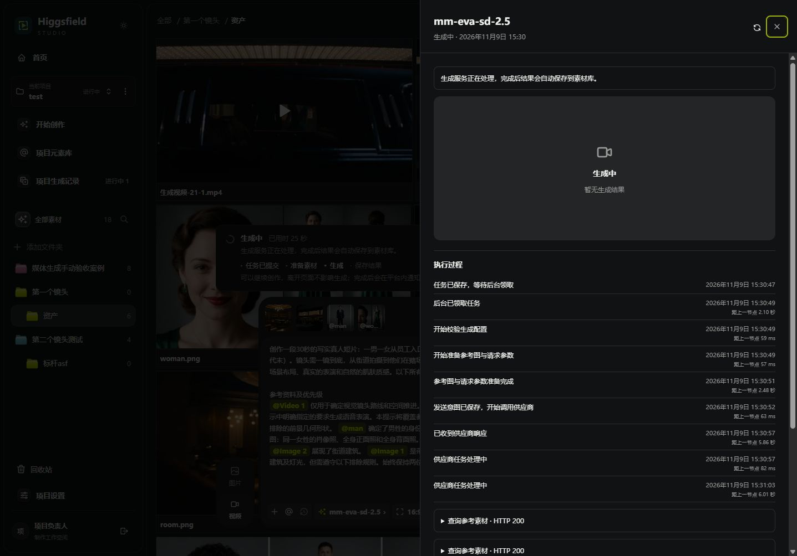
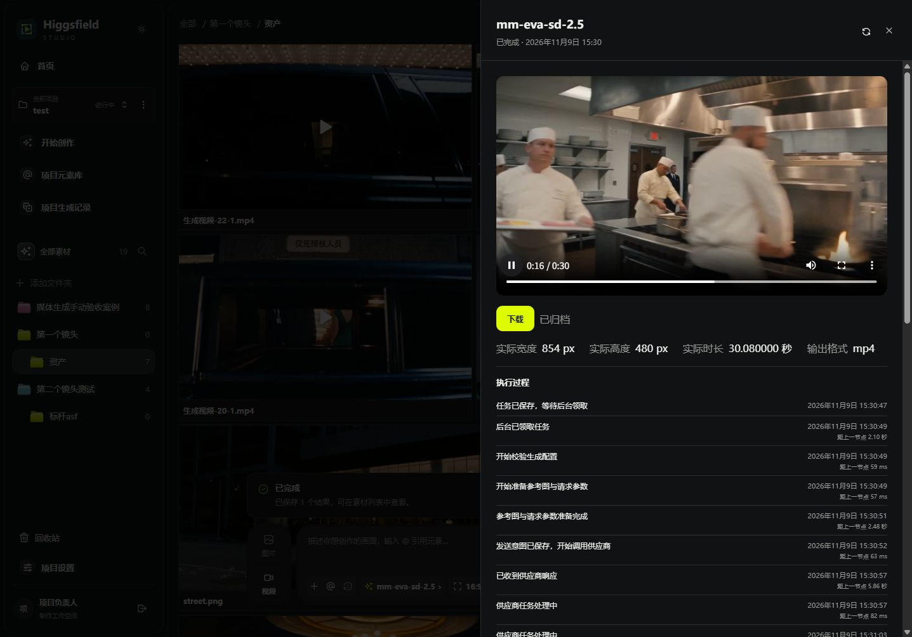
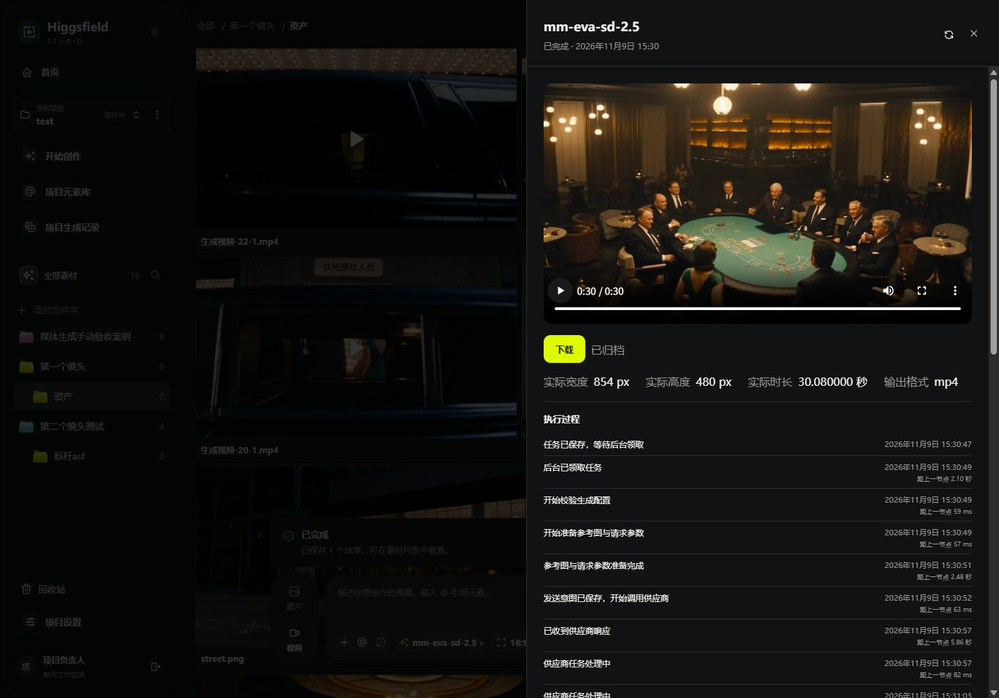

# 当前草稿实际生成验收：任务22（2026-11-09）

## 结论与范围

亲自在内置浏览器使用项目2、文件夹4、草稿109，点击一次“生成”，完成供应商真实付费调用、状态跟踪、归档和完整播放。结果为素材29／输出12：`生成视频-22-1.mp4`。本次未发现新的平台功能问题，未修改业务代码，未再次生成。

参数：mm-eva-sd-2.5，16:9，480p，30秒，Standard，声音开启；2张场景图、2个人物引用、1个参考视频。数据库对比证明任务21与22的编译内容摘要及参数相同。本轮验收的是当前视频草稿，不是图片生成。

## 阶段耗时

时间采用北京时间；依据 hf_creation_job、hf_task_event、hf_provider_call、hf_generated_output 的持久化时间。平台归档完成耗时不含之后人为打开、播放的操作时间。

|阶段|起止时间|耗时|
|---|---|---:|
|创建任务至开始素材准备（排队、领取、配置校验）|15:30:47.254—15:30:49.455|2.201秒|
|参考素材与参数准备|15:30:49.455—15:30:51.940|2.485秒|
|保存发送意图|15:30:51.940—15:30:52.004|0.064秒|
|提交供应商至登记受理|15:30:52.004—15:30:57.943|5.939秒|
|受理至平台发现生成完成|15:30:57.943—15:36:10.840|312.897秒|
|等待归档、下载、校验和登记|15:36:10.840—15:37:43.924|93.084秒|
|总计：创建至归档完成|15:30:47.254—15:37:43.924|416.670秒（6分56.67秒）|

“受理至发现完成”包含供应商排队、生成和平台轮询间隔，不是供应商精确推理时间。浏览器于15:37阶段观察到已完成和播放器，之后实际播放到30.08秒结束；未对客户端首帧呈现延迟单独埋点。

## 防重复及交互验证

- 数据库记录：video_submit 1次、asset_get 2次、video_poll 10次；无新上传或人物注册。
- 浏览器关闭详情、重新打开、刷新详情后，后台继续执行，付费提交次数仍为1。
- 提交按钮显示“已提交”；下载阶段显示已下载／总大小；归档后当前文件夹自动新增成片。
- 归档尝试1次，4条并行连接，5个下载请求（探测加4个分段），续传0次。
- 浏览器播放器实际从开始播放至结束：currentTime=duration=30.08、ended=true、error=null、readyState=4。

## 文件与耗时对照

归档文件6,936,429字节，独立读取文件计算SHA-256，与数据库一致：`ba476eca17c46612825349e7812f84b4494984d69fab8f479f2314b6df625822`。
ffprobe核验：H.264视频854×480，视频轨30.041667秒；AAC音频30.08秒；容器30.08秒。

任务21总耗时386.037秒，本次416.670秒，多30.633秒。下载及媒体校验从62.346秒变为92.970秒，多30.624秒；文件大小从6,623,373变为6,936,429字节，约增加4.7%。两次均为4连接、零续传，说明没有重试造成的额外等待；此次观测到下载吞吐更低，但仅凭这些数据不能定位是供应商CDN、外网链路还是本地存储的具体瓶颈。

验收覆盖平台生成流程、文件完整性与浏览器完整播放，不等于逐句台词、口型、人物一致性或全部艺术要求已通过；音轨存在已核实，未逐句听辨台词。文件保存在本地配置的受控存储，本次不代表正式NAS部署验收。

## 浏览器证据

