# higgsfield-ai · 技术架构方案

版本：1.10 评审稿  
日期：2026 年 10 月 27 日  
范围：后端服务、制作平台、管理平台  
读者：产品、前端、后端、测试与运维人员

本次修订依据已导入的本地RuoYi-FastAPI源码；工程现状、证据与复用边界见[工程基线核对与文档衔接方案](工程基线核对与文档衔接方案.md)。制作平台为 `higgsfield-frontend/`，管理平台为 `ruoyi-fastapi-frontend/vue3/web/`，共用 `ruoyi-fastapi-backend/`。本次只更新文档，未实现所述新增能力。

**项目名称与本地开发基线（已确认）：** 整体项目名称为 `higgsfield-ai`。现有工作目录 `D:\laputta\higgsfield`、制作端 `higgsfield-frontend/`、管理端 `ruoyi-fastapi-frontend/vue3/web/` 和后端 `ruoyi-fastapi-backend/` 均保持不变；本次不改仓库地址、包名、模块名或数据库实例名。本地开发使用 Docker 启动 PostgreSQL 与 Redis，后端及两个前端在宿主机分别手动启动。制作端尚待初始化，未来生成/media Worker 在本机作为独立进程手动启动；正式部署在公司内网服务器，素材与视频长期保存到公司 NAS；具体部署参数另行定义。


**若依数据库设计基线（本次确认）：** 全部新增业务数据库设计遵循本地 RuoYi-FastAPI PostgreSQL 约定：hf_ 模块表名、语义 xxx_id 自增 bigint、若依审计字段、按职责使用 del_flag（0/2）、复用 sys_dict_type/sys_dict_data、关联表自增主键与联合唯一约束、禁止物理外键、服务层事务维护逻辑关联。物理表/字段/字典映射以 [P0-3 数据库详细设计](数据库详细设计.md) 为准；平台业务 ID 传输为十进制字符串，API 基础审计时间为 createTime/updateTime。不可变历史、幂等、价格版本及权限规则仍须保留。本次只更新设计，不改基础框架或业务代码。


**统一约束与优先级：** 以[项目 AGENTS.md](../AGENTS.md)为工程约束；[文档一致性与优先级索引](文档一致性与优先级索引.md)统一文档编号、需求等级和处理规则。P0-1～P0-6 是文档编号，不是需求优先级；业务规则等级以 P0-1 的规则表为唯一来源，本文引用规则 ID 时继承其等级，不另行定级。设计完成不等于实现或验收通过。


**正式部署基线（用户已确认）：** 平台部署在公司内网服务器，素材、图片、视频及其长期归档文件存放公司 NAS。员工通过平台访问受授权内容，浏览器不直接访问 NAS 共享目录。内网服务器的操作系统、数量、正式环境容器化方式、域名及 NAS 协议/挂载路径仍待运维确认；本地 Docker 启动 PostgreSQL/Redis、后端及两前端手动启动的方式不变。

## 1 架构结论与设计依据

采用**双前端应用、统一业务后端、异步执行进程**的架构。制作平台承载项目创作和协作；管理平台负责组织权限、供应商、API Key、模型、预算与审计；后端统一执行权限校验、素材处理、生成编排、文件归档和费用核算。第一阶段使用模块化单体，API 与 Worker 独立运行，业务模块保持清晰边界，后续依据负载和团队需要拆分服务。

项目是内容、成员、任务和费用的核心归属单位。素材版本固定输入，元素组织多份参考素材，任务快照固定一次创作，作品保存输出。公司 NAS 保存长期文件，供应商 URL 与上游 Asset ID 仅用于外部调用。所有模型调用通过后端，员工不接触供应商 API Key。

### 1.1 资料与适用范围

| 依据 | 用途 | 使用边界 |
|---|---|---|
| [初版技术方案](../references/初版的技术方案/技术方案文档.md) | 技术栈、项目归属、素材版本、NAS、供应商调用及费用规则 | 供应商样例参数和接口仍需正式联调 |
| [已整理界面](../references/已整理/)及[截图状态对照表](../references/已整理/截图状态对照表.csv) | 页面结构、元素、文件夹、生成参数、评论、项目设置 | 219 张静态截图；菜单和弹窗可见，悬停或点击触发方式仍待确认 |
| 用户本次要求 | 三大部分、C4 分层、关键流程与时序、后台配置 API Key | 管理平台凭据页为新增设计，并非截图中已有页面 |
| [C4 官方图层说明](https://c4model.com/diagrams)与[抽象定义](https://c4model.com/abstractions) | 统一架构表达 | C1 至 C4 是架构视角的逐级放大，不等同于代码的四层分层 |

本方案延续初版的 Vue 3、FastAPI、Celery、Redis、PostgreSQL 和 NAS 选型。当前已导入 insistence/RuoYi-FastAPI 源码，本地许可证为 MIT，存在 PostgreSQL 依赖、数据库适配与 Compose；具体上游 commit 和实际运行数据库仍待核定。管理前端选用 vue3/web，制作端只有工程规范文件，应用尚未初始化，AI 任务 Worker 与业务模块尚未实现。

本次修订补充 VideoPlus 接入与后台手动价格配置。证据包括供应商 [MM 接口文档](../references/购买的apikey公司提供的文档/mm-api-1.md)、[价格文档](../references/购买的apikey公司提供的文档/model-pricing.md)、本会话已解锁并读取的 [Apifox 接口文档](https://9d11mhczhy.apifox.cn/)，以及用户提供的四张火山方舟价格截图。Apifox 保存的响应属于文档样例，不代表本平台已完成真实调用、鉴权、计费或端到端验收；截图价格为用户提供时的页面信息，未经本次官网实时复核。

价格来源优先级按用途区分：SD 2.0/2.5 的平台计价按用户指定采用官网截图；第三方采购成本保留供应商报价，并以实际账单确认。接口能力采用供应商契约与联调结果，价格表中的规格不能自行打开模型能力。冲突详见 6.8、9.5。

### 1.2 关键架构决策

| 编号 | 决策 | 原因与约束 |
|---|---|---|
| ADR-01 | 制作平台和管理平台独立构建，共用后端领域服务 | 独立发布与权限入口；制作端内部 Element Plus 与 shadcn-vue 共存并统一样式，避免两套业务规则 |
| ADR-02 | 模块化单体加异步 Worker | 保持任务、预算和 Outbox 的本地事务，同时允许独立扩容执行能力 |
| ADR-03 | 公司项目与上游项目、账号、凭据分别建模 | 多个业务项目共用上游账号也能独立鉴权和统计成本 |
| ADR-04 | 元素、素材版本、上游 Asset 分离 | 支持多图角色与稳定引用，避免把可编辑 Element ID 当作供应商标识 |
| ADR-05 | PostgreSQL 是任务与费用事实源 | Redis 仅承担消息、缓存和短期限流，丢失后可重建任务调度 |
| ADR-06 | API Key 加密、版本化、后台集中配置 | 支持权限控制、轮换和在途任务继续查询；禁止明文回显 |
| ADR-07 | 能力配置驱动生成参数 | 截图中的模型名、分辨率、时长和高级效果不代表已采购接口支持 |
| ADR-09 | 价格规则后台手动维护、版本化发布，平台计价与采购成本分开 | 支持多币种、多计费项与历史重现；未知价格不能当作免费 |
| ADR-08 | 生成、归档、计费分别记录状态 | 归档重试不重复生成，轮询不重复收费 |

## 2 界面到业务能力的映射

### 2.1 制作平台信息架构

```text
制作平台
├── 首页                         快速创作、最近项目、明确当前项目
├── 我的生成                     我发起且当前仍有权访问的任务与作品
├── 我的项目                     搜索、排序、置顶、个人隐藏、项目文件夹
├── 我的元素                     我创建或收藏且仍有权访问的元素聚合视图
├── 公司公共素材                 按授权查询，不等于全员公开
└── 项目空间
    ├── 项目概览与简报           创作目标、说明、最近任务
    ├── 图片与视频创作           提示词、引用、模型、参数、任务结果
    ├── 文本对话                 项目会话、提示词辅助
    ├── 全部素材与文件夹         上传文件、作品、筛选、网格或瀑布流
    ├── 项目元素                 表格、网格、看板、多图、属性
    ├── 素材与元素详情           预览、来源、提示词、评论、图片标注
    ├── 任务                     阶段、失败原因、重试和归档状态
    └── 项目设置                 成员、角色、申请、用量、归档
```

“我的”是访问视图，不另建绕过项目权限的个人数据库。首页提交生成必须选择项目；没有项目时先创建或选择项目。暂不增加隐式个人空间，以保持初版“生成必属项目”的约束。

### 2.2 页面与架构映射表

下表中的“界面参考”用于定位资料；对应领域行为是本方案的设计约定。

| 界面参考 | 可见能力 | 后端模块与数据 | 设计规则 |
|---|---|---|---|
| 我的项目 18 张 | 创建、编辑、置顶、隐藏、排序、文件夹 | Projects、`hf_project`、`hf_user_project_preference`、`hf_project_collection` | 隐藏和置顶为个人偏好；隐藏不撤销成员权限，不等于归档 |
| 首页 35 张、我的生成 27 张 | 素材选择、模型、比例、时长、音频、图像数量 | Creation、ModelCatalog、`hf_prompt_draft`、`hf_creation_job` | 页面共用创作组件；所有可选值由已发布模型能力决定 |
| 我的元素 71 张、项目元素 2 张 | 多图、主图、分类、名称、版本标签、Element ID、自定义属性、复制移动 | Elements、`hf_element`、`hf_element_revision`、`hf_element_revision_media` | Element ID 是空间内业务别名；内部自增 bigint 主键永久稳定；显示版本标签不能覆盖历史修订 |
| 元素详情 14 张 | 信息、评论线程、回复、圈注、颜色工具 | Collaboration、`hf_comment_thread`、`hf_comment`、`hf_annotation` | 标注绑定固定文件版本，存归一化坐标；更换图片不迁移旧标注 |
| 项目简报 1 张 | 正文与内容分区 | Projects、`hf_project_brief` | 修订号控制并发；保存富文本结构并过滤危险内容 |
| 项目设置 9 张 | 通用设置、成员、权限矩阵、申请、用量 | Access、Projects、Usage | 项目角色与全局管理角色分离；费用查看单独授权 |
| 项目素材 13 张 | 文件夹、类型模型日期状态筛选、隐藏失败项 | Assets、Outputs、LibraryQuery | 生成失败任务不是文件；库视图可合并展示任务占位与作品，接口标明类型 |
| Cully Hill Boys 项目素材 17 张 | 视频、图片、多级文件夹、卡片尺寸、瀑布流 | LibraryQuery、`hf_folder`、`hf_folder_entry`、`hf_user_view_preference` | 文件夹仅组织内容；大小和布局不产生新文件 |
| Cully Hill Boys 项目元素 4 张、元素详情 1 张 | 角色、场景、道具及多视图 | Elements、Assets | 一个元素修订可关联多个固定素材版本 |
| Cully Hill Boys 素材详情 7 张 | 组图、视频预览、完整提示词 | Outputs、Creation、Storage | 一个任务可产出多件作品；详情追溯不可变输入快照 |

### 2.3 与截图的范围差异

截图中的 Canvas、AI Director、Community、Pricing 等导航名称不作为已具备的业务能力。首期不实现画布编排、自动导演、外部社区和商业订阅；文本对话按初版方案纳入目标架构。导入元素先采用可校验的结构化导入，截图“Extracting hf_element”是否属于 AI 提取没有足够证据；后续 AI 提取需独立任务、人工确认及计费。

高级相机镜头、色彩迁移、提示词增强、首尾帧、延展和编辑模式由适配器声明支持后开放。若只实现提示词模板，界面应标为“提示词预设”，不能宣称具备专用模型控制能力。项目公开分享、外部访客暂不开放；跨项目复用通过授权关系实现。

## 3 总体边界与技术组成

| 部分 | 技术基线 | 负责内容 | 边界 |
|---|---|---|---|
| 制作平台 | Vue 3、TypeScript、Vite、Vue Router、Pinia、Axios、Element Plus、shadcn-vue、Tailwind、Tiptap | 创作、素材元素、项目协作、任务作品 | 不持有供应商凭据、不决定实际费用、不直接访问 NAS |
| 管理平台 | 现有 Vue 3、JavaScript、Vite、Vue Router、Pinia、Axios、Element Plus | 组织权限、API Key、模型、价格、预算、对账、审计 | 使用独立管理接口权限；表单采用 ElForm 校验和显式保存处理 |
| 后端服务 | RuoYi-FastAPI 基础、FastAPI、异步 SQLAlchemy 2.0/AsyncSession、Redis、JWT/OAuth2、迁移工具、Celery | 两个平台的业务 API、领域规则、异步编排和集成 | HTTP 路由与后台任务复用应用服务，不复制核心规则 |
| 支撑设施 | PostgreSQL、Redis、NAS、Nginx、FFmpeg、图片处理库 | 事务、消息、文件、入口、媒体衍生文件 | PostgreSQL 保持事实；NAS 文件不靠公开静态目录暴露 |

建议同一站点部署 `/studio/`、`/admin/`，新增业务 API 为 `/api/v1/`，新增管理 API 为 `/api/admin/v1/`；已有框架 /system/*、/login 等路径与 code/msg 响应保持兼容。静态子路径目前尚未配置，管理 Vite base 仍为 /。前端路由隔离不构成安全边界，后端对每次操作执行功能权限和数据范围校验。认证复用现有 Authorization Bearer JWT 与 Redis 会话，统一处理会话撤销、过期与退出。管理端现有 Admin-Token 是 JS 可读 Cookie，不是 HttpOnly 会话；制作端使用独立令牌管理与 fetch SSE。不能把登录令牌或供应商秘密放 URL。

## 4 C4 Model 软件架构分层规范

### 4.1 图层与表达约定

C4 将软件系统逐级展开为容器、组件和代码元素。本方案用 Mermaid 表达这些抽象，保留 C4 的层级和边界语义，不依赖特定绘图语法。C4 中的“容器”指可运行应用或数据存储，不专指 Docker 容器。依据见 [C4 官方说明](https://c4model.com/abstractions)。

| 层级 | 本方案回答的问题 | 应包含内容 | 禁止混入的内容 |
|---|---|---|---|
| C1 系统上下文 | 谁使用平台，平台依赖谁 | 人员、本系统、外部系统及业务关系 | 内部数据库、类、函数 |
| C2 容器 | 哪些应用和存储运行、如何通信 | 两个 SPA、API、Worker、调度进程、数据库、队列、协议 | 页面按钮和具体 Python 方法 |
| C3 组件 | 一个容器内部如何划分职责 | 指定容器的组件、公开接口、依赖及外部协作容器 | 把不同进程的内部模块画成同一容器 |
| C4 代码 | 关键组件怎样实现契约 | 类、接口、方法、依赖方向 | 全系统每个类的无差别展开 |

每张静态架构图标明层级和范围；节点写明类型、技术或职责；每条箭头标明调用目的，跨容器关系补充协议。C1 不画存储细节，C3 一张图只展开一个容器。流程图、时序图、部署图是补充视角，不替代 C1 至 C4。组件更名、服务拆分、存储变更时同步更新相应图和 ADR。

### 4.2 C1 系统上下文

范围：公司 AI 创作平台整体。NAS 是公司既有外部文件系统；供应商内部拓扑以其正式接口为准。

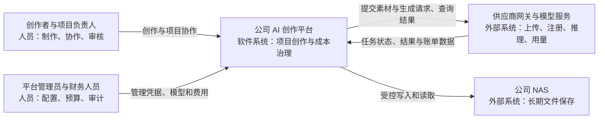

最后一条关系表示业务数据返回，不要求供应商主动回调。内网部署默认采用主动查询；若将来引入回调，另设验签入口和事件去重。

### 4.3 C2 容器视图

范围：本系统运行单元及外部依赖。两类 Worker 可由同一代码包启动为不同队列进程。

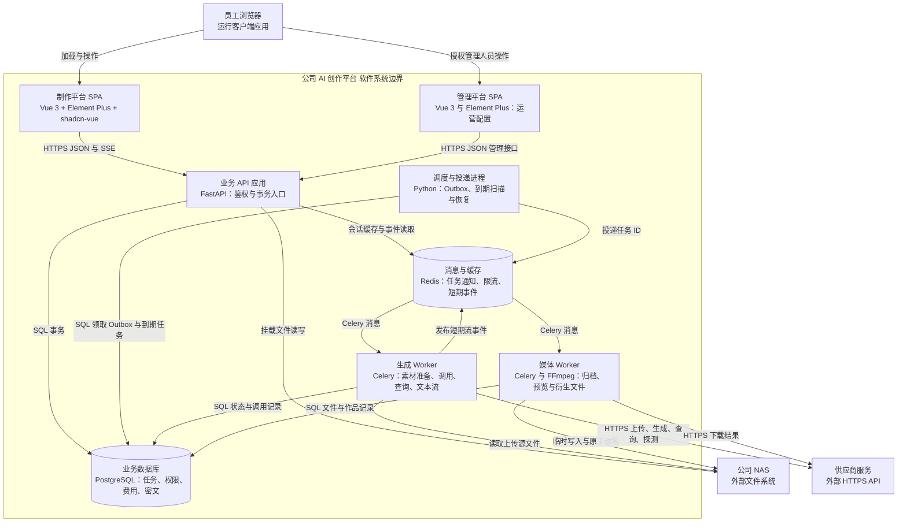

Nginx 负责分发两个 SPA 并代理 API，见部署图。数据库密文解密所需主密钥由运行环境秘密注入，不进入业务数据库；图中没有假设公司已经建设 KMS。凭据验证也交给 Worker，管理 API 本身不直接请求任意外部地址。

### 4.4 C3 后端 API 组件视图

范围：仅展开 FastAPI 容器。方框内组件均为 Python 模块，第一阶段通过进程内接口调用。

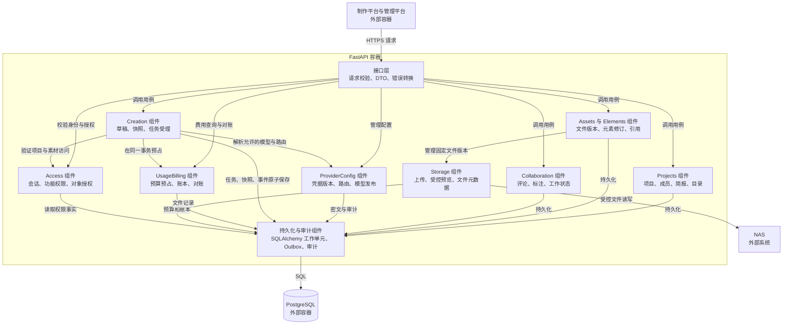

管理 API 与制作 API 只在路由、DTO 和权限要求上分开，不能各自维护独立的项目、任务或费用实现。审计与敏感配置变更同事务提交，日志系统故障不能导致配置变更无记录。

### 4.5 C3 生成 Worker 组件视图

范围：仅展开生成 Worker。归档交给媒体 Worker，通过 Outbox 衔接。

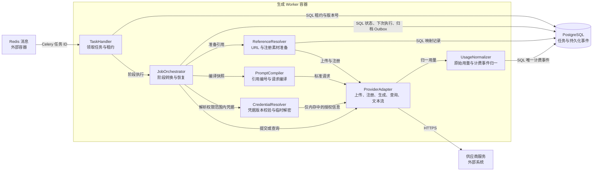

组件共享后端领域包。图片生成即使供应商同步返回，也由 Worker 执行；API 不等待长耗时推理完成。媒体 Worker 只消费归档、转码和缩略图任务，不承担新的生成提交。

### 4.6 C3 前端组件边界

范围分别为制作 SPA 和管理 SPA；下表是两张组件视图的文字索引，各 SPA 内的组件均不可直接调用另一 SPA 的内部状态。

| SPA | 组件 | 职责与依赖 |
|---|---|---|
| 制作 | AppShell、ProjectContext | 导航、当前项目、权限摘要；依赖业务 API |
| 制作 | CreationWorkspace、PromptEditor、ReferencePicker、ParameterPanel | 共用首页和项目创作入口；依赖模型能力契约和草稿服务 |
| 制作 | AssetLibrary、ElementLibrary、MediaViewer | 素材、元素、三种布局、受控预览；依赖库查询 API |
| 制作 | TaskCenter、DiscussionPanel、ProjectSettings | 任务阶段、评论标注、项目权限；依赖对应业务 API |
| 管理 | AdminShell、PermissionGuard | 管理导航与操作可见性；服务端仍重复授权 |
| 管理 | ProviderConsole、CredentialForm、ModelPublisher | 连接、Key 配置、测试结果、模型发布；依赖管理 API |
| 管理 | BudgetConsole、ReconciliationConsole、AuditExplorer | 预算、账单、审计；依赖管理 API |
| 各自拥有 | ApiClient、Pinia Stores、ErrorPresenter | 请求、页面状态、统一错误；共享类型包而不共享运行时 Store |

制作平台容器展开如下，页面通过业务组件协作，统一访问后端。

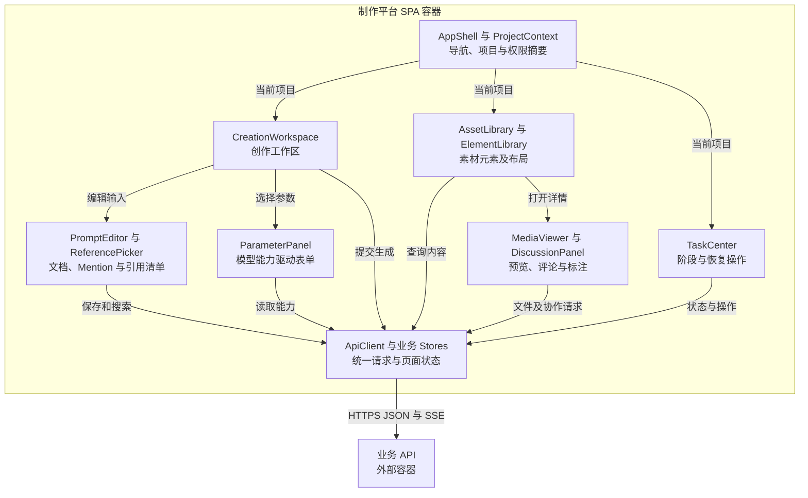

管理平台容器展开如下，凭据表单只在提交期间持有输入，列表与 Store 只接收脱敏元数据。

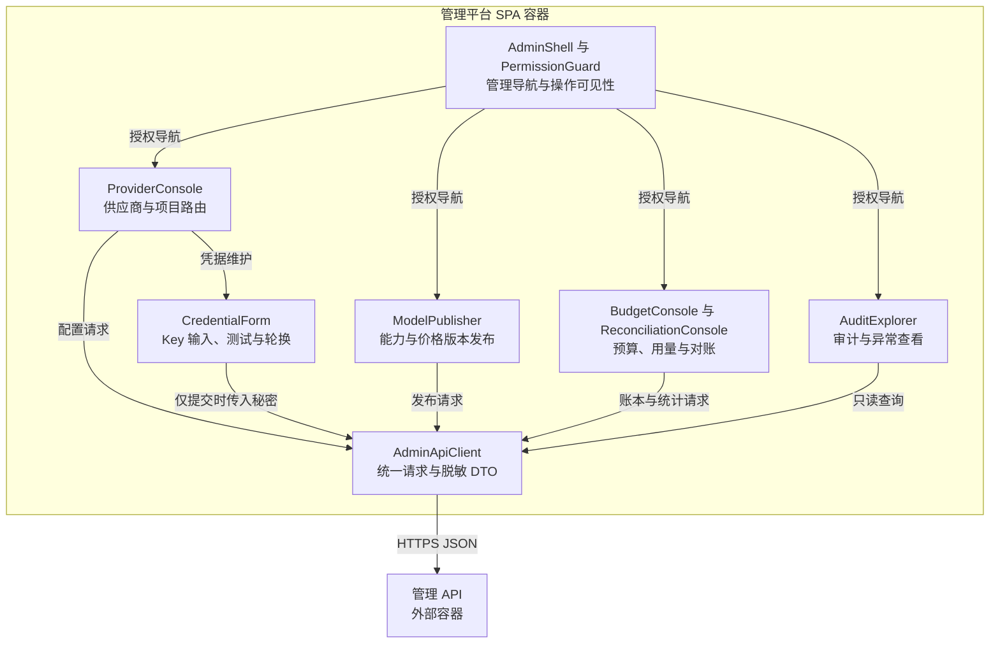

### 4.7 C4 关键代码契约

范围：Creation 受理组件和供应商调用端口。以下是目标类设计，并非现有代码扫描结果。

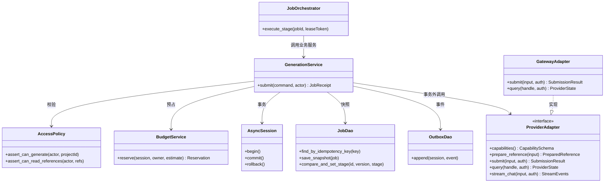

`SubmissionResult` 必须区分 `accepted`、`rejected`、`unknown`，不能将超时统一转换为失败。`ProviderState` 区分上游任务状态、输出位置、原始用量、请求 ID。不支持的能力返回明确错误，不伪造空结果。

初版网关样例涉及上传 `/v1/assets/upload`、注册 `/v1/mm/assets`、注册查询 `/v1/mm/assets/get`、生成 `/v1/chat/completions` 与视频查询 `/v1/video/tasks/{taskId}`，仅作为适配器联调起点。适配器同时检查 HTTP 状态和业务 `base_resp.status_code`，按契约解析可能包含 JSON 字符串的 `message.content`；图片 Base64 解码后验证类型和大小。视频查询使用内层视频任务 ID，不能使用外层聊天响应 ID。网关 `mm-*` 别名不直接等同官方模型，也不据此套用官方零售价。

### 4.8 代码依赖分层与目录

```text
higgsfield-frontend/                     制作平台，待初始化 Vue3/TS
ruoyi-fastapi-frontend/vue3/web/          管理平台，复用现有系统管理
ruoyi-fastapi-backend/
  module_admin/                         已有系统管理与身份能力
  module_identity/                      已有认证中心，SSO启用需验证
  module_higgsfield/                    待新增核心业务模块
    controller/                         双前端业务路由、DTO、鉴权
    service/                            业务规则、用例与事务编排
    dao/                                AsyncSession 数据操作与查询
    entity/do/                          SQLAlchemy ORM 模型
    entity/vo/                          Pydantic 请求、响应与分页模型
    adapter/                            外部供应商及 NAS 适配
    workers/                            待新增Celery执行入口
  alembic/                              已有迁移工具，业务版本链待建立
ruoyi-fastapi-test/                      已有跨工程测试，业务用例待新增
docs/                                   架构、契约与基线核对
```

依赖规则：controller（router）→ service → dao → entity/do（ORM model），VO 放 entity/vo。Controller 只处理接口适配；Service 管理业务规则、跨 DAO 事务和适配器调用；DAO 使用 AsyncSession 操作 ORM。Worker 调用同一 Service，不另建 application/domain/infrastructure 平行架构。C4 图中的领域职责是 Service 内部职责划分，不代表额外代码分层。

前端页面依赖业务组件和服务，服务通过统一 Axios 客户端调用 API；Pinia 保存当前项目、草稿和视图状态，不保存 API Key。Tiptap 引用和生成参数使用类型契约；表格、网格、看板共用查询及领域对象。两个 SPA 分别打包 CSS，只共享设计变量和 API 类型。

### 4.8.1 制作端强制编码与组件库共存

`higgsfield-frontend/` 使用 Vue3，Element Plus 与 shadcn-vue 共存，按功能、参考界面、可访问性及性能需求选择最合适组件。不能再将两个组件库理解为分别专属于两个前端。管理端仍使用 `ruoyi-fastapi-frontend/vue3/web/` 的 Vue3 工程与现有 Element Plus 界面。

制作端强制要求：全部业务组件使用 `<script setup lang="ts">`、使用组合式 API；业务逻辑抽为 use 开头的 composables；请求集中在 api/，组件不直接写传输请求；组件遵循单一职责；共享状态用 Pinia，禁用 Vuex；命名、具名导出和 ref/reactive/computed 遵循组合式规范。

统一两套库的设计变量、CSS 重置策略、弹层层级与焦点管理；同一交互容器不叠加两套校验或焦点锁。细则和评审要求见[制作平台前端编码规范](制作平台前端编码规范.md)，目录级约束见 [higgsfield-frontend/AGENTS.md](../higgsfield-frontend/AGENTS.md)。这些是已确认的工程规则，依赖及自动化门禁尚未初始化。

### 4.9 框架集成规则

已有框架采用 controller/service/dao/entity，新增业务严格沿用该结构及 RouterRegister 入口。数据库与 Redis 设施复用；现有 APScheduler 不等于 AI 队列，生成 Worker 仍按任务可靠性协议接入并复用 Service。

框架功能权限包含 `*:*:*`，部门数据范围对admin可直接通过；AI业务必须额外执行项目/对象策略，不能让框架管理员默认读取所有创作内容。原系统和新增业务统一使用 ResponseUtil、分页 VO、异常处理及拦截链；新业务 DTO 和流式适配不改变公共信封。

已有sys_file_info和AI插件不直接替代本方案hf_stored_file、hf_credential_version和费用表。AI文件由独立NAS适配器治理；未验证统一生命周期前，不让框架文件回收站同时管理相同物理文件。

## 5 后端服务与领域模型

### 5.1 领域职责

| 模块 | 主要职责 | 必须保持的不变量 |
|---|---|---|
| Access | 用户、部门、全局角色、数据授权 | 身份取自服务端会话；对象授权覆盖搜索、详情、预览、下载 |
| Projects | 项目、成员、简报、申请、文件夹、个人偏好 | 项目负责人不能通过项目配置给自己授予全局凭据权限 |
| Assets | 素材空间、固定版本、公共授权 | 历史版本不可覆盖；公共素材只复用文件，不自动扩散授权 |
| Elements | 角色、场景、道具、多图、修订、自定义属性 | 修改业务别名不改变永久 ID；任务固定元素修订及具体媒体版本 |
| Collaboration | 评论、回复、图片标注、审核状态 | 标注绑定具体媒体版本，审核状态不代替生成状态 |
| Creation | 草稿、会话、任务、快照、作品来源 | 编辑草稿不修改已受理输入；每个任务绑定项目及发起人 |
| Providers | 供应商连接、凭据、模型能力、路由、适配器 | 供应商账号和业务项目分离；秘密不进入任务载荷 |
| UsageBilling | 调用、用量、采购价、预算、账本、对账 | 一次上游计费对象只产生一份有效计费事件，调整追加而不覆盖历史 |
| Storage | NAS 文件、校验、预览、归档、回收 | 文件路径由服务端生成；数据库与 NAS 使用补偿一致性 |

### 5.2 核心概念与关系

| 概念 | 含义 | 示例与规则 |
|---|---|---|
| 项目 | 创作与成本归属 | 一个项目有多个成员、草稿、任务和作品 |
| 素材 Asset | 一份可复用媒体的业务对象 | 角色正面图；换文件创建新版本 |
| 素材版本 AssetVersion | 固定内容与属性 | V2 指向不可变 NAS 文件 |
| 元素 Element | 创作语义对象 | “男孩角色”包含正面、侧面和背面图 |
| 元素修订 ElementRevision | 元素描述、生成相关属性与媒体列表的快照 | 修订 R3 引用三张不同的素材版本 |
| 业务别名 Element Alias | 界面中的可编辑 Element ID | `char_boy1`，同一空间唯一，不是上游 Asset ID |
| 上游绑定 ProviderAssetBinding | 特定供应商范围的注册映射 | 素材版本、账号、区域、上游项目、Group 与注册策略版本共同限定 |
| 任务 Job | 一次不可变创作请求的执行过程 | 一个任务包含多次上传、注册、提交和查询调用 |
| 作品 Output | 一次任务的一份输出 | 多张图片或多个视频分别记录，归属原项目 |

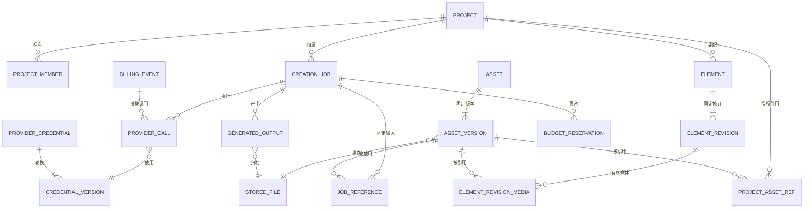

此图展示主关系，不要求所有调用都有计费事件：无收费或费用尚不明的查询调用可以先无关联；一次调用含多个计费子项时通过明细表扩展。公共素材由公共空间持有，项目引用它而不取得其所有权。

### 5.3 数据表与关键约束

| 数据组 | 表 | 关键字段与约束 |
|---|---|---|
| 组织权限 | 复用 RuoYi 用户、角色、部门表；`hf_project_member`、`hf_project_role_permission` | `(project_id,user_id)` 唯一；费用查看、导出、凭据维护分别授权 |
| 项目组织 | `hf_project`、`hf_project_brief`、`hf_project_join_request`、`hf_folder`、`hf_folder_entry` | 项目状态、修订号；目录禁止循环；目录项不得跨空间挂接未授权对象 |
| 个人偏好 | `hf_user_project_preference`、`hf_project_collection`、`hf_user_view_preference`、`hf_favorite` | 用户维度置顶隐藏、项目分组、布局、列宽；不修改资源权限 |
| 素材文件 | `hf_asset_space`、`hf_asset_space_grant`、`hf_asset`、`hf_asset_version`、`hf_stored_file`、`hf_project_asset_ref` | 版本唯一；文件状态与哈希；公共引用包含授权来源；文件存储键不接受用户输入 |
| 元素 | `hf_element`、`hf_element_revision`、`hf_element_revision_media`、`hf_property_definition` | `(space_id,alias)` 唯一；修订不可变；媒体顺序唯一；属性类型和值校验 |
| 协作 | `hf_comment_thread`、`hf_comment`、`hf_annotation`、`hf_review_event` | 目标对象与媒体版本；父评论约束；编辑修订、删除审计 |
| 创作 | `hf_prompt_draft`、`hf_chat_session`、`hf_chat_message`、`hf_creation_job`、`hf_job_reference`、`hf_generated_output` | 草稿 revision 乐观锁；`(actor_id,project_id,idempotency_key)` 唯一且保存请求摘要 |
| 供应商 | `hf_provider_connection`、`hf_provider_account`、`hf_provider_credential`、`hf_credential_version`、`hf_credential_test`、`hf_project_provider_config` | 账号作用域独立于 Key 版本；密文、主密钥版本、启停状态、配置修订；测试绑定精确配置版本 |
| 外部素材 | `hf_provider_upload`、`hf_provider_asset_binding` | 版本与上游作用域复合唯一；URL 到期时间；注册状态；注册策略版本 |
| 价格规则 | `hf_price_rule_item`、`hf_price_source`、`hf_exchange_rate_version`、`hf_billing_line_item`、`hf_price_publish_event` | 分离用途与币种、条件无歧义、版本不可变；详见 9.4 |
| 模型路由 | `hf_model_profile`、`hf_model_profile_version`、`hf_routing_policy`、`hf_price_version` | 已发布版本不可原地覆盖；能力、网关别名、绑定范围与计价版本 |
| 费用 | `hf_provider_call`、`hf_usage_record`、`hf_billing_event`、`hf_billing_adjustment`、`hf_reconciliation_batch` | 调用先记后发；上游计费身份唯一；原始用量保留且脱敏 |
| 预算 | `hf_budget`、`hf_budget_reservation`、`hf_budget_ledger_entry` | 任务和预算组合唯一；预占、扣减、释放、调整均有唯一业务事件 |
| 可靠性 | `hf_outbox_event`、`hf_processed_event`、`hf_audit_log` | 事件 ID 唯一；任务租约、下次执行时间、尝试次数、状态版本 |

金额采用 PostgreSQL `numeric` 与 Python `Decimal`，禁止浮点数作为结算值。所有金额带币种，不直接相加不同币种。时间落库采用 UTC，报表展示默认 Asia/Shanghai，采购账期保留供应商时区口径。列表按项目、创建时间和状态建立索引；自定义属性 JSONB 只对明确查询需求增加索引，不建立任意脚本执行能力。

### 5.4 元素版本与引用规则

元素的名称和业务别名可编辑。参考图顺序、主图、描述或参与生成的属性发生变化时，创建新修订；展示用的版本标签可编辑，但不作为修订身份。审核状态与评论独立记录，不必因为一条评论创建生成修订。

在提示词中选择元素后，保存 `elementId`、`elementRevisionId`、已选 `assetVersionIds` 和引用角色。默认选择主图，选择多图时在制作平台明确展示将提交的图片清单，不静默把全部图片加入请求。草稿重开可以提示新修订，由用户主动升级；任务提交再次展开成固定媒体清单，按素材版本与引用角色去重。模型需要首帧和尾帧时，即使文件相同也不能错误合并两个角色。

Tiptap Mention 保存稳定 `referenceId`，独立引用清单保存具体版本与角色。编译时从同一有序清单生成“图片 1、图片 2”等文本和媒体数组，图片与视频编号规则由适配器定义；不能用正则替换所有 `@名称`。撤销、重做和删除最后一个 Mention 时同时维护引用清单，用户明确保留的附件除外。搜索支持中文输入法、防抖、键盘选择和过期请求取消；不可用引用显示原因，不自动替换文件。

公共素材引用不复制原文件；跨项目复制元素创建新的元素身份和修订，并逐项验证媒体的跨项目使用授权。跨项目“移动”在有历史引用时改为受控复制加原对象归档，历史归属不改写；不允许通过移动逃避原项目访问规则。

## 6 管理平台、供应商接入与价格配置

### 6.1 管理平台导航

```text
管理平台
├── 组织与权限         用户、部门、全局角色、项目治理
├── 供应商接入
│   ├── 供应商连接     地址、适配器、超时、账号作用域、上传策略
│   ├── API Key 管理   新增、测试、启用、轮换、停用、撤销
│   └── 项目路由       项目、模型、凭据池、上游 ProjectName 映射
├── 模型与能力         模型版本、参数约束、素材注册策略、可见范围
├── 价格与预算         手动价格配置、试算与发布、采购报价、用户项目额度
├── 用量与对账         人员项目部门模型统计、账单、差异处理
├── 素材治理           公共素材授权、保留策略、异常归档
└── 审计与运维         配置变更、任务异常、调用明细、服务健康
```

### 6.2 API Key 配置表单

这是供应商凭据管理功能，不是向员工发放平台开放 API Token。管理员在表单中输入供应商已有 Key，平台不会替代供应商开通账号或模型权限。

| 分区 | 字段 | 校验和展示 |
|---|---|---|
| 基本信息 | 凭据名称、供应商连接、环境、说明、责任人 | 名称可读；生产与测试环境隔离 |
| 账号范围 | `providerAccountId`、区域、上游项目、可选 Group | Key 轮换保持同一账号范围；跨账号属于新绑定，不能复用旧 Asset ID |
| 秘密输入 | `apiKey` | 仅新增或替换时输入；保存后清空表单；详情无取回明文入口 |
| 适用范围 | 允许项目、模型、调用用途 | 由路由规则引用，默认不向全部项目开放 |
| 控制策略 | 生效到期时间、并发、速率、选用优先级 | 后端强校验；额度控制与公司预算分别管理 |
| 运维信息 | 掩码、指纹、状态、版本、最近测试、最近使用 | 只返回末尾少数字符和不可逆指纹；不返回密文 |
| 操作 | 保存待测、验证连接、启用、轮换、排空、紧急撤销 | 权限分开；危险操作确认说明在途任务影响 |

供应商 Base URL 在连接页配置，生产目标使用 HTTPS（VideoPlus 当前资料为 HTTP，处理见 6.7），限制允许域名、端口及重定向目标，解析后禁止访问本机、元数据地址及未授权内网段。API Key 页不能让操作者随意改成任意请求地址。鉴权头由适配器决定，例如 `Authorization: Bearer` 或供应商专用头，禁止前端拼装。

### 6.3 凭据安全与生命周期

| 状态 | 新任务选择 | 在途调用 | 使用规则 |
|---|---|---|---|
| `draft` 待验证 | 禁止 | 禁止 | 已加密保存，尚未通过当前版本测试 |
| `active` 已启用 | 允许 | 允许 | 还需通过账号、项目、模型、时间和限额校验 |
| `draining` 排空中 | 禁止 | 仅允许已绑定任务的必要后续调用 | 停用或轮换旧版本时使用；保留既有任务查询与结果获取 |
| `disabled` 已停用 | 禁止 | 禁止 | 无在途依赖后停用；需要替换或人工恢复 |
| `revoked` 已撤销 | 禁止 | 禁止 | 紧急事件立即阻断，不等待排空 |

“过期”和“测试失败”分别作为有效期判断与测试结果，不用测试失败覆盖掉完整生命周期。编辑连接、账号作用域、Key 或测试相关参数，旧测试结果失效；只有当前配置修订通过验证且操作者有启用权限才允许发布。无无副作用探测接口时，界面明确标注测试请求可能计费并记录其管理成本归属，不能默认免费。

秘密采用经审查的加密库实现带认证的加密，例如 AES-GCM；每次加密使用独立随机 nonce，将凭据 ID、环境和版本作为附加认证数据。数据库保存密文、nonce、认证信息和主密钥版本。解密主密钥通过部署秘密文件或秘密管理服务注入，与数据库及数据库备份分离，权限仅授予需要解密的运行进程。主密钥轮换与供应商 API Key 轮换分别处理，并验证旧密文可恢复。

管理员只能写入或替换秘密，不能读回秘密。Key 不进入日志、审计请求正文、错误堆栈、OpenAPI 示例、浏览器持久化、Redis 任务参数或不可变任务快照。任务记录 `credentialId` 与 `credentialVersionId`，Worker 调用前临时解密；响应白名单序列化，阻断上游回显授权信息。应用生产环境关闭 SQL 参数回显，敏感配置请求禁用请求体采样和浏览器遥测录制。

### 6.4 配置与启用流程

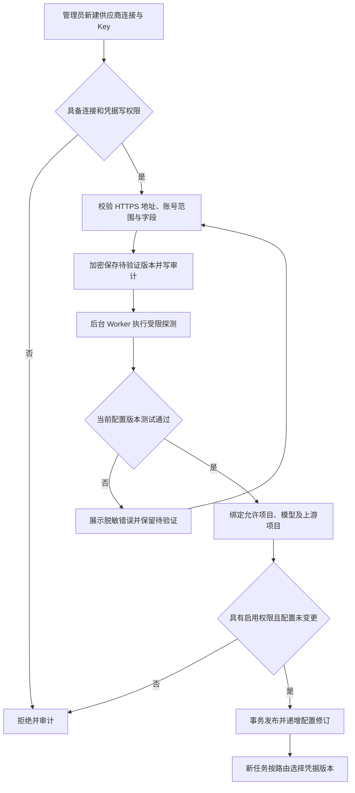

### 6.5 配置测试与轮换时序

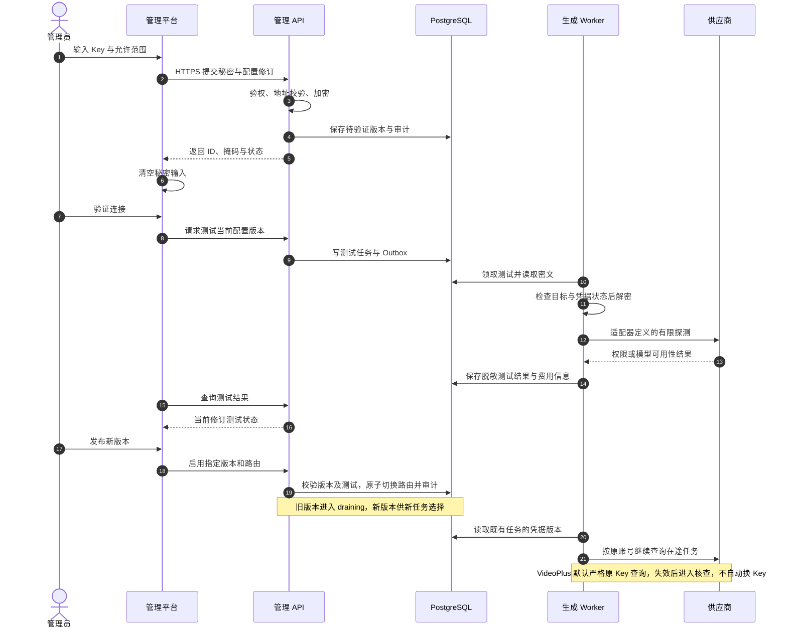

轮换后的新任务使用新版本，已绑定任务默认继续使用旧版本直至完成。VideoPlus 当前严格使用创建时原 Key；只有供应商证据、P0-2 契约及对应恢复测试全部更新后，才可另行批准替代查询策略，并保留最初绑定与每次实际凭据版本。不同账号之间不透明切换。紧急撤销应先在平台阻断，再按供应商能力撤销上游 Key；平台撤销本身不等于供应商已撤销，也不等于上游任务停止收费。

### 6.6 路由选择与运行时复核

路由配置来源顺序：项目显式配置 → 允许的部门策略 → 平台默认策略。首期在配置阶段将部门/平台默认解析成经授权的项目显式配置并审计，运行时只读取项目整组路由及其 revision，不动态回退到未持久化的默认配置。各来源均须满足项目授权、模型能力、账号范围与环境限制；“默认”不绕过授权。供应商连接、模型能力、路由和价格版本固定到任务快照；实际凭据版本在受理时选定，外部调用前复核最新撤销状态、账号范围、有效期和限流。

任务受理后凭据被禁用、模型被紧急下线或授权被撤回时，尚未开始外部生成的任务进入阻断状态，由明确策略或人工处理；已经受理的上游任务继续执行必要的查询、归档和费用记录，除非凭据紧急撤销使其无法查询。不能在超时后自动切换另一个 Key 重提生成，避免重复消费。

### 6.7 VideoPlus 模型网关接入契约

制作平台 → 本平台后端 → VideoPlus 网关 → 底层模型。前端不直接调用供应商，不接收第三方 API Key。供应商适配器属于 C3 的 Providers 基础设施组件，生成编排负责任务，UsageNormalizer 负责用量归一，UsageBilling 负责计价；两套前端不实现供应商响应解析和结算规则。

连接资料提供的 Base URL 是 `http://llm-gw.videoplus.cc/`；这是当前资料值，不能把它写成已验证的 HTTPS 服务。生产接入需确认供应商支持的 HTTPS 地址或受控加密通道，未确认前连接保持待验证。原 C2/部署图中的 HTTPS 是目标安全边界。请求头为 `Authorization: Bearer <服务端解密的Key>`、`X-Biz-Id: op`；JSON 接口使用 `application/json`，上传接口使用带正确 boundary 的 multipart，不套用 JSON Content-Type。

| 能力 | 接口及网关模型 | 请求与响应适配 |
|---|---|---|
| 多模态对话 | `POST /v1/chat/completions`；`mm-gemini-2.5-f`、`mm-gemini-3.0-p`、`mm-gemini-3.1-f` | 支持文本与图文消息；参数放请求顶层；普通响应读取 `choices` 与 `usage.prompt_tokens/completion_tokens`；流式协议与结束用量仍需联调 |
| 图片生成 | 同一 POST；`mm-imagen2`，用户指定底层 GPT-image2，供应商文档别名为 canvas-20 | 支持文本/参考图；`n` 为 1–10，参考图最多 16 张；尺寸、质量、格式由模型能力版本校验。`choices[0].message.content` 是 JSON 字符串，二次解析 `images` 与内层 `usage.input_tokens/output_tokens`；外层 usage 为 0 不能覆盖内层用量 |
| SD 视频提交 | 同一 POST；`mm-eva-sd-2.5`、`mm-nova-sd-2.5`，以及各自 2.0 / Fast 别名 | 提交只代表受理。解析 content 内 JSON 的任务 ID 与业务状态；外层 chat completion ID 与内层任务 ID 分别保存，查询使用内层 ID，不用字符串后缀推断计价规则 |
| SD 视频查询 | `GET /v1/video/tasks/{task_id}` | 使用创建任务的同一 Key；成功读取 `content.video_url` 与 `usage.completion_tokens`。按 30–60 秒间隔起步，支持退避抖动，查询状态与次数持久化 |
| 临时素材上传 | `POST /v1/assets/upload`，multipart `file` | 文档限制图片 20 MB、视频 500 MB；URL 约 24 小时有效；保存到期时间，提交前重新检查可用期 |
| 官方素材注册 | `POST /v1/mm/assets` | URL、`AssetType`（Image/Video/Audio，区分大小写）、`ProjectName`（eva/nova）按供应商契约传递；业务项目不直接充当 ProjectName |
| 注册素材查询 | `POST /v1/mm/assets/get`，请求包含 `Id` | 状态 Active/Processing/Failed；仅 Active 可进入生成；签名 URL 约 12 小时，需刷新获取 |

Apifox 样例依据：[Gemini Pro](https://9d11mhczhy.apifox.cn/525292868e0)、[图片生成](https://9d11mhczhy.apifox.cn/525304604e0)、[SD 2.5 提交](https://9d11mhczhy.apifox.cn/525341932e0)、[视频查询](https://9d11mhczhy.apifox.cn/525332999e0)、[Fast 规格](https://9d11mhczhy.apifox.cn/525331784e0)。这里只引用页面，不复制样例中的凭据、签名链接及大段 Base64。

适配器同时检查 HTTP 状态、供应商业务错误和结果结构；HTTP 200 或外层 choices 存在不等于成功。JSON 二次解析失败、内层业务失败、缺少任务 ID 分别归一为明确错误或受理待确认，不静默生成空结果。图片 Base64 解码后验证类型、大小与数量，落入受控临时文件再归档至 NAS；原始响应以脱敏元数据与必要受控证据保留，不把二进制内容写日志。

### 6.8 供应商限制、冲突与发布门槛

| 事项 | 已有依据 | 本平台处理 |
|---|---|---|
| 视频任务凭据 | 文档要求创建与查询使用同一 Key | VideoPlus 默认禁止换 Key 查询旧任务，即使属于同账号；旧 Key 排空。只有新增验证证据才允许例外恢复策略 |
| eva / nova | 国际/国内模型作用域不同 | 账号、路由、注册 ProjectName 和模型别名一致；不得跨范围复用 Asset ID |
| Fast 分辨率 | Apifox Fast 标题仅 480p/720p，价格文档却有 SD 2.5 Fast 1080p | 1080p 报价可保存为待核实，能力保持禁用；SD 2.0 的 4K 同理需验证网关支持 |
| 注册引用格式 | 文本描述取签名 URL，部分示例使用 `asset://`，且存在跨 eva/nova 示例 | 将引用编码作为适配器能力，未确认时禁止该组合；不照抄冲突示例 |
| 临时输出 | SD 结果 URL 约 24 小时 | 成功即排队归档，临近到期提升优先级；过期先刷新原任务，不能重新生成掩盖丢失 |
| 超时与过期 | 文档含 expired 后重提建议，但未证明幂等和免费 | 采用 7.5 的未知受理核查；用户明确发起新生成才建立新任务与预算 |
| H3、M3、语音 | 价格文档列出，非当前三类核心接入范围 | 允许保留报价草稿；独立验收后开放，不因价格导入自动上架 |

H3 后续接入需要独立解析 `task.content.url`、`task.usage`，仅可查询最近 7 天；不复用 SD 的查询响应字段，不透传其不支持的 audio/bitrate 参数。首期模型能力只发布实际验证的 Gemini、图片生成和 Seedance 组合。

### 6.9 后台手动价格配置页面

在“价格与预算 → 模型价格”提供列表、编辑、试算、发布、历史版本与来源证据。管理员可以从官网或供应商文档复制数值到结构化表单；首期不要求自动抓取官网，也不执行粘贴文本中的代码或公式。未来整表粘贴只生成待校验草稿。

| 表单区域 | 字段与行为 |
|---|---|
| 模型身份 | 供应商连接/账号或合同范围、网关模型别名、底层模型 ID/版本、标准/Fast、区域；一份报价可显式关联多个经过确认的别名 |
| 计价用途 | 平台计价、采购报价分开；平台计价依据官网，采购报价依据供应商；界面和导出始终标注口径 |
| 规则条件 | 分辨率、是否包含视频输入、质量、服务等级、输入类型、用量区间；仅显示适用维度，未知与不适用分开 |
| 计费明细 | 普通输入、缓存输入、输出、参考视频秒数、输出视频秒数、图片数量、字符数等行项目；不限制为输入/输出两个金额框 |
| 单位与金额 | CNY/USD、每 1,000,000 Token / 张 / 秒 / 每百万字符、单价、免费额度与阶梯；填写非负 Decimal，显式免费须填 0 并说明依据 |
| 规则模板 | Token 分项求和、视频计费 Token、秒数加超额图片等白名单模板；不开放任意脚本表达式 |
| 来源证据 | 来源类型、链接（如有）、原文摘录、截图附件、获取日期、备注；文件纳入平台受控附件，不能引用个人临时目录 |
| 生效与审计 | 草稿修订、生效时间、失效时间、创建人、发布人、变更原因；发布后不可覆盖历史版本 |
| 试算 | 输入模型参数与模拟 usage，显示命中规则、各分项、单位、币种、公式、舍入和总额；不发送真实模型请求 |

保存和发布采用 ElForm 校验及后端同等校验。相同用途、范围、模型、规格和有效期内不得出现歧义规则；重叠价格区间、缺失必需计费项、无有效单位或汇率均阻止发布。默认值必须显式配置，不能在匹配失败时偷偷降为 720p 或无视频输入。草稿可不完整，正式可消费的模型规格必须有完整有效价格。

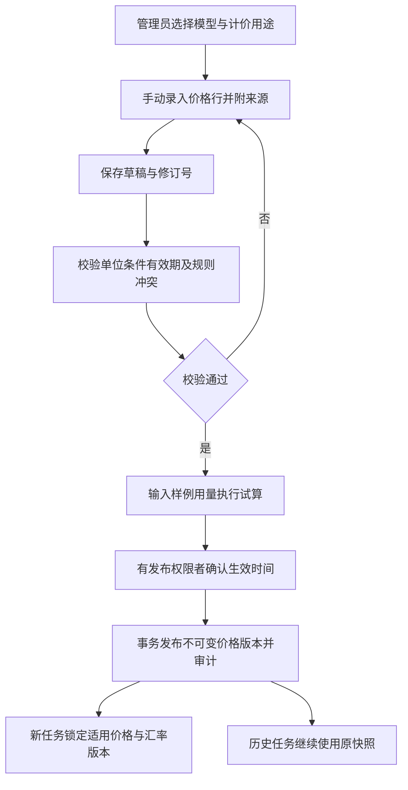

价格编辑与发布分别使用 `billing:price:write`、`billing:price:publish`，查看使用 `billing:price:read`。无需首期增加多人审批，但发布必须明确确认版本差异、用途和生效时间。并发修改使用 revision 检查，撤回通过关闭未来生效范围或发布替代版本实现，不删除已被任务引用的数据。

## 7 关键业务流程与时序

### 7.1 项目创作主流程

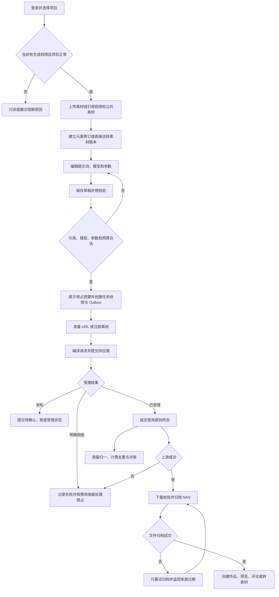

提交待确认的恢复分支见 7.5；没有可靠证据时保持待确认，不能直接转回提交。主流程中的费用处理可以先于或晚于文件归档，不由作品是否可预览决定。

### 7.2 素材上传与元素修订时序

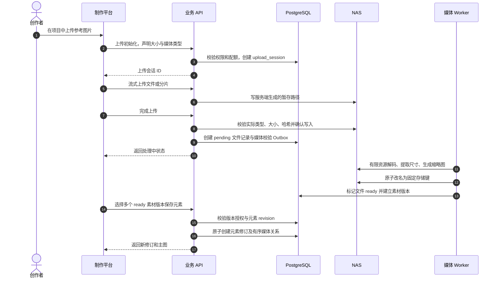

NAS 与数据库无法原子提交：暂存文件具有会话和到期时间；最终改名后数据库提交失败，可按会话重试确认；定期扫描孤立文件和缺失文件。只有 `ready` 文件允许生成引用。文件已被历史任务或元素修订引用时不能物理删除。上传大小、媒体解码时长和像素上限由后台策略限制，大视频不整块读入 API 内存。

### 7.3 素材引用与任务受理时序

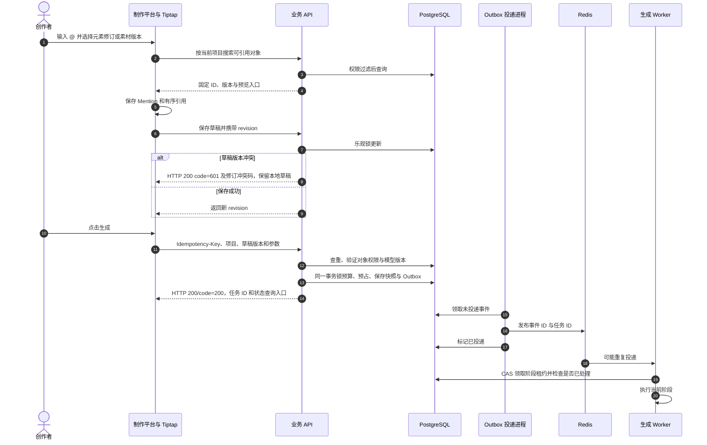

幂等键按用户、项目限定，重复同键同请求返回同一任务；同键不同请求摘要返回 code=601 业务冲突。查重与插入依赖数据库唯一约束，不能只依赖提交前查询。Outbox 发布后标记前进程退出会重复投递，消费者以事件 ID、任务状态版本及阶段租约去重。Redis 消息只携带 ID，不携带提示词全文、文件或秘密。

### 7.4 素材准备决策流程

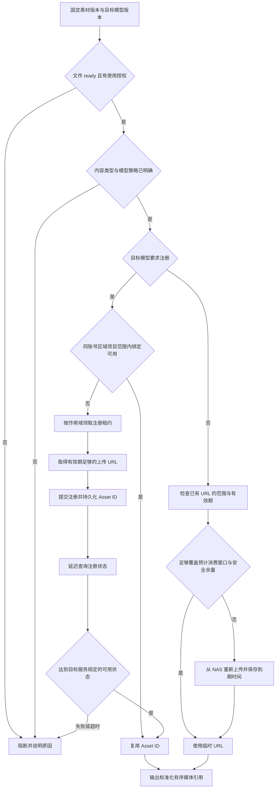

注册由“供应商＋模型＋媒体类型＋实际内容”共同决定，不以角色或场景分类直接判断。临时 URL 有效期按供应商确认值配置；初版中的 24 小时只是已有样例规则。若无法保证 URL 覆盖上游排队与下载窗口，应使用供应商支持的持久注册方式或阻断提交，不能只检查当前未过期。Asset ID 是否独立于原 URL 存活需单独确认。

### 7.5 生成提交与不确定结果恢复

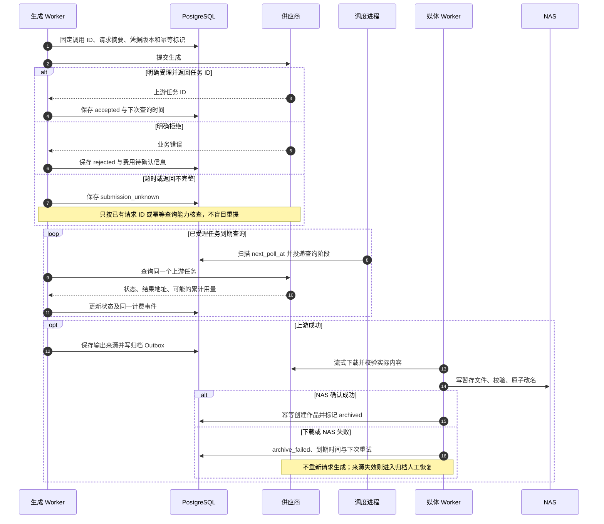

供应商调用前写 `started` 记录。进程在发送之后、保存受理结果之前退出，也属于提交未知。若上游明确支持幂等重放，使用原始幂等标识与完全一致的请求；否则根据上游请求 ID、受理查询或运营核查恢复。已有任务 ID 时只能继续查询。任务租约防止并发阶段执行，但本身无法保证外部 HTTP 恰好执行一次。

### 7.6 文本会话与流式恢复

文本生成同样先创建归属明确的任务、预算预占和调用记录。在供应商流式能力已验证并启用时，Worker 独立持有供应商流，按批次持久化消息片段与游标，再发布短期事件；未启用时保存最终消息并发布任务状态事件；API 通过 SSE 向浏览器推送已授权事件。浏览器断开只中断订阅，不自动终止 Worker 或释放预算。

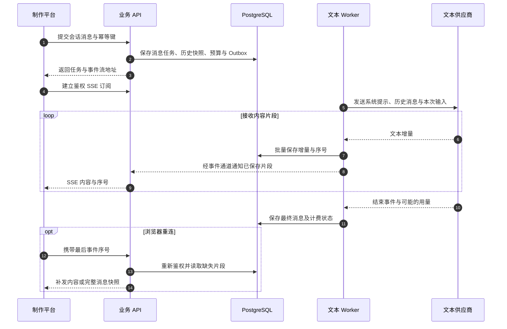

Worker 在供应商流中断后不能假定可从断点继续推理。保存部分文本并标记中断，按接口能力补查用量；用户主动再生成会形成新任务。Token 以供应商计费定义为准，包含历史与系统提示，缺失值显示待确认。SSE 缓存过期可通过数据库快照恢复；流式能力与最终用量协议在接入前验证。

### 7.7 评论标注与作品复用

评论、回复和标注每次写入检查目标项目权限。标注记录 `assetVersionId` 或作品文件 ID、归一化坐标、形状、颜色及画布原始尺寸；缩放只影响渲染。视频评论先支持文字和时间点，逐帧绘制属于后续能力。私有草稿的评论继承同一可见范围，评论用户提及不能隐式授予目标内容权限。

作品转素材创建新素材身份或新版本，并保留 `sourceOutputId`、`sourceJobId`；可复用同一不可变存储文件，通过引用计数和保留检查保护文件。发布到公共库需额外权限及使用范围，评论通过与生成成功均不自动等于公共发布。

## 8 状态机与可靠性

### 8.1 状态维度

| 维度 | 状态示例 | 界面用途 |
|---|---|---|
| 项目生命周期 | 正常、暂停、归档、待删除 | 决定是否允许新创作和编辑 |
| 编排状态 | accepted、preparing、submitting、submission_unknown、running、finished、blocked | 展示实际阶段和操作入口 |
| 上游生成 | not_submitted、queued、running、succeeded、failed、cancelled、unknown | 表示供应商执行结果 |
| 归档 | not_started、archiving、archived、archive_failed、source_expired | 决定作品是否在公司内可用 |
| 费用 | estimated、pending、calculated、confirmed、disputed | 区分预估、计算和最终结算 |
| 用量 | available、partial、unknown | 避免把未知显示为零 |
| 内容工作状态 | 无状态、制作中、待审核、已通过、已拒绝 | 供元素和作品协作，与技术任务状态独立 |

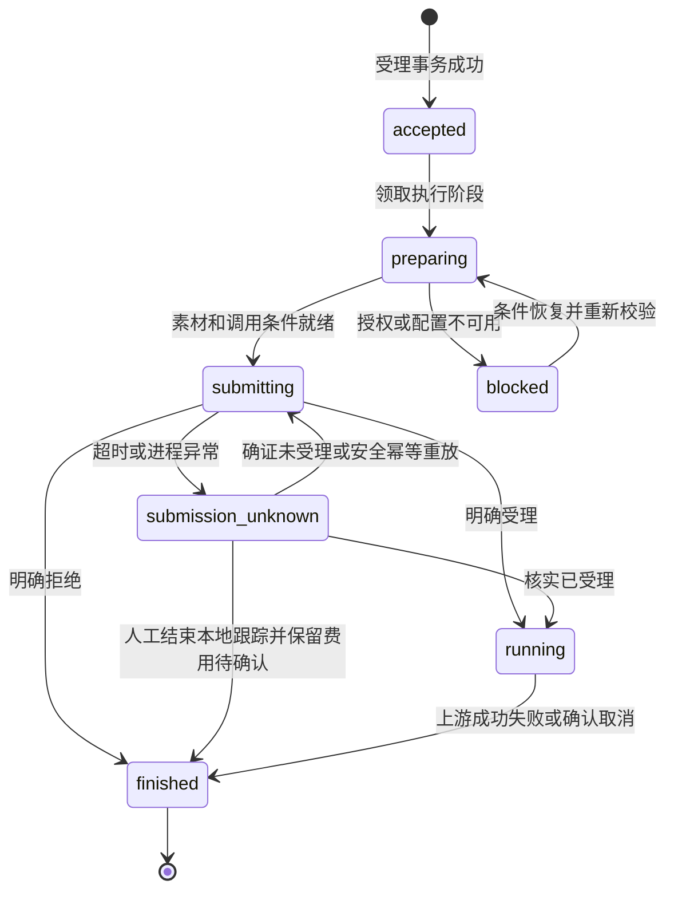

编排结束不等于归档和费用均结束；调度器按各自状态继续处理。界面可显示“生成成功，正在归档”“生成成功，归档失败”“提交待确认”等组合，不伪造精确百分比。

### 8.2 故障处置矩阵

| 故障 | 自动处理 | 不允许的处理 |
|---|---|---|
| API 写任务后退出 | Outbox 扫描继续投递 | 依赖浏览器再次提交才能入队 |
| Redis 消息丢失 | 按数据库未推进任务和到期时间重建通知 | 将 Redis 队列当唯一任务记录 |
| 消息重复或 Worker 重启 | 事件去重、状态 CAS、带 fencing token 的租约；过期执行者写回被拒绝 | 仅凭 Redis 锁判定外部调用从未发生 |
| 提交超时或连接被断开 | 标为未知，核查受理记录 | 普通 HTTP 重试策略直接重发生成 POST |
| 429 或供应商限流 | 遵循已验证的重试语义和退避；按账号范围限流 | 认为换 Key 就能绕过账号限制 |
| 查询失败 | 有界退避与抖动，保留上游任务 ID | 重新生成 |
| 注册并发或超时 | 复合唯一约束、租约与受理核查 | 盲目创建多份同范围 Asset |
| NAS 不可用 | 阻断新上传，限制新生成，优先恢复已生成结果归档 | 把上游成功标为本地作品已就绪 |
| 下载地址过期 | 若支持则刷新原任务结果，否则告警人工处理 | 用重新生成掩盖归档丢失 |
| Key 被撤销 | 阻断后续调用，VideoPlus 严格原 Key；失效任务保留核查，不自动换 Key | 用不相关账号查询或重提 |
| 项目暂停或归档 | 禁止新任务，继续维护已受理任务 | 丢弃在途状态和费用 |
| 成员被移除 | 新请求立即拒绝，长连接重验并关闭；历史归属保留 | 用旧前端权限缓存继续开放资源 |

所有重试有次数上限、截止时间、下次执行时间和人工处理入口。租约超时不能直接重试处于 `submitting` 的外部调用，必须先转未知核查。调度器可以多副本领取任务，但通过数据库锁与唯一事件约束保证同一阶段不会无限重复入队。若采用 Celery Beat 驱动扫描，应只运行一个有效 Beat 或明确采用主节点选举。

取消分三类：未提交上游可本地取消并释放确定未消费的预占；已受理且供应商支持取消则发起取消请求，等待确认；供应商不支持时仅停止用户等待或隐藏任务，后台继续归档与计费。失败和取消均不自动视为免费。

## 9 用量费用与预算一致性

### 9.1 费用事实与归属

`hf_provider_call` 记录每次真实 HTTP 调用；`hf_usage_record` 保存原始与标准化用量；`hf_billing_event` 表示可计费事实。一次视频生成被轮询十次仍对应同一生成计费事件，若查询本身收费则另外按供应商规则建立查询费用事件。去重键依据“供应商账号＋上游计费对象＋计费项”定义，不能只按模型名或调用返回次数计算。

每次调用保存原任务的用户、部门快照、项目、模型版本、价格版本、凭据版本和上游 ID。技术 Worker 是执行者，不是费用归属用户。管理员凭据测试计入管理成本中心。公共素材首次注册费按预先配置归发起项目或公共成本中心，其他项目复用不会再次承担同一注册费。

### 9.2 预算受理与结算时序

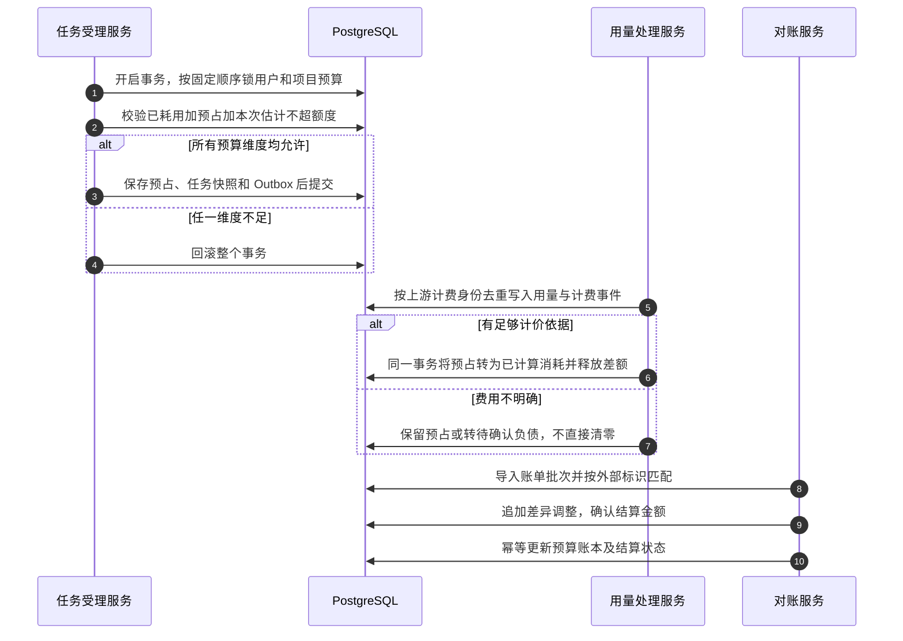

任务受理前的“费用预览”不预占额度，只有正式提交事务有预占效力。多预算行按稳定顺序加锁，避免并发超额及锁顺序死锁。预占金额与计费币种、价格版本绑定。实际费用高于预占时记真实成本并触发超额处理，不篡改金额；可阻止后续提交，但供应商未提供费用硬上限时，平台不承诺绝对不超支。

### 9.3 报表口径

制作平台只显示获授权项目和本人的可见费用。管理平台按用户、项目、发生时部门、模型、供应商账号和凭据查看用量。Token、张数、视频秒数分别展示，不自行换算成统一“真实 Token”。预估、已计算、已确认是同一费用的不同阶段，不相加；内部积分为独立运营账本，不等于采购价。

汇总按 P0-4 显式 timeBasis=createTime/billingPeriod 查询，页面注明时间口径；经营视图建议默认任务创建时间、财务视图建议账期，不以隐式默认替代请求参数。累计用量重复返回按证据去重，修订追加证据及差额调整，不覆盖既有计费事件原始金额；缺失返回显示“未知”或“部分待确认”。账单文件重复导入使用文件摘要和供应商账期去重；无法唯一匹配的记录进入差异队列，不按时间相近强行归属。

### 9.4 价格、用量和账单的三个口径

价格规则由 Providers 发布的模型身份与能力版本关联，UsageBilling 独立维护；不把价格埋在 Worker、前端或模型适配器代码中。同一请求可以有“平台计价金额”和“采购估算金额”，后续另收到“供应商账单确认金额”；三个值独立显示，不相加为一笔费用。平台计价不代表已向员工收款，本期不引入商业收费系统。

预算明确选择平台计价或采购成本作为控制口径，建议默认按平台计价控制内部额度，具体币种、周期及无预算处理沿 P0-5 §15 待评审，未确认不视为已批准策略。任务受理原子锁定 `platformPriceVersionId`、适用的 `procurementPriceVersionId`、`exchangeRateVersionId`、预算口径和参数摘要；供应商账单差异通过调整事件处理，不回写历史单价。排队跨越新价格生效时间仍沿用受理时快照；供应商实际扣费变化单列对账差异。

新增数据表：`hf_price_rule_item` 保存条件、计费项、单位、Decimal 单价和免费区间；`hf_price_source` 保存来源元数据与受控附件引用；`hf_exchange_rate_version` 保存币种对、换算方向、生效期和来源；`hf_billing_line_item` 保存命中规则、规范化用量、金额及口径；`hf_price_publish_event` 保存版本发布记录。沿用 `hf_price_version`、`hf_usage_record`、`hf_billing_event`、`hf_billing_adjustment`，同一上游计费对象按口径去重，不能把两种估值误当成两次实际消费。

### 9.5 初始价格草稿与来源差异

用户提供的截图原件已复制留存：[SD2.5-无视频输入.png](价格来源/SD2.5-无视频输入.png)、[SD2.5-包含视频输入.png](价格来源/SD2.5-包含视频输入.png)、[SD2.0-无视频输入.png](价格来源/SD2.0-无视频输入.png)、[SD2.0-包含视频输入.png](价格来源/SD2.0-包含视频输入.png)。

以下是文档初始值，尚未写入运行系统或完成正式发布。SD 标准版平台计价按用户提供的官网截图录入；两种视频输入模式分别建规则，当前截图单价相同。官网截图 SD 2.5 标示底层模型 ID 为 `doubao-seedance-2-5-260628`；网关是否映射到该确切版本仍需确认，SD 2.0 完整底层 ID 未从截图确认。

| 模型 | 分辨率 | 官网截图：无视频输入 | 官网截图：有视频输入 | 供应商报价：无视频输入 | 供应商报价：有视频输入 |
|---|---|---:|---:|---:|---:|
| SD 2.5 | 480p / 720p | 70 | 70 | 70 | 42 |
| SD 2.5 | 1080p | 77 | 77 | 77 | 46 |
| SD 2.0 | 480p / 720p | 46 | 46 | 46 | 28 |
| SD 2.0 | 1080p | 51 | 51 | 51 | 31 |
| SD 2.0 | 4K | 26 | 26 | 26 | 16 |

上表单位均为 **CNY / 百万计费 Token**。供应商文档称按 `completion_tokens` 计价，以 CNY 基准除以 6.69 换算 USD。平台官网价格与供应商采购报价不可互相覆盖；原接口文档中的旧固定美元价格不作为当前价格依据。截图有/无视频输入示例金额相同，但公式已改变，不能据此断定参考视频免费。

Fast 没有本次官网截图依据，以下仅保留为供应商采购报价草稿，不冒充官网平台计价：

| 模型 | 分辨率 | 无视频输入 | 有视频输入 | 单位与状态 |
|---|---|---:|---:|---|
| SD 2.5 Fast | 480p / 720p | 64 | 38 | CNY / 百万计费 Token，待采购核实 |
| SD 2.5 Fast | 1080p | 71 | 42 | 同上；能力冲突，保持禁用 |
| SD 2.0 Fast | 480p / 720p | 37 | 22 | 同上；平台价格待补充 |

其他模型采用供应商 `model-pricing.md` 作为报价来源，是否同时用于平台计价由管理员显式发布。不得推断为底层模型官网定价。

| 模型 | 输入 | 输出 | 单位及说明 |
|---|---:|---:|---|
| `mm-gemini-2.5-f` | 0.27 | 30.00 | USD / 百万 Token；保留原文，不自行将输出价改为 0.30 |
| `mm-gemini-3.0-p` | 2.00 | 12.00 | USD / 百万 Token |
| `mm-gemini-3.1-f` | 0.50 | 3.00 | USD / 百万 Token |
| `mm-imagen2` | 5.00 | 30.00 | USD / 百万 Token；按内层实际输入/输出用量计价 |

图片文档中的 `$0.0035/张` 明确不是当前生效计费规则，不录成默认扣费项。图片数、质量与尺寸可以影响用量和能力校验，但不能额外叠加没有依据的按张收费。

为后续能力保留扩展报价模板：M3 Standard 普通输入/缓存输入/输出分别 0.30/0.06/1.20 USD 每百万 Token，Priority 为 0.45/0.09/1.80；H3 输出和参考视频分别 0.13 USD/秒，前 5 张输入图片免费、超出部分 0.04 USD/张、参考音频免费；语音 HD 100 USD/百万字符、Turbo 60 USD/百万字符。上述模型不因保存报价而纳入首期上线。

### 9.6 用量归一、公式与精度

| 场景 | 结算公式 | 用量依据 |
|---|---|---|
| Gemini / 图片 | `输入Token / 1000000 × 输入单价 + 输出Token / 1000000 × 输出单价` | Gemini 外层 usage；图片 content 解析后的内层 usage |
| SD 平台计价 | `计费Token / 1000000 × 官网规则单价` | 供应商返回且定义已核实的 `completion_tokens` |
| SD 采购估算 | `completion_tokens / 1000000 × 供应商CNY单价 / 汇率` | 当前报价汇率为 CNY/USD = 6.69，作为独立版本保存，不能写死为通用汇率 |
| H3 后续能力 | `(输出秒数 + 参考视频秒数) × 0.13 + max(图片数 - 5, 0) × 0.04` | 若返回总秒数已经含参考视频，则不重复加；以已验证 usage 定义为准 |

缓存计费若启用，应确认输入 Token 是否已包含缓存命中部分，再拆成互斥的普通输入与缓存输入，不能重复计算。保存 `usageSource`、解析器版本、原始脱敏字段、计量单位与是否累计标识。供应商未返回用量时标记 unknown；若经语义核查确实免费才能记 0。

官网截图视频预估公式为：无视频输入 `宽 × 高 × 帧率 × 输出时长 / 1024`；包含视频输入为 `宽 × 高 × 帧率 × (输入时长 + 输出时长) / 1024`。它只用于参数明确时的预估，多个参考视频如何合计、帧率和实际尺寸应由已验证模型规则提供，不能仅凭“480p”标签推断。供应商完成后返回的计费 Token 已包含哪些消耗必须确认；结算时不能在返回 Token 上再次叠加估算的输入视频 Token。

截图中的元/个、约元/秒是特定比例和 5 秒输出的示例，不作为新的固定单价。例如 SD 2.5 720p 的 108000 Token × 70 / 1000000 = 7.56 CNY；SD 2.0 1080p 的 243000 × 51 / 1000000 = 12.393 CNY，展示两位为 12.39。供应商 SD 2.5 720p 有视频输入、1000000 Token 的采购估算则为 42 / 6.69 ≈ 6.278027 USD，与平台 70 CNY 是不同口径。

金额计算使用 Decimal，数据库建议 `numeric(24,10)`，单价和汇率保留原始精度；按版本记录舍入方式与币种显示精度，建议汇总后 ROUND_HALF_UP，页面人民币展示两位。账单确认以供应商实际扣费及其舍入规则对账，不能拿页面近似金额反推真实用量。无明确输入规模时估算应显示范围或待估，不承诺精确成本。

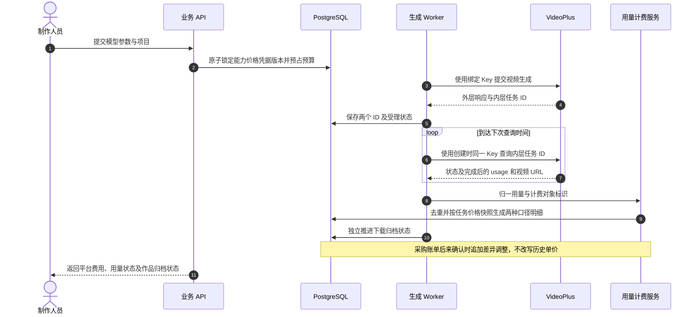

## 10 API 契约与权限

### 10.1 制作平台接口

统一前缀 `/api/v1`。下列为目标契约概要，工程实现时生成 OpenAPI 和 TypeScript 类型。

| 方法与路径 | 职责 | 关键契约 |
|---|---|---|
| `GET/POST /projects` | 列表与创建 | 列表按当前用户授权过滤 |
| `PATCH /projects/{id}` | 项目设置 | revision；归档等动作使用明确 action 接口 |
| `POST /projects/{id}/members` | 成员管理 | 校验可授予角色范围，避免越权授权 |
| `PUT /projects/{id}/brief` | 项目简报 | 乐观锁，富文本安全过滤 |
| `GET/POST /projects/{id}/folders` | 内容目录 | 校验所属项目及父目录，禁止循环 |
| `POST /uploads`、`POST /uploads/{id}/complete` | 上传会话和完成确认 | 额度、文件类型、幂等确认；分片端点在详细契约中定义 |
| `GET /projects/{id}/library` | 素材与作品库 | 框架页码分页、类型标签、筛选白名单、稳定次排序 |
| `POST /assets/{id}/versions` | 创建固定版本 | 引用已完成上传会话 |
| `GET /references/search` | Mention 搜索 | 必传 projectId；支持元素与素材版本 |
| `POST /elements`、`PATCH /elements/{id}` | 元素创建与修改 | 创建返回永久 ID；元素修订与别名独立 |
| `POST /elements/{id}/copy` | 跨项目复制 | 检查来源与目标权限以及每个媒体授权 |
| `PUT /drafts/{id}` | 保存草稿 | revision 冲突使用 HTTP 200/code=601 与业务细分码，不静默覆盖 |
| `GET /model-profiles` | 可用模型能力 | 只返回已授权发布版本，不返回秘密和内部连接配置 |
| `POST /generations/validate` | 预校验和估价 | 不保证随后提交仍有额度 |
| `POST /generations` | 受理任务 | 幂等键、成功受理回执、任务 ID；不接受决定归属的 userId |
| `GET /generations/{id}` | 查询任务 | 多状态维度与可执行动作，不透传供应商原始响应 |
| `POST /generations/{id}/cancel` | 申请取消 | 返回取消语义和是否已获上游确认 |
| `POST /generations/{id}/retry-archive` | 重试归档 | 不发起新的生成 |
| `GET /outputs/{id}/preview`、`/download` | 文件访问 | 每次鉴权，支持视频 Range；仅返回公司受控文件 |
| `POST /outputs/{id}/to-asset` | 作品转素材 | 保留来源链、幂等转换 |
| `POST /comment-threads`、`POST /comment-threads/{id}/comments` | 标注与评论 | 目标版本授权、提及用户可见性、修订约束 |
| `POST /chat/sessions/{id}/messages` | 文本任务 | 幂等、固定历史输入、框架成功信封返回 |
| `GET /generations/{id}/events` | SSE 订阅 | 事件序号、重连、重新鉴权、快照补偿 |

### 10.2 管理平台接口

统一前缀 `/api/admin/v1`。管理接口不复用面向制作平台的宽松 DTO。

| 方法与路径 | 功能 | 最小权限 |
|---|---|---|
| `GET/POST /provider-connections` | 查看和新建供应商连接 | `provider:read` / `provider:write` |
| `PATCH /provider-connections/{id}` | 修改地址和配置修订 | `provider:write` |
| `GET /credentials` | 查看掩码和状态 | `credential:read` |
| `POST /credentials` | 加密保存 Key | `credential:write` |
| `POST /credentials/{id}/versions` | 写入替换 Key 版本 | `credential:rotate` |
| `POST /credential-versions/{id}/tests` | 创建探测任务 | `credential:test` |
| `GET /credential-tests/{id}` | 脱敏测试结果 | `credential:read` |
| `POST /credential-versions/{id}/activate` | 发布当前版本 | `credential:activate` |
| `POST /credential-versions/{id}/drain` | 排空旧版本 | `credential:disable` |
| `POST /credential-versions/{id}/revoke` | 紧急撤销 | `credential:revoke` |
| `PUT /project-provider-configs/{projectId}` | 项目路由和上游映射 | `provider:route` 加项目管理范围 |
| `POST /model-profiles/{id}/versions`、`POST /model-profile-versions/{versionId}/publish` | 能力版本与发布 | `model:write` / `model:publish` |
| `GET/POST /price-versions`、`PATCH /price-versions/{id}` | 价格列表、新建/编辑草稿；PATCH 携带 revision | `billing:price:read` / `billing:price:write` |
| `POST /price-versions/{id}/simulate` | 按指定草稿或已发布版本试算，不调用供应商 | `billing:price:read` |
| `POST /price-versions/{id}/publish` | 校验冲突、生效期、revision 并原子发布 | `billing:price:publish` |
| `GET /price-versions/{id}/history` | 版本来源、差异与审计 | `billing:price:read` |
| `POST /price-sources`、`POST /exchange-rate-versions` | 来源附件与汇率版本 | `billing:price:write`；启用汇率需发布权限 |
| `PUT /budgets/{id}` | 仅修改预算 active 开关；已引用的用途、币种与主体不改 | `billing:budget` |
| `POST /budget-periods/{id}/adjust-limit` | 按 revision 追加额度变更，不改历史消费 | `billing:budget` |
| `GET /usage/summary`、`GET /billing-events` | 汇总和计费明细 | `billing:read` 加数据范围 |
| `POST /reconciliations` | 导入对账 | `billing:reconcile` |
| `GET /audit-logs` | 查询关键审计 | `audit:read` |

不存在 `GET /credentials/{id}/secret`。常规删除保留审计身份和被引用版本，秘密销毁按无在途依赖及保留策略处理。财务人员可查看凭据标识对应的消费，不因此获得配置或解密权限。

### 10.3 错误与数据范围

错误响应包含稳定业务码、用户可理解说明、字段问题与 `requestId`。例如 `PROJECT_READ_ONLY`、`REFERENCE_FORBIDDEN`、`DRAFT_REVISION_CONFLICT`、`MODEL_PARAMETER_INVALID`、`BUDGET_INSUFFICIENT`、`CREDENTIAL_UNAVAILABLE`、`SUBMISSION_UNKNOWN`。供应商原始错误经脱敏后保存在运维视图，不能直接作为员工提示。

授权按“功能权限 ∩ 项目成员权限 ∩ 对象可见范围 ∩ 当前状态”计算。全局平台管理员、凭据管理员、财务人员和项目负责人分别授予所需权限，不设置默认的全员管理权限。项目费用查看、内容下载、公共发布、跨项目复制和成员管理独立控制。

搜索与导出必须执行与详情一致的过滤；预签名链接若后续引入，其有效期不能替代对象授权。首期采用鉴权接口与 Nginx 内部文件位置交付，每个 Range 请求鉴权；移除成员后停止新请求和后续流订阅，但已经下载到用户设备的文件无法远程撤回。

## 11 部署与运行架构

### 11.0 本地开发运行方式（已确认）

| 组件 | 启动位置与方式 | 连接约定 |
|---|---|---|
| PostgreSQL | Docker 容器 | 映射本机端口并持久化数据卷；本项目数据库只使用 PostgreSQL |
| Redis | Docker 容器 | 映射本机端口，数据持久化策略按开发需求配置 |
| 后端 API | 在 `ruoyi-fastapi-backend/` 使用本机 Python 环境手动启动 | 通过 `127.0.0.1` 与实际映射端口访问 PostgreSQL、Redis |
| 管理前端 | 在 `ruoyi-fastapi-frontend/vue3/web/` 手动启动开发服务器 | 独立开发端口，通过代理访问同一后端 |
| 制作前端 | 在 `higgsfield-frontend/` 初始化完成后手动启动开发服务器 | 使用与管理端不同的开发端口，通过代理访问同一后端 |
| 生成/media Worker | 实现后在本机独立进程手动启动 | 复用后端业务配置和两个基础设施容器，不要求先容器化业务服务 |

本机进程不能直接使用 Docker 内部服务名作为数据库/Redis主机名。端口、卷名、数据库账号与本地配置值在开发环境落地时核实，不将现有 Compose 样例端口当作已启动事实。前端原框架代理与新增 `/api/v1`、`/api/admin/v1` 代理按实际后端路由分别配置。

建议顺序：启动 PostgreSQL/Redis并确认就绪 → 执行经核验的数据库初始化/迁移 → 手动启动后端 → 分别启动管理端与制作端 → 按需启动Worker。重启开发环境应保留数据卷，不能把删除卷作为常规重启步骤。

现有 `docker-compose.pg.yml` 是框架全栈样例，不作为本地“一键启动所有业务容器”的操作约定。后续可新增仅包含 PostgreSQL/Redis 的开发基础设施 Compose；本次只更新文档，没有修改 Compose、环境文件或启动任何服务。

### 11.1 目标部署拓扑（与本地开发方式区分）

已确认在公司内网服务器部署，并使用公司 NAS 保存素材与视频。Linux 应用主机是建议，尚未确认操作系统或主机数量；正式环境是否容器化按运维环境选择。下面展示逻辑运行单元，可由 Docker Compose 等方式承载，不假定已有部署脚本或已决定全栈容器化。

```mermaid
flowchart TB
    client["公司内网浏览器"]
    subgraph host["公司内网应用服务器（Linux 为建议）"]
      nginx["Nginx<br/>HTTPS 入口、SPA、内部文件交付"]
      studio["制作平台静态产物<br/>/studio/"]
      admin["管理平台静态产物<br/>/admin/"]
      api["FastAPI 进程"]
      dispatch["调度与 Outbox 进程"]
      worker["生成与文本 Worker"]
      media["媒体 Worker 与 FFmpeg"]
      pg[("PostgreSQL 独立持久卷")]
      redis[("Redis 独立持久卷")]
      secret["只读运行秘密挂载<br/>主密钥与基础连接凭据"]
    end
    nas["公司 NAS<br/>专用服务账号与持久存储"]
    upstream["外部供应商 HTTPS 服务"]
    backup["独立备份目标<br/>数据库备份与 NAS 快照"]
    client -->|HTTPS| nginx
    nginx -->|静态读取| studio
    nginx -->|静态读取| admin
    nginx -->|内网 HTTP 代理| api
    nginx -->|受保护只读文件交付| nas
    api -->|SQL| pg
    api -->|缓存与 SSE 事件| redis
    api -->|暂存文件读写| nas
    dispatch -->|SQL 扫描与租约| pg
    dispatch -->|消息投递| redis
    redis -->|任务通知| worker
    redis -->|任务通知| media
    worker -->|SQL| pg
    media -->|SQL| pg
    worker -->|读取素材| nas
    media -->|归档与预览文件| nas
    worker -->|HTTPS 受控出站| upstream
    media -->|HTTPS 受控下载| upstream
    secret -->|启动时注入| api
    secret -->|启动时注入| worker
    pg -->|备份与日志归档| backup
    nas -->|快照与增量备份| backup
```

数据库、Redis 不开放员工网络访问。Nginx 的文件位置必须配置为内部访问，只接受后端授权后生成的存储键映射，禁止路径穿越。NAS 挂载支持方式按公司设备验证，API、Worker 使用一致路径配置；Nginx 只读，媒体 Worker 按需写入。FFmpeg 受 CPU、内存、执行时长和输入协议约束。

#### 内网与 NAS 的访问边界

- PostgreSQL 保存文件标识、NAS 存储键、大小/哈希、版本、权限和任务关系；媒体二进制长期保存到 NAS，供应商临时 URL 不作为永久存储地址。PostgreSQL/Redis 数据目录不因素材使用 NAS 而默认迁移到 NAS。
- API、媒体 Worker 与受控文件交付进程按服务账号权限访问 NAS；数据库、NAS 挂载和供应商 Key 不直接暴露给员工浏览器。预览、下载、HEAD/Range 均先经过平台授权。
- 应用服务器本地磁盘可用于受控临时处理和缓存，不能替代 NAS 的最终归档。挂载失效时必须识别不可用状态，禁止静默写入挂载点下的本地空目录并宣称归档成功。
- 公司内网部署不等于完全离线。现有第三方模型调用仍需服务器受控出站；供应商无法直接读取公司 NAS 路径或内网 URL。按已验证的上传/注册协议把获授权参考素材交给供应商，不直接公开 NAS；如供应商模式必须拉取 URL，先确认受控中转方案和权限，再开放对应能力。
- 继续采用后端主动查询任务结果；不因接入外部模型而默认将应用或 NAS 开放公网。供应商地址的加密路径要求仍沿 P0-2，不能把当前 HTTP 资料地址写成已验证 HTTPS。
- 正式上线前冻结 NAS 协议（SMB/NFS 等需验证）、服务账号、挂载路径、容量/配额、备份与恢复策略；验证读写、原子改名、断连重挂、并发归档和视频 Range 播放。NAS 快照不单独等同完整备份，数据库、媒体和解密主密钥按同一恢复计划核对。

### 11.2 扩展与容量策略

先按 `generation`、`polling`、`media`、`chat` 队列隔离长短任务。供应商账号和模型并发限制独立于 Worker 数量；增加 Worker 不自动提高采购额度。文本流按连接并发限制独立扩容，媒体任务按 CPU、磁盘和 NAS 带宽扩容。API 无本地会话依赖后可横向扩容；数据库和 NAS 单点仍需运维方案，单主机起步不宣称高可用。

容量估算使用“日输入文件量＋日输出文件量＋衍生文件量”，再按保留期、版本增长和备份系数计算。记录实际图片大小、视频码率与平均时长后再确定磁盘和吞吐规格，不用截图推定并发规模。

### 11.3 建议服务目标与观测

下表是待试运行验证的设计目标，不是当前实测指标；供应商排队和推理时长单独统计。

| 指标 | 初始目标或监控方式 | 触发处理 |
|---|---|---|
| 普通列表与详情 API | 约定数据规模下 P95 ≤ 1 秒 | 查询分析、索引和分页优化 |
| 生成受理 API | 不含文件上传和推理，P95 ≤ 2 秒 | 查看事务锁、预算竞争和数据库负载 |
| Outbox 投递延迟 | P95 ≤ 5 秒 | 告警并检查投递进程及 Redis |
| 在途任务可恢复性 | 进程重启后由数据库扫描恢复 | 跟踪租约过期、重复事件和未知提交 |
| 归档时限 | 必须早于供应商结果到期，配置安全余量 | 临近到期高优先级补偿，失败升级告警 |
| API Key 健康 | 到期、认证失败、撤销、连续错误 | 停止新任务选用并通知运维 |
| 成本正确性 | 重复计费事件为零；未知费用有可追踪队列 | 对账并追加调整，不隐藏差异 |
| 备份恢复 | 建议试运行 RPO ≤ 24 小时、RTO ≤ 4 小时 | 通过演练确认，业务要求更高则增加 WAL 归档和冗余 |

日志串联 `requestId`、`jobId`、`callId`、`upstreamTaskId`，但高基数 ID 不作为时序指标标签。监控队列最老任务、阶段停留、注册失败、NAS 可用性、剩余存储、供应商错误率、归档失败、预算预占积压。日志脱敏授权头、签名 URL、Base64 和提示词敏感正文；必要的输入快照受业务权限和保留策略保护。

### 11.4 备份、迁移与恢复

数据库、NAS 和加密主密钥分别备份并受控保管；只有数据库备份无法恢复素材和解密凭据。建立恢复时间点及文件清单，保证数据库引用的文件在恢复集内。恢复后校验文件记录、大小、哈希、作品与任务关系，再恢复任务调度。

发布前备份并验证可读性，迁移优先采用兼容新增字段与表的方式。API 与 Worker 的部署版本及事件 schema 必须兼容；破坏性迁移先暂停新任务并排空相关执行阶段。失败回滚应同时评估应用与数据库兼容性，不能只回退前端。恢复环境默认关闭真实供应商提交，确认在途任务与上游状态后才恢复调用，防止从备份重放已消费的生成。

## 12 分期实施与验收

### 12.1 实施顺序

ST-00～ST-06 是技术实施阶段，B1～B4 是业务交付批次，都不是需求优先级。ST-00 是共同前置，ST-01/02 支撑 B1，ST-01/03 支撑 B2，ST-04 与 ST-05 中对话部分支撑 B3，ST-05 的协作与 ST-06 支撑 B4；阶段可以交叉，正式消费必须先满足对应阻断项。平台任务 SSE 按 P0-4 实现状态、快照和事件重放，不依赖供应商流式能力；只有供应商文本增量及其用量协议验证后才开放逐字流式对话，首期保留非流式等待和最终消息链路。

| 阶段 | 交付范围 | 完成门槛 |
|---|---|---|
| ST-00 工程与契约 | 固定 RuoYi 版本、双 SPA、数据库迁移、认证权限、适配器契约 | 框架与 PostgreSQL 兼容验证；开发测试生产配置隔离 |
| ST-01 项目与资产 | 项目成员、简报、目录、NAS 上传、版本、公共授权、元素基础 | 项目隔离、文件访问、版本不变、元素多图及引用规则通过 |
| ST-02 管理与消费基础 | 供应商连接、API Key 配置测试轮换、模型发布、调用记录、预算、Outbox | 在开放正式生成前具备归属、成本追踪和凭据安全 |
| ST-03 图片创作闭环 | 共用创作组件、Tiptap、草稿、能力参数、图片任务、归档、作品转素材 | 图片生成到归档可追溯，失败不丢状态且不盲目重复消费 |
| ST-04 视频与恢复 | URL 注册策略、视频提交查询、提交未知、归档补偿 | 模拟超时、重启、重复消息、NAS 故障均可恢复 |
| ST-05 协作与文本 | 评论标注、工作状态、元素布局、平台任务 SSE；项目申请按 D02/D03 与 P0-6 门槛关闭到契约补齐 | 权限撤回、评论版本定位、断线恢复通过 |
| ST-06 运营与上线 | 对账、费用报表、审计、容量验证、备份恢复演练 | 真实供应商联调、试点项目验证和运维交接完成 |

高级镜头、色彩迁移、AI 元素提取、画布与导演工作流列入后续能力，不阻碍前述闭环。分期减少功能数量，不取消固定版本、权限边界、调用记录、密钥加密或预算事务。

### 12.2 核心验收矩阵

| 编号 | 场景 | 通过条件 |
|---|---|---|
| A01 | 用户篡改 projectId、assetVersionId、outputId | 搜索、详情、预览和下载均不泄露未授权内容 |
| A02 | 首页切项目与未保存草稿 | 明确保存或保留本地，旧项目引用不会被静默带入新任务 |
| A03 | 同名元素、改别名、更新多图和版本标签 | 历史任务仍引用原修订及固定文件；普通 @ 文本不伪装成有效引用 |
| A04 | 公共素材跨项目复用 | 不重复保存原文件；新作品及费用归当前项目 |
| A05 | 复制移动元素到其他项目 | 每个媒体授权均检查，原任务归属与历史文件不被改写 |
| A06 | 同幂等键并发点击生成 | 只创建一个任务和一次预占；不同请求摘要返回冲突 |
| A07 | 多任务竞争同一用户与项目预算 | 事务内校验与预占，不出现并发绕过额度 |
| A08 | 多员工共用同一 Key | 各自归属、项目和部门快照可追踪，Worker 不成为消费人 |
| A09 | 查看凭据列表、详情、错误、日志、队列 | 无明文 Key 或密文回显；普通制作用户无法调用管理接口 |
| A10 | 测试通过后修改连接或 Key | 测试失效，新修订不能沿用旧结果直接启用 |
| A11 | 正常轮换与紧急撤销 | 新任务选新版本；旧任务排空可查；紧急撤销立即阻断后续调用并明确影响 |
| A12 | 提交响应丢失或 Worker 在发送后退出 | 转提交未知，不自动重提；恢复依据可审计 |
| A13 | 重复消息、租约过期、投递后未标记退出 | 业务推进幂等；过期执行者不能覆盖新状态 |
| A14 | URL 过期、注册未就绪、账号范围不一致 | 重新准备或明确阻断，不跨账号复用 Asset ID |
| A15 | 上游成功但 NAS 不可用 | 生成成功和归档失败分别展示；仅重试归档 |
| A16 | 视频轮询累计 usage 重复返回 | 同一计费事件只计一次，缺失用量保持未知 |
| A17 | 浏览器关闭文本流 | Worker 状态和费用继续跟踪，重连可恢复已保存内容 |
| A18 | 评论后更新元素参考图 | 原标注仍指向原文件版本，不漂移到新图片 |
| A19 | 项目归档、成员移除、用户禁用 | 新操作和流订阅权限立即收敛；已受理任务归属保留 |
| A20 | 账单重复导入和实际费用高于预占 | 不重复扣账，差异追加调整，真实成本可见 |
| A21 | NAS 路径穿越、恶意 URL、超大媒体 | 服务端阻断，下载重定向逐跳校验且媒体处理资源受限 |
| A22 | 数据库与 NAS 灾难恢复 | 文件可读且关系一致，密钥可恢复；默认不重放真实生成 |

验证分为领域不变量与接口测试、故障注入、真实供应商联调、制作平台浏览器业务验收和恢复演练。通过 Mock 不代表已验证真实供应商计费、取消、素材注册或幂等能力；上线记录应分别列出各层验证结果。

### 12.3 本次新增验收要求

| 编号 | 场景 | 通过条件 |
|---|---|---|
| A23 | 两种价格来源录入 | SD 官网平台价格与供应商采购价格各自保存，报表明确口径 |
| A24 | 缺价、规则重叠、单位或生效区间错误 | 可存草稿，发布失败；消费不能按 0 元放行 |
| A25 | 新价发布时已有排队/运行任务 | 历史任务及预占使用原快照，新任务按有效期选择新版本 |
| A26 | 图片外层 usage 为 0、内层非零 | 计价只读取正确内层值，Base64 输出正确归档 |
| A27 | 视频外层 ID 不同于内层 ID | 查询内层任务 ID，保留创建 Key，轮询不重复计费 |
| A28 | 报价含 Fast 1080p 或 SD 2.0 4K | 未验证能力仍不出现在制作平台可选参数中 |
| A29 | 报价并发编辑、越权发布 | revision 冲突及无权限请求被拒绝，审计可追踪 |
| A30 | 试算和真实账单差异 | 7.56 CNY、12.393 CNY 和 42/6.69 USD 样例可重现，账单调整不改历史 |
| A31 | 上传/注册 URL 到期、跨区域引用 | 刷新或阻断，不跨 eva/nova 复用，不重提生成掩盖异常 |
| A32 | 新旧价格用量重复返回或未知 | 同一口径去重、不同口径不合计，未知用量不记零 |

以上为待实现验收标准，本次仅更新架构文档，未执行真实供应商计费调用。

### 12.4 接入前待确认事项

| 事项 | 责任角色 | 未确认时的处理 |
|---|---|---|
| 上游精确commit、当前数据库初始化状态与PostgreSQL迁移路径 | 技术负责人 | 不进入业务开发基线 |
| VideoPlus 正式 HTTPS/加密通道、网关别名到底层版本映射、账号范围 | 接入负责人 | 连接保持待验证，禁止启用 |
| 上传限制、临时 URL 生命周期、Asset 是否独立存活 | 接入负责人 | 不发布依赖该能力的模型配置 |
| 哪些媒体及人像需要注册，Group 的实际规则 | 产品与接入负责人 | 使用明确规则；待确认内容阻断 |
| 生成幂等键、受理查询、任务取消、结果保留时间 | 接入负责人 | 保守采用提交待确认和主动轮询 |
| 文本流协议、usage 定义、失败收费、采购价格 | 财务与接入负责人 | 用量未知不记零；缺价模型不正式开放消费 |
| VideoPlus 同 Key 查询限制与轮换恢复能力 | 接入负责人 | 严格保留创建 Key；未验证不能用同账号新 Key 替换 |
| 官网截图包含视频输入公式、网关 completion_tokens 定义及采购价冲突 | 财务与接入负责人 | 保存分离口径草稿，验证后发布，差异进入对账 |
| NAS 挂载协议、备份、容量、公司恢复目标 | 运维与业务负责人 | 试点容量验证与恢复演练通过再扩量 |
| 外部分享、个人空间、AI 提取、画布与导演范围 | 产品负责人 | 保持关闭，另立能力契约和验收范围 |

## 附录 A 代表界面定位

完整状态以[截图状态对照表](../references/已整理/截图状态对照表.csv)为索引。以下原图用于核对关键领域决策，图片保持原位和原文件名。

| 架构主题 | 原图 |
|---|---|
| 项目列表与导航 | [我的项目默认页](../references/已整理/我的项目-完整页面-默认-All项目列表含11-01.png) |
| 全局创作入口 | [首页视频创作](../references/已整理/首页-完整页面-默认-视频生成与项目列表-01.png) |
| 模型与参数 | [生成模式菜单](../references/已整理/首页-生成模式选择器-弹出菜单-参考与前后续及编辑模式-01.png) |
| 元素多图与属性 | [元素编辑主图与缩略图](../references/已整理/我的元素-编辑元素-弹窗-主图与三张缩略图-05.png) |
| 跨项目组织 | [复制元素目标树](../references/已整理/我的元素-复制元素-弹窗-项目树展开-03.png) |
| 评论版本绑定 | [元素评论与图片定位](../references/已整理/元素详情-评论侧栏-默认-两条评论与图片定位标记-02.png) |
| 项目内容权限 | [角色与内容权限](../references/已整理/项目设置-角色与权限-页面滚动位置-中部内容权限-01.png) |
| 项目用量 | [项目用量统计](../references/已整理/项目设置-用量统计-页面滚动位置-顶部总体用量-01.png) |
| 多图元素实例 | [MAYA 角色多视图](../references/已整理/Cully%20Hill%20Boys元素详情-信息侧栏-默认-MAYA角色多视图-01.png) |
| 任务输入追溯 | [作品完整提示词侧栏](../references/已整理/Cully%20Hill%20Boys素材详情-提示词侧栏-展开-街景完整提示词-01.png) |

## 附录 B 图表阅读索引

| 图 | 位置 | 主要阅读对象 |
|---|---|---|
| C1 系统上下文 | 4.2 | 产品、管理者、外部接入人员 |
| C2 容器视图 | 4.3 | 技术负责人、开发、运维 |
| C3 API、Worker 与双前端组件 | 4.4、4.5、4.6 | 前后端开发 |
| C4 代码契约 | 4.7 | 后端开发与代码评审 |
| 核心数据关系 | 5.2 | 数据库设计与业务开发 |
| Key 配置流程及轮换时序 | 6.4、6.5 | 管理平台开发与运维 |
| 项目创作流程 | 7.1 | 产品、制作平台开发、测试 |
| 素材上传与元素修订时序 | 7.2 | 资产模块开发 |
| 引用与任务受理时序 | 7.3 | 前后端协作 |
| 素材准备决策流程 | 7.4 | 供应商适配开发 |
| 生成与归档恢复时序 | 7.5 | 编排开发与运维 |
| 文本流时序 | 7.6 | 文本会话开发 |
| 编排状态机 | 8.1 | 后端、前端与测试 |
| 预算与结算时序 | 9.2 | 费用模块开发与财务 |
| 部署拓扑 | 11.1 | 运维与架构评审 |


本次新增图表：6.9 价格配置发布流程；9.6 VideoPlus 视频接入与双口径计价时序。

**前端统一编码约束（补充确认）：** 两端新增及修改的前端业务代码使用 Vue3 + Vue Router + Pinia + Axios，统一 `<script setup>`，禁止 Options API；业务逻辑放 use 开头的 composables，请求放 api/ 独立模块，路由定义和守卫由 Vue Router 管理，全局状态由 Pinia 管理。代码风格遵循[制作平台前端编码规范](制作平台前端编码规范.md)中的明确约定。保留管理端存量工程；本次未重写已有组件或初始化制作端。

**制作端双向绑定约束：** higgsfield-frontend 使用 Vue3.4+，自定义组件双向绑定优先 defineModel()，支持多个 v-model:xxx；禁止 .sync，子组件严禁直接修改 props（包括嵌套对象/数组）。详见[制作平台前端编码规范](制作平台前端编码规范.md)第9章。数据库继续执行已确认的若依统一规范，无物理外键。

**后端强制规范：** PostgreSQL 继续作为数据库；controller → service → dao → entity/do、异步 AsyncSession、统一 ResponseUtil/PageResponseModel/异常/中间件，以及日志、导出、配置和 Redis 权限缓存失效要求，详见[后端编码与框架对齐规范](后端编码与框架对齐规范.md)。

**UI 与主题基线：** 页面样式、布局和组件排版参考用户截图，保留卡片、表格、表单、侧边栏及按钮的视觉特征。必须交付亮色/暗黑双主题和主题切换入口；成对语义色变量统一驱动 Element Plus 与 shadcn-vue，切换不丢业务状态、不改变媒体原图颜色。具体规则和验收见[制作平台前端编码规范](制作平台前端编码规范.md)第11章。

## 本轮分层图说明

C4 类图的方法是职责示意，不是同步接口签名。涉及数据库或网络 I/O 的方法使用 async/await；Worker 的 JobOrchestrator 只调用 Service，Service 通过 DAO 与独立 AsyncSession 推进状态，供应商网络调用位于数据库长事务之外。纯能力描述函数可同步。

## 价格与预算详细契约衔接

价格配置、用量归一、预占结算、对账调整及计算示例详见[P0-5 价格用量预算说明](价格用量预算说明.md)；角色与费用范围见[P0-6 权限矩阵](权限矩阵.md)。P0-5 的默认周期、估算上界及采购币种表达仍为评审提案，不将文档完成当作实际价格发布或收费验证。
