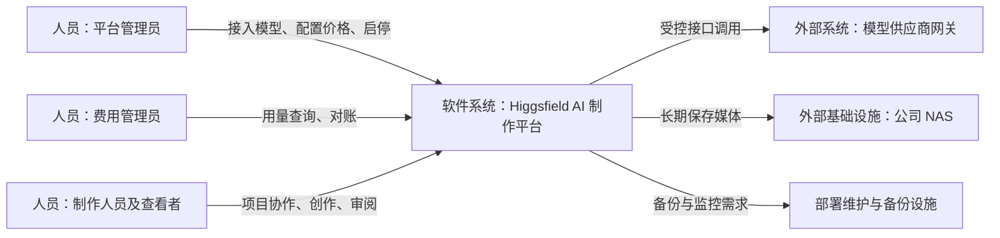
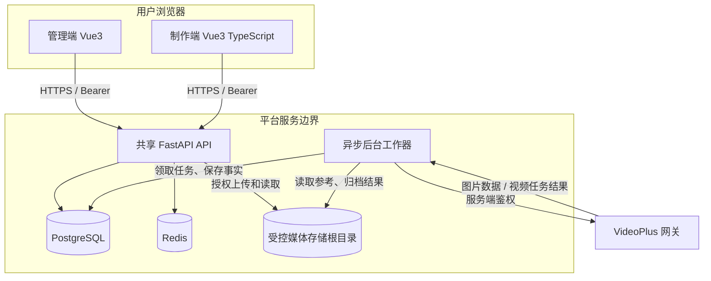
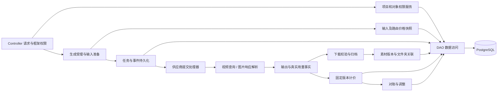
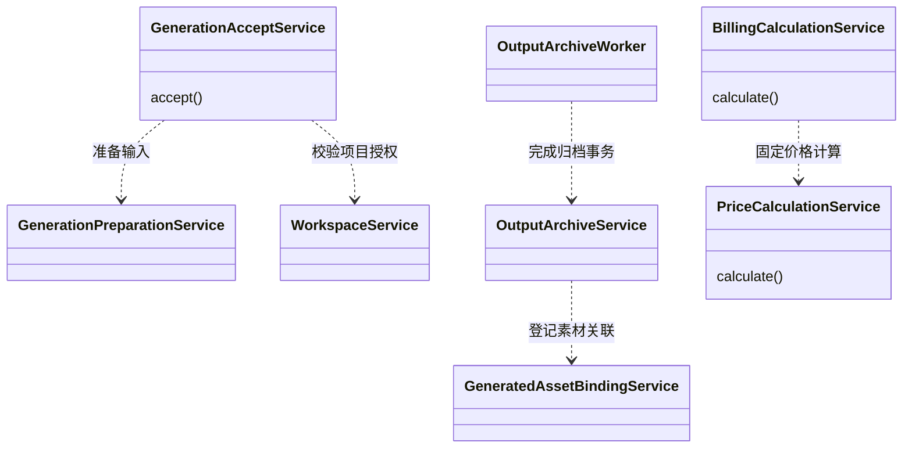
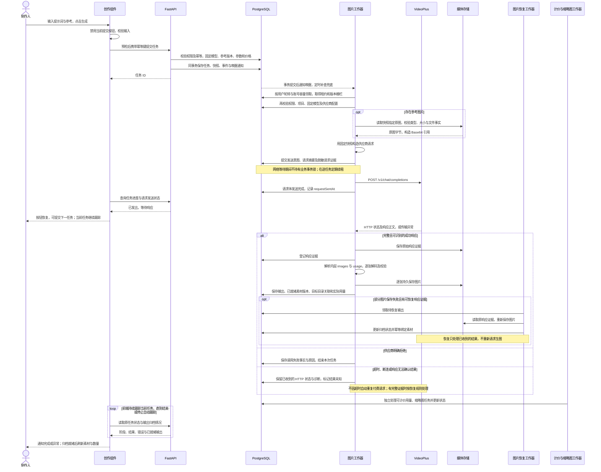
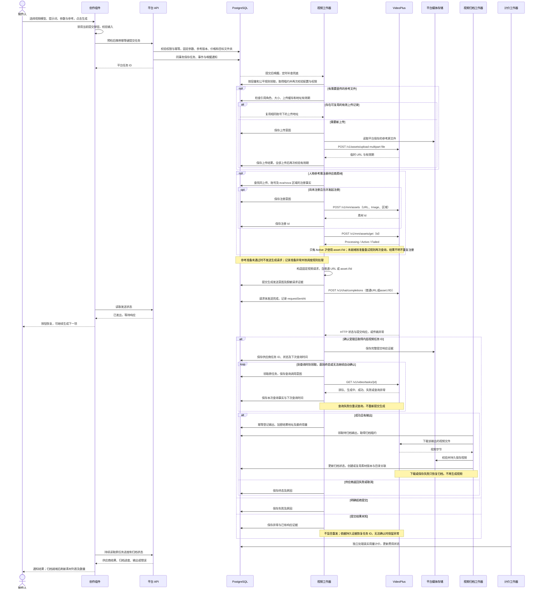
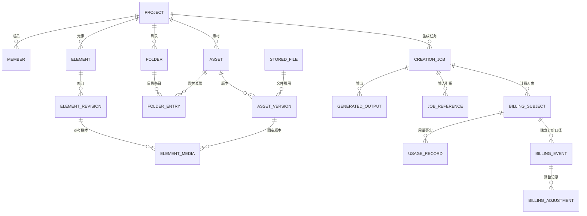
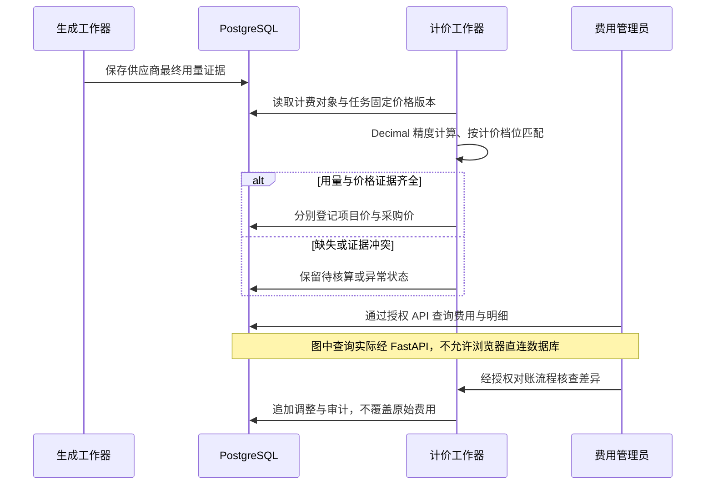

# Higgsfield AI 制作平台 · 技术方案（对应当前代码）

版本：2.0｜更新：2026-11-03｜代码基线：`fdf3f612`
阅读顺序：业务目标见[完整 PRD](AI图片与视频制作平台PRD-全流程版.md)，本文说明系统分工、关键链路、数据和保障措施。C4 图中的“容器”表示可运行应用/数据存储，不代表已经采用 Docker 部署。

## 1. 技术结论与建设边界

采用两个 Vue3 前端、共享 FastAPI 后端、PostgreSQL、Redis 和独立异步后台工作器。模型调用集中在服务端；文件由平台长期存储并授权访问；生成、归档和费用分别记录状态。

| 层次 | 当前选型与代码位置 | 说明 |
|---|---|---|
| 制作端 | Vue3、TypeScript、Pinia、Vue Router、Axios；`higgsfield-frontend` | 项目、素材、元素和创作组件 |
| 管理端 | Vue3、Element Plus；`ruoyi-fastapi-frontend/vue3/web` | 供应商模型、测试、费用和系统管理 |
| API | FastAPI、异步 SQLAlchemy 2.0；`ruoyi-fastapi-backend` | 复用 RuoYi 鉴权、响应、分页、异常与权限 |
| 数据库 | PostgreSQL | 业务元数据、任务、价格版本、用量与不可变证据 |
| Redis | 框架登录会话与相关缓存等 | 不把 Redis 描述为唯一任务事实来源 |
| 后台执行 | `module_higgsfield/worker.py` 及异步处理器 | 数据库任务/事件、租约与恢复；不是必须依赖 Celery 的方案 |
| 媒体存储 | StorageService 管理受控存储根目录 | 本地为测试磁盘；正式环境计划 NAS |
| 外部服务 | VideoPlus MM 网关 | 图片同步返回数据；视频异步提交并查询 |

当前代码仍保留预算、项目专用路由等模块，但当前简化的实际用量生成流程不要求预算、不做预占、不逐项目开放模型。模块存在不能作为当前产品必经流程的依据。

## 2. C4 一级：系统上下文

信任边界：浏览器不保存供应商密钥、不直连 NAS；项目成员只能访问授权内容；供应商访问的是后台上传/注册后的素材，不是假定其能读取内网地址。

## 3. C4 二级：应用与数据容器

本地开发：PostgreSQL 与 Redis 使用本地 Docker 基础设施；后端、管理端和制作端在宿主机运行。正式部署的 OS、容器化方式、服务器数量与 NAS 协议待确认，不能把本地图当正式部署清单。

## 4. C4 三级：后端核心组件

层次遵循 controller → service → dao → entity/do；请求响应定义在 entity/vo。Service 管理事务、锁与跨对象校验；DAO 执行数据访问。异步并发任务不得共享同一个 AsyncSession。

## 5. C4 四级：关键代码职责与依赖

以下是当前核心类的职责依赖图，不把调用关系误画成继承关系。

### 5.1 源码索引

| 业务能力 | 当前主要入口 |
|---|---|
| 创作界面 | [CreationComposer.vue](../higgsfield-frontend/src/components/creation/CreationComposer.vue)、[ProjectCreation.vue](../higgsfield-frontend/src/components/projects/ProjectCreation.vue) |
| 草稿与防重复 | [useCreationDraft.ts](../higgsfield-frontend/src/composables/useCreationDraft.ts)、[useGenerationSubmit.ts](../higgsfield-frontend/src/composables/useGenerationSubmit.ts) |
| 生成进度与素材刷新 | [useCreationProgress.ts](../higgsfield-frontend/src/composables/useCreationProgress.ts) |
| 元素编辑与复用 | [ProjectElements.vue](../higgsfield-frontend/src/components/projects/ProjectElements.vue)、[ElementEditor.vue](../higgsfield-frontend/src/components/projects/ElementEditor.vue) |
| 管理端接入 | [ModelSetup.vue](../ruoyi-fastapi-frontend/vue3/web/src/views/studio/setup/ModelSetup.vue) |
| 测试证据与进度 | [TestEvidence.vue](../ruoyi-fastapi-frontend/vue3/web/src/views/studio/setup/TestEvidence.vue)、[TestProgress.vue](../ruoyi-fastapi-frontend/vue3/web/src/views/studio/setup/TestProgress.vue) |
| 费用与对账界面 | [billing/index.vue](../ruoyi-fastapi-frontend/vue3/web/src/views/studio/billing/index.vue)、[reconciliations/index.vue](../ruoyi-fastapi-frontend/vue3/web/src/views/studio/reconciliations/index.vue) |
| 生成事务入口 | [generation_accept_service.py](../ruoyi-fastapi-backend/module_higgsfield/service/generation_accept_service.py)、[generation_preparation_service.py](../ruoyi-fastapi-backend/module_higgsfield/service/generation_preparation_service.py) |
| 项目权限 | [project_permission_service.py](../ruoyi-fastapi-backend/module_higgsfield/service/project_permission_service.py)、[project_permissions.py](../ruoyi-fastapi-backend/module_higgsfield/project_permissions.py) |
| 图片处理 | [image_response_service.py](../ruoyi-fastapi-backend/module_higgsfield/service/image_response_service.py)、[image_reference_service.py](../ruoyi-fastapi-backend/module_higgsfield/service/image_reference_service.py) |
| 视频响应与参考素材 | [videoplus_response_service.py](../ruoyi-fastapi-backend/module_higgsfield/service/videoplus_response_service.py)、[videoplus_media_resolver.py](../ruoyi-fastapi-backend/module_higgsfield/service/videoplus_media_resolver.py) |
| 结果下载与归档 | [output_download_service.py](../ruoyi-fastapi-backend/module_higgsfield/service/output_download_service.py)、[output_archive_service.py](../ruoyi-fastapi-backend/module_higgsfield/service/output_archive_service.py) |
| 素材自动关联 | [generated_asset_binding_service.py](../ruoyi-fastapi-backend/module_higgsfield/service/generated_asset_binding_service.py) |
| 物理存储 | [storage_service.py](../ruoyi-fastapi-backend/module_higgsfield/service/storage_service.py) |
| 计费 | [billing_calculation_service.py](../ruoyi-fastapi-backend/module_higgsfield/service/billing_calculation_service.py)、[usage_normalization_service.py](../ruoyi-fastapi-backend/module_higgsfield/service/usage_normalization_service.py) |
| 后台入口 | [worker.py](../ruoyi-fastapi-backend/module_higgsfield/worker.py) |
| 最新角色层级迁移 | [20261103_87_role_hierarchy.py](../ruoyi-fastapi-backend/alembic/versions/20261103_87_role_hierarchy.py) |

## 6. 请求受理、快照与幂等

前台 `generate()` 对校验和提交使用互斥标志；提交前生成幂等键，并保留结果不明时的恢复信息。后端将相同请求键与请求内容关联：相同键、相同输入返回原受理结果；同键不同输入拒绝。

受理事务保存：发起人、部门快照、项目、任务类型、模型版本/规格、凭据版本、平台与采购价格版本、提示词、参数、参考编译结果、目标文件夹及任务事件。当前实际用量路径保存 `billingMode=actual_usage`，预占集合为空。

数据库提交之后由后台工作器执行供应商调用，不让浏览器保持一个长请求等待最终图片/视频。不明请求不能通过更换幂等键自动重发。前台 loading 只改善操作体验，后端幂等才是重复请求的业务保护。

## 7. 图片生成时序

以下按当前图片适配器实现绘制。浏览器向平台提交任务、工作器向供应商发送生成请求是两次不同的请求；平台返回任务 ID，不代表供应商已收到请求。图中的媒体存储指平台配置的存储位置，正式环境目标为 NAS，不代表本地已经使用 NAS。

按钮恢复依赖前端读到发送完成状态，不是客户端点击后立即恢复，也不是等供应商生成完才恢复。请求发送失败、结果未知另有状态分支，不能显示为成功。通知用于报告结果，任务状态与输出仍持久保存在生成记录中；关闭页面不会取消后台工作。

供应商模型名发送 `mm-imagen2`，底层模型信息仅用于说明。`n/size/quality/output_format` 等在请求顶层。图片输入不自动压缩缩放；返回原图经过限制与校验后持久保存。

当前图片适配器以 `images[].b64_json` 为协议依据；仅返回 image URL 的兼容链路尚未实现，不能把视频下载器存在理解成图片 URL 已支持。外层 chat usage 不能替代内层真实图片 usage。

## 8. 视频、虚拟人物与素材注册时序

视频生成分为“提交并取得供应商任务 ID”和“按该 ID 查询产出”两段；下载归档由独立归档工作器处理，不由浏览器下载后再上传。以下包含文生视频、普通图片/视频参考及人物参考的条件分支。

“供应商生成成功”和“文件已保存到素材库”是两个状态；下载或存储失败时不能把成功产出说成生成失败。费用与缩略图处理是独立后台流程，图中的位置不表示必须等前一个流程全部结束才开始。图片、视频都使用短事务保存节点事实，网络与文件操作在事务外进行。

两图代码依据：[图片提交处理器](../ruoyi-fastapi-backend/module_higgsfield/service/image_submit_handler.py)、[视频提交处理器](../ruoyi-fastapi-backend/module_higgsfield/service/videoplus_submit_handler.py)、[参考素材准备](../ruoyi-fastapi-backend/module_higgsfield/service/videoplus_media_resolver.py)、[视频查询处理器](../ruoyi-fastapi-backend/module_higgsfield/service/videoplus_poll_handler.py)、[输出归档工作器](../ruoyi-fastapi-backend/module_higgsfield/service/output_archive_worker.py)、[请求交换证据](../ruoyi-fastapi-backend/module_higgsfield/service/provider_exchange_service.py)、[前端按钮状态](../higgsfield-frontend/src/utils/generationFeedback.ts)。这些图是当前源码流程说明，不代替真实供应商与 NAS 的端到端验收。

素材注册返回的 `Id` 与平台元素无关。对 SD 人物参考使用 `asset://Id`，查询素材主要用于确认状态；不能用查询到的签名 URL 替代已要求的 asset ID。eva/nova 素材库隔离，注册缓存必须绑定供应商账号和区域，不能跨账号复用。

普通参考无需全部强制注册；上传 URL 有有效期，后台需检查可用性。上游支持音频或某个报价档位，不代表制作端已开放对应能力。

视频 `completion_tokens` 来自成功轮询结果；初始提交返回的零用量仅代表创建阶段。供应商异步任务 ID 必须取内层响应，不能误用外层 chat completion ID。

### 8.1 执行耗时与调度

- 生成与归档工作器按空闲名额持续补位，沿用既有并发数、账号容量、租约和版本栅栏；单个慢任务不再阻塞整批任务的下一次领取。
- 本地使用 `scripts/start-local.ps1` 统一启动 API 与工作器，API 热重载不重启工作器。各模式并发/批量及安全停机期限配置在 `scripts/worker-settings.json`；工作器控制文件支持停止领取、等待在途任务及健康心跳，旧进程不支持控制文件时拒绝强杀。此脚本不提供正式环境的自动拉起服务。
- 任务状态写入同事务 PostgreSQL NOTIFY，常驻调度器经专用 LISTEN 连接唤醒；按 schema 隔离通知，不含业务正文。监听重连后补查，保留一秒扫描以处理通知丢失与定时到期任务。监听不是持久消息队列，不替代任务表。
- 准备阶段使用已持久化领取事件计算用户最近获得服务的时间，候选按用户交错排序，短领取事务串行协调跨进程公平性；供应商账号容量控制仍优先。查询/恢复阶段保留调度时刻和租约规则，不承诺严格用户配额或抢占在途请求。
- 生成工作器生命周期内复用 HTTP 连接池，每次请求仍创建独立客户端，隔离账号请求头和 Cookie；不自动重试生成请求。
- 调用证据分别记录准备调用、请求体发送完成、响应头到达、响应正文接收完成和调用结束。`requestSentAt` 来自底层传输完成事件，不代表供应商已受理或已生成成功；仅存在 `startedAt` 不能据此解除发送阶段限制。
- 网络耗时使用单调时钟记录到调用证据的 `timingsMs`；详情显示连接、握手、发送、等待响应及接收耗时。执行节点间隔依据持久事件时间计算，表示两个节点之间经过的时间，不冒充供应商内部推理耗时。旧记录缺少的指标显示“尚未记录”。
- 制作端只在请求准备和发送期间限制当前提交；发送完成后可继续创建下一项，后台分别跟踪各任务结果并去重通知。轮询只读取进行中列表及尚未结束的已跟踪任务，不反复扫描全部历史。
- 视频状态查询在处理中间隔 30–35 秒，排队中 45–60 秒，未知响应 60 秒；保留至少 30 秒的原有频率边界及随机错峰。查询异常不会重新提交视频生成。
- 这些措施消除平台可控等待，不保证供应商推理耗时缩短；真实供应商、网络和 NAS 的端到端耗时仍需根据后续调用证据测量。

### 8.2 多人同时制作的调度边界（2026-11-05）

保留“受理并持久化任务 → 工作器领取 → 供应商执行 → 结果归档”的主流程。新增约束如下：

- 受理事务通过 PostgreSQL 事务锁原子统计个人、项目、全平台待处理任务，达到上限返回 `GENERATION_QUEUE_FULL`。同一请求的永久幂等回执优先返回，队列满不会导致已受理请求重复创建。待处理包括排队、执行和等待人工核查；已完成与关闭追踪不计入受理积压。
- 正式图片、视频与管理员测试使用同一个凭据身份容量门禁，覆盖该身份的全部密钥版本和项目。配置冲突取启用路由中最小的 `maxConcurrency`；无启用路由的测试默认串行。容量判断与占用事实在短事务中提交，网络等待不持有事务。不同凭据身份仍独立；供应商若按账号合并多个 API Key 限流，应按真实共享额度配置各凭据，不能把本机制理解成已自动识别供应商账号总额度。
- 领取沿用按制作人轮转及租约栅栏，未获名额保留排队。未知提交缺少可核查证据时暂停自动处理；视频达到自动核查窗口后也暂停。暂停不代表供应商停止，因此保留名额，避免超额或重复付费。
- 管理员可重新查询已有视频任务；该操作重开核查窗口，不提交新生成。只有核实供应商任务停止或未运行，并填写原因、证据及确认项后，才能“结束追踪并释放名额”。管理员未知测试的详情抽屉提供相同核查释放能力，保留测试结果、费用与审计证据。
- 归档失败按指数退避，达到次数上限后暂停；进程崩溃后的过期领取也计入次数。检查存储后使用原有“重试归档”恢复，重置本轮尝试次数，不重新生成。下载前先检查存储根目录。
- 任务 SSE 每秒查询轻量版本标记，变化时刷新完整快照；稳定时每 5 秒重验对象权限，登录状态仍每秒检查。事件积压连续补读，不跨用户缓存快照。

迁移 `20261105_88` 将以下配置加入若依“参数设置”，不覆盖管理员已有值。参数修改后新受理或调度读取生效，值须为 1 至 1000000 的整数；降低额度不会取消在途任务。

| 参数（统一前缀 `hf.production.`） | 默认值 | 含义 |
| --- | ---: | --- |
| `userPending` | 20 | 每个制作人的待处理任务数，跨项目累计 |
| `projectPending` | 200 | 单项目待处理任务数 |
| `platformPending` | 1000 | 全平台待处理任务数 |
| `videoTrackingSeconds` | 7200 | 视频自动核查窗口，单位秒 |
| `archiveMaxAttempts` | 5 | 每轮归档自动尝试次数 |
| `archiveRetryBaseSeconds` | 60 | 首次归档失败后的重试间隔 |
| `archiveRetryMaxSeconds` | 1800 | 归档重试间隔上限 |

验证使用独立 PostgreSQL schema、模拟供应商和组件模拟接口，覆盖并发受理、共享名额、未知暂停、人工释放、归档退避和恢复、权限撤销及重复请求。没有触发真实付费生成；这些验证不等于正式服务器与 NAS 的容量压测。

## 9. 归档、文件夹与元素版本

物理文件与逻辑目录分离：存储服务生成随机文件键；数据库保存项目和文件夹关系。当前本地测试根目录为 `D:/laputta/higgsfield/.local-data/media`，实际文件键可为 `media/<随机编号>`，这是开发配置示例，不是正式 NAS 约定。

`OutputArchiveService` 验证文件就绪、媒体类型及输出关系；`GeneratedAssetBindingService` 为图片和视频输出创建/复用素材版本并关联任务快照中的文件夹。对同一输出重复处理是后台恢复或租约重试，不代表用户又生成了一次。输出唯一关联与事务避免重复建素材。

文件夹删除或不再可用时保留输出并记录关联问题；不盲目转移到当前浏览器目录。旧归档视频的历史关联回填属于单独数据修复，不自动随新版代码执行。

元素保存修订与媒体引用；编译生成请求时保留选中的素材版本和元素修订，便于重现输入。元素改名、换图、调整描述不会回写历史任务快照。

## 10. 数据模型与不变量

图为逻辑关系，不代表数据库物理外键。实际表以 `hf_` 命名，框架系统用户/角色/部门另行复用。

| 实体组 | 实际表举例 | 数据职责 |
|---|---|---|
| 项目与权限 | 项目、成员、角色配置实体 | 有效成员、唯一 Owner、范围继承 |
| 文件与素材 | hf_stored_file、hf_asset、hf_asset_version、hf_folder_entry | 物理文件、逻辑素材、目录与版本 |
| 元素 | hf_element、hf_element_revision、hf_element_revision_media | 命名资料、修订和多媒体引用 |
| 草稿任务 | hf_prompt_draft、hf_draft_reference、hf_creation_job、hf_job_reference | 编辑状态与已提交输入分离 |
| 供应商 | hf_provider_connection、hf_provider_account、hf_credential_version、hf_provider_call | 连接、账号、密钥版本与调用 |
| 输出 | hf_generated_output、hf_provider_response | 结果和上游响应证据 |
| 费用 | hf_billing_subject、hf_usage_record、hf_billing_event、hf_billing_line_item、hf_billing_adjustment | 用量、原始计价与后续调整 |
| 可靠执行 | hf_task_event、hf_outbox_event、hf_processed_event | 任务事件、待处理事件及去重 |

约束：PostgreSQL bigint 自增主键；公共审计字段；业务逻辑删除；账本和审计不开放删除；Service 事务与唯一约束维护完整性；真实 Alembic 迁移，不使用 create_all 或直接改版本号替代。

## 11. 真实用量与费用时序

图片按输入/输出 Token 分项计价；SD 按最终 completion_tokens、分辨率及视频输入标记选价；H3 按归一化时长和超免费张数计价。每次任务锁定价格及相关汇率，配置改价仅影响之后的任务。

同一计费对象按 purpose 区分 platform/procurement；两种金额不能加在一起作为总消耗。管理员测试归属成本中心，不伪造成项目任务。缺价格或用量不能用另一口径替代，也不能写零元。

## 12. 权限、安全与可追溯性

- 框架 JWT/OAuth2 Bearer 登录与菜单按钮权限；项目、对象、本人/全项目范围在 Service 再校验。
- 项目角色有效范围取层级继承结果；Owner 固定项目业务权限与系统后台权限分离。
- 权限变更涉及框架会话/权限缓存失效；项目权限读取服务端当前状态，不能只信前端 Pinia。
- 密钥保存在服务端凭据体系，测试 Request/cURL 脱敏；日志避免泄露密钥、Base64 大正文和临时签名。
- 下载/解析设置大小和格式边界；媒体真实解码/探测，防止只靠扩展名判断。
- 存储根目录、挂载与路径受到校验；拒绝不可信路径穿越与异常文件关联。
- 网络失败、供应商请求号、任务状态、用量和归档结果分别留证；故障恢复不能创建新的付费生成。

## 13. 后台执行与运行维护

当前 worker 入口包含 image、video、archive、image-recovery、billing、credential-test、reconciliation、element-import、image-thumbnail 等模式。运行部署须配置进程托管、日志、健康与恢复；这些是服务维护职责，不应要求普通管理员在网页操作时执行 PowerShell。

任务持久化、租约、心跳和重试并不等同于“外部调用严格一次”。当网络中断且无法判断供应商是否受理时，系统保留不明状态并核查，避免自动重发造成额外费用。

建议正式监控：待处理任务积压、工作器心跳、结果不明任务、归档失败数、存储容量、未计价数量、供应商错误率。这里是上线运行要求，不表示这些指标已全部配置到生产监控平台。

## 14. 正式部署与恢复方案

正式目标是公司内网服务器部署应用，NAS 长期保存媒体，PostgreSQL 保存元数据；外部模型访问由服务端受控出网。浏览器仅访问平台。

上线前需要确认并演练：

1. OS、反向代理与 HTTPS、网络访问范围、数据库/Redis与后台进程部署方式。
2. NAS 协议、挂载路径、服务账号权限、挂载失效识别、容量和吞吐。
3. 数据库与媒体备份、版本关联的一致性恢复、密钥及配置恢复。
4. 供应商临时 URL 失效前的归档与失败处置；已过期且无法取回的结果不能承诺自动恢复。
5. 数据库迁移与应用版本兼容、回滚方案、可用性和真实业务验收。

没有已实现的“管理员在网页填写 NAS 路径即可完成部署”能力。可由平台管理员承担部署维护协调，但 NAS 服务权限不是系统角色菜单权限。

## 15. 验证依据与尚未完成的验收

本次依据源码、实体、迁移及现有测试定位编写；只执行文档静态检查。代码基线包含最近图片/视频素材关联、防重复提交及角色继承修正，不能据此宣称正式环境已上线验收。

重点手工验收：图片与视频各一次完整生成；SD 人物注册与 asset ID；修改价格时运行中任务保持原价；归档失败只重试下载；角色越权拒绝；费用明细与供应商账单对应；亮暗主题与移动窗口布局。

已知边界：图片 URL-only 响应未支持；制作端音频上传未完整开放；报价表与部分模型能力冲突须由供应商确认；旧视频目录关联不自动回填；正式 NAS、恢复与真实对账端到端尚待验收。

完整数据字段和接口以当前 [entity](../ruoyi-fastapi-backend/module_higgsfield/entity) 与 [controller](../ruoyi-fastapi-backend/module_higgsfield/controller) 为准；旧设计中的字段草案不能替代当前 VO、Service 和实际迁移。
