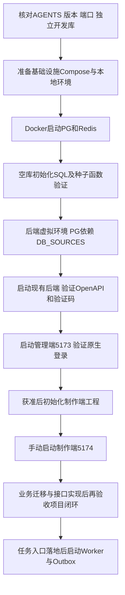

# higgsfield-ai · 本地开发与工程初始化手册

版本：1.2 本地基础设施配置已落地  
日期：2026 年 10 月 27 日  
范围：Windows PowerShell 本地开发、基础设施、框架初始化及检查  
状态：基于当前源码的操作方案；本轮未安装依赖、创建容器、连接数据库或启动应用

**正式部署基线（用户已确认）：** 平台部署在公司内网服务器，素材、图片、视频及其长期归档文件存放公司 NAS。员工通过平台访问受授权内容，浏览器不直接访问 NAS 共享目录。内网服务器的操作系统、数量、正式环境容器化方式、域名及 NAS 协议/挂载路径仍待运维确认；本地 Docker 启动 PostgreSQL/Redis、后端及两前端手动启动的方式不变。

## 1 依据与执行边界

遵循[AGENTS.md](../AGENTS.md)、[技术架构方案](技术架构方案.md)、[P0-1 需求](首期需求与业务规则说明书.md)、[P0-2 供应商契约](模型供应商接入契约与差异清单.md)、[P0-3 数据库设计](数据库详细设计.md)、[P0-4 平台 API](平台API契约.md)、[P0-5 价格用量预算](价格用量预算说明.md)、[P0-6 权限矩阵](权限矩阵.md)及[工程基线](工程基线核对与文档衔接方案.md)。优先级与规则 ID 沿用[统一索引](文档一致性与优先级索引.md)，本手册不新增等级。

**本地 Docker 只运行 PostgreSQL 与 Redis；后端、管理端、制作端在宿主机分别手动启动。** 后续生成/media Worker 和 Outbox 调度也作为独立开发进程手动启动，不把框架 APScheduler 当作已经完成的生成 Worker。

本地 Compose 和环境变量示例已提供，按第4章配置并由开发者手动启动。制作端仍待初始化，现有目录、包名和仓库位置保持不变。

## 2 源码核对与目标配置

| 项目 | 当前源码事实 | 本手册目标 |
|---|---|---|
| 后端入口 | [app.py](../ruoyi-fastapi-backend/app.py) 使用 server:create_app factory；默认端口9099 | 宿主机虚拟环境执行 python app.py --env dev |
| 数据库配置 | [config/env.py](../ruoyi-fastapi-backend/config/env.py) 使用 DB_DEFAULT_SOURCE + DB_SOURCES JSON | primary 显式设 PostgreSQL；不照抄旧 DB_HOST 配置 |
| PG 依赖 | [requirements-pg.txt](../ruoyi-fastapi-backend/requirements-pg.txt) 包含 asyncpg、SQLAlchemy 和本地 CLI 包 | 使用该文件；业务 ORM 仍全部异步 |
| 管理端 | [package.json](../ruoyi-fastapi-frontend/vue3/web/package.json) 有 dev=vite 和 pnpm-lock.yaml | 使用 vue3/web；手动固定5173 |
| 管理代理 | [vite.config.js](../ruoyi-fastapi-frontend/vue3/web/vite.config.js) 默认80；/dev-api去前缀转9099 | 命令行覆盖端口；后端端口保持9099 |
| 制作端 | higgsfield-frontend 只有 AGENTS.md | 待初始化 Vue3/TS 工程后固定5174 |
| 原 Compose | [docker-compose.pg.yml](../docker-compose.pg.yml) 同时定义前端/后端/PG/Redis | 保留参考；不直接执行其全栈 up |
| 初始 SQL | [ruoyi-fastapi-pg.sql](../ruoyi-fastapi-backend/sql/ruoyi-fastapi-pg.sql) 包含 drop table、种子及 find_in_set 函数 | 仅向独立、全新空库首次导入 |
| 迁移 | alembic/env.py 存在，当前无版本链；启动有 create_all 路径 | 后续建立真实迁移；不能把启动或 upgrade 空链当迁移完成 |

## 3 端口与运行时基线

以下为本项目约定端口；基础设施端口的当前检查结果见第4章，未启动服务。冲突时统一更新 Compose、后端 DB_SOURCES、两个前端代理及检查地址，不允许 Vite 自动悄悄换端口。

| 服务 | 运行位置 | 访问地址/端口 | 用途 |
|---|---|---|---|
| PostgreSQL | Docker | 宿主127.0.0.1:35432 → 容器5432 | 数据库 higgsfield_ai_dev（新本地库建议名，不重命名既有库） |
| Redis | Docker | 宿主127.0.0.1:36379 → 容器6379 | 框架缓存/会话使用逻辑库2 |
| 后端 | 宿主机 | 127.0.0.1:9099 | 统一接口；本地 root_path 空 |
| 管理前端 | 宿主机 | http://127.0.0.1:5173 | Vue3 管理工程 |
| 制作前端 | 宿主机，待初始化 | http://127.0.0.1:5174 | Vue3 + TS，双组件库 |
| Worker/Outbox | 宿主机，待实现 | 不预设HTTP端口 | 独立进程；任务队列命名和Redis库另行配置 |

宿主机应用连接127.0.0.1及映射端口，不能用 Compose 服务名 postgres/redis；容器健康检查使用容器内端口。两前端建议始终使用127.0.0.1，不混用localhost导致Cookie/Origin差异；不同端口的Cookie并不天然隔离，不依赖复制Admin-Token实现SSO。

运行时核对：管理 package.json 声明 Node `^22.22.2 || ^24.15.0`、pnpm `11.28.6`，根 .nvmrc 仅写22，不能据此使用任意旧22版本。建议选符合声明的22.x补丁版并记录实际版本。后端 pyproject.toml 声明Python≥3.10，Docker参考为3.10；本地建议选Python3.12进行依赖解析验证，未实测兼容前不标记通过。PostgreSQL沿现有14主版本；Redis本地配置沿用7.4，初始化时记录确切镜像digest。都不使用latest作为可复现基线，也不在本文宣称这些是官网最新版本。

```powershell
Set-Location D:\laputta\higgsfield
git status --short
docker version
docker compose version
py -0p
node --version
pnpm --version
Get-NetTCPConnection -State Listen -ErrorAction SilentlyContinue |
  Where-Object { $_.LocalPort -in 35432,36379,9099,5173,5174 } |
  Select-Object LocalAddress,LocalPort,OwningProcess
```

检查命令不替代授权：若发现既有容器、数据库或端口，先辨认所属项目；不停止或删除其他环境。工作区已有大量导入文件，不以清空目录作为初始化方式。

## 4 基础设施配置与启动

以下操作全部在 `D:\laputta\higgsfield` 执行，由开发者手动启动容器。已提供 `docker-compose.local.yml` 与 `.env.local-infra.example`，无需安装教程或自行拼接模板。

### 4.1 配置环境变量

```powershell
Set-Location D:\laputta\higgsfield
# 仅首次复制，不覆盖已有本地配置。
if (-not (Test-Path .env.local-infra)) {
  Copy-Item .env.local-infra.example .env.local-infra
}
notepad .env.local-infra
```

填写 `LOCAL_PG_PASSWORD` 为本机独立随机密码（建议至少32位字母数字），保存并关闭编辑器。该文件已加入 `.gitignore`，不要提交密码。`LOCAL_PG_PORT=35432`、`LOCAL_REDIS_PORT=36379` 是宿主机端口；PostgreSQL 用户固定为 `higgsfield_dev`，数据库固定为 `higgsfield_ai_dev`。后端配置见第6.2节，密码必须相同，后端不会自动读取此文件。

本地入口沿用 PostgreSQL 14、Redis 7.4、UTC 及 PostgreSQL UTF8/C 排序规则。Redis仅绑定本机回环且无密码，后端使用逻辑库2；不用于共享或正式环境。

### 4.2 检查端口及项目归属

```powershell
docker ps -a --format "table {{.Names}}\t{{.Ports}}"
Get-NetTCPConnection -State Listen -ErrorAction SilentlyContinue |
  Where-Object { $_.LocalPort -in 35432,36379 } |
  Select-Object LocalAddress,LocalPort,OwningProcess
netsh interface ipv4 show excludedportrange protocol=tcp
docker volume ls --filter label=com.docker.compose.project=higgsfield-ai-local
docker compose --env-file .env.local-infra -f docker-compose.local.yml ps -a
```

2026年10月27日检查时，35432和36379未监听、不在IPv4 TCP排除范围，且现有运行或停止容器均未配置这两个宿主端口。原约定15432/16379及候选25432/26379已被其他停止容器配置（通过docker inspect检查PortBindings确认），故改用35432/36379，避免其他项目恢复时冲突；5432和6379已有占用。这是检查时快照，启动前仍须确认。如果选定端口已占用或受系统保留，修改环境文件中的对应端口，并同步第6.2节的 `db_port` / `REDIS_PORT` 及检查命令；不停止其他项目进程或容器。若发现同名项目资源，先确认归属，不复用未知数据卷。

顶层固定 `name: higgsfield-ai-local`，不设置 `container_name`、网络或卷的显式 `name`。默认自动生成 `higgsfield-ai-local-postgres-1`、`higgsfield-ai-local-redis-1`、`higgsfield-ai-local_default` 及下述数据卷。不要额外传入 `-p` 或设置 `COMPOSE_PROJECT_NAME` 覆盖项目名，否则会指向不同资源。

其他四份框架参考Compose也已设置各自的项目名，并移除固定容器/网络名称。参考全栈PG的15432/16379、参考MySQL的16379与其他项目容器配置重叠；测试参考的80/9099当前已有占用。它们不作为本地启动入口，不与本地入口并行启动；保留其原有镜像、端口和框架用途。

### 4.3 启动、状态与日志

密码保存后，按顺序执行。`config --quiet` 失败时先修正配置，不继续启动。

```powershell
docker compose --env-file .env.local-infra -f docker-compose.local.yml config --quiet
if ($LASTEXITCODE -ne 0) { throw 'Compose 配置校验失败，请先修正配置' }
docker compose --env-file .env.local-infra -f docker-compose.local.yml up -d postgres redis
docker compose --env-file .env.local-infra -f docker-compose.local.yml ps
docker compose --env-file .env.local-infra -f docker-compose.local.yml logs --tail 80 postgres redis
# 持续查看日志；Ctrl+C仅退出日志查看。
docker compose --env-file .env.local-infra -f docker-compose.local.yml logs -f --tail 80 postgres redis
```

首次启动会按需拉取镜像并初始化数据库，等待两个服务显示healthy，再执行第5章的数据核验。配置校验使用 `--quiet`，不要把包含密码的展开配置粘贴到日志。这里不启动或构建后端和前端。

首次初始化仅向专属空数据卷导入现有框架SQL `ruoyi-fastapi-backend/sql/ruoyi-fastapi-pg.sql`。该脚本含DROP，不得手工重跑到已有库；它是框架种子基线，不替代后续业务迁移。初始化目录只在空数据目录首次执行，修改SQL或环境文件密码不会自动更新旧卷。若初始化失败，保留日志定位，不能靠反复up或删除卷宣称恢复。

### 4.4 数据持久化位置

PostgreSQL数据位于命名卷 `higgsfield-ai-local_pg_data`，挂载到容器 `/var/lib/postgresql/data`；Redis数据位于 `higgsfield-ai-local_redis_data`，挂载到 `/data`，已开启AOF，沿用Redis默认每秒fsync策略。突然断电仍可能丢失最近约一秒的写入。

这两个卷由Docker管理，实际存放在Docker Desktop的Linux数据磁盘内，不是仓库下的Windows文件夹。创建后可查看引擎内挂载位置：

```powershell
docker volume inspect higgsfield-ai-local_pg_data higgsfield-ai-local_redis_data --format '{{.Name}} -> {{.Mountpoint}}'
```

卷会随stop/start及容器重建保留；不要执行 `down -v`、`volume prune` 或Docker Desktop清空数据。镜像主版本升级必须另行备份及迁移。停止与再次启动命令见第12章。

## 5 框架数据库初始化与验证

新空库使用框架PG SQL建立sys_*等基础表、字典和初始数据，再核验后启动后端。不要先让create_all建空表后认为框架菜单/用户种子已经具备。框架初始管理员口令应从受控交付渠道确认，本文不传播默认口令；首次登录后改为独立开发口令，不连接生产身份库。

从仓库根目录执行下列检查（只读取目标容器）：

```powershell
docker compose --env-file .env.local-infra -f docker-compose.local.yml exec postgres psql -U higgsfield_dev -d higgsfield_ai_dev -c "SELECT current_database(), current_user, version();"
docker compose --env-file .env.local-infra -f docker-compose.local.yml exec postgres psql -U higgsfield_dev -d higgsfield_ai_dev -c "SELECT count(*) FROM sys_user; SELECT count(*) FROM sys_menu; SELECT count(*) FROM sys_dict_type; SELECT find_in_set(1::bigint, '0,1,2'::varchar);"
docker compose --env-file .env.local-infra -f docker-compose.local.yml exec redis redis-cli -n 2 ping
Test-NetConnection 127.0.0.1 -Port 35432
Test-NetConnection 127.0.0.1 -Port 36379
```

预期：库名/用户与本手册一致，系统种子表有数据，find_in_set存在且匹配结果正确，Redis返回PONG，宿主端口可达。记录表计数及初始化日志，不能仅凭容器healthy判定框架可登录。find_in_set来自框架PG脚本，不是PG内置函数。

已有数据库路径：先记录库名、schema、系统表计数、Alembic revision和备份；禁止导入上述整套初始化SQL。需要新环境时采用新的数据库/卷命名，不能直接改旧实例名或复用未知卷。

### 5.1 新业务迁移门槛

P0-3的80张业务表仍是设计，当前没有对应真实迁移。工程实施阶段须建立审核过的Alembic版本链，验证模型metadata注册、中文COMMENT、bigserial/序列、公共字段、逻辑删除、唯一约束、无物理外键及Service关系校验。框架基线SQL与业务迁移必须明确分工，不能重复创建sys_*或仅stamp一个版本。

以下仅在真实版本链已落地、审核通过、确认目标库且已备份后执行：

```powershell
Set-Location D:\laputta\higgsfield\ruoyi-fastapi-backend
.\.venv\Scripts\python.exe -m alembic heads
.\.venv\Scripts\python.exe -m alembic current
.\.venv\Scripts\python.exe -m alembic upgrade head
.\.venv\Scripts\python.exe -m alembic current
```

alembic.ini的[settings] env当前为dev；env.py会加载相应配置并可能创建versions目录。当前无迁移时不执行上述命令冒充初始化完成。autogenerate也不是最终DDL，必须审阅，尤其不能把未导入metadata的表误判为待删除。

## 6 后端环境与手动启动

### 6.1 虚拟环境和依赖

在后端目录创建独立.venv，使用已选Python版本；以下3.12为建议目标，本机没有该版本时先安装/选择经依赖验证的版本。不要绕过依赖失败自行混装MySQL依赖。

```powershell
Set-Location D:\laputta\higgsfield\ruoyi-fastapi-backend
py -3.12 -m venv .venv
.\.venv\Scripts\python.exe -m pip install -r requirements-pg.txt
.\.venv\Scripts\python.exe -m pip check
```

不要求激活脚本，因此不必为启动放宽PowerShell全局执行策略。requirements-pg包含本地CLI包“.”，须在后端目录执行。psycopg2是框架已有依赖，不意味着新业务允许同步Session。无法获得指定依赖版本或本机wheel时记录失败与平台信息，先核定依赖来源，不静默升级/降级整套框架。

### 6.2 .env.dev 目标值

保留已有文件，逐项核对和调整，不整份覆盖未知本地配置。以下为目标示例，真实密码/JWT密钥由本地生成；DB_SOURCES是一行合法JSON，不把它拆成DB_HOST/DB_PASSWORD。示例不代表已修改当前.env.dev。

```dotenv
APP_ENV=dev
APP_NAME=higgsfield-ai
APP_HOST=127.0.0.1
APP_PORT=9099
APP_ROOT_PATH=
APP_RELOAD=true
APP_WORKERS=1
APP_DEMO_MODE=false
APP_DISABLE_SWAGGER=false
APP_DISABLE_REDOC=false
APP_TIMEZONE=Asia/Shanghai
APP_DEFAULT_ENABLED_PLUGINS=
DB_DEFAULT_SOURCE=primary
DB_SOURCES={"primary":{"db_type":"postgresql","db_host":"127.0.0.1","db_port":35432,"db_username":"higgsfield_dev","db_password":"替换为与基础设施一致的本机密码","db_database":"higgsfield_ai_dev","db_echo":false}}
REDIS_HOST=127.0.0.1
REDIS_PORT=36379
REDIS_USERNAME=
REDIS_PASSWORD=
REDIS_DATABASE=2
JWT_SECRET_KEY=替换为本机独立随机密钥
TRANSPORT_CRYPTO_ENABLED=false
TRANSPORT_CRYPTO_MODE=off
```

DB_ECHO不是当前多数据源设置的独立控制入口，db_echo放入对应DB_SOURCES对象。JSON密码含引号/反斜线时必须合法转义；.env不会自动把另一文件的密码替换进此JSON。后端不读取.env.local-infra，它只供Compose插值。

APP_ROOT_PATH空是本手册的本地目标，后端实际路由不加/dev-api；管理Vite负责剥离开发代理前缀。不能同时剥两次或手工给后端controller加/dev-api。生产/studio、/admin部署另行设计。

传输加密关闭仅为回环隔离环境的初始诊断方案，不是生产政策；接入真实业务前还需用目标加密策略测试Axios、SSE、分片和Range。现有插件是否启用可能受数据库状态影响，APP_DEFAULT_ENABLED_PLUGINS空不等于禁用已安装插件；首次环境不配置模型供应商Key，不调用真实付费接口。

load_dotenv保留已有进程环境变量优先。若终端残留APP_ENV、DB_SOURCES等指向其他环境，必须先核实并在专用开发终端处理，不能只看文件判断连接目标。启动时不要打印完整DB_SOURCES/JWT到聊天或日志。

### 6.3 启动和后端检查

保持数据库/Redis检查通过，在终端A执行现有入口：

```powershell
Set-Location D:\laputta\higgsfield\ruoyi-fastapi-backend
.\.venv\Scripts\python.exe app.py --env dev
```

该命令前台运行，保留终端查看日志，Ctrl+C停止。现有CLI也提供app run入口，但不同时启动两套9099进程。启动会访问数据库/Redis并执行框架初始化，不是纯只读检查；只连接已确认的开发库。create_all只补缺表，不能完成现有表迁移。

在另一个终端检查：

```powershell
Invoke-WebRequest http://127.0.0.1:9099/openapi.json -UseBasicParsing | Select-Object StatusCode
Invoke-RestMethod http://127.0.0.1:9099/captchaImage | Select-Object code,msg,captchaEnabled
```

预期OpenAPI可取、验证码接口返回框架成功结构；浏览器打开http://127.0.0.1:9099/docs。文档页可能依赖外部静态资源，空白时先检查openapi.json与浏览器资源错误，不能直接判断后端故障。本手册不假设已有/health端点。

## 7 管理端手动启动

目录固定为ruoyi-fastapi-frontend/vue3/web。依赖使用其现有锁文件与声明的pnpm版本，不在父目录运行其他框架工程。

```powershell
Set-Location D:\laputta\higgsfield\ruoyi-fastapi-frontend\vue3\web
pnpm --version
pnpm install --frozen-lockfile
```

若锁文件与package.json不一致应停止并记录原因，不能为“能启动”擅自删除锁文件或改用npm生成第二份锁。安装完成后，在此目录准备.env.development.local覆盖本地值（真实文件需排除提交）：

```dotenv
VITE_APP_TITLE=higgsfield-ai 管理平台
VITE_APP_ENV=development
VITE_APP_BASE_API=/dev-api
VITE_APP_PLUGIN_BASE=
```

VITE_APP_PLUGIN_BASE空与后端APP_ROOT_PATH空配套；原.env.development中该值为/dev-api，需明确覆盖。普通请求仍使用/dev-api代理。VITE_*会进入前端产物，禁止存数据库密码、供应商Key、JWT签名密钥。

终端B手动启动：

```powershell
Set-Location D:\laputta\higgsfield\ruoyi-fastapi-frontend\vue3\web
pnpm run dev --host 127.0.0.1 --port 5173 --strictPort
```

访问http://127.0.0.1:5173。原配置open=true可能自动打开页面；端口80被本命令覆盖。检查网络请求：浏览器/dev-api/captchaImage→Vite→9099/captchaImage；登录后的/system/*同样只去掉/dev-api一次。新增管理业务将使用/dev-api/api/admin/v1/...，不能写成/dev-api/admin/...。

用获准开发账户验证登录、getInfo、getRouters、菜单与退出；既有Admin-Token是JS可读Cookie，仍通过Authorization Bearer调用。HTTP200不一定业务成功，检查code；框架登录通过不等于项目权限、费用或新增AI接口已实现。

## 8 制作端工程初始化与启动条件

**当前higgsfield-frontend没有package.json，不能现在执行pnpm install/dev并宣称制作平台可运行。** 以下为后续获准工程初始化的交付清单，当前不执行脚手架生成或覆盖目录内AGENTS.md。

| 初始化项 | 必须结果 |
|---|---|
| 基础工程 | Vue3.4+、TypeScript、Vite，锁定版本与pnpm-lock.yaml；dev脚本为vite |
| 应用分层 | views/components/composables/api/router/stores/styles/utils；script setup lang=ts，禁止Options API |
| 请求与登录 | Axios统一若依code/分页处理、独立平台身份客户端；不从管理Cookie复制会话 |
| 组件与主题 | Element Plus与shadcn-vue共存，统一变量、弹层与亮暗切换；不机械反色媒体 |
| 路由 | Vue Router，先有基础登录/框架路由；未实现业务不伪装可用 |
| 状态与绑定 | Pinia、use组合函数、defineModel、多参数v-model；组件不直接请求或改props |
| 开发代理 | /dev-api→http://127.0.0.1:9099，剥离一次；仅开发代理，不是业务API前缀 |
| 环境 | 建议VITE_APP_BASE_API=/dev-api；必须由新工程api客户端读取，变量名字本身不会自动生效 |
| 能力开关 | 没有已验证供应商/价格/预算时生成入口关闭，不放测试Key在浏览器 |

建议制作端统一请求示例：浏览器/dev-api/api/v1/projects→后端/api/v1/projects；原生登录为/dev-api/login→/login。SSE经专用fetch模块携带Bearer，处理Content-Type及JSON错误；文件Range鉴权与上传流另做联调。

工程清单完成并提交锁文件后，终端C运行：

```powershell
Set-Location D:\laputta\higgsfield\higgsfield-frontend
pnpm install --frozen-lockfile
pnpm run dev --host 127.0.0.1 --port 5174 --strictPort
```

制作端基础页与主题切换可先验收；P0-4业务接口尚未实现时必须标为未接入，不用空数据冒充完整项目流程。两个前端不共享运行时Store。

## 9 完整初始化顺序与后续Worker



业务迁移一旦进入实施，应在启动相应业务版本前执行，不在应用运行中靠create_all追表。现有框架APScheduler、日志后台任务并非Celery；PG依赖清单未包含现成生成Worker。Worker入口模块、任务注册、Redis库/队列、租约及Outbox参数未落地，本文不编造celery -A命令。

建议预留Redis逻辑库3用于后续队列、4用于结果（是否需要结果存储由实现确认）；逻辑库不是安全隔离，仍需独立项目键前缀。现阶段只配置框架库2，不提前配置不存在的CELERY_*环境变量。Windows原生Worker运行模式/并发能力须验证；若需WSL，单独说明环境及127.0.0.1访问差异，不能自行把Worker迁入Docker改变约定。

本地文件/NAS：框架既有上传路径不自动等于P0-3受控素材仓库。新业务需确定独立暂存/归档根目录、访问权限、媒体工具、预览Range和清理策略；未完成前只报告框架启动，不报告素材闭环。不得用生产NAS路径或实际供应商Key验证基本启动。

## 10 分层检查与验收记录

| 检查ID | 执行内容 | 通过证据 | 不代表 |
|---|---|---|---|
| DEV-01 | 版本、端口、目录和Compose服务清单 | 实际版本、占用检查、仅两个基础设施服务 | 应用已运行 |
| DEV-02 | PG/Redis启动与宿主连接 | healthy、端口、PONG、目标库名 | 种子/迁移已完整 |
| DEV-03 | 框架种子及函数 | sys_user/menu/dict计数、find_in_set验证 | 新业务80表已建 |
| DEV-04 | 后端依赖与启动 | pip check、无启动异常、OpenAPI和验证码 | 所有业务权限正确 |
| DEV-05 | 管理端代理与会话 | 登录/getInfo/getRouters/退出，业务code正常 | 项目对象权限和AI功能已实现 |
| DEV-06 | 制作端初始化 | 工程锁文件、5174启动、路由与亮暗基础检查 | 完整制作页面验收 |
| DEV-07 | 业务迁移（后续） | 实际Alembic revision、schema/注释/索引、事务测试 | 仅stamp或空upgrade通过 |
| DEV-08 | 权限与计费（后续） | P0-6 AUTH、P0-5 FIN用例结果 | 普通启动健康即可替代 |
| DEV-09 | 任务与文件（后续） | Worker重启恢复、归档、SSE/Range、幂等 | 框架定时任务就是生成队列 |
| DEV-10 | 真实模型（单独授权） | P0-2联调证据、可控费用、正确原Key查询 | 本地启动即授权收费调用 |

记录模板：日期/操作者、代码revision、Node/pnpm/Python版本、镜像digest、数据库名称与迁移版本、端口、DEV项结果（通过/失败/未执行）、脱敏证据及遗留问题。禁止将密码、完整.env、供应商Key放入检查报告。当前所有运行验收均为未执行，本轮已通过Compose静态配置校验、项目资源命名及端口检查，未启动容器或执行数据库初始化。

## 11 常见故障定位

| 现象 | 优先核对 | 处理边界 |
|---|---|---|
| 后端仍连MySQL或错误数据库 | DB_SOURCES、进程环境优先级、启动cwd/--env | 不只修改旧DB_HOST变量；不打印密码 |
| 容器健康但无用户/菜单 | 初始SQL日志、目标库、卷是否已存在 | 不重跑含DROP的全库SQL到已有库 |
| 改POSTGRES_PASSWORD后连接失败 | 旧卷内用户密码未改变 | 受控修改数据库角色凭据，不删除卷碰运气 |
| 管理端访问80或端口跳号 | 启动命令是否带5173及strictPort | 检查占用进程，不强杀未知服务 |
| /dev-api返回404或代理502 | root_path、Vite重写、9099是否运行 | 保持代理只去一次前缀，不修改所有后端路由 |
| 登录成功但菜单/操作失败 | code、原生权限、种子、Redis会话、目标用户 | 不能靠授予超级管理员掩盖数据权限问题 |
| SSE/上传/文件被当JSON解密 | 传输加密模式、Content-Type、代理流处理 | 基础关闭加密验证与目标配置兼容验收分别记录 |
| 制作端无dev脚本 | 当前尚未初始化 | 不把AGENTS.md当应用；先完成工程授权与清单 |
| 依赖版本安装失败 | 源、锁文件、Python/Node兼容及网络 | 保留错误，不删除锁或随意换依赖系列 |
| /docs空白但OpenAPI成功 | 文档JS/CSS网络请求 | 区分静态资源失败和API故障 |

## 12 停止、重启与数据保留

先Ctrl+C停止制作端、管理端，再停止后端；未来有Worker时先停止新任务受理并按租约策略退出。基础设施保留数据停止命令（仓库根目录）：

```powershell
docker compose --env-file .env.local-infra -f docker-compose.local.yml stop postgres redis
```

停止后再次启动（保留原容器和数据）：

```powershell
docker compose --env-file .env.local-infra -f docker-compose.local.yml start postgres redis
docker compose --env-file .env.local-infra -f docker-compose.local.yml ps
```

若容器已被移除，使用第4章同一组文件及up命令重建，原命名卷仍会复用。修改端口等Compose配置后也需使用up应用变更，start不会更新配置。不要默认down -v、volume prune或删除数据库目录；本手册不提供无差别重置命令。换镜像主版本不等于数据库升级，需另制定备份与迁移方案。

本手册为初始化操作方案，后续实际执行后才能将记录改为已验证。数据库与Redis的本地容器、三个宿主机应用、未来独立Worker与生产部署是不同边界，不能混写成“全栈Docker已部署”。
