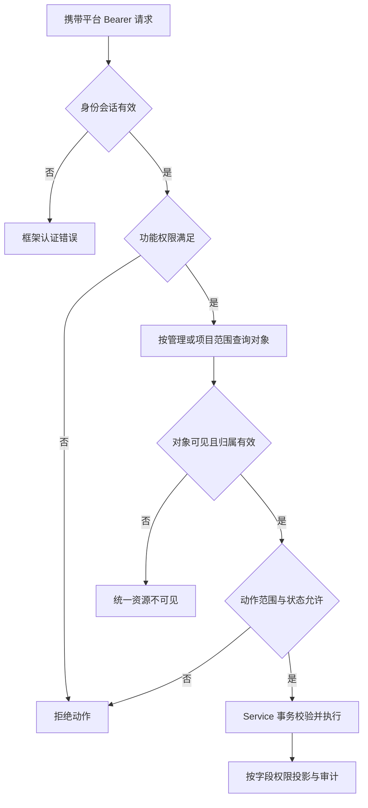
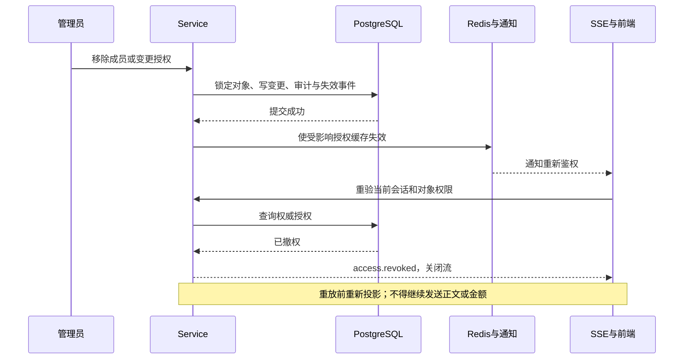

# higgsfield-ai · 权限矩阵

版本：1.0 评审稿  
日期：2026 年 10 月 27 日  
文档编号：P0-6  
适用范围：制作平台、管理平台、共享后端及后台任务  
状态：目标权限设计，未创建角色、菜单、权限种子或业务代码

## 1 依据、确认状态与优先级

依据[根目录 AGENTS.md](../AGENTS.md)、[技术架构方案](技术架构方案.md)、[P0-1 首期需求](首期需求与业务规则说明书.md)、[P0-2 供应商契约](模型供应商接入契约与差异清单.md)、[P0-3 数据库设计](数据库详细设计.md)、[P0-4 平台 API](平台API契约.md)及[后端规范](后端编码与框架对齐规范.md)。两前端目录不变，共用 ruoyi-fastapi-backend；PostgreSQL/Redis 通过 Docker 启动，应用手动启动。

P0-6 是文档编号，不是需求等级。本文不新增另一套等级，继承[文档一致性与优先级索引](文档一致性与优先级索引.md)和 P0-1 稳定规则 ID：项目隔离 PRJ-01/03/07、资源权限 AST-01/07/08、复制 ELM-06、生成 GEN-01～09、撤权 COL-06、凭据 ADM-01～07、费用 BIL-01～10、全链路保护 QLT-01。UX-08 双主题仍为首期必需；主题不改变任何授权结果。

**已确认基线：** 最小权限、服务端鉴权、项目隔离、功能与对象权限同时满足、Key 不回显、费用独立授权、不可变历史、撤权收敛、无物理外键。**评审建议：** 本文默认角色包、角色可授予集合、会话共享范围及费用附加角色。它们是对 D02/D03 的具体提案，不代表用户已批准角色种子。未确认时不启用有争议授权，已确认基线不得降级。D01、D04～D10 仍由原负责人确认。

## 2 授权模型与若依实际边界

一次允许操作必须同时满足：有效平台会话 → 功能权限 → 对应端点的数据范围 → 项目/对象授权 → 当前状态及业务约束。登录制作端或管理端、页面可见、按钮可见、知道对象 ID 均不能单独授权。

| 层次 | 权威来源与检查位置 | 不能代替的检查 |
|---|---|---|
| 身份与会话 | 现有 JWT/OAuth2 Bearer、LoginService、Redis 登录 token，停用状态 | 不能用供应商 Key 登录平台，不能靠 URL token |
| 系统功能权限 | sys_user_role → sys_role_menu → sys_menu.perms；Controller 的 UserInterfaceAuthDependency | 项目成员、对象归属、费用字段、业务状态 |
| 管理数据范围 | sys_role.data_scope、sys_role_dept；现有 DataScopeDependency 语义与 Service 范围校验 | 部门全部不等于全部项目内容可读 |
| 项目动作与范围 | hf_project_member → hf_project_role → hf_project_role_permission；Service 强制查询 | 平台功能权限不能被项目角色反向提升 |
| 对象与来源 | 所有者、父项目、固定版本、公共授权；Service 与 DAO 查询条件 | 不能信任请求中的 projectId、ownerId、sourceId |
| 状态与事务 | 项目状态、del_flag、revision、任务阶段、版本有效性；Service 事务及锁 | 有权限不等于可删除历史、重提未知调用或修改已发布价格 |

本地[接口权限依赖](../ruoyi-fastapi-backend/common/aspect/interface_auth.py)在遇到 `*:*:*` 时允许功能检查通过；[数据范围依赖](../ruoyi-fastapi-backend/common/aspect/data_scope.py)对 admin 返回全部范围。**这是已读源码事实，不代表项目对象权限可以跳过。** Service 必须继续检查项目成员、私有对象和公共素材授权。普通平台管理员角色不应配置为框架超级管理员。

功能权限列表默认可能按“任一满足”执行；需要 A+B 的端点必须使用严格检查或逐项检查，不能把 `asset:create + 来源使用权` 写成 OR。同一用户可兼任系统角色；功能权限按框架并集合并，停用、撤销、对象不可见和业务状态限制仍优先。

## 3 角色分层与建议默认包

### 3.1 系统角色与项目角色

| 角色 | 建议稳定码/落点 | 默认职责 | 不自动获得 |
|---|---|---|---|
| 平台管理员 | hf_platform_admin，sys_role | 系统组织维护、供应商/Key、模型、项目元数据治理、异常处置 | 项目内容、价格发布、采购账单、预算调整 |
| 费用管理员 | hf_finance_admin，sys_role | 价格维护/发布、预算、费用、对账及调整；范围另配 | Key 管理、模型调用、素材正文、项目成员管理 |
| 制作平台基础使用者 | hf_studio_user，sys_role | 获得制作端功能权限上限；实际能力由项目角色限制 | 加入任意项目、自动创建项目、公共发布、项目费用、治理他人内容 |
| 项目负责人 | owner，hf_project_role | 本项目资料、成员、内容治理、归档恢复 | 系统角色授予、供应商管理、预算调整、费用读取 |
| 制作成员 | producer，hf_project_role | 本项目浏览、生成、维护本人内容、评论 | 编辑他人内容、默认下载、公共发布、费用读取 |
| 只读成员 | viewer，hf_project_role | 本项目已共享内容浏览 | 生成、编辑、下载、评论、费用读取 |

前三类是系统角色模板，后三类是项目角色；同名职责不意味着使用同一张表。owner/producer/viewer 是角色身份，不可仅凭角色名称在 Controller 硬编码放行；项目动作读取权限映射，owner 的最后负责人保护单独按稳定角色语义执行。hf_project_member 每个项目/用户一条记录、一个 role_id，首期不虚构多项目角色叠加或单用户对象 ACL。

制作端系统角色的基础功能上限包含第 5 章默认项目动作集合，但不默认包含下载、复制、公共发布、项目费用、建项和申请等附加码；高权限项目动作仍必须由 owner 等项目角色授权。登录用户默认只获得本人偏好等已登录能力，不因“有账号”自动成为 hf_studio_user。管理角色兼任项目成员时仍按其项目角色操作。

### 3.2 可选授权与不扩大 schema 的落地

- project:create 为独立系统功能授权，建议由平台管理员显式授予有建项职责的用户；建项事务创建本人 owner 成员关系及项目空间。
- 下载、项目费用、公共发布、跨项目复制可以分开授予。首期采用经评审的**预设角色变体**（例如 viewer_download、owner_usage），仍一名成员一个项目 role_id；同步授予必要系统功能码，不能只改前端按钮。
- 变体使用 hf_project_role/hf_project_role_permission，新增稳定 role code 和准确权限集合，不新增数据表。普通负责人只能授予第 7 章允许集合；变体未审定或未初始化即不可选。
- 不开放任意项目角色编辑器；不新增每用户例外授权 API。后续若确需该能力，先补 P0-3/P0-4 及评审，不能把 JSON 偏好当权限存储。
- 可把平台管理员的操作拆成运维、凭据维护、发布等系统角色包；写入、验证、发布使用不同权限码，但首期不强制“必须两个人”。若要求双人复核，需另补审批契约，不能宣称现有发布接口已支持。

## 4 制作平台页面、菜单与按钮

制作端路由由 Vue Router 管理，菜单不是复制管理端页面。系统权限码登记到若依 sys_menu.perms，项目按钮依据当前对象 allowedActions 与当前项目权限；只用 /me 的全局 permissions 不能判断某项目是否允许操作。两端新增/修改组件使用 script setup，业务请求经 composable/Store → api，不在组件内自行拼权限请求。

| 页面 | 进入条件 | 按钮/动作权限 | 附加范围 |
|---|---|---|---|
| S01 首页、S02 我的项目 | 已登录；列表 project:read | project:create；置顶/隐藏/集合为本人操作 | 我的项目仅 active 成员；创建不以成员关系为前置 |
| S03 我的生成、S09 项目任务/作品 | generation:read；作品 asset:read | generation:cancel、output:archive、asset:create、asset:download | mine 仍交集当前项目权，取消与归档重试独立 |
| S04 我的元素、S07 项目元素 | element:read | element:create/edit/remove/copy/configure/import，使用完整码见 §5 | 本人修改或项目治理；复制双向校验 |
| S05 项目总览/简报 | project:read | project:edit、project:manage | 当前项目；简报 revision 校验 |
| S06 素材库与目录 | asset:read | asset:upload/create/edit/remove/download/reference、folder:write | 文件版本归属、上传所有者、公共授权 |
| S08 创作面板 | generation:create 或 chat:create，按创作类型 | validate/提交使用对应生成权限 | 项目可写、素材可用、模型已发布、路由/预算有效 |
| S10 项目设置 | project:read；成员页 member:read | member:manage、project:manage/archive；用量 project:usage:read | 不把负责人权限当成财务权限 |
| S11 多模态对话 | chat:read | chat:create；会话维护按 §6 | 读取共享/私有边界按本版提案，不接受伪造历史角色 |
| S12 公司公共素材 | public:read，必须选目标项目 | asset:reference、public:publish | canRead/canUse/canPublish 独立判断 |
| 评论/标注/工作状态 | comment:read + 目标可读 | comment:create、comment:edit:own、comment:moderate、content:review | 标注固定版本；审核通过不等于公开 |

页面编号沿用 P0-1，首页聚合入口不额外开放数据。菜单隐藏、按钮禁用及明暗主题只影响展示，不替代后端检查。任一项目无权限时清空相关 Pinia 缓存及预览，不能残留上一个项目正文。

## 5 项目角色逐动作矩阵

表中“项目”表示当前有效成员所在项目；“本人”还必须满足对象所有者；“—”表示默认不授予；“附加”表示须启用经评审变体。所有允许项均需系统功能权限上限及状态校验；表中动作并列表示分别授权，不表示调用每个端点都需要整组全部权限。角色默认包是建议，不改变 P0-1 规则确认状态。

| 完整功能码/动作 | owner | producer | viewer | 对象范围或限制 |
|---|---|---|---|---|
| project:read、member:read | 项目 | 项目 | 项目 | 成员信息仅业务必要字段，不返回全公司用户数据 |
| project:edit | 项目 | — | — | 简报编辑 |
| project:manage、project:archive | 项目 | — | — | 状态动作保留在途任务及历史 |
| member:manage | 项目 | — | — | 可授予集合及最后负责人保护 |
| asset:read、element:read、generation:read、chat:read、comment:read | 项目 | 项目 | 项目 | 私有草稿、上传及管理证据不属于共享内容 |
| asset:upload、asset:create、element:create、generation:create、chat:create | 项目 | 项目 | — | 创建后所有者由服务端填写；创建会话与实际生成都校验 |
| asset:edit、asset:remove、element:edit、element:remove | 项目 | 本人 | — | 不修改历史文件，删除/恢复仍检查引用与状态 |
| folder:write、element:configure | 项目 | — | — | 共享目录移动/属性定义影响他人，默认由负责人维护 |
| element:import | 项目 | 本人 | — | 上传归本人，导入结果不可借治理入口跨项目读取 |
| element:copy | 附加 | 附加 | — | 来源可读/可用 + 目标 element:create；复制不沿用源授权 |
| asset:download | 附加 | 附加 | 附加 | 预览权限不自动授予下载动作；不承诺防止已读媒体被另行保存 |
| asset:reference、public:read | 项目 | 项目 | 仅 public:read | 读取与生成使用分开；公共空间授权同时满足 |
| public:publish | 附加 | — | — | 源内容可读可用、目标 canPublish，生成独立公共身份 |
| generation:cancel、output:archive | 项目 | 本人 | — | 任务创建者由任务身份字段确定；未知提交不得重提 |
| comment:create、comment:edit:own | 项目/本人 | 项目/本人 | 附加 | 创建在可读目标下；edit:own 仅作者，不扩大为项目编辑 |
| comment:moderate、content:review | 项目 | — | — | 删除/编辑他人评论留痕；工作状态不改变素材授权 |
| project:usage:read | 附加 | 附加 | 附加 | 仅平台口径；开通即允许该项目聚合费用，不能当“只看本人”授权 |

系统级 project:create 不写入项目角色表。project:join 也不是成员权限：仅有功能码且项目有明确可发现授权时可申请；当前 schema/API 尚未定义可发现策略持久化与配置端点，首期保持入口关闭，采用成员邀请/添加。不通过“能申请”暴露内容或成员列表。

hf_project_role_permission.data_scope 只存 own/project。项目级操作记录 project；修改本人素材/元素及取消本人任务记录 own。本人评论永远校验作者；私有草稿/上传限制是不可被 project 范围越过的对象规则。变体权限不得突破对象保护。

## 6 对象范围与敏感字段

| 对象 | 读取边界 | 写入/使用边界 |
|---|---|---|
| 项目、成员、简报 | 当前有效成员及相应功能码；管理治理接口仅元数据 | owner 动作或明确管理治理；不允许修改 projectId 跨项目迁移 |
| 个人集合、偏好、收藏 | 仅本人，引用对象再过滤授权 | 仅本人；管理角色不代操作偏好 |
| 上传会话与分片 | owner_id=当前人，仍有项目权或管理用途权 | 续传/完成/绑定同样检查；负责人也不能占用他人上传 |
| 草稿 | owner_id=当前人且项目仍可读 | 本人且项目可写；管理员/负责人无草稿后门 |
| 素材/元素及修订 | 当前项目内容权限；历史版本亦检查 | producer 以身份表 create_user_id 判断本人，不以最近修订作者/update_by 夺取所有权 |
| 会话与消息 | 建议首期按已提交项目内容共享，chat:read + 成员范围 | 会话创建者可改标题/归档/继续发送；负责人可治理标题/归档，不能以他人身份续写；其他成员仅阅读。私有会话模式须另评审 |
| 任务、输入、输出、SSE | generation:read/asset:read 及项目范围；输入正文独立读取也同样鉴权 | 取消看任务 user_id/项目角色范围；再生成新任务重新授权；归档补偿不发起新生成 |
| 评论和标注 | comment:read 且目标精确文件可读 | 作者 comment:edit:own 或 comment:moderate；删除沿用同一判定，不另造未定义 delete 权限码 |
| 公共素材 | 当前项目授权 canRead + public:read | 引用/生成还需 canUse 和目标写权；发布需 canPublish + public:publish；任何布尔值不隐含其他值 |
| 管理价格附件/账单 | 对应用途权限与管理范围 | 上传所有者与用途绑定；不通过项目文件入口访问 |
| 费用与预算 | 制作端 project:usage:read 仅 platform；管理端 billing 权限及范围 | 费用估价不授权预算调整；省略无权金额，billingVisibility=hidden，未知不当零 |
| API Key 与调用证据 | 仅允许掩码和脱敏元数据，所有角色都不得读密文/明文 | 秘密仅写入；测试和轮换独立动作；无提示词或签名 URL 越权回显 |

本人用量接口不接受 userId，返回本人且当前有权项目的 platform 汇总；建议沿用项目费用读取授权逐项目过滤，无任一授权项目则拒绝，不能利用个人汇总绕过项目费用关闭。预算 canSubmit/blockingCodes 可给有提交权限者，periods/价格ID/估价金额仍按费用权限隐藏。

跨项目复制/作品转素材必须同时校验源固定版本的读取与使用权、目标项目创建权及媒体授权；目标 owner 不等于源项目成员。公共授权撤回阻断新查询/引用/提交，不删除已受理任务快照和已合法生成的目标作品；历史输入读取仍按当前授权投影，不能借任务输入回放重新暴露已撤回源媒体。

## 7 成员、授予与项目状态

建议默认 owner 可添加 producer/viewer，可将成员晋升 owner，但仅限自己已拥有的项目；费用、下载、公共发布等变体只有在授予者自己也具备相应项目权限且该变体在可授予清单内时可选。不可授予系统管理员、费用管理员或扩张 sys_role 范围。跨用户同一项目角色变更使用 member revision，事务锁项目及成员；删除/降级/停用必须验证至少一位有效负责人，角色变更保留审计。

系统角色授予使用原生若依角色管理与其数据范围检查，不用 member:manage 替代 system:role 或用户授权接口。能创建角色不代表可以授予超出本人可授予集合的权限；初始化最高权限角色属于受控运维，不暴露普通项目 UI。

| 项目状态 | 普通浏览 | 内容新建/编辑/生成 | 治理与后台维护 |
|---|---|---|---|
| active | 按授权 | 按授权及预算/能力 | 正常治理 |
| paused | 按授权只读 | 拒绝 | 有权者恢复；在途查询、归档、计费继续 |
| archived | 按授权只读 | 拒绝 | 有权者恢复；不自动重新生成 |
| pending_delete 或 del_flag=2 | 普通入口不可见 | 拒绝 | 受控治理保留审计；不可变账本/历史不删除 |

项目暂停/归档时可执行必要的权限撤回和恢复治理；不能以治理为由继续普通评论、标签或提示词编辑。成员移除/用户停用即时撤销后续交互，已受理后台任务不冒用当前用户会话运行；后台按固定任务身份维护查询、归档、费用，不因此给被移除用户恢复访问。紧急 Key 撤销仍阻断相关上游调用。

## 8 管理平台菜单、按钮与角色矩阵

菜单目录使用若依 M/C/F 体系：目录组织、页面入口、按钮权限分别登记，沿用现有系统菜单；不制造第二套用户/部门写入口。业务页面的列表/read 码和写动作码分开授权；有写码但无 read 码时不应自动获得读取，角色包须显式列出所需组合。下面所有码都是完整值，斜线分组仅用于节省表宽时另作说明。

| 菜单/页面 | 读取权限 | 动作权限 | 平台管理员默认 | 费用管理员默认 |
|---|---|---|---|---|
| M01 用户、部门、角色、菜单 | 原生 system:user:list/query、system:dept:list/query、system:role:list/query、system:menu:list/query | 沿用对应 controller 的 add/edit/remove、授权及重置动作，不新造 identity 门面 | 按组织管理授权 | — |
| 项目治理 | project:govern | project:govern | 元数据治理范围 | — |
| M02 供应商连接/账号 | provider:read | provider:write | 有 | — |
| Key 及版本 | credential:read | credential:write、credential:rotate、credential:test、credential:activate、credential:disable、credential:revoke | 有；测试明确确认潜在费用 | — |
| 项目模型路由 | provider:route | provider:route | 治理范围内项目 | — |
| M03 模型能力 | model:read | model:write、model:verify、model:publish | 有；不能用报价证明能力 | — |
| M04 价格/来源/汇率 | billing:price:read | billing:price:write、billing:price:publish | — | 有；发布不允许覆盖历史 |
| M04 预算及周期 | billing:budget:read | billing:budget | — | 有 |
| M05 用量/账本/费用 | billing:read | billing:adjust | — | 有；调整追加证据 |
| 对账与附件 | billing:read；附件按用途 | billing:reconcile | — | 有 |
| 公共空间授权 | public:manage | public:manage | 授权治理，不自动读取媒体正文 | — |
| M06 异常任务/调用 | operations:read | operations:recover | 脱敏诊断与受控恢复 | — |
| 审计 | audit:read | 无修改/删除入口 | 范围内脱敏审计 | 范围内费用审计（建议） |

上表原生 system:* 的 slash 表示同前缀不同完整动作，例如 system:user:list 和 system:user:query；不是可存入 sys_menu.perms 的字符串或通配符。P0-4 中 identity:read、identity:write、role:read、role:assign 对应后续可选门面，首期**不注册、不调用**；实际原生权限以本地 controller 为准。

管理角色“有”仍需有效授权与范围，不给默认 `*:*:*`。费用管理员默认不持有 project:usage:read 或项目成员身份，管理报表可看授权费用不等于能打开制作端内容。用户兼任项目角色时，两种访问路径独立判定。

## 9 管理数据范围、部门与多角色

| sys_role.data_scope | 若依含义 | 本项目管理业务映射 |
|---|---|---|
| 1 | 全部 | 仅当前功能所授权的管理记录；不提升为项目内容读取 |
| 2 | 自定义部门 | sys_role_dept 中部门集合，关联业务归属字段过滤 |
| 3 | 本部门 | 当前有效用户部门；无部门时不匹配部门数据 |
| 4 | 本部门及下级 | 当前部门树范围；按 PostgreSQL 实际适配验证 |
| 5 | 仅本人 | 权威业务 user_id/create_user_id/owner_id，不用字符串 create_by |

项目治理暂按 hf_project.create_user_id 关联创建者当前组织范围；该表没有项目所属 dept_id，不能虚构项目归属部门。费用按 hf_creation_job.user_id/dept_id 的发生时快照过滤，调部门不改历史归属；管理员当前可管理部门集合与快照部门求交。预算用户主体用目标用户当前组织，项目主体用项目治理范围。此映射为本版可实施提案，若改成独立项目部门，须先补 schema 与 API。

无自然人员/部门归属的供应商连接、模型、公共空间、价格簿及账号级对账：首期按全局功能授权管理，只给明确全部范围的相应管理角色；不把 credential.owner_id 责任人误当供应商账号 ACL。自定义部门角色不自动获得这些记录。账号级对账可能跨部门，缺少账单分割授权方案时只供全局财务使用。没有可靠归属的记录默认不返回，不凭同名部门猜测。

多系统角色范围沿用若依并集语义，但新业务还必须以**提供该功能码的有效角色集合**限制管理范围，避免“无财务权限的全部范围角色 + 仅本人财务角色”合并为全公司财务权限。现有 GetDataScope 会遍历有效角色；此项是 Service 范围收窄的待实现要求，不声称框架已按功能隔离角色范围。不得修改原系统 API 的既有语义来伪装已完成业务适配。

项目内容路径使用项目成员集合，不将管理部门范围机械加到所有制作请求：跨部门项目协作者可以在明确项目授权内协作。管理路径使用管理范围，不因其看得到费用就给项目内容。两条路径不能用一个 SQL OR 合并放行。

PostgreSQL 基础脚本提供 find_in_set 兼容函数；现有部门范围依赖该函数，初始化/迁移与测试需验证其存在及行为，不能当作 PostgreSQL 内置函数。新业务无物理外键，Service 在事务中维护成员、角色、引用的完整性。

## 10 授权检查、缓存失效与事件

Controller 复用框架认证与功能权限依赖；Service 解析对象权威归属、获取项目/管理范围并决定事务；DAO 将授权条件放入查询后再计数/分页。详情、导出、搜索、文件 GET/HEAD/Range、分片、批量导入、幂等重放、任务输入与 SSE 均执行相同范围，不先全量查出再在前端过滤。所有普通写入口防止客户端伪造作者或所属项目。

当前 LoginService 校验 Redis 登录 token 后还会获取用户权限；完整用户/权限缓存及即时失效为目标补充。建议缓存按用户保存功能权限/组织摘要，项目授权单独按 userId+projectId 获取或缓存；不要把所有项目正文或 Key 放入权限缓存。

| 变化 | 必须失效/复核的对象 |
|---|---|
| 退出、停用用户、会话撤销 | 登录会话、用户权限摘要、该用户实时连接 |
| 系统角色、菜单按钮、data_scope、角色部门变更 | 所有受影响用户的功能与管理范围缓存，不只编辑操作者 |
| 用户调部门、部门树变更 | 受影响用户及管理者的组织范围；历史费用快照不改 |
| 项目成员移除/角色变更、角色权限变更 | 该项目/角色受影响成员的对象权限与 SSE 投影 |
| 公共空间 grant 撤回 | 来源选择器、引用资格、文件读取、新生成验证 |
| 项目暂停/归档、Key 紧急撤销 | 状态校验与在途调用控制，不把旧 allowedActions 当授权 |

授权变更必须先持久提交并发布可靠失效通知；跨实例使用数据库事实与 Outbox/现有 Redis 机制，缓存不可用时回查权威数据或拒绝，不允许使用无限期旧快照。精确缓存键/TTL/版本方案在实现前补充，不宣称当前已有权限版本字段。高风险写与费用消费在事务内重验关键成员和状态；普通读也须保证失效后的下一请求不按旧授权放行。

SSE 在连接、重连和事件发送前重新判定有效授权，撤权通知优先，心跳复核兜底；已排队 payload 也不能绕过撤权。前端收到撤权清除相关 Store、取消请求并关闭预览；已下载到用户设备的副本无法追溯删除，不承诺 DRM。

## 11 响应与审计

未登录使用框架认证路径；对象存在性不可见统一 HTTP 200、code=601、data.errorCode=RESOURCE_NOT_FOUND；已可见对象缺动作权限用 HTTP 200、code=403、data.errorCode=PERMISSION_DENIED。原生框架仅返回 msg 的错误须兼容；文件 Range、原生校验及 OAuth 路径不强行改造。费用隐藏省略 billing/金额，禁止返回零伪装授权。allowedActions 只列当前可执行的动作，不替代下次请求鉴权。

审计记录谁、何时、对何项目/对象、授予或撤销了哪些角色/范围、原因、变更前后值与 requestId；不记录秘密请求体、未授权提示词及媒体内容。权限不足事件保留必要定位信息，用户响应不泄露对象存在性。审计、账本、发布历史不开放通用删除；价格发布、Key 撤销、恢复处置按现有幂等/revision 规则执行。

## 12 表结构和接口落点

| 规则落点 | 已有设计 | 本轮边界 |
|---|---|---|
| 系统角色/菜单/范围 | sys_user、sys_role、sys_menu、sys_user_role、sys_role_menu、sys_role_dept | 复用若依，不新增身份表 |
| 项目角色与成员 | hf_project_role、hf_project_member、hf_project_role_permission | 单成员单角色，own/project；预设变体待确认，不擅自生成种子 |
| 公共授权 | hf_asset_space_grant.can_read/can_use/can_publish | 按项目授权；不虚构账号或用户级 ACL |
| 本人对象 | 草稿/会话/上传 owner_id；素材/元素 create_user_id；任务 user_id | 不以审计账号字符串代替稳定身份 |
| 历史与证据 | hf_audit_log、hf_outbox_event、任务/账本 | 不因撤权清除历史；访问时按当前授权投影 |

P0-4 中只写“作者或治理”“会话所有者或治理”“操作者或项目治理”的接口按 §5～7 细化：评论删除使用 comment:edit:own 或 comment:moderate；会话维护为 chat:create+本人，或 project:manage+负责人项目范围（仅治理标题/归档）；导入报告为 element:import+本人，或 project:manage+负责人项目范围。继续发送仅 chat:create+会话本人，另验生成能力与预算。相应读码与目标可见条件仍须满足。

本版不增加 API 路径、不修改响应 DTO、不新增表；权限服务尚未实现。公共可发现项目、每用户自定义例外、供应商账号级 ACL、双人审批属于现有设计未闭合能力，默认不开放，需要先更新 P0-3/P0-4 才能实现。

## 13 权限验收矩阵

以下 AUTH 用例编号是追踪 ID，不另行分配与原需求冲突的等级。

| 用例 | 场景与预期 | 关联规则 |
|---|---|---|
| AUTH-01 | 框架超级管理员无项目成员关系，制作端素材/任务输入/文件不可读；管理端仅授权脱敏元数据 | QLT-01、PRJ-01 |
| AUTH-02 | producer 可编辑本人素材，不可编辑他人；修改修订不改变作者归属 | AST-02、ELM-02 |
| AUTH-03 | viewer 看项目但不能生成、评论或下载；显式变体只增加指定动作 | QLT-01 |
| AUTH-04 | owner 无费用附加授权，费用字段、估价、SSE、本人汇总均不泄露金额 | BIL-06、QLT-01 |
| AUTH-05 | 财务可看授权账单，不能下载项目素材、读取 Key 或开启模型调用 | ADM-01、QLT-01 |
| AUTH-06 | 拥有目标项目 owner 但无源权限，复制/转素材被拒绝且无部分写入 | ELM-06、AST-08 |
| AUTH-07 | 公共 canRead=true、canUse=false，可浏览但生成引用拒绝；撤回后新查询与重放不泄露 | AST-08、COL-06 |
| AUTH-08 | 两请求并发移除/降级负责人，最后一位有效负责人受事务保护 | PRJ-06 |
| AUTH-09 | 项目成员被移除后，列表计数、HEAD/Range、SSE、幂等重放及上传完成均拒绝 | COL-06、QLT-01 |
| AUTH-10 | 部门范围只显示允许费用；无关角色的全部范围不扩大财务授权 | QLT-01、BIL-09 |
| AUTH-11 | 暂停/归档项目拒绝新写/生成，在途查询归档计费继续且无自动重提 | PRJ-07、GEN-07/09 |
| AUTH-12 | 角色/菜单授权变更多实例缓存失效；Redis 故障回查或拒绝，不用旧授权放行 | COL-06 |
| AUTH-13 | project:join 入口未启用，无任意项目探测/自动入组；收藏不恢复已失效访问 | PRJ-05、QLT-01 |
| AUTH-14 | 草稿/上传只有本人可见；项目负责人不能绕过；会话他人不得续写 | QLT-01、GEN-03 |
| AUTH-15 | 功能权限 A+B 缺任一均拒绝；默认 OR 依赖不造成组合条件绕过 | QLT-01 |
| AUTH-16 | 亮暗主题均按相同权限显示按钮；深链接和手工请求仍受服务端拒绝 | UX-08、QLT-01 |
| AUTH-17 | 价格写权限不能发布，Key 测试不能激活；错误回显无秘密 | ADM-01/02、BIL-05 |
| AUTH-18 | PostgreSQL 部门树过滤与 find_in_set 适配正确；逻辑关系并发不产生孤立授权 | QLT-01、PRJ-06 |

## 14 待确认与编码前门槛

| 决策 | 本版建议与未确认时处理 | 负责人/时点 |
|---|---|---|
| D02 角色包、创建项目与角色授予 | 按 §3/5/7；未批准变体和可授予集合不初始化 | 产品与管理员，权限业务编码前 |
| D03 内容共享与草稿/评论/会话 | 草稿本人私有；提交内容/会话项目共享；本人续写、负责人治理；只读评论用附加变体 | 产品与项目负责人，对应功能编码前 |
| 管理项目/预算组织归属 | 项目创建者当前组织；费用发生时部门快照；无归属全局配置只给全局角色 | 产品与财务，管理范围实现前 |
| 公共素材及独立下载 | 首期按项目 grant，下载/发布分别授权，不承诺防拷贝 | 业务负责人，公共素材开放前 |
| 可发现项目与申请 | 未有持久化配置契约，默认关闭申请入口 | 产品与技术，若纳入首期先补契约 |
| 缓存失效实现 | 权威重验、可靠通知和多实例测试；确定缓存键/TTL及故障处理 | 技术负责人，权限缓存实现前 |

完成文档不等于上述业务提案已经批准；不必等待所有后续能力确认才开展无依赖的工程工作。正式开放对应功能前须通过相应 AUTH 用例，分别报告静态设计、真实 PostgreSQL/API 测试和浏览器验收。本次未执行这些运行验证。

## 附录 A 平台业务权限码登记

以下从 P0-4 端点权限列核对得到，仅登记完整码，不把 DTO 字段、权限族简称、菜单标题当作权限码。不变更既有命名；页面表的压缩写法以此处完整码为准。所有组合端点仍按原 API 的 AND/OR 语义及 §6 的对象规则判断。

| 权限族 | 完整权限码 | 使用状态 |
|---|---|---|
| project | `project:archive`、`project:create`、`project:edit`、`project:govern`、`project:join`、`project:manage`、`project:read`、`project:usage:read` | 目标业务码，待实现注册；默认角色按正文 |
| member | `member:manage`、`member:read` | 目标业务码，待实现注册；默认角色按正文 |
| asset | `asset:create`、`asset:download`、`asset:edit`、`asset:read`、`asset:reference`、`asset:remove`、`asset:upload` | 目标业务码，待实现注册；默认角色按正文 |
| folder | `folder:write` | 目标业务码，待实现注册；默认角色按正文 |
| element | `element:configure`、`element:copy`、`element:create`、`element:edit`、`element:import`、`element:read`、`element:remove` | 目标业务码，待实现注册；默认角色按正文 |
| generation | `generation:cancel`、`generation:create`、`generation:read` | 目标业务码，待实现注册；默认角色按正文 |
| chat | `chat:create`、`chat:read` | 目标业务码，待实现注册；默认角色按正文 |
| comment | `comment:create`、`comment:edit:own`、`comment:moderate`、`comment:read` | 目标业务码，待实现注册；默认角色按正文 |
| content | `content:review` | 目标业务码，待实现注册；默认角色按正文 |
| public | `public:manage`、`public:publish`、`public:read` | 目标业务码，待实现注册；默认角色按正文 |
| output | `output:archive` | 目标业务码，待实现注册；默认角色按正文 |
| provider | `provider:read`、`provider:route`、`provider:write` | 目标业务码，待实现注册；默认角色按正文 |
| credential | `credential:activate`、`credential:disable`、`credential:read`、`credential:revoke`、`credential:rotate`、`credential:test`、`credential:write` | 目标业务码，待实现注册；默认角色按正文 |
| model | `model:publish`、`model:read`、`model:verify`、`model:write` | 目标业务码，待实现注册；默认角色按正文 |
| billing | `billing:adjust`、`billing:budget`、`billing:budget:read`、`billing:price:publish`、`billing:price:read`、`billing:price:write`、`billing:read`、`billing:reconcile` | 目标业务码，待实现注册；默认角色按正文 |
| operations | `operations:read`、`operations:recover` | 目标业务码，待实现注册；默认角色按正文 |
| audit | `audit:read` | 目标业务码，待实现注册；默认角色按正文 |
| identity | `identity:read`、`identity:write` | 首期不注册；原生 system:* 接口替代 |
| role | `role:assign`、`role:read` | 首期不注册；原生 system:* 接口替代 |

仅要求“已登录/本人”的偏好、收藏、上传续传等端点，不为凑矩阵而虚构权限码；仍须检查父对象授权。未在 P0-4 定义的导出端点不新增；已有框架导出使用其原生权限，未来业务导出须先补契约和数据范围验收。
