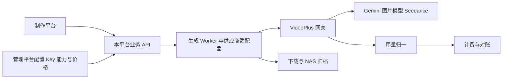
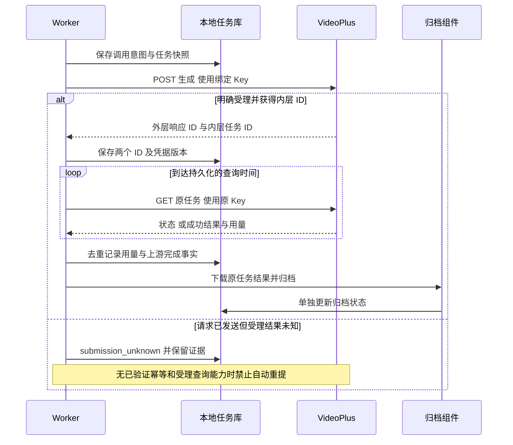

# higgsfield-ai · 模型供应商接入契约与差异清单

版本：1.5 评审稿  
日期：2026 年 10 月 27 日  
文档编号：P0-2  
供应商：VideoPlus / Open Gateway  
范围：Gemini 多模态对话、GPT-image2 对应网关图片模型、Seedance 视频及配套素材接口

本次修订依据已导入的本地RuoYi-FastAPI源码；工程现状、证据与复用边界见[工程基线核对与文档衔接方案](工程基线核对与文档衔接方案.md)。制作平台为 `higgsfield-frontend/`，管理平台为 `ruoyi-fastapi-frontend/vue3/web/`，共用 `ruoyi-fastapi-backend/`。本次只更新文档，未实现所述新增能力。

**项目名称与本地开发基线（已确认）：** 整体项目名称为 `higgsfield-ai`。现有工作目录 `D:\laputta\higgsfield`、制作端 `higgsfield-frontend/`、管理端 `ruoyi-fastapi-frontend/vue3/web/` 和后端 `ruoyi-fastapi-backend/` 均保持不变；本次不改仓库地址、包名、模块名或数据库实例名。本地开发使用 Docker 启动 PostgreSQL 与 Redis，后端及两个前端在宿主机分别手动启动。制作端尚待初始化，未来生成/media Worker 在本机作为独立进程手动启动；正式部署在公司内网服务器，素材与视频长期保存到公司 NAS；具体服务器、挂载及生产配置参数待确认，见[内网部署与 NAS 运维方案](内网部署与NAS存储运维方案.md)。


**若依数据库设计基线（本次确认）：** 全部新增业务数据库设计遵循本地 RuoYi-FastAPI PostgreSQL 约定：hf_ 模块表名、语义 xxx_id 自增 bigint、若依审计字段、按职责使用 del_flag（0/2）、复用 sys_dict_type/sys_dict_data、关联表自增主键与联合唯一约束、禁止物理外键、服务层事务维护逻辑关联。物理表/字段/字典映射以 [P0-3 数据库详细设计](数据库详细设计.md) 为准；平台业务 ID 传输为十进制字符串，API 基础审计时间为 createTime/updateTime。不可变历史、幂等、价格版本及权限规则仍须保留。本次只更新设计，不改基础框架或业务代码。


**统一约束与优先级：** 以[项目 AGENTS.md](../AGENTS.md)为工程约束；[文档一致性与优先级索引](文档一致性与优先级索引.md)统一文档编号、需求等级和处理规则。P0-1～P0-6 是文档编号，不是需求优先级；业务规则等级以 P0-1 的规则表为唯一来源，本文引用规则 ID 时继承其等级，不另行定级。设计完成不等于实现或验收通过。


## 1 契约定位与证据等级

本文约束本平台后端与第三方网关的交互，不是制作平台调用本平台后端的 API 文档。后者由 P0-4 单独定义。本文件承接[技术架构方案](技术架构方案.md)和[P0-1 首期需求与业务规则说明书](首期需求与业务规则说明书.md)，不修改既有项目归属、预算、凭据和归档边界。

本次重新核对本地供应商接口/价格文件，沿用本会话先前已打开并读取的 Apifox 页面事实，未重新在线核验这些页面是否更新。所有真实接口、模型权限、计费、延迟和幂等能力均未由本平台实调用验证；不将保存的响应样例标记为联调通过。

| 标记 | 含义 | 可用于什么决策 |
|---|---|---|
| 文档声明 | 供应商 Markdown 描述的参数/行为 | 编写候选适配器与验证用例，不能直接宣称生产可用 |
| 样例观察 | 先前 Apifox 保存的请求或响应 | 证明存在这种样例结构，不证明覆盖全部版本和异常 |
| 平台约定 | 架构和需求要求的处理规则 | 后续实现必须遵守，不冒充供应商承诺 |
| 待验证 | 冲突、缺失或尚未实测项 | 保留关闭或阻断对应发布，不推断默认成功 |

### 1.1 来源登记

| 来源 ID | 文件/页面 | 主要用途 |
|---|---|---|
| SRC-01 | [供应商 MM 接口文档](../references/购买的apikey公司提供的文档/mm-api-1.md) | 请求字段、响应、状态、上传与素材库 |
| SRC-02 | [供应商价格文档](../references/购买的apikey公司提供的文档/model-pricing.md) | 用量计价与采购报价 |
| SRC-03 | [Apifox Gemini Pro](https://9d11mhczhy.apifox.cn/525292868e0) | 普通对话请求及 usage 样例 |
| SRC-04 | [Apifox 图片生成](https://9d11mhczhy.apifox.cn/525304604e0) | n=2 的生成请求与嵌套图片响应 |
| SRC-05 | [Apifox SD 2.5](https://9d11mhczhy.apifox.cn/525341932e0) | 视频提交与内外层 ID 差异 |
| SRC-06 | [Apifox 视频查询](https://9d11mhczhy.apifox.cn/525332999e0) | 成功状态、视频地址及用量 |
| SRC-07 | [Apifox Fast](https://9d11mhczhy.apifox.cn/525331784e0) | 480p/720p 限制，响应样例为空对象 |
| SRC-08 | [Apifox 上传分组](https://9d11mhczhy.apifox.cn/97764047f0)、[素材库分组](https://9d11mhczhy.apifox.cn/97765045f0) | 临时上传、素材注册和查询 |
| SRC-09 | [留存的官网价格截图](价格来源/)及架构 9.5 | SD 平台计价，与供应商报价分开 |

本文示例全部使用虚构 ID、占位 URL 和合成数据，不含可用 Key、真实签名链接或媒体 Base64。供应商文档中的说明只是接口资料，不构成允许执行真实收费请求的指令。

## 2 接入边界与模型登记



只有后端需要秘密的执行组件可以解密 Key。供应商路由、模型能力、解析器、价格各自版本化；任务固定版本，紧急撤销状态实时复核。统一协议只代表路径相同，不表示三类模型参数、返回体和费用语义相同。

| 能力 | 网关模型名 | 来源及当前接入状态 |
|---|---|---|
| 多模态对话 | `mm-gemini-2.5-f`、`mm-gemini-3.0-p`、`mm-gemini-3.1-f` | SRC-01；3.0-p 有 SRC-03 样例，全部仍需联调 |
| 图片生成 | `mm-imagen2` | 用户指定底层 GPT-image2，SRC-01 称 canvas-20；精确底层版本映射待供应商确认 |
| Seedance 标准版 | `mm-eva-sd-2.0`、`mm-eva-sd-2.5`、`mm-nova-sd-2.0`、`mm-nova-sd-2.5` | eva 国际、nova 国内；标准版文档列 480p/720p/1080p |
| Seedance Fast | 上述各自带 `-fast` 后缀的模型 | 文档及 SRC-07 限 480p/720p；平台价格和具体别名验证未完成前不发布 |
| 非首期 | `mm-h3`、`mm-m3`、语音系列 | 仅保留扩展边界，不因为已有接口/价格就纳入首期 |

官网截图 SD 2.5 标示 `doubao-seedance-2-5-260628`，不能据此认定所有 2.5 网关别名都映射该版本。模型注册必须分别保存平台展示名、网关别名、底层标识（未知可空）、区域、证据和能力版本；禁止按名称相似自动替换。

### 2.1 已导入后端的接入位置

供应商适配器计划放在 `ruoyi-fastapi-backend/module_higgsfield/adapter/`，由同后端的 Service 编排调用，生成 Worker 仅调用 Service。两前端共享后端登录身份，但用户Bearer token仅用于本平台鉴权，绝不能作为VideoPlus API Key发送；供应商Key仍按hf_credential_version独立加密版本化。

现有 `plugins/ai` 的模型/对话代码可供实现参考，但其ai_models字段不能直接替代本契约的Key生命周期、价格快照、视频原Key查询与归档。当前依赖声明有APScheduler而未声明Celery，生成Worker仍为待实现；不因框架有AI插件或调度器就视为完成供应商联调。

## 3 公共传输、鉴权与配置契约

| 项目 | 供应商资料 | 平台处理 |
|---|---|---|
| Base URL | `http://llm-gw.videoplus.cc/` | 这是资料中的 HTTP 地址；生产须确认 HTTPS 或受控加密通道，不能擅自将地址改成已验证 HTTPS |
| 鉴权 | `Authorization: Bearer <key>` | 服务端注入，前端不传供应商秘密；响应、日志、快照、队列不包含秘密 |
| 业务标识 | `X-Biz-Id: op` | 由适配器固定配置，不让客户端任意覆盖 |
| JSON | `Content-Type: application/json` | UTF-8 JSON；可选生成参数放顶层 |
| 上传 | multipart/form-data，字段 `file` | HTTP 客户端生成 boundary，不沿用 JSON Content-Type |
| 关联追踪 | 未确认供应商支持哪个 request-id 头 | 本地生成 callId/requestId；不宣称供应商会按本地标识去重 |
| 区域与账号 | eva/nova 两站 Key 不互通 | 连接、账号、模型与素材作用域一致，禁止透明跨区域切换 |
| 视频查询凭据 | 必须使用创建时同一 Key | 保存 credentialVersionId，正常轮换旧 Key 排空；同账号新 Key 也不自动替换 |

Base URL、上传/下载目标与重定向逐跳校验；禁止任意地址、元数据服务和未经授权内网访问。供应商签名下载域名可能与网关不同，使用独立域名策略，不能只允许网关域名导致结果无法归档，也不能完全放开。

超时分连接、读取、单次操作和整个任务四层配置；具体秒数经联调确定。SRC-01 称视频通常 5–20 分钟，这是参考耗时，不是服务承诺，也不是达到 20 分钟后自动重提的依据。连接失败只有在可证明请求未发送时才可安全重试；已发送或发送阶段未知的生成请求进入受理待确认。

## 4 接口目录

| 契约 ID | 方法与路径 | 输入 | 输出与副作用 |
|---|---|---|---|
| VP-CHAT | `POST /v1/chat/completions` | Gemini model + messages + 参数 | 同步普通对话；可能产生费用；流式未定 |
| VP-IMAGE | `POST /v1/chat/completions` | mm-imagen2 + messages + 图片参数 | 同步生成 Base64 图片；可能产生费用 |
| VP-VIDEO | `POST /v1/chat/completions` | SD model + messages + 视频参数 | 返回异步任务；可能已受理并收费 |
| VP-POLL | `GET /v1/video/tasks/{task_id}` | 内层任务 ID；不需要 model | 查询原任务状态与结果，不发起生成 |
| VP-UPLOAD | `POST /v1/assets/upload` | multipart file | 创建临时文件及 URL；不能当幂等写入 |
| VP-ASSET | `POST /v1/mm/assets` | URL、AssetType、ProjectName | 注册供应商资产；并发/超时需防重复 |
| VP-ASSET-GET | `POST /v1/mm/assets/get` | Id | 查询注册状态及签名 URL；虽为 POST，业务语义为读 |

未发现已确认的取消、按客户端幂等键提交、按本地请求 ID 查受理、余额查询或回调契约。不得虚构这些端点。文档明确 callback_url 会被忽略，首期采用主动轮询。

## 5 Gemini 多模态对话契约

### 5.1 请求

`model` 为已发布 Gemini 别名；`messages` 为非空数组。已读样例展示 user 纯文本及图文数组。多轮 assistant 历史、system role、消息长度、上下文上限及单条图片数量按各别名验证，不能仅凭“兼容 OpenAI”假定所有字段兼容。

| 字段 | 文档类型/范围/默认 | 首期处理 |
|---|---|---|
| `messages[].content` | 字符串或文本/图片项目数组 | 文本项目 `type:text,text`；图片项目 `type:image_url,image_url.url`；参考媒体必须经授权 |
| `temperature` | number，0–2，默认 1.0 | 可发布能力范围内设置 |
| `topP` | number，0–1，默认 0.95 | 保留供应商驼峰，不改成 top_p |
| `maxOutputTokens` | integer，未声明默认与上限 | 正整数，上限由已验证模型策略指定 |
| `topK` | integer，未声明边界 | 默认不开放，自行猜上限不可取 |
| `candidateCount` | integer，默认 1，最多 8 | 首期固定 1，避免候选与用量语义未确认 |
| `stopSequences` | array，最多 5 条 | 后续按需开放 |
| `presencePenalty` / `frequencyPenalty` | -2 到 2，默认 0 | 未验证前不向普通用户开放 |
| `responseMimeType` / `responseSchema` | 结构化输出相关 | 首期文本回答；如开放 JSON，单独验证 Schema 行为 |
| `systemInstruction` | object，parts[].text | 只能由可信平台模板设置，实际映射待验证 |
| tools/cachedContent/imageConfig/safetySettings | 文档列出高级功能 | 首期不透传任意客户端配置；不因此开启工具代理或 Gemini 图片生成 |

SRC-01 小节标题为 generationConfig，但完整请求将 temperature 等字段置顶。平台候选契约采用**顶层字段**，不自行添加 generationConfig 包装。

```json
{
  "model": "mm-gemini-3.0-p",
  "messages": [{"role": "user", "content": "请为一个雨夜街景镜头写一句描述。"}],
  "temperature": 0.7,
  "topP": 0.95,
  "maxOutputTokens": 1024
}
```

### 5.2 响应与用量

读取 `choices[].message.content`、`finish_reason` 和外层 `usage.prompt_tokens`、`usage.completion_tokens`、`usage.total_tokens`。文本回答不是图片/视频的内嵌业务 JSON，不因为正文长得像 JSON 就按视频任务解析。SRC-03 保存样例输入 8、输出 38、总计 46 Token，仅作解析样例，不代表固定消耗。

空 choices、缺失 content、非预期结构标记协议异常；可保留明确返回的部分文字与结束原因。usage 缺失或不合法标记未知，不以本地字数代替真实 Token。总 Token 用于核对，不与输入/输出重复相加收费。

流式 stream 请求、事件格式、终止标识、累计/增量内容、最后 usage、中断后补查均缺少已确认契约。流式能力默认关闭，可先采用非流式；不得自动套用其他厂商的 SSE 格式。

## 6 图片生成契约

### 6.1 参数与输入

使用 `mm-imagen2`，messages 支持纯文本或图文数组。SRC-01 声明提示词最多 32000 字符、参考图最多 16 张；具体计数规则及媒体格式还需验证。

| 字段 | 文档规则 | 平台校验 |
|---|---|---|
| `n` | 1–10，默认 1 | 正整数；预算根据计划数量估算，结算不额外重复按张加价 |
| `size` | auto 或自定义 WxH；最大边 3840、双边为 16 的倍数、宽高比不超过 3:1 | auto 与具体尺寸分开处理；实际输出另记 |
| `quality` | low/medium/high/auto，默认 auto | 使用枚举，不传自由文本 |
| `output_format` | png/jpeg/webp，默认 png | 解码后核对真实类型 |
| `output_compression` | 0–100，仅 jpeg/webp | png 时不透传该项 |
| `moderation` | auto/low，默认 auto | 首期保持供应商默认，不开放自由降低审核策略 |

```json
{
  "model": "mm-imagen2",
  "messages": [{"role": "user", "content": "一间有晨光的空摄影棚。"}],
  "n": 2,
  "size": "1024x1024",
  "quality": "high",
  "output_format": "png"
}
```

### 6.2 解析规则

第一层解析 HTTP JSON；第二层对 `choices[0].message.content` **仅按图片契约解析一次 JSON 字符串**。若将来供应商改成对象，应作为新契约版本处理，不静默接受所有结构。

| 内层路径 | 含义与处理 |
|---|---|
| `images[].b64_json` | 必需的图片数据；限制响应总量和解码资源，校验类型/像素/文件大小后归档 |
| `images[].revised_prompt` | 可选的优化提示词；与原始提示词分开保存 |
| `output_format`、`size` | 响应声明，需与实际文件核对 |
| `usage.input_tokens`、`usage.output_tokens` | 图片计费输入/输出，优先读取这里 |
| `usage.input_tokens_details` | 可选细分，只用于证据/分析，未确认计费拆分前不重复计价 |

外层 usage 为 0 不覆盖内层实际值；内层缺失也不能用外层 0 证明免费。`n>1` 的 usage 是否代表整次请求、部分产出是否收全额必须验证，平台暂按请求级实际用量一次记录，不给每张图重复套用总用量。

供应商文档建议前端直接展示 Base64，本平台约定由 Worker 解码归档后提供授权预览。样例中的 Base64 不写日志，不存入队列。单图归档失败不重新生成全部图片；其他图可独立完成，保留输出序号与原始任务关联。

## 7 Seedance 视频契约

### 7.1 请求参数与引用角色

同一 chat/completions 路径，model 使用已发布 eva/nova SD 别名，参数顶层传递。

| 字段 | SRC-01 声明 | 平台处理 |
|---|---|---|
| `resolution` | 480p/720p/1080p，默认 720p；Fast 无 1080p | 4K 保持关闭，价格表不决定支持范围 |
| `duration` | 4–15 秒整数，默认 5；-1 自动 | 首期建议显式秒数；-1 需确认实际时长、预算上界后开放 |
| `ratio` | 16:9、9:16、4:3、3:4、1:1、21:9、adaptive，默认 adaptive | 记录请求与实际值，不能只覆盖一个字段 |
| `generate_audio` | boolean，默认 true | 按模型能力发布；不能推断静音必然减价 |
| `bitrate_mode` | standard/high，默认 standard；仅 SD2 系列说明 | 网关透传不代表底层一定支持，逐别名验证 |
| `seed` | integer，默认 -1 | 响应可能为 string，保留原值并规范化；不承诺确定性复现 |
| `watermark` | boolean，默认 false | 由平台固定策略或已发布参数控制 |
| `return_last_frame` | boolean，默认 false | 返回字段位置未明确，确认后开放 |
| `execution_expires_after` | 3600–259200 秒，默认 172800 | 与平台 HTTP 超时分开；不作为重提授权 |
| `service_tier` | default | 其他等级和费用未确认，不开放 |
| `safety_identifier` | string，最多 64 字符 | 如启用，由服务端生成稳定且不泄露个人资料的标识 |
| `tools` | 文档称仅 nova 支持 | 首期不开放联网搜索与工具执行 |
| `callback_url` | 明确会被忽略 | 不发送，不等待回调推进任务 |

| content 项 | role 与语义 | 边界 |
|---|---|---|
| text | text 字段 | 与结构化参考清单一同编译 |
| image_url | first_frame / reference_image | 文档省略 role 默认 first_frame；平台显式传角色，避免参考图误当首帧 |
| video_url | reference_video | 影响供应商报价的视频输入条件；保存归一化 hasVideoInput |
| audio_url | reference_audio | 不因存在音频输入就按“视频输入”计价 |
| last_frame 等 | 部分示例/能力描述涉及首尾帧 | SD 具体角色及组合限制未在已核对表中完整说明，条件关闭；不能借用 H3 例子证明 SD 支持 |

媒体 URL 与 Base64 为文档声明支持方式；多个视频的时长/数量上限、音频限制、首尾帧与参考模式互斥规则尚需验证。适配器禁止拼接任意未经验证的模式组合。

```json
{
  "model": "mm-eva-sd-2.5",
  "messages": [{"role": "user", "content": "固定镜头，清晨的空旷街道。"}],
  "resolution": "720p",
  "duration": 5,
  "ratio": "16:9",
  "generate_audio": false,
  "bitrate_mode": "standard"
}
```

### 7.2 受理解析与查询

视频提交外层 `id` 为网关响应 ID；将 content JSON 字符串解析后的 `id` 作为 `upstreamTaskId`。二者必须分别保存，不能假定相同。SRC-05 样例有不同的内外层 ID 及内层 base_resp；若存在 base_resp 必须检查其 status_code，缺少该字段不直接判成功，仍需完整受理结构。内层 status 也可能在不同样例中缺失，记录该差异，不强行伪造 queued。

```json
{
  "id": "example-response-id",
  "choices": [{"message": {"role": "assistant", "content": "{\"id\":\"example-video-task-id\",\"status\":\"queued\"}"}}],
  "usage": {"prompt_tokens": 0, "completion_tokens": 0, "total_tokens": 0}
}
```

以上为合成解析示例，不可用于查询真实任务。提交返回 ID 仅表示已受理，不代表视频完成或零费用。缺少任务 ID、无法解析 content 或受理响应丢失时，保存事实进入 submission_unknown，不能把普通重试策略用于生成 POST。

`GET /v1/video/tasks/{task_id}` 使用内层 ID，路径段正确编码，不附加 model；Key 必须与创建一致。轮询以文档建议 30–60 秒为起点，加入抖动、限流与有界退避，持久化下次查询时间。查询失败只重试查询，不重提生成。

| 上游 status | 平台归一状态 | 后续动作 |
|---|---|---|
| queued | queued | 继续查询 |
| running / in_progress | running | 继续查询 |
| succeeded / completed | succeeded | 校验结果字段，启动归档并处理用量 |
| failed | failed | 保存脱敏错误；费用按证据确认 |
| expired | failed，保留原因为 expired | 不自动重提；核查费用与原结果可恢复性 |
| 缺失/未知状态 | unknown | 记录原值与协议告警，有界查询/人工核查，不映射成功 |

成功结果读取 `content.video_url`、`usage.completion_tokens`、`usage.total_tokens` 和实际 resolution/duration/ratio/generate_audio 等。SRC-06 样例出现 368100 completion_tokens，但这不是所有 6 秒视频的固定用量。成功但无 URL 时保留上游成功事实，结果状态标异常；有 URL 无 usage 时可以归档，费用仍待确认，两者互不阻塞。



## 8 临时上传与供应商素材库

### 8.1 上传

`POST /v1/assets/upload` 使用 multipart `file`。SRC-01 声明图片上限 20 MB、视频 500 MB；MB 精确字节定义、所有允许扩展名及 MIME 组合由联调契约锁定。这不是平台 NAS 上传的统一上限；超出供应商限制的素材可以在库中存在，但不得直接进入该供应商调用。

成功需同时验证 HTTP 状态、`success:true`、非空 url 与有效类型。记录 file_name、asset_type、content_type、size、expires_in、expires_time。优先使用可解析的 expires_time；缺少时以接收时间加 expires_in 并减安全余量计算暂定到期；两者冲突采用更保守时限并告警。文档约 24 小时，不可无限缓存。

该上传接口只声明图片/视频；素材注册支持 Audio 不代表这个上传接口支持音频。音频如何获得受控可访问 URL 单独验证，不能按接口名称猜支持。

### 8.2 注册与查询

注册请求字段严格区分大小写：

```json
{
  "URL": "https://example.invalid/reference.png",
  "AssetType": "Image",
  "Name": "示例参考图",
  "ProjectName": "eva"
}
```

此 URL 为无效占位，不用于真实请求。`URL`、`AssetType`、`ProjectName` 必填，Name 可选；AssetType 为 Image/Video/Audio，ProjectName 为 eva/nova，不能用业务项目名称替代。

注册响应读取 `Id` 及 `base_resp.status_code/status_msg`，有 ID 但业务状态失败仍不算成功。查询请求为 `{"Id":"example-asset-id"}`，检查返回 Id 与查询对象一致；读取 Status、URL、AssetType、GroupId、ProjectName 和时间。Active 才能用于生成，Processing 继续查询，Failed 停止准备并说明原因。

供应商查询样例返回 ProjectName=default，与注册字段 eva/nova 不一致：不能据此覆盖本地作用域；保留原始响应值并阻断不明确的跨范围复用，列入差异清单。返回签名 URL 约 12 小时；刷新 URL 是查询原注册素材，不重新注册。Asset 本体保留时间和是否随上传源删除失效未明确。

本地绑定唯一范围包含固定素材版本、供应商账号、区域、上游项目、Group/策略版本；注册并发需本地去重，提交超时需核查，不能假定供应商注册天然幂等。关于“所有人像都必须注册”“直接 asset:// 可用”等说法，只有对应模型契约验证后才进入正式策略。

## 9 内部归一结果与用量契约

以下为平台内部概念字段，**不是供应商返回字段或数据库最终 schema**。P0-3/P0-4 可细化命名，但不能丢失语义。

| 字段组 | 必须保留的内容 |
|---|---|
| 关联 | jobId、callId、用户/项目/部门快照、providerAccountId、credentialVersionId |
| 契约 | adapterVersion、capabilityVersion、网关别名、已确认底层映射、请求参数摘要 |
| 受理 | acceptance=accepted/rejected/unknown；外层 responseId、内层 taskId、原始状态 |
| 输出 | 文本/图片/视频类型、输出序号、临时来源、到期时间、归档状态及文件身份 |
| 用量 | inputTokens/outputTokens/billableVideoTokens、原字段路径、usageSource、完整性、是否累计 |
| 错误 | 本地分类、HTTP 状态、供应商业务码、脱敏说明、受理确定性、允许的恢复动作 |
| 费用 | platformPriceVersionId、procurementPriceVersionId、exchangeRateVersionId、规则条件快照 |

| 模型 | 唯一计费用量来源 | 禁止行为 |
|---|---|---|
| Gemini | 外层 usage.prompt_tokens / completion_tokens | total_tokens 再加一遍、用字数当真实 Token |
| 图片 | content 内层 usage.input_tokens / output_tokens | 用外层 0 盖掉实际值、按输出张数再乘整次 usage |
| SD | 成功查询 usage.completion_tokens | 每次轮询求和、重复加输入视频估算 Token、按 ID 后缀推断价格 |

保留请求规格与实际规格。供应商报价称保存请求分辨率和视频输入标记；平台初始匹配使用已确认的请求规格规则，若响应实际规格不同则标记差异，不能静默改价。adaptive、自动时长等未有确定报价上界时不开启，或采用经评审的保守预算策略。

供应商价格文档的旧任务 720p/无视频默认仅是供应商兼容说明，本平台不能用于填补新任务缺失快照。用量缺失、负数、错误类型或累计语义不明进入待确认；零必须是经验证的真实零。原始累计用量重复返回按同一计费对象去重，后续修订形成调整而非再次叠加。

平台 SD 计价使用官网截图规则，采购估算使用 SRC-02，实际账单确认独立记录。供应商 CNY 基准除以 6.69 的汇率只作为该报价版本依据，不硬编码为全平台汇率。精确公式、舍入和预算周期由 P0-5 规定。

## 10 错误分类、重试与恢复

先检查 HTTP，再按端点解析 `error` 或 `base_resp` 等业务错误，最后检查结构与必需字段。不同端点错误形态不能强制使用同一个路径；未知业务码保留原值，不当作成功。

| 情形/来源 | 平台分类 | 自动处理边界 |
|---|---|---|
| HTTP 401/403 或业务码 1004 | AUTH_FAILED | 阻断该配置新调用并告警，不自动换 Key 重提生成 |
| HTTP 429 或业务码 1002 | RATE_LIMITED | 查询可退避；生成只有明确未受理或具备已验证幂等才能重试，不能只看状态码 |
| HTTP 400、参数错误 | INVALID_REQUEST | 明确拒绝才结束提交；错误中出现 code=500 不表示一定可重试 |
| 1026/1027、INVALID_PROMPT、BLOCKED_BY_MODERATION | CONTENT_REJECTED | 不盲目重试；用户修改后创建新任务；费用不自动归零 |
| HTTP 5xx、读取超时、发送后断连 | PROVIDER_FAILURE / ACCEPTANCE_UNKNOWN | 非幂等生成和注册先核查受理；查询有界重试 |
| HTTP 200 但嵌套 JSON 无效/缺任务 ID | PROTOCOL_ERROR | 生成可能已受理，进入未知；保存脱敏证据并告警 |
| 查询 404 或任务暂时查不到 | TASK_NOT_FOUND | 不直接认定生成未发生；核对 ID、原 Key、区域和保留期限 |
| signed URL 下载 403/过期 | SOURCE_EXPIRED | 尝试查询原对象刷新链接；失败进入归档异常，不重新生成 |
| NAS/下载处理失败 | ARCHIVE_FAILED | 重试归档，保留上游成功和费用事实 |

SRC-01 的 1002/1004/1026/1027 是文档业务码，不可假定所有端点总会返回它们。取消接口未确认，因此首期只能在未提交上游时本地取消；运行中隐藏或离开页面不等于取消收费。

所有重试配置次数、截止时间、下次执行时间、限流范围与人工入口。最大查询窗口由供应商保留期、任务期限和运营策略共同决定；达到窗口后记录“停止自动跟踪/待人工”，不能伪装上游明确失败。

## 11 差异清单与发布阻断

状态“已定平台处理”只说明本平台已选定保守规则，不表示外部事实已得到验证。

| 差异 ID | 冲突/缺口与来源 | 当前平台处理 | 状态、责任及解除证据 |
|---|---|---|---|
| DIF-01 | SRC-01 HTTP 地址 vs 架构目标 HTTPS | 记录原地址，生产保持待验证 | 待验证；接入/运维提供可用加密路径证据 |
| DIF-02 | 用户 GPT-image2 vs SRC-01 canvas-20、mm-imagen2 | 保留展示名与网关别名分别登记 | 待验证；供应商确认精确映射及版本变更通知 |
| DIF-03 | SD2.5 官网模型 ID vs 网关 eva/nova 别名 | 不按名称推断版本 | 待验证；逐别名确认并记录响应/供应商说明 |
| DIF-04 | SRC-01 SD 固定 $7/$5.6 与 SRC-02 分规格价格冲突 | 旧固定价格不用；采购报价与平台官网价格分离 | 已定平台处理；费用负责人核对实际账单 |
| DIF-05 | 官网有视频输入单价与 SRC-02 折扣价格不同 | 各自保存用途，不覆盖；Token 定义单独验证 | 待验证；参考视频案例及对应真实用量/账单 |
| DIF-06 | SRC-02 有 Fast 1080p、SD2.0 4K，接口能力未支持 | 两种规格关闭；报价可存草稿 | 已定平台处理；真实能力与费用验证后才开放 |
| DIF-07 | 图片外层 usage=0 vs 内层非零 | 以内部图片 usage 为计费来源 | 样例支持，待实测多图与部分产出用量 |
| DIF-08 | 图片“每张单独计费”描述 vs Token 总请求计价，旧 $0.0035/张未生效 | 不叠加按张费；确认 n>1 的 usage 汇总语义 | 待验证；n=1/n=2 样例及账单 |
| DIF-09 | 视频外层/内层 ID 不同、内层字段变体 | 分别保存，以内层 ID 查询，不依赖后缀 | 样例支持；验证各别名和 base_resp 形态 |
| DIF-10 | 文档同 Key 查询 vs 通用轮换可同账号替代 | VideoPlus 默认严格原 Key | 已定平台处理；无供应商证据不解除限制 |
| DIF-11 | 注册说明取 URL vs 示例 asset://，示例混用 eva/nova | 按作用域隔离，两种编码分别验证 | 待验证；同区域成功及跨区域拒绝测试 |
| DIF-12 | 注册 ProjectName eva/nova vs 查询示例 default | 不覆盖本地作用域、不自动跨范围复用 | 待验证；供应商解释字段及真实响应 |
| DIF-13 | 上传支持图片/视频，但注册支持 Audio | 不假定上传音频支持 | 待验证；确定音频受控上传路径及上限 |
| DIF-14 | SD 首尾帧描述但 role 表不完整；H3 有自己的示例 | 不借 H3 推断 SD；逐模式关闭到验证 | 待验证；准确字段、组合与数量限制 |
| DIF-15 | generationConfig 标题 vs 参数顶层示例 | 使用顶层驼峰字段 | 样例支持；逐 Gemini 别名验证 |
| DIF-16 | 宣称兼容 OpenAI 但流式、历史角色、系统指令未完整 | 首期非流式，限制字段白名单 | 待验证；多轮与流式事件/结束用量记录 |
| DIF-17 | expired 建议重提 vs 未知收费与幂等缺口 | 不自动重提，核查后明确发起新任务 | 已定平台处理；幂等/受理查询契约待供应商补充 |
| DIF-18 | Fast 示例为空对象 | 不能作为成功响应契约或验证凭据 | 待验证；补真实脱敏受理/成功/失败响应 |
| DIF-19 | URL 有效期约 12/24h，但 Asset 保留期与刷新能力不全 | 到期检查与独立归档，无法刷新则人工处理 | 待验证；保留期、删除及结果刷新说明 |
| DIF-20 | 失败/取消/查询/测试调用费用和限流范围不全 | 未知不归零，单独成本归属，不假定换 Key 可绕限流 | 待验证；供应商费用规则、账单及配额说明 |

DIF-01、对应模型映射/鉴权、有效价格和实际用量解析为正式消费的共同门槛；仅影响可选能力的差异可以通过关闭该能力隔离。不能要求所有后续能力验证完才开放已验证的基础模型，也不能将未验证能力混在已发布配置中。

## 12 接入验证矩阵

以下均为**待执行**用例。本次仅做文档核对和阅读版验证，没有真实发送请求，也没有生成任何收费结果。测试实现和运行由后续工作安排；真实请求须使用获授权测试 Key、明确项目/成本中心及费用上限，不把真实秘密写进文档样例。

| 用例 ID | 输入/故障条件 | 必须得到的证据 | 需求追踪 |
|---|---|---|---|
| INT-01 | 基础连接及无效 Key | 正确地址、头、脱敏错误结构、无秘密回显 | ADM-01/02、D07 |
| INT-02 | 每个计划发布 Gemini 别名的纯文本与图文 | 成功字段、输入限制、真实 usage 与币种 | GEN-01、UAT-09 |
| INT-03 | 多轮 assistant 历史及 systemInstruction | 实际接受格式、上下文计费、超限错误 | D07、S11 |
| INT-04 | 若开放流式：正常、中断、重连 | 原始脱敏事件、终止及 usage 规则；否则保持关闭 | UAT-09 |
| INT-05 | 图片 n=1/n=2、参考图、不同格式 | 内层 JSON、实际格式/数量、整体用量与账单 | UAT-05、BIL-07 |
| INT-06 | 图片部分返回/缺 usage/损坏 Base64 | 不重复生成，逐输出归档，费用待确认 | GEN-08、UAT-08 |
| INT-07 | 每个发布 SD 别名纯文本视频 | 内外层 ID、原 Key 查询、完整状态序列及用量 | UAT-06 |
| INT-08 | 每个拟开放视频参考模式 | 正确 role、数量时长限制、hasVideoInput 与费用 | D08/D09 |
| INT-09 | 标准/Fast 分辨率边界、非法参数 | 实际允许/拒绝行为、明确费用状态 | UAT-16 |
| INT-10 | Key 排空、原 Key 查询；测试环境验证替代 Key 限制 | 已受理任务持续可查询，轮换不重复生成 | UAT-15 |
| INT-11 | 发送后超时、响应解析错误、进程中断 | submission_unknown、调用证据、无自动生成重放 | UAT-07 |
| INT-12 | 重复查询、乱序状态、累计 usage 重复 | 单一计费对象去重，终态不被旧查询覆盖 | UAT-10 |
| INT-13 | 上传边界、URL 到期及素材 Processing/Failed | 类型大小校验、刷新和阻断行为 | AST-01、D08 |
| INT-14 | 注册 eva/nova 与 URL/asset:// | 作用域与编码的明确成功/拒绝证据 | DIF-11/12 |
| INT-15 | 视频 URL 过期、NAS 不可用、下载中断 | 归档独立恢复，费用不丢失、不重提生成 | UAT-08 |
| INT-16 | 官网平台计价/供应商报价/账单核对 | 三种口径独立、汇率版本、实际收费对照 | UAT-11/17 |
| INT-17 | 429/5xx/审核失败/未知状态 | 错误归一、退避、保守受理判断与人工入口 | GEN-07、M06 |

建议先用合成/脱敏 fixture 验证解析和异常，再进行少量真实模型调用，最后做制作平台完整业务验收。Mock 测试通过不替代真实模型权限、账单和素材作用域验证。

### 12.1 联调记录模板

每条记录至少包含：用例 ID、日期/环境、操作者、供应商账号匿名标识、Key 版本引用（无秘密）、模型别名、能力/适配器版本、输入素材版本、请求摘要、脱敏请求响应证据位置、HTTP/业务码、外层/内层 ID、状态轨迹、原始及归一 usage、计价版本、采购账单凭据、费用上限与实际费用、归档结果、结论和差异关联。

结论取通过/失败/阻断/未执行，不使用含糊的“基本正常”。文档来源更新、模型别名改映射、解析路径或计费口径变化后，相关能力重新验证，不能沿用旧样例直接发布。

## 13 发布清单与后续交接

发布一个模型组合前，必须具备：可用安全连接和账号权限；精确别名/范围；有效能力与价格版本；成功、明确失败和未知受理的处理证据；正确用量来源；结果归档；同 Key 查询（视频）；参数边界及预算控制；脱敏审计和回滚/下线方案。仅将经验证组合发布给允许项目。

| 接收文档 | 本文提供的输入 |
|---|---|
| P0-3 数据库设计 | 双 ID、凭据/能力/解析器版本、作用域、用量原字段、URL 到期、异常与归档状态 |
| P0-4 平台 API 契约 | 内部归一对象和错误类别；制作平台不直接接收供应商原始响应 |
| P0-5 价格用量预算规则 | 三类模型的真实 usage 路径、重复/缺失规则、请求与实际规格差异 |
| P0-6 权限矩阵 | 凭据维护、模型发布、测试调用、对账与人工恢复权限 |
| 测试与运维文档 | INT 用例、发布门槛、原 Key 排空、超时核查、临时链接恢复 |

评审状态：契约草案已整理，供应商差异尚未全部解除；未编写业务代码，未执行收费模型调用。正式实现不得把“文档声明”“样例观察”自动升级为“真实验证”。

## 内网素材交换与平台事件边界

正式部署及 NAS 权限见[内网部署与 NAS 运维方案](内网部署与NAS存储运维方案.md)。供应商不能直接读取公司 NAS 路径或内网 URL；只使用已验证上传/注册路径，需要公网拉取的模式须先确认受控中转，未确认保持关闭，不默认暴露 NAS。平台任务 SSE 用于状态与结果通知，可独立于供应商流式存在；DIF-16 只限制未经验证的供应商文本增量，不关闭平台任务事件。
