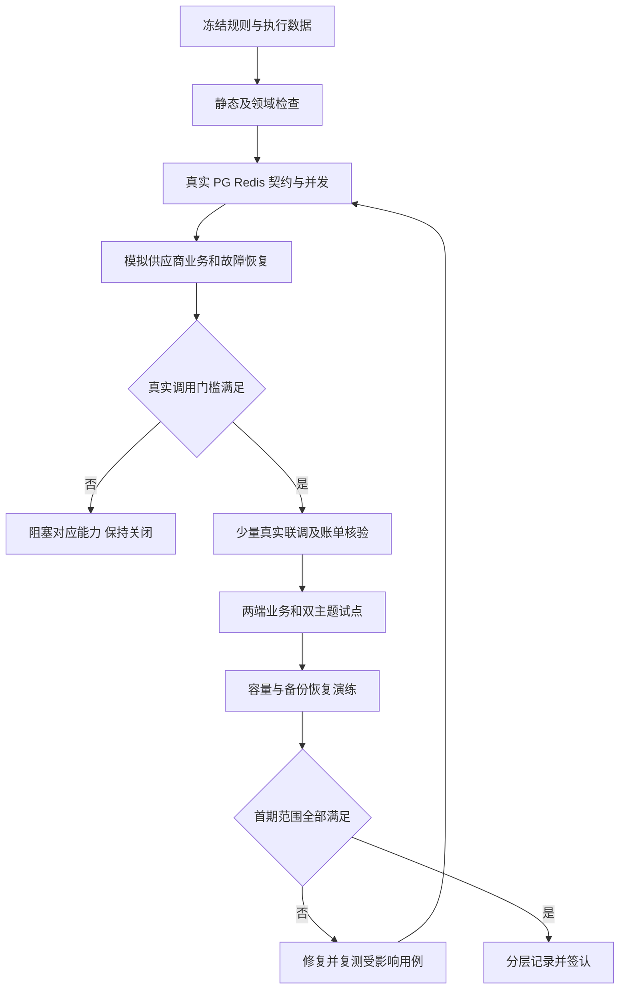
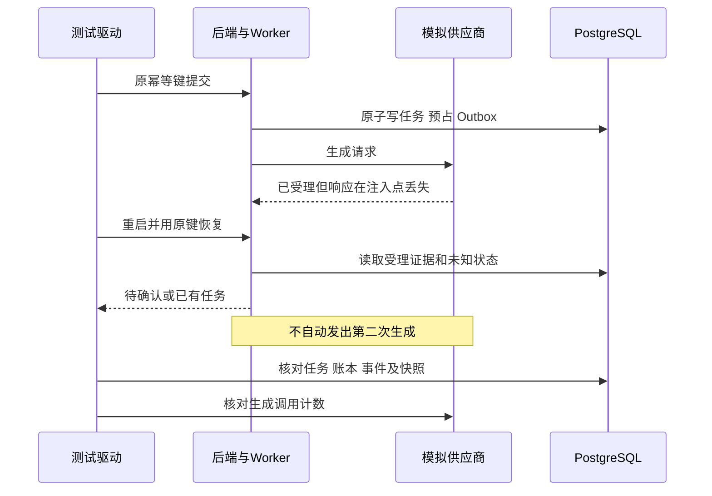

# higgsfield-ai · 测试与验收方案

版本：1.1  
日期：2026 年 10 月 27 日  
状态：测试设计评审稿；所有运行用例待执行，不代表已实现或已验收

**正式部署基线（用户已确认）：** 平台部署在公司内网服务器，素材、图片、视频及其长期归档文件存放公司 NAS。员工通过平台访问受授权内容，浏览器不直接访问 NAS 共享目录。内网服务器的操作系统、数量、正式环境容器化方式、域名及 NAS 协议/挂载路径仍待运维确认；本地 Docker 启动 PostgreSQL/Redis、后端及两前端手动启动的方式不变。

## 1 目标、依据与验收边界

本方案覆盖制作平台 `higgsfield-frontend`、管理平台 `ruoyi-fastapi-frontend/vue3/web` 和共用后端 `ruoyi-fastapi-backend`，验证从配置供应商、组织项目、提交模型任务，到作品归档、计费、协作与恢复的完整流程。

依据：[AGENTS.md](../AGENTS.md)、[技术架构方案](技术架构方案.md)、[P0-1 首期需求](首期需求与业务规则说明书.md)、[P0-2 供应商契约](模型供应商接入契约与差异清单.md)、[P0-3 数据库设计](数据库详细设计.md)、[P0-4 平台 API](平台API契约.md)、[P0-5 价格用量预算](价格用量预算说明.md)、[P0-6 权限矩阵](权限矩阵.md)、[页面规格与交互说明书](页面规格与交互说明书.md)、[前端规范](制作平台前端编码规范.md)、[后端规范](后端编码与框架对齐规范.md)、[本地开发手册](本地开发与工程初始化手册.md)及[文档索引](文档一致性与优先级索引.md)。供应商证据沿用 P0-2 已登记材料；本文不重新验证官网价格或上游能力。

业务优先级唯一来源仍为 P0-1：P0（阻断项）、P1（首期必需）、P2（后续增强）。P0-1 至 P0-6 是文档编号；本文 TST-xx 是执行工作包，不是新等级。覆盖多项规则时，执行最严格的开放门槛，不把全部页面或全部测试重新标成同一级。

首期验收包括 B1～B4；B2 演示通过不能称为首期交付。未计划开放的流式、Fast/4K、音频、复杂画布等按源契约关闭，仍测试“入口关闭且接口拒绝”；不能把首期基础图片、视频、图文会话测试标成可选以绕过交付。

本轮只产出测试设计与阅读版，不编写测试或业务代码，不安装依赖、启动服务、运行迁移或调用收费模型。后续报告必须分别列出静态核对、模拟测试、真实数据库/接口测试、真实供应商联调、浏览器业务验收和恢复演练。

## 2 测试层次、职责和证据

| 层次 | 核心内容 | 执行责任建议 | 不能据此声称 |
|---|---|---|---|
| 设计与静态检查 | 源规则、DTO、迁移、框架分层、前端规范、用例追踪 | 各模块开发＋评审人 | 服务可运行或业务已通过 |
| 领域及适配器测试 | 价格计算、状态转换、解析、参数边界、脱敏 | 后端开发 | 真实供应商接受请求或实际收费正确 |
| PostgreSQL/Redis 集成 | 事务、并发、唯一性、缓存失效、迁移与恢复 | 后端＋测试 | 浏览器操作完整或供应商行为已验证 |
| API 契约与安全 | 响应、权限、文件、分页、幂等、SSE | 后端＋测试 | 隐藏按钮就阻止越权 |
| 浏览器业务与主题 | 两前端真登录、操作、刷新、双主题、错误恢复 | 前端＋测试＋业务代表 | 模拟模型结果等于真实模型闭环 |
| 真实模型与费用核验 | 每个拟发布别名/规格、用量证据、账单核对 | 接入负责人＋费用负责人 | 只测一个别名就覆盖同系列全部规格 |
| 容量与恢复 | 负载隔离、积压、备份、在途任务恢复 | 后端＋运维＋测试 | 本机单次成功等于生产 SLA |

责任均是岗位建议，实际执行前在报告填写姓名。业务代表确认业务结果，权限负责人确认角色和数据范围，费用负责人确认金额口径及账单，运维确认恢复证据。设计提案仍待批准时，报告标“阻塞：决策未冻结”，不能由测试人员代为批准。

自动化建议：后端沿项目测试工具组织领域/契约测试，异步集成使用实际 PostgreSQL 与 Redis；前端组件测试与浏览器自动化按锁定的工程工具落地。人工负责截图视觉比对、复杂权限评审、真实账单及恢复证据。本文不创建工具配置或要求现在运行全仓测试。

## 3 环境、隔离与测试数据

### 3.1 环境准备

沿本地手册用 Docker 启动 PostgreSQL、Redis，后端、两前端及后续 Worker/调度进程在宿主机手动启动。建议端口仍为 PG 15432、Redis 16379、后端 9099、管理 5173、制作 5174；执行前核实实际配置与监听，端口不是已验证事实。

使用独立测试库、Redis 命名空间、媒体根目录、供应商测试凭据及成本归属。记录代码提交/脏工作区差异、文档版本、迁移版本、Python/Node/PG/Redis/浏览器版本、时区、能力/价格/凭据版本。禁止将真实秘密放入 fixture、截图、报告或前端环境变量。

空库初始化与已有库升级分开验收；只运行真实迁移，不能用 create_all 或手改迁移版本代替。备份恢复在隔离目标执行，禁止对现有开发数据执行破坏性重置。故障注入仅作用于测试进程、测试目录和模拟供应商；真实供应商异常以受控少量验证或已脱敏记录辅助，不发送破坏性压测。

正式环境验收还须在公司内网服务器与实际 NAS 测试目录完成：挂载可用性/权限、断连与重挂、挂载丢失时不落入本地目录、视频 Range、并发归档及数据库/文件哈希一致性。验证服务端受控出站、供应商不能直接读取内网 NAS 地址、参考素材经已验证上传/注册链路传递。上述检查归入 TST-03/06/07/13/17/18，不新增优先级；本地磁盘模拟通过不能替代 NAS 实测。

### 3.2 固定数据集

| 数据集 | 准备内容 | 用途与不变量 |
|---|---|---|
| F01 身份与范围 | 两部门、两个互不授权项目 PA/PB；owner、producer、viewer、无关用户、无项目成员关系的系统管理员、仅财务、仅运维 | 按 P0-6 评审后的角色包落地；另设仅下载/费用附加权限及缺一权限组合 |
| F02 项目与历史 | 活跃、暂停/归档项目；两位 owner 及只剩一位 owner；本人/他人草稿和会话 | 并发变更、历史保持、他人私有内容保护 |
| F03 媒体 | 合法图片/视频、坏摘要、损坏编码、伪 MIME、过期 URL、空文件、超限文件；长中文名 | 对冻结限制生成边界 -1/等于/+1 数据；真实原文件哈希独立保存 |
| F04 版本与引用 | 两修订多图元素、主图切换、旧任务、带标注评论、公共只读/可用/撤销授权 | 旧任务和标注目标不漂移；读和使用权限分离 |
| F05 接入能力 | 有效/无效/排空/撤销 Key 版本；新旧路由；已验证与未验证能力；不同作用域 Asset ID | 密钥测试不自动激活；默认原 Key 查旧视频；未验证能力关闭 |
| F06 价格与预算 | P0-5 CALC-01～15 的精确十进制数据；重叠时段、无价、未知用量、预算不足及跨月 | 原始金额和汇率快照冻结；不是实时报价或真实账单 |
| F07 消息与调用 | 相同幂等键、同键不同正文、重复/乱序事件、外层/内层不同任务 ID、部分输出 | 统计真实调用次数、任务数、用量证据、账本条数 |
| F08 对账与精度 | 重复文件/行、同标识不同金额、累计修订、增量退款、跨币种；超过 JS 安全整数的 ID | 原记录不覆盖、调整追加、ID 往返无精度损失 |
| F09 UI | 各页空数据/长文本/多页/无权/错误/加载；同一批媒体与筛选 | 两主题使用完全相同数据、视口与操作状态 |

F01 的 owner 等为源文档角色包提案身份，不代表已审批权限。大整数用例由隔离 fixture 构造，不调整生产自增序列。数据清理按测试 runId/项目归属执行；运行报告保留证据后，按保留策略清理，不能删除审计/账本来令结果看似通过。

## 4 准入、执行顺序与退出标准

### 4.1 分阶段门槛

| 阶段 | 准入 | 必须产出 |
|---|---|---|
| 设计准备 | 相关源契约无冲突；D04 等依赖已冻结或受影响能力关闭 | 规则追踪、环境清单、fixture、待决策清单 |
| 基础与领域 | PG/Redis 隔离环境健康；真实迁移可执行；模拟器不访问真实生成 | 工程规范、领域计算、DB/API 基础报告 |
| 模拟业务 | 核心权限、事务、幂等通过 | 浏览器主流程、故障注入、并发恢复证据 |
| 真实接入 | 共通门槛满足，测试 Key/成本中心/消费上限明确，接入负责人确认测试范围 | INT 证据、发布规格清单、用量及账单对照 |
| 试点验收 | 真实基础模型、角色和价格版本冻结；关键缺陷已修复复测 | B1～B4/UAT、双主题、性能及恢复报告 |
| 首期交付 | 所有首期必需能力和阻断门槛满足，关闭项有可验证配置 | 按层次的签认报告与遗留项，不以总通过率替代 |

### 4.2 结果与缺陷记录

用例执行状态统一：未执行、通过、失败、阻塞、不适用。不适用必须写明关闭能力及源范围依据，并验证关闭行为；待实现、缺测试账号或未拿到账单属于阻塞/未执行，不是通过。不使用“通过但未验证真实接口”的混合状态，应拆成模拟通过、真实层未执行。

缺陷记录影响、复现、关联规则、实际/预期、环境、请求/任务/事件 ID、修复及复测证据；不另建与 P0/P1/P2 混用的“高/中/低”需求等级。泄密、越权、重复消费、破坏历史、错误预算放行等缺陷阻断相关路径开放；首期必需功能未达到要求则不能宣告首期完成。

修复后复测失败用例及受影响契约、事务、权限、主题路径；变更范围决定回归范围。不能通过更换预期值、清空数据库、删掉失败账本或换新幂等键把故障隐藏。未知费用应保持待确认，不把挂账强改零以通过退出检查。

## 5 业务流程验收：沿用 UAT-01～19

各行均须记录 API 结果和页面结果；涉及写入再记录数据库不变量，涉及真实生成再记录上游调用/账单证据。以下步骤补足 P0-1，不重定义其规则。

| 用例/工作包 | 前置与操作步骤 | 必须验证的结果与证据 |
|---|---|---|
| UAT-01 / TST-01 | F05/F06；M02 保存 Key→测试→改配置→尝试启用；M03/M04 发布能力及价格 | 保存不调用；旧测试不能激活新修订；无明文/密文回显；无完整有效能力/价格不能消费；审计关联操作者 |
| UAT-02 / TST-02 | F01；S02 创建 PA→S10 加成员→无关用户查详情/下载→个人隐藏 | 功能权限和对象权限共同生效；不可见对象不泄漏；隐藏仅影响本人；列表 total 同样按权限计算 |
| UAT-03 / TST-03 | F03；上传三文件并中断一个→仅续传失败项→并发完成/绑定→上传新版本 | 逐项进度可恢复；ready 与入库分开；一会话不重复绑定；旧版本哈希与记录保留 |
| UAT-04 / TST-04 | F04；建多图元素→任务固定修订→更换主图/版本标签→查旧任务 | alias 冲突正确；展示标签不替换 revision；历史输入仍指原修订/文件 |
| UAT-05 / TST-05 | F06/F07；S08 双击提交图片→丢失响应后原键恢复→返回多图 | 一意图一任务一次预占；请求级总 usage 不按图数重复乘；各输出独立归档；核对供应商生成调用数 |
| UAT-06 / TST-06 | 视频内外 ID 不同；提交→关闭浏览器→重新打开查询 | 用内层 ID 和原 Key 版本查询；服务端继续跟踪；任务/费用仍归提交者及项目，不归 Worker |
| UAT-07 / TST-07 | 发送后丢响应/进程退出→重启→M06 查询核实 | submission_unknown 可审计；无自动新生成；已知 ID 只查；无幂等能力时不能承诺外部恰好一次 |
| UAT-08 / TST-07 | 上游成功，隔离媒体存储不可写→恢复存储→归档重试 | 生成与归档状态分离；只下载归档；无新生成费；文件大小/哈希正确，引用唯一 |
| UAT-09 / TST-08 | S11 文本、图文、多轮→双端同时发送→中断请求；有流式验证时另测流中断 | 会话串行与快照固定；非流式不伪装流；已保存部分文本可恢复；未知 usage 不记零；关闭浏览器不取消服务端跟踪 |
| UAT-10 / TST-09 | 两请求争抢项目＋用户预算→重复返回累计 usage→事务故障 | 受理和全部预算/Outbox 原子；重复费用不发生；账本汇总等于缓存；符合 CALC-09～12 |
| UAT-11 / TST-09 | 发布新价和汇率→查旧任务→新任务→更正累计用量 | 旧快照不变、新任务按生效版本；平台/采购/账单独立；只追加差额 |
| UAT-12 / TST-10 | 公共可读不可用→尝试引用；复制 PB 元素到 PA，撤销其中一张图授权 | 逐媒体校验源和目标；拒绝时不部分写入；允许时新作品/费用归目标任务，历史来源不改 |
| UAT-13 / TST-04 | 对图片标注→更新元素图→查看评论→工作状态通过 | 评论定位原文件；标注替换原子；协作通过不自动公开；视频逐帧绘制未开放则入口关闭 |
| UAT-14 / TST-11 | 打开列表/文件/SSE后移除成员、禁用用户或归档项目→重放旧请求 | 多实例缓存失效；文件/计数/重放不泄漏；项目归档阻断新写，已受理任务归档与费用可继续 |
| UAT-15 / TST-01 | Key 正常轮换→旧视频查询→新视频提交；另测紧急撤销 | 原 Key 排空旧任务，新任务新版本；撤销阻断后续调用并列明影响，不能无证据自动换 Key |
| UAT-16 / TST-06 | 存入未验证规格价格→浏览模型→手工提交关闭参数 | UI 不可选且 API 拒绝，价格存在不证明能力；模型别名映射具证据 |
| UAT-17 / TST-12 | 相同账单文件导入两次→相同行金额冲突→核实→授权调整/退款 | 原始记录不覆盖；差异待处理；重复导入不重复调整；确认事实不自动改平台价 |
| UAT-18 / TST-13 | 隔离恢复数据库、媒体和凭据主密钥→核对清单→核查在途任务 | 关系、文件哈希和解密一致；默认真实提交关闭；恢复不会重放已消费任务；记录实际 RPO/RTO |
| UAT-19 / TST-14 | 两端各页同数据切亮暗→表单未保存/上传/任务订阅中再切换 | 同布局和权限；输入/筛选/选择/连接不丢；两组件库及弹层同步；媒体像素不反色 |

TST-01～14 是这些执行工作包的稳定标识。TST-15～18 为后文跨流程工程、协议、安全及容量工作包。每个 UAT 可有多条执行记录，模拟与真实记录禁止合并覆盖。

## 6 权限测试：AUTH-01～18 全量承接

以 F01 的角色×项目关系×对象作者×项目状态×动作构造矩阵。每个允许动作至少配一个“缺功能权限”和一个“有功能权限但缺项目/对象范围”的拒绝样本；对象权限不能只测 403 页面。owner、producer、viewer 默认包先按 P0-6 完成评审，不能把提案当已有配置。

| 组合 | 操作/注入 | 判定与源用例 |
|---|---|---|
| 超级管理员/财务/运维无项目关系 | 查看素材、提示词、文件及草稿，篡改 projectId | `*:*:*` 不绕过项目内容授权；财务不读 Key/正文；AUTH-01/05 |
| producer 自己/他人对象，viewer | 编辑/删、生成/评注/下载，增加单独附加权限再试 | 默认禁止与单项授权准确；编辑不改变作者；AUTH-02/03 |
| owner 无费用权限 | 估价、任务、汇总、预算状态、SSE | 费用字段在服务端去除，不只是前端隐藏；AUTH-04/09 |
| 源/目标与公共权限 | 有目标 owner 无源权限；canRead 有、canUse 无；撤销 | 复制/生成引用无部分写入；列表、事件重放也收敛；AUTH-06/07 |
| 最后 owner 并发 | 两独立事务同时移除/降级剩余负责人 | 提交后至少一位有效负责人；AUTH-08 |
| 部门数据权限叠加 | 财务受限范围＋无关全量角色 | 不扩大财务范围；PG 部门树过滤准确；AUTH-10/18 |
| 项目只读与撤权 | 归档/暂停、移除成员、停用用户、Redis 故障 | 新写拒绝；在途成本继续；旧权限不能放行；AUTH-09/11/12 |
| 申请、收藏、草稿及会话 | 手工探测项目、收藏旧对象、读他人草稿/续写会话 | 未开放申请不可用，收藏不授予权限；本人资源边界；AUTH-13/14 |
| 组合权限与主题 | 缺 A 或 B 权限、深链接、两主题按钮 | 要求 A+B 时不能误用 OR；后台仍拒绝；AUTH-15/16 |
| 管理动作分离 | 仅价格写→发布；仅 Key 测试→激活 | 动作独立，错误无密钥；AUTH-17 |

撤权测试必须覆盖文件 GET/HEAD/Range、上传 complete/绑定、幂等旧结果重放、事件重连、列表计数及聚合，不只重登后查看菜单。多个 API/Worker 实例先预热缓存再撤权，故障时回查或拒绝；记录“授权变更生效点之后第一次请求”的结果。具体传播时限须冻结，不用无限等待后成功掩盖窗口。

## 7 模型接入测试：INT-01～17 与 DIF-01～20

为每个拟发布的“供应商连接＋别名＋能力版本＋输入模式＋规格”建立能力证据行，字段包括输入摘要、脱敏请求、响应结构、上游 ID、原 Key 版本标识、状态序列、用量、账单关联、验证日期及开放结论。同一模型系列不可共用一条通过证据。

| 范围 | 测试内容 | 通过依据 |
|---|---|---|
| 共通接入 INT-01/17 | 加密路径、认证、429/5xx/未知状态/审核失败、脱敏、限流 | DIF-01 及对应映射/鉴权/有效价/用量共同门槛满足；安全请求退避，不将 retryable 解释为新生成授权 |
| Gemini INT-02/03/04 | 纯文本、图文、多轮历史、systemInstruction、顶层参数；流式按条件 | 逐别名真实成功及 usage；未验证字段拒绝；DIF-15/16 未闭环的流式保持关闭 |
| 图片 INT-05/06 | n=1/n=2、参考图、实际输出格式、嵌套 JSON、坏 Base64、部分返回 | 内层 usage 来源正确；多图不重复计量、不叠加旧按张价；DIF-02/07/08 |
| 视频 INT-07/08/09 | 内外层 ID、原 Key 查询、分辨率、参考模式/role、正常与非法参数 | 不根据名字猜 SD 版本；DIF-03/06/09/14/18 对应规格逐项验证 |
| 凭据与未知受理 INT-10/11/12 | 轮换、排空、丢响应、崩溃、重复查询、乱序 | DIF-10/17；原任务可追踪，未知不盲重提，终态不回退，usage 去重 |
| 资源 INT-13/14/15 | 上传边界、Processing/Failed、eva/nova、URL/asset://、到期、NAS 故障 | DIF-11/12/13/19；按账号/区域/项目范围隔离，不用示例混写证明互通 |
| 费用 INT-16 | 有/无视频输入、失败/取消/查询/测试成本、真实账单 | DIF-04/05/20；平台参考价、采购价、账单分开，未知不免费 |

先用合成及脱敏 fixture 验证解析/失败分支，再对实际开放组合做少量真实请求。真实联调记录批准范围、测试项目、成本中心、硬性消费上限及停止条件；达到上限、出现不明重复受理或新秘密泄漏立即停止新增真实请求，保留查询/归档与费用核查路径。

账单尚未到达时只能记录“接口/用量证据通过，账单核验阻塞”，不能填实际收费通过。DIF 的原状态只由新增证据更新，不因本方案列出测试就改为已闭环。关闭可选能力不阻断已验证基础能力，但首期三类核心接入仍须满足退出标准。

## 8 价格、用量、预算与对账

完整执行 FIN-01～12、CALC-01～15；金额断言用精确 Decimal，不能用 UI 的两位小数反算账本。CALC-06/07 是后续计价模板示例，只验证可复用计算规则，不因此启用未定义模型/字段。

| 执行组 | 操作与断言 | 源用例 |
|---|---|---|
| 价格发布 | 不完整草稿可存；缺来源/单位/免费说明、重叠时段不能发布；并发仅合法版本提交 | FIN-01、DB-05、API-08 |
| 精确计算 | 对每个 CALC 输入逐分项计算，断言内部金额、单位、币种、展示值；图片请求总量不乘输出数 | FIN-02、CALC-01～08 |
| 快照冻结 | 提交任务后换价格/汇率/模型路由；旧任务和累计修订仍引用原快照 | FIN-06、UAT-11 |
| 多预算并发 | 项目/用户任一不足时任务、预占和 Outbox 全部不提交；两个独立会话同时争抢 | FIN-03、CALC-09～12 |
| 用量去重 | 重复轮询、乱序、部分 subject 后补完整、累计修订 | FIN-04/10；相同证据不增加费用，累计修订只记差额 |
| 未知费用 | usage 缺失、无价、无估算上界、取消/失败/归档失败/关闭追踪 | FIN-05/08；待确认不按零结算，不自动释放未知预占 |
| 对账退款 | 同文件/行重导、累计目标与增量退款、超过余额的退款 | FIN-07/12、CALC-13/14；只追加有效调整，超额退款进争议 |
| 权限与恢复 | 金额隐藏、事务中途退出、消息重复、缓存重建 | FIN-09/11；无泄漏，账本累计等于周期缓存，不静默改账 |

核心计算核对点（构造数据，不是最新官网报价）：

- CALC-02：243000 × 51 / 1000000 = 12.3930000000 CNY；显示 12.39 不得损失账本精度。
- CALC-09：额度 100、已消费 60、其他预占 20，本次预占 15；实际 12.393 后 consumed=72.393、reserved=20、available=7.607。结算与释放同事务。
- CALC-10：同样预占 15，但实际 25；最终 consumed=85、reserved=20、available=−5。真实费用不能裁到 15，应阻断后续新受理并显示超额。
- CALC-12：项目可用 20、用户可用 10，本次预占 15，整体拒绝；拒绝前后相关任务/账本/Outbox 无部分新增。
- CALC-15：同一 108000 Token 结果查询 10 次，可记录 10 次查询事实，但同一计费对象每个已配置口径只计一次。

预占是预算状态，不与已结算费用相加为“实际消费”；项目预算与用户预算同时扣记约束同一消费，不产生两笔财务费用。期末重算以各用途/币种/主体/周期独立核对；跨月任务仍使用受理时的周期和价格。无预算/无可靠上界处理沿 P0-5 待评审提案，测试前须冻结相应策略，不能借默认值跳过门槛。

## 9 并发、故障注入与恢复

并发验证使用独立 AsyncSession/数据库连接和同步屏障，确保请求真正交错，不能用顺序循环代替。每次记录故障前状态、注入点、请求数、调用数、提交结果、恢复后快照和账本；正常重试和故障恢复使用同一关联 runId。

| 注入点 | 方法（仅隔离环境） | 恢复与通过标准 |
|---|---|---|
| 受理事务提交前 | 在写任务/预占/Outbox 的中途抛错 | 全部回滚；无可消费投递，不存在部分预算预占 |
| 事务提交后响应丢失 | 丢弃客户端响应后原 key 同 body 重试 | 返回原已授权结果；一次任务/预占；撤权后不能借重放读结果 |
| 发送上游后未存响应 | 模拟器接受后中断 Worker | 进入待确认；无自动新生成；已知 ID 查询，否则保留核查证据 |
| Outbox 投递后未标记 | 重启调度并重复投递 | 阶段推进幂等；旧 fencing_token 写回拒绝；不能承诺外部无幂等 API 恰好一次 |
| 同时取消和完成 | 屏障控制两个事务竞争 | 生成、取消、归档、费用独立一致；终态无错误回退 |
| NAS 不可写/下载中断 | 拒绝测试目录写入或截断下载 | 非完整文件不标 ready；恢复后只归档，大小/哈希合格 |
| 结果 URL 到期 | 模拟到期响应 | 按已验证刷新策略恢复，否则人工处理；不重新付费生成 |
| SSE 重复/缺口/过期 | 断连接、重复序列、清除测试重放缓存 | 去重/重放或 snapshot reset；无漏最终文本；不带 token 查询参数 |
| Redis 不可用 | 中断测试连接，保留数据库 | 权限回查或拒绝、任务可扫描恢复；不能用过期授权放行 |
| 数据库短时断开 | 在安全注入点断开测试连接 | 写结果不明先核查；恢复后无双份账本；错误无连接秘密 |
| 会话并发发送 | 两浏览器共享会话同时提交 | 冲突/忙状态明确，消息顺序唯一，任务输入固定 |
| 删除和引用竞争 | 删除源版本/目录移动与新引用并发 | Service 锁与事务阻止悬空引用、目录环；无物理 FK 仍完整 |
| 结算中途崩溃 | 结算、释放、缓存更新事务中失败 | 整体回滚或完整提交；恢复重试不重复入账，按账本重算一致 |

备份恢复 TST-13：记录备份时刻和文件清单→在隔离位置恢复 PG、媒体、主密钥→核对序列、迁移、文件哈希、任务与作品引用、账本/预算→保持真实提交关闭→逐个核查在途上游状态→负责人确认后才允许调度。报告实际丢失时间与恢复耗时，架构 RPO≤24 小时、RTO≤4 小时仍为待试运行验证的建议目标。

## 10 API、数据库与工程规范

### 10.1 TST-15 工程与数据库

完整承接 DB-01～28 及 P0-3 §17 的新增框架要求，不把“无外键”误解为不测引用完整性。

| 项目 | 验证方法与通过标准 |
|---|---|
| PostgreSQL 迁移 | 空库初始化、已有结构升级各跑一次；核对实际 schema/版本；不用 SQLite/MySQL 替代 PG 事务测试 |
| 表与字段 | 新业务 snake_case、bigserial/语义 bigint 主键、公共字段、中文 COMMENT；实际元数据中无物理 FK；不能只看文档 |
| 审计与 ID | 客户端伪造 create_by 等不生效；API 大整数字符串往返；导入后的序列正确，不使用 MAX(id)+1 |
| 逻辑删除 | del_flag=0/2、查询过滤、重复同名删除/重建/恢复冲突；不可变账本、审计、发布历史不允许删除绕过去重 |
| 索引及唯一约束 | 业务联合唯一、部分唯一、幂等/账本全量唯一；目标规模查询计划核对，不能仅证明索引名称存在 |
| 逻辑关系 | DB-01～04、17、19/20、24、27/28；事务锁保护归属、主图、目录、上传绑定和历史来源 |
| 状态与并发 | DB-06～16、18、21～26；价格发布、预算、幂等、租约、事件、路由、会话和 CAS 不变量 |
| 字典 | 复用 sys_dict_type/sys_dict_data；停用禁止新选，历史仍回显；API 英文与库编码映射正确 |
| 后端分层 | controller→service→dao→entity/do，VO 在 entity/vo；ORM 全部异步 AsyncSession，事务在 Service，禁止并发共享会话 |
| 前端分层 | Vue3/Router/Pinia/Axios，script setup，制作端 TS；use/api 分层，defineModel、多参数 v-model；无 Options API/Vuex/.sync/props 修改 |

### 10.2 TST-16 平台协议

承接 API-01～16。普通成功断言 HTTP200/code200；业务失败按 §12 检查 code601/data.errorCode，登录与权限检查401/403业务码及实际框架响应；FastAPI 原生422、真实路由404、HTTP429仍分别识别，不能要求所有失败都含 data.errorCode。

不可见业务对象使用 code601/RESOURCE_NOT_FOUND；这与实际不存在的 HTTP 路由404不同。API-02 原表的旧“返回404”表述在本轮同步修正。可读对象无动作权限按权限拒绝，错误中不得透露其他项目名称或文件路径。

验证分页先过滤授权再统计，顶层 rows/pageNum/pageSize/total/hasNext，边界页和排序稳定；ID/revision/金额字符串；省略字段表示不改，null 只清除允许项。幂等同键不同正文返回 IDEMPOTENCY_KEY_REUSED，处理中为 IDEMPOTENCY_IN_PROGRESS，不能以错误简写作为实际枚举。

验证 SSE 序列、首次快照交接、断线重放、过期 reset、终态/最终文本、撤权，事件游标不能与列表分页混用。测试取消与费用独立、上传分片摘要冲突和过期、模型未知参数、价格草稿/发布、旧测试激活新配置被拒绝。每个错误都核对前端是否保留可恢复输入。

### 10.3 TST-17 安全与审计

使用受控 fixture 验证路径穿越、非法文件类型、超大媒体、恶意 URL 与逐跳重定向、跨账号 Asset、XSS 文本显示和签名地址脱敏；不得对外部网站发送破坏性探测。媒体处理资源上限和 URL/地址策略沿源设计冻结后逐项验收。

搜索实际请求日志、响应、前端存储、队列、错误详情、审计导出和截图，确认无 APIKey 明文/密文、Authorization、完整签名 URL 等泄漏；敏感提示词只在获授权快照中保存。审计记录真实操作者、对象、时间、原因和变化，Worker 不取代业务提交者身份。保留策略未定稿时标阻塞相应上线条件，不擅自无限保留。

## 11 两端页面与亮暗双主题

执行 UI-01～20，逐页覆盖 S01～S12 与 M01～M06；S08 是复用创作面板，应在首页和项目素材两处验证，不能仅测独立组件。管理原生页面新增/修改处仍须遵循 AGENTS，不要求本轮重写框架所有历史参考版本。

视觉基准来自[已整理截图索引](../references/已整理/截图状态对照表.csv)和页面说明中的代表图。截图证明视觉，不证明 Hover/点击；没有管理端专用截图的布局按页面设计评审。精确色值、尺寸和断点未冻结时，布局语义可先检查，像素视觉签认标阻塞，不能把组件库默认样式批准为最终设计。

| 检查维度 | 执行步骤 | 通过标准 |
|---|---|---|
| 默认外观 | 同数据、同视口保存两主题截图，逐页与来源比对 | 卡片、表格、表单、树、侧栏、按钮的结构/密度/圆角/层级保留 |
| 交互状态 | 每类组件覆盖默认、选中、禁用、焦点、错误、菜单和弹层 | 无单主题漏配；Element Plus/shadcn-vue Teleport 跟随同一主题源 |
| 切换保持 | 编辑表单、筛选、选中多项、上传和 SSE 进行中切换 | 路由/输入/选择/上传/订阅不重建或丢失，不触发重复提交 |
| 首次加载 | 有明确偏好/无偏好分别刷新与重开页面 | 已选主题恢复，无明显错误主题闪屏；无选择时使用系统偏好 |
| 媒体 | 对比两主题图片/视频实际像素与透明图背景 | 原媒体不反色；棋盘底不修改文件内容 |
| 可访问性 | Tab/Shift+Tab/Enter/Esc，打开关闭弹窗，查看错误摘要 | 焦点可见且归还触发点；仅悬浮动作有键盘入口；错误不只依赖颜色 |
| 对比度 | 测文本、边界、禁用/状态显示 | 页面规格建议普通文字4.5:1、大字和关键非文本3:1，记录测量与例外评审 |
| 视口与长内容 | 1440/1920宽桌面及1024以下窄屏，长中文/大数/空态 | 表格可内部滚动、操作不被遮挡；移动完整创作非首期承诺 |
| 权限一致 | 在两主题执行相同允许/拒绝身份 | 按钮和数据权限无主题差异；直接请求仍由后端控制 |

浏览器矩阵建议冻结为执行时记录的 Windows Chrome、Edge 稳定版本及其实际版本号；本稿不声称特定版本已通过。不把这些建议扩展成未经确认的全浏览器承诺。截图建议保留原图、实际图、差异图及主题/视口/数据摘要，动态时间和随机数据固定；视频采用同一帧，不用整页模糊阈值掩盖布局错误。

## 12 TST-18 容量、响应与运行可观测性

架构建议：普通列表/详情 P95≤1秒，生成受理（不含上传/推理）P95≤2秒，Outbox 投递 P95≤5秒；RPO/RTO 见 §9。均为待验证目标，不是已实现 SLA。

执行前冻结数据规模、并发用户、模型任务比例、媒体大小、持续时长、机器规格、预热方式和允许错误率；这些数字尚无已确认值，必须记录为容量准入项，不能任意跑一次后宣称达标。数据库和 NAS 按真实路径，供应商推理使用模拟延迟，不对付费接口压测。

负载至少覆盖：大量只读浏览＋后台长生成、同一预算热点竞争、上传与归档并行、事件重连、Outbox 积压恢复。分别报告 API 自身耗时、锁等待、排队、供应商排队/推理和归档耗时，不能用平均数替代 P95，也不能把超时样本剔除。

记录吞吐、P50/P95/P99、错误/拒绝/超时数、最老任务、阶段停留、DB连接、Redis错误、媒体存储余量、预占积压。日志串联 requestId/jobId/callId/upstreamTaskId；高基数 ID 不作为时序标签。容量通过仍要求重复计费为零、无越权、无数据损坏；性能目标未冻结只能出测量报告，不作容量签认。

## 13 追踪矩阵与覆盖计算

保留源用例身份，不重新复制一套相似但不同的等级。下列集合均纳入本方案；源文档变更后须同步报告及关联用例，不能用旧用例数量证明新版本覆盖。

| 来源 | 用例集合 | 本方案执行位置 |
|---|---|---|
| 架构 | A01～A30 | 由 P0-1 UAT 映射进入 §5，补 §9/10/12；A02 首页草稿/切项目另由 UI-01/05 验证 |
| P0-1 | 69 条规则、UAT-01～19 | §5 全流程＋本节规则登记 |
| P0-2 | INT-01～17、DIF-01～20 | §7 逐能力实证；差异不等于已通过用例 |
| P0-3 | DB-01～28、§17 框架补充 | §9、10.1 PostgreSQL 实测 |
| P0-4 | API-01～16、API-DB-01～09 | §6、9、10.2；九项等级仍引用统一索引 |
| P0-5 | CALC-01～15、FIN-01～12 | §8 精确计算与账本；后续模板不意味着能力开放 |
| P0-6 | AUTH-01～18 | §6 权限矩阵＋§11 双主题 |
| 页面规格 | UI-01～20 | §5、11 两端页面及异常 |
| 本地手册 | DEV-01～10 | §3 环境准入；不代替业务验收 |

每条规则需要至少一项正向、边界或拒绝/异常证据；安全及一致性规则必须有负向/并发证据。下面是规则到工作包的最低登记，执行时细化子用例并引用源规则原文，不能以一个工作包测试通过自动将其所有关联规则批量标通过。

| 规则 ID | 优先级来源 | 最低执行关联 |
|---|---|---|
| PRJ-01 | 继承 P0-1 同 ID，不另标级 | TST-02、11、15；UAT-02/14、AUTH-08/13 |
| PRJ-02 | 继承 P0-1 同 ID，不另标级 | TST-02、11、15；UAT-02/14、AUTH-08/13 |
| PRJ-03 | 继承 P0-1 同 ID，不另标级 | TST-02、11、15；UAT-02/14、AUTH-08/13 |
| PRJ-04 | 继承 P0-1 同 ID，不另标级 | TST-02、11、15；UAT-02/14、AUTH-08/13 |
| PRJ-05 | 继承 P0-1 同 ID，不另标级 | TST-02、11、15；UAT-02/14、AUTH-08/13 |
| PRJ-06 | 继承 P0-1 同 ID，不另标级 | TST-02、11、15；UAT-02/14、AUTH-08/13 |
| PRJ-07 | 继承 P0-1 同 ID，不另标级 | TST-02、11、15；UAT-02/14、AUTH-08/13 |
| PRJ-08 | 继承 P0-1 同 ID，不另标级 | TST-02、11、15；UAT-02/14、AUTH-08/13 |
| PRJ-09 | 继承 P0-1 同 ID，不另标级 | TST-02、11、15；UAT-02/14、AUTH-08/13 |
| AST-01 | 继承 P0-1 同 ID，不另标级 | TST-03、10、15、17；UAT-03/12、UI-06/12 |
| AST-02 | 继承 P0-1 同 ID，不另标级 | TST-03、10、15、17；UAT-03/12、UI-06/12 |
| AST-03 | 继承 P0-1 同 ID，不另标级 | TST-03、10、15、17；UAT-03/12、UI-06/12 |
| AST-04 | 继承 P0-1 同 ID，不另标级 | TST-03、10、15、17；UAT-03/12、UI-06/12 |
| AST-05 | 继承 P0-1 同 ID，不另标级 | TST-03、10、15、17；UAT-03/12、UI-06/12 |
| AST-06 | 继承 P0-1 同 ID，不另标级 | TST-03、10、15、17；UAT-03/12、UI-06/12 |
| AST-07 | 继承 P0-1 同 ID，不另标级 | TST-03、10、15、17；UAT-03/12、UI-06/12 |
| AST-08 | 继承 P0-1 同 ID，不另标级 | TST-03、10、15、17；UAT-03/12、UI-06/12 |
| ELM-01 | 继承 P0-1 同 ID，不另标级 | TST-04、10；UAT-04/12、UI-04/07 |
| ELM-02 | 继承 P0-1 同 ID，不另标级 | TST-04、10；UAT-04/12、UI-04/07 |
| ELM-03 | 继承 P0-1 同 ID，不另标级 | TST-04、10；UAT-04/12、UI-04/07 |
| ELM-04 | 继承 P0-1 同 ID，不另标级 | TST-04、10；UAT-04/12、UI-04/07 |
| ELM-05 | 继承 P0-1 同 ID，不另标级 | TST-04、10；UAT-04/12、UI-04/07 |
| ELM-06 | 继承 P0-1 同 ID，不另标级 | TST-04、10；UAT-04/12、UI-04/07 |
| ELM-07 | 继承 P0-1 同 ID，不另标级 | TST-04、10；UAT-04/12、UI-04/07 |
| ELM-08 | 继承 P0-1 同 ID，不另标级 | TST-04、10；UAT-04/12、UI-04/07 |
| GEN-01 | 继承 P0-1 同 ID，不另标级 | TST-05～09、11；UAT-05～10、API-04/10/11/15/16 |
| GEN-02 | 继承 P0-1 同 ID，不另标级 | TST-05～09、11；UAT-05～10、API-04/10/11/15/16 |
| GEN-03 | 继承 P0-1 同 ID，不另标级 | TST-05～09、11；UAT-05～10、API-04/10/11/15/16 |
| GEN-04 | 继承 P0-1 同 ID，不另标级 | TST-05～09、11；UAT-05～10、API-04/10/11/15/16 |
| GEN-05 | 继承 P0-1 同 ID，不另标级 | TST-05～09、11；UAT-05～10、API-04/10/11/15/16 |
| GEN-06 | 继承 P0-1 同 ID，不另标级 | TST-05～09、11；UAT-05～10、API-04/10/11/15/16 |
| GEN-07 | 继承 P0-1 同 ID，不另标级 | TST-05～09、11；UAT-05～10、API-04/10/11/15/16 |
| GEN-08 | 继承 P0-1 同 ID，不另标级 | TST-05～09、11；UAT-05～10、API-04/10/11/15/16 |
| GEN-09 | 继承 P0-1 同 ID，不另标级 | TST-05～09、11；UAT-05～10、API-04/10/11/15/16 |
| COL-01 | 继承 P0-1 同 ID，不另标级 | TST-04、10、11；UAT-12～14、AUTH-07/09/12 |
| COL-02 | 继承 P0-1 同 ID，不另标级 | TST-04、10、11；UAT-12～14、AUTH-07/09/12 |
| COL-03 | 继承 P0-1 同 ID，不另标级 | TST-04、10、11；UAT-12～14、AUTH-07/09/12 |
| COL-04 | 继承 P0-1 同 ID，不另标级 | TST-04、10、11；UAT-12～14、AUTH-07/09/12 |
| COL-05 | 继承 P0-1 同 ID，不另标级 | TST-04、10、11；UAT-12～14、AUTH-07/09/12 |
| COL-06 | 继承 P0-1 同 ID，不另标级 | TST-04、10、11；UAT-12～14、AUTH-07/09/12 |
| ADM-01 | 继承 P0-1 同 ID，不另标级 | TST-01、06、11、17；UAT-01/15/16、AUTH-17 |
| ADM-02 | 继承 P0-1 同 ID，不另标级 | TST-01、06、11、17；UAT-01/15/16、AUTH-17 |
| ADM-03 | 继承 P0-1 同 ID，不另标级 | TST-01、06、11、17；UAT-01/15/16、AUTH-17 |
| ADM-04 | 继承 P0-1 同 ID，不另标级 | TST-01、06、11、17；UAT-01/15/16、AUTH-17 |
| ADM-05 | 继承 P0-1 同 ID，不另标级 | TST-01、06、11、17；UAT-01/15/16、AUTH-17 |
| ADM-06 | 继承 P0-1 同 ID，不另标级 | TST-01、06、11、17；UAT-01/15/16、AUTH-17 |
| ADM-07 | 继承 P0-1 同 ID，不另标级 | TST-01、06、11、17；UAT-01/15/16、AUTH-17 |
| BIL-01 | 继承 P0-1 同 ID，不另标级 | TST-09、12；CALC-01～15、FIN-01～12 |
| BIL-02 | 继承 P0-1 同 ID，不另标级 | TST-09、12；CALC-01～15、FIN-01～12 |
| BIL-03 | 继承 P0-1 同 ID，不另标级 | TST-09、12；CALC-01～15、FIN-01～12 |
| BIL-04 | 继承 P0-1 同 ID，不另标级 | TST-09、12；CALC-01～15、FIN-01～12 |
| BIL-05 | 继承 P0-1 同 ID，不另标级 | TST-09、12；CALC-01～15、FIN-01～12 |
| BIL-06 | 继承 P0-1 同 ID，不另标级 | TST-09、12；CALC-01～15、FIN-01～12 |
| BIL-07 | 继承 P0-1 同 ID，不另标级 | TST-09、12；CALC-01～15、FIN-01～12 |
| BIL-08 | 继承 P0-1 同 ID，不另标级 | TST-09、12；CALC-01～15、FIN-01～12 |
| BIL-09 | 继承 P0-1 同 ID，不另标级 | TST-09、12；CALC-01～15、FIN-01～12 |
| BIL-10 | 继承 P0-1 同 ID，不另标级 | TST-09、12；CALC-01～15、FIN-01～12 |
| UX-01 | 继承 P0-1 同 ID，不另标级 | TST-02～08、14、16；UI-01～20 |
| UX-02 | 继承 P0-1 同 ID，不另标级 | TST-02～08、14、16；UI-01～20 |
| UX-03 | 继承 P0-1 同 ID，不另标级 | TST-02～08、14、16；UI-01～20 |
| UX-04 | 继承 P0-1 同 ID，不另标级 | TST-02～08、14、16；UI-01～20 |
| UX-05 | 继承 P0-1 同 ID，不另标级 | TST-02～08、14、16；UI-01～20 |
| UX-06 | 继承 P0-1 同 ID，不另标级 | TST-02～08、14、16；UI-01～20 |
| UX-07 | 继承 P0-1 同 ID，不另标级 | TST-02～08、14、16；UI-01～20 |
| UX-08 | 继承 P0-1 同 ID，不另标级 | TST-02～08、14、16；UI-01～20 |
| QLT-01 | 继承 P0-1 同 ID，不另标级 | TST-11、13、15～18；AUTH-01～18、UAT-18 |
| QLT-02 | 继承 P0-1 同 ID，不另标级 | TST-11、13、15～18；AUTH-01～18、UAT-18 |
| QLT-03 | 继承 P0-1 同 ID，不另标级 | TST-11、13、15～18；AUTH-01～18、UAT-18 |
| QLT-04 | 继承 P0-1 同 ID，不另标级 | TST-11、13、15～18；AUTH-01～18、UAT-18 |

执行统计按冻结范围：适用数=总数−有依据的不适用数；分别报告通过、失败、阻塞、未执行。覆盖率是已有测试映射的适用规则数/适用规则总数，不是通过率；模拟和真实分层统计，任何关键开放门槛失败不能被总通过率稀释。

## 14 执行记录、交付物与签认模板

每条执行记录使用以下字段，不在本轮虚填结果：

| 字段 | 必填内容 |
|---|---|
| runId / caseId | 执行批次、源用例、TST 工作包、规则 ID |
| 基线 | 代码版本/工作区差异、文档版本、schema/迁移、模型/价格/凭据版本标识 |
| 条件 | 环境、角色及项目、fixture、前置状态、是否真实收费、批准额度 |
| 步骤 | 可复现顺序、并发屏障、故障注入点、主题/视口 |
| 预期 | API码/数据、任务和账本不变量、页面状态、允许调用次数 |
| 实际 | 原始结果摘要、状态之一；未执行填未执行，不能留模糊“正常” |
| 证据 | 脱敏请求/响应、事件序列、只读数据库核对、截图、供应商/账单关联 |
| 缺陷/复测 | 缺陷 ID、影响、修复版本、复测结果；保留初次失败记录 |
| 签认 | 执行人、复核人、时间、范围与遗留项 |

建议测试交付目录（后续执行时建立，不在本轮创建）：每个 runId 保存环境清单、用例结果、追踪矩阵、脱敏证据、费用核对、双主题截图、性能报告、恢复报告和最终签认。真实凭据、完整授权头、含敏感正文的原始响应不能以“测试证据”为由公开归档。

最终报告按层次列结论：设计检查 / 领域模拟 / PostgreSQL与API / 真实供应商 / 浏览器两主题 / 容量 / 恢复。写明已验证、失败、阻塞、未执行及关闭能力。业务、权限、费用、技术、运维分别确认相关部分；“尚缺真实供应商账单”不得由文档生成成功代替。

## 15 待决策与当前验收状态

| 依赖 | 当前处理 | 阻断范围 |
|---|---|---|
| P0-1 D01～D10 | 沿源文档负责人/时点；角色、字段、导入、预算等需冻结 | 依赖该决策的测试准入及功能开放，不阻断无依赖工作 |
| 页面 §13 缺口 | 成员候选、统计/导出来源、精确视觉参数需契约闭环 | 相应页面动作/视觉签认；不虚构接口测试 |
| 供应商差异与报价 | 按 DIF 保存状态，基础共通门槛和逐能力证据分开 | 未验证组合保持关闭；报价不替代真实费用核验 |
| 性能负载与浏览器矩阵 | 冻结数据规模、并发、持续时长、实际版本 | 正式容量/兼容性签认 |
| 数据保留、恢复目标、权限传播时限 | 沿架构建议，试运行确认具体目标 | 上线运行与安全退出条件 |

当前仅完成测试方案及索引的文档维护；本方案所有业务、权限、模型、预算、故障、主题、容量和恢复执行记录均为未执行。本轮同步纠正 P0-4 API-02 的旧404表述，更新 P0-1 的文档衔接状态，不改变业务范围、规则优先级、数据库设计或接口实现。
