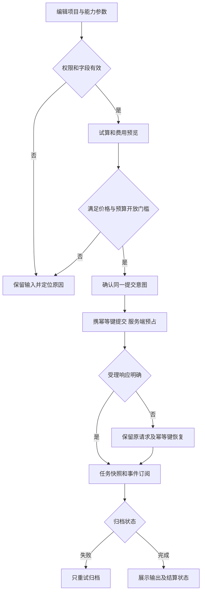
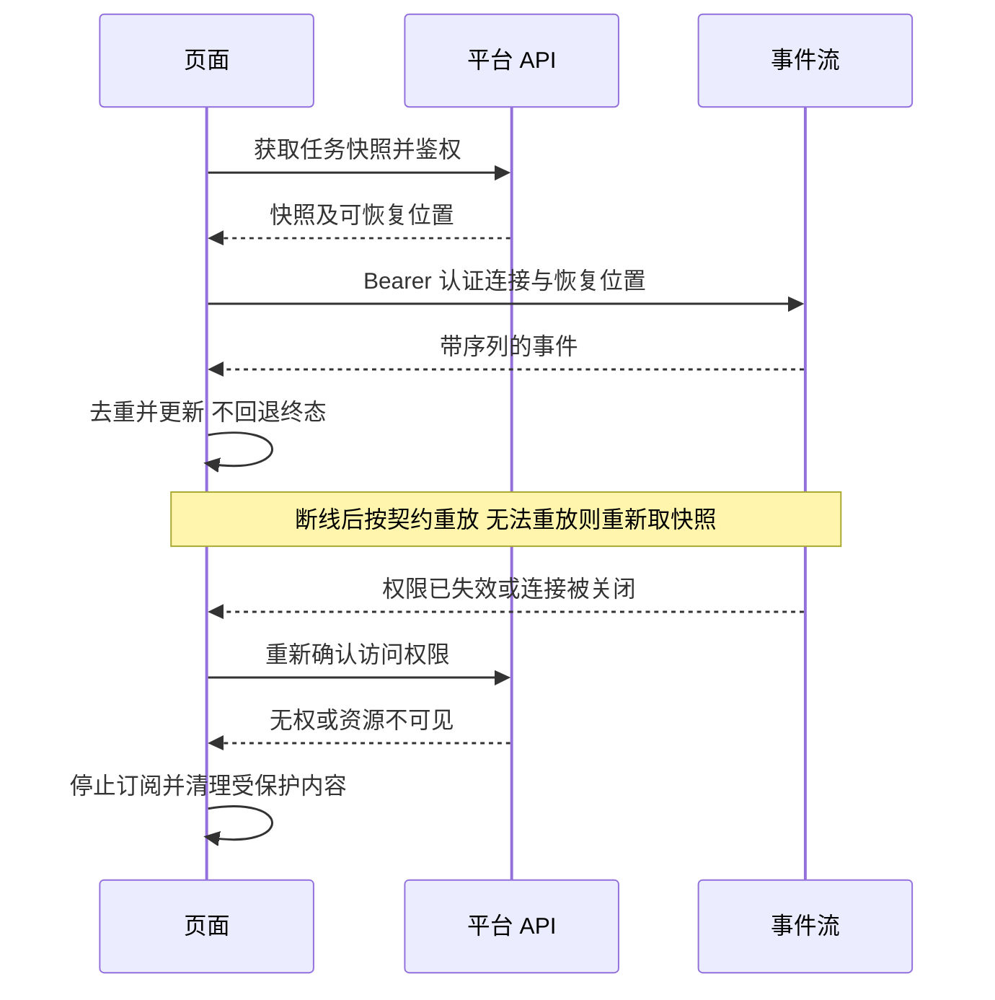
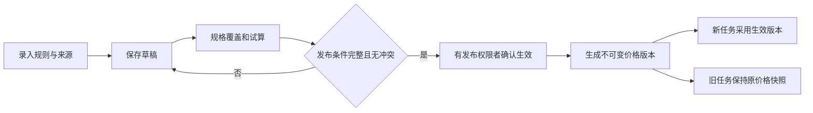

# higgsfield-ai · 页面规格与交互说明书

版本：1.1  
日期：2026 年 10 月 27 日  
状态：页面设计评审稿；未实现业务页面，未完成真实业务验收

## 1 依据、边界与阅读约定

本说明承接 [AGENTS.md](../AGENTS.md)、[技术架构方案](技术架构方案.md)、[P0-1 首期需求](首期需求与业务规则说明书.md)、[P0-2 供应商接入](模型供应商接入契约与差异清单.md)、[P0-3 数据库](数据库详细设计.md)、[P0-4 平台 API](平台API契约.md)、[P0-5 价格用量预算](价格用量预算说明.md)、[P0-6 权限矩阵](权限矩阵.md)，并遵循[前端规范](制作平台前端编码规范.md)和[后端规范](后端编码与框架对齐规范.md)。

业务范围和等级以 P0-1 为唯一来源，权限以 P0-6、费用以 P0-5、请求响应与状态枚举以 P0-4 为准。S01～S12、M01～M06 是页面身份，UI-xx 是验收追踪，不是优先级。本文不为已有需求重新定级，不将页面设计等同于实现或已批准的业务决策。

“截图证据”仅描述可见内容；“设计约定”是本次形成的待评审交互；“契约要求”不得被视觉设计覆盖。布局尺寸为实现起点，不是截图精确测量。D01～D10 仍沿用 P0-1 的负责人和确认时点；未确认部分只阻断依赖该决策的入口。

## 2 截图依据与范围差异

依据 [截图状态对照表](../references/已整理/截图状态对照表.csv)定位素材。本次实际查看以下八张代表截图，未声称逐张复核全部 219 张；编码时仍须按页面选取完整状态集并比较。静态截图不能证明点击、悬浮、自动保存和加载行为。

| 证据 | 可见视觉结构 | 本项目承接 |
|---|---|---|
| [首页](../references/已整理/首页-完整页面-默认-视频生成与项目列表-01.png) | 深色全局侧栏、中心输入区、参数胶囊、亮色生成按钮、项目卡片 | S01/S08；以内部费用替换积分文案 |
| [我的项目](../references/已整理/我的项目-完整页面-默认-All项目列表含11-01.png) | 面包屑、筛选标签、搜索排序、新建卡片 | S02；只展示契约支持的过滤条件 |
| [项目素材空态](../references/已整理/项目素材-完整页面-空内容-全部素材图片模式-02.png) | 项目侧栏、文件夹树、顶部工具栏、底部生成栏 | S05/S06/S08；上传与生成入口分开 |
| [编辑元素](../references/已整理/我的元素-编辑元素-弹窗-主图与三张缩略图-05.png) | 左图右表单、缩略图、滚动表单、固定保存区 | S07；版本标签与不可变修订分开 |
| [用量统计](../references/已整理/项目设置-用量统计-页面滚动位置-顶部总体用量-01.png) | 筛选、三张统计卡、图表、成员统计表 | S10/M05；口径和币种明确 |
| [评论侧栏](../references/已整理/元素详情-评论侧栏-默认-两条评论与图片定位标记-02.png) | 大媒体、右侧评论、定位标记、底部输入区 | S07/S09；视频逐帧绘制不因此开放 |
| [角色权限](../references/已整理/项目设置-角色与权限-页面滚动位置-中部内容权限-01.png) | 分组矩阵和角色列 | S10 只读解释；不照抄截图授权值 |
| [视频提示词详情](../references/已整理/Cully%20Hill%20Boys素材详情-提示词侧栏-展开-仓库视频完整提示词-02.png) | 视频播放器、参数与提示词侧栏、底部控制 | S09；4K 等需供应商验证 |

管理平台没有本轮核实的专用视觉截图，采用现有若依导航、查询表单、表格及弹窗结构，新增业务页统一使用上述卡片层级与双主题变量。这是设计约定，不声称逐像素复制管理端参考图。

| 截图内容 | 范围处理 |
|---|---|
| Cinema Studio 品牌、订阅、积分、社区 | 替换项目品牌；不引入订阅支付或社区；金额按币种展示 |
| Private/Shared 标签、公开 Share 链接 | 不增加未经契约定义的过滤器或匿名分享；项目成员授权与公共发布分开 |
| Canvas、AI Director、高级镜头 | 按索引 EXT 范围关闭，不以可点击占位伪装实现 |
| 任意角色勾选、Trash 永久清空 | 首期不开放任意项目角色编辑器；只使用已定义删除/恢复流程 |
| 导出按钮、自动保存、拖拽排序 | 只有存在契约与明确交互时开放；截图本身不是接口授权 |

## 3 页面地图与通用布局

以下路径是前端路由建议，尚未创建。最终路由冻结须与 Vue Router 和若依菜单配置核对；不得拿路由建议当作 API 路径。

| 页面 | 入口/建议路由 | 布局与主要资源 | 契约定位 |
|---|---|---|---|
| S01 首页 | `/` | 全局侧栏、快捷创作、近期项目 | P0-4 §5、8 |
| S02 我的项目 | `/projects` | 搜索、项目卡片、个人视图 | §5 |
| S03 我的生成 | `/generations` | 筛选、任务卡片、详情 | §8 |
| S04 我的元素 | `/elements` | 元素聚合、收藏、详情 | §7 |
| S05 项目工作区 | `/projects/:projectId` | 项目侧栏、简介与工作入口 | §5 |
| S06 项目素材 | `/projects/:projectId/assets` | 文件夹树、素材网格/表格 | §6 |
| S07 项目元素 | `/projects/:projectId/elements` | 属性表、编辑弹窗、详情侧栏 | §7 |
| S08 创作面板 | S01/S06 内复用，不强制单独路由 | 提示词、引用、参数、报价 | §8 |
| S09 任务/输出详情 | `/generations/:taskId` | 媒体、输入快照、事件与费用 | §8、14 |
| S10 项目设置 | `/projects/:projectId/settings` | 基本、成员、角色说明、请求、用量 | §5、11 |
| S11 文本会话 | `/projects/:projectId/chats` | 会话列表、消息区、输入区 | §8.3 |
| S12 公共媒体 | `/public-media` | 授权目录、预览、引用/发布入口 | §6、11 |
| M01 组织与项目治理 | 原生系统菜单＋新增项目治理菜单 | 若依用户/部门/角色；项目治理表 | §9、13 |
| M02 供应商接入 | 新增供应商菜单 | 连接、凭据、项目路由页签 | §9 |
| M03 模型能力 | 新增模型菜单 | 模型列表、能力版本与验证记录 | §10.1 |
| M04 价格与预算 | 新增价格、预算两个菜单 | 价格版本、规则行、预算周期 | §10.2～10.3 |
| M05 用量与对账 | 新增用量、对账、审计菜单 | 汇总、明细、导入与差异 | §10.3、11 |
| M06 异常与资产治理 | 新增异常、公共授权菜单 | 异常队列、证据、治理操作 | §11 |

设计约定：宽屏保持左导航＋主内容，项目内替换为项目导航及目录树，不把两层宽侧栏同时展开挤压内容。以 1440px 和 1920px 作为桌面验收视口；低于 1024px 将侧栏折叠为可键盘操作的抽屉，媒体详情右栏转页签/下方区域。表格允许自身横向滚动，页面整体不产生无意义横向滚动。断点属于建议，冻结前用实际长中文字段验证。

列表工具栏固定在内容顶部；弹窗标题、关闭和操作区稳定可见，长表单在内容区滚动。生成面板不得覆盖最后一行素材或分页。布局不依赖固定高度裁掉错误信息；空态、骨架和有数据状态使用同一内容边界。

交互约定：单击名称打开对象；展开图标只展开目录；更多菜单独立操作。悬浮操作必须有键盘聚焦等价入口。Esc 关闭非提交中的弹层；未保存编辑先提供继续编辑/放弃选择，禁止静默丢弃。弹窗打开后聚焦标题或首项，关闭回到触发控件；危险操作按钮不得默认获得回车确认。

## 4 通用字段校验和反馈

前端校验用于即时反馈，后端仍是权限、约束、价格和预算的最终裁决。Element Plus 表单使用 ElForm 校验，不绕过组件直接原生提交。shadcn-vue 表单也使用统一字段错误映射；同一表单只有一个提交和校验入口。

| 字段/场景 | 页面校验与提示 | 服务端边界 |
|---|---|---|
| 名称、标题 | 必填项去除首尾空白后不可空；保留原输入便于修改 | 长度按 DTO/schema；项目名不自行加全局唯一限制 |
| ID、revision | 作为字符串传递，不转 JS Number；隐藏字段不代表可信 | 服务端确认存在、归属、当前修订；bigint 不丢精度 |
| 金额、单价、汇率、额度 | 十进制字符串；单位、币种、基数同时可见；拒绝非数/非法精度 | 正负与范围按具体 DTO；调整可正可负，不统一禁止负数 |
| 时间区间 | 起点不晚于终点；显示时区，提交契约格式 | 有效期重叠、预算周期以服务端判断 |
| 文件 | 选择前提示允许类型/大小/数量；逐文件反馈；文件名不作为 MIME 依据 | D04 限制未冻结不得编造数值；校验实际内容、权限及去重绑定 |
| 提示词/模型参数 | 必需字段、枚举、互斥、引用数量按已发布能力 schema；更换模型显式提示不兼容项 | 不能凭价格表或截图开放模型组合；不悄悄丢弃旧输入 |
| 元素 alias/属性 | alias 按所属空间唯一性反馈；文本/单选按定义校验 | 多人并发唯一冲突须显示到字段；不开放任意脚本属性 |
| 标注 | point/rect/path 坐标归一化到 0～1；时间点在媒体时长内 | 区分省略标注与传空数组；目标固定文件版本 |
| 密钥 | 写入型遮罩输入；不读回、不放 URL/日志/草稿 | 空白不等于清除旧值；保存与测试分开 |
| 原因/证据 | 调整、撤销、治理等操作显示必填原因和证据项 | 按接口权限审计，不接受前端代填执行人 |

D04 中未冻结的长度、文件类型/大小/数量和属性限制列入 §13。前端不得通过自定较宽阈值宣称已符合后端契约；上线前必须从确定的 schema 得到统一约束。字段错误放在字段下，提交失败顶部给摘要并定位首个错误，提示文案中文且可操作。

分页使用 pageNum/pageSize，目标默认 1/20、最大 100，实际以 P0-4 为准；筛选变化回第一页，保留合法页大小。排序只能选择契约支持项。刷新不清空筛选；跨页选择必须明确“本页”，没有批量契约则不提供全量批量操作。

## 5 制作平台页面规格

### S01 首页

布局：沿首页截图保留侧栏、居中创作面板和近期项目卡片，品牌改为 higgsfield-ai。字段：项目选择、生成类型、提示词及能力参数共用 S08。项目未选择时可编辑提示词，但真实提交前必须明确目标项目与可用能力。

流程：选择有权限的项目→加载已授权能力（不向制作端返回内部路由或密钥）→编辑→按费用权限确认提交信息→提交→进入 S09。点击近期项目进入 S05，点击“新建项目”使用 S02 表单。权限：项目创建和生成分别判断；平台管理员身份不隐含项目访问。异常：无项目显示创建/联系授权入口；无能力显示不可生成原因；近期列表失败可单独重试，不清空输入。验收：切换目标项目后不能继续使用旧项目引用和旧报价。

### S02 我的项目

布局：面包屑、搜索排序工具栏、新建卡片及项目网格；支持契约中的 q/status/hidden/pinned。字段：创建名称必填，其他可选字段严格使用项目 DTO；允许同名，不以名称作为导航标识。

流程：新建成功按返回 ID 打开；置顶/隐藏是当前用户个人集合操作，不修改全体成员视图；编辑使用 revision，归档单独确认。权限：仅列可见项目；用户可隐藏自己视图不等于有项目归档权。异常：搜索零结果与无项目分别显示；创建结果不明按原幂等意图恢复；冲突保留输入并要求重载比较。验收：用户 A 隐藏项目不影响用户 B；隐藏项目仍受项目权限约束。

### S03 我的生成

布局：项目、媒体类型、任务状态筛选＋任务卡片；卡片显示缩略图、状态、时间、项目及可见费用摘要。字段：时间范围、筛选枚举来自契约，不把模型失败等同于业务协作状态。

流程：打开 S09；取消、归档重试等仅在对应状态提供。权限：任务列表和详情均校验输入/结果访问，不能因可读缩略图而暴露全部提示词。异常：任务进行中使用真实阶段，不编造百分比；缩略图失败保留任务可访问入口；费用未知与无费用权限区别显示。验收：多次事件刷新不重复插卡，失权对象从列表及缓存移除。

### S04 我的元素

布局：搜索、分类、创建/收藏范围筛选，卡片或表格，详情复用 S07。字段：scope、q、category、workStatus 按接口；收藏是个人偏好，不是权限授予。

流程：选择元素查看其空间与来源→有权限则编辑或受控复制；收藏切换不改变项目归属。权限：聚合只包含当前可读对象，其他人的私有草稿不可读取。异常：收藏来源失权显示不可用或移除展示，不保留缓存预览泄漏；空态区分尚未创建与无筛选结果。验收：跨项目聚合不能绕过项目授权。

### S05 项目工作区与简介

布局：项目名称和更多菜单、项目侧栏、简介区及素材/元素/会话入口。字段：项目基本信息与简介使用契约允许字段；编辑保存携带 revision，不自动派生新字段。

流程：简介只读→有编辑权进入编辑→保存→更新视图；切换项目清理旧对象上下文。权限：简介编辑、项目治理和内容查看分别判断；归档项目按状态只读，不在前端伪装可写。异常：项目不可见统一资源不可用，不暴露存在性；简介冲突保留本地草稿并显示重载入口。验收：通过手输 URL 访问与菜单导航的权限一致。

### S06 项目素材库与文件夹

布局：参考空态截图的文件夹树、顶部筛选/视图/上传工具栏、素材网格/表格、底部 S08。树行保留彩色文件夹、层级缩进、数量及选中背景；数量无真实来源时不伪造。树组件可按数据量选 Element Plus 虚拟树或 shadcn-vue 定制外观，必须统一选中/展开/键盘语义；按 P0-4 的 GET /projects/{id}/folders，以 parentId、pageNum、pageSize 分页获取子节点；展开时按需加载并保留分页状态，不假定一次返回全树。虚拟渲染与接口分页分别处理，不新增未定义的游标协议。

字段：目录名称、parentId、orderNum；素材名称、folderId；过滤 folderId/includeDescendants/kind/q/modelId/from/to/showFailed。新增/移动选择器排除非法父子循环，由服务端再次验证。拖拽移动不是默认必需交互，先提供明确“移动到”操作。

流程：选文件→校验→创建上传会话→逐分片上传/恢复→完成校验→绑定素材→刷新列表。上传 ready 不等于素材绑定成功，逐项显示“待绑定/已入库/失败”；不得一失败清空整批成功项。素材预览、下载、新版本、移动、逻辑删除/恢复按对象动作入口；删除前显示对象与影响，不提供未经契约定义的永久清空。

权限：上传、读、下载、移动、删除/恢复独立检查；上传会话只允许本人操作；不因能预览就能下载。异常：过期会话、断网、分片失败、重复绑定、失权、空间/大小限制分别反馈，重试不重新绑定同一会话。验收：切目录不丢上传进度；恢复后的列表与筛选一致；大列表不会导致生成输入丢失。

### S07 项目元素、编辑与协作详情

布局：项目元素表格/网格，属性筛选；编辑采用截图左媒体主图/缩略图、右字段表单、固定取消/保存。详情右侧信息/评论页签、媒体标注、工作状态；长评论和表单各自滚动。

字段：name、alias、category、description、attrs、media、workStatus 及契约允许的版本标签。主图和参考图区分；草稿可无主图，但成为生成引用前须满足能力和元素规则。版本标签只是展示，不替代不可变 revision。属性类型首期文本/单选；别名冲突定位到 alias。

流程：编辑副本→校验→携 revision 保存；选择主图/移除引用需明确按钮；复制时选择目标项目并核验源可读与目标可写。导入按固定模板预检→展示逐项结果→确认入库，D10 未冻结的细节保持关闭。评论提交独立于元素保存，标注绑定当前文件；提交成功再清空输入。

权限：自己编辑/删除、项目治理及评论能力按 P0-6，不能默认所有成员都能写；他人草稿不因 owner 角色开放。异常：图片失效、引用被删、版本冲突、导入部分失败、评论发送失败分别保留可恢复输入。验收：关闭未保存弹窗有确认；修改 UI 表单不直接修改 props；切主图后历史任务仍引用旧快照。

### S08 共用创作面板

布局：Image/Video 模式入口、提示词区、引用缩略图、模型/比例/分辨率/时长等能力参数、费用预估与主按钮；多模态对话使用 S11。按钮文案明确“生成”；只有 estimateVisibility=visible 时展示币种金额/估算状态，hidden 时不展示金额或价格版本，仍可按服务端 valid/canSubmit 决定提交，不显示无来源积分。

字段：按可用模型能力 schema 动态呈现；不支持的参数隐藏或显示不可用原因。更换模型前比较不兼容引用/参数并确认，保留用户可恢复输入。前端不提交密钥、采购路由选择、结算金额或执行用户。草稿明确保存归属，不声称截图证明自动保存；首期提供显式保存，自动保存时机待评审。

流程：校验→按费用权限展示预估或可提交状态→确认提交→禁用同一意图重复点击→收到任务→订阅/查询。预估不冻结预算；提交时服务端重新校验并原子预占。估算无可靠上界、无有效价格、预算不足等按 P0-5 门槛阻断，不以“费用为零”绕过。请求结果未知时保持同一幂等键及相同请求恢复，不换键盲目重发。

权限：项目写入/生成、引用对象、模型可用性同时满足。异常：参数错误就地反馈；预算不足显示授权范围内的信息；上游不确定受理显示处理中/待核实，不能承诺取消即免费。验收：双击和网络重试只产生同一意图；切主题不重置输入或重新提交。

### S09 任务与输出详情

布局：大媒体/播放器、输出缩略条、右侧输入快照/参数/事件/费用页签；评论仅对已有协作对象开放，不能临时制造任务评论 API。展示任务技术状态、归档状态与素材工作状态，三者不得合并。

字段：只读请求快照、模型版本、规格、结果、用量及价格版本；金额同时显示状态和币种。费用无权限隐藏；用量未知显示“待确认”，不是 0。预估、平台计价、采购成本和账单不得混为一个数字。

流程：事件驱动更新；断线重连按序列去重/补放，不可补放时查询快照。取消是请求，不即刻断言取消成功；归档失败使用归档补偿，不重新生成收费；另一次生成必须是明确新意图。结果入素材库沿输出绑定契约。

权限：原始输入、下载、费用、归档、取消分别判断；撤权立即停止订阅并清除展示。异常：媒体链接过期重新获取受控地址；供应商成功但归档失败保留“生成成功/待归档”解释；旧状态事件不能回退终态。验收：刷新页面能恢复最新状态，浏览器关闭不等于取消任务。

### S10 项目设置

布局：参考 General/Members/Roles/Usage/Requests 页签；中文为基本信息、成员、权限说明、用量、申请。申请入口只有发现/申请契约及决策满足才开放；不可发现项目不展示诱导入口。

字段：基本信息、成员角色、治理原因；用量筛选日期/模型/成员。成员选择不能直接给普通用户开放全量系统用户接口；缺少项目范围候选接口时列为接口缺口，不复制系统用户读取权限。角色只选择已批准角色包，权限矩阵默认只读。

流程：编辑基本信息→revision 保存；邀请/变更/移除成员→展示影响→确认；最后一个 owner 不能退出或降级；归档前明确只读影响。用量页区分平台费用、采购费用和预算预占，统计表/卡片按同一筛选口径；没有导出契约时不显示可用导出。

权限：成员管理、项目费用、下载等不由 owner 身份自动推导；权限以 P0-6 分层求交。异常：并发成员变更、最后 owner、统计无权限、未知用量与零用量分别显示。验收：撤权后相关用户既不能从菜单进入，也不能通过旧详情/事件链接访问。

### S11 项目文本会话

布局为设计约定，无本轮确认的专用截图：左会话列表、中央消息区、底部提示词及多模态附件，沿用全站卡片与参数样式。字段：会话标题、消息文本、已授权附件、模型参数；使用已验证 Gemini 底层能力，不把文本会话当图片/视频任务接口。

流程：选择会话→发送→等待当前轮结束→继续；服务端同一会话串行，前端禁用并发发送但保留新输入。仅当上游流式验证通过才开放增量显示；非流式用等待状态，不模拟逐字返回。发出消息的快照固定，后续编辑不能改变历史。

权限：本人会话继续写；owner 治理标题/归档不意味着可读他人正文；共享阅读按 P0-6 待决策策略。异常：断网、未知受理和余额门槛沿 S08，不能自动再发一轮收费；未完成轮次显示可恢复状态。验收：跨会话切换不会把 A 的回复写入 B；费用显示遵守权限和未知口径。

### S12 公共媒体

布局为架构补充设计：授权目录、类型筛选、媒体卡片、详情、来源及可执行操作。字段：发布描述、授权范围、引用目标项目等仅使用 P0-4 DTO；“公共”不等于匿名互联网可读。

流程：有发布权者选择固定来源版本→发布确认；使用者选择目标项目→校验 use 权及目标写入权→创建引用/副本；撤销授权后刷新可用动作。权限：canRead、use、publish 分离；下载仍独立。异常：来源不可用、目标失权、授权撤销显示明确原因，禁止沿用缓存链接继续操作。验收：历史任务快照不因源条目编辑被悄悄替换，未来访问仍按授权校验。

## 6 管理平台页面规格

### M01 组织与项目治理

布局：原生若依用户/部门/角色/菜单/字典页保持框架操作习惯；项目治理新增列表、筛选、治理详情。字段：原生系统字段沿原生 DTO，不包装成业务新契约；项目治理只暴露允许的状态、负责人及原因字段。

流程：先配置功能权限，再配置项目成员及对象权限；菜单、按钮、管理数据范围不能替代项目权限。变更后触发权限缓存失效，刷新当前会话可见动作。权限：平台管理员不能通过 `*:*:*` 自动读取所有项目内容；无项目内容权限时治理页只展示获准元数据。异常：角色使用中、最后 owner、数据范围不足分别反馈。验收：隐藏按钮与服务端拒绝保持一致，旧 token/缓存不会持续绕过撤权。

### M02 供应商连接、凭据与项目路由

布局：连接列表＋连接详情；凭据使用遮罩、状态和版本列表；项目路由按能力分组编辑，清晰展示生效 revision。字段：供应商地址/配置、凭据名称和 write-only secret、路由模型映射等按 §9；地址与连接参数服务端校验，不能前端直连第三方。

流程：保存连接/密钥→显式测试→查看测试证据→满足条件后启用；可能收费的测试须展示费用风险、成本归属并由有权用户确认。测试不是保存的附带动作。轮换按新版本测试、切换、旧版本排空/撤销处理，历史任务继续按原凭据版本查询；不得为了当前密钥列表简洁删除历史证据。

权限：凭据维护、测试、路由变更分开；财务角色不能读取密钥；详情只显示脱敏标识。异常：超时显示未知测试结果，不能自动再测试；路由 revision 冲突保留编辑；旧凭据仍有在途任务时显示影响。验收：任何 HTML、浏览器存储、审计详情、错误原文均不回显 secret。

### M03 模型与能力版本

布局：模型列表、能力版本、参数 schema、验证记录和发布区。字段：底层模型标识、模型类型、参数约束、支持输入/输出规格及验证记录按 §10.1；schema 错误定位到字段，不允许任意执行脚本。

流程：建草稿→维护规格→登记/核实供应商验证证据→检查发布条件→发布不可变版本；修改已发布能力必须新版本。登记验证记录不等于本页面已实际调用供应商。权限：编辑与发布按 P0-6 拆分；制作端仅获得已授权且通过门槛的能力。异常：供应商差异未闭环、价格未覆盖、版本冲突阻止相关开放。验收：截图有 4K、价格有 Fast 均不自动变成可选能力。

### M04 价格配置与预算

布局：价格列表按供应商/模型/用途/币种筛选，编辑页分基本信息、规格规则、来源、生效期、试算与发布；预算为独立列表及周期详情，不与价格混为一张表。

价格字段：输入/输出/缓存等计价维度、单位与基数、规格条件、精确单价、币种、有效期、来源说明；按模型类型提供规则行，不强迫视频只按“每秒”或对话只按“每次”。SD 官网价作为已记录来源参考，供应商采购报价与平台计价各自保存，不能未经确认等同实际账单。

流程：手工录入或粘贴至明确字段→校验→试算→草稿保存→发布前完整性/重叠检查→确认生效。未完整草稿可保存但不能发布；发布后新建版本，旧任务锁定旧快照。规则公式只能使用 P0-5 白名单，禁止粘贴任意可执行公式。试算展示计算步骤、单位、舍入及币种转换，不只是最终值。

预算字段：用途、主体、币种、周期、额度及状态按 DTO；预算启停和当前周期额度调整使用不同动作。界面展示额度、已结算、预占、可用及计算口径；项目和用户同时适用预算不累计为两笔费用。额度调整填写原因，明确前后金额；历史周期不直接覆盖。按 P0-5 设计，降额可低于现有占用，显示超额并阻断后续提交，不能为凑余额释放在途预占；相关预算细节仍须评审。

权限：价格查看/维护/发布、预算查看/调整分别判断。异常：无价、重叠价、规格缺失、试算无上界、非法额度值、revision 冲突分别定位；未知费用不能显示为免费。验收：用 P0-5 CALC-01～15 逐项比对，页面格式化不改变结算精度。

### M05 用量、账单、对账与审计

布局：日期/模型/项目/用户/币种/费用口径筛选，汇总卡、明细表、账单导入、差异详情与调整记录。字段：账单账号/密钥标识映射、账期、行号、原始金额、用量证据、差异类型、调整金额与原因；敏感原文展示前脱敏。

流程：导入→预检→确认→匹配→核实差异→有权限时独立创建调整；确认账单事实不自动修改平台价格或预算。原始事件只读，调整以新记录呈现；有效金额展示原始＋调整，不把账单、采购、平台费简单相加。重复导入/调整沿契约幂等处理。

权限：管理数据范围与财务权限共同约束；有费用权限不等于可读提示词、媒体或密钥。异常：不明账号映射、重复账单、缺失用量、币种混杂、部分预检错误各自可定位；导出按已定义授权和脱敏策略，不虚构缺失导出端点。验收：财务列表和详情使用同一范围，同一记录不会因对账确认二次收费。

### M06 异常任务与资产治理

布局：按异常类型/时间/处理状态筛选的队列，详情展示技术事件、受理证据、归档情况及允许动作；公共授权治理单独页签。字段：处理原因、证据、当前 revision，不能手改任务为“成功”替代核实。

流程：查询状态 requery、归档补偿 retry_archive、证明未受理 confirm_not_accepted、关闭追踪 close_tracking 按 P0-4 的对应状态和权限开放；点击前说明是否涉及供应商交互、是否生成新消费。未知受理不提供盲目再次生成。资产治理按删除/恢复/授权接口操作，不删除账本/审计/历史证据。

权限：运维处理权不默认获得全部内容，证据按必要范围脱敏。异常：重复处理、状态已变更、证据不足、归档文件不可达分别反馈并刷新最新详情。验收：关闭追踪不等于免单，归档重试不产生新模型调用；治理行为留审计。

## 7 关键交互流程

### 7.1 生成提交与恢复

### 7.2 事件与撤权

事件连接通过支持认证头的 fetch 方案封装于 api/use 层，不把 token 放查询参数。事件序列不是列表分页游标。断网本身不等于撤权，先显示连接状态，恢复时重校验；明确撤权后清理数据。

### 7.3 价格发布

## 8 权限呈现与数据保护

菜单可见、按钮可用、数据范围、项目身份、对象归属和状态是不同层次。采用 P0-6 的权限码原文和动作矩阵，不在本文新造权限码。页面初始化加载权限；服务端每次请求再检查，前端隐藏绝非安全边界。

| 情况 | 页面处理 |
|---|---|
| 没有菜单/能力权限 | 不显示导航；直接访问显示无权入口；不可见对象遵循资源不可用语义 |
| 可读对象但无动作权限 | 动作隐藏；若需解释协作流程，可展示明确只读说明，不给可点击假按钮 |
| 有权限但当前状态不可执行 | 按钮禁用并显示状态原因，如任务已终态、项目已归档 |
| 项目角色默认包尚待确认 | 依据 P0-6 提案评审，不自行把 viewer、producer、owner 作为已授权配置 |
| 财务与运维 | 仅返回必要元数据；不得为方便详情而附带密钥、私有草稿、正文 |
| 页面打开期间被撤权 | 清理受保护列表/预览/缓存，停止订阅；未发送敏感输入不得转移到其他项目 |

下载、复制、公共发布、费用查看与生成不是“可读”的自动附加能力。所有对象链接、文件地址和事件流都要重校验；前端缓存按用户/项目隔离，退出登录清除受保护数据。

## 9 异常与恢复状态表

| 状态 | 展示 | 可执行恢复及禁止事项 |
|---|---|---|
| 首次加载 | 与目标布局一致骨架；区域 aria-busy | 不闪现上个项目数据 |
| 真空数据/筛选零结果 | 不同说明和创建/清除筛选入口 | 无权限时不显示创建按钮 |
| 局部查询失败 | 区域错误和重试；其余区域可用 | 不清空未提交表单 |
| 字段校验失败 | 字段错误＋摘要 | 原生 422 等按框架映射，禁止只显示“网络错误” |
| HTTP 200 业务失败 | 解析 code；601 读取 data.errorCode | 不能以 HTTP 成功直接弹“保存成功” |
| 登录失效/禁止访问 | 按 code 401/403 及原生 HTTP 错误处理 | 不循环重试；不可见对象按 RESOURCE_NOT_FOUND 呈现 |
| revision 冲突 | 显示已更新，保留输入，提供重载比较 | 不自动覆盖最新数据 |
| 写请求结果未知 | 显示结果待确认和恢复入口 | 同意图同 key 同 body；禁止换 key 重复消费 |
| 部分上传/导入失败 | 逐项状态、失败原因、可重试项 | 不把部分成功显示为全失败再全部重发 |
| 模型受理未知/归档失败 | 分别显示待核实/待归档 | 不将重试归档改成重新生成 |
| 预算不足/价格缺失 | 费用状态与允许的管理联系入口 | 不泄漏其他项目额度，不用 0 代替未知 |
| 媒体加载失败/过期 | 媒体占位、重取授权链接 | 不暴露内部存储地址或密钥 |

请求 ID 可供排查，错误展示不包含供应商 secret、完整未脱敏响应和数据库栈。成功提示在确定服务端结果后出现，长操作须有可再次查看的任务状态，不仅使用短暂 toast。

## 10 亮暗双主题与视觉验收

亮色与暗黑是同一页面的两套配色，不是两套业务模板。截图暗色版先按源图对齐，亮色版保留几何、间距、圆角、密度、主次按钮、品牌强调和状态身份。本稿不宣称已从截图采样精确色值；最终 token 色值、字重和尺寸须在页面实现前形成对照表并验证。

| 语义 token 组 | 暗黑目标 | 亮色目标 | 共同要求 |
|---|---|---|---|
| background/surface/elevated | 深色画布、可分辨卡片与弹层 | 浅色画布、白色或近白卡片 | 层级和阴影强度等价，不机械反色 |
| text/secondary/disabled | 高可读浅文字、弱化次级文字 | 深文字、中灰次级文字 | 禁用不与正文同权重，不能只靠透明度导致不可读 |
| border/divider | 低亮度边界 | 浅灰边界 | 表格分隔、输入边界可识别 |
| brand/primary/on-primary | 保留截图亮黄绿品牌身份 | 同品牌色系并调整文字对比 | 生成主按钮层级稳定，主文字对比达标 |
| selected/hover/focus | 选中表面与焦点环清晰 | 浅强调背景与清晰焦点环 | 选中、悬浮、键盘焦点不可混为一种状态 |
| success/warning/error/info | 适配深底的色与图标 | 适配浅底的色与图标 | 不仅用颜色传递状态，配文字或图标 |
| overlay/popover/tooltip | 深色遮罩与浮层 | 浅底浮层和适度遮罩 | 两组件库 Teleport 弹层跟随主题 |
| media | 原始图片和视频 | 原始图片和视频 | 禁止整体 invert；透明素材可用中性棋盘底 |

可见主题切换放全局侧栏底部或用户菜单固定位置，管理端放顶栏；图标附文字/可访问名称。Pinia 单一主题源、useTheme 统一应用，Element Plus 与 shadcn-vue 映射同一变量；本地仅存非敏感偏好。先用用户明确选择，否则首次遵循系统偏好，首屏绘制前应用；“跟随系统”的独立选项是否展示可后续评审。

切换不刷新路由、不清空筛选、已选条目、表单、上传或事件订阅。主题测试覆盖卡片、表格、表单、侧栏、树、主/次/危险按钮、菜单、弹窗、tooltip 和媒体详情，以及默认/选中/禁用/聚焦/错误状态。建议普通文本对比至少 4.5:1，大字及关键非文本边界至少 3:1，作为本稿可访问性验收设计目标；键盘路径、焦点可见和不只靠颜色同样验收。

## 11 工程落点与接口衔接

制作端目录仍为 `higgsfield-frontend`，管理端仍为 `ruoyi-fastapi-frontend/vue3/web`，共用 `ruoyi-fastapi-backend`。前端 Vue3、Vue Router、Pinia、Axios；新增业务统一 script setup，制作端 TypeScript；页面/组件/use 组合函数/api 模块分层。表单双向绑定优先 defineModel，支持 v-model:xxx，禁止 .sync、Options API 和子组件修改 props。

页面只消费平台契约，不直接带公司 APIKey 调用第三方。后端 controller/service/dao/entity/do 和 entity/vo、异步 AsyncSession、若依响应/异常/权限机制保持不变。数据库仍为 PostgreSQL、bigserial、RuoYi 公共字段及逻辑删除，无物理外键；不可变历史不提供删除 UI。本文不增加表或端点。

| 页面 UI 状态 | 对应持久化边界 |
|---|---|
| 个人置顶/隐藏/收藏 | P0-3 已有个人集合；不写项目公共状态 |
| 表单编辑副本 | 前端临时状态；只有契约草稿可持久化且仅本人可读 |
| 提交、价格、模型、引用版本 | 已有任务/调用快照；不可由后续 UI 编辑回写历史 |
| 上传进度与素材入库 | 已有上传会话与绑定关系；成功状态分阶段呈现 |
| 预算/费用/对账 | 已有预占、账本、调整及审计；前端不自行结算 |

本地仍由 Docker 运行 PostgreSQL/Redis，后端和两前端手动启动，具体步骤见[初始化手册](本地开发与工程初始化手册.md)。本文检查不启动这些服务。

## 12 页面验收清单

UI 编号仅追踪覆盖，等级继承 P0-1，不新增分级。每项必须记录身份、对象范围、固定数据、视口、主题、操作、预期响应与截图；不能只用管理员验证所有页面。

| 用例 | 覆盖页面 | 最低验收路径 | 规则族/配套验收 |
|---|---|---|---|
| UI-01 | S01/S08 | 切项目、引用失效、报价与重复点击 | GEN、BIL；FIN |
| UI-02 | S02 | 同名创建、个人隐藏、冲突恢复 | PRJ、UX |
| UI-03 | S03 | 筛选、事件重复、失权任务 | GEN；AUTH |
| UI-04 | S04 | 跨项目聚合、收藏失权 | ELM、COL；AUTH |
| UI-05 | S05 | 简介编辑、归档只读、手输路由 | PRJ；AUTH |
| UI-06 | S06 | 多文件部分失败、恢复上传、重复绑定、移动循环 | AST；P0-4 契约验收 |
| UI-07 | S07 | 别名冲突、主图、revision、评论标注 | ELM、COL |
| UI-08 | S08/S11 | 未知受理不重复消费、无价/预算不足 | GEN、BIL；FIN |
| UI-09 | S09 | 断流重放、归档补偿、费用未知、取消 | GEN、BIL |
| UI-10 | S10 | 最后 owner、撤权、费用隔离 | PRJ、BIL；AUTH |
| UI-11 | S11 | 串行发送、切会话、禁止读他人私有正文 | GEN、COL；AUTH |
| UI-12 | S12 | 读/用/发布分离、目标项目失权 | AST、COL；AUTH |
| UI-13 | M01 | 菜单按钮数据范围、无项目内容特权 | ADM；AUTH |
| UI-14 | M02 | 保存不测试、收费测试确认、轮换原 key 查询 | ADM、GEN |
| UI-15 | M03 | 未验证规格不可发布/开放 | ADM；DIF |
| UI-16 | M04 | 规则试算、版本冻结、额度调整与并发 | BIL；CALC、FIN |
| UI-17 | M05 | 导入重复、账单确认与调整分离、脱敏 | BIL；FIN、AUTH |
| UI-18 | M06 | 受理未知、证据不足、归档重试不收费 | GEN、ADM、BIL |
| UI-19 | 全部页面 | 亮暗同数据截图、键盘、弹层、长文本和窄屏 | UX-08；UAT-19 |
| UI-20 | 全部写页面 | HTTP200业务失败、原生422、冲突、断网保留输入 | UX、QLT；P0-4 |

验收层次分开：本稿只进行文档与 HTML 检查；后续还有组件交互、接口契约、权限负向、真实供应商、预算并发及双主题浏览器验收。代表截图对比不等于业务闭环通过。

## 13 待冻结项与开放门槛

| 项目 | 来源与当前状态 | 后续产出/门槛 |
|---|---|---|
| 字段长度、文件限制、属性数量 | P0-1 D04 未完全冻结 | DTO/schema 和两端校验表一致后开放相关写入口 |
| 默认角色包、共享阅读与可发现申请 | P0-1/P0-6 既有待决策 | 确认权限包和必要接口；此前不开放任意角色编辑/可发现申请 |
| 预算周期、无预算/无上界处理 | P0-5 既有提案 | 评审前按阻断消费方案设计，不能称已批准 |
| 固定模板导入和逐项错误 | D10 及接口细节 | 固定模板、预检/确认 DTO、部分失败展示冻结 |
| 成员候选选择 | 普通项目管理员不能直接继承全量系统用户权限 | 在 P0-4/P0-6 明确候选查询范围和接口；缺口闭环前不开放不安全选择器 |
| 页面参数持久化、自动保存、拖拽 | 本稿设计边界 | 默认显式保存/明确按钮；新持久化需先核对 API/数据库 |
| 导出、统计曲线、文件夹数量 | 截图不能证明接口存在 | 逐项核对数据源、口径及授权，无来源不假造数字和按钮 |
| 精确视觉参数与响应断点 | 本稿布局/色彩语义建议 | 补 token 色值和关键页面两主题设计对照；按完整截图状态验收 |

这些是已有决策或契约/设计完善项，不重编号为新优先级任务。若影响源规则，应先更新对应 P0 文档与索引，再实施页面。技术强制规范和已确认双主题要求不因存在待冻结项而降级。
