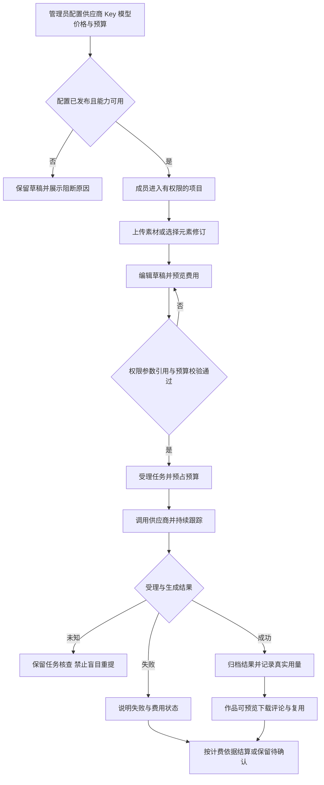

# higgsfield-ai · 首期需求与业务规则说明书

版本：1.6 评审稿  
日期：2026 年 10 月 27 日  
文档编号：P0-1  
适用范围：制作平台、管理平台、后端服务  
基线：[技术架构方案](技术架构方案.md) · [架构 HTML 阅读版](技术架构方案.html)

本次修订依据已导入的本地RuoYi-FastAPI源码；工程现状、证据与复用边界见[工程基线核对与文档衔接方案](工程基线核对与文档衔接方案.md)。制作平台为 `higgsfield-frontend/`，管理平台为 `ruoyi-fastapi-frontend/vue3/web/`，共用 `ruoyi-fastapi-backend/`。本次只更新文档，未实现所述新增能力。

**项目名称与本地开发基线（已确认）：** 整体项目名称为 `higgsfield-ai`。现有工作目录 `D:\laputta\higgsfield`、制作端 `higgsfield-frontend/`、管理端 `ruoyi-fastapi-frontend/vue3/web/` 和后端 `ruoyi-fastapi-backend/` 均保持不变；本次不改仓库地址、包名、模块名或数据库实例名。本地开发使用 Docker 启动 PostgreSQL 与 Redis，后端及两个前端在宿主机分别手动启动。制作端尚待初始化，未来生成/media Worker 在本机作为独立进程手动启动；正式部署在公司内网服务器，素材与视频长期保存到公司 NAS；具体服务器、挂载及生产配置参数待确认，见[内网部署与 NAS 运维方案](内网部署与NAS存储运维方案.md)。

**若依数据库设计基线（本次确认）：** 全部新增业务数据库设计遵循本地 RuoYi-FastAPI PostgreSQL 约定：hf_ 模块表名、语义 xxx_id 自增 bigint、若依审计字段、按职责使用 del_flag（0/2）、复用 sys_dict_type/sys_dict_data、关联表自增主键与联合唯一约束、禁止物理外键、服务层事务维护逻辑关联。物理表/字段/字典映射以 [P0-3 数据库详细设计](数据库详细设计.md) 为准；平台业务 ID 传输为十进制字符串，API 基础审计时间为 createTime/updateTime。不可变历史、幂等、价格版本及权限规则仍须保留。本次只更新设计，不改基础框架或业务代码。

**统一约束与优先级：** 以[项目 AGENTS.md](../AGENTS.md)为工程约束；[文档一致性与优先级索引](文档一致性与优先级索引.md)统一文档编号、需求等级和处理规则。P0-1～P0-6 是文档编号，不是需求优先级；业务规则等级以 P0-1 的规则表为唯一来源，本文引用规则 ID 时继承其等级，不另行定级。设计完成不等于实现或验收通过。

## 1 文档目的与证据边界

本文件回答首期“给谁使用、完成什么业务、允许什么操作、异常如何处理、怎样验收”。它是后续数据库详细设计、平台 API 契约、权限矩阵、计费规则和页面规格的共同输入，不重复定义架构技术栈，不表示业务功能已经实现。

首期目标是让公司制作人员在获授权的项目中，使用公司采购的模型完成多模态对话、图片生成和视频生成，将素材与结果长期归档，并能够追踪人员、项目、用量及费用；管理员可配置供应商 Key、模型能力、价格和预算。

| 来源 | 作用 | 证据边界 |
|---|---|---|
| [技术架构方案](技术架构方案.md) | 三端边界、项目归属、任务状态、凭据、价格与预算基线 | 本文承接已有决策；细化建议尚需业务评审 |
| [初版技术方案](../references/初版的技术方案/技术方案文档.md) | 原始业务背景与方向 | 冲突处以用户最新明确要求、AGENTS.md 及当前架构为准 |
| [已整理界面](../references/已整理/)与[截图状态对照表](../references/已整理/截图状态对照表.csv) | 页面、字段、布局及可见状态 | 共 219 张；原始需求编制时核对索引并抽查六张关键页面，未重新逐张审阅全部截图；悬停、点击、关闭方式不能由静态图证明 |
| [模型接口文档](../references/购买的apikey公司提供的文档/mm-api-1.md)、[价格文档](../references/购买的apikey公司提供的文档/model-pricing.md)、[Apifox](https://9d11mhczhy.apifox.cn/) | 外部能力与供应商约束 | 沿用架构中的已读资料结论；保存样例不等于真实联调通过 |
| [价格截图留存](价格来源/) | SD 2.0/2.5 平台计价来源 | 官网截图与供应商采购报价分开；完整价格初始值见架构 9.5 |

规则标记：**基线**表示承接架构或用户明确要求；**建议**表示本文件为首期补充的具体产品规则，评审前不得称为用户已确认；**门槛**表示相关外部能力确认并验证后才能开放。未标建议的核心不变量均按基线执行。用户已确认的工程与双主题要求必须执行；其余标为“建议”的产品细节仍待评审。优先级不改变确认状态，不能把高优先级建议当作已获批准。

## 2 首期范围与交付批次

首期沿用目标架构，控制功能范围，不另建无法演进的临时系统。采用内部员工使用、单公司管理的边界；不含对外商业订阅与收款。

| 批次 | 必须交付的业务结果 | 前置条件 |
|---|---|---|
| B1 管理与项目基础 | 登录、用户部门与角色、项目成员、供应商 Key、模型能力、价格草稿/试算/发布、预算 | 已导入框架的运行基线、数据模型、权限及配置契约明确 |
| B2 首条创作闭环 | 项目素材上传、图片生成、任务追踪、结果归档、费用归属与预占结算 | 有可用模型路由、已发布价格与可用 NAS |
| B3 三类模型闭环 | Gemini 多模态对话、Seedance 视频任务、异常恢复、元素多图引用 | 分别通过对应供应商契约和用量验证 |
| B4 协作与试点验收 | 元素/素材组织、评论标注、项目设置、公共素材授权、用量统计与基础对账 | 核心生成链路稳定；完成权限、故障与恢复验收 |

B2 可作为内部阶段演示，不能称为整个首期完成。B1–B4 均通过验收后才是首期业务交付。

| 范围分类 | 功能 |
|---|---|
| 首期必须 | 项目与成员、素材及版本、文件夹、元素多图与修订、对话/图片/视频生成、任务与作品、评论及图片定位标注、供应商与 Key、模型能力、手动价格、预算与用量、基础对账和审计 |
| 条件开放 | 具体模型版本、首尾帧/参考视频/延展/编辑、音频输出、Fast、4K、流式对话、注册素材引用；按验证后的能力逐项开放 |
| 建议后续增强 | 元素看板与复杂属性类型、复杂批量导入、跨项目一键移动、账单自动抓取；保留模型边界，首期提供必要的替代操作 |
| 明确不做 | Canvas、AI Director、Community、外部分享/访客、商业订阅/充值积分、独立个人空间、自动 AI 元素提取、H3/M3/语音正式上线、自动抓取官网价格 |

截图中存在功能入口不等于首期承诺。对延期能力不放置无效按钮；对条件能力说明不可用原因，不能因存在报价而开启。

### 2.1 已导入工程的首期衔接

B1的用户、部门、系统角色和菜单管理优先复用 `ruoyi-fastapi-frontend/vue3/web` 与后端 module_admin，不再开发第二套系统管理。项目成员、业务角色、Key版本、模型价格、预算和异常治理仍属新增业务，不能视为框架已完成。制作平台目录已有 AGENTS.md 规范文件，应用工程仍需独立初始化。

两端复用同一身份目录与Bearer会话验证，首期不承诺自动单点登录。原生管理权限可能包含超级管理员通配符，项目内容访问仍须显式授权；会话退出、跨端登录是否互踢及后续OIDC接入需单独验证。框架已存在文件/AI插件，不等于满足本需求的不可变版本、计费与归档要求。

## 3 用户角色与业务对象

### 3.1 角色边界

下表为建议的默认职责，不替代 P0-6 的逐操作权限矩阵。一个用户可以兼任角色，但权限必须显式授予。全局管理身份不自动授予全部项目素材内容读取权。

| 角色 | 主要职责 | 默认边界 |
|---|---|---|
| 平台管理员 | 用户部门、角色、供应商连接、Key、模型配置、异常治理 | 费用发布和项目内容访问单独授权；禁止读取已保存 Key 明文 |
| 费用管理员 | 价格维护发布、预算、全局用量及采购对账 | 不因能看费用而获得素材或凭据权限 |
| 项目负责人 | 项目资料、成员、项目协作、项目归档 | 预算调整与费用查看须额外权限，不维护供应商 Key |
| 制作成员 | 获授权项目内上传、维护本人内容、生成、复用、评论 | 修改他人内容、下载、公共发布、跨项目复制分别校验 |
| 只读成员 | 浏览获授权内容 | 下载、评论和费用查看可单独授予；默认不能生成或编辑 |

建议首期使用上述预设角色组合，保留细粒度权限，复杂自定义角色编辑器另行评审。用户停用或成员移除后立即失去新访问资格，历史任务与消费归属不删除。

### 3.2 对象定义

| 对象 | 业务含义 | 不变量 |
|---|---|---|
| 项目 | 工作、成员、内容与费用的归属范围 | 每个生成任务必须属于一个项目 |
| 素材/素材版本 | 上传或复用的文件及不可变内容版本 | 新文件内容产生新版本；历史任务引用不漂移 |
| 元素/元素修订 | 角色、场景、道具等可复用资料，含多图与属性 | 元素不是一张图片；参与生成的资料变更创建修订 |
| 草稿 | 可编辑提示词、参数与引用集合 | 可变，未提交不产生生成费用 |
| 生成任务 | 一次明确提交及其固定输入 | 用户、项目、引用、模型、价格和凭据版本可追溯 |
| 作品 | 生成成功并归档的结果文件 | 一个任务可产生多件作品，失败任务不是文件 |
| 上游素材绑定 | 供应商侧 Asset 与本地版本映射 | 与账号、区域、上游项目及注册策略绑定 |
| 价格版本/费用明细 | 指定条件下的计价依据及计算记录 | 发布后不可覆盖；历史任务不随新价格重算 |

## 4 页面范围与界面追踪

以下页面 ID 供 API、页面规格和验收用例引用。管理员页面是业务新增设计，不能宣称在现有截图中已经存在。

| 页面 ID | 页面与首期操作 | 界面来源 | 必须表现的状态 |
|---|---|---|---|
| S01 | 首页：快速创作、选择项目、最近项目 | 首页 35 张 | 未选项目、无可用模型、草稿未保存、可提交 |
| S02 | 我的项目：创建、搜索、排序、置顶、个人隐藏 | 我的项目 18 张 | 空列表、搜索无结果、无创建权限、归档项目 |
| S03 | 我的生成：按项目/类型/状态筛选、打开详情 | 我的生成 27 张 | 排队、运行、失败、归档异常、无当前访问权 |
| S04 | 我的元素：创建或收藏的有权访问元素聚合 | 我的元素 71 张 | 空内容、编辑校验、修订更新、引用失效 |
| S05 | 项目空间与简报：项目导航、简报查看编辑 | 项目简报 1 张 | 无内容、编辑冲突、项目只读 |
| S06 | 项目素材：文件夹树、上传、筛选、预览、下载、移动目录 | 项目素材 13 张、Cully Hill Boys 项目素材 17 张 | 上传进度、空目录、部分失败、访问被撤回 |
| S07 | 项目元素与详情：多图、主图、分类、描述、属性、状态、复制 | 项目元素 2 张、Cully Hill Boys 项目元素 4 张、元素详情 14 张及实例 1 张 | 多图选择、版本提示、评论与原图标注 |
| S08 | 创作面板：文本/图片/视频、模型参数、引用、费用预览 | 首页、我的生成、项目素材 | 参数无效、引用不可用、预算不足、提交待确认 |
| S09 | 作品/任务详情：结果、原始提示词、参数、用量、归档状态 | Cully Hill Boys 素材详情 7 张及我的生成 | 多输出、部分归档、失败原因、可重试动作 |
| S10 | 项目设置：基本信息、成员、角色、申请、用量、归档 | 项目设置 9 张 | 无权限、申请待处理、费用不可见、项目归档 |
| S11 | 项目文本会话：历史对话、图文输入、回答、再生成 | 架构补充，无专门确认截图 | 等待、部分回答、中断、用量未知 |
| S12 | 公司公共素材：按授权浏览、引用与受控发布 | 架构补充 | 未授权、可引用、发布权限不足 |
| M01 | 用户/部门/角色复用现有管理页面；项目治理新增 | 现有RuoYi系统管理 + 新增业务 | 停用、越权、项目治理留痕 |
| M02 | 供应商连接、API Key、项目路由 | 新增管理设计 | 待测、测试失败、启用、排空、撤销 |
| M03 | 模型与能力发布 | 新增管理设计 | 草稿、待验证、发布、紧急下线 |
| M04 | 模型价格与预算 | 新增管理设计 | 草稿错误、试算、定时生效、版本冲突、额度不足 |
| M05 | 用量、账单、差异与审计 | 新增管理设计 | 待计算、已计算、已确认、争议、未知用量 |
| M06 | 异常任务与素材治理 | 新增管理设计 | 提交未知、归档失败、链接过期、人工处理 |

页面族统计合计 219 张，重复状态截图不是新的业务功能。文件夹树的建议行为是“点名称选中目录、点展开控件展开、点菜单打开操作”，选中与展开独立；这是本项目交互约定，不是对原站行为的反推。

## 5 主业务流程

制作人员不选择或持有供应商 Key。后台自动路由应可追踪，但员工页面只需显示模型、费用估算与可操作状态，不暴露供应商内部凭据结构。

## 6 项目、成员与内容归属规则

| 规则 ID | 优先级 | 业务规则 | 验收结果 |
|---|---|---|---|
| PRJ-01 | P0（阻断项） | 基线：首页提交前必须选项目；我的项目/生成/元素是聚合视图 | 未选项目不能生成；我的视图不绕过项目权限 |
| PRJ-02 | P1（首期必需） | 建议：创建必填项目名称，去除首尾空白；允许同名，通过 ID 区分；创建者为首位负责人 | 空白名称不可创建，同名项目的内容与预算不混用 |
| PRJ-03 | P0（阻断项） | 基线：切换项目不能把旧项目素材隐式带入新草稿 | 提示保存/保留原草稿，新项目重新验证引用 |
| PRJ-04 | P1（首期必需） | 基线：置顶、隐藏、个人项目集合只影响个人导航 | 隐藏不归档项目、不移除成员、不删除文件 |
| PRJ-05 | P1（首期必需） | 建议：成员由负责人或有权限者邀请/添加；加入申请须经审批，不提供匿名自动入组 | 未批准申请不授予内容访问权 |
| PRJ-06 | P1（首期必需） | 建议：负责人退出或被移除前必须转交至少一位有效负责人 | 不产生无负责人项目；管理员处理有审计 |
| PRJ-07 | P0（阻断项） | 基线：正常项目可按权限编辑；暂停/归档阻断新创作与编辑，已受理任务继续维护 | 历史作品可按授权只读访问，任务费用不丢失 |
| PRJ-08 | P1（首期必需） | 建议：首期提供归档/恢复，不提供普通用户永久删除项目 | 恢复需权限且重新检查配置；不会自动重新提交旧任务 |
| PRJ-09 | P0（阻断项） | 基线：简报多人编辑通过修订号检测冲突 | 冲突提示刷新或比较，禁止最后一次保存静默覆盖 |

项目内容默认面向获授权项目成员；草稿建议默认仅创建者可见，提交后的任务按项目内容权限可见。费用是否可见独立于能否看到作品。正式可见范围需在 P0-6 固化。

## 7 素材、文件夹与元素规则

### 7.1 素材与目录

| 规则 ID | 优先级 | 业务规则 | 验收结果 |
|---|---|---|---|
| AST-01 | P0（阻断项） | 上传校验类型、实际文件内容、大小和项目写权限；具体允许格式/上限由媒体策略确定 | 不支持文件明确拒绝；供应商上传上限不能被误当作平台所有素材统一上限 |
| AST-02 | P0（阻断项） | 基线：文件内容与素材版本不可变，重传或替换生成新版本 | 已生成任务能追溯原文件；不覆盖 NAS 中被历史引用的内容 |
| AST-03 | P1（首期必需） | 建议：多文件上传逐项展示结果，失败项可单独重试 | 成功项不因一项失败重复上传；未就绪素材不能用于生成 |
| AST-04 | P1（首期必需） | 基线：目录只组织内容，不构成授权边界；建议首期一个素材在项目内有一个主目录，标签与收藏不复制文件 | 移动目录不改变历史任务、作者或费用归属 |
| AST-05 | P1（首期必需） | 建议：同父目录名称去空白后不重复；根目录不可删除；树不能循环 | 不能把目录移入自身子孙；名称排序与手动组织相互独立 |
| AST-06 | P1（首期必需） | 建议：删除非空目录前选择将内容移到父目录，首期不提供无提示递归删除 | 清楚展示受影响内容数量，取消操作不修改内容 |
| AST-07 | P0（阻断项） | 基线：普通删除采用逻辑移除；被历史任务引用的文件禁止物理清除 | 新选择器不显示已移除内容，历史证据仍受权限保护 |
| AST-08 | P0（阻断项） | 基线：公共素材按授权引用，不等于全员公开 | 引用时校验使用权；新任务和新作品归当前项目 |

建议“全部素材”统计可见且未移除的素材/作品条目，失败任务占位单独标识，不计为文件数量；子文件夹计数采用含子孙目录的可见条目数，并在页面规格中统一标注。多输出作品逐件计数，版本数不重复计为素材条目。

预览、下载、跨项目引用分别鉴权。下载通过后端授权入口，不暴露 NAS 路径；上传完成不代表已获供应商注册许可。公网上传 URL 与供应商 Asset 只作为调用准备材料，不替代公司持久素材。

### 7.2 元素与引用

| 规则 ID | 优先级 | 业务规则 | 验收结果 |
|---|---|---|---|
| ELM-01 | P1（首期必需） | 基线：元素包含分类、名称、业务别名、描述、参考图及主图；可含自定义属性与工作状态 | 多张参考图归一个元素；不把每张图强制建成一个元素 |
| ELM-02 | P0（阻断项） | 基线：媒体、顺序、主图、参与生成的描述/属性改变创建新修订；版本展示标签不是内部修订号 | 标签可编辑，但历史任务固定引用原修订 |
| ELM-03 | P1（首期必需） | 建议：普通名称可重复，业务别名在所属空间唯一；无参考图可保存草稿，不能作为需要图片的引用提交 | 选择结果显示项目/缩略图帮助区分；别名冲突可定位 |
| ELM-04 | P0（阻断项） | 基线：提示词中插入元素保存结构化引用，默认主图，选择多图时显示具体媒体 | 普通键入 @名称 不自动变成有效引用；文字编号与媒体顺序一致 |
| ELM-05 | P0（阻断项） | 基线：元素更新后旧草稿可提示升级，由用户选择，不静默替换 | 提交时再次验证所选修订和素材权限 |
| ELM-06 | P0（阻断项） | 基线：跨项目复制创建新身份，逐项验证媒体使用权；有历史引用的移动按受控复制和归档处理 | 原任务、费用与文件版本不随复制改变 |
| ELM-07 | P1（首期必需） | 建议：首期提供网格与基本表格、文本/单选属性；复杂看板与属性计算后续扩展 | 不因未实现某种展示方式损失元素数据 |
| ELM-08 | P1（首期必需） | 建议：结构化导入使用固定模板、逐行预检和错误报告；首期不解析任意压缩包或自动提取元素 | 未确认导入不会写入；批量操作不能绕过媒体授权 |

收藏/取消收藏属于个人偏好，不赋予内容权限；来源访问被撤回后，收藏入口显示不可用，不通过收藏缓存继续展示原文件。

## 8 创作、任务与作品规则

### 8.1 通用提交

| 规则 ID | 优先级 | 业务规则 | 验收结果 |
|---|---|---|---|
| GEN-01 | P0（阻断项） | 基线：仅展示已发布、对当前项目可见且有有效路由与价格的模型规格 | 不可用规格不允许通过手工修改请求绕过 |
| GEN-02 | P0（阻断项） | 基线：服务端复核项目状态、权限、引用、参数、预算及凭据 | 前端禁用按钮不是唯一防线 |
| GEN-03 | P0（阻断项） | 基线：任务受理时固定用户/部门/项目、素材版本、元素修订、提示词、模型参数、价格及凭据版本 | 后续编辑草稿、元素、部门或价格不改写历史归属 |
| GEN-04 | P0（阻断项） | 基线：同一次提交因重复点击或网络重传只建立一个任务与一次预占 | 相同幂等标识但不同内容返回冲突 |
| GEN-05 | P0（阻断项） | 基线：预览费用不预占；正式提交原子校验并预占预算 | 多个并发任务不能绕过同一用户/项目额度 |
| GEN-06 | P0（阻断项） | 基线：任务在浏览器关闭后继续；重新进入可查询 | 不依赖网页一直打开来轮询、归档或记账 |
| GEN-07 | P0（阻断项） | 基线：供应商提交结果不明进入待确认，不自动切换 Key 或重提 | UI 提示正在核查；刷新不是重新生成 |
| GEN-08 | P0（阻断项） | 基线：重新生成是新任务，需重新校验并提示可能产生新费用 | 原任务与原费用不覆盖；保留来源任务关联 |
| GEN-09 | P0（阻断项） | 基线：上游生成成功与本地归档完成分开；NAS 故障仅重试下载、校验和归档，不重新生成 | 归档失败可见且可恢复，保留原任务、调用与费用记录 |

### 8.2 三类模型的业务边界

| 类型 | 首期输入与结果 | 约束 |
|---|---|---|
| 多模态对话 | 项目会话内文本与获授权图片；保存用户消息和模型回答 | 模型为已发布 Gemini 别名；每次模型调用单独记用量，历史上下文也可能计入输入；不额外承诺联网搜索、知识库或工具代理 |
| 图片生成 | 提示词、可选参考图、数量、尺寸、质量、格式；一次任务可多图 | 使用 `mm-imagen2`；具体范围按能力版本校验；接收 Base64 后必须归档，外层零用量不代表免费 |
| 视频生成 | 提示词、所支持的参考图/视频、比例、时长、分辨率及已支持的声音参数 | 使用发布的 Seedance 别名；提交返回任务，后台持续查询；严格保留创建 Key；4K/Fast 1080p 不因价格存在而开放 |

建议对话首期提供会话创建、重命名、历史查看和再次生成，不提供历史分支树；修改旧问题通过新调用产生后续回答，不覆盖已有消费记录。流式协议未通过验证时采用非流式等待结果，不能伪造逐字流。中断显示已获得内容及中断状态，用量缺失保持未知。

首尾帧、延展、编辑、参考音频等能力可按模型逐项启用，未验证时不能标为可用。模板提示词可以提供，但不得宣称实现了供应商未支持的专用镜头或导演控制。

### 8.3 状态与用户动作

| 页面状态 | 用户可执行动作 | 费用与后续行为 |
|---|---|---|
| 已受理/素材准备 | 查看、在尚未提交供应商时申请本地取消 | 确认未消费后释放对应预占 |
| 正在生成 | 查看状态；供应商支持并确认后才提供取消 | 隐藏任务不停止供应商消费 |
| 提交待确认 | 查看说明、联系管理员处理 | 保留核查记录，不提供一键无提示重提 |
| 生成失败 | 查看脱敏原因、复制参数为新草稿 | 失败不等于免费；再生成是独立任务 |
| 生成成功，正在归档 | 查看任务与已有结果 | 尚未归档文件不标记为公司长期可用作品 |
| 生成成功，归档失败 | 有权限者重试归档 | 不重复调用生成；费用仍如实记录 |
| 作品已就绪 | 预览、按权限下载、评论、引用或转素材 | 作品可追溯原任务，多图逐件管理 |
| 结果链接已过期 | 请求恢复原任务结果或人工处理 | 禁止用重新生成冒充归档恢复 |

多输出任务按每个输出分别记录归档状态，已完成的作品可用，其余显示未就绪；费用按实际计费证据处理，不能按本地成功下载图片数随意折算。取消与生成完成竞争时以已核实的上游事实处理，不能仅依赖本地取消按钮的点击时间。

## 9 协作、公共素材与生命周期

| 规则 ID | 优先级 | 业务规则 |
|---|---|---|
| COL-01 | P1（首期必需） | 评论、回复和图片定位标注绑定具体素材版本/作品文件；元素换图不迁移旧标注。视频首期支持文字与时间点评论，逐帧绘制后续评审 |
| COL-02 | P1（首期必需） | 建议作者可编辑/删除本人评论，项目管理者可治理评论并留痕；提及他人不自动给对方授予项目访问权 |
| COL-03 | P1（首期必需） | 工作状态建议采用无状态、制作中、待审核、已通过、已拒绝；这是协作标签，不构成复杂审批系统，不与生成技术状态混用 |
| COL-04 | P0（阻断项） | 审核通过不等于公共发布；发布公共素材需要独立权限与使用范围，并保留原始来源 |
| COL-05 | P0（阻断项） | 作品转素材可复用不可变文件，但生成新素材身份/版本并记录来源任务；不能删除原作品追溯链 |
| COL-06 | P0（阻断项） | 成员移除、用户停用、授权撤回后，新查询/下载/流订阅立即重新鉴权；已受理任务由服务端继续维护，结果仍归原项目 |

建议首期逻辑移除后可由有权限者恢复；物理清理、保留天数和法务留存策略属于上线前确认项。未明确清理策略前不自动删除有引用的源文件或审计证据。

## 10 管理平台与供应商业务规则

### 10.1 凭据与模型

| 规则 ID | 优先级 | 业务规则 | 页面反馈 |
|---|---|---|---|
| ADM-01 | P0（阻断项） | 管理员输入公司采购 Key，保存加密；普通员工不接触 Key，保存后不返回明文或密文 | 详情仅掩码、状态、版本、责任人 |
| ADM-02 | P0（阻断项） | 连接、Key、账号范围等改变后旧测试结果失效，当前配置测试通过且具备发布权限才能启用 | 明确待测试、失败原因及可能计费的测试用途 |
| ADM-03 | P0（阻断项） | 正常轮换让新任务使用新版本，旧版本排空；VideoPlus 旧视频继续使用原创建 Key | 展示在途依赖，不能认为同账号新 Key 必然可查旧任务 |
| ADM-04 | P0（阻断项） | 紧急撤销立即阻断后续调用，留存受影响任务 | 说明平台停用不等于供应商停止任务或停止收费 |
| ADM-05 | P0（阻断项） | 模型配置把能力、区域、网关别名、可见项目与价格分开管理 | eva/nova 素材绑定不能混用；价格不自动开启能力 |
| ADM-06 | P0（阻断项） | 管理员的测试调用归管理成本中心，不能归到技术 Worker 或随机项目 | 测试结果、费用状态可审计 |
| ADM-07 | P0（阻断项） | 未完成生产连接安全验证或模型版本映射验证的配置不能正式开放消费 | 当前资料 HTTP 地址不冒充已验证的 HTTPS 服务 |

### 10.2 异常治理

异常队列必须展示任务、项目、发起者、发生阶段、最后已知事实、下次处理时间及费用状态。允许的处理为重新查询、重新归档、补充证据、确认未受理后安全重试或结束本地跟踪；不得提供无说明的“全部重跑”。处理人、理由、证据和结果写审计，原始 Key、签名链接和大段媒体数据不进入普通日志。

## 11 手动价格、预算与费用业务规则

本章定义产品行为，精确计价公式与采购条目以架构第 9 章为当前基线，后续 P0-5 细化为可执行规则，不维护互相矛盾的第二份价格表。

| 规则 ID | 优先级 | 业务规则 | 验收结果 |
|---|---|---|---|
| BIL-01 | P1（首期必需） | 管理员可手动录入模型、规格、计费项、币种、单位、单价、有效期和来源附件 | 支持输入/输出、缓存、秒数、张数等不同项，不限定两个价格框 |
| BIL-02 | P0（阻断项） | SD 2.0/2.5 平台计价按用户官网截图，供应商报价用于采购估算，账单确认另记 | 页面显式标注三种口径，不将它们相加为总费用 |
| BIL-03 | P0（阻断项） | 草稿可不完整；发布检查规则歧义、单位、有效期、必需项与来源；价格 0 必须显式说明免费 | 空白不能解释为 0；无价规格不能正式消费 |
| BIL-04 | P1（首期必需） | 试算不调用模型，展示命中条件、分项用量、单价、换算、舍入和总额 | 能复现架构中的样例金额；试算本身不收费 |
| BIL-05 | P0（阻断项） | 发布后不可覆盖，修改产生新版本；历史任务用受理时价格/汇率快照 | 排队中调价不追溯改价；历史差异走调整记录 |
| BIL-06 | P0（阻断项） | 预算明确口径、币种、用户/项目范围与周期；同一任务同时受适用额度约束 | 超额拒绝有说明；费用预览不占额度，正式受理才预占 |
| BIL-07 | P0（阻断项） | 实际用量返回后去重计价并结算预占，未知用量保留待确认 | 重复轮询不会重复收费；失败或取消不自动归零 |
| BIL-08 | P0（阻断项） | 实际费用超过预占仍如实记账并告警，可阻断后续消费 | 不修改真实成本以“凑额度”，不承诺上游无硬限额时绝对不超支 |
| BIL-09 | P0（阻断项） | 汇率、单价与金额使用精确数值，跨币种不能直接相加 | 显示原币种、转换依据和日期；页面近似值不反推用量 |
| BIL-10 | P0（阻断项） | 对账导入重复文件/账期不重复入账，无法唯一匹配进入差异队列 | 调整追加原因与凭证，不覆盖原调用和计算事实 |

建议预算首期采用按月额度，按 Asia/Shanghai 自然月归属提交任务；月末未完成任务的预占和后续结算仍归原预算周期。项目总额度可以叠加约束。月度周期、是否允许负责人申请调额作为待确认建议，未定前不写死在业务接口。

费用报表默认提供人员、发生时部门、项目、模型、时间范围筛选；制作平台只显示授权范围，采购合同报价仅向费用角色开放。业务统计可按任务创建时间，供应商对账按账期，界面须标明。Token、秒数、张数分开展示，不人为换算为统一“真实 Token”。

## 12 通用交互、质量与保护要求

| 规则 ID | 优先级 | 要求 |
|---|---|---|
| UX-01 | P1（首期必需） | 所有列表区分加载中、无内容、筛选无结果、无权限和请求失败；不能用空列表掩盖接口错误 |
| UX-02 | P1（首期必需） | 保存/提交期间防重复点击但保留后端幂等；失败保留用户输入并指出字段错误，不只弹“操作失败” |
| UX-03 | P1（首期必需） | 未保存变更离开页面或切换项目应提示；多端编辑冲突不可静默覆盖 |
| UX-04 | P1（首期必需） | 删除、跨项目复制、价格发布、Key 撤销等操作说明影响；价格编辑与发布分开，不要求每个普通保存都二次确认 |
| UX-05 | P1（首期必需） | 图片/视频预览按真实文件状态展示；长任务展示阶段和更新时间，无可靠进度时不显示伪造百分比 |
| UX-06 | P1（首期必需） | 中文为默认文案；保留准确模型别名和技术错误追踪号，面向员工的错误不泄露上游秘密 |
| UX-07 | P1（首期必需） | 建议优先支持桌面浏览器，窄屏能阅读和基本操作；移动端完整创作体验不作为首期承诺，具体宽度和浏览器版本在页面规格中确认 |
| UX-08 | P1（首期必需） | 基线：两端页面保留参考截图的布局、卡片、表格、表单、侧边栏和按钮视觉特征；同时提供亮色、暗黑主题及可见切换入口，共用布局、分别配置语义色；两组件库同步，媒体不反色，切换保留筛选、选择和未提交输入 |
| QLT-01 | P0（阻断项） | 权限须覆盖页面、接口、文件预览下载及实时订阅；接口不得信任客户端传入的费用和资源所有者 |
| QLT-02 | P1（首期必需） | 长耗时生成不阻塞普通项目浏览；容量与响应时间沿用架构建议目标，经试运行验证后再形成 SLA |
| QLT-03 | P0（阻断项） | NAS 故障不伪装为归档完成；备份恢复后先核对在途任务，不能自动重放产生重复费用 |
| QLT-04 | P0（阻断项） | 关键操作留存操作者、对象、时间、变化和原因；日志脱敏；数据保留策略在上线前定稿 |

## 13 首期验收场景与需求追踪

以下是业务级验收，后续测试方案补足步骤、数据、自动化覆盖和故障注入。真实供应商联调、模拟测试和浏览器业务验收分别报告结果。

| 用例 ID | 场景与预期结果 | 关联规则/页面 | 架构验收对应 |
|---|---|---|---|
| UAT-01 | 管理员配置 Key、能力、价格并发布；未验证配置不能用于生成 | ADM-01/02/05，M02–M04 | A09、A10、A24 |
| UAT-02 | 创建项目、配置成员；无关用户无法查询或下载内容 | PRJ-01/05，S02/S10 | A01、A19 |
| UAT-03 | 上传多文件，其中一项失败可单独重试；原版本仍可追溯 | AST-01/02/03，S06 | A14、A21 |
| UAT-04 | 创建多图元素，更新主图后旧任务仍指向原修订 | ELM-01/02/04/05，S07 | A03 |
| UAT-05 | 提交图片任务并重复点击，只形成一次任务和一次预占；多图结果归档 | GEN-03/04，S08/S09 | A06、A26 |
| UAT-06 | 视频响应 ID 不同，后台使用内层 ID 和原 Key 查询；网页关闭仍继续 | GEN-06，ADM-03 | A08、A27 |
| UAT-07 | 提交超时进入待确认，刷新不会重提；核查记录完整 | GEN-07，M06 | A12、A13 |
| UAT-08 | 上游成功但 NAS 不可用，展示归档失败，仅重试下载归档 | GEN-09，S09/M06 | A15 |
| UAT-09 | Gemini 图文会话保存消息与回答；流中断显示部分内容，用量未知不归零 | S11，BIL-07 | A17 |
| UAT-10 | 多任务竞争预算不超额受理；计费用量重复返回不重复扣记 | GEN-05，BIL-06/07 | A07、A16 |
| UAT-11 | 发布新价格，旧任务按原快照计价；两种估值不相加 | BIL-02/05，M04/M05 | A23、A25、A30 |
| UAT-12 | 公共素材和跨项目元素复制逐项鉴权，费用归新任务项目 | AST-08、ELM-06 | A04、A05 |
| UAT-13 | 图像标注后更换元素图，评论仍定位旧版本；通过状态不自动公开 | COL-01/03/04 | A18 |
| UAT-14 | 归档项目、移除成员或停用用户，访问及时收敛且历史成本保留 | PRJ-07、COL-06 | A19 |
| UAT-15 | Key 正常轮换后旧视频可查，紧急撤销明确受影响任务 | ADM-03/04 | A11 |
| UAT-16 | 价格表存在未验证 4K/Fast 1080p，制作界面仍不能选择 | GEN-01、ADM-05 | A28 |
| UAT-17 | 重复导入账单不重复入账，无法匹配的记录可人工对账 | BIL-10 | A20 |
| UAT-18 | 文件、数据库与凭据恢复后关系一致，默认关闭真实任务重放 | QLT-03 | A22 |

| UAT-19 | 亮色与暗黑逐页核对参考图布局及交互状态；切换不丢输入、不变媒体颜色，两组件库及弹层同步 | UX-08 | AGENTS.md UI 与双主题、前端规范 §11 |

首期退出条件：B1–B4 已承诺范围完成；关键权限、重复计费和历史追溯用例全部通过；三类核心模型各有真实授权链路验证，且每个拟发布别名/输入模式/规格均有对应证据；单条成功不代表同系列全部能力通过；重大缺陷已关闭；未开放能力在界面明确关闭；配置、恢复与运维交接可执行。供应商费用未知的异常必须可追踪，不能通过清零隐藏问题。

## 14 待确认事项与默认处理

本表将产品建议与外部接入门槛分开。无需等所有事项确认才设计文档；对应功能编码或开放前必须有明确结论。

| 决策 ID | 待确认事项 | 建议/默认处理 | 最迟确认时点与负责人 |
|---|---|---|---|
| D01 | 首期批次及看板、复杂属性、跨项目一键移动的延期范围 | 采用 B1–B4；保留基础表格/网格、受控复制 | 需求评审，产品负责人 |
| D02 | 预设角色、谁可创建项目/查看费用/治理他人内容 | 最小权限，业务权限独立授权 | 权限接口设计前，产品与管理员 |
| D03 | 草稿私有、项目内容共享及默认评论权限 | 草稿创建者可见，已提交内容按项目权限 | 权限矩阵冻结前，项目负责人 |
| D04 | 名称长度、文件格式/大小、单次上传数、自定义属性限制 | 先定义可配置策略，不凭截图猜固定上限 | 页面及 API 契约冻结前，产品与技术 |
| D05 | 预算周期、项目总额、额度申请流程 | 建议自然月，按提交周期保留在途预占 | 计费开发前，费用负责人 |
| D06 | 逻辑删除恢复期限、审计与源文件保留期 | 未确认前不自动物理清理历史引用 | 上线前，业务与运维 |
| D07 | HTTPS/受控加密通道、模型精确映射、流式与计费语义 | 未确认组合保持关闭 | 对应供应商功能开放前，接入负责人 |
| D08 | 注册媒体范围、asset:// 与 URL、eva/nova 的契约差异 | 不跨范围复用，按验证后的适配器编码 | 素材注册联调前，接入负责人 |
| D09 | SD 官网有视频输入公式与供应商真实用量、失败收费差异 | 平台价格/采购报价/账单分离，未知不归零 | 正式消费开放前，费用与接入负责人 |
| D10 | 结构化元素导入字段与错误回滚粒度 | 固定模板、预检、确认导入；不做 AI 提取 | 元素导入开发前，产品负责人 |

评审修改应记录变更原因、涉及规则 ID、页面、API、表结构与验收用例。若改变架构基线，必须同步回写技术架构方案，不能让需求与架构长期矛盾。

## 15 配套文档衔接

| 配套文档 | 从本文接收的输入 | 必须输出的细节 |
|---|---|---|
| P0-2 供应商接入契约 | GEN、ADM 规则与 D07–D09 | 参数范围、字段路径、错误分类、响应样例、能力验证记录 |
| P0-3 数据库详细设计 | 对象定义、修订/归属/价格与预算规则 | 字段类型、约束、索引、状态枚举、迁移与保留策略 |
| P0-4 平台 API 契约 | 页面 ID、规则 ID、状态与用户动作 | 请求响应、分页、错误码、幂等、修订冲突与事件协议 |
| P0-5 价格用量预算说明 | BIL 规则及架构价格基线 | 精确规则匹配、金额计算、预占结算、周期、账单调整示例 |
| P0-6 权限矩阵 | 角色边界、内容归属与 D02/D03 | 对象×动作×角色×数据范围矩阵及默认授权 |
| [页面规格与交互说明书](页面规格与交互说明书.md)及[测试与验收方案](测试与验收方案.md)（已形成评审稿，运行验收待执行） | S/M 页面、UX 规则、UAT 场景 | 字段与交互、截图依据、测试数据、步骤、证据与退出标准；待决策项仍按源规则处理 |

## 附录 A 代表界面与证据索引

以下链接保留原图；完整页面状态仍以 CSV 为准。参考图用于结构理解，不替代本文件的业务规则。

| 主题 | 参考图 |
|---|---|
| 项目列表 | [项目默认页](../references/已整理/我的项目-完整页面-默认-All项目列表含11-01.png) |
| 首页创作 | [首页视频生成](../references/已整理/首页-完整页面-默认-视频生成与项目列表-01.png) |
| 元素多图编辑 | [主图与三张缩略图](../references/已整理/我的元素-编辑元素-弹窗-主图与三张缩略图-05.png) |
| 项目角色权限 | [中部内容权限](../references/已整理/项目设置-角色与权限-页面滚动位置-中部内容权限-01.png) |
| 评论原图定位 | [两条评论与图片定位](../references/已整理/元素详情-评论侧栏-默认-两条评论与图片定位标记-02.png) |
| 费用展示参考 | [项目用量顶部](../references/已整理/项目设置-用量统计-页面滚动位置-顶部总体用量-01.png) |

评审状态：本文已形成需求草案，未声明产品评审通过，未实施业务代码，未执行收费模型调用。
