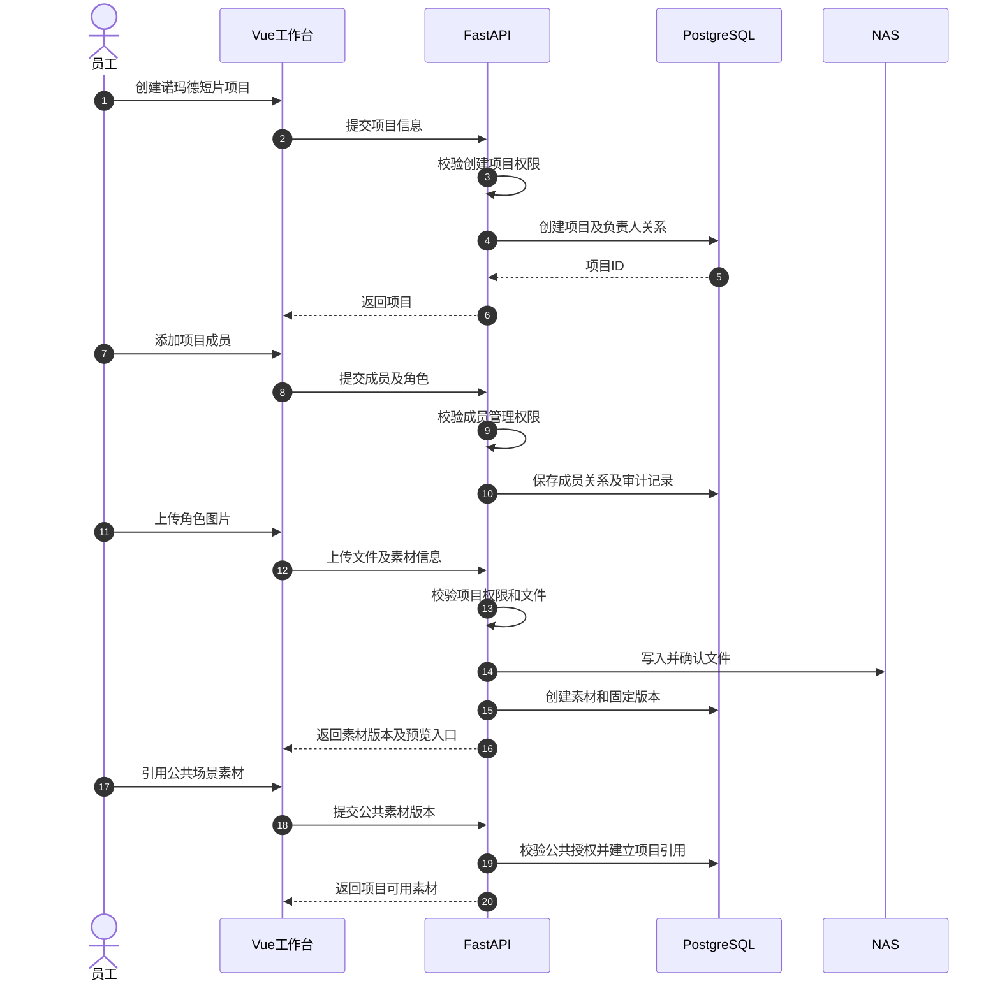
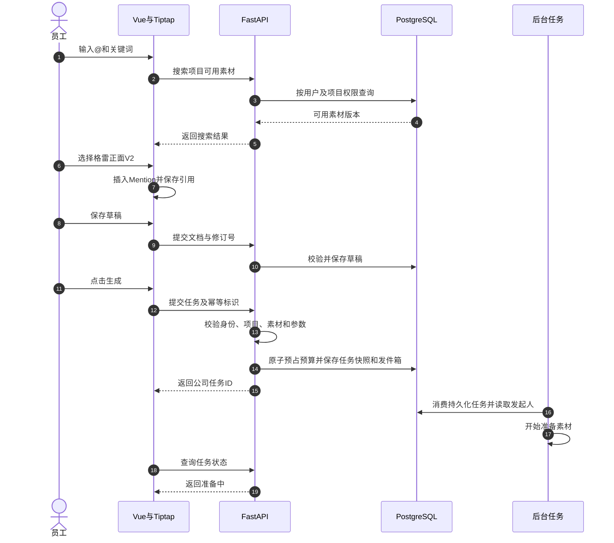
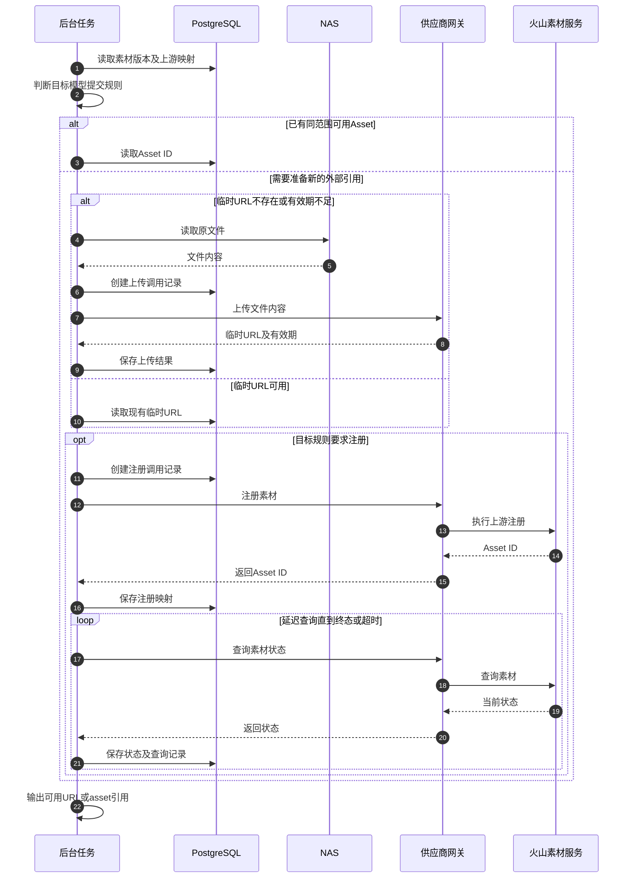
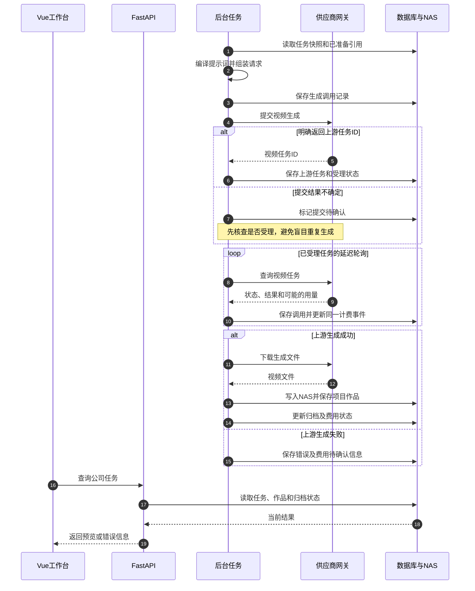
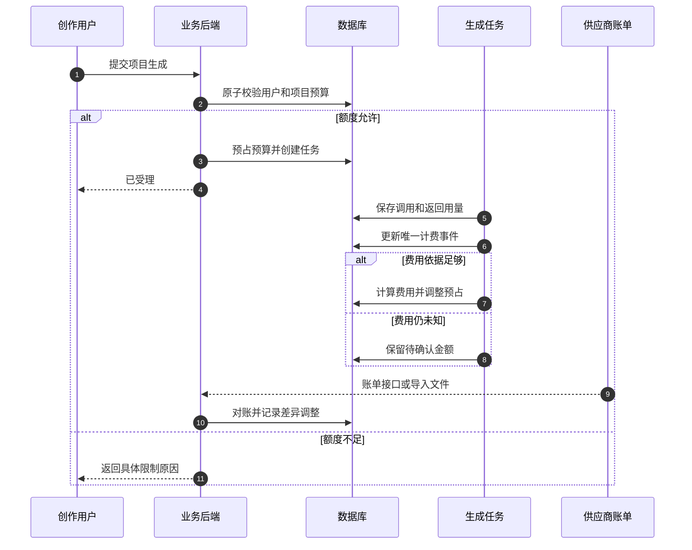

可以。这次把**「项目」正式确定为平台的核心组织单位**，将素材、创作、协作、生成任务、作品和费用统一归属到项目，同时保留公司公共素材库。

整套方案可以定义为：

> **基于 RuoYi-FastAPI 开发公司内部 AI 创作平台，采用 Vue 3 创作工作台，以业务项目组织成员、素材、草稿、对话、任务和作品；使用公司 NAS 长期保存文件，通过供应商上传服务、火山素材服务及模型生成服务完成创作，并按用户、项目、部门、模型等维度管理用量、预算和费用。**

以下内容是一份可用于产品设计、数据库设计和开发拆分的完整方案。供应商接口以你提供的样例为接入依据；尚未明确的参数、计费和生命周期规则，作为接入前待确认项，不写成已经验证的能力。

---

**一、平台目标与系统边界**

平台主要服务公司内部员工，支持以下完整流程：

1. 创建业务项目，邀请成员并分配权限。
2. 上传素材或生成图片，将可复用内容加入素材资产库。
3. 在项目中开展文本讨论、图片创作和视频创作。
4. 在提示词编辑器中输入 `@`，引用具体素材版本。
5. 后端自动处理文件上传、素材注册、生成请求和任务查询。
6. 将生成作品归档到 NAS，并归属当前项目。
7. 追溯任务使用的提示词、素材版本、模型、参数和发起人。
8. 按用户、项目、部门、模型及时间统计用量和费用。

各方职责如下：

| 范围 | 负责内容 |
|---|---|
| 公司自研平台 | 项目、成员、权限、素材管理、提示词编辑器、任务编排、作品、用量、费用和预算 |
| 公司 NAS | 原始素材、素材版本、缩略图、生成图片和视频的长期保存 |
| 供应商上传服务 | 接收文件副本，返回可供上游访问的临时公网 URL |
| 火山素材服务 | 按接口规则注册素材，返回 Asset ID 和素材状态 |
| 文本、图片、视频模型服务 | 执行实际的模型推理和内容生成 |
| 供应商账单或用量接口 | 提供可用于对账的上游用量或结算依据 |

**员工只使用公司平台。** 上传、注册、轮询等操作由后端完成，不要求员工逐次到火山控制台操作。

管理员可能仍需在供应商平台完成账号开通、模型权限开通、凭据申请及必要的项目配置；具体取决于供应商网关已封装哪些能力。

---

**二、技术组成**

| 模块 | 技术方案 | 职责 |
|---|---|---|
| 基础框架 | RuoYi-FastAPI | 用户、角色、部门、菜单和基础权限 |
| 前端基础 | Vue 3＋TypeScript＋Vite | 页面与业务交互 |
| 创作工作台 | shadcn-vue＋Tailwind CSS | 生图、生视频、素材选择、任务和作品展示 |
| 管理后台 | Element Plus | 用户权限、供应商配置、模型配置、费用报表 |
| 提示词编辑器 | Tiptap＋自定义 Mention 节点 | 富文本输入和 `@` 素材版本引用 |
| 业务后端 | Python＋FastAPI | 身份校验、业务规则、供应商适配、任务管理 |
| 后台任务 | Celery＋Redis | 上传、注册、生成、轮询、归档和对账 |
| 数据库 | PostgreSQL | 业务记录、权限、素材版本、调用和费用 |
| 文件存储 | 公司现有 NAS | 原文件及作品长期保存 |
| 媒体处理 | 图片处理库＋FFmpeg | 文件校验、尺寸时长读取、缩略图和封面 |
| 内网入口 | Nginx | 前端分发、API 代理和受控文件访问 |

RuoYi-FastAPI 是基础工程，项目协作、素材版本、模型接入和费用管理需要在其上开发。实施时固定具体仓库版本和依赖版本，并确认所选版本的 PostgreSQL 适配情况。

**shadcn-vue 与 Element Plus 的使用约定：**

- 创作页面主要使用 shadcn-vue。
- 管理页面主要保留 Element Plus。
- 同一业务区域尽量统一交互和视觉规范。
- 统一主题、字体、弹层层级和消息提示方式。
- 处理 Tailwind 全局样式与已有后台样式的影响。

不需要为了引入 shadcn-vue，将已有后台页面全部重写。

---

**三、以项目为核心的业务结构**

以「诺玛德短片」为例：

| 项目内对象 | 内容 |
|---|---|
| 项目基本信息 | 名称、说明、负责人、状态 |
| 项目成员 | 成员、角色、加入时间、权限 |
| 项目素材 | 角色图、服装图、场景、道具、动作参考视频 |
| 公共素材引用 | 已授权使用的公司公共素材 |
| 创作草稿 | 提示词、素材引用、模型、生成参数 |
| 对话记录 | 剧情讨论、分镜讨论、提示词优化 |
| 生成任务 | 发起人、输入内容、执行状态、上游任务 |
| 生成作品 | 图片、视频、预览、下载和来源记录 |
| 用量与费用 | 项目总消耗、成员消耗、预算和待结算费用 |
| 操作记录 | 成员变更、素材修改、生成、删除和权限调整 |

需要明确四个概念：

| 概念 | 示例 | 用途 |
|---|---|---|
| 公司业务项目 | 诺玛德短片 | 内容归属、协作、权限、预算和费用 |
| 供应商连接 | videoplus-main | 接口地址、供应商类型和接入配置 |
| 供应商凭据 | credential-001 | 实际调用使用的 API Key |
| 火山项目 | `ProjectName: eva` | 上游素材服务所需的项目范围 |

**公司业务项目与火山 `ProjectName` 不需要一一对应。**

例如：

| 公司业务项目 | 供应商连接 | 火山 ProjectName |
|---|---|---|
| 诺玛德短片 | videoplus-main | eva |
| 产品宣传片 | videoplus-main | eva |
| 招聘宣传片 | videoplus-main | eva |

即使多个业务项目共用 `eva`，公司平台仍必须独立执行项目权限和费用归属校验。

---

**四、项目生命周期与成员权限**

项目建议具有以下状态：

| 状态 | 允许的主要操作 |
|---|---|
| 正常 | 上传素材、编辑草稿、发起创作、协作 |
| 暂停 | 查看已有内容，禁止提交新生成任务 |
| 归档 | 保留历史内容，默认只读 |
| 待删除 | 隐藏入口，等待保留期及引用检查 |

项目暂停或归档时，已有上游任务可能仍在运行。平台应继续查询和归档结果，不能直接停止维护这些任务。

项目权限建议采用：

| 项目角色 | 主要权限 |
|---|---|
| 项目负责人 | 管理成员、项目设置、项目内容及授权范围内的预算 |
| 创作者 | 管理获授权素材、编辑草稿、发起生成、查看项目作品 |
| 查看者 | 查看获授权内容，不提交生成 |
| 费用查看者 | 查看项目费用与报表，不必拥有素材修改权限 |

平台管理员属于全局角色，与项目角色分开。

用户加入项目也不必然意味着能查看全部私人草稿或对话。建议：

- 项目素材、正式作品默认按项目授权共享。
- 草稿和文本对话支持“仅自己”和“项目共享”。
- 生成任务详情继承明确的可见范围。
- 项目费用查看权限独立配置。
- 成员被移除后，后端立即停止其新请求访问。
- 已经提交的任务保留原发起人，继续按既定规则执行和计费。

---

**五、公司公共素材库与项目素材库**

平台提供两类素材空间。

| 素材空间 | 归属 | 使用范围 |
|---|---|---|
| 项目素材库 | 某个业务项目 | 项目内有权限的成员 |
| 公司公共素材库 | 公司公共资源空间 | 获授权的项目或员工 |

公共素材可以包括：

- 公司统一角色或品牌形象。
- 通用材质、道具、场景。
- 风格参考和镜头参考。
- 经授权可跨项目使用的人像素材。

**公共素材跨项目使用时，不复制原文件。**

例如：

```text
公共素材：金属走廊
版本：V3
存储文件：NAS 中的一份固定文件

诺玛德短片 → 引用金属走廊 V3
产品宣传片 → 引用金属走廊 V3
```

两个项目分别记录自己的引用关系，生成任务固定引用 V3。

使用公共素材生成的新作品：

- 归属于当前创作项目。
- 记录实际发起员工。
- 生成费用归属于当前项目。
- 不自动进入公共素材库。

将项目素材发布到公共素材库，需要单独的发布权限，并明确其授权范围。**公共库不是所有员工无条件可见的文件夹。**

如果公共素材更新为 V4：

- 新创作可以选择 V4。
- 已保存的 V3 草稿不会被偷偷替换。
- 历史任务继续指向 V3。
- 可以提示“有新版本”，由用户主动升级。

---

**六、页面与交互设计**

建议平台入口按以下结构组织：

| 页面 | 主要功能 |
|---|---|
| 我的项目 | 创建、加入、搜索、收藏和归档项目 |
| 项目概览 | 最近任务、作品、成员和项目消耗 |
| 项目素材 | 上传、分类、筛选、版本、预览和状态 |
| 项目文本对话 | 剧情讨论、提示词优化、对话历史 |
| 项目图片创作 | 提示词、参考图、参数、生成结果 |
| 项目视频创作 | 提示词、`@` 引用、参考素材、参数、任务进度 |
| 项目作品 | 图片、视频、下载、转素材、生成记录 |
| 项目任务 | 执行状态、失败原因、重试和归档状态 |
| 项目成员 | 成员与项目角色 |
| 项目费用 | 用量、成员消耗、预算和待结算项 |
| 公司公共素材库 | 公共素材管理、授权和发布 |
| 管理后台 | 用户、部门、供应商、凭据、模型、价格、审计 |

进入项目之后，页面应持续显示当前项目名称，减少误提交到其他项目的情况。

切换项目时：

1. 检查当前草稿是否保存。
2. 保存或提示处理未保存修改。
3. 加载目标项目的权限和配置。
4. 切换素材搜索范围、任务列表和费用范围。
5. 不把原项目的草稿及素材引用直接带入新项目。

---

**七、素材资产与版本管理**

每份素材至少记录以下信息：

| 类别 | 字段 |
|---|---|
| 基础信息 | 素材 ID、名称、说明、标签 |
| 归属 | 项目素材或公共素材、所属空间 |
| 权限 | 可访问成员、项目或角色范围 |
| 媒体类型 | 图片、视频；音频按后续模型能力开放 |
| 业务分类 | 角色、场景、道具、服装、动作、风格 |
| 人像类型 | 不含人像、虚拟人像、真人人像、待确认 |
| 来源 | 员工上传、AI 生成、作品转素材 |
| 版本 | 版本 ID、版本号、创建人、创建时间 |
| 文件信息 | NAS 存储键、格式、大小、尺寸、时长、哈希 |
| 上传记录 | 供应商、临时 URL、过期时间 |
| 注册记录 | 上游范围、Asset ID、状态、失败原因 |
| 授权信息 | 使用范围、必要的授权说明及附件 |

版本规则：

- 更换图片、裁剪形成新文件或修改视频，创建新版本。
- 仅修改展示名称或标签，不必创建文件版本。
- 已生成任务引用的版本不可覆盖。
- 文件重新上传供应商不产生新业务版本。
- 一个版本可以存在多个供应商上传记录和注册记录。
- 删除素材前检查草稿、历史任务和公共引用。

素材被归档后，可以禁止新增引用，同时保留历史任务的追溯能力。文件物理删除由保留策略和引用检查决定。

---

**八、NAS、临时 URL 与 Asset ID 的分工**

| 对象 | 作用 | 是否作为永久身份 |
|---|---|---|
| 公司素材版本 ID | 标识公司系统内的固定素材版本 | 是 |
| NAS 存储键 | 定位公司保存的文件 | 是，受存储管理控制 |
| 内部预览地址 | 提供员工访问 | 否，可由系统动态生成 |
| 供应商临时 URL | 供上游下载文件副本 | 否 |
| 火山 Asset ID | 引用上游已注册素材 | 按上游生命周期管理 |

公司数据库建议保存 NAS 的相对存储键，例如：

```text
assets/material-001/version-002/original.png
```

由服务端解析实际挂载位置，不接受前端直接指定 NAS 路径。

内部预览通过鉴权接口提供，例如：

```text
GET /api/asset-versions/version-002/preview
```

不能直接将：

```text
http://192.168.10.50/static/image/xxx.png
```

作为外部模型的下载地址。

后端应读取文件内容，调用供应商上传接口取得公网 URL。

你提供的上传规则为 24 小时有效期，平台应将它作为供应商配置并保存实际到期时间。生成前检查剩余有效期，不足则重新上传。

**注册后的 Asset ID 是否仍依赖原始 URL，需要供应商明确确认；不能把两者的有效期混为一谈。**

---

**九、素材是否注册，由内容与目标模型共同决定**

| 实际内容 | 处理策略 |
|---|---|
| 不含人像的普通场景或道具 | 目标接口允许时使用临时 URL |
| 虚拟人像 | 目标接口要求注册时，等待注册为 `Active` 后使用 Asset ID |
| 场景中包含虚拟人像 | 按实际人像内容判断，不能只看“场景”分类 |
| 真人人像 | 根据目标服务的支持、认证和授权要求处理 |
| 动物或机器人角色 | 按内容和模型规则判断 |
| 人像类型待确认 | 使用前确认，避免错误分流 |

注册策略不能写成：

```text
所有角色素材必须注册
```

也不能写成：

```text
所有生图或生视频都必须注册
```

应配置为：

```text
目标供应商＋目标模型＋媒体类型＋实际内容 → 提交策略
```

同一图片在一个生图接口中可以使用 URL，在另一个视频接口中可能需要使用 Asset ID。

---

**十、`@` 素材引用的实现**

`@` 功能由三个部分组成：

1. 搜索当前用户可使用的素材。
2. 在编辑器中保存结构化素材引用。
3. 生成时将引用转换为目标模型所需的文本编号及媒体参数。

**搜索范围**

默认搜索当前项目有权使用的素材。

下拉框可以提供两个范围：

| 范围 | 内容 |
|---|---|
| 当前项目 | 项目素材及已加入项目的公共素材引用 |
| 公司公共素材 | 当前项目和当前用户有权使用的公共素材 |

后端对每次搜索执行权限过滤，前端筛选不能代替权限控制。

下拉项建议展示：

- 缩略图。
- 素材名称。
- 版本号。
- 图片或视频类型。
- 项目素材或公共素材标记。
- 不可用原因，例如版本归档、缺少授权。

**选中之后保存什么**

编辑器显示：

> 让 **@格雷正面 V2** 走进 **@飞船走廊 V1**，镜头缓慢跟随。

保存的 Mention 节点示例：

```json
{
  "type": "assetMention",
  "attrs": {
    "referenceId": "ref-grey",
    "label": "格雷正面",
    "versionLabel": "V2"
  }
}
```

独立引用表：

```json
{
  "referenceId": "ref-grey",
  "assetId": "material-grey-front",
  "versionId": "grey-front-v2",
  "mediaType": "image",
  "role": "reference_image"
}
```

**名称用于展示，版本 ID 用于定位文件。** 临时 URL 和 Asset ID 由后端生成请求时解析，不作为编辑器引用的永久身份。

**关键交互规则**

- 重复引用同一个版本，不重复添加媒体。
- 修改素材名称不破坏引用。
- 粘贴普通 `@格雷` 文本不会自动获得有效素材引用。
- 删除最后一个引用节点时，同步处理对应参考素材；用户主动保留的参考素材除外。
- 撤销和重做需要同时恢复编辑器与引用列表。
- 搜索支持防抖、中文输入法、键盘选择和过期请求取消。
- 草稿再次打开时，重新检查素材权限和版本状态。
- 不可用引用应显示具体原因，不能静默替换为其他素材。

---

**十一、草稿与生成快照**

草稿建议保存：

| 字段 | 说明 |
|---|---|
| 项目 ID | 所属创作项目 |
| 创建人 | 草稿所有者 |
| 可见范围 | 私人或项目共享 |
| 创作类型 | 文本、图片、视频 |
| 编辑器文档 | Tiptap JSON |
| 引用列表 | 素材版本及顺序 |
| 模型配置 ID | 当前选择的模型 |
| 参数 | 尺寸、质量、时长、比例等 |
| 修订号 | 防止并发覆盖 |
| 更新时间 | 自动保存及恢复依据 |

多人编辑同一草稿时，第一阶段可以采用修订号冲突检测，不必立即实现实时协同编辑。

用户点击生成后，创建**不可随草稿变化的任务输入快照**：

- 当时的项目和发起人。
- 提示词文档。
- 素材版本和排列顺序。
- 模型及参数。
- 编译后的请求内容。
- 供应商连接和实际凭据。
- 计价规则版本。
- 部门归属快照。

之后继续编辑草稿，不改变已经提交的任务。

---

**十二、生成时的数据拼装**

前端提交公司业务数据：

```json
{
  "projectId": "project-nomad",
  "generationType": "video",
  "modelProfileId": "seedance-video",
  "promptDocument": {
    "type": "doc",
    "content": []
  },
  "references": [
    {
      "referenceId": "ref-grey",
      "assetId": "material-grey-front",
      "versionId": "grey-front-v2",
      "role": "reference_image"
    },
    {
      "referenceId": "ref-corridor",
      "assetId": "material-corridor",
      "versionId": "corridor-v1",
      "role": "reference_image"
    }
  ],
  "parameters": {
    "resolution": "480p",
    "ratio": "21:9",
    "duration": 30,
    "generate_audio": true
  }
}
```

这里的参数来自此前示例，正式可选值由已验证的模型能力配置控制。

前端不提交可用于决定消费归属的 `userId`，也不提交 API Key。

后端依次执行：

1. 从登录身份取得用户。
2. 校验项目成员身份及生成权限。
3. 校验模型和参数。
4. 校验素材版本及公共素材授权。
5. 校验预算并创建任务。
6. 解析素材对应的有效 URL 或 Asset ID。
7. 按参考素材列表生成编号。
8. 遍历 Tiptap 文档，将 Mention 节点替换为引用文字。
9. 组装供应商请求。

例如：

```text
让 @格雷正面V2 中的男性走进 @飞船走廊V1，镜头缓慢跟随。
```

转换为：

```text
让图片1中的男性走进图片2，镜头缓慢跟随。
```

对应请求示意：

```json
{
  "model": "mm-eva-sd-2.5",
  "messages": [
    {
      "role": "user",
      "content": [
        {
          "type": "text",
          "text": "让图片1中的男性走进图片2，镜头缓慢跟随。"
        },
        {
          "type": "image_url",
          "image_url": {
            "url": "asset://asset-example"
          },
          "role": "reference_image"
        },
        {
          "type": "image_url",
          "image_url": {
            "url": "https://supplier.example/temporary/corridor.png"
          },
          "role": "reference_image"
        }
      ]
    }
  ],
  "resolution": "480p",
  "ratio": "21:9",
  "duration": 30,
  "generate_audio": true
}
```

编号与媒体数组必须由同一份有序引用列表生成。图片和视频分别编号；供应商若有不同引用语法，由对应适配器处理。

不能仅用正则替换所有 `@名称`，否则会混淆普通文本、重名素材和不同版本。

---

**十三、供应商适配层**

业务服务不要直接散落调用供应商 HTTP 接口，统一通过适配层。

| 能力 | 适配层职责 |
|---|---|
| 上传文件 | 读取文件、上传、解析 URL 和有效期 |
| 注册素材 | 构造注册参数、解析 Asset ID |
| 查询素材 | 标准化状态及错误 |
| 文本生成 | 普通或流式响应、用量提取 |
| 图片生成 | 解析图片、Base64 解码、用量提取 |
| 视频提交 | 解析上游任务 ID |
| 视频查询 | 标准化状态、结果地址和用量 |
| 对账 | 导入或查询账单，匹配调用和计费事件 |

你提供的网关接口对应关系：

| 能力 | 接口 |
|---|---|
| 文件上传 | `POST /v1/assets/upload` |
| 素材注册 | `POST /v1/mm/assets` |
| 素材详情 | `POST /v1/mm/assets/get` |
| 图片或视频生成 | `POST /v1/chat/completions` |
| 视频任务查询 | `GET /v1/video/tasks/{taskId}` |

需要特别处理：

- 图片返回的是 **Base64**，不是“base46”。
- `message.content` 可能是 JSON 字符串，需要再次解析。
- 视频应使用内部响应中的视频任务 ID 查询，不能直接使用外层聊天响应 ID。
- HTTP 成功与 `base_resp.status_code` 成功分别检查。
- 注册后查询刚返回的 Asset ID，不能使用其他样例 ID。
- `mm-*` 为网关模型名，不能直接假定等同某个官方模型标识。
- 当前注册样例未提供 `GroupId`，不能推断网关如何创建或选择素材组。

---

**十四、完整时序：创建项目与准备素材**



文件与数据库无法依靠同一个数据库事务原子提交。实现时使用临时文件、确认写入、记录状态及清理补偿，处理孤立文件和缺失文件。

---

**十五、完整时序：`@` 引用与任务提交**



数据库事务内保存任务、预算预占和发件箱记录，再可靠投递后台队列，避免“任务已创建但没有入队”。

---

**十六、完整时序：素材准备与注册**



只有达到目标接口规定的可用状态，才继续生成。

素材注册和复用以**素材版本及上游使用范围**判断，不能因为两个项目使用同一个名称，就认为能够复用同一个 Asset ID。

---

**十七、完整时序：视频生成、查询与归档**



上图将数据库和 NAS 合并展示，实际是两个独立组件。

**上游生成成功、公司归档成功、费用结算完成，是三个独立状态。**

归档失败时优先重试下载，不能重新生成视频。

---

**十八、图片生成与文本对话流程**

**图片生成**

1. 在项目中填写提示词、选择参考素材和参数。
2. 后端创建任务、预占预算并记录调用。
3. 准备目标接口需要的参考图片。
4. 调用 `mm-imagen2`。
5. 解析响应中的 JSON 字符串及 Base64。
6. 校验实际图片格式、大小和尺寸。
7. 将图片保存到 NAS。
8. 在当前项目创建作品记录。
9. 保存用量，计算估算费用或待结算金额。
10. 用户可选择“加入项目素材”或“发布到公共素材库”。

“发布到公共素材库”需要额外权限。生成作品不必全部自动成为素材，否则素材库容易积累大量未筛选结果。

**文本对话**

1. 用户在项目内创建会话。
2. 保存会话所属项目、所有者及可见范围。
3. 每次发送消息创建独立调用记录。
4. 按模型要求组装系统提示词、历史消息和附件。
5. 返回普通或流式内容。
6. 保存结果、原始用量与费用信息。

文本调用的输入用量可能包含历史消息和系统提示词，不能只统计用户最后输入的一句话。

浏览器断开也不代表上游停止计费。应保存中断状态，并按实际接口能力补齐结果或用量。

具体文本模型与流式响应协议，待供应商接口确认后接入。

---

**十九、用户、项目、任务与 API Key 的关系**

| 对象关系 | 规则 |
|---|---|
| 用户与项目 | 多对多，通过成员关系及角色管理 |
| 项目与任务 | 一个项目拥有多个任务 |
| 用户与任务 | 每个任务记录实际发起用户 |
| 任务与接口调用 | 一个任务可以包含多个实际调用 |
| 用户与凭据 | 通过实际调用关联，不固定绑定唯一 Key |
| 项目与凭据 | 可由后台策略选择允许使用的凭据 |
| 调用与费用 | 通过计费事件关联，不能直接按调用次数重复收费 |

员工发起任务时，后端从登录身份取得 `userId`。

任务进入 Celery 后：

- Worker 从数据库读取任务归属。
- 后续上传、注册、生成、轮询均继承原始归属。
- 不把 Worker 或系统管理员记为实际创作员工。
- 管理员代操作时，单独记录操作人和业务归属，不能混淆。

API Key 由后端保管。日志仅记录 `credentialId`，不记录明文密钥。

---

**二十、统一用量与费用管理**

每次实际接口调用记录：

| 类别 | 内容 |
|---|---|
| 操作归属 | 用户、部门快照、业务项目 |
| 任务关联 | 公司任务、单次调用、重试关联 |
| 调用目标 | 供应商连接、凭据、请求模型、返回模型 |
| 业务类型 | 文本、图片、视频、上传、注册、查询 |
| 时间 | 开始、结束、耗时 |
| 结果 | 成功、失败、取消、结果待确认 |
| 上游标识 | 请求 ID、任务 ID、素材 ID |
| 原始用量 | 供应商返回的 `usage` |
| 标准化用量 | Token、图片数量、视频时长等 |
| 计费信息 | 单位、价格版本、币种、费用和结算状态 |

**用量按不同维度分别统计：**

| 类型 | 用量 | 计费依据 |
|---|---|---|
| 文本 | 输入、输出、缓存等 Token | 实际采购价格 |
| 图片 | 张数、尺寸、质量、接口返回 Token | 按张或按 Token 等采购规则 |
| 视频 | 数量、秒数、分辨率、音频选项、Token | 按秒或其他采购规则 |
| 辅助操作 | 调用次数及供应商计费用量 | 是否收费由合同或账单决定 |

注意：

- 未提供的 Token 记为未知，不记为零。
- 缓存 Token 可能属于输入 Token 子集。
- 外层和内层响应重复提供用量时，不累加两遍。
- 视频轮询重复返回累计用量时，更新同一个计费事件。
- 失败任务仍可能收费。
- 图片或视频用量不能自行换算成“真实 Token”。

**公共素材的费用归属**

| 行为 | 默认归属 |
|---|---|
| 在诺玛德项目中用公共素材生成视频 | 诺玛德项目及发起用户 |
| 公司统一制作并入库公共素材 | 公共素材建设成本中心 |
| 某项目首次触发公共素材上游注册 | 按配置归发起项目或公共成本中心 |
| 其他项目复用已有注册结果 | 不重复记入之前的注册费用 |

共享准备成本的分摊规则需要明确配置，不能每次使用都完整重复收费。

---

**二十一、价格、预算、积分与对账**

平台应区分：

| 金额 | 含义 |
|---|---|
| 提交前预估 | 根据请求参数估算，用于预算预占 |
| 用量计算费用 | 根据返回用量和采购价格计算 |
| 已确认结算费用 | 经供应商账单或明确结算依据确认 |
| 内部积分 | 公司对员工的内部额度，不等于采购金额 |

费用计算采用版本化价格规则，保存：

- 供应商、模型或网关别名。
- 计费单位。
- 价格适用时间。
- 输入、输出、缓存等价格维度。
- 图片尺寸和质量。
- 视频分辨率、时长及音频等维度。
- 币种、折扣、套餐等适用规则。
- 必要的汇率及换算时间。

如果网关按 `mm-*` 明确收费，应以实际采购价计算，不能直接套用底层模型公开零售价。

**预算流程：**



预算校验和预占需要原子执行，避免多个同时提交的任务都通过余额检查。

供应商未明确支持硬性费用上限时，平台不能仅凭粗略预估承诺绝对不超支。应配置单任务参数限制、用户并发限制和预算偏差处理规则。

---

**二十二、后台报表**

建议增加「用量与费用管理」，包含：

| 页面 | 内容 |
|---|---|
| 汇总概览 | 模型调用、辅助调用、Token、图片、视频、费用 |
| 人员统计 | 每个用户的用量、费用和额度 |
| 项目统计 | 项目总消耗、成员分布、预算 |
| 部门统计 | 按任务发生时的部门快照汇总 |
| 模型统计 | 模型调用、失败率、用量、费用 |
| 供应商统计 | 连接和凭据的调用及成本 |
| 调用明细 | 实际请求、错误、上游 ID |
| 计费明细 | 估算、计算、确认和待结算费用 |
| 对账管理 | 账单导入、匹配、差异和调整 |
| 预算管理 | 用户及项目额度、预占和剩余 |

报表时间口径：

- 统一使用公司时区，例如北京时间。
- 保存任务发起、上游完成、归档和费用确认时间。
- 项目经营视图可按任务发起时间统计。
- 财务对账按供应商账期和结算口径统计。
- 页面明确当前采用哪种口径。
- 不把同一笔费用的估算值与结算值相加。

未使用平台的用户可以显示零消耗；已使用但供应商未返回用量的用户，应显示“部分待确认”，不能显示为完全零消耗。

---

**二十三、数据库设计**

在 RuoYi 基础表之外，建议增加：

| 数据表 | 职责 |
|---|---|
| `projects` | 业务项目及状态 |
| `project_members` | 项目成员和角色 |
| `asset_spaces` | 项目素材空间、公司公共素材空间 |
| `asset_space_grants` | 素材空间的授权范围 |
| `assets` | 素材基本信息、归属和分类 |
| `asset_versions` | 固定版本及内容属性 |
| `project_asset_refs` | 项目对公共素材版本的引用 |
| `stored_files` | NAS 文件、哈希及归档状态 |
| `provider_connections` | 供应商地址和接入配置 |
| `provider_credentials` | 凭据及使用范围 |
| `project_provider_configs` | 业务项目与上游配置映射 |
| `provider_uploads` | 临时 URL 和到期时间 |
| `provider_asset_bindings` | 版本与上游 Asset ID 的对应 |
| `model_profiles` | 模型能力和参数配置 |
| `price_versions` | 版本化采购价格 |
| `chat_sessions` | 项目内会话及可见范围 |
| `chat_messages` | 消息和调用关联 |
| `prompt_drafts` | 草稿文档及修订号 |
| `creation_jobs` | 统一创作任务 |
| `job_references` | 任务引用版本及顺序 |
| `provider_calls` | 每次真实上游调用 |
| `usage_records` | 原始及标准化用量 |
| `billing_events` | 去重后的计费事件 |
| `billing_adjustments` | 对账调整记录 |
| `generated_outputs` | 项目作品和生成来源 |
| `budgets` | 用户、项目等预算 |
| `budget_reservations` | 任务预算预占 |
| `credit_transactions` | 可选的内部积分流水 |
| `reconciliation_batches` | 账单及对账批次 |
| `outbox_events` | 可靠任务投递 |
| `audit_logs` | 关键操作审计 |

重点关系：

```text
业务项目 → 成员、草稿、会话、任务、作品、费用

素材 → 多个固定版本
素材版本 → NAS 文件
素材版本 → 多个供应商上传记录或注册映射

任务 → 发起用户＋业务项目＋输入快照
任务 → 多次供应商调用
任务 → 多个生成作品
供应商调用 → 用量记录
上游计费对象 → 去重后的计费事件
```

临时 URL 和 Asset ID 的复用范围需包含供应商账号、区域、项目等实际约束，不能只凭素材版本 ID 全局复用。

---

**二十四、公司后端 API 规划**

以下是建议的自研接口，不是供应商接口。

| 功能 | 接口示例 |
|---|---|
| 项目列表、创建 | `GET /api/projects`、`POST /api/projects` |
| 项目设置 | `PATCH /api/projects/{id}` |
| 项目成员 | `GET/POST /api/projects/{id}/members` |
| 项目素材 | `GET /api/projects/{id}/assets` |
| 引入公共素材 | `POST /api/projects/{id}/asset-references` |
| 上传原文件 | `POST /api/uploads` |
| 创建素材 | `POST /api/assets` |
| 素材详情 | `GET /api/assets/{id}` |
| 新建素材版本 | `POST /api/assets/{id}/versions` |
| `@` 搜索 | `GET /api/assets/search` |
| 素材预览 | `GET /api/asset-versions/{id}/preview` |
| 发布公共素材 | `POST /api/assets/{id}/publish` |
| 上游素材准备 | `POST /api/asset-versions/{id}/sync` |
| 草稿保存 | `POST /api/drafts`、`PUT /api/drafts/{id}` |
| 文本会话 | `POST /api/chat/sessions` |
| 发送文本消息 | `POST /api/chat/sessions/{id}/messages` |
| 模型配置 | `GET /api/model-profiles` |
| 生成预校验 | `POST /api/generations/validate` |
| 提交生成 | `POST /api/generations` |
| 任务详情 | `GET /api/generations/{id}` |
| 项目作品 | `GET /api/projects/{id}/outputs` |
| 作品预览与下载 | `GET /api/outputs/{id}/preview`、`/download` |
| 作品转素材 | `POST /api/outputs/{id}/to-asset` |
| 用量汇总 | `GET /api/usage/summary` |
| 人员及项目统计 | `GET /api/usage/users`、`/projects` |
| 调用与计费明细 | `GET /api/provider-calls`、`/billing-events` |
| 账单对账 | `POST /api/reconciliations` |

所有涉及项目、素材、文件、任务和费用的接口均执行服务端权限校验，包括预览和下载接口。

---

**二十五、任务可靠性与状态设计**

不要用一个 `status` 表示所有状态。

| 状态维度 | 示例 |
|---|---|
| 公司编排状态 | 已受理、准备素材、提交中、提交待确认、执行中、结束 |
| 上游生成状态 | 排队、运行、成功、失败、取消 |
| 文件归档状态 | 未开始、归档中、成功、失败 |
| 用量状态 | 已提供、部分提供、未提供、待确认 |
| 费用状态 | 预估、待结算、已确认、存在差异 |
| 素材注册状态 | 未注册、提交中、处理中、可用、失败 |

可靠性规则：

- 点击生成使用幂等标识，避免重复点击重复创建任务。
- 每次实际请求前先记录调用。
- 接口超时与上游失败分开处理。
- 已有上游任务 ID 时优先继续查询。
- 没有幂等或查询依据时，不自动重试可能已被受理的生成请求。
- 轮询使用延迟调度，不长期占用 Worker 等待。
- Worker 重启后可从数据库恢复未完成任务。
- 注册同一版本时防止并发重复创建。
- NAS 归档失败时保留来源及到期信息，优先重试归档。
- 取消本地等待不等于取消上游任务，也不等于停止收费。
- 显示真实阶段，不虚构精确进度百分比。

---

**二十六、部署与数据保护**

基础部署可以从一台应用服务器加现有 NAS 开始，根据并发增加 Worker。

需要具备：

| 条件 | 要求 |
|---|---|
| 员工访问 | 能访问内网平台 |
| API 与 Worker | 能访问 PostgreSQL、Redis 和 NAS |
| 外部访问 | 能访问供应商接口及结果下载地址 |
| NAS 权限 | 服务账号按需读写 |
| 文件预览 | 通过业务鉴权访问 |
| 备份 | 数据库与 NAS 分别备份并定期验证恢复 |
| 时间 | 服务端时钟同步，统一统计时区 |

公司无需为了该方案先建设公网文件入口；前提是供应商支持文件上传和主动查询。

同时需要落实：

- 凭据不进入前端、不写入普通日志。
- 日志脱敏临时签名 URL、授权头和大体积 Base64。
- 结果下载限制目标地址和重定向，避免服务端任意地址访问。
- 文件内容与声明类型一致性校验。
- 用户输入的文件名不直接作为 NAS 路径。
- 大视频采用流式传输，避免整文件占满内存。
- 视频预览支持受控的范围读取。
- NAS 不可用时明确阻断相关操作或标记归档待恢复。

---

**二十七、开发实施顺序**

| 阶段 | 开发内容 | 验收结果 |
|---|---|---|
| 第一阶段 | RuoYi 基础、项目、成员、权限、NAS 文件服务 | 用户可创建项目并安全上传、预览文件 |
| 第二阶段 | 素材库、版本、公共素材及项目引用 | 不复制文件即可跨项目授权复用 |
| 第三阶段 | 调用记录、用量、价格、预算基础 | 后续模型调用从第一天即可追踪消费 |
| 第四阶段 | 图片生成与作品归档 | 生图结果保存到项目，可转素材 |
| 第五阶段 | Tiptap、Mention、草稿、引用编译 | 可通过 `@` 引用固定版本 |
| 第六阶段 | 视频上传、注册、生成、轮询和归档 | 完整跑通项目视频创作 |
| 第七阶段 | 文本会话、流式处理、历史用量 | 项目内对话和费用可追踪 |
| 第八阶段 | 报表、对账、故障恢复和体验优化 | 可运营、可审计、可恢复 |

阶段可以按资源并行安排，但**身份归属、调用记录和用量基础应先于正式开放模型调用**，避免上线后再补历史消费。

---

**二十八、核心验收场景**

上线前至少验证：

1. 员工不能访问未授权项目。
2. `@` 搜索不会泄露其他项目素材。
3. 公共素材仅对获授权范围可见。
4. 引用公共素材不会重复保存原文件。
5. 公共素材升级版本不改变历史任务。
6. 同名素材和不同版本能够正确区分。
7. 删除或撤销 Mention 时引用列表保持一致。
8. 前端伪造 `userId` 不能改变消费归属。
9. 生成作品自动归当前项目及实际发起人。
10. 多个员工共用 Key 时仍能分别统计。
11. 临时 URL 过期前能自动重新准备。
12. 素材未达到可用状态时不会错误提交生成。
13. 重复点击不会重复创建同一业务任务。
14. 提交超时不会自动重复扣费生成。
15. 多次轮询不会重复记入生成费用。
16. 上游成功、NAS 失败时仅重试归档。
17. 用户或项目预算可应对并发提交。
18. 无用量返回显示待确认，而非零消耗。
19. 成员移除、项目暂停、归档后的访问和任务行为符合规则。
20. 数据库与 NAS 恢复后，素材、任务和作品能正确关联。

---

**二十九、正式接入前需确认的供应商事项**

| 待确认事项 | 影响 |
|---|---|
| 正式 HTTPS 地址 | 凭据与文件传输 |
| 上传格式、大小和并发限制 | 文件上传规则 |
| 临时 URL 有效期及保留时间 | 缓存和重新上传策略 |
| 哪些模型和人像必须注册 | 素材分流 |
| `Active` 后是否独立保存文件 | 原 URL 过期后的可用性 |
| Asset ID 的账号、区域、项目范围 | 跨项目复用 |
| 网关是否自动处理 Group | 注册配置 |
| 图片、视频模型的实际能力 | 参数校验及 UI 选项 |
| 文本模型及流式用量协议 | 文本会话接入 |
| 生成任务幂等与受理查询能力 | 超时恢复 |
| 结果链接保留时间 | 归档时限 |
| 请求失败或取消是否收费 | 费用与预算 |
| 网关别名对应的采购价格 | 价格管理 |
| `usage` 的字段定义及重复返回方式 | 正确统计 |
| 账单接口或导出格式 | 对账结算 |

这版方案中的关键归属规则是：**项目组织创作，用户承担操作归属，素材版本固定输入，任务保存过程，作品保存结果，计费事件记录成本；公共素材通过授权复用，上游 `ProjectName` 通过后台映射。**